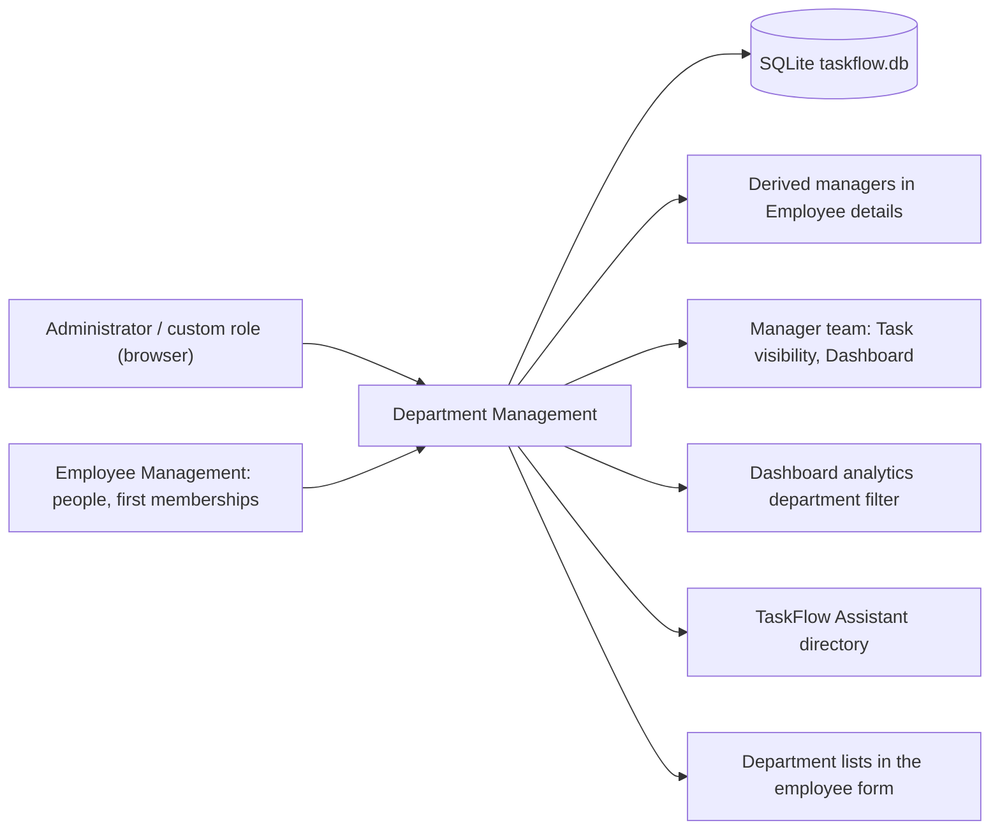
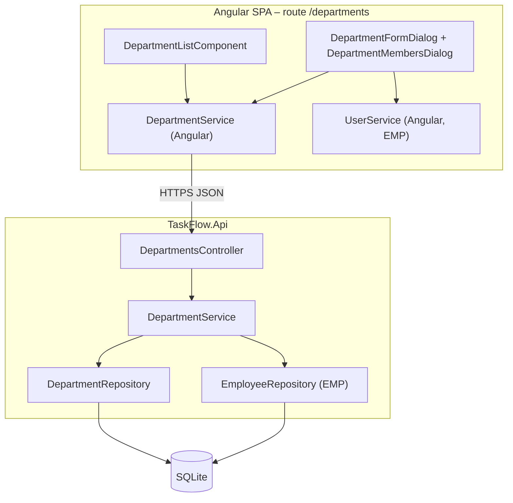
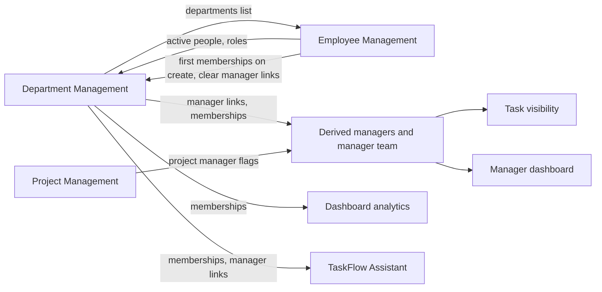
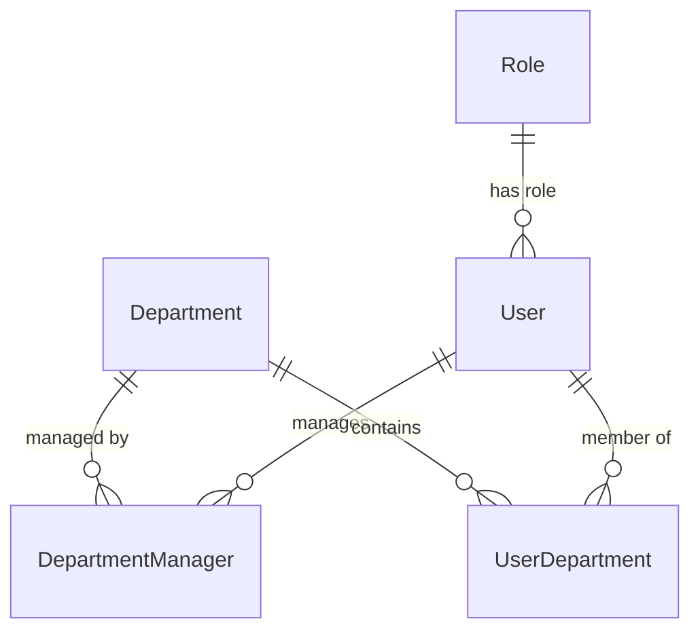
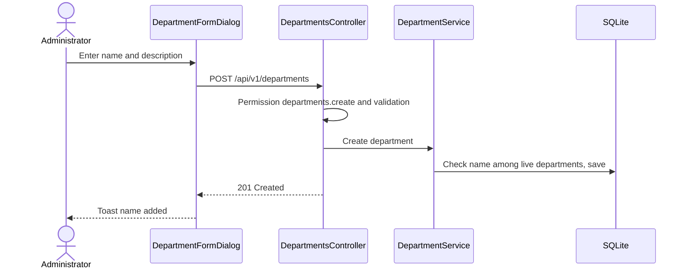
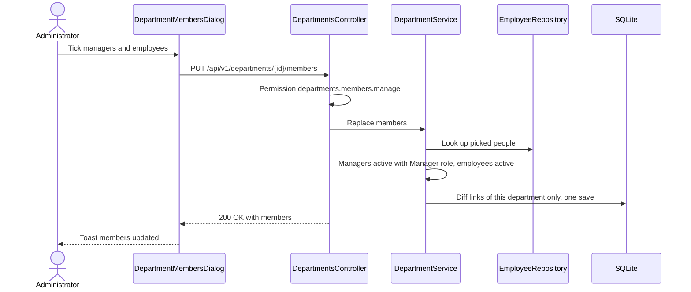
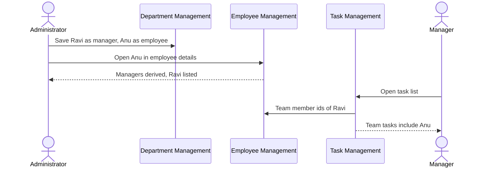
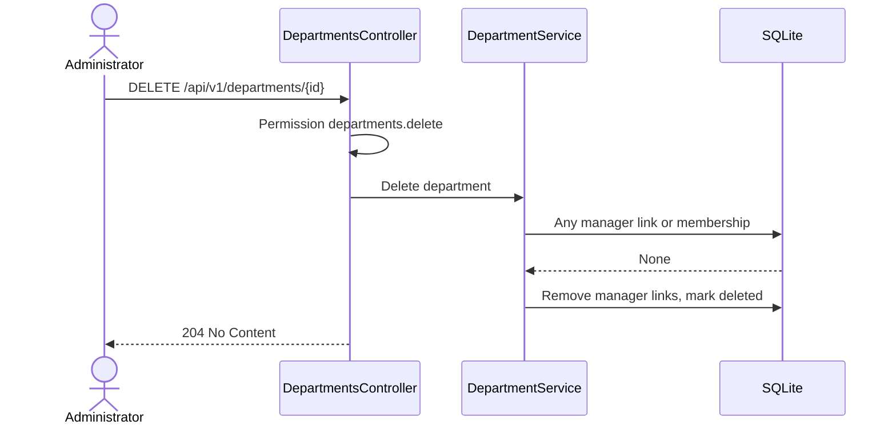

# High-Level Design – Department Management

## TaskFlow – Intelligent Task Allocation & Tracking System

> **Document:** High-Level Design (sub-module DEPT)  ·  **Version:** 1.0  ·  **Status:** Draft
> **Project type:** Personal Project (Skill Development)  ·  **Date:** 31-Oct-2026
> **Author:** Jojo George (jojogeorge3344@gmail.com)
> **Module:** TaskFlow Management  ·  **Sub-module:** 03.3 Department Management (code `DEPT`)
> **Based on:** BRD-Department-Management v1.0, FRD-Department-Management v1.0, TaskFlow as built
> © 2026 Jojo George. All rights reserved.

---

## Document Control

| Version | Date | Author | Summary of changes |
|---|---|---|---|
| 1.0 | 31-Oct-2026 | Jojo George | Initial version, derived from the Department Management BRD/FRD and the code |

**Related documents:**

| Document | Location |
|---|---|
| Overall HLD (stack, deployment, cross-cutting design) | `../../00-Overall/HLD-TaskFlow-Overall.md` |
| BRD – Department Management | `../../../BRD/03-TaskFlow-Management/03.3-Department-Management/BRD-Department-Management.md` |
| FRD – Department Management | `../../../FRD/03-TaskFlow-Management/03.3-Department-Management/FRD-Department-Management.md` |
| LLD – Department Management | `../../../LLD/03-TaskFlow-Management/03.3-Department-Management/LLD-Department-Management.md` |
| Sibling HLDs | `../03.1-Employee-Management/HLD-Employee-Management.md`, `../03.2-Project-Management/HLD-Project-Management.md` |
| TDD | `TF - Documents/TF - TDD/TDD-TaskFlow.md` (§3 architecture, §7.2.2 organisation data) |

---

## 1. Introduction

### 1.1 Purpose
This HLD describes how Department Management is built: its place in TaskFlow, its frontend and backend components,
how department managers and members feed reporting lines and manager teams in other sub-modules, the data it owns,
its key flows, security and design decisions. Classes, methods, columns and the full endpoint list are in the LLD.

### 1.2 Scope
**In scope:** the department list (counts, search), add / edit department, delete (only when empty), the Manage
members dialog (managers and employees of one department), and the derivation of managers and manager teams from
department data.

**Out of scope:** departments ticked when an employee is first added (Employee Management HLD – same data, other
entry point); dashboards and analytics that filter by department (Dashboard HLD); the Assistant's people directory
(Assistant HLD).

**Change from original BRD (Screen 6):** create / edit and unique names are kept; the card shows separate manager and
employee counts; members are seen and changed in the Manage members dialog (new), and the employee list has no
Department filter (⚠️ To be confirmed whether that filter is still wanted) – see BRD-Department-Management §5.

### 1.3 Audience
Developer, reviewer and tester of TaskFlow (Jojo George); anyone maintaining the organisation structure.

### 1.4 Definitions & Abbreviations

| Term | Meaning |
|---|---|
| SPA | Single Page Application (Angular frontend) |
| Department manager | A Manager-role user linked as manager of a department |
| Department employee (member) | A user who belongs to a department |
| Derived manager | A person's managers = managers of their departments (+ project managers, see PROJ) |
| Manager team | Members of the departments a Manager manages + members of projects they manage |
| Department action permission | Any of `departments.create`, `departments.edit`, `departments.delete`, `departments.members.manage` |

---

## 2. System Context

### 2.1 Context Diagram

### 2.2 Actors & External Systems

| Actor / system | Interaction | Protocol |
|---|---|---|
| Administrator | Manages departments and their members | HTTPS (JSON REST, Bearer JWT) |
| Custom role user | Uses the screen when holding at least one department action permission | HTTPS |
| Manager | No screen; reads department lists in other screens through `departments.view`; can be a department manager | HTTPS |
| Other sub-modules | Read memberships and manager links (Employee details, manager team, dashboards, Assistant) | In-process (shared database) |
| External systems | None – no email, no notifications, no third-party service | – |

---

## 3. Architecture Goals, Constraints & Principles

### 3.1 Quality Goals

| Goal | How the architecture supports it |
|---|---|
| Data integrity – atomic save | All manager and member changes of one department are validated first and stored in one save; any invalid person changes nothing (NFR-DEPT-01) |
| Data integrity – structure | Delete is refused while the department has any manager or member, checked again on the server at delete time (BR-DEPT-02) |
| Data integrity – names | Unique filtered index on live department names; a deleted department's name can be reused (BR-DEPT-01) |
| Security | One permission policy per endpoint (NFR-DEPT-02) |
| Consistency | Reporting lines are derived from membership and manager links at read time, never copied (BR-DEPT-07) |
| Usability | Search, sort, bulk select and selected count in the members dialog (NFR-DEPT-04) |

### 3.2 Constraints
- Single API process and one SQLite file; the department list is not paged and is searched on the client.
- Only the Manager system role (`SystemRoles` id 2) can be a department manager.
- Flat departments only (no parent / child).
- Shared cross-cutting pipeline (JWT, MFA gate, validation, error mapping) – see the overall HLD.

### 3.3 Architecture Principles
- Controller → Service → Repository; the service commits through `IUnitOfWork`.
- DEPT owns `Department`, `DepartmentManager` and `UserDepartment`; Employee Management writes memberships only when an
  employee is created and removes manager links when a Manager is demoted or deleted.
- Replace one department's whole membership per save; never touch other departments.
- The server decides access; the SPA only hides what the user cannot do.

---

## 4. Architecture Overview

### 4.1 Architecture Style
Part of the TaskFlow three-tier design: Angular SPA → ASP.NET Core REST API (`/api/v1/departments`) → SQLite through
EF Core. The sub-module is a vertical slice with one lazy SPA route, a list page, two dialogs, one controller, one
domain service and one repository (plus the Employee repository to check picked people).

### 4.2 Logical Architecture

### 4.3 Layers & Responsibilities

| Layer | Responsibility in DEPT | May call |
|---|---|---|
| Presentation | Route and menu gated by department action permissions, cards with counts, client-side search, dialogs, people list limited to Manager and Employee roles, Delete blocked while members exist | API |
| API / Controller | Permission policies, 404 when a department is not live, HTTP status mapping | Service |
| Service | Unique names, delete guard, member validation (active, Manager role for managers), diff of this department's links | Repositories |
| Repositories | Departments with counts, members, live checks, membership and manager-link rows | Database |
| Integrations | None | – |

---

## 5. Component / Module Design

| Component | Responsibility | Key parts (high level) | Depends on |
|---|---|---|---|
| Route and menu | Open `/departments` only with a department action permission; others go to their dashboard | `management.routes.ts` with `permissionGuard`, `DepartmentScreenPermissions`, menu item in `nav-items.ts` | `AuthService` permission claims |
| Department list page | Cards with "managers · employees" counts, search by name, Manage members / Edit / Delete, delete blocked with a tooltip while members exist | `DepartmentListComponent` | Angular `DepartmentService` |
| Department form dialog | Add or edit name and description | `DepartmentFormDialogComponent` | Angular `DepartmentService` |
| Members dialog | Load current members and active Managers / Employees, search, sort, bulk select, one save | `DepartmentMembersDialogComponent` | Angular `DepartmentService`, EMP `UserService` (people list) |
| Department API | Seven actions on `/api/v1/departments`: list, one department, members, create, update, replace members, delete | `DepartmentsController` with `[RequirePermission]` | `DepartmentService` |
| Request validation | Name required (≤ 200), description ≤ 500 | FluentValidation validators run by `ValidationFilter` | – |
| Department domain service | Create / update with unique names, delete guard and clean-up, member validation and replacement | `DepartmentService` | `DepartmentRepository`, `EmployeeRepository`, `IUnitOfWork` |
| Department repository | Counts, members, live checks, link-row staging | `DepartmentRepository` | `AppDbContext` |
| Derivation (owned by EMP) | Derived managers in employee details and a Manager's team | `EmployeeRepository` | Department manager links and memberships |

### 5.1 Module Interaction

| Interaction | Direction | What flows |
|---|---|---|
| Employee Management | both ways | DEPT reads active people and their role to validate picks; EMP writes memberships for departments ticked when an employee is created and removes department-manager links when a Manager is demoted or deleted; EMP's form and details read the department list and derived managers |
| Project Management | combined | A Manager's team adds members of projects they manage (computed by `EmployeeRepository`) |
| Task Management / Dashboard | DEPT → readers | Manager team drives task visibility and the manager dashboard; analytics filter tasks and people by department membership |
| TaskFlow Assistant | DEPT → reader | The Assistant's people directory reads memberships and manager links; there are no department tools |

---

## 6. Data Architecture (high level)

### 6.1 Data Stores

| Store | Technology | Holds (for DEPT) | Notes |
|---|---|---|---|
| Main database | SQLite `taskflow.db` (EF Core) | `Department`, `DepartmentManager`, `UserDepartment` (owned); `User` (read) | Single file in the TaskFlow data folder |
| File storage | – | Nothing | DEPT stores no files |

### 6.2 Main Data Domains

| Entity | Owner | DEPT use |
|---|---|---|
| `Department` | DEPT | Create, update, soft delete; unique live name |
| `DepartmentManager` | DEPT | Who manages a department; replaced per department; removed on department delete |
| `UserDepartment` | DEPT | Who belongs to a department; replaced per department; first rows can come from EMP |
| `User`, `Role` | EMP, Role Configuration | Read: active check, Manager role, names, usernames, emails |

### 6.3 Data Flow
1. **Create / edit:** dialog → validated request → unique-name check among live departments → save.
2. **Replace members:** dialog sends manager ids and employee ids → every manager must be an active Manager, every
   employee an active user → diff of this department's manager links and memberships → one save.
3. **Read:** the list query adds manager and employee counts; the members call returns both lists with each person's
   active flag, so inactive members stay visible with a badge.
4. **Derive:** Employee details and the manager team read the links at query time; no derived value is stored.
5. **Delete:** refused while any manager link or membership exists; otherwise remaining manager links are removed and
   the department is marked deleted.

---

## 7. Integration Design

| Integration | Direction | Purpose | Failure behaviour |
|---|---|---|---|
| Employee people list | Internal, inbound | People for the members dialog | Needs `employees.view`; without it the list stays empty ("There are no active managers or employees to pick from.") |
| Employee repository | Internal, inbound | Validate picked people | A failed pick refuses the whole save with "User {id} is not an active manager." / "User {id} is not an active user." |
| External systems | – | None (no email, no notification) | – |

---

## 8. Key Flows (high level)

Sign-in and the request pipeline are shown in the overall HLD. DEPT has no background job (_not applicable for this
sub-module_).

### 8.1 Add or edit a department

### 8.2 Replace department members (main business flow)

### 8.3 Membership drives reporting lines (cross-module)

### 8.4 Delete a department

---

## 9. Security Architecture

| Concern | Approach |
|---|---|
| Authentication | Shared JWT + refresh cookie and mandatory MFA (overall HLD); endpoints sit behind the MFA set-up gate |
| Authorization | One permission policy per endpoint: `departments.view` (all reads), `departments.create`, `departments.edit`, `departments.delete`, `departments.members.manage`; no inline checks. Legacy `departments.manage` expands to the finer keys. The screen needs an action key; `departments.view` alone (Manager default) only feeds lists elsewhere |
| Business guards | Active Manager-role users only as managers; active users only as members; delete only when empty – all in `DepartmentService` |
| Data scope | None – department data is organisation-wide for any holder of `departments.view` |
| Data protection | No secrets; names, usernames and emails of members only |
| Transport | HTTPS and the `SpaClient` CORS policy (overall HLD) |
| Auditing | Refused requests are audited by the shared denied-action handler; request logging records each call; no change history for departments |

---

## 10. Technology Stack

DEPT uses the shared TaskFlow stack without additions – ASP.NET Core on .NET 10 (`net10.0`) with EF Core SQLite 10.0.12
and FluentValidation 12.2.0 on the server, and Angular 19.2 standalone components with signals in the browser.
Versions and reasons are in the overall HLD (`../../00-Overall/HLD-TaskFlow-Overall.md`, §10).

---

## 11. Deployment Architecture

DEPT has no deployment unit of its own: it ships inside the single `TaskFlow.Api` process and the Angular bundle, and
its data lives in `taskflow.db` in the TaskFlow data folder. See the overall HLD
(`../../00-Overall/HLD-TaskFlow-Overall.md`, §11) for hosts, environments and ports.

---

## 12. Non-Functional Design

| Area | Design decision |
|---|---|
| Performance | Counts are returned with the department list; search and member search / sort run on the client |
| Scalability | No paging; sized for one organisation on one server |
| Reliability | Validation before any change, one save per member replacement; unique-index races end in 409 "That value is already in use." |
| Availability | Same as the API process (overall HLD) |
| Usability | Blocked delete explains the fix (NFR-DEPT-03); bulk selection tools (NFR-DEPT-04) |
| Maintainability | Small service with one repository; layer and folder structure enforced by architecture tests |
| Observability | Shared request logging; no audit trail |
| Backup & Recovery | Covered by the data-folder backup in the overall HLD |

---

## 13. Design Decisions

| ID | Decision | Alternatives considered | Rationale |
|---|---|---|---|
| D-DEPT-1 | Replace all managers and employees of one department in one PUT, diffing only that department's rows | Add / remove one person at a time; edit departments from the employee form | One validated, all-or-nothing save per department (BR-DEPT-05); one owner of memberships after creation (BR-DEPT-09) |
| D-DEPT-2 | Separate manager links and memberships; the SPA sends a ticked Manager-role person as manager and anyone else as employee | One membership row with a manager flag | Oversight (derived managers, manager team) and belonging (department filters in analytics) are read separately |
| D-DEPT-3 | Delete only when the department has no manager or member, as a soft delete; unique index only over live rows | Cascade-remove members; hard delete | People are never left without their department managers by accident (BR-DEPT-02); the name can be reused (BR-DEPT-01) |
| D-DEPT-4 | Reporting lines and manager teams are derived from department data at read time | Store a "reports to" value per person | One source of truth that follows membership changes at once (BR-DEPT-07, BR-DEPT-08) |
| D-DEPT-5 | Only active Manager-role users may be department managers; any active user may be a member (server) | Any role as manager; a configurable permission | Matches the manager-team model shared with PROJ (BR-DEPT-04) |
| D-DEPT-6 | The screen is opened by action permissions, not by `departments.view` | Open the screen with `departments.view` | Managers keep the department lists they need elsewhere without seeing an administration screen (REQ-DEPT-05) |
| D-DEPT-7 | Client-side search, no paging | Server search and paging | Small lists; one call per screen |

---

## 14. Risks, Assumptions & Open Issues

| Type | Description | Mitigation / owner |
|---|---|---|
| Risk | ⚠️ To be confirmed: the members dialog lists only Manager and Employee roles, so Administrators and custom-role users can never be picked, although the API accepts any active user as an employee (R-DEPT-02) | Decide whether other roles should be selectable – Jojo George |
| Risk | ⚠️ To be confirmed: users without `departments.members.manage` cannot see who is in a department (R-DEPT-03) | Decide whether a read-only member view is needed |
| Risk | ⚠️ To be confirmed: the empty-state **Add department** button is shown without checking `departments.create` (R-DEPT-04) | The server refuses the save |
| Risk | The members dialog silently needs `employees.view` (R-DEPT-05) | Grant it with `departments.members.manage` |
| Open issue | ⚠️ To be confirmed: the delete confirmation says "permanently deleted" although deletion is a soft delete | Jojo George |
| Open issue | The Assistant help topic for this screen is titled "Project management" | Correct the help text – Jojo George |
| Assumption | Flat departments; list sizes allow an unpaged, client-searched list | – |

---

## 15. Traceability (requirements → components)

| FRD items | Module / component | Section |
|---|---|---|
| FR-DEPT-01 – FR-DEPT-04, FR-DEPT-12 (cards, counts, search, empty and error states) | `DepartmentListComponent` › Angular `DepartmentService` › `DepartmentsController` › `DepartmentService` › `DepartmentRepository` | §5, §6.3, D-DEPT-7 |
| FR-DEPT-05, FR-DEPT-06 (menu, route, buttons) | Route `permissionGuard` with `DepartmentScreenPermissions`, menu item, permission-driven buttons | §5, §9, D-DEPT-6 |
| FR-DEPT-07 (server-side refusal) | `[RequirePermission]` policies on `DepartmentsController` | §9 |
| FR-DEPT-08 – FR-DEPT-11 (blocked delete, server re-check, soft delete, name reuse) | `DepartmentListComponent` tooltip › `DepartmentService` delete guard › `DepartmentRepository`; unique filtered index | §8.4, D-DEPT-3 |
| FR-DEPT-13 – FR-DEPT-16 (add / edit, unique name) | `DepartmentFormDialogComponent` › validators › `DepartmentService` | §8.1 |
| FR-DEPT-17 – FR-DEPT-22 (people list, inactive badge, search, sort, bulk select) | `DepartmentMembersDialogComponent` › EMP `UserService`, `DepartmentsController` members read | §5, §7 |
| FR-DEPT-23 – FR-DEPT-28, FR-DEPT-31 (save as manager / employee, validation, atomic per-department replace, several departments) | `DepartmentMembersDialogComponent` › `DepartmentsController` › `DepartmentService` › `EmployeeRepository`, `DepartmentRepository` | §8.2, D-DEPT-1, D-DEPT-2, D-DEPT-5 |
| FR-DEPT-29, FR-DEPT-30 (derived managers, manager team) | `EmployeeRepository` derivation used by Employee details, `TaskService`, `ManagerDashboardScope` | §5.1, §8.3, D-DEPT-4 |
| FR-DEPT-32 (memberships from employee create) | EMP `EmployeeService` › `UserAllocationService` (staging memberships) | §5.1 |
| FR-DEPT-33 (manager links removed on demotion or delete) | EMP `EmployeeService` › `EmployeeRepository` manager-duty clean-up | §5.1 |

**Coverage:** FR-DEPT-01 – FR-DEPT-33 (33 of 33) map to at least one component.

---
© 2026 Jojo George. All rights reserved. Unauthorized copying or distribution of this document is prohibited.
