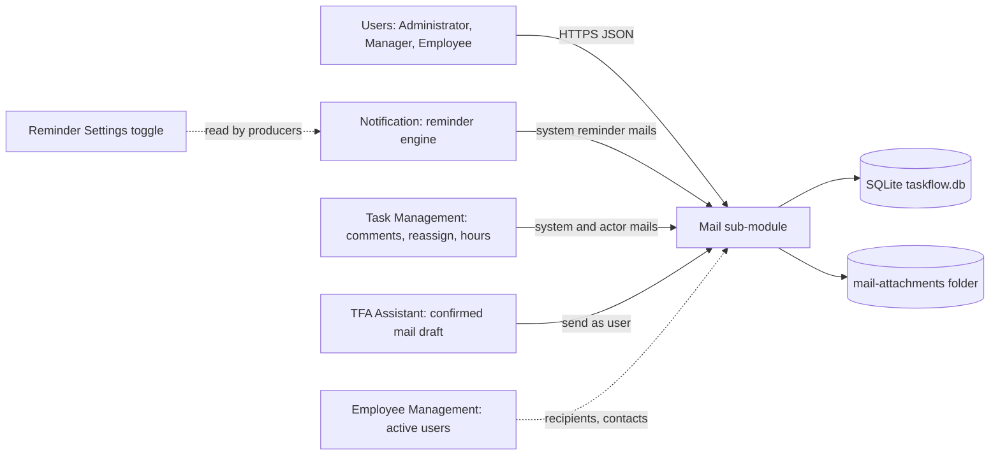
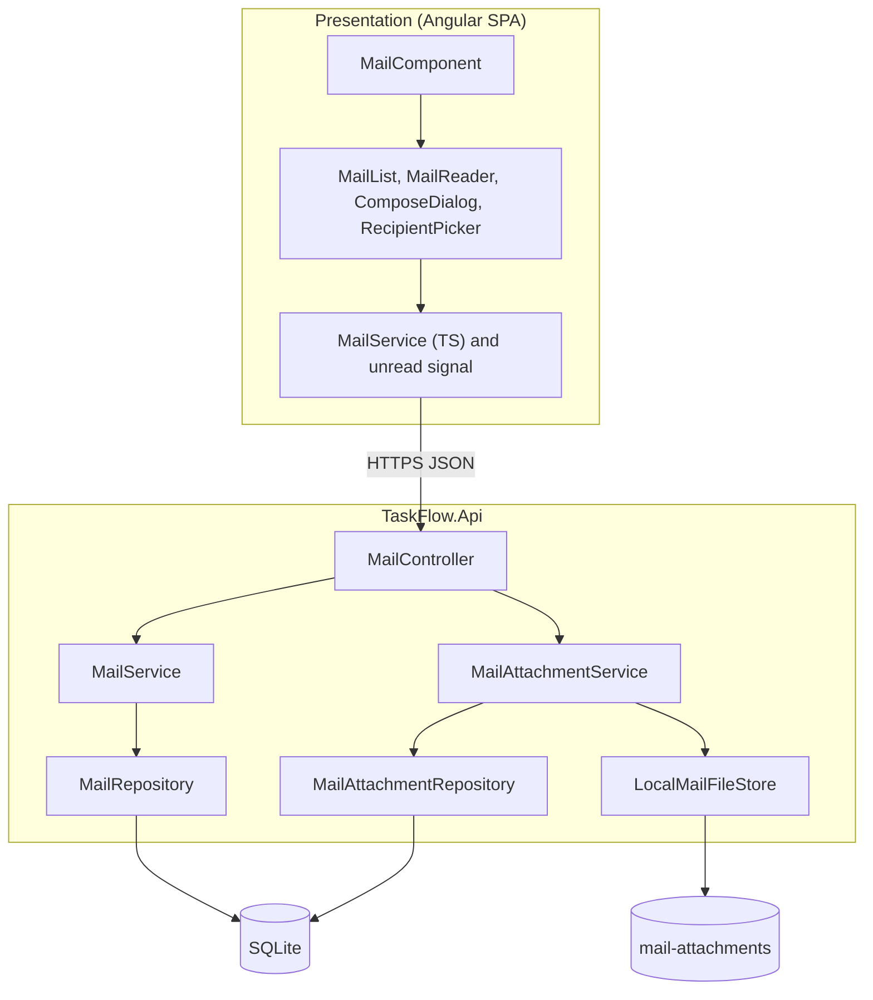
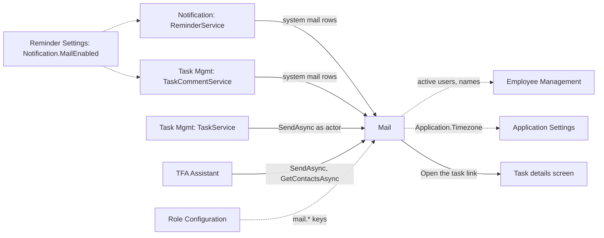
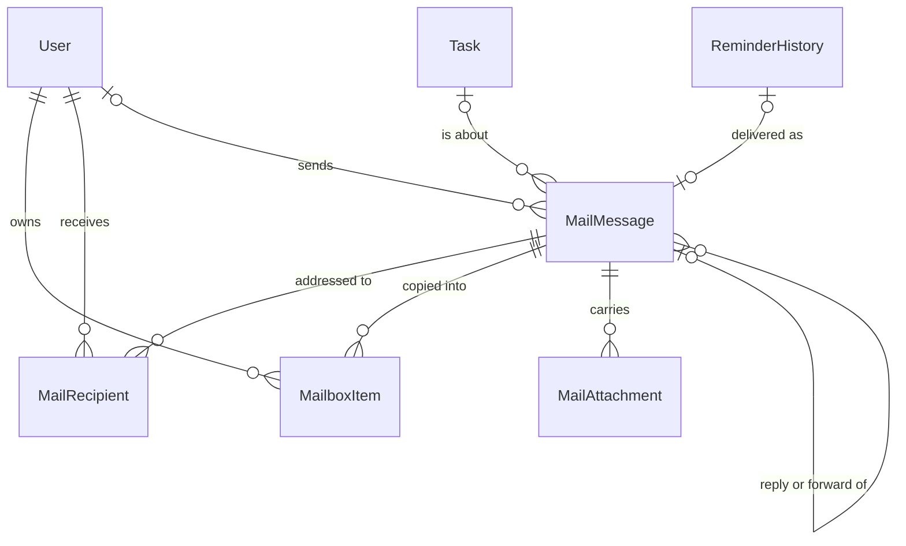
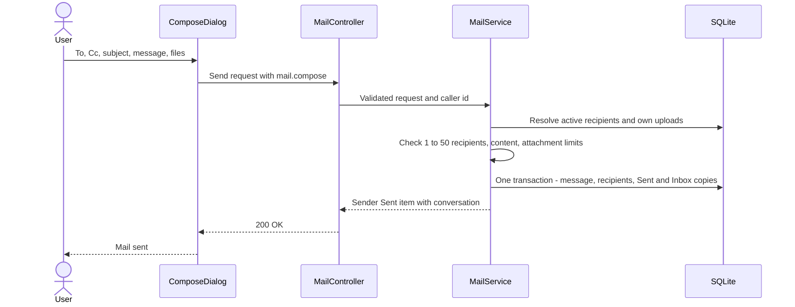
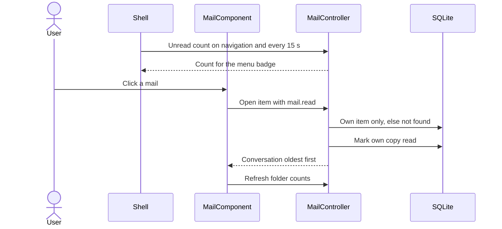
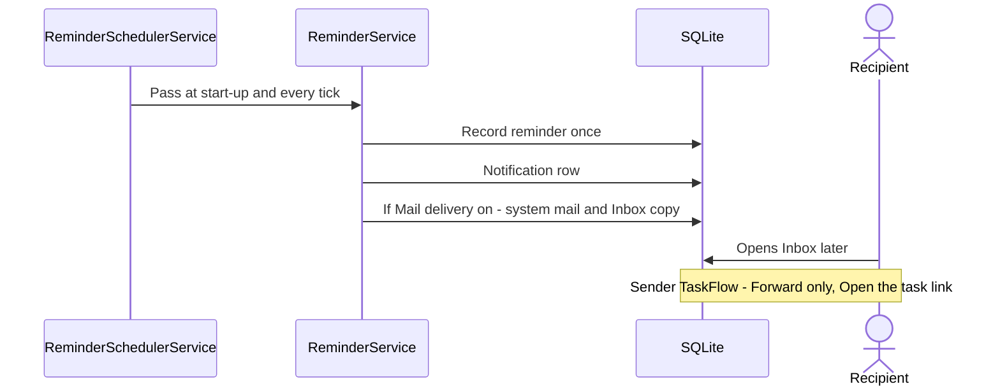
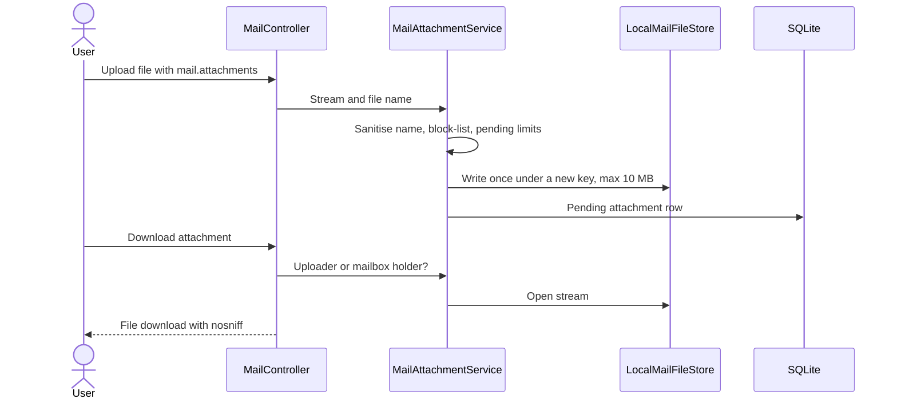

# High-Level Design – Mail

## TaskFlow – Intelligent Task Allocation & Tracking System

> **Document:** High-Level Design (Sub-module: Communication → Mail, code `MAIL`)  ·  **Version:** 1.0  ·  **Status:** Draft
> **Project type:** Personal Project (Skill Development)  ·  **Date:** 31-Oct-2026
> **Author:** Jojo George (jojogeorge3344@gmail.com)
> **Based on:** BRD-Mail v1.0, FRD-Mail v1.0
> © 2026 Jojo George. All rights reserved.

---

## Document Control

| Version | Date | Author | Summary of changes |
|---|---|---|---|
| 1.0 | 31-Oct-2026 | Jojo George | Initial version |

**Related documents:**

| Document | Location |
|---|---|
| Overall HLD (stack, deployment, cross-cutting design, decisions `D-nn`) | `../../00-Overall/HLD-TaskFlow-Overall.md` |
| BRD – Mail | `../../../BRD/04-Communication/04.1-Mail/BRD-Mail.md` |
| FRD – Mail (`FR-MAIL-nn`, `UC-MAIL-nn`) | `../../../FRD/04-Communication/04.1-Mail/FRD-Mail.md` |
| LLD – Mail (classes, endpoints, tables) | `../../../LLD/04-Communication/04.1-Mail/LLD-Mail.md` |
| Sibling HLD – Notification (reminder engine that writes reminder mails) | `../04.2-Notification/HLD-Notification.md` |
| TDD v2.0 – §15 Internal Mail Design | `TF - Documents/TF - TDD/TDD-TaskFlow.md` |

---

## 1. Introduction

### 1.1 Purpose
This HLD describes how the Mail sub-module is built: its place in TaskFlow, its frontend and backend components, the
data domains it owns, how other sub-modules place mails into a user's Inbox, the attachment file store, and the
security and design decisions behind the private, internal-only mailbox. Classes, endpoints, columns and tests are in
the LLD.

### 1.2 Scope
**In scope:** the Mail screen (folders, list, reading pane, menu badge), the compose panel (new mail, reply, reply all,
forward, drafts, recipient suggestions), mailbox organisation (flags, trash, delete forever), attachments, and the
receiving side of system mails from the reminder engine and Task Management.

**Out of scope:** outside email (SMTP) – superseded by design; reminder generation (Notification HLD); the "Also deliver
reminders to Mail" toggle (Reminder Settings HLD); the Assistant's mail-draft card (Assistant HLD). The shared stack,
deployment and cross-cutting pipeline are in the overall HLD.

**Change from original BRD**

| Original BRD item | Current design |
|---|---|
| Screen 14 "Email Configuration" with SMTP server, credentials and test email | Superseded and not built. Internal mailbox between TaskFlow users only; no mail server, no credentials (D-MAIL-1). |
| Screen 14 FR 6 "Record email delivery attempts and failures" | Delivery is a local database write in the same transaction as the reminder record; the `EmailDeliveryLogs` table was dropped by migration `20261017090431_AddInternalMail`. |

### 1.3 Audience
Developer, tester and reviewer of TaskFlow; the product owner (Jojo George).

### 1.4 Definitions & Abbreviations

| Term | Meaning |
|---|---|
| Mailbox item | One user's own copy of a mail in Inbox, Sent or Drafts, with personal read, star, important and trash state |
| Conversation | A mail and its replies and forwards, grouped by a conversation key |
| System mail | A mail written by TaskFlow itself (no sender user), shown as from "TaskFlow" |
| Pending upload | An uploaded attachment that is not yet on a sent mail or saved draft |
| File store | Local folder that holds attachment bytes under generated names |
| SPA | Single Page Application (Angular frontend) |

---

## 2. System Context

### 2.1 Context Diagram

### 2.2 Actors & External Systems

| Actor / system | Interaction | Protocol |
|---|---|---|
| Users (any role holding `mail.*` keys) | Read, write, organise own mail; upload and download attachments | HTTPS / REST (JSON, multipart for upload) |
| Notification – reminder engine | Writes system reminder mails into recipients' Inboxes | In-process (shared database transaction) |
| Task Management – comment service | Writes system comment mails into participants' Inboxes | In-process |
| Task Management – task service | Sends reassignment and worked-hours mails as the acting user | In-process call to the Mail service |
| TFA Assistant | Sends a user-confirmed mail draft from the user's mailbox; finds contacts | In-process call to the Mail service |
| Local file system | Stores and serves attachment bytes | File I/O |
| Outside email servers | None – no SMTP, nothing leaves TaskFlow | – |

---

## 3. Architecture Goals, Constraints & Principles

### 3.1 Quality Goals

| Goal | How the architecture supports it |
|---|---|
| Privacy | Every query is rooted in the caller's own mailbox items; foreign items are "not found" (D-MAIL-3) |
| Integrity | A send is one transaction: message, recipients, Sent copy and every Inbox copy, or nothing (NFR-MAIL-06) |
| Safety of shared files | Block-listed types, size limits, server-chosen content type, download-only delivery (D-MAIL-6) |
| Responsiveness | Paged folder views (25 per page) and a lightweight unread-count call polled by the shell |
| Maintainability | Same Controller → Service → Repository layering as every module; access by four permission keys |

### 3.2 Constraints
- Internal recipients only: every address must belong to an active TaskFlow user (BR-MAIL-01).
- Single server, single SQLite file; attachment bytes on the local disk in the shared data folder.
- No server push: the SPA polls the unread count on navigation and every 15 seconds.
- Plain-text bodies only (no HTML mail).

### 3.3 Architecture Principles
- **Copy per owner:** state that differs per person (read, star, important, trash, purge) lives on the owner's mailbox item, never on the shared message (D-MAIL-2).
- **Validate before write:** recipients and attachments are fully resolved and checked before the send transaction starts.
- **404, never 403, for other people's data** – existence of foreign mail is never revealed.
- **Producers own their trigger, Mail owns the data:** other sub-modules decide *when* to write a mail; the mail tables and rules belong to Mail.

---

## 4. Architecture Overview

### 4.1 Architecture Style
Feature slice of the TaskFlow three-tier application: Angular SPA screen and components → REST controller under
`/api/v1/mail` → mail and attachment services → repositories (EF Core, SQLite) plus a local file-store integration. The
shared pipeline (JWT, session validation, MFA gate, permission policies, validation filter, problem-details errors) is
described once in the overall HLD.

### 4.2 Logical Architecture

### 4.3 Layers & Responsibilities

| Layer | Responsibility | May call |
|---|---|---|
| Presentation | Folder rail, list, reader, compose drawer, recipient picker, menu badge, URL state, narrow-screen panes, client-side limits | API |
| API / Controllers | `MailController`: HTTP, caller id from the token, permission policy per action, multipart upload, file download headers | Services |
| Services | `MailService` (send, drafts, compose prefill, folders, flags, trash, contacts); `MailAttachmentService` (upload checks, download access, removal) | Repositories, file store |
| Repositories | `MailRepository` (own-mailbox queries, conversations, recipient resolution, contacts); `MailAttachmentRepository` (ownership, pending totals, download check) | Database |
| Integrations | `IMailFileStore` → `LocalMailFileStore` (write once, open read) | Local file system |

---

## 5. Component / Module Design

| Module | Responsibility | Key components (high level) | Depends on |
|---|---|---|---|
| Mailbox (Mail screen) | Folder views, counts, search, open conversation, menu badge | `MailComponent`, `MailListComponent`, `MailReaderComponent`; `MailController`; `MailService`; `MailRepository` | Users (names, deleted users still shown) |
| Organise | Star, important, mark unread, trash, restore, delete forever on the own copy | `MailReaderComponent`, `MailListComponent`; `MailService` | Mailbox items |
| Compose | New mail, reply, reply all, forward, drafts, recipient suggestions, send | `ComposeDialogComponent`, `RecipientPickerComponent`; `MailService`, mail request validators, `MailRules` | Employee Management (active users), Application Settings (timezone for quoted dates) |
| Attachments | Upload, pending limits, attach, forward copies, download, remove | `ComposeDialogComponent`, `MailReaderComponent`; `MailAttachmentService`, `MailAttachmentRepository`, `LocalMailFileStore` | Local file store |
| System mail intake | Accept mails written by other sub-modules into Inboxes | Mail entities and repository helpers used by `ReminderService` and `TaskCommentService`; `IMailService` used by `TaskService` and the Assistant | Notification, Task Management, Reminder Settings toggle, TFA Assistant |

### 5.1 Module Interaction

| From → To | What | Coupling |
|---|---|---|
| Notification → Mail | One system mail per delivered reminder (subject "Task reminder:", "Task due today:", "Overdue task:") | Writes Mail entities inside the reminder transaction; linked to the reminder record |
| Task Management (comments) → Mail | System mail "Comment *verb*: *title*" while the toggle is on | Staged in the comment's unit of work; discarded on failure so the comment still saves |
| Task Management (reassign, worked hours) → Mail | Mail from the acting user ("Task reassigned:", "Worked hours changed:") | Calls `IMailService.SendAsync`; best effort, failures logged |
| TFA Assistant → Mail | Confirmed mail draft sent from the user's mailbox; contact lookup | Calls `IMailService` with the same validator and rules |
| Mail → Employee Management | Recipient resolution and suggestions over active users | Read only |
| Mail → Task Management UI | "Open the task" link on mails that carry a task | Navigation only |

---

## 6. Data Architecture (high level)

### 6.1 Data Stores

| Store | Technology | Holds | Notes |
|---|---|---|---|
| Main database | SQLite `taskflow.db` (EF Core) | Mail messages, recipients, mailbox items, attachment metadata | Tables created by migration `20261017090431_AddInternalMail` |
| Attachment store | Local folder `mail-attachments` under the data folder (`Mail:AttachmentsPath`, relative to `Storage:Root`) | Attachment bytes, one file per stored upload, generated name | Files are written once and never modified or deleted; must be backed up with the database (NFR-MAIL-08) |

### 6.2 Main Data Domains

| Domain | Owned / used | Purpose |
|---|---|---|
| `MailMessage` | Owned | Content, conversation, draft state, system flag, optional task and reminder link |
| `MailRecipient` | Owned | To / Cc of a sent mail (`MailRecipientKind`) |
| `MailboxItem` | Owned | Personal copy per owner and folder (`MailFolder`: Inbox, Sent, Drafts) |
| `MailAttachment` | Owned | File metadata; bytes in the file store |
| `User` | Used (Employee Management) | Senders, recipients, contacts |
| `Task` | Used (Task Management) | "Open the task" target |
| `ReminderHistory` | Used (Notification) | At most one system mail per delivered reminder |
| `ApplicationSetting` | Used (Settings) | `Notification.MailEnabled` (read by producers), `Application.Timezone` |

### 6.3 Data Flow
- **Send:** compose panel → validate recipients (active users), content and attachments → one transaction writes the
  message, recipients, the sender's Sent copy and one Inbox copy per recipient, and removes a sent draft's Drafts copy →
  recipients' badges rise on their next poll.
- **Reminder:** reminder engine records a reminder → in the same transaction writes the in-app notification and, while
  "Also deliver reminders to Mail" is on, a system mail with an Inbox copy for that recipient.
- **Read and organise:** opening a mail marks only the reader's copy read; flags, trash and purge change only that copy.
- **Attachments:** upload → stored file plus a pending metadata row → attached on send or draft save → forwarding
  creates new metadata rows that point to the same stored file.

---

## 7. Integration Design

| Integration | Direction | Purpose | Failure behaviour |
|---|---|---|---|
| Local file store (`LocalMailFileStore`) | Outbound (disk) | Save and stream attachment bytes | Over-size or empty upload refused with a field error; a missing file on download returns "not found" ("Could not download the file.") |
| Reminder engine (`ReminderService`) | Inbound | System reminder mails | Part of the reminder transaction; a failed pass is logged and retried next tick (Notification HLD) |
| Comment service (`TaskCommentService`) | Inbound | System comment mails | Staged mail rows are discarded; the comment itself is still saved (BR-NOTIF-13) |
| Task service (`TaskService`) | Inbound | Reassignment and worked-hours mails as the actor | Exception caught and logged; the task change stands |
| TFA Assistant (`DraftMailTool`, `FindUserTool`, `AssistantActionService`) | Inbound | Contacts lookup; send a confirmed draft | Validation errors shown on the Action Card; "Nothing was sent." on failure |
| Outside email (SMTP) | – | Not used | – |

---

## 8. Key Flows (high level)

### 8.1 Compose and send a mail (UC-MAIL-06)

### 8.2 Open a mail and update the badge (UC-MAIL-01)

### 8.3 Reminder delivered into the Inbox (background job, cross-module)

### 8.4 Upload and download an attachment (integration with the file store)

---

## 9. Security Architecture

| Concern | Approach |
|---|---|
| Authentication | Shared JWT bearer + refresh cookie with per-request session validation and the MFA setup gate (overall HLD) |
| Authorization | Class-level `[Authorize]` plus one `perm:<key>` policy per action: `mail.read`, `mail.compose`, `mail.organize`, `mail.attachments`; granted by default to Administrator, Manager and Employee, configurable for custom roles. Route `/mail` uses `permissionGuard`; buttons hidden with `canCompose()` / `canOrganize()` |
| Data scope | Own only. Every mailbox query starts from the caller's non-purged items; attachment download needs uploader or mailbox-holder status; foreign ids return 404. Only the contacts search spans the active-user directory |
| Content safety | Plain-text bodies; the SPA `linkify` turns only http(s) URLs into links via Angular bindings; attachments always downloaded with a server-chosen content type and `X-Content-Type-Options: nosniff`; block-listed executable types; upload request capped at 11 MB |
| Data protection | No credentials exist (no SMTP). Attachment files carry generated names, not user file names |
| Auditing | Refused requests logged by `DeniedActionAuditHandler`; Mail writes no task activity entries |

---

## 10. Technology Stack

Mail uses the shared TaskFlow stack without additions: ASP.NET Core Web API on .NET 10 (`net10.0`), EF Core 10.0.12 with
SQLite, FluentValidation 12.2.0 for the send and draft validators, Angular 19.2 for the screen. No mail library or SMTP
client is installed. Versions and rationale: overall HLD (`../../00-Overall/HLD-TaskFlow-Overall.md`).

---

## 11. Deployment Architecture

Mail runs inside the single `TaskFlow.Api` process and needs no extra service. Its only deployment-specific item is the
attachment folder `mail-attachments` (setting `Mail:AttachmentsPath`, resolved against `Storage:Root`), which lives in the
same data folder as `taskflow.db` and must be included in every backup. Environments, hosting and the deployment diagram:
overall HLD (`../../00-Overall/HLD-TaskFlow-Overall.md`).

---

## 12. Non-Functional Design

| Area | Design decision |
|---|---|
| Performance | Folder views paged (25 by default, at most 50); composite mailbox index for owner, folder and order; previews cut on the server; unread count is a single count query (NFR-MAIL-01) |
| Scalability | Single instance; mailbox rows grow with recipients per mail (one copy each); no clean-up job yet (R-MAIL-01) |
| Reliability | All-or-nothing send in one transaction (NFR-MAIL-06); attachments planned and validated before any write; producer failures never undo the triggering task change |
| Availability | No external dependency; works offline |
| Maintainability | Limits and block-list in one rules class (`MailRules`); access through four permission keys editable in Role Configuration (NFR-MAIL-09) |
| Observability | Request logging and denied-action audit (shared); producer mail failures logged as warnings |
| Usability | Field-keyed validation errors mapped onto the compose fields (NFR-MAIL-04); one pane at a time on narrow screens (NFR-MAIL-05); badge refresh every 15 seconds (NFR-MAIL-07) |
| Backup & Recovery | Database and `mail-attachments` folder backed up together (NFR-MAIL-08) |

---

## 13. Design Decisions

| ID | Decision | Alternatives considered | Rationale |
|---|---|---|---|
| D-MAIL-1 | Internal mailbox between TaskFlow users instead of outbound SMTP email | SMTP with stored credentials (original Screen 14); third-party mail API | Works offline, no secrets to store, nothing leaves TaskFlow, colleagues can also write to each other |
| D-MAIL-2 | One shared message plus one mailbox item per owner and folder | One row per recipient with copied content; flags on the message | Personal read, star, important and trash state without duplicating content; Sent and Inbox of the same user stay independent |
| D-MAIL-3 | Foreign mail, drafts and attachments return 404, never 403 | 403 Forbidden | Does not reveal that a mail exists; Administrators have no special mailbox access (BR-MAIL-02) |
| D-MAIL-4 | Attachment bytes on the local disk under generated keys, metadata in the database; forwarded copies share the stored file | Bytes in the database; copy the file on forward | Keeps the database small; forward is cheap; write-once files are never corrupted by later edits |
| D-MAIL-5 | Delete forever is a soft purge of the owner's item; files are never deleted | Physical delete of rows and files | Other recipients keep their copies; shared stored files stay valid; clean-up deferred (R-MAIL-01) |
| D-MAIL-6 | Plain-text bodies, download-only attachments, server-side content type and executable block-list | Rich HTML mail; inline preview | Removes script injection and content-sniffing risks (NFR-MAIL-03) |
| D-MAIL-7 | Drafts keep raw recipient text; recipients are checked only on send | Validate on every save | Users can save unfinished mail (BR-MAIL-10) |
| D-MAIL-8 | Reminder and comment mails are system mails written by the producer in its own unit of work; reassignment and worked-hours mails go through `IMailService.SendAsync` as the acting user | Every producer calls one mail API; a message queue | Reminder mail shares the reminder's duplicate-proof transaction (one mail per reminder); actor mails reuse full send validation and appear in the actor's Sent folder |
| D-MAIL-9 | Unread badge by polling (navigation + 15 s) | Server push (SignalR, SSE) | Single-server simplicity; no extra infrastructure; latency acceptable for internal mail |

---

## 14. Risks, Assumptions & Open Issues

| Type | Description | Mitigation / owner |
|---|---|---|
| Risk | Storage grows: purged mail and attachment files are never removed; abandoned uploads are not cleaned up (R-MAIL-01) | Per-user pending limits (20 files, 100 MB); plan a clean-up job – Jojo George |
| Risk | The contacts search exposes names and emails of all active users to anyone with `mail.compose` (R-MAIL-02) | Accepted for one organisation; restrict `mail.compose` for custom roles – Jojo George |
| Risk | A harmful file is shared (R-MAIL-04) | Block-list, size limits, download-only with `nosniff` |
| Open issue | ⚠️ To be confirmed: Attach, chip removal and download buttons are not gated by `mail.attachments` in the UI; users without the key get an error | Jojo George |
| Open issue | ⚠️ To be confirmed: draft Discard calls the delete action that needs `mail.organize`, while the panel is gated only by `mail.compose` | Jojo George |
| Open issue | ⚠️ To be confirmed: reassignment and worked-hours mails are sent even when "Also deliver reminders to Mail" is off | Jojo George |
| Open issue | ⚠️ To be confirmed: whether a separate delivery-failure record is still needed (original Screen 14 FR 6 / FR 7) | Jojo George |
| Assumption | All correspondents are users of one organisation; plain text is sufficient | Jojo George |

---

## 15. Traceability (requirements → components)

| BRD/FRD item | Module / component | Section |
|---|---|---|
| FR-MAIL-01 | Route `/mail` with `permissionGuard`; `MailController` `mail.read` policy | §5, §9 |
| FR-MAIL-02 – FR-MAIL-03 | Mailbox › `MailComponent` folder rail; `MailService` summary counts | §5 |
| FR-MAIL-04 | Shell badge + `MailService` (TS) unread signal; unread-count action | §5, §8.2 |
| FR-MAIL-05 – FR-MAIL-08 | Mailbox › `MailListComponent`; `MailService` / `MailRepository` paged folder views and search | §5, §12 |
| FR-MAIL-09 – FR-MAIL-12 | Mailbox › `MailReaderComponent` (conversation, `linkify`, task link); `MailService` open and mark read | §5, §8.2, §9 |
| FR-MAIL-13 – FR-MAIL-19 | Organise › `MailReaderComponent`, `MailListComponent`; `MailService` flags, trash, restore, purge on own item | §5, D-MAIL-2, D-MAIL-5 |
| FR-MAIL-20 | `MailRepository` own-mailbox root; 404 for foreign items | §9, D-MAIL-3 |
| FR-MAIL-21 – FR-MAIL-22 | `MailReaderComponent` action rules; `MailService` refuses reply to system mail | §5 |
| FR-MAIL-23 | `MailRepository` loads people including deleted users | §6 |
| FR-MAIL-24 | `MailComponent` narrow-screen panes | §12 |
| FR-MAIL-25 | System mail intake › `TaskCommentService` (toggle `Notification.MailEnabled`) | §5.1, §7, D-MAIL-8 |
| FR-MAIL-26 – FR-MAIL-27 | System mail intake › `TaskService` → `IMailService.SendAsync` as actor | §5.1, §7, D-MAIL-8 |
| FR-MAIL-28 – FR-MAIL-29 | Attachments › `MailAttachmentService` download check; `LocalMailFileStore`; `nosniff` download | §8.4, §9, D-MAIL-6 |
| FR-MAIL-30 | SPA error messages on failed calls (`MailComponent`, `MailReaderComponent`) | §5 |
| FR-MAIL-31 – FR-MAIL-32 | Compose › `ComposeDialogComponent` gated by `canCompose()`; `mail.compose` policies | §5, §9 |
| FR-MAIL-33 – FR-MAIL-34 | Compose › `RecipientPickerComponent`; contacts action over active users | §5, §7 |
| FR-MAIL-35 – FR-MAIL-41 | Compose › request validators + `MailService` send (recipient resolution, limits, one transaction) | §8.1, §12 |
| FR-MAIL-42 – FR-MAIL-46 | Compose › `MailService` compose prefill (Reply, Reply all, Forward, timezone) and conversation key | §5, §6.3 |
| FR-MAIL-47 – FR-MAIL-49 | Compose › `MailService` draft create, update, send-by-id; Discard | §5, D-MAIL-7 |
| FR-MAIL-50 – FR-MAIL-55 | Attachments › `MailRules` limits, `MailAttachmentService`, `MailAttachmentRepository` pending totals and ownership | §8.4, D-MAIL-4 |
| FR-MAIL-56 | `ComposeDialogComponent` maps field-keyed 400 errors | §12 |
| NFR-MAIL-01 – NFR-MAIL-09 | Non-functional design | §12 |
| BR-MAIL-01 – BR-MAIL-13 | Covered through the FR rows above (see FRD §11) | §15 |

---
© 2026 Jojo George. All rights reserved. Unauthorized copying or distribution of this document is prohibited.
