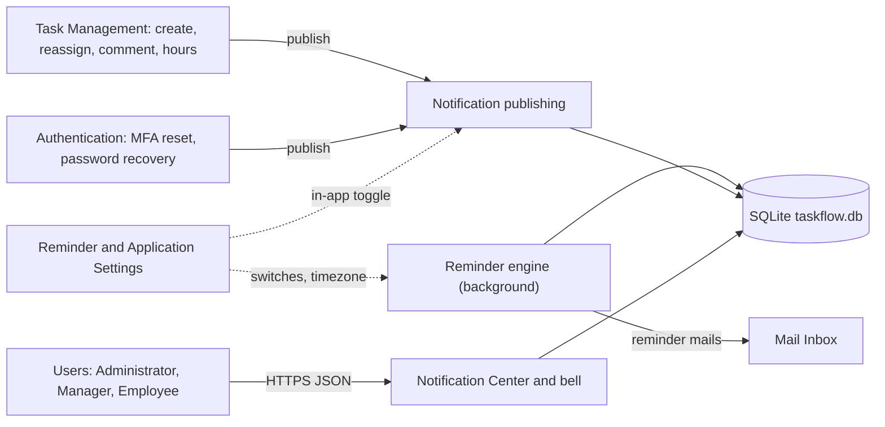
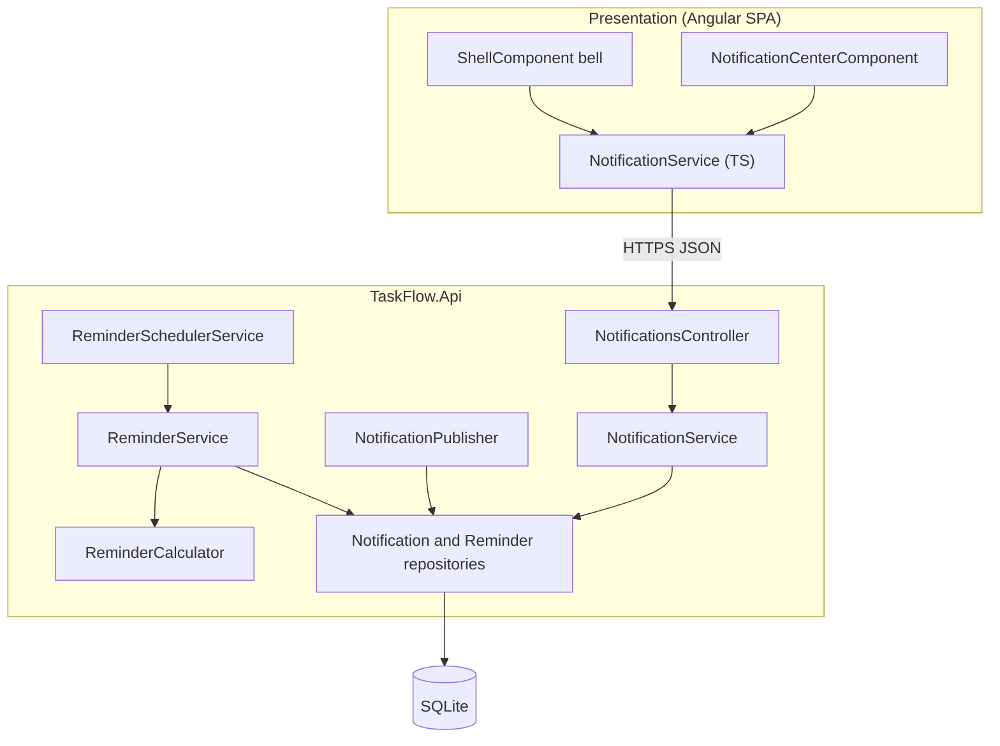
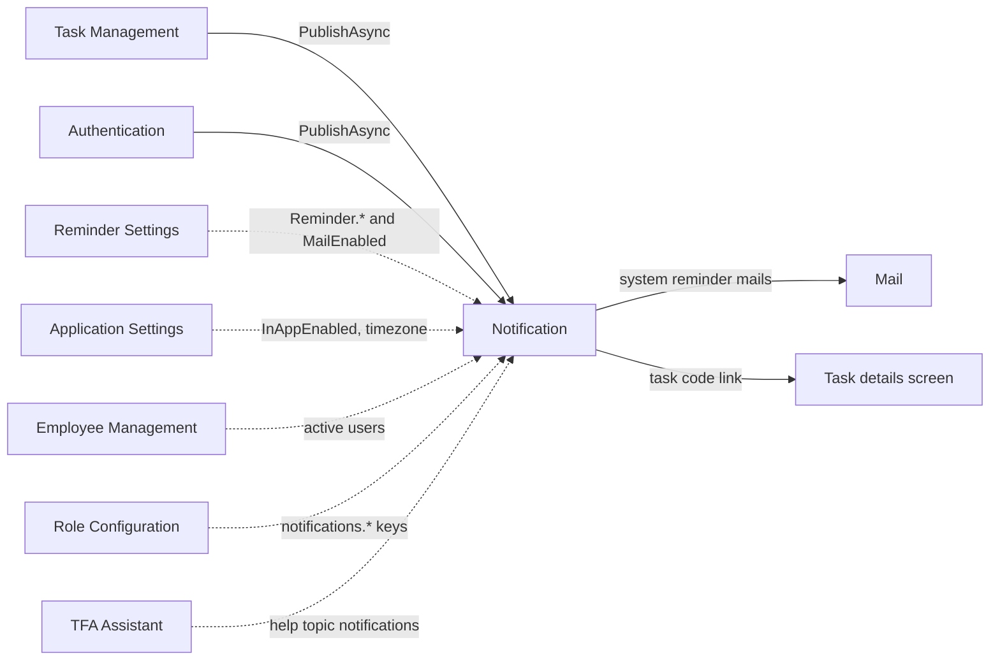
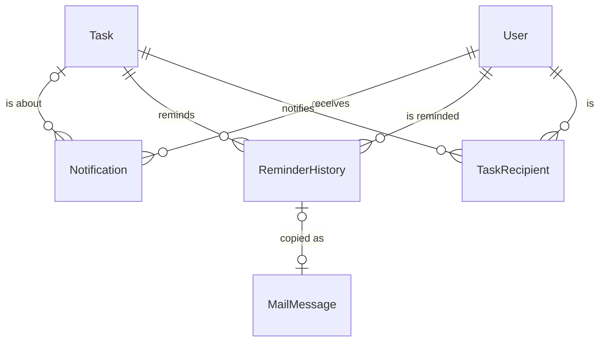
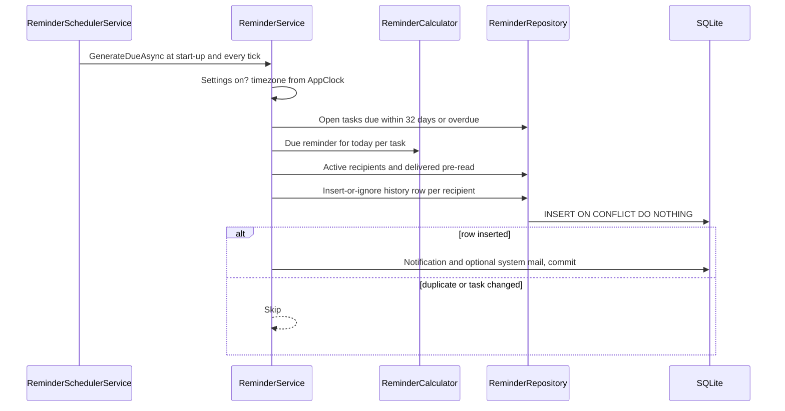
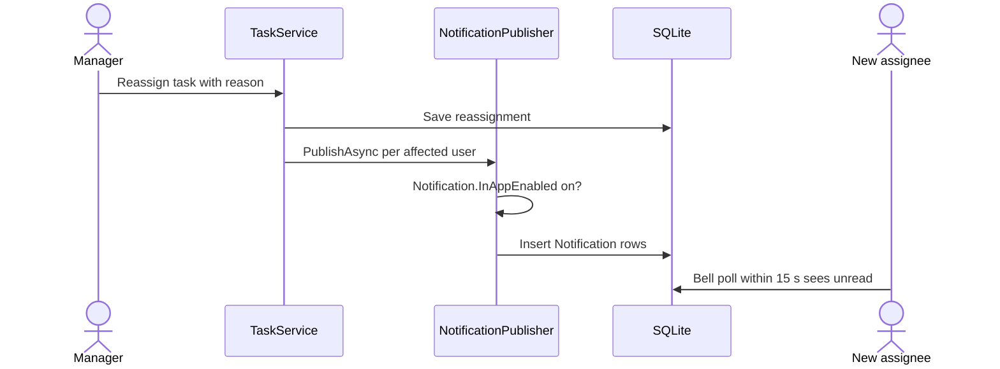
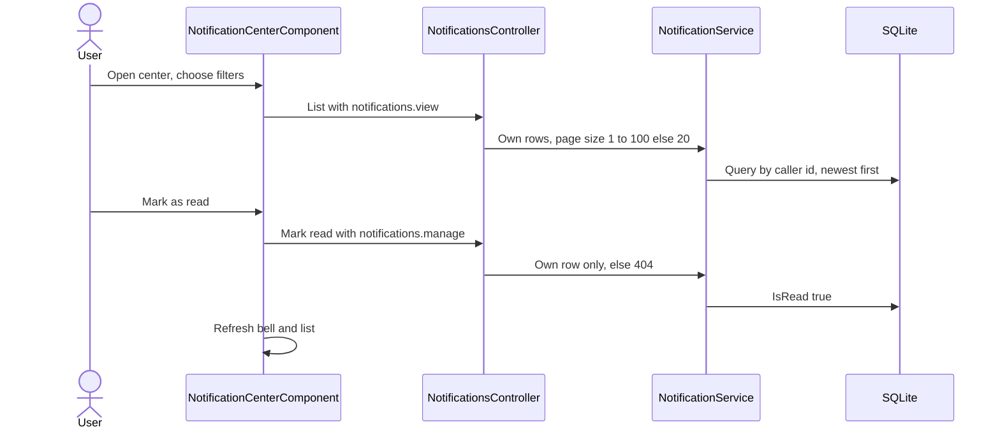
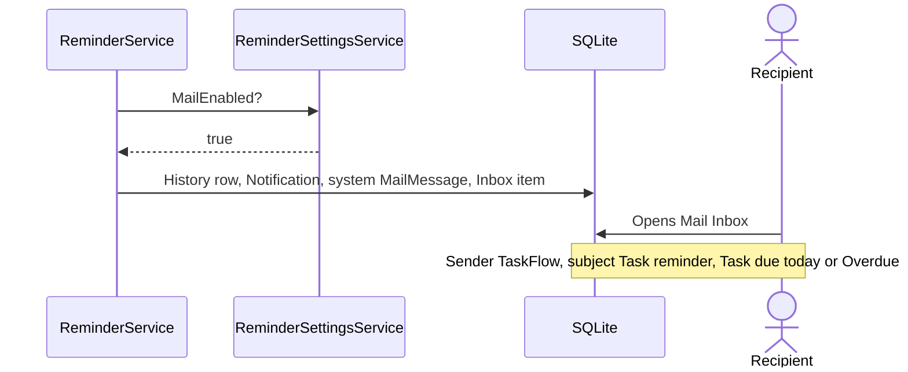

# High-Level Design – Notification

## TaskFlow – Intelligent Task Allocation & Tracking System

> **Document:** High-Level Design (Sub-module: Communication → Notification, incl. deadline reminder engine, code `NOTIF`)  ·  **Version:** 1.0  ·  **Status:** Draft
> **Project type:** Personal Project (Skill Development)  ·  **Date:** 31-Oct-2026
> **Author:** Jojo George (jojogeorge3344@gmail.com)
> **Based on:** BRD-Notification v1.0, FRD-Notification v1.0
> © 2026 Jojo George. All rights reserved.

---

## Document Control

| Version | Date | Author | Summary of changes |
|---|---|---|---|
| 1.0 | 31-Oct-2026 | Jojo George | Initial version |

**Related documents:**

| Document | Location |
|---|---|
| Overall HLD (stack, deployment, cross-cutting design, decisions `D-nn`) | `../../00-Overall/HLD-TaskFlow-Overall.md` |
| BRD – Notification | `../../../BRD/04-Communication/04.2-Notification/BRD-Notification.md` |
| FRD – Notification (`FR-NOTIF-nn`, `UC-NOTIF-nn`) | `../../../FRD/04-Communication/04.2-Notification/FRD-Notification.md` |
| LLD – Notification (classes, endpoints, tables) | `../../../LLD/04-Communication/04.2-Notification/LLD-Notification.md` |
| Sibling HLD – Mail (receives reminder mails) | `../04.1-Mail/HLD-Mail.md` |
| HLD – Reminder Settings (engine switches and defaults) | `../../06-Settings/06.1-Reminder-Settings/HLD-Reminder-Settings.md` |
| TDD v2.0 – §11 Notification & Reminder Engine | `TF - Documents/TF - TDD/TDD-TaskFlow.md` |

---

## 1. Introduction

### 1.1 Purpose
This HLD describes how the Notification sub-module is built: the Notification Center and header bell, the publishing seam
other sub-modules use for event notifications, and the background deadline reminder engine that delivers first, second,
due-today and overdue reminders exactly once. It covers components, interactions, data domains, key flows, security and
design decisions. Classes, endpoints and columns are in the LLD.

### 1.2 Scope
**In scope:** Notification Center (list, filters, paging, mark read, mark all read), header bell with unread dot, event
notification publishing (task assigned, reassigned, comment, worked hours, MFA reset, password reset), the reminder
scheduler and reminder generation, duplicate prevention and reminder history, and optional reminder delivery into Mail.

**Out of scope:** editing reminder switches and defaults (Reminder Settings), per-task reminder fields and recipients
(Task Management), the mailbox itself (Mail HLD), outside email or SMS, server push. Shared stack, deployment and the
request pipeline are in the overall HLD.

**Change from original BRD**

| Original BRD item | Current design |
|---|---|
| §3.2 fixed schedule (two days / one day before) | Per-task first and second reminder days and Daily/Weekly overdue frequency, read by the engine on every pass |
| §3.2 "Deadline changed → recalculate future reminders" | No future reminders are stored; each pass reads current task state, so changes apply on the next pass (D-NOTIF-3) |
| §3.4 SMTP email notifications | Optional copy into the internal Mail Inbox while `Notification.MailEnabled` is on |
| §3.5 reminder history with attempt details | History records each delivered reminder with status `Sent`; retry and failure tracking not implemented |

### 1.3 Audience
Developer, tester and reviewer of TaskFlow; the product owner (Jojo George).

### 1.4 Definitions & Abbreviations

| Term | Meaning |
|---|---|
| Event notification | In-app alert written when another sub-module changes something (assignment, comment, account event) |
| Reminder pass | One run of the reminder engine over all candidate tasks |
| Reminder slot | The UTC instant of local midnight of today in the application timezone; part of the duplicate key |
| Insert-or-ignore | Database insert that silently does nothing when the unique key already exists |
| Publisher | `INotificationPublisher`, the write seam other modules call |
| SPA | Single Page Application (Angular frontend) |

---

## 2. System Context

### 2.1 Context Diagram

### 2.2 Actors & External Systems

| Actor / system | Interaction | Protocol |
|---|---|---|
| Users (holders of `notifications.view` / `notifications.manage`) | View, filter and mark own notifications; see the bell dot | HTTPS / REST (JSON) |
| Task Management (`TaskService`, `TaskCommentService`) | Publishes assigned, reassigned, comment and worked-hours notifications | In-process (`INotificationPublisher`) |
| Authentication (`MfaService`, `PasswordRecoveryService`) | Publishes System notifications for MFA reset and password reset | In-process |
| Reminder Settings / Application Settings | Provide `Reminder.*`, `Notification.MailEnabled`, `Notification.InAppEnabled`, `Application.Timezone` | In-process reads |
| Mail | Receives reminder mails written by the engine | In-process (shared transaction) |
| Host process timer | Drives the reminder pass at start-up and every `Reminders:TickSeconds` | `BackgroundService` / `PeriodicTimer` |

---

## 3. Architecture Goals, Constraints & Principles

### 3.1 Quality Goals

| Goal | How the architecture supports it |
|---|---|
| Exactly-once reminders | Unique reminder key enforced by the database with insert-or-ignore; nothing else is written unless the insert succeeded (D-NOTIF-2) |
| Restart safety | Stateless passes; no in-memory schedule; next pass after a restart resumes cleanly (NFR-NOTIF-04) |
| Correct days | One application timezone; DST-safe local-midnight slot computed by a pure calculator (NFR-NOTIF-06) |
| Privacy | Own-scope queries; foreign notification ids return 404 (NFR-NOTIF-07) |
| Resilience | A failed pass is logged and swallowed; the next tick retries (NFR-NOTIF-05); a failed publish never undoes the task change |
| Maintainability | Rules isolated in `ReminderCalculator`; switches changed in Reminder Settings without code (NFR-NOTIF-08) |

### 3.2 Constraints
- Single server, single instance: one reminder engine per installation, no distributed lock.
- SQLite file database (single writer); the engine pre-reads delivered reminders to avoid taking the write lock needlessly.
- No server push; the SPA polls.
- Only today's reminders are produced; days missed while the application was stopped are not caught up (BR-NOTIF-06).

### 3.3 Architecture Principles
- **Database as the source of truth for "already sent"** – no flags in memory.
- **Read current state, never pre-schedule** – the task's status, deadline and intervals are read on every pass.
- **Pure rules, impure shell** – the calculator has no I/O; the service does loading, delivery and transactions.
- **One seam for event writes** – other sub-modules publish through `INotificationPublisher`, which honours the in-app toggle.

---

## 4. Architecture Overview

### 4.1 Architecture Style
Two cooperating parts inside the TaskFlow API process: (1) a request/response read side (Angular screen → REST controller
under `/api/v1/notifications` → service → repository) plus an append-only publishing seam, and (2) a hosted background
worker that runs reminder passes on a timer. Both share the SQLite database through EF Core. The shared pipeline is in
the overall HLD.

### 4.2 Logical Architecture

### 4.3 Layers & Responsibilities

| Layer | Responsibility | May call |
|---|---|---|
| Presentation | Notification Center (filters, paging, mark read), header bell dot, unread signal refreshed on navigation, every 15 s and on tab focus | API |
| API / Controllers | `NotificationsController`: caller id from the token, `perm:notifications.*` policy per action | Services |
| Services | `NotificationService` (list, count, mark read); `NotificationPublisher` (event writes, in-app toggle); `ReminderService` (pass logic, delivery); `ReminderSchedulerService` (timer, scope, error handling) | Repositories, Settings services, clock |
| Rules | `ReminderCalculator` (which reminder is due today, slot) | – |
| Repositories | `NotificationRepository`; `ReminderRepository` (candidates, delivered pre-read, recipients, insert-or-ignore) | Database |
| Integrations | None external; uses the Settings module's `IAppClock` and `IReminderSettingsService` | – |

---

## 5. Component / Module Design

| Module | Responsibility | Key components (high level) | Depends on |
|---|---|---|---|
| Notification Center and bell | Own list, filters, paging, mark one / all read, task link, unread dot | `NotificationCenterComponent`, shell bell, `NotificationService` (TS); `NotificationsController`, `NotificationService`, `NotificationRepository` | Task Management (task code link, task access on open) |
| Event publishing | Append notifications for other sub-modules; skip while in-app notifications are off | `INotificationPublisher` / `NotificationPublisher` | Application Settings (`Notification.InAppEnabled`); callers in Task Management and Authentication |
| Reminder scheduler | Run a pass at start-up and every tick in its own DI scope; log and survive failures | `ReminderSchedulerService` (`BackgroundService`) | Configuration `Reminders:SchedulerEnabled`, `Reminders:TickSeconds` |
| Reminder generation | Candidates, today's reminder per task, recipients, duplicate-proof delivery, optional mail | `ReminderService`, `ReminderCalculator`, `ReminderRepository` | Reminder Settings (`Reminder.*`, `Notification.MailEnabled`), Application Settings (timezone via `AppClock`), Employee Management (active users), Mail (system mail rows) |

### 5.1 Module Interaction

| From → To | What | Coupling |
|---|---|---|
| Task Management → Notification | `TaskAssigned`, `Reassigned`, `TaskComment`, `System` (worked hours) | Publisher call; a failure is caught by the caller, the task change stands (BR-NOTIF-13) |
| Authentication → Notification | `System` for admin MFA reset and password reset with the authenticator | Publisher call |
| Notification → Task Management | Reads tasks, deadlines, intervals, creators, `TaskRecipients` | Read only, no tracking |
| Notification → Mail | One system mail per delivered reminder while Mail delivery is on | Writes Mail entities in the reminder transaction |
| Settings → Notification | Engine switches, in-app toggle, timezone | Read on every pass / publish |

---

## 6. Data Architecture (high level)

### 6.1 Data Stores

| Store | Technology | Holds | Notes |
|---|---|---|---|
| Main database | SQLite `taskflow.db` (EF Core) | Notifications, reminder history; reads tasks, recipients, users, settings; writes reminder mails | `Notifications` from migration `20261013075057_AddTaskTracking`; `ReminderHistory` from `20261017062735_AddReminderEngine` |
| In-memory | Process | Nothing persistent – the engine keeps no state between passes | – |

### 6.2 Main Data Domains

| Domain | Owned / used | Purpose |
|---|---|---|
| `Notification` | Owned | One in-app alert for one user (`NotificationType`: TaskAssigned, Reassigned, DeadlineReminder, Overdue, System, TaskComment) |
| `ReminderHistory` | Owned | Proof of delivery; unique per task, recipient, `ReminderType` (FirstReminder, SecondReminder, DueToday, Overdue) and slot; `ReminderStatus` |
| `Task`, `TaskRecipient` | Used (Task Management) | Deadline, status, intervals (`ReminderFrequency`), creator, recipients |
| `User` | Used (Employee Management) | Active recipients |
| `ApplicationSetting` | Used (Settings) | `Reminder.*`, `Notification.MailEnabled`, `Notification.InAppEnabled`, `Application.Timezone` |
| `MailMessage`, `MailRecipient`, `MailboxItem` | Written for Mail | System reminder mail with one Inbox copy |

`ReminderStatus` values `Pending`, `Failed` and `Skipped` exist but the engine writes only `Sent`.

### 6.3 Data Flow
- **Event:** source module saves its change → publisher checks the in-app toggle → one `Notification` per affected user →
  bell dot appears on the user's next poll.
- **Reminder:** pass → candidates (open, deadline at most 32 days ahead or passed) → calculator decides today's reminder →
  recipients (task recipients + creator, active only) → per recipient one transaction: insert-or-ignore history row → only
  if inserted: notification and, optionally, system mail.
- **Read:** user opens the center → own rows, newest first, 20 per page → mark read flips `IsRead` only; nothing is deleted.

---

## 7. Integration Design

| Integration | Direction | Purpose | Failure behaviour |
|---|---|---|---|
| Host timer (`PeriodicTimer` in `ReminderSchedulerService`) | Internal | Trigger passes | Exception in a pass logged as "Reminder pass failed." and swallowed; next tick retries |
| Reminder Settings (`IReminderSettingsService`) | Inbound read | Master switch, deadline-day switch, Mail delivery | Missing or unreadable values fall back to defaults |
| Application clock (`IAppClock`) | Inbound read | Application timezone | Falls back to `Application:Timezone`, then UTC |
| Mail tables | Outbound write | Reminder copy in the Inbox | Same transaction as the history row; at most one mail per reminder |
| Task Management / Authentication publishers | Inbound | Event notifications | Callers catch and log; their own change is kept |
| External services | – | None | – |

---

## 8. Key Flows (high level)

### 8.1 Reminder pass (background job, UC-NOTIF-05)

### 8.2 Event notification on reassignment (main business flow)

### 8.3 View and mark as read (UC-NOTIF-01, UC-NOTIF-02)

### 8.4 Reminder copied into Mail (integration)

---

## 9. Security Architecture

| Concern | Approach |
|---|---|
| Authentication | Shared JWT bearer + refresh cookie, session validation, MFA setup gate (overall HLD) |
| Authorization | `[Authorize]` plus `perm:notifications.view` (list, unread count) and `perm:notifications.manage` (mark read, mark all); defaults granted to Administrator, Manager, Employee; route `/notifications` uses `permissionGuard`; bell shown with `canSeeNotifications`; Mark all as read hidden with `canManage()` |
| Data scope | Own only: every query filters on the caller's id; a foreign id returns 404, never 403 |
| Background engine | Runs with no user context and needs no permission; its switches are edited under `settings.reminders.manage` in Reminder Settings |
| Data protection | Notification texts contain task titles and names only; no secrets |
| Auditing | `ReminderHistory` is the audit trail for reminders; refused requests logged by `DeniedActionAuditHandler` |

---

## 10. Technology Stack

Notification uses the shared TaskFlow stack: ASP.NET Core on .NET 10 (`net10.0`) with the built-in `BackgroundService` and
`PeriodicTimer` for the scheduler, EF Core 10.0.12 with SQLite (raw `INSERT … ON CONFLICT DO NOTHING` for the history),
Angular 19.2 with RxJS for the polling bell. No job scheduler or message broker is installed. Versions and rationale:
overall HLD (`../../00-Overall/HLD-TaskFlow-Overall.md`).

---

## 11. Deployment Architecture

The reminder engine is hosted inside the single `TaskFlow.Api` process and starts with it; there is no separate worker
service. It is controlled by `Reminders:SchedulerEnabled` (default `true`) and `Reminders:TickSeconds` (default 60).
`Mail:AppBaseUrl`, when set, adds an "Open the task" web address to reminder mails. Exactly one API instance may run
against a database, otherwise two engines would compete (duplicates are still prevented by the unique key). Environments
and the deployment diagram: overall HLD (`../../00-Overall/HLD-TaskFlow-Overall.md`).

---

## 12. Non-Functional Design

| Area | Design decision |
|---|---|
| Performance | Pass every 60 s (NFR-NOTIF-01); delivered pre-read avoids write locks for already-sent reminders; candidate window limited to 32 days ahead; list paged at 20 (1–100) and unread count served by an index on user and read flag (NFR-NOTIF-03) |
| Scalability | Single instance; one transaction per recipient and reminder keeps write locks short |
| Reliability | Database-enforced idempotency (NFR-NOTIF-04); re-check that the task is still open with the same deadline at insert time; pass failures logged and retried (NFR-NOTIF-05) |
| Availability | No external dependency; reminders continue offline |
| Maintainability | Pure `ReminderCalculator` unit-tested separately; switches and defaults in Reminder Settings (NFR-NOTIF-08) |
| Observability | Logs "Generated {Count} deadline reminder notification(s)." per pass and "Reminder pass failed." on errors |
| Usability | Bell refreshed on navigation, every 15 s and on tab focus (NFR-NOTIF-02) |
| Correctness | DST-safe slot and day difference in the application timezone (NFR-NOTIF-06) |
| Backup & Recovery | Notifications and history live in `taskflow.db` and are covered by the database backup |

---

## 13. Design Decisions

| ID | Decision | Alternatives considered | Rationale |
|---|---|---|---|
| D-NOTIF-1 | In-process `BackgroundService` with `PeriodicTimer` as the reminder scheduler | Hangfire / Quartz; OS scheduled task; message broker | No extra infrastructure on a single server; restart-safe because passes are stateless |
| D-NOTIF-2 | Duplicate prevention by a unique key (task, recipient, type, slot) and insert-or-ignore; notification and mail written only when the insert succeeded | In-memory "sent" flags; check-then-insert | Exactly-once under overlapping passes, retries and restarts; the database is the only judge |
| D-NOTIF-3 | Compute only today's reminder on each pass from current task state; store nothing for the future | Pre-generate a reminder schedule per task and cancel or rebuild on change | No recalculation logic; deadline, status and interval changes take effect automatically; no stale rows |
| D-NOTIF-4 | Pure `ReminderCalculator` with a DST-safe local-midnight slot in the application timezone | Calculations inline in the service; UTC days | Deterministic and unit-testable; one timezone for everyone (BR-NOTIF-07) |
| D-NOTIF-5 | Event notifications go through `INotificationPublisher`, which honours `Notification.InAppEnabled` | Each module writes rows directly | One place for the toggle and the write rules; append-only seam |
| D-NOTIF-6 | One transaction per recipient and reminder, with the change tracker cleared after each | One transaction per pass | A failure affects only one delivery; short SQLite write locks |
| D-NOTIF-7 | Notifications are never deleted; only the read flag changes | Delete / archive | Keeps a history for the user; simple model (BR-NOTIF-02) |
| D-NOTIF-8 | Unread state by polling (navigation, 15 s, tab focus) | Server push | Single-server simplicity; same mechanism as the Mail badge |
| D-NOTIF-9 | Reminder recipients = task recipients (assignee always one) + task creator, active users only | Recipients only (original BR-5) | Creators can follow up before the deadline (BR-NOTIF-04) |

---

## 14. Risks, Assumptions & Open Issues

| Type | Description | Mitigation / owner |
|---|---|---|
| Risk | Application stopped for a whole day → that day's reminders are never sent (R-NOTIF-01) | Pass at start-up; overdue reminders continue once running – Jojo George |
| Risk | Notification list grows without limit (R-NOTIF-02) | Paging; clean-up in a later phase |
| Risk | Two API instances against one database run two engines | Unique key still prevents duplicates; deploy one instance |
| Open issue | ⚠️ To be confirmed: reminder notifications are written directly, not through the publisher, so they ignore `Notification.InAppEnabled` | Jojo George |
| Open issue | ⚠️ To be confirmed: the SPA type list lacks `TaskComment`, so comment rows show an empty chip and cannot be filtered | Jojo George |
| Open issue | ⚠️ To be confirmed: per-row Mark as read is shown without `notifications.manage` and then fails | Jojo George |
| Open issue | ⚠️ To be confirmed: with Weekly frequency the first overdue reminder comes 7 days after the deadline day | Jojo George |
| Open issue | No retry or failure tracking: `DeliveryAttempts` stays 0 and status is always `Sent` | Future phase |
| Assumption | The application runs continuously; one application timezone for all users | Jojo George |

---

## 15. Traceability (requirements → components)

| BRD/FRD item | Module / component | Section |
|---|---|---|
| FR-NOTIF-01 | Route `/notifications` with `permissionGuard`; `notifications.view` policy | §5, §9 |
| FR-NOTIF-02 – FR-NOTIF-03 | Shell bell (`canSeeNotifications`) + `NotificationService` (TS) unread signal; unread-count action | §4.3, §12 |
| FR-NOTIF-04 – FR-NOTIF-11 | Notification Center › `NotificationCenterComponent`; `NotificationService` / `NotificationRepository` list, filters, paging | §5, §8.3 |
| FR-NOTIF-12 – FR-NOTIF-15 | Notification Center › mark read / mark all (`notifications.manage`); bell refresh | §8.3, §9 |
| FR-NOTIF-16 – FR-NOTIF-17 | Task code link to the task details screen; repository drops links of deleted tasks | §5.1 |
| FR-NOTIF-18 | No delete path anywhere | D-NOTIF-7 |
| FR-NOTIF-19 – FR-NOTIF-21 | `NotificationCenterComponent` states and messages; own-scope 404 | §9 |
| FR-NOTIF-22 – FR-NOTIF-28 | Event publishing › `NotificationPublisher` called by `TaskService`, `TaskCommentService`, `MfaService`, `PasswordRecoveryService` | §5.1, §8.2 |
| FR-NOTIF-29 – FR-NOTIF-31 | `NotificationPublisher` in-app toggle; callers catch failures; deleted users filtered | §7, D-NOTIF-5 |
| FR-NOTIF-32 | Reminder scheduler › `ReminderSchedulerService` | §8.1, D-NOTIF-1 |
| FR-NOTIF-33 – FR-NOTIF-34 | Reminder generation › `ReminderService` switches and candidate query | §6.3, §8.1 |
| FR-NOTIF-35 – FR-NOTIF-40 | `ReminderCalculator` (timezone, first, second, due today, overdue) | §8.1, D-NOTIF-4 |
| FR-NOTIF-41 | `ReminderService` recipient resolution (recipients + creator, active) | §6.3, D-NOTIF-9 |
| FR-NOTIF-42 – FR-NOTIF-44 | `ReminderRepository` insert-or-ignore with live-task and deadline re-check | §8.1, D-NOTIF-2, D-NOTIF-3 |
| FR-NOTIF-45 – FR-NOTIF-46 | `ReminderService` message texts and notification types | §8.1 |
| FR-NOTIF-47 | `ReminderService` system mail while `Notification.MailEnabled` is on | §8.4 |
| FR-NOTIF-48 | `ReminderHistory` record | §6.2 |
| FR-NOTIF-49 | `ReminderSchedulerService` error handling | §7, §12 |
| FR-NOTIF-50 | Stateless pass reading current task state | D-NOTIF-3 |
| NFR-NOTIF-01 – NFR-NOTIF-08 | Non-functional design | §12 |
| BR-NOTIF-01 – BR-NOTIF-13 | Covered through the FR rows above (see FRD §11) | §15 |

---
© 2026 Jojo George. All rights reserved. Unauthorized copying or distribution of this document is prohibited.
