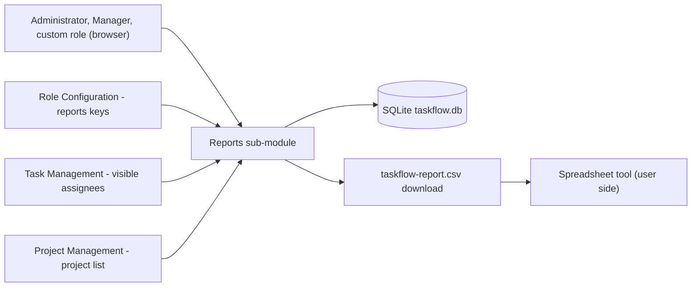
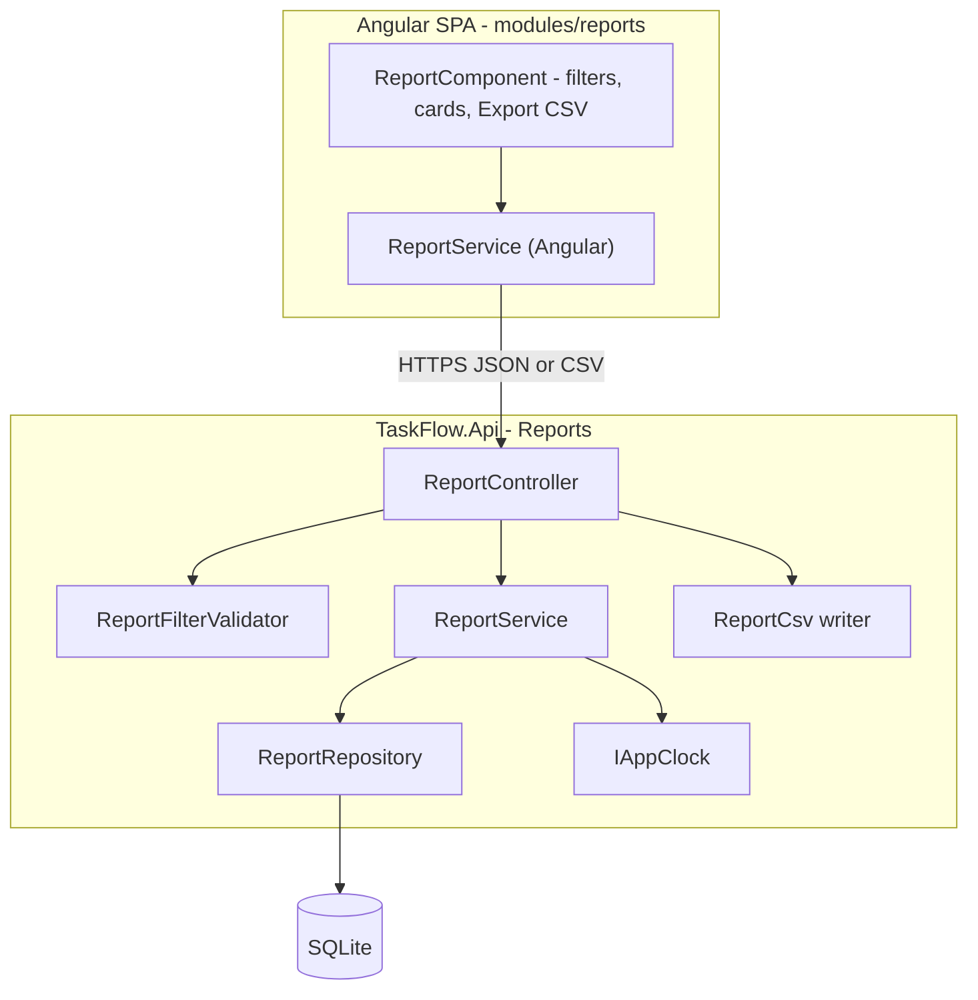
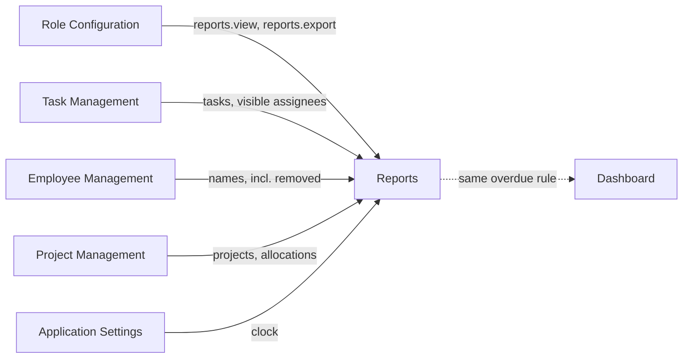
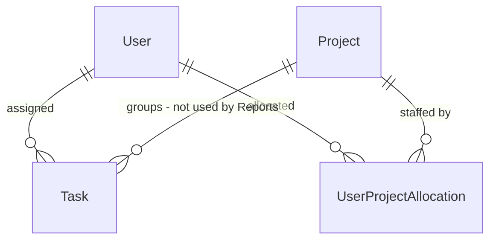
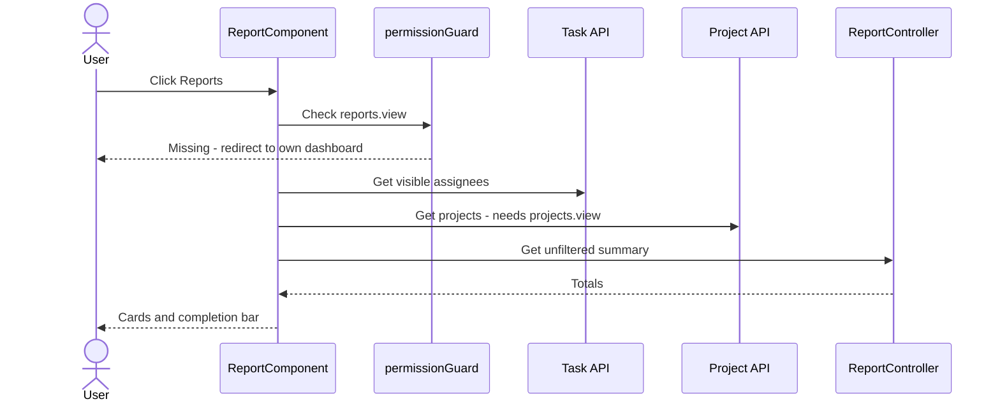
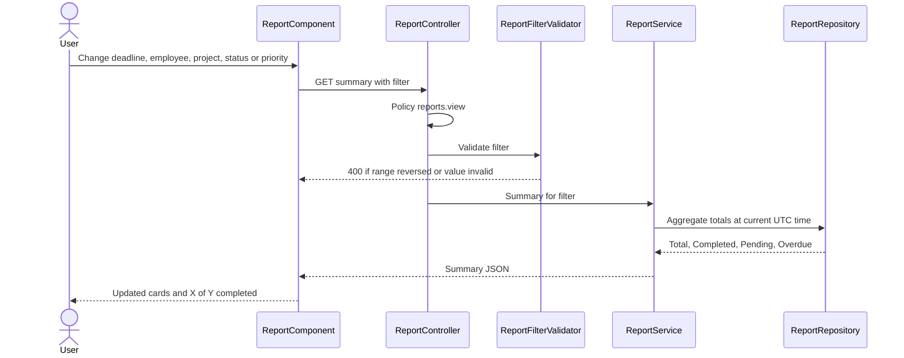
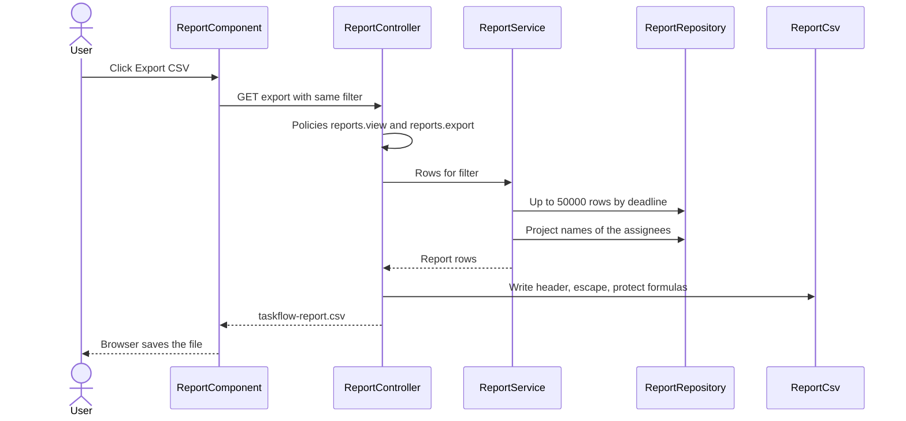

# High-Level Design – Reports

## TaskFlow – Intelligent Task Allocation & Tracking System

> **Document:** High-Level Design (sub-module 10 – RPT)  ·  **Version:** 1.0  ·  **Status:** Draft
> **Project type:** Personal Project (Skill Development)  ·  **Date:** 31-Oct-2026
> **Author:** Jojo George (jojogeorge3344@gmail.com)
> **Based on:** BRD – Reports v1.0, FRD – Reports v1.0 (FR-RPT-01 – FR-RPT-42), TDD v2.0, TaskFlow as built
> © 2026 Jojo George. All rights reserved.

---

## Document Control

| Version | Date | Author | Summary of changes |
|---|---|---|---|
| 1.0 | 31-Oct-2026 | Jojo George | Initial version of the Reports HLD (Task Reports screen, summary totals and CSV export), written from the Reports BRD / FRD and the code as built |

**Related documents**

| Document | Location |
|---|---|
| HLD – Overall (stack, deployment, cross-cutting design) | `../../00-Overall/HLD-TaskFlow-Overall.md` |
| BRD – Reports | `../../../BRD/05-Reports/05.1-Reports/BRD-Reports.md` |
| FRD – Reports | `../../../FRD/05-Reports/05.1-Reports/FRD-Reports.md` |
| LLD – Reports (classes, endpoints, queries, tests) | `../../../LLD/05-Reports/05.1-Reports/LLD-Reports.md` |
| HLD – Dashboard (charts and scoped analytics) | `../../01-Dashboard/01.1-Dashboard/HLD-Dashboard.md` |
| HLD – Task Management, Project Management (filter-list sources) | `../../02-TaskFlow-Monitoring/02.1-Task-Management/HLD-Task-Management.md`, `../../03-TaskFlow-Management/03.2-Project-Management/HLD-Project-Management.md` |
| TDD | `TF - Documents/TF - TDD/TDD-TaskFlow.md` (v2.0) – §2.3, §6.3, §6.6, §7.5, §8.7 |

---

## 1. Introduction

### 1.1 Purpose
This HLD describes how the Reports sub-module is built: its place in TaskFlow, its frontend and backend components, the
data it reads, how it uses Task Management and Project Management, its key flows (summary and CSV export), its security
model and the design decisions behind it. Classes, methods, queries, columns and the full endpoint detail are in the LLD.

### 1.2 Scope
In scope: the **Reports** menu item and the Task Reports screen (`/reports`), the summary totals (Total, Completed,
Pending, Overdue) and completion summary, the filters (deadline range, employee, project, status, priority) and the CSV
export `taskflow-report.csv`. Out of scope: charts and scoped analytics (Dashboard HLD), workload views (Employee Workload
HLD), and the shared stack, deployment and cross-cutting design (overall HLD).

### 1.3 Audience
Developer and reviewer (Jojo George), technical reviewers, and anyone maintaining reporting or exports.

### 1.4 Definitions & Abbreviations

| Term | Meaning |
|---|---|
| SPA | Single Page Application (Angular frontend) |
| Summary | The four totals and the completion percentage for the current filter |
| Export | The filtered task rows written as a CSV file |
| CSV | Comma-separated values (RFC 4180 style, CRLF line ends, header row) |
| Formula protection | Writing a leading `'` before a cell starting with `=`, `+`, `-` or `@` so spreadsheets do not run it |
| Allocation | Link between an employee and a project (`UserProjectAllocation`) |
| Organisation scope | Every holder of `reports.view` sees all non-deleted tasks |

---

## 2. System Context

### 2.1 Context Diagram

### 2.2 Actors & External Systems

| Actor / system | Interaction | Protocol |
|---|---|---|
| Administrator, Manager | Open Task Reports, filter, export | HTTPS (SPA → REST JSON; CSV download) |
| Custom role with `reports.view` | Same as above; export only with `reports.export` | HTTPS |
| Employee | No access by default | – |
| Task Management (internal) | Supplies the Employee filter list (assignees the user can see) | REST JSON |
| Project Management (internal) | Supplies the Project filter list (needs `projects.view`) | REST JSON |
| Role Configuration (internal) | Grants `reports.view` and `reports.export` | Database (role permissions) |
| Spreadsheet tool (user side) | Opens the downloaded CSV; not called by TaskFlow | File |

No external (third-party) service is called by this sub-module.

---

## 3. Architecture Goals, Constraints & Principles

### 3.1 Quality Goals

| Goal | How the architecture supports it |
|---|---|
| Security | View and export are separate permission keys checked by the server; export requires both |
| Safe output | The CSV writer applies formula protection and proper quoting to every cell |
| Correct totals | Overdue is derived at query time from status and deadline using the application clock (system decision D5) |
| History preservation | Soft-deleted tasks are left out; tasks of removed employees keep the person's name (system decision D6) |
| Performance | Totals come from one aggregate query; the export is capped at 50,000 rows |
| Maintainability | Controller → Service → Repository with a validator and a separate CSV writer |

### 3.2 Constraints
- Single SQLite database shared with all modules; no reporting replica.
- Export is built in memory and capped at 50,000 rows (code constant); only CSV is offered.
- Fixed permission catalogue: `reports.view`, `reports.export` (export requires view).
- No department filter and no per-user data scope in this release (BRD §3.2).

### 3.3 Architecture Principles
- One filter model for summary and export, so the file always holds the tasks behind the totals.
- Server-side validation of every filter value; the UI date pickers only help.
- Read-only module: no write, no notification, no mail, no activity entry.
- Output encoding at the edge: the CSV writer is the only place that formats cells.

---

## 4. Architecture Overview

### 4.1 Architecture Style
Reports follows the system-wide style – Angular SPA calling a layered ASP.NET Core REST API over SQLite – described in the
overall HLD (`../../00-Overall/HLD-TaskFlow-Overall.md`), which also covers the technology stack, deployment, the request
pipeline (JWT, session validation, MFA gate, permission policies, validation filter) and logging. This section only shows
the Reports slice.

### 4.2 Logical Architecture

### 4.3 Layers & Responsibilities

| Layer | Reports responsibility | May call |
|---|---|---|
| Presentation | Route guard, menu item, filter toolbar, count cards, completion bar, export button, blob download, error panel and toast | Reports API, Task and Project APIs (filter lists) |
| API / Controller | Bind the filter, enforce `reports.view` / `reports.export`, return JSON or a CSV file | Validator, service, CSV writer |
| Validation | Reject a reversed deadline range and undefined status / priority values | – |
| Service | Map the filter to criteria (UTC bounds), compute totals at the current time, build export rows with the assignee's projects | Repository, `IAppClock` |
| Repository | Read-only queries: aggregate totals, export rows, project names per user | Database |
| CSV writer | Header, escaping, formula protection, date format | – |

---

## 5. Component / Module Design

| Component | Responsibility | Key components (high level) | Depends on |
|---|---|---|---|
| Reports route and menu (frontend) | Show **Reports** only with `reports.view`; redirect others to their own dashboard | `REPORTS_ROUTES` with `permissionGuard`, `nav-items` | Auth session (permissions), `dashboardRouteFor` |
| Task Reports page (frontend) | Filters with instant reload, **Reset**, four cards, completion bar, **Export CSV** (shown with `reports.export`), "Exporting…" state, error panel and toast | `ReportComponent` | `ReportService` (Angular), task and project services, shared `local-day`, `save-blob`, toast |
| Report API client (frontend) | Call summary and export; drop empty filter values; download the CSV as a blob | `ReportService` (Angular) | Reports API |
| Reports API (backend) | Two read-only GET endpoints: summary and export | `ReportController` | Permission policies, validation filter |
| Filter validation (backend) | Deadline order; enum values | `ReportFilterValidator` (FluentValidation) | Shared `ValidationFilter` |
| Report logic (backend) | Totals, export rows, project list per assignee, row cap | `ReportService` | `ReportRepository`, `IAppClock` |
| CSV writer (backend) | RFC 4180 output with formula protection; file name and media type | `ReportCsv` | – |
| Report data access (backend) | Aggregate totals, ordered capped rows, allocation names | `ReportRepository` | SQLite via EF Core |

### 5.1 Module Interaction

| Interacting sub-module | Direction | What is exchanged |
|---|---|---|
| Role Configuration | In | Grants the two report keys; `reports.export` requires `reports.view` |
| Task Management | In (read + API) | Task data for totals and rows; `/api/v1/tasks/assignees` for the Employee list (scoped to the caller's task access) |
| Project Management | In (read + API) | Allocations and names for the Project filter and column; `/api/v1/projects` for the Project list (needs `projects.view`) |
| Employee Management | In (read) | Assignee names, including removed (soft-deleted) users |
| Application Settings | In (in-process) | `IAppClock` current UTC time for the overdue rule |
| Dashboard | Related | Same instant overdue rule; the Dashboard offers charts and scoped analytics, Reports offers totals and the file |

---

## 6. Data Architecture (high level)

### 6.1 Data Stores

| Store | Technology | Holds (for this sub-module) | Notes |
|---|---|---|---|
| Main database | SQLite (`taskflow.db`, EF Core) | Tasks, users, project allocations, projects | Read only; Reports owns no table and adds no migration |
| Browser | Blob download | `taskflow-report.csv` saved by the user | Not kept by TaskFlow |

### 6.2 Main Data Domains

| Domain | Owner sub-module | Use in Reports |
|---|---|---|
| Tasks | Task Management | Filters, totals, export rows; deleted tasks excluded |
| People | Employee Management | Employee filter value and Assignee column; removed users kept |
| Project allocations | Project Management | Project filter and Project column (assignee's allocations, not the task's own project) |
| Projects | Project Management | Project names, sorted by name |

### 6.3 Data Flow
1. The page sends the optional filter values; the deadline days are turned into UTC start and end instants by the browser.
2. The validator checks the range order and enum values; the service normalises the bounds to UTC.
3. Summary: the repository returns Total, Completed, Pending and Overdue in one aggregate query, with Overdue measured at the clock's current time.
4. Export: the repository returns up to 50,000 matching rows, earliest deadline first; the service adds each assignee's project names; the CSV writer formats the file.
5. The browser shows the cards and completion bar, or saves the file.

---

## 7. Integration Design

| Integration | Direction | Purpose | Failure behaviour |
|---|---|---|---|
| Task Management – `/api/v1/tasks/assignees` | Outbound (SPA) | Employee filter options | List stays empty; report still works (no message – R-RPT-04) |
| Project Management – `/api/v1/projects` | Outbound (SPA) | Project filter options | 403 without `projects.view`; list stays empty with no message (R-RPT-04) |
| Application Settings – `IAppClock` | Inbound (in-process) | Current UTC time for Overdue | – |
| Browser file download | Outbound (response) | CSV attachment `taskflow-report.csv` (`text/csv`, UTF-8) | Any error → toast "Could not export the report. Please try again." |

API surface of the sub-module (details in the LLD): `/api/v1/reports` (summary, JSON) and `/api/v1/reports/export`
(CSV file). Both are GET and read-only. No external service is called.

---

## 8. Key Flows (high level)

### 8.1 Open Task Reports (access and filter lists)

### 8.2 Filter the report (main business flow)

### 8.3 Export CSV (integration flow)

### 8.4 Background job
_Not applicable for this sub-module._ Reports run on request only; there are no scheduled or emailed reports.

---

## 9. Security Architecture

| Concern | Approach |
|---|---|
| Authentication | Shared JWT bearer token + refresh-token cookie with session revalidation and MFA gate (overall HLD) |
| Authorization | Controller-level `reports.view` covers both endpoints; export additionally needs `reports.export`. Defaults: Administrator and Manager granted, Employee denied, custom role configurable; the catalogue refuses `reports.export` without `reports.view` |
| Data scope | Organisation-wide for every holder of `reports.view` (no Own / Team narrowing) – see D-RPT-1 and R-RPT-01 |
| Input validation | FluentValidation on the filter (range order, enum values); model binding rejects unparseable values (400) |
| Output safety | Formula protection and quoting in the CSV writer (NFR-RPT-02) |
| Frontend | Route guard and menu item on `reports.view`; **Export CSV** button only with `reports.export`. UI hiding is a convenience; the server is the authority |
| Data protection | Export holds task and person names only; no secrets; nothing stored server-side |
| Auditing | Refused requests (403) are logged by the shared denied-action audit handler (user, method, path, policy); views and exports create no activity entry |

---

## 10. Technology Stack

The shared stack (ASP.NET Core / .NET 10, EF Core 10.0.12 with SQLite, Angular 19.2, JWT) is described in the overall HLD
(`../../00-Overall/HLD-TaskFlow-Overall.md`). Sub-module-specific items:

| Area | Technology | Version | Reason |
|---|---|---|---|
| Filter validation | FluentValidation | 12.2.0 | Same validation pipeline as the rest of the API |
| CSV output | In-house writer (`ReportCsv`) on .NET | net10.0 | Small, dependency-free, with formula protection |
| Data access | EF Core LINQ aggregate on SQLite | 10.0.12 | Totals computed in one query |
| File download | Angular `HttpClient` blob + shared save helper | Angular ^19.2.0 | Keeps the bearer token on the request; no public file URL |

---

## 11. Deployment Architecture

_Not applicable for this sub-module._ Reports run inside the single `TaskFlow.Api` process and the Angular SPA; they add
no process, port, folder or configuration section. Deployment and environments are in the overall HLD
(`../../00-Overall/HLD-TaskFlow-Overall.md`). Configuration read: `ConnectionStrings:Default` (`<secret>`) and the shared
`Jwt:*` lifetimes; the 50,000-row cap, file name and media type are code constants.

---

## 12. Non-Functional Design

| Area | Design decision |
|---|---|
| Performance | Summary in one aggregate, no-tracking query using the deadline and assignee indexes; export capped at 50,000 rows. > ⚠️ To be confirmed: a measured response-time target (NFR-RPT-06) |
| Scalability | Single API instance on SQLite; export built in memory, bounded by the row cap (NFR-RPT-04) |
| Reliability | Stateless, read-only requests; a failed export can simply be repeated |
| Availability | Same as the API process (overall HLD) |
| Security | Server-side view / export checks with audit of refusals (NFR-RPT-01); formula protection (NFR-RPT-02) |
| Compatibility | Header row, comma separator, quoting, CRLF, `yyyy-MM-dd` dates (NFR-RPT-03) |
| Usability | Instant reload on filter change, **Reset**, plain-language error panel and toast (NFR-RPT-05) |
| Maintainability | Controller → Service → Repository; CSV writer and validator as separate units with their own tests |
| Observability | Shared request logging and denied-action audit |
| Backup & Recovery | Nothing owned; covered by the data-folder backup in the overall HLD |

---

## 13. Design Decisions

| ID | Decision | Alternatives considered | Rationale |
|---|---|---|---|
| D-RPT-1 | Organisation-wide data for every holder of `reports.view` | Own / Team scope per caller (original BRD FR6) | Matches the dashboards' organisation view for report users; access is controlled by who holds the key. > ⚠️ To be confirmed: acceptance for Managers (R-RPT-01) |
| D-RPT-2 | Separate `reports.view` and `reports.export` keys; export requires view | One key for both | Administrators can allow on-screen totals without allowing data to leave the system |
| D-RPT-3 | One filter model shared by summary and export | Separate export parameters | The file always contains the tasks behind the totals |
| D-RPT-4 | Totals in one aggregate query; Overdue derived at the current clock time | Stored overdue flag; several count queries | Never stale (system decision D5); one round trip |
| D-RPT-5 | CSV built in memory, capped at 50,000 rows, earliest deadline first | Streamed export; no cap; Excel / PDF | Simple and bounded for a single-server deployment; CSV opens everywhere. > ⚠️ To be confirmed: warn when the cap is reached (R-RPT-02) |
| D-RPT-6 | Formula protection and quoting in a dedicated CSV writer | Plain string join; third-party CSV library | Prevents spreadsheet formula injection; no extra dependency |
| D-RPT-7 | Project filter and column use the assignee's allocations | The task's own project | Reports what each person is staffed on, as built. > ⚠️ To be confirmed: use the task's project (R-RPT-06) |
| D-RPT-8 | Keep removed (soft-deleted) users' tasks and names; exclude deleted tasks | Hide everything linked to removed users | Finished work still counts (system decision D6, BR-RPT-06) |
| D-RPT-9 | Deadline days converted to UTC instants in the browser; server treats unspecified dates as UTC | Convert in the application timezone on the server | Simple, as built. > ⚠️ To be confirmed: move to the application timezone (R-RPT-03) |

---

## 14. Risks, Assumptions & Open Issues

| Type | Description | Mitigation / owner |
|---|---|---|
| Risk | Managers see tasks outside their team (organisation scope) (R-RPT-01) | Grant `reports.view` only to trusted roles. > ⚠️ To be confirmed: per-user scope – Jojo George |
| Risk | Exports over 50,000 rows are cut without a warning (R-RPT-02) | Narrow the filters. > ⚠️ To be confirmed: warning – Jojo George |
| Risk | Deadline-day bounds follow the browser's time zone, not the application timezone (R-RPT-03) | > ⚠️ To be confirmed – Jojo George |
| Risk | Project / Employee list stays empty without `projects.view` or on a load failure, with no message (R-RPT-04) | Grant `projects.view` with `reports.view`. > ⚠️ To be confirmed: message – Jojo George |
| Risk | Employee list follows Task List access while totals are organisation-wide (R-RPT-05) | Review custom role grants – Jojo George |
| Risk | Reports count Cancelled tasks in Total and all open tasks as Pending, while the dashboards exclude Cancelled and split Pending / In progress (BR-RPT-10) | > ⚠️ To be confirmed: align – Jojo George |
| Risk | The server's validation message is not shown; the screen shows the generic load error (the date pickers normally prevent the case) | > ⚠️ To be confirmed – Jojo George |
| Assumption | Data volume fits on-request aggregation and in-memory export on SQLite | Re-check if task volume grows |
| Open issue | > ⚠️ To be confirmed: measured response-time target (NFR-RPT-06) | Jojo George |

---

## 15. Traceability (requirements → components)

| FRD item(s) | Module / component | Section |
|---|---|---|
| FR-RPT-01, FR-RPT-02 | Reports route and menu (`REPORTS_ROUTES`, `permissionGuard`, `nav-items`) | §5, §8.1 |
| FR-RPT-03 | Reports API (`ReportController`, `reports.view` policy, denied-action audit) | §5, §9 |
| FR-RPT-04, FR-RPT-05, FR-RPT-06 | Task Reports page (`ReportComponent`) + filter-list integrations | §5, §7, §8.1 |
| FR-RPT-07 | Task Reports page (count cards) | §5 |
| FR-RPT-08, FR-RPT-09, FR-RPT-10, FR-RPT-11, FR-RPT-12, FR-RPT-14 | Report logic (`ReportService`) + `ReportRepository` aggregate + `IAppClock` | §5, §8.2, D-RPT-4 |
| FR-RPT-13 | Task Reports page (completion bar) | §5 |
| FR-RPT-15, FR-RPT-16 | Page date pickers (local day to UTC) + `ReportService` bounds + repository filter | §6.3, D-RPT-9 |
| FR-RPT-17 | Task Reports page (date picker limits) | §5 |
| FR-RPT-18 | Filter validation (`ReportFilterValidator`) | §8.2, §9 |
| FR-RPT-19, FR-RPT-23, FR-RPT-24, FR-RPT-25 | `ReportRepository` filters; validator for enum values | §5, §9 |
| FR-RPT-20 | Task Management integration (`/api/v1/tasks/assignees`) | §7 |
| FR-RPT-21 | `ReportRepository` allocation filter | §6.2, D-RPT-7 |
| FR-RPT-22 | Project Management integration (`/api/v1/projects`, `projects.view`) | §7 |
| FR-RPT-26, FR-RPT-27 | Task Reports page (instant reload, **Reset**) | §5 |
| FR-RPT-28, FR-RPT-29 | `ReportRepository` (deleted tasks out, removed users kept) | §6.2, D-RPT-8 |
| FR-RPT-30 | `ReportService` (organisation scope) | §9, D-RPT-1 |
| FR-RPT-31 | Task Reports page (**Export CSV** with `reports.export`) | §5, §9 |
| FR-RPT-32 | Reports API (`reports.view` + `reports.export` policies, audit) | §8.3, §9, D-RPT-2 |
| FR-RPT-33, FR-RPT-34 | `ReportService` + `ReportRepository` (shared filter, order, 50,000 cap) | §8.3, D-RPT-3, D-RPT-5 |
| FR-RPT-35, FR-RPT-36, FR-RPT-38, FR-RPT-39 | CSV writer (`ReportCsv`) | §8.3, D-RPT-6 |
| FR-RPT-37 | `ReportService` project names per assignee | §8.3, D-RPT-7 |
| FR-RPT-40, FR-RPT-41 | Task Reports page + Angular `ReportService` (blob download, toast) | §5, §7 |
| FR-RPT-42 | Whole sub-module (read-only, no side effects) | §3.3 |

All 42 FRs (FR-RPT-01 – FR-RPT-42) are traced to at least one component.

---
© 2026 Jojo George. All rights reserved. Unauthorized copying or distribution of this document is prohibited.
