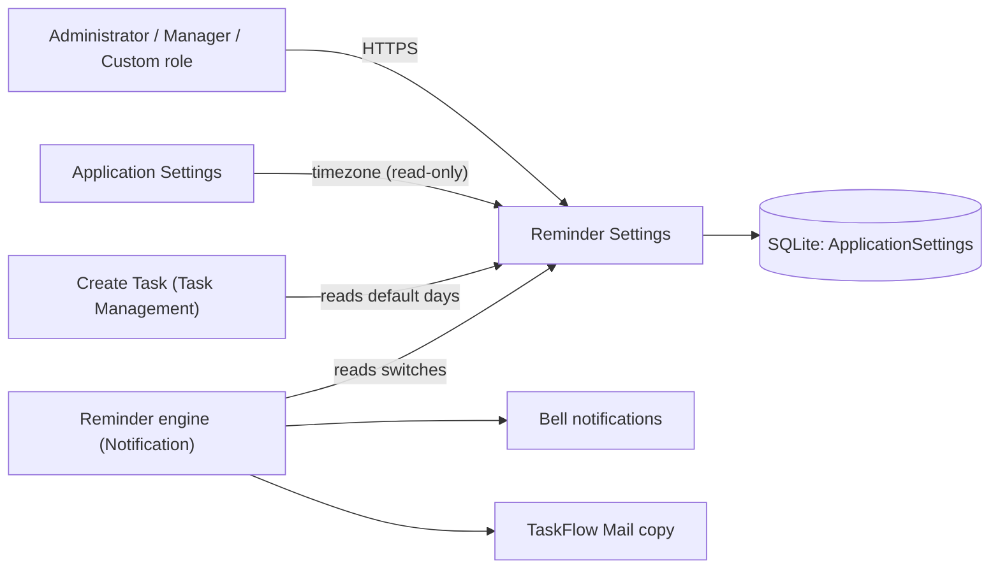
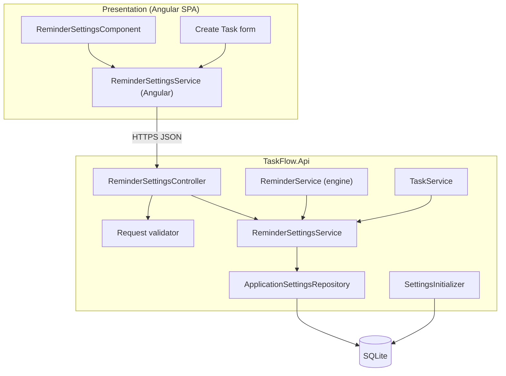
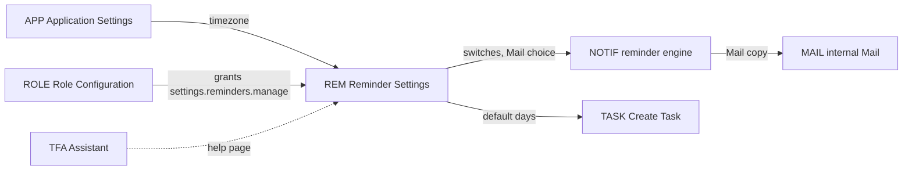
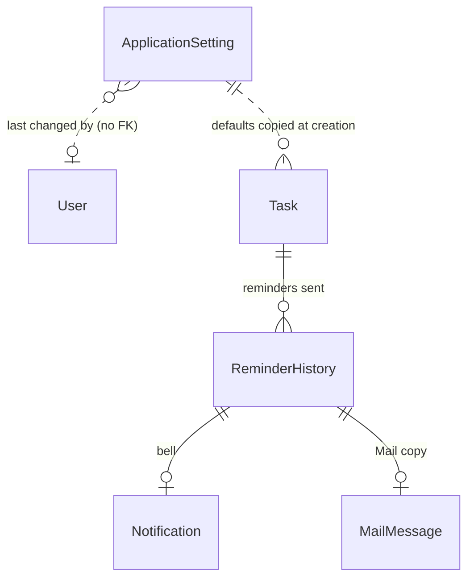
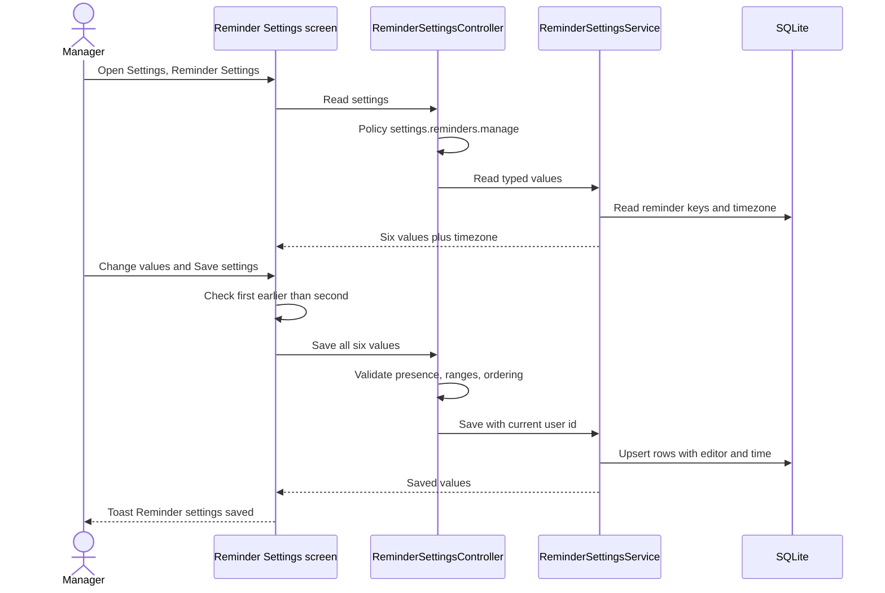
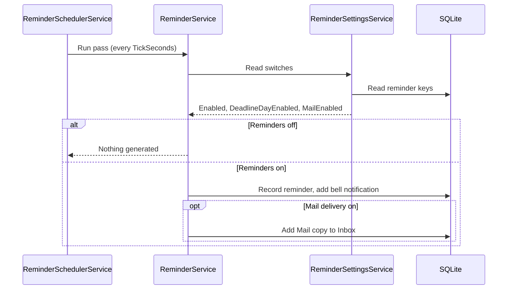
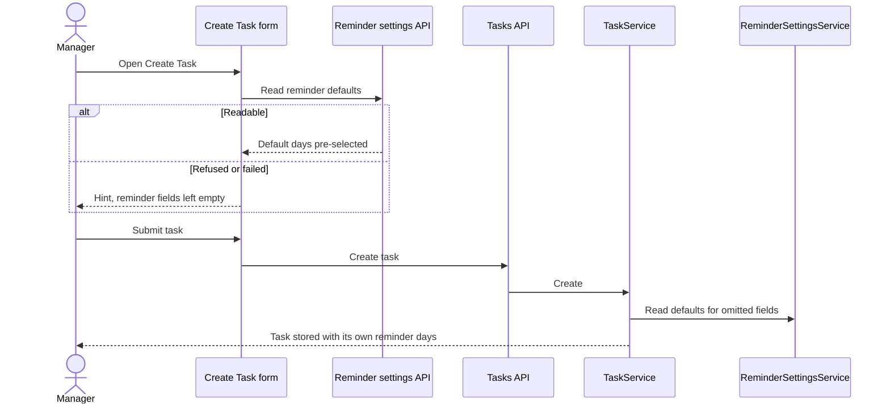

# High-Level Design – Reminder Settings

## TaskFlow – Intelligent Task Allocation & Tracking System

> **Document:** High-Level Design  ·  **Version:** 1.0  ·  **Status:** Draft
> **Project type:** Personal Project (Skill Development)  ·  **Date:** 31-Oct-2026
> **Author:** Jojo George (jojogeorge3344@gmail.com)
> **Based on:** BRD-Reminder-Settings v1.0, FRD-Reminder-Settings v1.0
> **Module:** Settings  ·  **Sub-module:** 06.1 Reminder Settings  ·  **Code:** REM
> © 2026 Jojo George. All rights reserved.

---

## Document Control

| Version | Date | Author | Summary of changes |
|---|---|---|---|
| 1.0 | 31-Oct-2026 | Jojo George | Initial version |

**Related documents:**

| Document | Location |
|---|---|
| Overall HLD (stack, deployment, cross-cutting design) | `../../00-Overall/HLD-TaskFlow-Overall.md` |
| BRD – Reminder Settings | `../../../BRD/06-Settings/06.1-Reminder-Settings/BRD-Reminder-Settings.md` |
| FRD – Reminder Settings | `../../../FRD/06-Settings/06.1-Reminder-Settings/FRD-Reminder-Settings.md` |
| LLD – Reminder Settings | `../../../LLD/06-Settings/06.1-Reminder-Settings/LLD-Reminder-Settings.md` |
| HLD – Notification (reminder engine) | `../../04-Communication/04.2-Notification/HLD-Notification.md` |
| HLD – Application Settings (timezone, in-app switch) | `../06.2-Application-Settings/HLD-Application-Settings.md` |
| HLD – Task Management (Create Task) | `../../02-TaskFlow-Monitoring/02.1-Task-Management/HLD-Task-Management.md` |
| TDD | `TF - Documents/TF - TDD/TDD-TaskFlow.md` §11.3 (Settings and per-task intervals) |

---

## 1. Introduction

### 1.1 Purpose
This HLD describes how Reminder Settings is built: where it sits in TaskFlow, which frontend and backend components
make it up, which data it owns, how the reminder engine and Create Task consume it, and the design decisions behind
it. Class-, table- and column-level detail is in the LLD.

### 1.2 Scope
In scope: the Reminder Settings screen (`/settings/reminders`), its API (`/api/v1/settings/reminders`, read and save),
the service that reads and writes the six organization-wide reminder values, their storage in the shared settings
table, start-up defaults, and the read paths used by the reminder engine and Create Task.

Out of scope: reminder generation, scheduling and de-duplication (Notification HLD), the timezone and in-app switch
(Application Settings HLD), per-task reminder days (Task Management HLD).

### 1.3 Audience
Developer, reviewer and tester of TaskFlow; the product owner for the design decisions.

### 1.4 Definitions & Abbreviations

| Term | Meaning |
|---|---|
| SPA | Single Page Application (the Angular frontend) |
| Reminder run | One pass of the reminder engine (`ReminderSchedulerService`), every 60 seconds by default |
| Key/value settings table | `ApplicationSettings`: one row per setting key, shared with Application Settings |
| Mail copy | A system message in the recipient's internal TaskFlow Mail inbox, created with a reminder |
| Policy | ASP.NET Core authorization policy `perm:<key>` for a permission key |

---

## 2. System Context

### 2.1 Context Diagram

### 2.2 Actors & External Systems

| Actor / system | Interaction | Protocol |
|---|---|---|
| Administrator, Manager, Custom role with `settings.reminders.manage` | View and save the reminder configuration | HTTPS / JSON (SPA → REST API) |
| Reminder engine (Notification sub-module) | Reads the switches and the Mail choice at the start of every run | In-process service call |
| Create Task (Task Management sub-module) | Reads the default first/second reminder and overdue frequency for new tasks | HTTPS from the SPA; in-process on the server |
| Application Settings | Owns the application timezone shown read-only here | Shared settings table |
| External systems | None – reminder copies go to internal Mail only, no SMTP | – |

---

## 3. Architecture Goals, Constraints & Principles

### 3.1 Quality Goals

| Goal | How the architecture supports it |
|---|---|
| Changeable without code | Values live in the database (key/value rows), not in code or `appsettings.json`; the engine reads them on every run (NFR-REM-04) |
| Reliability | Missing rows fall back to code defaults and are inserted at start-up without overwriting saved values (NFR-REM-05) |
| Security | One permission key guards both read and save on the server; the menu and route guard only hide the screen (NFR-REM-02) |
| Separation | The screen only stores configuration; the reminder engine alone generates reminders (NFR-REM-06) |
| Consistency | The same ordering rule (first earlier than second) is checked on the screen, in the request validator and again in Create Task |

### 3.2 Constraints
- One organization per installation, so exactly one set of reminder values.
- Single-server deployment with one SQLite file; no cache layer, so every read goes to the database.
- The screen offers fixed choices (3/2/1 days, 1/0 days, daily/weekly); the API accepts the wider ranges 1–30 and 0–30.

### 3.3 Architecture Principles
- Controller → Service → Repository, commits through the unit of work (overall HLD).
- Configuration is data: one row per setting key, typed by the service, never by the caller.
- Validation twice: on the screen for usability, on the server as the authority.
- Settings are organization-wide; no personal or team scope.

---

## 4. Architecture Overview

### 4.1 Architecture Style
A screen of the Angular SPA calls a REST controller; the controller delegates to a settings service that maps the six
typed values to rows of the shared key/value table. Two other server-side services (reminder engine, task service)
use the same settings service directly, in process.

### 4.2 Logical Architecture

### 4.3 Layers & Responsibilities

| Layer | Responsibility in this sub-module | May call |
|---|---|---|
| Presentation | Screen with switches and drop-downs, client-side ordering check, loading/error/saved states; menu entry and route guard | API |
| API / Controllers | `ReminderSettingsController`: read and save, permission policy at class level, resolves the current user for "last changed by" | Services |
| Validation | Request validator: all six values present, ranges, first greater than second | – |
| Services | `ReminderSettingsService`: typed view over the setting rows, defaults for missing values, writes editor and time; also used by the engine and the task service | Repositories |
| Repositories | `ApplicationSettingsRepository` (shared): read values by key, load rows for update | Database |
| Start-up | `SettingsInitializer`: inserts missing setting rows with their defaults | Database |

---

## 5. Component / Module Design

| Module / component | Responsibility | Key components (high level) | Depends on |
|---|---|---|---|
| Reminder Settings screen | Show and edit the six values and the read-only timezone | `ReminderSettingsComponent`, Angular `ReminderSettingsService`, shared reminder option lists | Reminder Settings API |
| Reminder Settings API | Authorize, validate and route read/save | `ReminderSettingsController`, request validator, global validation filter | Reminder settings service |
| Reminder settings service | Typed read with defaults, full save, timezone pass-through | `ReminderSettingsService` | Settings repository, setting key constants |
| Settings storage (shared) | Key/value rows for reminder and application settings | `ApplicationSettingsRepository`, entity `ApplicationSetting` | SQLite |
| Defaults at start-up (shared) | Create missing rows, never overwrite | `SettingsInitializer` | SQLite |
| Consumers (other sub-modules) | Use the values | `ReminderService` (Notification), `TaskService` and the Create Task form (Task Management) | Reminder settings service / API |

### 5.1 Module Interaction

| Interaction | Direction | What is exchanged |
|---|---|---|
| REM → NOTIF | Read by the engine at the start of each run | Reminders on/off, deadline-day on/off, Mail delivery on/off |
| REM → TASK | Read when a task is created | Default first reminder, second reminder, overdue frequency |
| APP → REM | Read on every load | Application timezone (display only) |
| NOTIF → MAIL | Write, by the engine | One system message per reminder and recipient when Mail delivery is on |
| ROLE → REM | Permission grant | Who may open and save the screen |
| TFA → REM | Knowledge page | The assistant explains reminder settings from its help page |

---

## 6. Data Architecture (high level)

### 6.1 Data Stores

| Store | Technology | Holds | Notes |
|---|---|---|---|
| Main database | SQLite (`taskflow.db`, EF Core) | Six reminder setting rows in the shared key/value table, with last editor and time | One row per key; unique key; shared with Application Settings |
| Code defaults | Setting key constants | Default values used when a row is missing | Reminders on, deadline day on, 2 days, 1 day, daily, Mail on |

### 6.2 Main Data Domains

| Domain | Owner | Use here |
|---|---|---|
| `ApplicationSetting` (reminder keys and `Notification.MailEnabled`) | REM (shared table with APP) | Read and written |
| `ApplicationSetting` (`Application.Timezone`) | APP | Read only |
| `Task` reminder days | TASK | Not written; receives the defaults when a task is created |
| `ReminderHistory`, `Notification`, `MailMessage` | NOTIF / MAIL | Not touched; produced by the engine using these settings |

### 6.3 Data Flow
1. Start-up inserts any missing reminder row with its default (saved values stay).
2. The screen loads the six values plus the timezone; the user saves all six together; the service writes them with
   the editor's id and the time.
3. Each reminder run reads the switches: off = nothing generated; deadline-day off = no "due today" reminder; Mail on =
   a Mail copy next to every bell notification.
4. Create Task reads the default days; the task stores its own copy, so later changes to the defaults do not touch it.

---

## 7. Integration Design

| Integration | Direction | Purpose | Failure behaviour |
|---|---|---|---|
| Reminder engine (in process) | Inbound read | Switches and Mail choice per run | A missing or unreadable row counts as its default, so reminders keep running |
| Create Task (SPA and server) | Inbound read | Default days for new tasks | When the SPA cannot read the defaults (for example no `settings.reminders.manage`), it sends no reminder values and the server applies the saved defaults |
| Application Settings (shared table) | Outbound read | Timezone shown read-only | Missing row → configured fallback timezone |
| Internal Mail | Indirect (through the engine) | Reminder copies | Controlled by the Mail switch; no external service |
| External services | – | None | – |

---

## 8. Key Flows (high level)

### 8.1 Load and save reminder settings

### 8.2 Reminder run uses the settings (background job)

### 8.3 Create Task picks up the default days

---

## 9. Security Architecture

| Concern | Approach |
|---|---|
| Authentication | JWT bearer access token and refresh cookie; session revalidated on every request (overall HLD) |
| Authorization | Class-level `settings.reminders.manage` policy on `ReminderSettingsController`, so read and save are both refused without it (FR-REM-22); SPA hides the menu item and `permissionGuard` sends the user to their dashboard (FR-REM-21) |
| Default grants | Administrator (always all permissions) and Manager (default grant); Employee denied; custom roles configurable on Role Configuration |
| Input validation | Request validator on save (presence, ranges, ordering); refusals return 400 with an `errors` map that the screen shows next to the fields |
| Data protection | The values are not secret; no secret is stored or returned |
| Auditing | Only last editor and time per row; refused requests are logged by the denied-action audit handler; no change history |

---

## 10. Technology Stack

Reminder Settings uses the shared TaskFlow stack without additions: Angular 19 SPA, ASP.NET Core Web API on .NET 10,
EF Core 10 with SQLite, FluentValidation 12 for the request validator. Versions and rationale are in the overall HLD
(`../../00-Overall/HLD-TaskFlow-Overall.md`, §10).

---

## 11. Deployment Architecture

Reminder Settings runs inside the single `TaskFlow.Api` process and the SPA it serves; there is no separate component
to deploy. Its values live in the main SQLite database in the data folder. The consuming reminder engine is enabled and
timed by `Reminders:SchedulerEnabled` (default `true`) and `Reminders:TickSeconds` (default 60); the timezone fallback
is `Application:Timezone`. Environments, hosting and backup are described in the overall HLD
(`../../00-Overall/HLD-TaskFlow-Overall.md`, §11).

---

## 12. Non-Functional Design

| Area | Design decision |
|---|---|
| Performance | Read = one query for seven keys by unique key; save = one transaction for six rows (NFR-REM-01) |
| Scalability | Single organization, single instance; the table holds a handful of rows |
| Reliability | Defaults in code for any missing or unreadable row; start-up insert never overwrites (NFR-REM-05); the engine reads the values on every run, so saves apply without restart (NFR-REM-04) |
| Availability | No dependency outside the API process and the database |
| Maintainability | Settings service is the only reader/writer of the reminder keys; engine and task service depend on its interface (NFR-REM-06); module structure enforced by architecture tests |
| Usability / accessibility | Every control has a label and hint; server errors are mapped onto the matching form control (NFR-REM-03, NFR-REM-08) |
| Observability | Request log per call; denied requests logged; engine logs how many reminders it generated |
| Backup & Recovery | Part of the database file; see overall HLD |

---

## 13. Design Decisions

| ID | Decision | Alternatives considered | Rationale |
|---|---|---|---|
| D-REM-1 | Store reminder settings as rows of the shared key/value table `ApplicationSettings` | A dedicated reminder-settings table with typed columns; values in `appsettings.json` | No migration per new setting; runtime-editable; shared tooling (initializer, repository) with Application Settings |
| D-REM-2 | Defaults defined in code and inserted at start-up only when missing | Seed once in a migration; reset on every start | Saved values are never overwritten; a missing row never stops reminders |
| D-REM-3 | Global values are only defaults; each task copies its own reminder days at creation | Tasks reference the global values | Changing defaults never changes existing tasks (BR-REM-05); per-task days remain editable |
| D-REM-4 | The engine reads the settings at the start of every run | Cache settings in memory; restart to apply | Changes apply on the next run without restart and without cache invalidation |
| D-REM-5 | Save requires all six values; no partial update | PATCH-style partial save filling gaps with defaults | Prevents silent resets; the screen always sends the full form (FR-REM-14) |
| D-REM-6 | Mail delivery switch controls internal Mail copies only | Outbound SMTP email (original Screen 13/14) | No credentials to store, works offline; SMTP superseded by internal Mail |
| D-REM-7 | Timezone shown read-only, owned by Application Settings | Edit the timezone on both screens | One owner for the one application timezone (BR-REM-07) |
| D-REM-8 | Create Task falls back to server-side defaults when the SPA cannot read reminder settings | Open the read endpoint to every signed-in user | Keeps the read behind `settings.reminders.manage` while every task still gets the configured defaults |

---

## 14. Risks, Assumptions & Open Issues

| Type | Description | Mitigation / owner |
|---|---|---|
| Risk | Reminders switched off by mistake (R-REM-01) | Hint on the switch; permission limited to `settings.reminders.manage` – Jojo George |
| Risk | No history of earlier values (R-REM-04) | Last editor and time per row – Jojo George |
| Risk | Users without `settings.reminders.manage` (for example a custom role with `tasks.create`) do not see the default days pre-selected on Create Task | Server applies the defaults (D-REM-8); hint on the form – Jojo George |
| Assumption | One organization per installation | Jojo George |
| Open issue | ⚠️ To be confirmed: as built, reminder bell notifications are written by the reminder engine directly and are **not** suppressed by the in-app notifications switch of Application Settings; FRD UC-REM-03 E1 states the opposite. Decide which behaviour is intended. | Jojo George |
| Open issue | ⚠️ To be confirmed: whether any SMTP channel should be tied to **Also deliver reminders to Mail** (currently internal Mail only). | Jojo George |
| Open issue | ⚠️ To be confirmed: exact wording of server messages for a missing or out-of-range value (standard validation wording). | Jojo George |
| Open issue | The screen offers fixed choices while the API accepts 1–30 / 0–30; a wider saved value is shown as an extra list entry (FR-REM-23). | Jojo George |

---

## 15. Traceability (requirements → components)

| FRD item | Module / component | Section |
|---|---|---|
| FR-REM-01 | `ReminderSettingsComponent` → `ReminderSettingsController` (read) → `ReminderSettingsService` | §4.2, §8.1 |
| FR-REM-02 | `ReminderSettingsComponent` (loading and error states) | §4.3 |
| FR-REM-03 | `ReminderSettingsComponent`, `ReminderSettingsService` (save) | §5, §8.1 |
| FR-REM-04 | `ReminderService` (engine) reading `ReminderSettingsService` | §8.2 |
| FR-REM-05 | `ReminderSettingsComponent`; `ReminderService` deadline-day handling | §8.2 |
| FR-REM-06 | `ReminderSettingsComponent` with shared reminder option lists | §5 |
| FR-REM-07 | `ReminderSettingsComponent` with shared reminder option lists | §5 |
| FR-REM-08 | `ReminderSettingsComponent` (overdue frequency) | §5 |
| FR-REM-09 | `ReminderSettingsService` (Mail switch); `ReminderService` Mail copy | §7, §8.2 |
| FR-REM-10 | `ReminderService` (bell always written for a reminder) | §8.2 |
| FR-REM-11 | `ReminderSettingsService` (timezone pass-through, never written) | §6.2, D-REM-7 |
| FR-REM-12 | `ReminderSettingsComponent` (client ordering check) | §8.1 |
| FR-REM-13 | Request validator via the validation filter | §4.3, §9 |
| FR-REM-14 | Request validator; `ReminderSettingsService` full save | D-REM-5 |
| FR-REM-15 | `ReminderSettingsService` defaults; `SettingsInitializer` | §6.3, D-REM-2 |
| FR-REM-16 | Create Task form and `TaskService` reading the defaults | §8.3, D-REM-8 |
| FR-REM-17 | Per-task copy of reminder days (Task Management) | D-REM-3 |
| FR-REM-18 | `ReminderService` reads settings every run | D-REM-4 |
| FR-REM-19 | `ReminderSettingsService` (editor and time on each row) | §6.1 |
| FR-REM-20 | `ReminderSettingsComponent` (toast, saved tick, error) | §8.1 |
| FR-REM-21 | Navigation builder and `permissionGuard` | §9 |
| FR-REM-22 | `ReminderSettingsController` class-level policy | §9 |
| FR-REM-23 | `ReminderSettingsComponent` with the shared option helper (extra list entry) | §14 |

---
© 2026 Jojo George. All rights reserved. Unauthorized copying or distribution of this document is prohibited.
