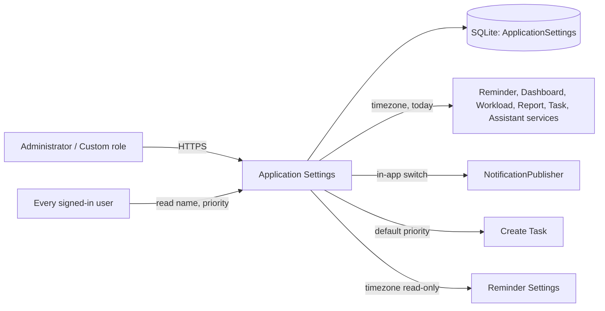
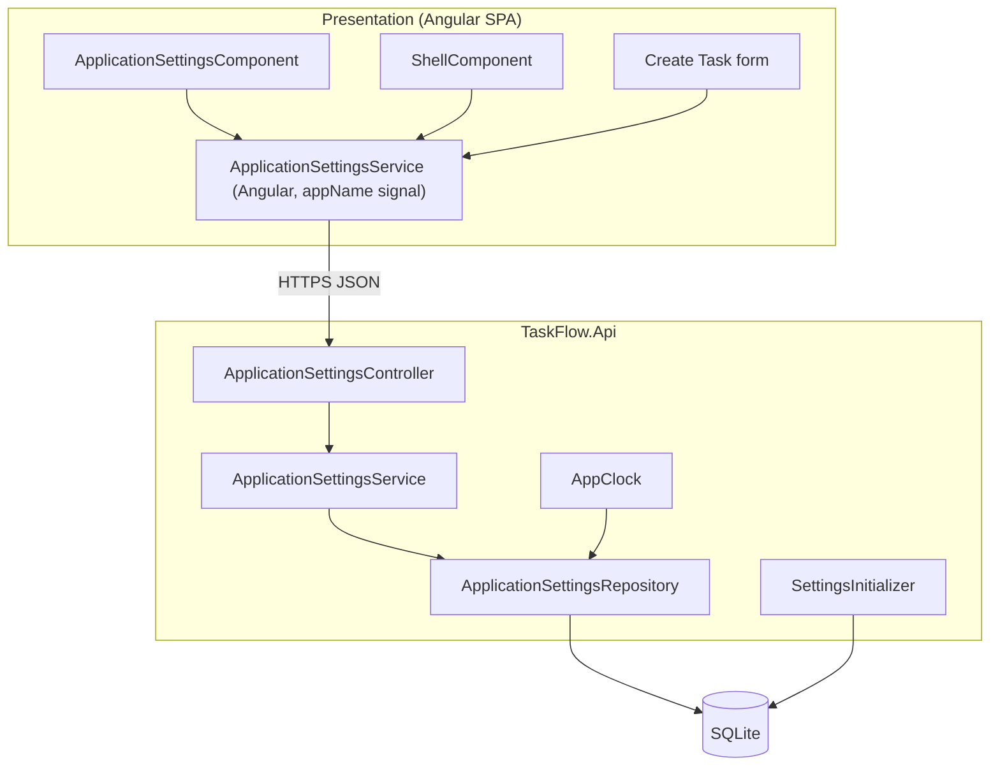
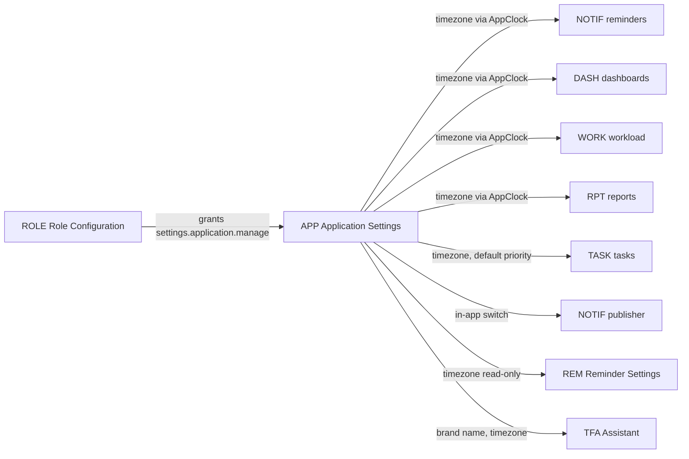
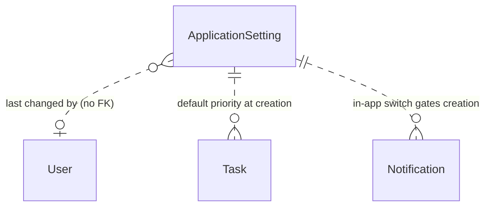
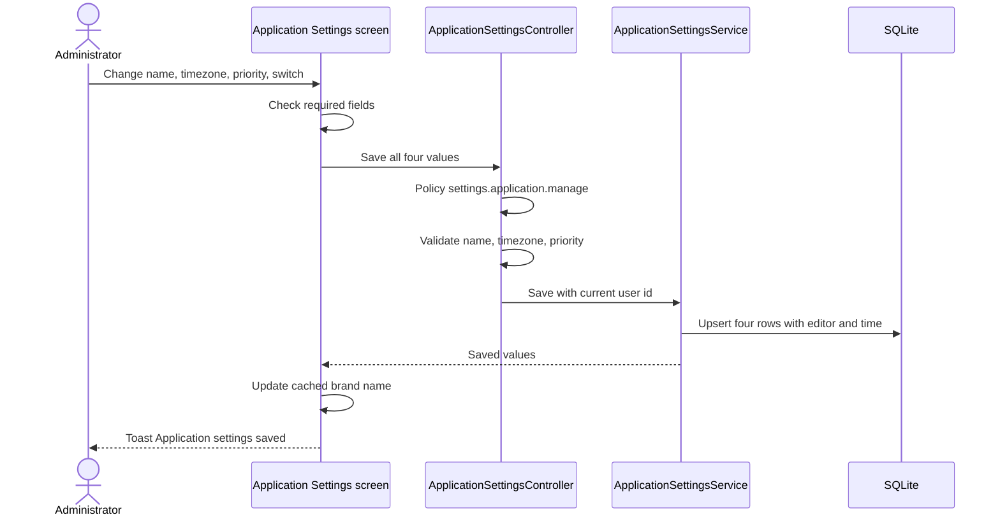
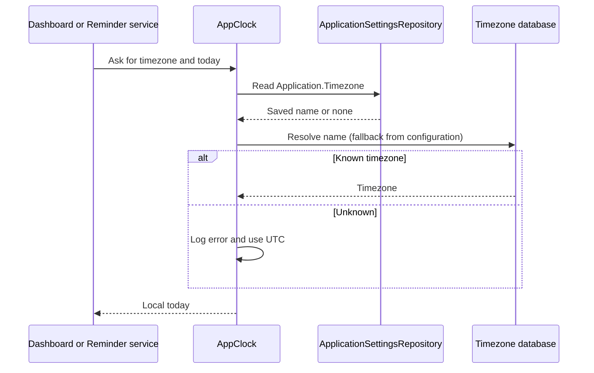
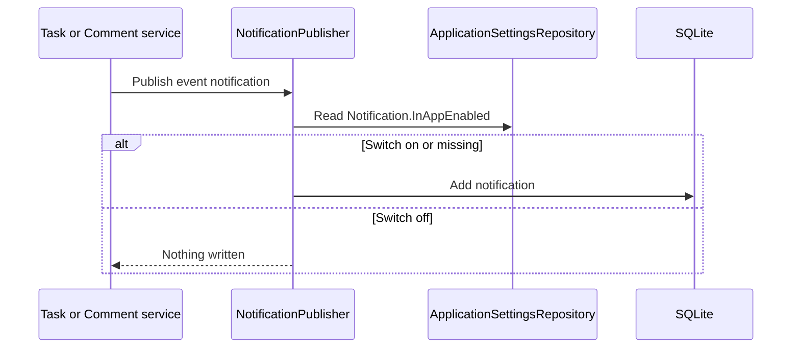

# High-Level Design – Application Settings

## TaskFlow – Intelligent Task Allocation & Tracking System

> **Document:** High-Level Design  ·  **Version:** 1.0  ·  **Status:** Draft
> **Project type:** Personal Project (Skill Development)  ·  **Date:** 31-Oct-2026
> **Author:** Jojo George (jojogeorge3344@gmail.com)
> **Based on:** BRD-Application-Settings v1.0, FRD-Application-Settings v1.0
> **Module:** Settings  ·  **Sub-module:** 06.2 Application Settings  ·  **Code:** APP
> © 2026 Jojo George. All rights reserved.

---

## Document Control

| Version | Date | Author | Summary of changes |
|---|---|---|---|
| 1.0 | 31-Oct-2026 | Jojo George | Initial version |

**Related documents:**

| Document | Location |
|---|---|
| Overall HLD (stack, deployment, cross-cutting design) | `../../00-Overall/HLD-TaskFlow-Overall.md` |
| BRD – Application Settings | `../../../BRD/06-Settings/06.2-Application-Settings/BRD-Application-Settings.md` |
| FRD – Application Settings | `../../../FRD/06-Settings/06.2-Application-Settings/FRD-Application-Settings.md` |
| LLD – Application Settings | `../../../LLD/06-Settings/06.2-Application-Settings/LLD-Application-Settings.md` |
| HLD – Reminder Settings (shares the settings table) | `../06.1-Reminder-Settings/HLD-Reminder-Settings.md` |
| HLD – Notification (in-app switch consumer) | `../../04-Communication/04.2-Notification/HLD-Notification.md` |
| TDD | `TF - Documents/TF - TDD/TDD-TaskFlow.md` §7.5 (date, time, timezone), §8.9 (Settings) |

---

## 1. Introduction

### 1.1 Purpose
This HLD describes the architecture of Application Settings: the organization-wide brand name, application timezone,
default task priority and in-app notifications switch; the components that store and serve them; and how the rest of
TaskFlow consumes them – above all the single application clock used for every "today", "due today" and "overdue"
decision. Class- and column-level detail is in the LLD.

### 1.2 Scope
In scope: the Application Settings screen (`/settings/application`), its API (`/api/v1/settings/application`, read and
save), the settings service, the application clock (`AppClock`), storage in the shared key/value table, start-up
defaults, and the read paths used by the shell, Create Task and the notification publisher.

Out of scope: reminder intervals and Mail delivery (Reminder Settings), notification creation and display
(Notification), change history of settings (not built).

### 1.3 Audience
Developer, reviewer and tester of TaskFlow; the product owner for the design decisions.

### 1.4 Definitions & Abbreviations

| Term | Meaning |
|---|---|
| SPA | Single Page Application (the Angular frontend) |
| Application clock | `AppClock` (`IAppClock`): resolves the application timezone and the local "today" for all services |
| Brand name | The application name shown in the sidebar and header |
| In-app switch | `Notification.InAppEnabled`: whether new bell notifications are created for events |
| Shell | The authenticated layout (sidebar, header) around every screen |

---

## 2. System Context

### 2.1 Context Diagram

### 2.2 Actors & External Systems

| Actor / system | Interaction | Protocol |
|---|---|---|
| Administrator, Custom role with `settings.application.manage` | View and save the four settings | HTTPS / JSON |
| Every signed-in user (shell, Create Task) | Read the brand name and default priority | HTTPS / JSON |
| Server-side services (reminder, dashboard, workload, report, task, mail, assistant) | Ask the application clock for the timezone and today | In-process |
| Notification publisher | Reads the in-app switch before creating an event notification | In-process |
| Operating system timezone database | Recognises timezone names such as `Asia/Kolkata` | In-process (.NET `TimeZoneInfo`) |
| External systems | None | – |

---

## 3. Architecture Goals, Constraints & Principles

### 3.1 Quality Goals

| Goal | How the architecture supports it |
|---|---|
| One timezone everywhere | Every service asks the one application clock instead of using server local time (BR-APP-02) |
| Immediate effect | Values are read from the database on use; no restart or cache invalidation needed (NFR-APP-05) |
| Reliability | Defaults for missing or unreadable values; an unknown timezone at run time falls back to UTC and is logged (NFR-APP-04) |
| Security | Read is open to signed-in users but carries no secret; save needs `settings.application.manage` (NFR-APP-02, NFR-APP-03) |
| Usability | The new brand name appears in the saving user's shell at once (cached signal in the SPA) |

### 3.2 Constraints
- One organization per installation, so one set of application settings.
- Timezone names must be known to the server's operating system timezone database.
- Single API process with one SQLite file; no cache layer.

### 3.3 Architecture Principles
- Controller → Service → Repository with commits through the unit of work (overall HLD).
- Configuration is data: one row per key in the shared key/value table.
- Time is a dependency: services receive "now" and "today" from `IAppClock`, which also makes them testable.
- The API re-checks every value; the screen's checks are for usability only.

---

## 4. Architecture Overview

### 4.1 Architecture Style
A screen of the Angular SPA and the shell call one REST controller; the controller delegates to a settings service over
the shared key/value table. The application clock is a separate server-side component reading the timezone row and
serving every other module in process.

### 4.2 Logical Architecture

### 4.3 Layers & Responsibilities

| Layer | Responsibility in this sub-module | May call |
|---|---|---|
| Presentation | Screen with name, timezone suggestions, priority, in-app switch and link to Reminder Settings; shell brand name; Create Task default priority | API |
| API / Controllers | `ApplicationSettingsController`: read for any signed-in user, save with `settings.application.manage`, resolves the editor | Services |
| Validation | Request validator: name 1–100, timezone present and recognised, priority valid, all values present | – |
| Services | `ApplicationSettingsService`: typed read with defaults, full save with editor and time; `AppClock`: timezone and local today with UTC fallback | Repositories |
| Repositories | `ApplicationSettingsRepository` (shared with Reminder Settings) | Database |
| Start-up | `SettingsInitializer`: inserts missing rows; the timezone row is seeded from `Application:Timezone` | Database |

---

## 5. Component / Module Design

| Module / component | Responsibility | Key components (high level) | Depends on |
|---|---|---|---|
| Application Settings screen | Show and edit the four values | `ApplicationSettingsComponent`, Angular `ApplicationSettingsService` | Application Settings API |
| Shell brand name | Show the saved name in sidebar and header | `ShellComponent` reading the cached `appName` signal | Angular `ApplicationSettingsService` |
| Application Settings API | Authorize, validate and route read/save | `ApplicationSettingsController`, request validator | Settings service |
| Settings service | Typed read with defaults; full save | `ApplicationSettingsService` | Settings repository, setting key constants |
| Application clock | Timezone resolution, local today, UTC fallback | `AppClock` (`IAppClock`) | Settings repository, `ApplicationOptions` |
| Settings storage (shared) | Key/value rows | `ApplicationSettingsRepository`, `ApplicationSetting` | SQLite |
| Defaults at start-up (shared) | Create missing rows, never overwrite | `SettingsInitializer` | SQLite, `Application:Timezone` |

### 5.1 Module Interaction

| Interaction | What is exchanged |
|---|---|
| APP → NOTIF, DASH, WORK, RPT, TASK, MAIL, TFA | Application timezone and local today through `IAppClock` |
| APP → TASK (Create Task) | Default task priority, read by the SPA |
| APP → NOTIF (publisher) | In-app switch: off = no new event notification |
| APP → REM | Timezone shown read-only; reminder intervals are not on this screen (link only) |
| APP → TFA | Brand name used by the assistant |
| ROLE → APP | Who may save |

---

## 6. Data Architecture (high level)

### 6.1 Data Stores

| Store | Technology | Holds | Notes |
|---|---|---|---|
| Main database | SQLite (`taskflow.db`, EF Core) | Four rows in the shared key/value table (`Application.Name`, `Application.Timezone`, `Application.DefaultPriority`, `Notification.InAppEnabled`) with last editor and time | Shared with Reminder Settings |
| Configuration | `appsettings.json` | `Application:Timezone`: initial and fallback timezone | Not edited at run time |
| Code defaults | Setting key constants | "TaskFlow", Medium, in-app on | Used for missing or unreadable rows |

### 6.2 Main Data Domains

| Domain | Owner | Use here |
|---|---|---|
| `ApplicationSetting` (`Application.*`, `Notification.InAppEnabled`) | APP (table shared with REM) | Read and written |
| `Task` priority | TASK | Not written; Create Task pre-selects the default |
| `Notification` | NOTIF | Not written; the publisher checks the in-app switch |

### 6.3 Data Flow
1. Start-up inserts missing rows; the timezone row takes `Application:Timezone`.
2. The shell reads the settings when it mounts and caches the brand name; Create Task reads the default priority.
3. The Administrator saves all four values together; the saving user's shell shows the new name at once.
4. Every "today" decision on the server asks `AppClock`, which reads the timezone row; a change applies on the next call.
5. The notification publisher reads the in-app switch before it writes an event notification.

---

## 7. Integration Design

| Integration | Direction | Purpose | Failure behaviour |
|---|---|---|---|
| .NET timezone database | Outbound (in process) | Validate the timezone on save; resolve it at run time | Unknown on save → 400 "Unknown timezone."; unknown at run time → UTC and an error log entry (FR-APP-09) |
| Consumers of `IAppClock` | Inbound (in process) | Local today and timezone | Always get a valid timezone (fallback) |
| Notification publisher | Inbound (in process) | In-app switch | Missing or unreadable value = enabled |
| Shell and Create Task (SPA) | Inbound HTTPS | Brand name, default priority | Shell keeps "TaskFlow" when the read fails, never blocks |
| External services | – | None | – |

---

## 8. Key Flows (high level)

### 8.1 Save application settings

### 8.2 A service asks for "today" (application clock)

### 8.3 Event notification with the in-app switch

---

## 9. Security Architecture

| Concern | Approach |
|---|---|
| Authentication | JWT bearer access token and refresh cookie; session revalidated on every request (overall HLD) |
| Authorization | Read: any signed-in user (`[Authorize]`), because the shell and Create Task need the name and priority (FR-APP-18). Save: `settings.application.manage` policy (FR-APP-23). Menu item and `permissionGuard` hide the screen from others (FR-APP-22) |
| Default grants | Administrator only; Manager and Employee denied; custom roles configurable |
| Data exposure | The readable response contains only the four non-secret values (FR-APP-19, NFR-APP-02) |
| Input validation | Request validator on save; refusals return 400 with an `errors` map shown next to the fields |
| Auditing | Last editor and time per row; denied saves logged by the denied-action audit handler; no change history |

---

## 10. Technology Stack

Application Settings uses the shared TaskFlow stack without additions: Angular 19 SPA (signals for the cached brand
name), ASP.NET Core Web API on .NET 10, EF Core 10 with SQLite, FluentValidation 12, and .NET `TimeZoneInfo` for
timezone names. Versions and rationale are in the overall HLD (`../../00-Overall/HLD-TaskFlow-Overall.md`, §10).

---

## 11. Deployment Architecture

Application Settings runs inside the single `TaskFlow.Api` process; its values live in the main SQLite database in the
data folder. The deployment-specific setting is `Application:Timezone` in `appsettings.json` (shipped as
`Asia/Kolkata`; code default `UTC`), which seeds the timezone row on a new installation and is the fallback while the row
is missing. The host's timezone database must know the configured names. Environments, hosting and backup are in the
overall HLD (`../../00-Overall/HLD-TaskFlow-Overall.md`, §11).

---

## 12. Non-Functional Design

| Area | Design decision |
|---|---|
| Performance | Read = one query by unique keys; save = one transaction for four rows (NFR-APP-01) |
| Scalability | Single organization, single instance; a handful of rows |
| Reliability | Code defaults for missing or unreadable values; UTC fallback for an unknown timezone at run time (NFR-APP-04) |
| Availability | Shell never waits on the settings call; it keeps "TaskFlow" on failure |
| Maintainability | All time-of-day logic depends on `IAppClock`; the settings service is the single reader/writer of these keys |
| Usability | New name visible at once for the saving user; other users see it when their shell next loads (NFR-APP-05) |
| Observability | Request log per call; error log entry for an unrecognised timezone; denied saves logged |
| Backup & Recovery | Part of the database file; see overall HLD |

---

## 13. Design Decisions

| ID | Decision | Alternatives considered | Rationale |
|---|---|---|---|
| D-APP-1 | Store the four values as rows of the shared key/value table | Typed settings table; `appsettings.json` only | Runtime-editable without migration or restart; shared repository and initializer with Reminder Settings |
| D-APP-2 | One application clock (`IAppClock`) used by every service for "today" | Server local time; per-user timezones | One consistent calendar day for reminders, dashboards, workload, reports and tasks (BR-APP-02); testable time |
| D-APP-3 | Unknown timezone at run time falls back to UTC and is logged | Fail the request; refuse to start | Reminders and dashboards keep working (FR-APP-09) |
| D-APP-4 | Read endpoint open to every signed-in user, save permission-protected | Separate public endpoint for name and priority; permission on read | The shell and Create Task need the values; the response holds no secret |
| D-APP-5 | Cache the brand name in an SPA signal updated on read and save | Reload the page; poll | New name visible immediately for the saving user without a reload |
| D-APP-6 | Save requires all four values | Partial update with defaults | No silent reset of unsent values (BR-APP-03) |
| D-APP-7 | Reminder intervals stay on Reminder Settings; this screen links there | Duplicate them here (original Screen 20) | One owner per setting |
| D-APP-8 | In-app switch checked by the notification publisher, not by each module | Check in every service | One place decides whether an event notification is written |

---

## 14. Risks, Assumptions & Open Issues

| Type | Description | Mitigation / owner |
|---|---|---|
| Risk | Wrong timezone saved, so tasks appear due a day early or late (R-APP-01) | Only recognised names accepted; hint on the field – Jojo George |
| Risk | In-app notifications switched off by mistake (R-APP-02) | Hint on the switch; restricted permission – Jojo George |
| Risk | No history of earlier values (R-APP-03) | Last editor and time per row – Jojo George |
| Assumption | The host knows standard timezone names (`UTC`, `Asia/Kolkata`, …) | Jojo George |
| Open issue | ⚠️ To be confirmed: as built, deadline **reminder** notifications are written by the reminder engine directly and do not pass the in-app switch; only event notifications through the publisher are suppressed. FR-APP-13 says "any event". | Jojo George |
| Open issue | ⚠️ To be confirmed: other signed-in users see a new brand name when their shell next loads (sign-in or page reload), not instantly; FR-APP-05 wording. | Jojo George |
| Open issue | ⚠️ To be confirmed: whether a full change history (original Screen 20 FR-6) is still required. | Jojo George |
| Open issue | Code comments still say "only an Administrator" may save; the code checks `settings.application.manage`. | Jojo George |

---

## 15. Traceability (requirements → components)

| FRD item | Module / component | Section |
|---|---|---|
| FR-APP-01 | `ApplicationSettingsComponent` → `ApplicationSettingsController` (read) → `ApplicationSettingsService` | §4.2 |
| FR-APP-02 | `ApplicationSettingsComponent` (loading and error states) | §4.3 |
| FR-APP-03 | `ApplicationSettingsComponent`, `ApplicationSettingsService` (save) | §8.1 |
| FR-APP-04 | Screen check, request validator, trimmed save in `ApplicationSettingsService` | §4.3 |
| FR-APP-05 | Angular `ApplicationSettingsService` cached `appName` signal, `ShellComponent` | §8.1, D-APP-5 |
| FR-APP-06 | `ApplicationSettingsComponent` (suggestions); validator timezone check | §7 |
| FR-APP-07 | Screen check and request validator | §7 |
| FR-APP-08 | `AppClock` used by all services | §8.2, D-APP-2 |
| FR-APP-09 | `AppClock` UTC fallback and error log | §8.2, D-APP-3 |
| FR-APP-10 | `ApplicationSettingsComponent` (priority list) | §5 |
| FR-APP-11 | Create Task form reading the settings | §5.1 |
| FR-APP-12 | `ApplicationSettingsComponent`, `ApplicationSettingsService` | §5 |
| FR-APP-13 | `NotificationPublisher` checking the in-app switch | §8.3, D-APP-8, §14 |
| FR-APP-14 | `ApplicationSettingsComponent` (link to Reminder Settings) | D-APP-7 |
| FR-APP-15 | Request validator via the validation filter | §4.3 |
| FR-APP-16 | Request validator; `ApplicationSettingsService` full save | D-APP-6 |
| FR-APP-17 | `ApplicationSettingsService` defaults; `SettingsInitializer` | §6.3 |
| FR-APP-18 | `ApplicationSettingsController` read with `[Authorize]` | §9, D-APP-4 |
| FR-APP-19 | Response limited to four non-secret values | §9 |
| FR-APP-20 | `ApplicationSettingsService` (editor and time per row) | §6.1 |
| FR-APP-21 | `ApplicationSettingsComponent` (saving state, toast, tick, error) | §8.1 |
| FR-APP-22 | Navigation builder and `permissionGuard` | §9 |
| FR-APP-23 | `settings.application.manage` policy on save | §9 |

---
© 2026 Jojo George. All rights reserved. Unauthorized copying or distribution of this document is prohibited.
