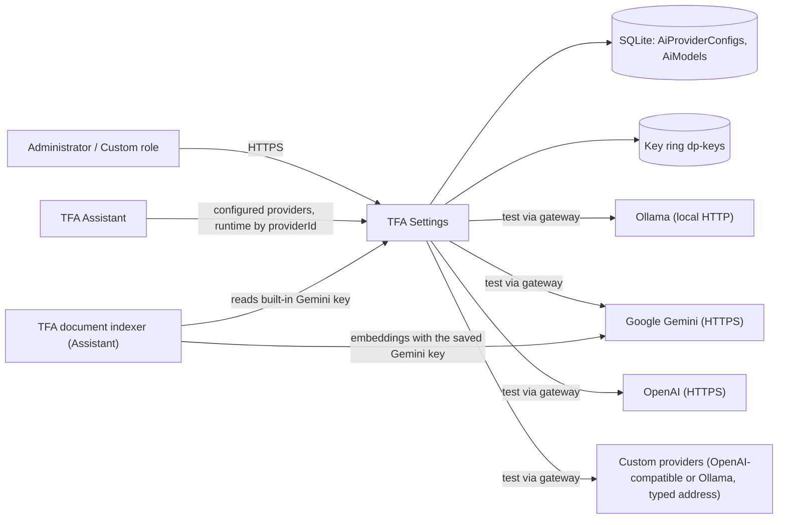
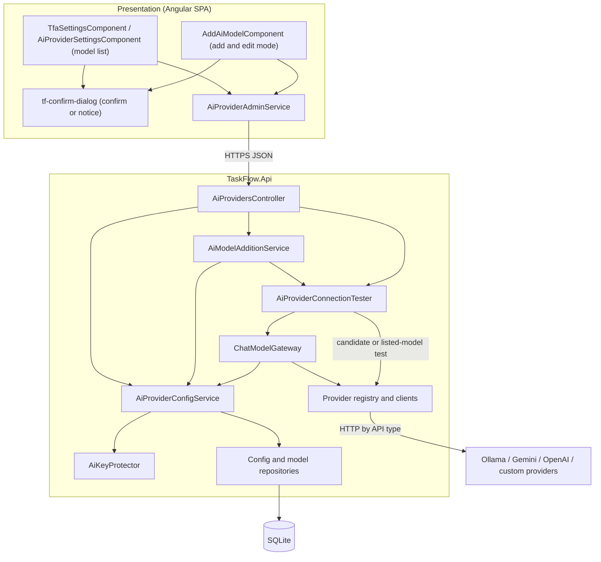
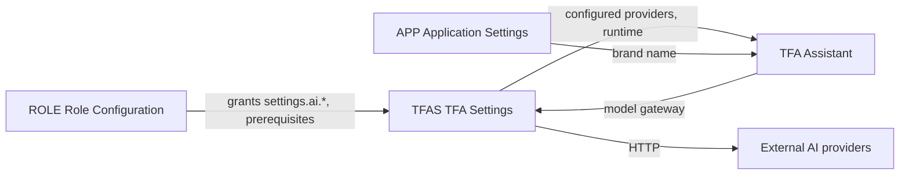
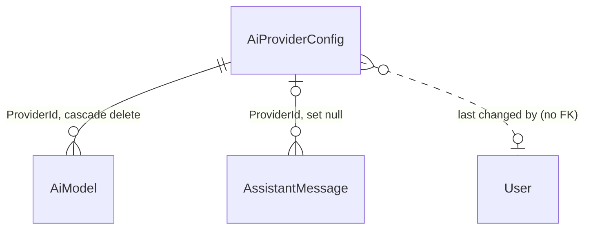
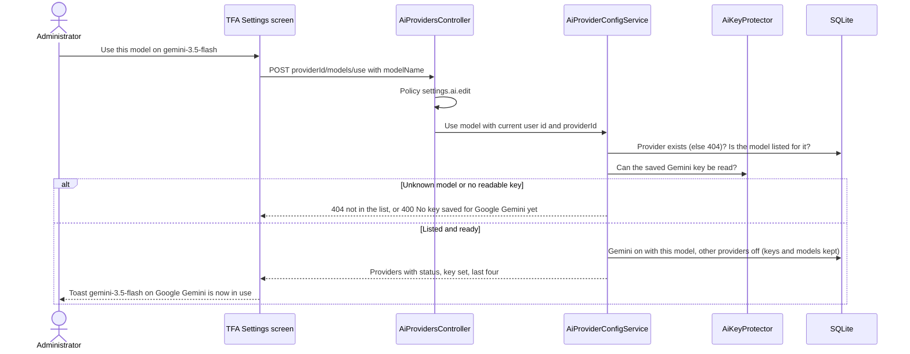
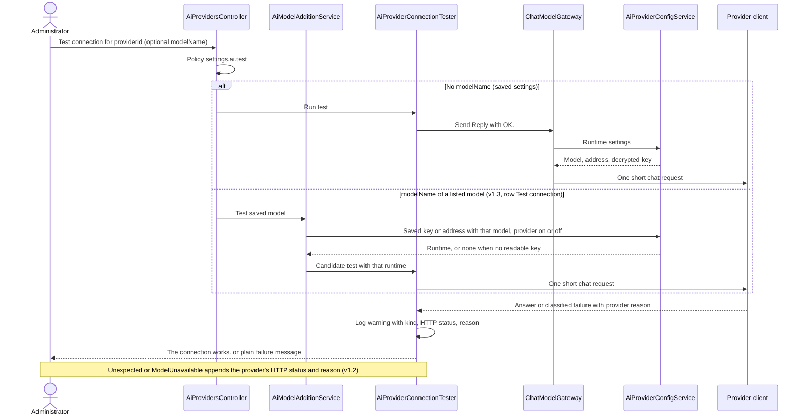
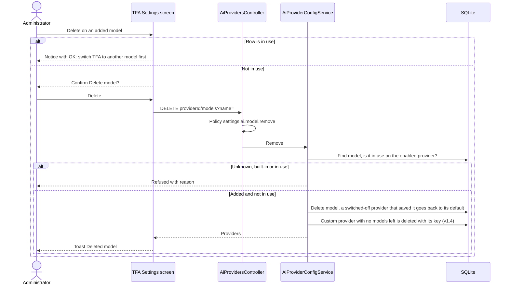
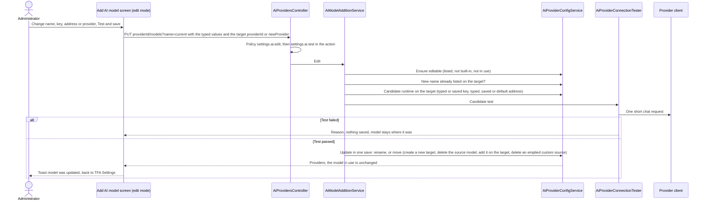
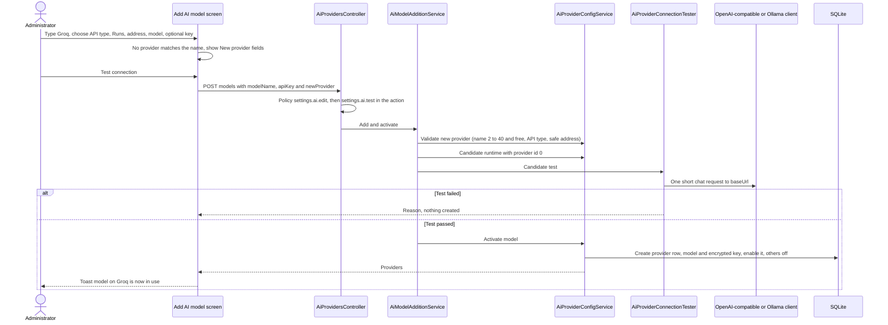

# High-Level Design – TFA Settings

## TaskFlow – Intelligent Task Allocation & Tracking System

> **Document:** High-Level Design  ·  **Version:** 1.4  ·  **Status:** Draft
> **Project type:** Personal Project (Skill Development)  ·  **Date:** 01-Nov-2026
> **Author:** Jojo George (jojogeorge3344@gmail.com)
> **Based on:** BRD-TFA-Settings v1.4, FRD-TFA-Settings v1.5
> **Module:** Settings  ·  **Sub-module:** 06.3 TFA Settings  ·  **Code:** TFAS
> © 2026 Jojo George. All rights reserved.

---

## Document Control

| Version | Date | Author | Summary of changes |
|---|---|---|---|
| 1.0 | 31-Oct-2026 | Jojo George | Initial version |
| 1.1 | 31-Oct-2026 | Jojo George | TFA answers TaskFlow questions from the documents folder (OpenSpec change `tfa-document-rag`): Document search card, `DocumentIndexController` (`/api/v1/assistant/documents/status`, `/reindex`), `DocumentIndexService` over the Assistant's `DocumentIndexStatus` and `DocumentIndexerService`; the saved Ollama address also serves embeddings. Updated §1, §2, §3, §4, §5, §6, §7, §8 (new §8.4), §9, §11, §12, §13 (D-TFAS-10, D-TFAS-11), §14 and §15. |
| 1.2 | 01-Nov-2026 | Jojo George | OpenSpec change `tfa-document-rag` revised (design D13, D14). Removed the Document search card, **Re-index now**, the 3-second status polling, `DocumentIndexController` (`GET /api/v1/assistant/documents/status`, `POST /api/v1/assistant/documents/reindex`) and `DocumentIndexService`; the background indexer re-checks the folder every 5 minutes and logs indexing problems as warnings. §8.4, D-TFAS-10 and D-TFAS-11 withdrawn (new D-TFAS-12). Model names must be model IDs without spaces; a Gemini model-name refusal is "model not available"; Test connection adds the provider's own status and reason (keys masked) for an unexpected error or a missing model (D-TFAS-13). Built-in Gemini models now `gemini-3.8-flash` (default), `gemini-3.5-flash`, `gemini-3.5-flash-lite`. Updated §1, §2, §3, §4, §5, §6, §7, §8, §9, §11, §12, §13, §14 and §15. |
| 1.3 | 01-Nov-2026 | Jojo George | OpenSpec change `tfa-model-list-and-edit`. TFA Settings becomes a read-only model list built on the client from `GET config` (Model / Server selects, provider card inputs and **Save TFA settings** removed); new actions `POST {kind}/models/use` and `PUT {kind}/models?name=`, `POST {kind}/test` takes an optional `{ modelName }`; `DELETE {kind}/models` uses the new "in use" rule (the model saved on the enabled provider) and built-in rule; `AddAiModelComponent` gains an edit mode at `/settings/tfa/models/:kind/:name/edit`; `tf-confirm-dialog` gains a notice mode; `PUT config` kept for compatibility but no longer called by the screen. §8.1 and §8.3 rewritten, §8.2 extended, new §8.5; D-TFAS-7 and D-TFAS-9 reworded; new D-TFAS-14 – D-TFAS-18. Updated §1, §2, §3, §4, §5, §6, §9, §13, §14 and §15. No schema change. |
| 1.4 | 01-Nov-2026 | Jojo George | OpenSpec change `tfa-custom-ai-providers`. Providers become data: `AiProviderConfigs` is the provider record (`Name`, `ApiType` renamed from `Kind`, `Locality`, `IsBuiltIn`); identity is `providerId` (`AiModels.ProviderId`, `AssistantMessages.ProviderId`); migration `AddCustomAiProviders` maps existing rows onto the three built-in providers. **Custom providers** of API type OpenAI-compatible or Ollama are created from the Add AI model screen (AI provider text box with suggestions) when the test passes, and removed when emptied; Edit can move a model to another provider. BREAKING: routes move from `{kind}` to `{providerId:int}`, adding a model is `POST /providers/models`; `OpenAiProvider` takes any server address and an optional key; the address rule applies to every provider. §1 – §15 updated; new §8.6 and §8.7; D-TFAS-3 superseded by D-TFAS-19; new D-TFAS-19 – D-TFAS-25. |

**Related documents:**

| Document | Location |
|---|---|
| Overall HLD (stack, deployment, cross-cutting design) | `../../00-Overall/HLD-TaskFlow-Overall.md` |
| BRD – TFA Settings | `../../../BRD/06-Settings/06.3-TFA-Settings/BRD-TFA-Settings.md` |
| FRD – TFA Settings | `../../../FRD/06-Settings/06.3-TFA-Settings/FRD-TFA-Settings.md` |
| LLD – TFA Settings | `../../../LLD/06-Settings/06.3-TFA-Settings/LLD-TFA-Settings.md` |
| HLD – TFA Assistant (runtime consumer) | `../../08-TFA-Assistant/08.1-Assistant/HLD-Assistant.md` |
| HLD – Role Configuration (permission prerequisites) | `../06.4-Role-Configuration/HLD-Role-Configuration.md` |
| OpenSpec change (model list and edit, v1.3) | `openspec/changes/tfa-model-list-and-edit/` |
| OpenSpec change (custom AI providers, v1.4) | `openspec/changes/tfa-custom-ai-providers/` |
| TDD | `TF - Documents/TF - TDD/TDD-TaskFlow.md` §3.2 (key ring, AI providers, document indexer), §6.5 (Integrations), §8.9 (Settings), §16.8 (document knowledge) |

---

## 1. Introduction

### 1.1 Purpose
This HLD describes the architecture of TFA Settings, the screen and services that decide which AI provider and model
the TFA Assistant uses: provider configuration, protected storage of API keys, the model list (since v1.3 a read-only list
with Use, Test, Edit and Delete actions, and an edit mode of the Add AI model screen), the connection test and the
provider clients reached through the Assistant's model gateway. Since v1.4 providers are stored records identified by
`providerId`: the three built-in providers (Google Gemini, OpenAI GPT, Ollama) and any number of custom providers that use
the OpenAI-compatible or Ollama API. Google Gemini is the default provider, and the API key saved for the built-in Google
Gemini provider also serves TFA's document embeddings, whichever provider answers. Class- and column-level detail is in the LLD. (v1.2: the v1.1 Document search card and its
re-index control were removed; TFA Settings has no view of the document index.)

### 1.2 Scope
In scope: the TFA Settings screen (`/settings/tfa`) and the Add AI model screen (`/settings/tfa/models/new`, and in edit
mode `/settings/tfa/models/:providerId/:name/edit`, v1.4; v1.3: `:kind`); their API under `/api/v1/assistant/providers`
(read configuration; use a listed model; add a tested model, creating a custom provider when it is new; edit or move an
added model after a test; delete an added model; test a provider or a listed model; the save request kept for
compatibility); the configuration service, connection tester, key protector, model and configuration storage, first-run
seeding and (v1.4) the `AddCustomAiProviders` migration; the provider clients for Ollama, Google Gemini and OpenAI /
OpenAI-compatible services.

Out of scope: the TFA chat itself, tools, confirm-before-act and the assistant's provider selector, and the document
indexing, embedding and retrieval themselves, including the logging of indexing problems (TFA Assistant HLD); editing
permissions (Role Configuration HLD). Removed in v1.2: the Document search card and its API under
`/api/v1/assistant/documents` (status, re-index).

### 1.3 Audience
Developer, reviewer and tester of TaskFlow; the product owner for the design decisions.

### 1.4 Definitions & Abbreviations

| Term | Meaning |
|---|---|
| TFA | TaskFlow Assistant, the AI chat assistant inside TaskFlow |
| Provider | An AI service stored as an `AiProviderConfig` row (v1.4): a built-in provider – Ollama (local), Google Gemini or OpenAI GPT (cloud) – or a custom provider |
| Built-in provider | One of the three providers shipped with TaskFlow (`IsBuiltIn`); never removed (v1.4) |
| Custom provider | A provider created by an administrator with API type OpenAI-compatible or Ollama, its own `BaseUrl`, Local or Cloud and an optional key; removed when its last model goes (v1.4) |
| API type | `AiApiType` (`Ollama`, `Gemini`, `OpenAI` = OpenAI-compatible): which provider client is used (v1.4; was the provider kind) |
| `providerId` | The id of a provider row; the identity used by routes, DTOs, the gateway and stored chat messages (v1.4) |
| Configured provider | Switched on, has a model, and has an address (Ollama, custom provider) or a readable key (built-in Gemini and OpenAI) |
| Data Protection | ASP.NET Core encryption API; keys kept in a key ring folder |
| Key ring | Folder `dp-keys` (`AiProviders:KeyRingPath`) under the data folder; DPAPI-protected on Windows |
| Model gateway | `ChatModelGateway` (`IChatModelGateway`): the single path from TaskFlow to any provider |
| SSRF | Server-side request forgery – making the server call an address it should not |
| Document index | TFA's searchable copy of the Markdown documents in the documents folder (`DocumentSources`, `DocumentChunks`, in-memory vectors) |
| Indexer | `DocumentIndexerService` (hosted background service) running `DocumentIndexer`; owned by the TFA Assistant |
| Model ID | The exact model name the provider expects in its request (for example `gemini-3.8-flash`); never contains spaces |
| Provider reason | The provider's own error status and message, at most 200 characters with keys replaced by `[key]`, shown only on Test connection |
| Model in use | The model saved on the enabled provider; the only model that cannot be edited or deleted besides built-ins (v1.3) |

---

## 2. System Context

### 2.1 Context Diagram

### 2.2 Actors & External Systems

| Actor / system | Interaction | Protocol |
|---|---|---|
| Administrator; Custom role with `settings.ai.*` | View the model list; use, test, add, edit and delete models (v1.3) | HTTPS / JSON |
| TFA Assistant (in process) | Reads which providers are configured and the runtime settings (model, address, decrypted key) | In-process service call |
| Ollama | Optional local model server for chat, no key | HTTP to the saved server address |
| Google Gemini | Default cloud model API and the embedding service for document search, key in a request header | HTTPS / REST |
| OpenAI | Cloud model API, bearer key | HTTPS / REST |
| Custom provider (v1.4) | Any OpenAI-compatible chat API (for example Groq, Mistral, OpenRouter, LM Studio, vLLM) or an Ollama server at the administrator's address; bearer key only when one is saved | HTTP or HTTPS / REST |
| Data Protection key ring | Encrypts and decrypts API keys | Local files |
| TFA document indexer (in process) | Embeds with Google Gemini (`gemini-embedding-2`) using the API key saved for the built-in Google Gemini provider, read on every run and question, whichever chat provider is selected; no Ollama provider is used for embeddings. TFA Settings no longer shows its status or wakes it (v1.2: card and **Re-index now** removed); it re-checks the folder on its own every `RescanMinutes` (5) | In-process service call |

---

## 3. Architecture Goals, Constraints & Principles

### 3.1 Quality Goals

| Goal | How the architecture supports it |
|---|---|
| Secret safety | API keys encrypted with Data Protection before storage; write-only through the API (only "key set" and the last four characters are returned) (NFR-TFAS-01) |
| SSRF protection | The server-address validator refuses link-local and cloud-metadata hosts – since v1.4 for every provider address, including custom providers; provider clients do not follow redirects (NFR-TFAS-02) |
| Least privilege | Four fine-grained permissions (view, edit, test, remove model), each checked on the server (NFR-TFAS-03) |
| Robust test | The connection test always returns a result message, never an error status (NFR-TFAS-04) |
| Detect lost keys | Each read checks whether the stored key can still be decrypted (NFR-TFAS-05) |
| Plain language | Provider failures are classified (not configured, invalid key, rate limited, timeout, unreachable, model unavailable) and mapped to fixed messages (NFR-TFAS-06). On Test connection only, an unexpected error or a missing model also shows the provider's own status and reason, keys masked (v1.2) |
| Privacy | Cloud providers are tagged by their `Locality` (a custom provider by its **Runs** choice, v1.4); Google Gemini is the default; the screen says matching document text also goes to cloud providers, that document search needs a Google Gemini API key and that document text is sent to Google (NFR-TFAS-07) |
| Upgrade safety (v1.4) | One data-preserving migration keeps keys, models, the saved model, the enabled flag and chat history (NFR-TFAS-13) |
| Visible document search (withdrawn) | _Removed in v1.2._ (v1.1: card with folder, model, counts, last run, last error; re-index; 3-second polling.) Changed documents are re-processed by the indexer's rescan; problems are in the server log (TFA Assistant HLD) |

### 3.2 Constraints
- _Withdrawn in v1.4:_ exactly three providers, fixed in code. Since v1.4 three API types are fixed in code
  (`AiApiType`, per-type facts in `AiProviderCatalog`) and providers are data: three built-in rows plus any number of
  custom rows of type OpenAI-compatible or Ollama. A custom provider cannot use the Gemini API, be renamed or change its
  API type.
- One API process; provider calls are synchronous HTTP with a timeout of `AiProviders:TimeoutSeconds` (60).
- Key protection depends on the key ring folder staying with the data folder; losing it makes saved keys unreadable.
- "One active server" is applied by the use and add actions on the server (v1.3); the save request kept for
  compatibility still accepts several enabled providers.
- The API key is one per provider, shared by all its models (v1.3: no key per model).
- The documents folder, embedding model and search settings are server configuration (`DocumentKnowledge`), not shown
  or editable on the screen (v1.2).
- A model name is the provider's model ID: no spaces, at most 100 characters. There is no allow-list; Test connection
  checks that the model exists.

### 3.3 Architecture Principles
- Controller → Service → Repository; integrations (key protection, provider clients) behind interfaces (overall HLD).
- Every call to a model goes through the one model gateway – the test uses the same path as the assistant.
- Secrets never leave the server towards the browser and never appear in logs.
- Defence in depth: SPA hides buttons, the API checks each permission, the validator checks each value.

---

## 4. Architecture Overview

### 4.1 Architecture Style
An Angular screen calls a REST controller with one permission per action. Behind it, a configuration service owns the
provider rows, the model list and key protection; a connection tester sends one short request through the Assistant's
model gateway, which picks the provider client from a registry.

API surface (7 actions on `AiProvidersController`; full list in the LLD; since v1.4 every provider route uses
`{providerId:int}` and an unknown id answers 404 – BREAKING, the v1.3 `{kind}` routes are withdrawn):
`/api/v1/assistant/providers/config` (read; save, kept for compatibility and no longer called by the screen),
`POST /api/v1/assistant/providers/models` (add a tested model; the body names an existing `providerId` or a
`newProvider`, so no id is in the route), `/api/v1/assistant/providers/{providerId}/models` (edit or move an added model
after a test (`PUT ?name=`), delete an added model (`DELETE ?name=`)),
`/api/v1/assistant/providers/{providerId}/models/use` (make a listed model the one TFA uses), and
`/api/v1/assistant/providers/{providerId}/test` (connection test, optionally of one listed model). The v1.1 `DocumentIndexController` actions
`GET /api/v1/assistant/documents/status` and `POST /api/v1/assistant/documents/reindex` were removed in v1.2 and now
answer 404. The assistant's own provider selector reads `/api/v1/assistant/providers`, owned by the TFA Assistant.

### 4.2 Logical Architecture

### 4.3 Layers & Responsibilities

| Layer | Responsibility in this sub-module | May call |
|---|---|---|
| Presentation | Read-only model list grouped by provider id (built-ins first, then custom providers by name, v1.4), built from `GET config` (model ID, Local / Cloud, key status or server address, Built-in / Added by you, In use) with **Use this model**, **Test connection**, and **Edit** / **Delete** on added models; notice and confirmation dialogs; Add AI model screen with the **AI provider** text box and a datalist of provider names (v1.4; no dropdown), the **New provider** fields (API type, Runs, Server address, optional key) for a name that matches no provider, an example model ID per API type and, for Gemini, a link to Google AI Studio for the key, and its edit mode (provider editable with the move hint since v1.4, **Test and save**, **Remove the key**); buttons shown per permission (v1.3; the v1.0 – v1.2 provider card, Model / Server selects, key box with keep/remove, Save and Remove model were removed). (v1.2: Document search card and Re-index now removed) | API |
| API / Controllers | `AiProvidersController`: one policy per action; routes `{providerId:int}` to the provider (v1.4; v1.3: `{kind}`); 404 for an unknown id. (v1.2: `DocumentIndexController` removed) | Services |
| Validation | Request validators: providers present and unique, model name (a model ID without spaces, v1.2; by API type since v1.4), server address (http/https, no link-local or metadata host, for every provider since v1.4), key without spaces, not new key and clear together (save and, v1.3, edit); (v1.4) new provider: name 2–40 characters and not taken ignoring case, API type OpenAI or Ollama, address required | – |
| Services | `AiProviderConfigService`: read config with status, save, remember added models, delete model (removing an emptied custom provider, v1.4), use a listed model, edit rules (built-in, in use, duplicate), rename or (v1.4) move, clear key, runtime for the gateway and for a listed model (v1.3), validate and create a new provider on activation (v1.4); `AiModelAdditionService`: test a typed model and save it only if the test passes (add and, v1.3, edit and, v1.4, move or create a custom provider), test a listed model with the saved key or address; `AiProviderConnectionTester`: one test request and result mapping, with the provider's reason added for an unexpected error or a missing model (v1.2). (v1.2: `DocumentIndexService` removed) | Repositories, integrations |
| Repositories | `AiProviderConfigRepository` (by id, built-in by API type, by name, v1.4), `AiModelRepository` (by provider id, v1.4) | Database |
| Integrations | `AiKeyProtector` (Data Protection), `KeyRingProtectionCheck`, provider registry (by API type, v1.4) and the Ollama, Gemini and OpenAI / OpenAI-compatible clients | Key ring, external providers |
| Start-up | Migration `AddCustomAiProviders` (v1.4) runs on start; `AiProviderSeeder`: creates any missing built-in provider row and keys the built-in models on the built-in rows (v1.4) | Database |

---

## 5. Component / Module Design

| Module / component | Responsibility | Key components (high level) | Depends on |
|---|---|---|---|
| TFA Settings screen | Read-only model list; use, test, edit (opens edit mode) and delete a model; add and edit models on the Add AI model screen (v1.3); type a provider name, create a custom provider, move a model (v1.4) | `TfaSettingsComponent`, `AiProviderSettingsComponent`, `AddAiModelComponent`, `ConfirmDialogComponent`, `AiProviderAdminService` | TFA Settings API, current user's permissions |
| TFA Settings API | Authorize and route the seven actions by `providerId` (v1.4) | `AiProvidersController`, request validators | Config service, model addition service, connection tester |
| Provider configuration | Provider rows (built-in and custom, v1.4), status (configured, key readable), model list, save rules, use / edit / move / delete rules with the "in use" check, new-provider validation and creation, removal of an emptied custom provider, runtime settings | `AiProviderConfigService`, `AiProviderCatalog` | Repositories, key protector |
| Model addition and edit | Test-then-save for add and edit (v1.3) and, v1.4, for a new custom provider and a move; test of a listed model with the saved key or address (v1.3) | `AiModelAdditionService` | Config service, connection tester |
| Connection test | One short request, plain result; for an unexpected error or a missing model, "`Provider` said: HTTP `status` - `reason`" is added (v1.2) | `AiProviderConnectionTester`, `ProviderFailureMessages` | Model gateway, provider registry |
| Key protection | Encrypt/decrypt keys; warn about an unprotected key ring at start-up | `AiKeyProtector`, `KeyRingProtectionCheck` | Data Protection key ring |
| Provider clients | Call each provider; classify failures (a Gemini 400 about the model name is "model unavailable", v1.2); attach the provider's cleaned reason; no redirects; `OpenAiProvider` calls `{baseUrl}/chat/completions` at any address with an optional key and retries once without tools when an OpenAI-compatible server answers 400 about tools (v1.4); failures name the provider by its name (`ProviderFailureException.For(runtime)`, v1.4) | `ChatModelProviderRegistry`, `OllamaProvider`, `GeminiProvider`, `OpenAiProvider`, `ProviderHttp.Reason` | External providers |
| Model gateway (Assistant module) | Single path to a provider for test and chat, keyed by `providerId` (v1.4) | `ChatModelGateway` | Config service (runtime), registry |
| Seeding and migration | First-run defaults; missing built-in rows (v1.4); `AddCustomAiProviders` maps the old rows onto built-in providers (v1.4) | `AiProviderSeeder`, migration `20261101050239_AddCustomAiProviders` | SQLite |
| Document search (v1.1, removed in v1.2) | _Withdrawn._ v1.1 showed the document index status, started a re-index and polled while running (`DocumentIndexCardComponent`, `getDocumentStatus()` / `reindexDocuments()`, `DocumentIndexController`, `DocumentIndexService`); all removed | – |

### 5.1 Module Interaction

| Interaction | What is exchanged |
|---|---|
| TFAS → TFA | Which providers are configured (assistant model selector, by `providerId` with name and locality since v1.4) and the runtime settings for each call |
| TFA → TFAS | The connection test uses the Assistant's model gateway, so a passing test means chat will reach the provider |
| ROLE → TFAS | Grants of `settings.ai.view`, `settings.ai.edit`, `settings.ai.test`, `settings.ai.model.remove`; edit, test and remove each require view |
| TFAS → providers | One short chat request for a test; chat requests from the assistant use the same clients |
| TFA document index → TFAS | The indexer reads the API key saved for the built-in Google Gemini provider (`DocumentEmbeddingEndpoint`, `GetBuiltInAsync(Gemini)`, decrypted through `IAiKeyProtector`) for embeddings. (v1.2: TFA Settings no longer reads `DocumentIndexStatus` or requests a re-index) |

---

## 6. Data Architecture (high level)

### 6.1 Data Stores

| Store | Technology | Holds | Notes |
|---|---|---|---|
| Main database | SQLite (`taskflow.db`, EF Core) | One row per provider, built-in or custom (v1.4: name, API type, Local / Cloud, built-in flag; on/off, model, address, encrypted key, last four characters, editor and time); the list of models per provider (built-in and added, keyed by `ProviderId` since v1.4); the provider id on each assistant message (v1.4) | Encrypted key never returned |
| Key ring | Data Protection key files in `dp-keys` | Keys that encrypt the API keys (purpose `TaskFlow.AiProviderKeys`) | DPAPI-protected on Windows; checked at start-up; must be backed up with the database |
| Code catalogue | `AiProviderCatalog` | Per API type (v1.4): model ID rule, default and built-in models and display name of the built-in provider, fixed address of built-in Gemini and OpenAI | Fixed in code; a provider's name, locality and key need come from its row (v1.4) |
| In-memory status (v1.1) | `DocumentIndexStatus` singleton (Assistant) | Enabled, folder, folder found, model, files, chunks, last indexed, running, last error and file | Owned and used only by the TFA Assistant since v1.2 (TFA Settings no longer shows it); the index tables are owned by the TFA Assistant |

### 6.2 Main Data Domains

_v1.0 – v1.3: `AiModel` and `AssistantMessage` were linked to the provider by the kind string; replaced by `ProviderId`
foreign keys in v1.4._

| Domain | Owner | Use here |
|---|---|---|
| `AiProviderConfig` | TFAS | Read and written; custom rows created on a passing test and deleted when emptied (v1.4); runtime read by the TFA Assistant |
| `AiModel` | TFAS | Read; added models written when added, renamed or moved on edit and removed on delete (v1.3, move v1.4); built-in models seeded and read-only |
| `AssistantMessage` | TFA Assistant | Stores the answering provider's id (v1.4); the column becomes null when a custom provider is removed |

### 6.3 Data Flow
1. First start seeds the built-in models and one row per provider (Google Gemini, OpenAI GPT, Ollama). A Gemini key supplied
   in configuration (`AiProviders:GeminiApiKey`) is stored encrypted on a Gemini row that has no key; on a brand-new
   installation Gemini is then switched on with `gemini-3.8-flash`. Without a configured key every provider stays off until
   an administrator saves a key; Ollama is never switched on automatically, and a key saved in TFA Settings is never
   overwritten (FR-TFAS-24).
2. The screen reads all providers with their status, model lists and "key set / last four" – never the key.
3. (v1.4) On upgrade the migration `AddCustomAiProviders` fills `Name`, `IsBuiltIn` and `Locality` on the existing rows,
   inserts any missing built-in row, and moves `AiModels` and `AssistantMessages` from the kind string to `ProviderId`;
   keys, models, the saved model, the enabled flag and message history are kept.
4. (v1.3) **Use this model** switches the chosen provider on with that model and the others off; adding or editing a
   model saves only after a passing test, a new key is encrypted before storage and an empty key box keeps the stored
   key; a rename updates the `AiModel` row (and a switched-off provider's saved name); a delete resets a switched-off
   provider that still saved the model to its default model. The v1.0 – v1.2 save from the screen was withdrawn; `PUT
   config` stays for compatibility.
5. (v1.4) Adding a model for a new provider name validates the new provider, tests a candidate runtime with id 0 and,
   on a pass, creates the custom provider row, its model and its encrypted key in one save and makes it the one in use.
   A move tests on the target and, on a pass, in one save creates a new target, deletes the source `AiModel`, adds the
   target's, and deletes a custom source provider left with no models. Deleting a custom provider's last model deletes
   the provider.
6. The test and the assistant ask the configuration service for the runtime settings by `providerId` (v1.4); the key is
   decrypted only in memory for the outgoing request.
7. (v1.2) The Document search card and **Re-index now** are removed. The TFA Assistant's indexer checks the documents
   folder on its own (shortly after start-up, then every 5 minutes) and logs indexing problems as warnings.

---

## 7. Integration Design

| Integration | Direction | Purpose | Failure behaviour |
|---|---|---|---|
| Ollama (local model server) | Outbound HTTP to the saved address | Test and chat | Unreachable / timeout / model missing → fixed plain message; TFA not available until fixed |
| Google Gemini | Outbound HTTPS, key in a request header | Test and chat | Invalid key, rate limit (with retry time), timeout, model unavailable (also a 400 `INVALID_ARGUMENT` about the model name, v1.2) → fixed plain message; on Test connection an unexpected error or a missing model adds Google's status and reason |
| OpenAI | Outbound HTTPS, bearer key, `https://api.openai.com/v1/chat/completions` | Test and chat | As for Gemini (without the model-name rule) |
| Custom provider, OpenAI-compatible (v1.4) | Outbound HTTP or HTTPS to `{baseUrl}/chat/completions`; bearer key only when one is saved | Test and chat | Same classification and messages as OpenAI, naming the provider; a 400 about tools is retried once without tools; a Local provider that cannot be reached gets the "not running" message |
| Custom provider, Ollama (v1.4) | Outbound HTTP to the typed address, no key | Test and chat (not embeddings) | As for the built-in Ollama, naming the provider |
| Data Protection key ring | Local | Encrypt/decrypt keys | Unreadable key → status "The saved key can no longer be read. Enter it again."; provider treated as not configured; a warning is logged |
| TFA Assistant | Inbound (in process) | Configured providers and runtime | Not-configured provider is not offered |
| TFA document indexer | Inbound (in process) | Reads the built-in Google Gemini provider's saved key for embeddings | v1.2: no status or re-index integration any more; indexing problems are logged by the TFA Assistant |

All provider calls share a timeout (`AiProviders:TimeoutSeconds`), do not follow redirects, and log provider, failure
kind, HTTP status and (v1.2) the provider reason – at most 200 characters with the sent key and key-shaped tokens
replaced by `[key]`; never headers, raw bodies or keys. The reason reaches the screen only through Test connection; chat
replies keep the fixed message. No automatic switch to another provider on failure.

---

## 8. Key Flows (high level)

### 8.1 Use a model from the list (v1.3)

The list itself is built in the browser from `GET config`: each provider already returns its models, the added ones,
the key status, the address, whether it is enabled and its saved model, so a row is **In use** when its provider is
enabled and the model is the saved one. No other read endpoint is needed. _The v1.0 – v1.2 flow (choose model and
server, paste key, **Save TFA settings** sending `PUT config` with only the chosen provider enabled) was withdrawn in
v1.3; `PUT config` stays for compatibility._

### 8.2 Test the connection (integration)

The row test uses the candidate path, not the gateway, because the gateway only serves the provider TFA uses. Nothing is
saved and the model in use does not change (v1.3).

### 8.3 Delete an added model (v1.3)

### 8.4 Check document search and re-index (v1.1) – withdrawn in v1.2

_Withdrawn._ The Document search card, **Re-index now**, the 3-second polling and the `GET .../documents/status` and
`POST .../documents/reindex` endpoints were removed (design D13 of `tfa-document-rag`; D-TFAS-12). The section number is
kept so references stay valid. The indexer's own flow (load the stored index at start-up, first run after a short
delay, rescan every `RescanMinutes`) and its warning logs are described in the TFA Assistant HLD.

### 8.5 Edit or move an added model (v1.3; move v1.4)

The target is the body's `providerId` or `newProvider`; when it is the current provider (or absent) the edit is a rename
as in v1.3. **Remove the key** in edit mode sends the same request with `clearKey: true` and the current name only; it is
not tested (nothing is sent to the provider) and removes the key for every model of that provider. It is refused together
with a move ("Remove the key on its own, without other changes."), and the screen hides the button while the provider is
changed. The screen confirms first and, when TFA uses that provider, warns that TFA is unavailable until a key is added
again.

### 8.6 Add a custom provider (v1.4)

A typed name that matches an existing provider (case-insensitive) sends that provider's `providerId` instead and follows
the v1.3 add flow. Exactly one of `providerId` and `newProvider` is accepted.

### 8.7 Upgrade to provider records (v1.4)

The migration `20261101050239_AddCustomAiProviders` runs on start: it adds `Name`, `Locality` and `IsBuiltIn`, renames
`Kind` to `ApiType`, fills the three existing rows as the built-in Google Gemini, OpenAI GPT and Ollama, inserts any missing
built-in row, then adds `AiModels.ProviderId` and `AssistantMessages.ProviderId`, fills them by joining on the old kind and
drops the old columns. `AiProviderSeeder` then keys the built-in models on the built-in rows. The down migration is lossy
for custom providers only (they and their models are dropped). The deploy notes say to stop the API and copy the SQLite
file before deploying the backend and frontend together.

---

## 9. Security Architecture

| Concern | Approach |
|---|---|
| Authentication | JWT bearer access token and refresh cookie; session revalidated on every request (overall HLD) |
| Authorization | Controller requires sign-in; each action has its own policy: read `settings.ai.view`; save and use a model `settings.ai.edit`; add and edit a model `settings.ai.edit` plus `settings.ai.test` checked in the action; test `settings.ai.test`; delete model `settings.ai.model.remove` (FR-TFAS-25; v1.3: no new permission keys). Edit, test and remove each require view, enforced by Role Configuration (FR-TFAS-26). The legacy key `settings.ai.manage` expands to the four keys for roles that still hold it. SPA: menu item and `permissionGuard` on view, and on edit for the Add AI model routes (`models/new`, `models/:providerId/:name/edit` since v1.4; the page also needs test); `canEdit` (Use this model), `canTest` (Test connection), `canAddModel` (Add AI model, Edit), `mayRemoveModel` (Delete) hide the buttons |
| Default grants | Administrator only; Manager and Employee denied; custom roles configurable |
| Secret handling | Keys encrypted with Data Protection (purpose `TaskFlow.AiProviderKeys`); write-only API; only "key set" and last four characters returned; key ring DPAPI-protected on Windows and checked at start-up (`KeyRingProtectionCheck`) |
| SSRF | Server address must be http/https and not link-local or a cloud metadata host; `localhost` and private addresses allowed; since v1.4 the rule applies to every provider address, including custom providers; only `settings.ai.edit` + `settings.ai.test` holders can create a provider, and the address is called only for the test and chat; redirects not followed |
| Transport | HTTPS from the browser; HTTPS to cloud providers; Ollama over the configured address |
| Privacy | Screen explains that cloud providers receive the user's question, related task details and matching TaskFlow document text (FR-TFAS-23); a custom provider marked Cloud gets the same cloud notice in the TFA window, decided by its `locality` (v1.4); a Local provider gets a notice that the message is sent to Google Gemini to search the documents and the reply is generated on this computer; the screen also says document search needs a Google Gemini API key and document text is sent to Google |
| Custom provider key (v1.4) | Encrypted and write-only like a built-in key; the Authorization header is sent only when a key is saved |
| Document search | v1.2: no endpoint or screen exposes the index any more (the v1.1 status and re-index endpoints answer 404), so folder paths and indexing errors appear only in the server log |
| Provider reason | Shown only in the Test connection result (`settings.ai.test`, administrators by default) and in the warning log; the sent key and key-shaped tokens (`AIza…`, `sk-…`, `AQ.…`) are replaced by `[key]` and the text is cut to 200 characters; chat replies never include it (v1.2) |
| Auditing | Last editor and time per provider row; denied requests logged by the denied-action audit handler; provider logs carry no secrets |

---

## 10. Technology Stack

TFA Settings uses the shared TaskFlow stack: Angular 19 SPA, ASP.NET Core Web API on .NET 10, EF Core 10 with SQLite,
FluentValidation 12. Specific to this sub-module are ASP.NET Core Data Protection for key encryption and typed
`HttpClient` provider clients for Ollama, Google Gemini and OpenAI (no vendor SDK packages); since v1.4 the OpenAI client
also serves every OpenAI-compatible custom provider. Versions and rationale are in
the overall HLD (`../../00-Overall/HLD-TaskFlow-Overall.md`, §10).

---

## 11. Deployment Architecture

TFA Settings runs inside the single `TaskFlow.Api` process. Deployment-relevant items: the key ring folder
`AiProviders:KeyRingPath` (default `dp-keys`) under `Storage:Root` must stay with the database (and be backed up with it)
or saved keys become unreadable; `AiProviders:TimeoutSeconds` (60) bounds each cloud provider and Gemini embedding call
(`AiProviders:OllamaTimeoutSeconds`, 180, each Ollama chat call); the optional Ollama, when used, runs as a separate local
service reachable at the saved address (default `http://localhost:11434`); cloud providers need outbound HTTPS. A Gemini key
can be supplied at install time with `dotnet user-secrets set "AiProviders:GeminiApiKey" "<key>"` or the environment
variable `AiProviders__GeminiApiKey` (the AI setup scripts ask for it). Document search (v1.1) needs a saved Google Gemini
API key, outbound HTTPS to Google and the documents folder readable by the API (`DocumentKnowledge:SourcePath`); since
v1.2 a missing folder or key shows only as a warning in the API log. (v1.4) Upgrading runs the `AddCustomAiProviders` migration on start: stop the API and
copy the SQLite file first, and deploy the backend and frontend together, because the provider routes changed; rollback is
restoring the copied file and the previous build. A custom provider needs network access from the API to its address. Environments, hosting and backup are in the overall HLD (`../../00-Overall/HLD-TaskFlow-Overall.md`, §11).

---

## 12. Non-Functional Design

| Area | Design decision |
|---|---|
| Performance | Configuration read and save are small database operations; a test is one short provider request bounded by the timeout (v1.2: no document status polling) |
| Scalability | Three built-in provider rows plus a few custom ones (v1.4) and a short model list; single instance |
| Reliability | Test never throws to the screen (always a result); unreadable key detected and reported; duplicate-model race on save handled by retrying without the duplicate |
| Availability | A provider outage affects only TFA; the rest of TaskFlow is independent |
| Security | See §9; secrets never logged or returned |
| Maintainability | Per-API-type facts and built-in models in one catalogue; providers are data, so a new OpenAI-compatible service needs no code (v1.4); each API type behind one client interface in a registry; the test reuses the assistant's gateway |
| Observability | Provider failures logged by provider, failure kind, HTTP status and the cleaned provider reason (both test paths, v1.2); key-ring warning at start-up; warning when an enabled provider's key cannot be decrypted |
| Backup & Recovery | Database and key ring together; see overall HLD |

---

## 13. Design Decisions

| ID | Decision | Alternatives considered | Rationale |
|---|---|---|---|
| D-TFAS-1 | Encrypt API keys with ASP.NET Core Data Protection and a key ring in the data folder | Plain text in the database; keys in `appsettings.json`; OS secret store | Keys not readable from the database file; no extra dependency; one folder to back up |
| D-TFAS-2 | Keys are write-only: the API returns only "key set" and the last four characters | Return masked or full key | A key can never leak through the browser (BR-TFAS-01) |
| D-TFAS-3 | _Superseded in v1.4 by D-TFAS-19._ Three fixed providers behind one model gateway and a provider registry | Vendor SDKs; a generic OpenAI-compatible endpoint only | Free local option (Ollama) plus two cloud options; one path for test and chat; easy to add a provider in code |
| D-TFAS-4 | The connection test goes through the same gateway as the assistant and always returns 200 with a result | Separate ping endpoint per provider; error status on failure | A passing test proves chat will work; the screen shows a message, never an error page |
| D-TFAS-5 | Fine-grained permissions view / edit / test / remove model, each requiring view | One `settings.ai.manage` key (now legacy) | Lets an organization delegate testing without editing; legacy key still honoured |
| D-TFAS-6 | Server-address validator blocks link-local and metadata hosts; no redirects | Allow any URL | Prevents SSRF towards cloud metadata services (BR-TFAS-06) |
| D-TFAS-7 | "One active server" applied by the use and add actions (v1.3; v1.0 – v1.2: by the screen's save); the save request still stores each provider's own on/off | Enforce a single enabled provider in every API request | Switched-off providers keep their keys, models and addresses for a quick switch back |
| D-TFAS-8 | Google Gemini switched on only on a brand-new installation and only when a Gemini key is configured; Ollama never switched on automatically | Ollama on by default; always off | Works out of the box with a free Google AI Studio key and gives document search its key; upgrades are not changed silently |
| D-TFAS-9 | Models are data (`AiModel`), built-in ones seeded and read-only, added ones editable and removable when not in use (v1.3 wording) | Free-text model only | Keeps the list tidy and prevents changing or removing the model in use (BR-TFAS-04) |
| D-TFAS-10 | _Withdrawn in v1.2 (replaced by D-TFAS-12)._ Document search status and re-index on TFA Settings, guarded by the existing `settings.ai.view` / `settings.ai.edit` keys | New permission keys; no UI (log only) | The administrators who set up Ollama also own the index; no catalogue change |
| D-TFAS-11 | _Withdrawn in v1.2 (replaced by D-TFAS-12)._ Re-index is a request to the background indexer (202, no second run), and the card polls while running | Synchronous re-index in the request | A full first index takes minutes; the request must not time out or run twice |
| D-TFAS-12 | No admin screen or endpoint for the document index (v1.2, OpenSpec `tfa-document-rag` D13): card, Re-index now, polling, `DocumentIndexController` and `DocumentIndexService` removed; indexing problems are logged as warnings | Keep the card; a problem-only banner on TFA Settings | Nothing on the card could be changed from the screen; the 5-minute rescan already does what Re-index did; folder path, model and chunk count are developer details |
| D-TFAS-13 | Model names are model IDs without spaces; Gemini 400 "model name" errors are `ModelUnavailable`; Test connection appends the provider's cleaned reason for `Unexpected` and `ModelUnavailable` only (v1.2, OpenSpec `tfa-document-rag` D14) | An allow-list of model names; showing the raw response body; showing the reason in chat too | Providers add models often and Test connection already checks existence; the reason (for example Google naming the replacement model) helps the administrator, while keys are masked and chat users keep the plain message |
| D-TFAS-14 | TFA Settings is a read-only model list built on the client from `GET config`, with Use, Test, Edit and Delete per row; all typing happens on the Add AI model screen and its edit mode; `PUT config` is kept but no longer called by the screen (v1.3, OpenSpec `tfa-model-list-and-edit`) | Keep the Model / Server selects and the editable card; a new list endpoint; remove `PUT config` | Administrators could not tell which fields belonged to which model; `GET config` already carries every field a row needs; an older client and existing tests keep working |
| D-TFAS-15 | The API key stays one per provider; an edit writes the typed key to the provider row and the screen warns that the key is shared by every model of that provider | A key per model | No schema change or migration; agreed during exploration |
| D-TFAS-16 | "In use" means the model saved on the enabled provider. Edit and delete are refused for it and for built-in models ("A built-in model cannot be changed or removed."); a model saved only on a switched-off provider may be renamed (the saved name follows) or deleted (the saved name resets to `AiProviderCatalog.DefaultModel`) | The v1.0 – v1.2 rule "saved for its server" (`UsesModelAsync`), which also blocked switched-off providers; an `IsHidden` flag so built-ins could be deleted | Nothing visibly used the blocked model; hiding built-ins needs a migration and seeder changes for little benefit |
| D-TFAS-17 | The edit screen is `AddAiModelComponent` in edit mode at its own route, reusing the candidate test path (`ResolveCandidateRuntimeAsync`, `TestCandidateAsync`); **Remove the key** sends `clearKey` and is not tested | A separate Edit component | Avoids duplicating the provider-dependent fields and validation; a removed key cannot be tested |
| D-TFAS-18 | A row's Test connection sends `{ modelName }` and is served by `AiModelAdditionService.TestSavedModelAsync` with the saved key or address, also for a switched-off provider; `tf-confirm-dialog` gains a single-button notice mode for the in-use message | Test through the gateway; a separate notice component | The gateway only serves the provider TFA uses; one dialog host per screen |
| D-TFAS-19 | Providers are data: `AiProviderConfig` becomes the provider record (`Name` unique NOCASE, `ApiType`, `Locality`, `IsBuiltIn`); three API types in code, any number of custom providers of type OpenAI-compatible or Ollama (v1.4, OpenSpec `tfa-custom-ai-providers` decision 1) | A separate `AiProviders` table next to the config table | The one-row-per-provider table already holds what a provider needs; a 1:1 join adds nothing |
| D-TFAS-20 | Identity is `providerId`: `AiModels.ProviderId` (FK cascade, unique with `Name`), `AssistantMessages.ProviderId` (nullable FK, set null), routes `{providerId:int}`, DTOs and the chat request carry the id (v1.4, decision 2) | Keep the kind and add a name; route by name | Built-in and custom providers are handled the same way; a removed custom provider leaves its messages without a provider |
| D-TFAS-21 | Migration `AddCustomAiProviders` maps existing rows onto the built-in providers and keeps keys, models, saved model, enabled flag and messages; down is lossy for custom providers only (v1.4, decision 3) | Ask administrators to set providers up again | Upgrades need no manual step and lose nothing |
| D-TFAS-22 | One OpenAI client for every OpenAI-compatible service: `runtime.BaseUrl ?? "https://api.openai.com/v1"` joined with `/chat/completions`, Authorization only with a key, one retry without tools on a 400 about tools (v1.4, decision 5) | A client per service | Most services accept the OpenAI chat format at their own address |
| D-TFAS-23 | Adding a model is `POST /providers/models` with `providerId` or `newProvider`; the provider is created only when the test passes; an edit with another target is a move, tested on the target and saved in one step (v1.4, decision 6) | Create the provider first, then add models | A new provider has no id yet; nothing half-made is left after a failed test |
| D-TFAS-24 | A custom provider with no models left is removed; built-in providers never are (v1.4, decision 7) | Keep empty providers; a separate delete-provider action | An enabled provider always has its saved model listed, so the provider in use cannot become empty; no extra screen |
| D-TFAS-25 | The AI provider field is a text box with a datalist and a case-insensitive match; document embeddings use the key of the built-in Google Gemini provider (v1.4, decisions 8 and 9) | A dropdown plus a separate "new provider" screen; embeddings through any provider | One field covers existing and new providers; the document index keeps one known embedding service |

---

## 14. Risks, Assumptions & Open Issues

| Type | Description | Mitigation / owner |
|---|---|---|
| Risk | API key leaked (R-TFAS-01) | Encrypted at rest, write-only API, no logging – Jojo George |
| Risk | Task data sent to a cloud provider without awareness (R-TFAS-02) | Cloud tag and explanation; notice once per provider in the TFA window; optional local Ollama chat – Jojo George |
| Risk | Cloud rate limit reached (R-TFAS-03) | Rate-limit message with retry time; switch model – Jojo George |
| Risk | Key ring lost or unprotected, keys unreadable (R-TFAS-04) | Start-up warning; "enter it again" status; back up the key ring with the database – Jojo George |
| Risk | Server address abused for SSRF (R-TFAS-05) | Address validator; no redirects – Jojo George |
| Risk | TFA cannot answer from the documents and nobody notices (R-TFAS-06) | v1.2: warnings in the API log (folder not found, embeddings unavailable, a file that could not be indexed); TFA tells users the documents cannot be searched right now (v1.1 mitigation, the Document search card, removed) – Jojo George |
| Risk | Google retires the built-in Gemini models again | Built-ins updated to `gemini-3.8-flash`, `gemini-3.5-flash`, `gemini-3.5-flash-lite` (v1.2); Test connection shows Google's reason, which names the replacement model; Add AI model adds a new ID – Jojo George |
| Risk | An administrator relies on the removed Save button to change a key (v1.3) | Key changes move to Edit, or to Add AI model for a provider that has only built-ins; the screen hint says so – Jojo George |
| Risk | Two administrators rename models at once (v1.3) | The unique index on `AiModels (ProviderId, Name)` (v1.4; was `(Kind, Name)`) refuses the clash with "That model is already in the list." – Jojo George |
| Risk | The server calls administrator-typed addresses (SSRF) (v1.4, R-TFAS-09) | Address rule for every provider; only `settings.ai.edit` + `settings.ai.test` holders create providers; no redirects – Jojo George |
| Risk | The migration touches three tables on users' SQLite files (v1.4, R-TFAS-10) | `CustomProvidersMigrationTests` on a real SQLite file from before the change; copy the `.db` file before deploying – Jojo George |
| Risk | OpenAI-compatible services differ in tool-call support (v1.4) | One retry without tools on a 400 about tools; failures classified as before – Jojo George |
| Risk | A name close to a built-in one ("gemini") creates a custom provider (v1.4) | Case-insensitive exact match only; the **New provider** tag makes it visible – Jojo George |
| Open issue | Whether to offer ready-made address suggestions (Groq, Mistral, OpenRouter) next to the address field (v1.4, OpenSpec open question). | Jojo George |
| Resolved (v1.3) | View-only users: the screen has no inputs any more. Test-only users: the row test uses the saved key or address, so no save is needed. | Jojo George |
| Open issue | ⚠️ To be confirmed: the use and add actions switch the other providers off, but the compatibility save request still accepts several enabled providers; whether it should refuse that. | Jojo George |
| Open issue | Whether each row should also show a short "Last tested" time (OpenSpec `tfa-model-list-and-edit` open question); can be added later. | Jojo George |
| Note | Checked against `ai-provider-settings.component.ts` (v1.3): a row is **In use** when `provider.isEnabled` and the model is `provider.modelName`; **Use this model** is ready when the provider needs no key or has a readable key. The v1.0 – v1.2 `statusText()` card status was removed. | Jojo George |

---

## 15. Traceability (requirements → components)

| FRD item | Module / component | Section |
|---|---|---|
| FR-TFAS-01 | `AiApiType`, `AiProviderCatalog` (per-API-type facts), `AiProviderConfig` rows (built-in and custom, v1.4) | §3.2, D-TFAS-19 |
| FR-TFAS-02 | `AiProviderSettingsComponent` (provider groups, In use badge); status from `AiProviderConfigService` | §4.3, §8.1 |
| FR-TFAS-03 | `AiProviderCatalog` built-in models; `AiProviderSeeder`; `AiModel` | §6, D-TFAS-9 |
| FR-TFAS-04 | _Withdrawn in FRD v1.4_ (server/model linking removed with the selects) | D-TFAS-14 |
| FR-TFAS-05 | `AddAiModelComponent`; `AiModelAdditionService`; `AiProviderConfigService` remembers added models | §6.3 |
| FR-TFAS-06 | `AddAiModelComponent` (add and edit mode); `AiProviderConfig` address | §6.1, §8.5 |
| FR-TFAS-07 | Request validator (address and SSRF rule) | §9, D-TFAS-6 |
| FR-TFAS-08 | Request validator (key rules) | §4.3 |
| FR-TFAS-09 | `AiProviderConfigService` (no key for Ollama) | §4.3 |
| FR-TFAS-10 | `AiKeyProtector`; write-only response | §9, D-TFAS-1, D-TFAS-2 |
| FR-TFAS-11 | `AiProviderConfigService` (key set, last four) | D-TFAS-2 |
| FR-TFAS-12 | `AiProviderConfigService` (empty key keeps the stored one) | §6.3 |
| FR-TFAS-13 | `AddAiModelComponent` edit mode (**Remove the key**); validator (not both) | §4.3, §8.5 |
| FR-TFAS-14 | `AiProviderConfigService` use and activate (one server on) | §8.1, D-TFAS-7 |
| FR-TFAS-15 | Request validator (each provider once) | §4.3 |
| FR-TFAS-16 | `AiProviderConfigService` configured providers → TFA Assistant | §5.1 |
| FR-TFAS-17 | `AiProviderConnectionTester` → `ChatModelGateway` → provider clients | §8.2, D-TFAS-4 |
| FR-TFAS-18 | `AiProviderConnectionTester` (always a result) | D-TFAS-4 |
| FR-TFAS-19 | _Withdrawn in FRD v1.4_ (no save before a test; the row test uses the saved key) | D-TFAS-18 |
| FR-TFAS-20 | `AiProvidersController` delete; `AiProviderConfigService`; delete confirmation | §8.3 |
| FR-TFAS-21 | `AiProviderConfigService` removal rules (built-in, in use) | §8.3, D-TFAS-9, D-TFAS-16 |
| FR-TFAS-22 | `AiProviderConfigService` key-readable check | §7 |
| FR-TFAS-23 | `AiProviderSettingsComponent` (cloud explanation) | §9 |
| FR-TFAS-24 | `AiProviderSeeder` | §6.3, D-TFAS-8 |
| FR-TFAS-25 | `AiProvidersController` per-action policies (test also checked in add and edit); component permission checks | §9 |
| FR-TFAS-26 | Permission catalogue prerequisites enforced by Role Configuration | §5.1, D-TFAS-5 |
| FR-TFAS-27 | Navigation builder and `permissionGuard` | §9 |
| FR-TFAS-28 | `AiProviderSettingsComponent`, `AddAiModelComponent` (toasts and error messages) | §8 |
| FR-TFAS-29 – FR-TFAS-36 | _Withdrawn in v1.2_ (Document search card, re-index, polling, switched-off state); components removed | §8.4 (withdrawn), D-TFAS-12 |
| REQ-TFAS-33 (model ID) | `UpdateAiProviderRequestValidator.BeAModelId`, `AddAiModelRequestValidator`; Add AI model example ID and Gemini key hint | §3.2, §4.3, D-TFAS-13 |
| REQ-TFAS-34 (Gemini model-name refusal) | `GeminiProvider` failure classification | §7, D-TFAS-13 |
| REQ-TFAS-35 (provider reason on test) | `ProviderHttp.Reason`, `ProviderFailureException.ProviderReason`, `AiProviderConnectionTester` | §8.2, §9, D-TFAS-13 |
| FR-TFAS-40 | `AiProviderSettingsComponent` model list built from `GET config` | §4.3, §8.1, D-TFAS-14 |
| FR-TFAS-41 | `POST {providerId}/models/use` (v1.4; was `{kind}`); `AiProviderConfigService` use | §8.1, D-TFAS-7 |
| FR-TFAS-42 | `POST {providerId}/test` with `modelName`; `AiModelAdditionService` saved-model test; `AiProviderConnectionTester` candidate test | §8.2, D-TFAS-18 |
| FR-TFAS-43 | `AiProviderConfigService` built-in rule; no Edit / Delete on built-in rows | D-TFAS-16 |
| FR-TFAS-44 | `AddAiModelComponent` edit mode, route `settings/tfa/models/:providerId/:name/edit` (v1.4) | §8.5, D-TFAS-17 |
| FR-TFAS-45 | `PUT {providerId}/models?name=`; `AiModelAdditionService` edit; `AiProviderConfigService` update | §8.5, D-TFAS-15 |
| FR-TFAS-46 | `AddAiModelComponent` **Remove the key** (`clearKey`); `AiProviderConfigService` clear key | §8.5, D-TFAS-15, D-TFAS-17 |
| FR-TFAS-47 | `AiProviderConfigService` in-use rule; `tf-confirm-dialog` notice mode | §8.3, §8.5, D-TFAS-16, D-TFAS-18 |
| FR-TFAS-48 | `DELETE {providerId}/models`; delete confirmation; default-model reset | §8.3, D-TFAS-16 |
| FR-TFAS-49, FR-TFAS-50 | `AddAiModelComponent` provider text box with datalist, case-insensitive match | §4.3, §8.6, D-TFAS-25 |
| FR-TFAS-51 – FR-TFAS-53 | `AddAiModelComponent` new-provider fields; `POST models` with `newProvider`; `AiProviderConfigService.ValidateNewProviderAsync`; `AiModelAdditionService` create on pass | §8.6, D-TFAS-23 |
| FR-TFAS-54 | `AiProviderSettingsComponent` custom groups; `AiProviderConfigService` removal of an emptied custom provider | §8.3, D-TFAS-24 |
| FR-TFAS-55, FR-TFAS-56 | `AddAiModelComponent` edit mode move hint; `PUT {providerId}/models` with a target; `AiProviderConfigService` move | §8.5, D-TFAS-23 |
| FR-TFAS-57 | `ProviderFailureException.For(runtime)`, `ProviderFailureMessages` by provider name and locality; `OpenAiProvider` | §5, §7, D-TFAS-22 |
| FR-TFAS-58 | Migration `AddCustomAiProviders`; `AiProviderSeeder`; 404 for an unknown `providerId` | §8.7, D-TFAS-20, D-TFAS-21 |

---
© 2026 Jojo George. All rights reserved. Unauthorized copying or distribution of this document is prohibited.
