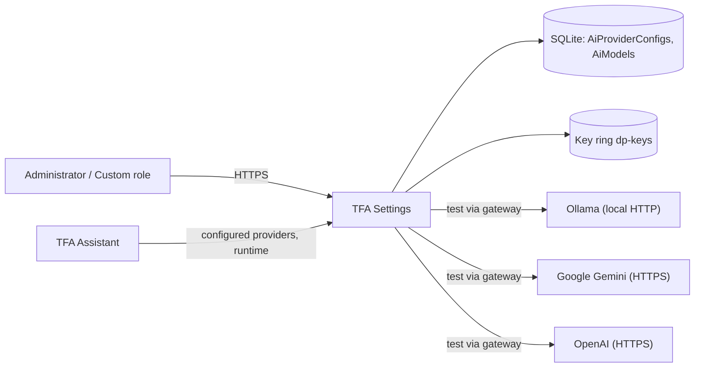
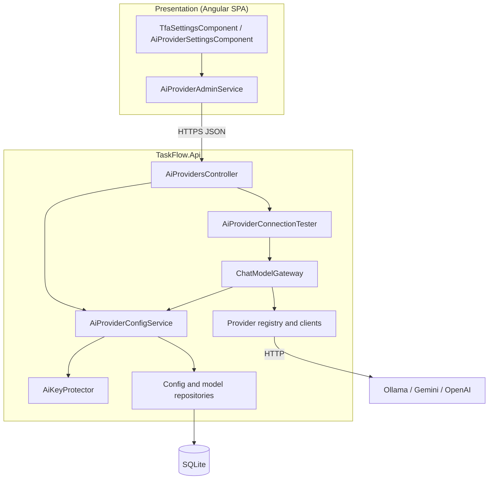
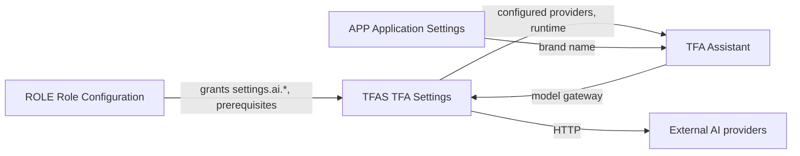
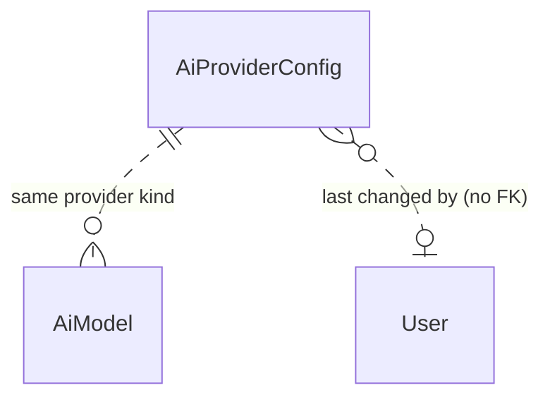
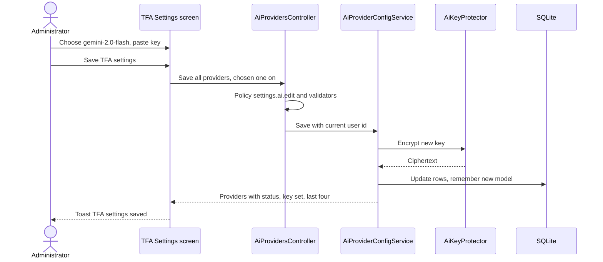
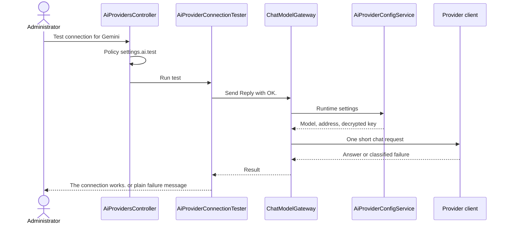
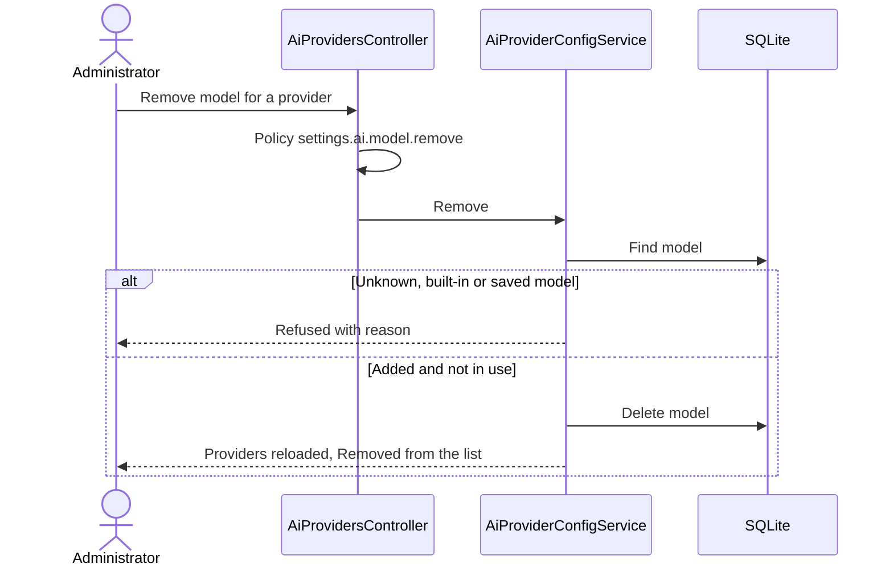

# High-Level Design – TFA Settings

## TaskFlow – Intelligent Task Allocation & Tracking System

> **Document:** High-Level Design  ·  **Version:** 1.0  ·  **Status:** Draft
> **Project type:** Personal Project (Skill Development)  ·  **Date:** 31-Oct-2026
> **Author:** Jojo George (jojogeorge3344@gmail.com)
> **Based on:** BRD-TFA-Settings v1.0, FRD-TFA-Settings v1.0
> **Module:** Settings  ·  **Sub-module:** 06.3 TFA Settings  ·  **Code:** TFAS
> © 2026 Jojo George. All rights reserved.

---

## Document Control

| Version | Date | Author | Summary of changes |
|---|---|---|---|
| 1.0 | 31-Oct-2026 | Jojo George | Initial version |

**Related documents:**

| Document | Location |
|---|---|
| Overall HLD (stack, deployment, cross-cutting design) | `../../00-Overall/HLD-TaskFlow-Overall.md` |
| BRD – TFA Settings | `../../../BRD/06-Settings/06.3-TFA-Settings/BRD-TFA-Settings.md` |
| FRD – TFA Settings | `../../../FRD/06-Settings/06.3-TFA-Settings/FRD-TFA-Settings.md` |
| LLD – TFA Settings | `../../../LLD/06-Settings/06.3-TFA-Settings/LLD-TFA-Settings.md` |
| HLD – TFA Assistant (runtime consumer) | `../../08-TFA-Assistant/08.1-Assistant/HLD-Assistant.md` |
| HLD – Role Configuration (permission prerequisites) | `../06.4-Role-Configuration/HLD-Role-Configuration.md` |
| TDD | `TF - Documents/TF - TDD/TDD-TaskFlow.md` §3.2 (key ring, AI providers), §6.5 (Integrations), §8.9 (Settings) |

---

## 1. Introduction

### 1.1 Purpose
This HLD describes the architecture of TFA Settings, the screen and services that decide which AI provider and model
the TFA Assistant uses: provider configuration, protected storage of API keys, the model list, the connection test and
the provider clients reached through the Assistant's model gateway. Class- and column-level detail is in the LLD.

### 1.2 Scope
In scope: the TFA Settings screen (`/settings/tfa`); its API under `/api/v1/assistant/providers` (read and save
configuration, remove an added model, test a provider); the configuration service, connection tester, key protector,
model and configuration storage, first-run seeding; the provider clients for Ollama, Google Gemini and OpenAI.

Out of scope: the TFA chat itself, tools, confirm-before-act and the assistant's provider selector (TFA Assistant HLD);
editing permissions (Role Configuration HLD).

### 1.3 Audience
Developer, reviewer and tester of TaskFlow; the product owner for the design decisions.

### 1.4 Definitions & Abbreviations

| Term | Meaning |
|---|---|
| TFA | TaskFlow Assistant, the AI chat assistant inside TaskFlow |
| Provider | An AI service: Ollama (local), Google Gemini or OpenAI (cloud) |
| Configured provider | Switched on, has a model, and has an address (Ollama) or a readable key (cloud) |
| Data Protection | ASP.NET Core encryption API; keys kept in a key ring folder |
| Key ring | Folder `dp-keys` (`AiProviders:KeyRingPath`) under the data folder; DPAPI-protected on Windows |
| Model gateway | `ChatModelGateway` (`IChatModelGateway`): the single path from TaskFlow to any provider |
| SSRF | Server-side request forgery – making the server call an address it should not |

---

## 2. System Context

### 2.1 Context Diagram

### 2.2 Actors & External Systems

| Actor / system | Interaction | Protocol |
|---|---|---|
| Administrator; Custom role with `settings.ai.*` | View, edit, test, remove models | HTTPS / JSON |
| TFA Assistant (in process) | Reads which providers are configured and the runtime settings (model, address, decrypted key) | In-process service call |
| Ollama | Local model server, no key | HTTP to the saved server address |
| Google Gemini | Cloud model API, key in a request header | HTTPS / REST |
| OpenAI | Cloud model API, bearer key | HTTPS / REST |
| Data Protection key ring | Encrypts and decrypts API keys | Local files |

---

## 3. Architecture Goals, Constraints & Principles

### 3.1 Quality Goals

| Goal | How the architecture supports it |
|---|---|
| Secret safety | API keys encrypted with Data Protection before storage; write-only through the API (only "key set" and the last four characters are returned) (NFR-TFAS-01) |
| SSRF protection | The server-address validator refuses link-local and cloud-metadata hosts; provider clients do not follow redirects (NFR-TFAS-02) |
| Least privilege | Four fine-grained permissions (view, edit, test, remove model), each checked on the server (NFR-TFAS-03) |
| Robust test | The connection test always returns a result message, never an error status (NFR-TFAS-04) |
| Detect lost keys | Each read checks whether the stored key can still be decrypted (NFR-TFAS-05) |
| Plain language | Provider failures are classified (not configured, invalid key, rate limited, timeout, unreachable, model unavailable) and mapped to fixed messages (NFR-TFAS-06) |
| Privacy | Cloud providers are tagged; Ollama (local) is the default on a new installation (NFR-TFAS-07) |

### 3.2 Constraints
- Exactly three providers, fixed in code (`AiProviderCatalog`).
- One API process; provider calls are synchronous HTTP with a timeout of `AiProviders:TimeoutSeconds` (60).
- Key protection depends on the key ring folder staying with the data folder; losing it makes saved keys unreadable.
- Only the screen enforces "one active server"; the API accepts several enabled providers.

### 3.3 Architecture Principles
- Controller → Service → Repository; integrations (key protection, provider clients) behind interfaces (overall HLD).
- Every call to a model goes through the one model gateway – the test uses the same path as the assistant.
- Secrets never leave the server towards the browser and never appear in logs.
- Defence in depth: SPA hides buttons, the API checks each permission, the validator checks each value.

---

## 4. Architecture Overview

### 4.1 Architecture Style
An Angular screen calls a REST controller with one permission per action. Behind it, a configuration service owns the
provider rows, the model list and key protection; a connection tester sends one short request through the Assistant's
model gateway, which picks the provider client from a registry.

API surface (4 actions; full list in the LLD): `/api/v1/assistant/providers/config` (read, save),
`/api/v1/assistant/providers/{kind}/models` (remove an added model), `/api/v1/assistant/providers/{kind}/test`
(connection test). The assistant's own provider selector reads `/api/v1/assistant/providers`, owned by the TFA
Assistant.

### 4.2 Logical Architecture

### 4.3 Layers & Responsibilities

| Layer | Responsibility in this sub-module | May call |
|---|---|---|
| Presentation | Provider card and status, model selector with built-in and added models, server address, API key box with keep/remove, Save, Test, Remove model; buttons shown per permission | API |
| API / Controllers | `AiProvidersController`: one policy per action; routes `{kind}` to the provider | Services |
| Validation | Request validators: providers present and unique, model name, server address (http/https, no link-local or metadata host), key without spaces, not new key and clear together | – |
| Services | `AiProviderConfigService`: read config with status, save, remember added models, remove model, runtime for the gateway; `AiProviderConnectionTester`: one test request and result mapping | Repositories, integrations |
| Repositories | `AiProviderConfigRepository`, `AiModelRepository` | Database |
| Integrations | `AiKeyProtector` (Data Protection), `KeyRingProtectionCheck`, provider registry and the Ollama, Gemini and OpenAI clients | Key ring, external providers |
| Start-up | `AiProviderSeeder`: built-in models and one row per provider | Database |

---

## 5. Component / Module Design

| Module / component | Responsibility | Key components (high level) | Depends on |
|---|---|---|---|
| TFA Settings screen | Choose server and model, enter address or key, save, test, remove added model | `TfaSettingsComponent`, `AiProviderSettingsComponent`, `AiProviderAdminService` | TFA Settings API, current user's permissions |
| TFA Settings API | Authorize and route the four actions | `AiProvidersController`, request validators | Config service, connection tester |
| Provider configuration | Rows per provider, status (configured, key readable), model list, save rules, runtime settings | `AiProviderConfigService`, `AiProviderCatalog` | Repositories, key protector |
| Connection test | One short request, plain result | `AiProviderConnectionTester`, `ProviderFailureMessages` | Model gateway |
| Key protection | Encrypt/decrypt keys; warn about an unprotected key ring at start-up | `AiKeyProtector`, `KeyRingProtectionCheck` | Data Protection key ring |
| Provider clients | Call each provider; classify failures; no redirects | `ChatModelProviderRegistry`, `OllamaProvider`, `GeminiProvider`, `OpenAiProvider` | External providers |
| Model gateway (Assistant module) | Single path to a provider for test and chat | `ChatModelGateway` | Config service (runtime), registry |
| Seeding | First-run defaults | `AiProviderSeeder` | SQLite |

### 5.1 Module Interaction

| Interaction | What is exchanged |
|---|---|
| TFAS → TFA | Which providers are configured (assistant model selector) and the runtime settings for each call |
| TFA → TFAS | The connection test uses the Assistant's model gateway, so a passing test means chat will reach the provider |
| ROLE → TFAS | Grants of `settings.ai.view`, `settings.ai.edit`, `settings.ai.test`, `settings.ai.model.remove`; edit, test and remove each require view |
| TFAS → providers | One short chat request for a test; chat requests from the assistant use the same clients |

---

## 6. Data Architecture (high level)

### 6.1 Data Stores

| Store | Technology | Holds | Notes |
|---|---|---|---|
| Main database | SQLite (`taskflow.db`, EF Core) | One configuration row per provider (on/off, model, address, encrypted key, last four characters, editor and time); the list of models per provider (built-in and added) | Encrypted key never returned |
| Key ring | Data Protection key files in `dp-keys` | Keys that encrypt the API keys (purpose `TaskFlow.AiProviderKeys`) | DPAPI-protected on Windows; checked at start-up; must be backed up with the database |
| Code catalogue | `AiProviderCatalog` | Providers, display names, built-in models, defaults | Fixed in code |

### 6.2 Main Data Domains

| Domain | Owner | Use here |
|---|---|---|
| `AiProviderConfig` | TFAS | Read and written; runtime read by the TFA Assistant |
| `AiModel` | TFAS | Read; added models written on save and removed on request; built-in models seeded |

### 6.3 Data Flow
1. First start seeds the built-in models and one row per provider; on a brand-new installation Ollama is switched on at
   `http://localhost:11434`, cloud providers stay off without a key (FR-TFAS-24).
2. The screen reads all providers with their status, model lists and "key set / last four" – never the key.
3. On save the SPA switches the chosen provider on and the others off; a new key is encrypted before storage; an empty
   key box keeps the stored key; a new model name is remembered in the list.
4. The test and the assistant ask the configuration service for the runtime settings; the key is decrypted only in
   memory for the outgoing request.

---

## 7. Integration Design

| Integration | Direction | Purpose | Failure behaviour |
|---|---|---|---|
| Ollama (local model server) | Outbound HTTP to the saved address | Test and chat | Unreachable / timeout / model missing → fixed plain message; TFA not available until fixed |
| Google Gemini | Outbound HTTPS, key in a request header | Test and chat | Invalid key, rate limit (with retry time), timeout, model unavailable → fixed plain message |
| OpenAI | Outbound HTTPS, bearer key | Test and chat | As for Gemini |
| Data Protection key ring | Local | Encrypt/decrypt keys | Unreadable key → status "The saved key can no longer be read. Enter it again."; provider treated as not configured; a warning is logged |
| TFA Assistant | Inbound (in process) | Configured providers and runtime | Not-configured provider is not offered |

All provider calls share a timeout (`AiProviders:TimeoutSeconds`), do not follow redirects, and log only provider,
failure kind and HTTP status – no headers, bodies or keys. No automatic switch to another provider on failure.

---

## 8. Key Flows (high level)

### 8.1 Choose provider and model, save

### 8.2 Test the connection (integration)

### 8.3 Remove an added model

---

## 9. Security Architecture

| Concern | Approach |
|---|---|
| Authentication | JWT bearer access token and refresh cookie; session revalidated on every request (overall HLD) |
| Authorization | Controller requires sign-in; each action has its own policy: read `settings.ai.view`, save `settings.ai.edit`, test `settings.ai.test`, remove model `settings.ai.model.remove` (FR-TFAS-25). Edit, test and remove each require view, enforced by Role Configuration (FR-TFAS-26). The legacy key `settings.ai.manage` expands to the four keys for roles that still hold it. SPA: menu item and `permissionGuard` on view; `canEdit`, `canTest`, `mayRemoveModel` hide the buttons |
| Default grants | Administrator only; Manager and Employee denied; custom roles configurable |
| Secret handling | Keys encrypted with Data Protection (purpose `TaskFlow.AiProviderKeys`); write-only API; only "key set" and last four characters returned; key ring DPAPI-protected on Windows and checked at start-up (`KeyRingProtectionCheck`) |
| SSRF | Server address must be http/https and not link-local or a cloud metadata host; `localhost` and private addresses allowed for Ollama; redirects not followed |
| Transport | HTTPS from the browser; HTTPS to cloud providers; Ollama over the configured address |
| Privacy | Screen explains that cloud providers receive the user's question and related task details (FR-TFAS-23) |
| Auditing | Last editor and time per provider row; denied requests logged by the denied-action audit handler; provider logs carry no secrets |

---

## 10. Technology Stack

TFA Settings uses the shared TaskFlow stack: Angular 19 SPA, ASP.NET Core Web API on .NET 10, EF Core 10 with SQLite,
FluentValidation 12. Specific to this sub-module are ASP.NET Core Data Protection for key encryption and typed
`HttpClient` provider clients for Ollama, Google Gemini and OpenAI (no vendor SDK packages). Versions and rationale are in
the overall HLD (`../../00-Overall/HLD-TaskFlow-Overall.md`, §10).

---

## 11. Deployment Architecture

TFA Settings runs inside the single `TaskFlow.Api` process. Deployment-relevant items: the key ring folder
`AiProviders:KeyRingPath` (default `dp-keys`) under `Storage:Root` must stay with the database (and be backed up with it)
or saved keys become unreadable; `AiProviders:TimeoutSeconds` (60) bounds each provider call; Ollama, when used, runs as a
separate local service reachable at the saved address (default `http://localhost:11434`); cloud providers need outbound
HTTPS. Environments, hosting and backup are in the overall HLD (`../../00-Overall/HLD-TaskFlow-Overall.md`, §11).

---

## 12. Non-Functional Design

| Area | Design decision |
|---|---|
| Performance | Configuration read and save are small database operations; a test is one short provider request bounded by the timeout |
| Scalability | Three provider rows and a short model list; single instance |
| Reliability | Test never throws to the screen (always a result); unreadable key detected and reported; duplicate-model race on save handled by retrying without the duplicate |
| Availability | A provider outage affects only TFA; the rest of TaskFlow is independent |
| Security | See §9; secrets never logged or returned |
| Maintainability | Provider list and built-in models in one catalogue; each provider behind one client interface in a registry; the test reuses the assistant's gateway |
| Observability | Provider failures logged by provider, failure kind and status; key-ring warning at start-up; warning when an enabled provider's key cannot be decrypted |
| Backup & Recovery | Database and key ring together; see overall HLD |

---

## 13. Design Decisions

| ID | Decision | Alternatives considered | Rationale |
|---|---|---|---|
| D-TFAS-1 | Encrypt API keys with ASP.NET Core Data Protection and a key ring in the data folder | Plain text in the database; keys in `appsettings.json`; OS secret store | Keys not readable from the database file; no extra dependency; one folder to back up |
| D-TFAS-2 | Keys are write-only: the API returns only "key set" and the last four characters | Return masked or full key | A key can never leak through the browser (BR-TFAS-01) |
| D-TFAS-3 | Three fixed providers behind one model gateway and a provider registry | Vendor SDKs; a generic OpenAI-compatible endpoint only | Free local option (Ollama) plus two cloud options; one path for test and chat; easy to add a provider in code |
| D-TFAS-4 | The connection test goes through the same gateway as the assistant and always returns 200 with a result | Separate ping endpoint per provider; error status on failure | A passing test proves chat will work; the screen shows a message, never an error page |
| D-TFAS-5 | Fine-grained permissions view / edit / test / remove model, each requiring view | One `settings.ai.manage` key (now legacy) | Lets an organization delegate testing without editing; legacy key still honoured |
| D-TFAS-6 | Server-address validator blocks link-local and metadata hosts; no redirects | Allow any URL | Prevents SSRF towards cloud metadata services (BR-TFAS-06) |
| D-TFAS-7 | "One active server" applied by the screen; the API stores each provider's own on/off | Enforce a single enabled provider in the API | Switched-off providers keep their keys, models and addresses for a quick switch back |
| D-TFAS-8 | Ollama on by default only on a brand-new installation | Always on; always off | Works out of the box locally without sending data to the cloud; upgrades are not changed silently |
| D-TFAS-9 | Models are data (`AiModel`), built-in ones seeded and protected, added ones removable when not in use | Free-text model only | Keeps the selector tidy and prevents removing the model in use (BR-TFAS-04) |

---

## 14. Risks, Assumptions & Open Issues

| Type | Description | Mitigation / owner |
|---|---|---|
| Risk | API key leaked (R-TFAS-01) | Encrypted at rest, write-only API, no logging – Jojo George |
| Risk | Task data sent to a cloud provider without awareness (R-TFAS-02) | Cloud tag and explanation; Ollama default – Jojo George |
| Risk | Cloud rate limit reached (R-TFAS-03) | Rate-limit message with retry time; switch model – Jojo George |
| Risk | Key ring lost or unprotected, keys unreadable (R-TFAS-04) | Start-up warning; "enter it again" status; back up the key ring with the database – Jojo George |
| Risk | Server address abused for SSRF (R-TFAS-05) | Address validator; no redirects – Jojo George |
| Open issue | ⚠️ To be confirmed: without `settings.ai.edit` the inputs stay editable and only **Save** is hidden; whether the screen should be fully read-only. | Jojo George |
| Open issue | ⚠️ To be confirmed: a user with `settings.ai.test` but without `settings.ai.edit` cannot test while there are unsaved changes (the automatic save is refused). | Jojo George |
| Open issue | ⚠️ To be confirmed: only the screen ensures one active server; whether the API should refuse several enabled providers. | Jojo George |
| Open issue | ⚠️ To be confirmed: exact conditions for **Ready to use** versus **In use** on the provider card. | Jojo George |

---

## 15. Traceability (requirements → components)

| FRD item | Module / component | Section |
|---|---|---|
| FR-TFAS-01 | `AiProviderCatalog` (three providers) | §3.2, D-TFAS-3 |
| FR-TFAS-02 | `AiProviderSettingsComponent`; status from `AiProviderConfigService` | §4.3 |
| FR-TFAS-03 | `AiProviderCatalog` built-in models; `AiProviderSeeder`; `AiModel` | §6, D-TFAS-9 |
| FR-TFAS-04 | `AiProviderSettingsComponent` (server/model linking) | §4.3 |
| FR-TFAS-05 | `AiProviderSettingsComponent`; `AiProviderConfigService` remembers added models | §6.3 |
| FR-TFAS-06 | `AiProviderSettingsComponent`; `AiProviderConfig` address | §6.1 |
| FR-TFAS-07 | Request validator (address and SSRF rule) | §9, D-TFAS-6 |
| FR-TFAS-08 | Request validator (key rules) | §4.3 |
| FR-TFAS-09 | `AiProviderConfigService` (no key for Ollama) | §4.3 |
| FR-TFAS-10 | `AiKeyProtector`; write-only response | §9, D-TFAS-1, D-TFAS-2 |
| FR-TFAS-11 | `AiProviderConfigService` (key set, last four) | D-TFAS-2 |
| FR-TFAS-12 | `AiProviderConfigService` (empty key keeps the stored one) | §6.3 |
| FR-TFAS-13 | `AiProviderSettingsComponent`; validator (not both) | §4.3 |
| FR-TFAS-14 | `AiProviderSettingsComponent` (one server on); `AiProviderConfigService` save | §8.1, D-TFAS-7 |
| FR-TFAS-15 | Request validator (each provider once) | §4.3 |
| FR-TFAS-16 | `AiProviderConfigService` configured providers → TFA Assistant | §5.1 |
| FR-TFAS-17 | `AiProviderConnectionTester` → `ChatModelGateway` → provider clients | §8.2, D-TFAS-4 |
| FR-TFAS-18 | `AiProviderConnectionTester` (always a result) | D-TFAS-4 |
| FR-TFAS-19 | `AiProviderSettingsComponent` (save before test) | §14 |
| FR-TFAS-20 | `AiProvidersController` remove; `AiProviderConfigService` | §8.3 |
| FR-TFAS-21 | `AiProviderConfigService` removal rules | §8.3, D-TFAS-9 |
| FR-TFAS-22 | `AiProviderConfigService` key-readable check | §7 |
| FR-TFAS-23 | `AiProviderSettingsComponent` (cloud explanation) | §9 |
| FR-TFAS-24 | `AiProviderSeeder` | §6.3, D-TFAS-8 |
| FR-TFAS-25 | `AiProvidersController` per-action policies; component permission checks | §9 |
| FR-TFAS-26 | Permission catalogue prerequisites enforced by Role Configuration | §5.1, D-TFAS-5 |
| FR-TFAS-27 | Navigation builder and `permissionGuard` | §9 |
| FR-TFAS-28 | `AiProviderSettingsComponent` (toasts and error messages) | §8 |

---
© 2026 Jojo George. All rights reserved. Unauthorized copying or distribution of this document is prohibited.
