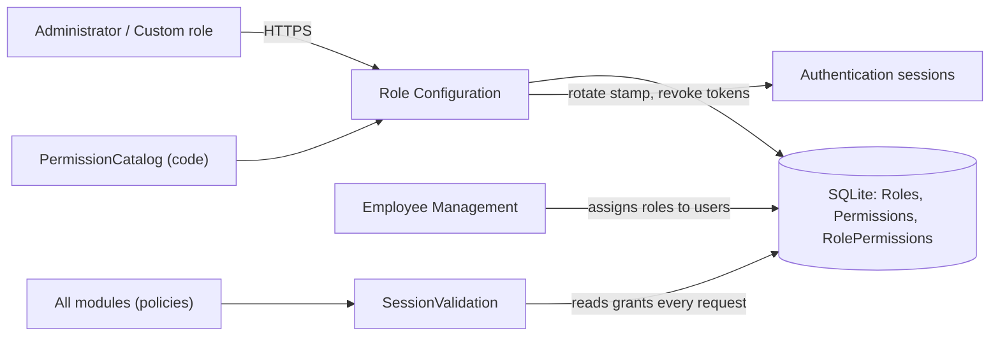
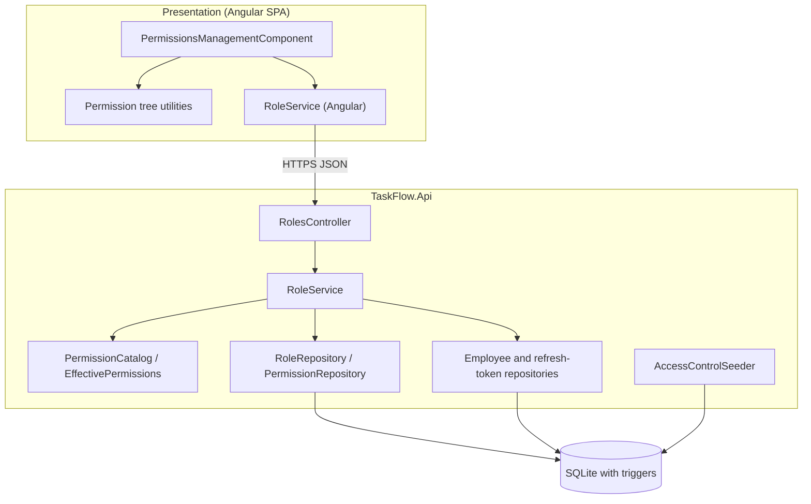
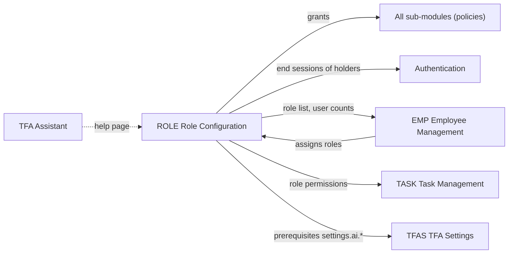
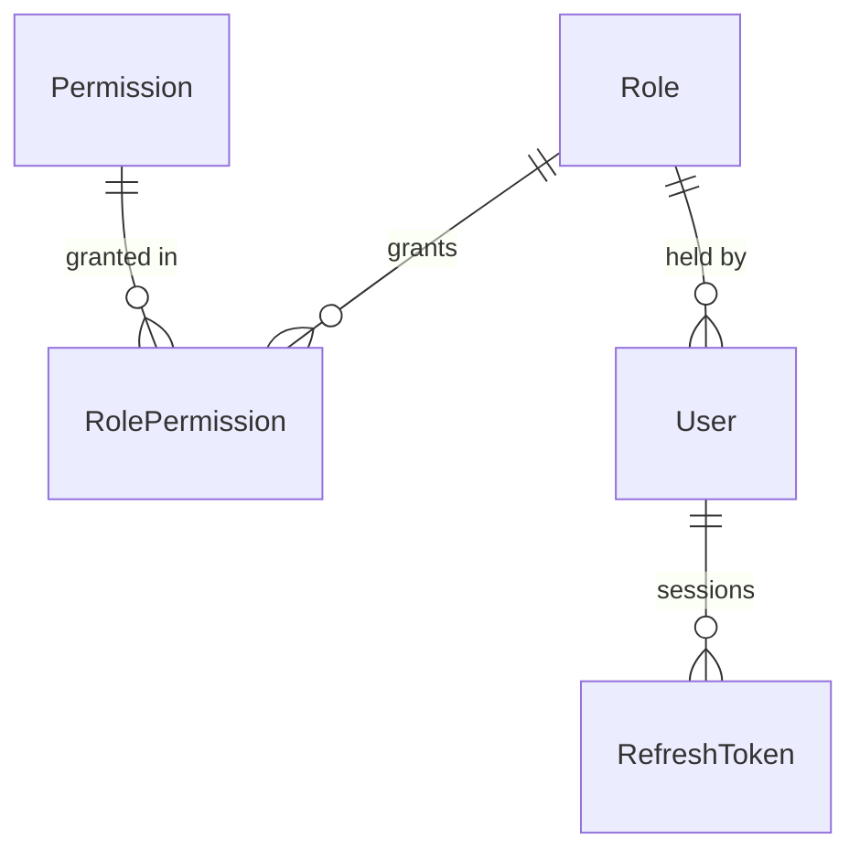
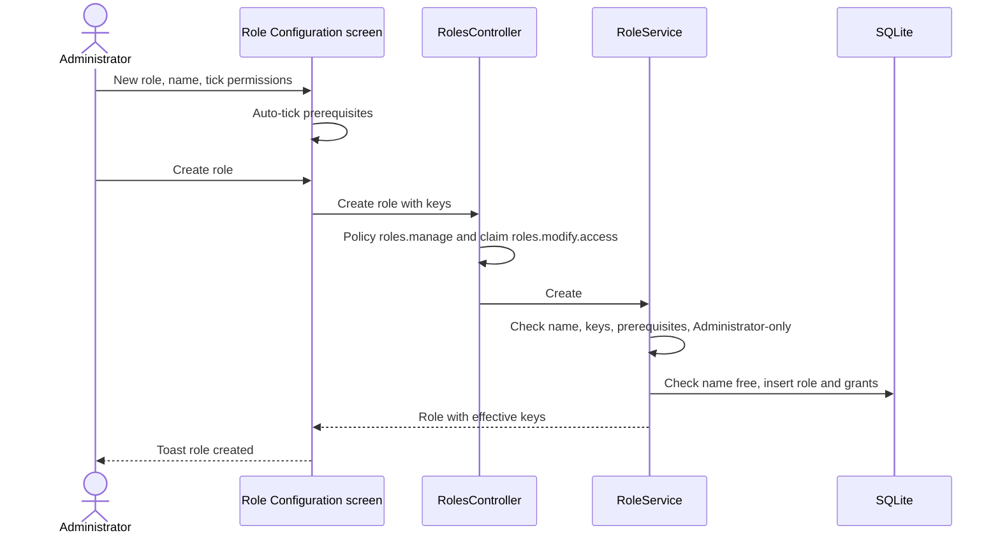
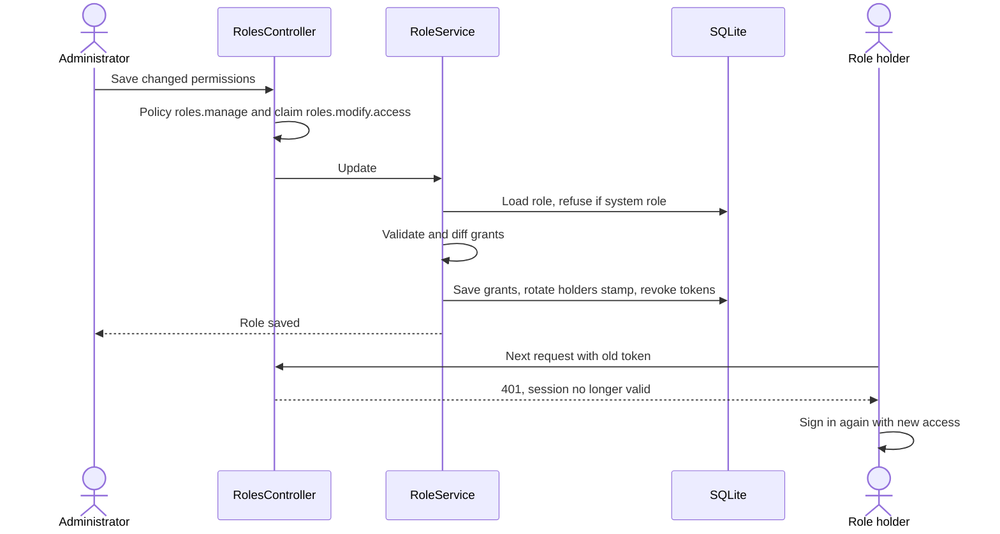
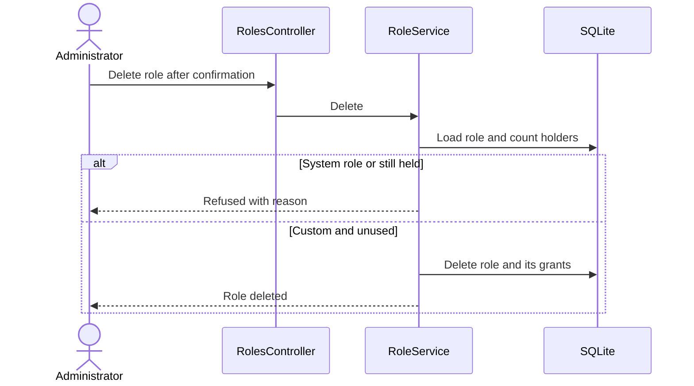

# High-Level Design – Role Configuration

## TaskFlow – Intelligent Task Allocation & Tracking System

> **Document:** High-Level Design  ·  **Version:** 1.0  ·  **Status:** Draft
> **Project type:** Personal Project (Skill Development)  ·  **Date:** 31-Oct-2026
> **Author:** Jojo George (jojogeorge3344@gmail.com)
> **Based on:** BRD-Role-Configuration v1.0, FRD-Role-Configuration v1.0
> **Module:** Settings  ·  **Sub-module:** 06.4 Role Configuration  ·  **Code:** ROLE
> © 2026 Jojo George. All rights reserved.

---

## Document Control

| Version | Date | Author | Summary of changes |
|---|---|---|---|
| 1.0 | 31-Oct-2026 | Jojo George | Initial version |

**Related documents:**

| Document | Location |
|---|---|
| Overall HLD (stack, deployment, authentication, permission model) | `../../00-Overall/HLD-TaskFlow-Overall.md` |
| BRD – Role Configuration | `../../../BRD/06-Settings/06.4-Role-Configuration/BRD-Role-Configuration.md` |
| FRD – Role Configuration | `../../../FRD/06-Settings/06.4-Role-Configuration/FRD-Role-Configuration.md` |
| LLD – Role Configuration | `../../../LLD/06-Settings/06.4-Role-Configuration/LLD-Role-Configuration.md` |
| HLD – Employee Management (assigning roles to users) | `../../03-TaskFlow-Management/03.1-Employee-Management/HLD-Employee-Management.md` |
| TDD | `TF - Documents/TF - TDD/TDD-TaskFlow.md` §9.8 (Permission model), §9.9 (Roles), §9.4 (Tokens and sessions) |

---

## 1. Introduction

### 1.1 Purpose
This HLD describes the architecture of Role Configuration: how TaskFlow keeps a fixed permission catalogue, three
read-only system roles and any number of custom roles; how a role's permissions are edited and validated; and how a
change reaches every signed-in holder of the role. Class- and column-level detail is in the LLD.

### 1.2 Scope
In scope: the Role Configuration screen (`/settings/permissions`); its API (`/api/v1/roles` and `/api/v1/permissions`);
the role service and its rules (names, prerequisites, Administrator-only and always-on permissions, scope levels, system
role protection, in-use check); the permission catalogue in code; role and grant storage with database triggers; the
access-control seeder; ending the sessions of holders after a permission change.

Out of scope: assigning roles to users and the Administrator safeguards on users (Employee Management HLD); sign-in,
tokens and session validation (overall HLD, Authentication); the permission checks inside each module (their own HLDs).

### 1.3 Audience
Developer, reviewer and tester of TaskFlow; the product owner for the design decisions.

### 1.4 Definitions & Abbreviations

| Term | Meaning |
|---|---|
| Permission catalogue | `PermissionCatalog`: the fixed list of 64 permissions in a Module → Screen → Section → Action tree, defined in code |
| System role | Administrator, Manager, Employee (`SystemRoles`); read-only |
| Custom role | A role created on this screen |
| Grant | One role–permission pair (`RolePermission`) |
| Prerequisite | A permission another one requires (for example `settings.ai.edit` requires `settings.ai.view`) |
| Always on | Permissions every user has; never stored as grants (own dashboard, own tasks, own profile) |
| Scope level | Levels of one selector, a higher level includes the lower (own / team / organization; my tasks / all tasks) |
| Legacy key | An older broad key expanded to its finer replacements (`EffectivePermissions`) |
| Security stamp | Per-user value checked on every request; changing it ends the user's sessions |

---

## 2. System Context

### 2.1 Context Diagram

### 2.2 Actors & External Systems

| Actor / system | Interaction | Protocol |
|---|---|---|
| Administrator; Custom role with `roles.manage` | View roles, compare, create, edit, delete custom roles | HTTPS / JSON |
| Holders of a changed role | Signed out; sign in again with the new access | (indirect) |
| Employee Management | Assigns roles to users; offers the Administrator role only to holders of `roles.administrator.assign` | Shared data |
| Authentication / session validation | Re-reads role and permission claims on every request; rejects tokens with an old security stamp | In process |
| Every module | Authorizes by policy `perm:<key>` against the claims | In process |
| External systems | None | – |

---

## 3. Architecture Goals, Constraints & Principles

### 3.1 Quality Goals

| Goal | How the architecture supports it |
|---|---|
| Server-side enforcement | Every endpoint requires `roles.manage`; create, save and delete also need `roles.modify.access`, checked in the controller (NFR-ROLE-01) |
| Immediate effect | Grants re-read on every request; holders of a changed role are signed out at once (NFR-ROLE-02) |
| Integrity at every level | System roles and the catalogue protected in the service and by SQLite triggers (NFR-ROLE-03) |
| Consistency | The catalogue (with prerequisites, scope levels, Administrator-only and always-on flags) is one code source for the API, the screen tree and the seeder |
| Usability | Tree with search, filter, expand/collapse, select all, compare view, unsaved-change counter (NFR-ROLE-04, NFR-ROLE-05) |

### 3.2 Constraints
- The permission list cannot be changed at run time; new permissions come with a new release.
- Three system roles with fixed ids 1–3.
- Single API process and one SQLite database; triggers are SQLite triggers.

### 3.3 Architecture Principles
- Controller → Service → Repository with commits through the unit of work (overall HLD).
- Access is decided by permission keys, never by role names (one documented exception, see overall HLD).
- The catalogue is code, the grants are data.
- Defence in depth: SPA hides, controller checks permissions, service checks rules, database triggers protect system data.

---

## 4. Architecture Overview

### 4.1 Architecture Style
An Angular screen (tree + matrix) calls a REST controller with a class-level permission policy and in-action claim
checks. A role service applies all role rules against the code catalogue and writes through two repositories; on a
permission change it also reaches into the Management and Authentication data to end the holders' sessions.

API surface (9 actions in two groups; full list in the LLD): roles – `/api/v1/roles` (list, create) and
`/api/v1/roles/{id}` (read, save, delete); catalogue – `/api/v1/permissions` (read; create always refused) and
`/api/v1/permissions/{id}` (change and delete always refused). The employee form's role options come from
`/api/v1/users/roles`, owned by Employee Management.

### 4.2 Logical Architecture

### 4.3 Layers & Responsibilities

| Layer | Responsibility in this sub-module | May call |
|---|---|---|
| Presentation | Role list with search and user counts; permission tree with tick boxes, scope selectors, always-on and Administrator-only tags; compare matrix; new, duplicate, copy-from, save bar, delete; read-only mode without `roles.modify.access` | API |
| API / Controllers | `RolesController`: class-level `roles.manage`; narrows the list without `roles.view.all`; refuses create/save/delete without `roles.modify.access`; catalogue mutations always refused | Services |
| Services | `RoleService`: list with effective keys, catalogue for display, create, update with grant diff and session ending, delete with in-use check | Repositories, catalogue |
| Security model | `PermissionCatalog`, `EffectivePermissions` (legacy expansion, scope levels), `SystemRoles` | – |
| Repositories | `RoleRepository`, `PermissionRepository`; employee and refresh-token repositories (other modules) | Database |
| Database | Triggers protect system roles, their grants and the catalogue rows | – |
| Start-up | `AccessControlSeeder`: system roles, missing permissions, every permission to Administrator, Manager/Employee defaults for new keys | Database |

---

## 5. Component / Module Design

| Module / component | Responsibility | Key components (high level) | Depends on |
|---|---|---|---|
| Role Configuration screen | Browse, compare and edit roles | `PermissionsManagementComponent`, permission tree utilities, Angular `RoleService` | Roles API, current user's permissions |
| Roles API | Authorize and route role and catalogue requests | `RolesController` | Role service |
| Role service | All role rules; session ending after a permission change | `RoleService`, `RoleException` | Repositories, catalogue |
| Permission model | Fixed catalogue, prerequisites, scope levels, legacy keys, always-on keys | `PermissionCatalog`, `PermissionKeys`, `EffectivePermissions`, `SystemRoles` | – |
| Role storage | Roles, catalogue rows, grants | `RoleRepository`, `PermissionRepository`; entities `Role`, `Permission`, `RolePermission` | SQLite |
| Protection | Read-only system roles and catalogue | SQLite triggers created by the roles migration | SQLite |
| Seeding | Keep catalogue and Administrator grants current | `AccessControlSeeder` | SQLite |

### 5.1 Module Interaction

| Interaction | What is exchanged |
|---|---|
| ROLE → all sub-modules | Grants become `permission` claims on the next request; policies `perm:<key>` decide access |
| ROLE → Authentication | New security stamp and revoked refresh tokens for every holder of a re-permissioned custom role |
| ROLE ↔ EMP | Employee Management assigns roles (`employees.role.assign`, Administrator also `roles.administrator.assign`); role delete counts holders |
| ROLE → TASK | The task service reads the permission keys held by a role |
| ROLE → TFAS (and others) | Prerequisites such as edit/test/remove requiring view |
| TFA → ROLE | The assistant explains role changes from its help page |

---

## 6. Data Architecture (high level)

### 6.1 Data Stores

| Store | Technology | Holds | Notes |
|---|---|---|---|
| Main database | SQLite (`taskflow.db`, EF Core) | Roles, catalogue rows, grants | Role names unique ignoring case; triggers protect system data |
| Code catalogue | `PermissionCatalog` | Hierarchy, prerequisites, scope levels, flags, role defaults | Source of truth; table rows only mirror keys and display text |
| Users / sessions (other modules) | SQLite | Users' role and security stamp; refresh tokens | Written here only to end sessions |

### 6.2 Main Data Domains

| Domain | Owner | Use here |
|---|---|---|
| `Role`, `Permission`, `RolePermission` | ROLE | Read and written (catalogue rows only by the seeder) |
| `User` (role, security stamp) | EMP | Holder count; security stamp rotated after a permission change |
| `RefreshToken` | Authentication | Active tokens of holders revoked after a permission change |

### 6.3 Data Flow
1. Each start, the seeder ensures the system roles, adds new catalogue entries, grants every permission to the
   Administrator and applies Manager/Employee defaults only to newly added keys.
2. The screen loads the roles (narrowed to the caller's own without `roles.view.all`) and the catalogue tree.
3. On save the service normalizes the keys (legacy expansion, always-on keys dropped), validates them, and writes only
   the changed grants.
4. If grants changed, every holder's security stamp is rotated and active refresh tokens are revoked in the same
   transaction; their next request is rejected and they sign in again.
5. Every request of every user re-reads role and permission claims from the grants.

---

## 7. Integration Design

| Integration | Direction | Purpose | Failure behaviour |
|---|---|---|---|
| Authentication sessions (in process) | Outbound write | End the sessions of a changed role's holders | Part of the save transaction: either saved and signed out, or nothing changes |
| Session validation (in process) | Inbound read by every request | Current role and permission claims | – |
| Employee Management (shared data) | Inbound/outbound | Role assignment; holder count for delete | Delete refused while users hold the role |
| Database triggers | Inside the database | Last line of defence for system roles and the catalogue | Statement aborted with "System roles are read-only." or "The permission catalog is read-only." |
| External services | – | None | – |

---

## 8. Key Flows (high level)

### 8.1 Create a custom role

### 8.2 Change a custom role's permissions (signs holders out)

### 8.3 Delete a custom role

---

## 9. Security Architecture

| Concern | Approach |
|---|---|
| Authentication | JWT bearer access token and refresh cookie; session revalidated on every request (overall HLD) |
| Authorization | Class-level `roles.manage` on all role and catalogue endpoints (FR-ROLE-25); in-action checks: `roles.view.all` to list every role (FR-ROLE-02), `roles.modify.access` for create, save and delete (FR-ROLE-23). SPA: menu item and `permissionGuard`; `canViewAllRoles`, `canModifyAccess` switch the screen to read-only |
| Default grants | Administrator: all four `roles.*` keys; Manager and Employee: none; custom roles configurable except `roles.administrator.assign` (Administrator only) |
| Privilege boundaries | Administrator-only permission refused for any other role (FR-ROLE-13); prerequisites enforced (FR-ROLE-11); always-on keys never stored (FR-ROLE-14); Administrator always holds every permission (FR-ROLE-22) |
| Integrity | System roles and the catalogue refused in the service and by triggers (FR-ROLE-06, FR-ROLE-21) |
| Session effect | A permission change ends every holder's sessions (FR-ROLE-18); a rename alone does not |
| Auditing | Denied requests logged by the denied-action audit handler; no activity entry or history for role changes |

---

## 10. Technology Stack

Role Configuration uses the shared TaskFlow stack without additions: Angular 19 SPA, ASP.NET Core Web API on .NET 10
with policy-based authorization, EF Core 10 with SQLite (including SQLite triggers created by migration). Versions and
rationale are in the overall HLD (`../../00-Overall/HLD-TaskFlow-Overall.md`, §10).

---

## 11. Deployment Architecture

Role Configuration runs inside the single `TaskFlow.Api` process and has no configuration keys of its own. Its tables
and triggers are created by the roles migration, applied automatically at start-up, after which `AccessControlSeeder`
brings the catalogue and the Administrator grants up to date on every start. Environments, hosting and backup are in
the overall HLD (`../../00-Overall/HLD-TaskFlow-Overall.md`, §11).

---

## 12. Non-Functional Design

| Area | Design decision |
|---|---|
| Performance | Roles and catalogue loaded in one call each; save writes only the changed grants (NFR-ROLE-06) |
| Scalability | 64 permissions and a small number of roles; single instance |
| Reliability | Save, grant diff and session ending in one transaction; unique name index decides concurrent saves (409) |
| Security | See §9; three layers (controller, service, triggers) |
| Maintainability | Catalogue in one code file drives API, tree and seeder; catalogue integrity and the roles migration are covered by tests |
| Usability | Tree, search, filters, compare matrix, unsaved-change counter and discard confirmation in the SPA (NFR-ROLE-04, NFR-ROLE-05) |
| Observability | Request log; denied-action log |
| Backup & Recovery | Part of the database file; see overall HLD |

---

## 13. Design Decisions

| ID | Decision | Alternatives considered | Rationale |
|---|---|---|---|
| D-ROLE-1 | Fixed permission catalogue in code; the table mirrors it and cannot be changed through the API | Editable permissions table | Every permission must be enforced by code, so new permissions only make sense with a release (BR-ROLE-02) |
| D-ROLE-2 | Three system roles read-only, protected in the service and by SQLite triggers | Service checks only | Integrity even against direct or faulty writes (NFR-ROLE-03) |
| D-ROLE-3 | Administrator receives every stored permission on every start | Grant once at installation | New permissions in later releases are never missing for the Administrator (BR-ROLE-10) |
| D-ROLE-4 | Manager/Employee defaults applied only when a permission is first added | Re-apply defaults on every start | An organization's later edits are never overwritten |
| D-ROLE-5 | A permission change on a custom role rotates holders' security stamps and revokes refresh tokens | Wait for tokens to expire; rely on claim refresh only | Holders sign in again with exactly the new access (BR-ROLE-09) |
| D-ROLE-6 | Grants re-read into claims on every request (session validation) | Permissions inside the JWT until expiry | A role change applies on the next call in every module |
| D-ROLE-7 | Prerequisites, scope levels, Administrator-only and always-on flags are catalogue attributes checked by the role service | Ad-hoc checks per screen | One rule set for API, tree and seeder (BR-ROLE-04…BR-ROLE-07) |
| D-ROLE-8 | Finer permissions (`roles.view.all`, `roles.modify.access`) checked inside the controller on top of `roles.manage` | Separate policies per endpoint | Read-only access to the screen can be delegated without the right to change roles |
| D-ROLE-9 | Legacy broad keys expanded to their finer replacements and stored as finer keys on save | Migrate all grants at once | Roles that still hold an old key keep working; saving cleans them up |

---

## 14. Risks, Assumptions & Open Issues

| Type | Description | Mitigation / owner |
|---|---|---|
| Risk | A custom role gets too much access (R-ROLE-01) | Compare view; prerequisites; Administrator-only permission – Jojo George |
| Risk | A custom role with `roles.manage` + `roles.modify.access` widens access (R-ROLE-02) | Grant only to trusted roles – Jojo George |
| Risk | Holders lose unsaved work when signed out (R-ROLE-03) | Change roles outside busy hours – Jojo George |
| Risk | No history of role changes (R-ROLE-04) | Compare view shows the current state – Jojo George |
| Open issue | ⚠️ To be confirmed: whether `roles.manage` should be Administrator-only. | Jojo George |
| Open issue | ⚠️ To be confirmed: reading one role by id ignores `roles.view.all`; whether that should be refused. | Jojo George |
| Open issue | ⚠️ To be confirmed: **Duplicate as custom role** is shown without `roles.modify.access` although the draft cannot be saved. | Jojo George |
| Open issue | ⚠️ To be confirmed: a refusal for missing `roles.modify.access` returns an empty 403, so the screen shows only "Could not save the role.". | Jojo George |
| Open issue | ⚠️ To be confirmed: the holder count also counts soft-deleted user accounts, which then block deleting the role. | Jojo George |

---

## 15. Traceability (requirements → components)

| FRD item | Module / component | Section |
|---|---|---|
| FR-ROLE-01 | `PermissionsManagementComponent`; `RoleService` list with user counts | §4.3 |
| FR-ROLE-02 | `RolesController` list narrowing (`roles.view.all`) | §9, D-ROLE-8 |
| FR-ROLE-03 | `PermissionsManagementComponent`, permission tree utilities; catalogue endpoint | §4.3 |
| FR-ROLE-04 | `PermissionsManagementComponent` compare matrix | §4.3 |
| FR-ROLE-05 | `PermissionsManagementComponent` search and filter | §4.3 |
| FR-ROLE-06 | `RoleService` system-role check; SQLite triggers | §7, D-ROLE-2 |
| FR-ROLE-07 | Screen **New role** → `RolesController` create → `RoleService` | §8.1 |
| FR-ROLE-08 | `PermissionsManagementComponent` (duplicate draft) | §4.3, §14 |
| FR-ROLE-09 | `PermissionsManagementComponent` (copy from) | §4.3 |
| FR-ROLE-10 | `RoleService` name rules; unique name index | §8.1, §12 |
| FR-ROLE-11 | Tree utilities auto-tick; `RoleService` prerequisite check | §8.1, D-ROLE-7 |
| FR-ROLE-12 | `RoleService` unknown-key check | D-ROLE-7 |
| FR-ROLE-13 | Catalogue Administrator-only flag; `RoleService`; tree restriction | §9 |
| FR-ROLE-14 | Catalogue always-on flag; `RoleService` drops them | §6.3 |
| FR-ROLE-15 | Catalogue scope levels; `EffectivePermissions`; tree scope selectors | D-ROLE-7 |
| FR-ROLE-16 | `RolesController` update → `RoleService` | §8.2 |
| FR-ROLE-17 | `PermissionsManagementComponent` save bar | §4.3 |
| FR-ROLE-18 | `RoleService` session ending via employee and refresh-token repositories | §8.2, D-ROLE-5 |
| FR-ROLE-19 | `RolesController` delete → `RoleService`; grants removed with the role | §8.3 |
| FR-ROLE-20 | `RoleService` holder count | §8.3 |
| FR-ROLE-21 | `RolesController` catalogue mutations refused; triggers | D-ROLE-1 |
| FR-ROLE-22 | `AccessControlSeeder` | §6.3, D-ROLE-3 |
| FR-ROLE-23 | `RolesController` `roles.modify.access` check; screen read-only mode | §9 |
| FR-ROLE-24 | `PermissionsManagementComponent` counters | §4.3 |
| FR-ROLE-25 | Navigation builder, `permissionGuard`, class-level `roles.manage` | §9 |
| FR-ROLE-26 | `PermissionsManagementComponent` toasts and errors; `RoleService` not-found | §8 |

---
© 2026 Jojo George. All rights reserved. Unauthorized copying or distribution of this document is prohibited.
