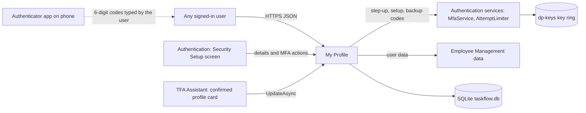
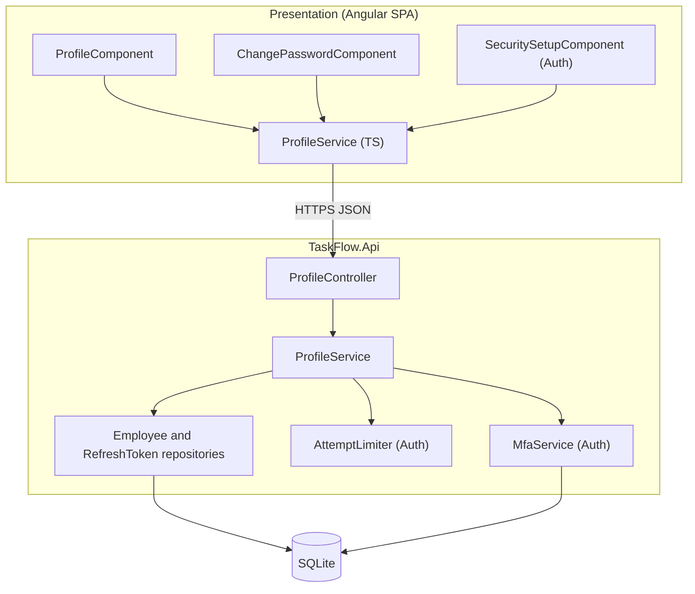
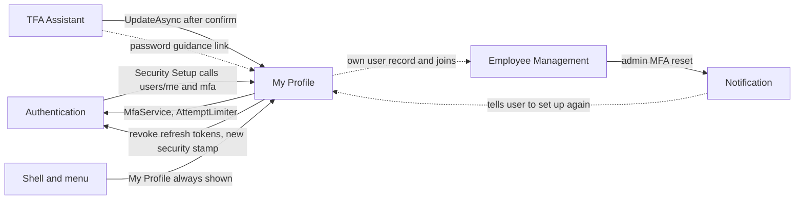
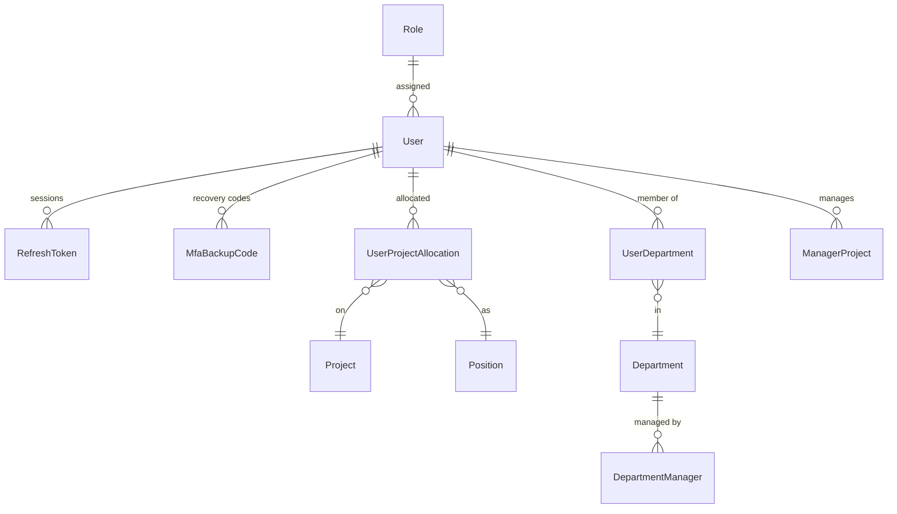
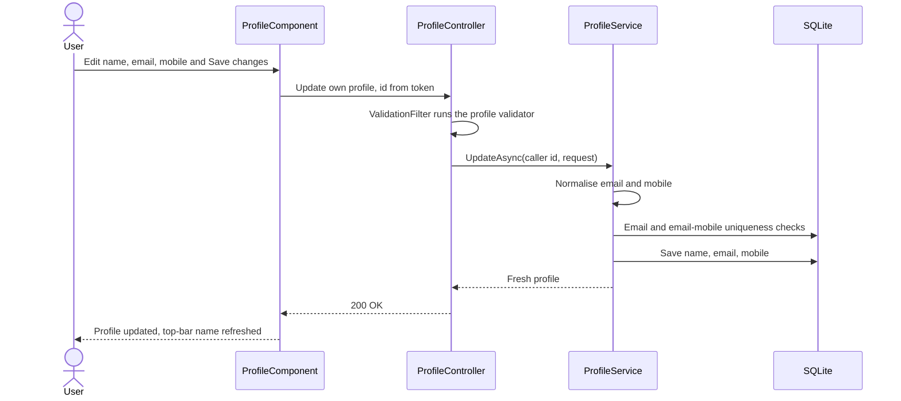
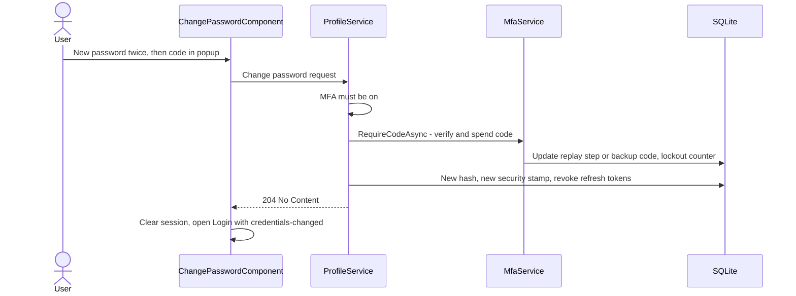
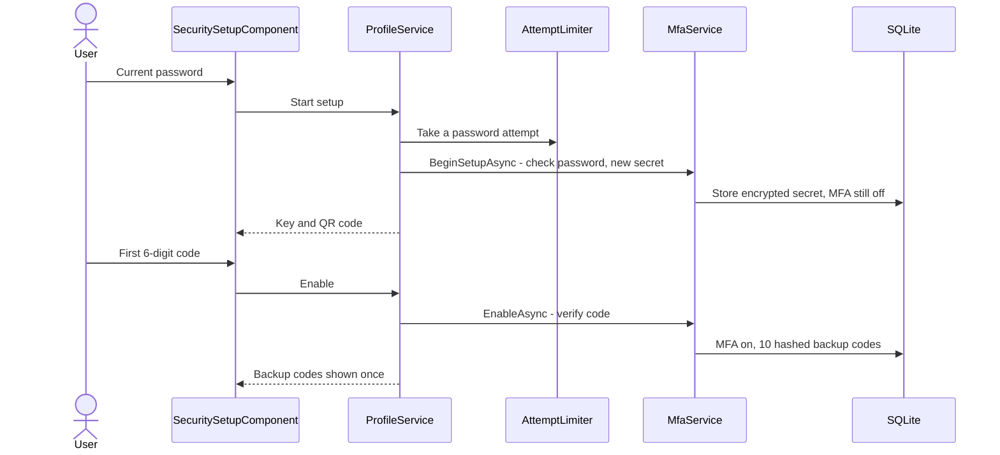
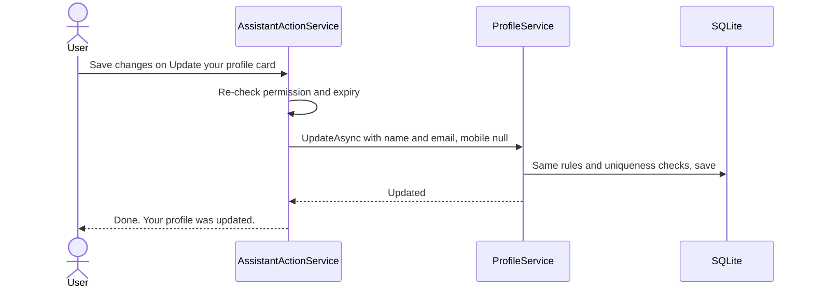

# High-Level Design – My Profile

## TaskFlow – Intelligent Task Allocation & Tracking System

> **Document:** High-Level Design (Sub-module: My Profile – profile, change password, two-step verification, code `PROF`)  ·  **Version:** 1.0  ·  **Status:** Draft
> **Project type:** Personal Project (Skill Development)  ·  **Date:** 31-Oct-2026
> **Author:** Jojo George (jojogeorge3344@gmail.com)
> **Based on:** BRD-My-Profile v1.0, FRD-My-Profile v1.0
> © 2026 Jojo George. All rights reserved.

---

## Document Control

| Version | Date | Author | Summary of changes |
|---|---|---|---|
| 1.0 | 31-Oct-2026 | Jojo George | Initial version |

**Related documents:**

| Document | Location |
|---|---|
| Overall HLD (stack, deployment, authentication pipeline, decisions `D-nn`) | `../../00-Overall/HLD-TaskFlow-Overall.md` |
| BRD – My Profile | `../../../BRD/07-My-Profile/07.1-My-Profile/BRD-My-Profile.md` |
| FRD – My Profile (`FR-PROF-nn`, `UC-PROF-nn`) | `../../../FRD/07-My-Profile/07.1-My-Profile/FRD-My-Profile.md` |
| LLD – My Profile (classes, endpoints, columns) | `../../../LLD/07-My-Profile/07.1-My-Profile/LLD-My-Profile.md` |
| HLD – Employee Management (administrator-managed account fields, MFA reset) | `../../03-TaskFlow-Management/03.1-Employee-Management/HLD-Employee-Management.md` |
| HLD – Assistant (profile Action Card) | `../../08-TFA-Assistant/08.1-Assistant/HLD-Assistant.md` |
| TDD v2.0 – §9 Authentication & Authorization, §10.14 Profile | `TF - Documents/TF - TDD/TDD-TaskFlow.md` |

---

## 1. Introduction

### 1.1 Purpose
This HLD describes how My Profile is built: the self-service screens for the signed-in user's own account, the single
API surface under `/api/v1/users/me`, how it reuses the Employee Management and Authentication building blocks (user
data, refresh tokens, MFA service, attempt limiter, setup gate), and the security decisions behind password change by
authenticator step-up and mandatory two-step verification. Classes, endpoint details and columns are in the LLD.

### 1.2 Scope
**In scope:** My Profile screen (view own account, edit full name, email and mobile number), Change Password screen,
the self-service two-step verification actions (start setup, turn on, check a code, regenerate backup codes) used by
the Security Setup screen, and the own-profile change applied after a TFA Action Card is confirmed.

**Out of scope:** another user's profile and the administrator MFA reset (Employee Management), sign-in, account recovery
and the Security Setup screen layout (Authentication, overall HLD), the Action Card itself (Assistant HLD). Shared stack
and deployment are in the overall HLD.

**Change from original BRD (Screen 19)**

| Original BRD item | Current design |
|---|---|
| Password change "requires the current password when appropriate" | Change is proven by an authenticator or backup code (MFA step-up); the current password is asked only to start authenticator setup (D-PROF-3) |
| "Department" as an editable field | Departments, projects, managers shown read-only; edited in Employee Management |
| Change password form on the profile screen | Separate route `/profile/change-password` |
| Not in original BRD | Mobile number; self-service two-step verification; profile change through TFA |

### 1.3 Audience
Developer, tester and reviewer of TaskFlow; the product owner (Jojo George).

### 1.4 Definitions & Abbreviations

| Term | Meaning |
|---|---|
| MFA / two-step verification | Time-based one-time code (TOTP) from an authenticator app in addition to the password |
| Step-up | Asking for a fresh second-factor code before a sensitive change |
| Backup code | One of 10 single-use recovery codes issued when MFA is turned on |
| Security stamp | Per-user marker in the access token; changing it invalidates every existing access token |
| Setup gate | Middleware that blocks the API for a signed-in user who has not finished MFA setup |
| SPA | Single Page Application (Angular frontend) |

---

## 2. System Context

### 2.1 Context Diagram

### 2.2 Actors & External Systems

| Actor / system | Interaction | Protocol |
|---|---|---|
| Any signed-in user (Administrator, Manager, Employee, Custom role) | View and edit own details; change password; set up MFA | HTTPS / REST (JSON) |
| Authentication – Security Setup screen | Saves step-1 details and calls the MFA setup and enable actions while setup is pending | HTTPS (same API) |
| Authentication services (`MfaService`, `AttemptLimiter`, `SessionValidation`, `MfaSetupGateMiddleware`) | Code verification, lockout, password-attempt budget, session checks, setup gate | In-process |
| Employee Management data (`IEmployeeRepository`) | Own user record with role, allocations, departments, managers | In-process |
| TFA Assistant (`ProposeProfileUpdateTool`, `AssistantActionService`) | Prepares and applies an own name / email change after confirmation | In-process |
| Authenticator app | Generates TOTP codes from the key shown once at setup | Offline (no network link to TaskFlow) |
| Data Protection key ring | Encrypts the TOTP secret | Local folder `dp-keys` |

---

## 3. Architecture Goals, Constraints & Principles

### 3.1 Quality Goals

| Goal | How the architecture supports it |
|---|---|
| Account security | Password change only after MFA step-up; all sessions revoked afterwards; TOTP key encrypted, backup codes hashed (NFR-PROF-01, NFR-PROF-02) |
| No self-promotion | API accepts only name, email and mobile; identity always from the token (BR-PROF-01, BR-PROF-02) |
| Brute-force resistance | Shared 5-wrong-codes / 5-minute lockout; 5 password attempts per 5 minutes for setup (NFR-PROF-03) |
| Consistency | One set of email and mobile rules (`EmailPolicy`, `MobileNumberPolicy`) shared with Employee Management and TFA |
| Data integrity | Optimistic concurrency → "Someone else changed this record…" (NFR-PROF-05) |
| Simplicity | No own tables or repository; reuse of Auth and Employee Management components |

### 3.2 Constraints
- MFA is mandatory (`Mfa:Required` = true); a user cannot turn it off.
- Single email domain `@taskflow.com`; email unique by local part, deleted accounts included.
- Single server; the password-attempt budget is in memory and resets on restart.
- My Profile must stay usable while MFA setup is pending (the setup gate allow-list).

### 3.3 Architecture Principles
- **Self only:** routes under `/api/v1/users/me`; no route or body carries a user id.
- **Reuse, do not duplicate:** MFA rules live in the Authentication `MfaService`; user data in Employee Management.
- **Server is the gate:** setup gate and step-up are enforced in the API; the SPA only mirrors them.
- **Show secrets once:** setup key and backup codes are returned once and never readable again.

---

## 4. Architecture Overview

### 4.1 Architecture Style
Feature slice of the TaskFlow three-tier application: Angular profile pages → one REST controller (`ProfileController`)
→ one service (`ProfileService`) that orchestrates reused repositories and Authentication services. The shared pipeline
(JWT, `SessionValidation`, `MfaSetupGateMiddleware`, validation filter, problem-details errors) is described once in the
overall HLD.

### 4.2 Logical Architecture

### 4.3 Layers & Responsibilities

| Layer | Responsibility | May call |
|---|---|---|
| Presentation | Profile view and form (live field checks, fixed `@taskflow.com` suffix), Change Password form with strength hint and code popup, Security Setup consumer; shell name refresh after save; session clear after password change | API |
| API / Controllers | `ProfileController` at `api/v1/users/me`: caller id from `ClaimTypes.NameIdentifier`, `[Authorize]` only, status mapping (204, 400, 404, 429) | Services |
| Services | `ProfileService`: read own DTO, update details, change password, MFA setup / enable / check / regenerate (through `IMfaService`, `IAttemptLimiter`) | Repositories, Auth services |
| Rules / validators | `UpdateOwnProfileRequestValidator`, `ChangePasswordRequestValidator`, MFA request validators; `EmailPolicy`, `MobileNumberPolicy` | – |
| Repositories (reused) | `EmployeeRepository` (own user, uniqueness checks), `RefreshTokenRepository` (revoke), `AccountRepository` and `MfaBackupCodeRepository` (inside `MfaService`) | Database |
| Integrations (reused) | `MfaSecretProtector` (Data Protection), `Totp` | Key ring |

---

## 5. Component / Module Design

| Module | Responsibility | Key components (high level) | Depends on |
|---|---|---|---|
| User profile | Show own account (identity, chips, read-only details, Manager rows); edit name, email, mobile | `ProfileComponent`, `ProfileService` (TS); `ProfileController`, `ProfileService`, `UpdateOwnProfileRequestValidator`, `EmailPolicy`, `MobileNumberPolicy` | Employee Management (`IEmployeeRepository`, `UserDto`) |
| Change password | New password 6–128, MFA step-up, revoke all sessions | `ChangePasswordComponent`; `ProfileService` (`ChangePasswordAsync`), `ChangePasswordRequestValidator` | Authentication (`IMfaService`, `RefreshTokenRepository`, `SessionValidation`), Employee Management repository |
| Two-step verification (self-service) | Start setup after password check, enable with first code, issue 10 backup codes, check a code, regenerate codes | `SecuritySetupComponent` (Auth) via `ProfileService` (TS); `ProfileService` MFA methods | Authentication (`MfaService`, `AttemptLimiter`, `MfaSecretProtector`, `Totp`, `MfaSetupGateMiddleware`) |
| TFA profile change (receiving side) | Apply a confirmed own name / email change with the same rules | `IProfileService.UpdateAsync` called by `AssistantActionService` | TFA Assistant |

### 5.1 Module Interaction

| From → To | What | Coupling |
|---|---|---|
| Authentication → My Profile | Security Setup step 1 saves details; step 2 starts and enables MFA | HTTPS calls to the profile endpoints, allowed by the setup gate |
| My Profile → Authentication | Code step-up and lockout, password-attempt budget, session revocation | In-process service and repository calls |
| My Profile → Employee Management | Own user record, allocations, departments, managers; uniqueness checks | Shared repository and DTO |
| TFA Assistant → My Profile | Confirmed "Update your profile" card applies name / email; mobile kept | `IProfileService.UpdateAsync` |
| Employee Management → (Notification) → My Profile | After an administrator MFA reset the user is notified and sets MFA up again here | Indirect |

---

## 6. Data Architecture (high level)

### 6.1 Data Stores

| Store | Technology | Holds | Notes |
|---|---|---|---|
| Main database | SQLite `taskflow.db` (EF Core) | User account fields, password hash, security stamp, MFA state, refresh tokens, backup code hashes | No tables of its own; MFA columns and `MfaBackupCodes` from migration `20261023101938_AddMfaAndAccountRecovery` |
| Data Protection key ring | Local folder `dp-keys` | Keys that encrypt the TOTP secret | Must be backed up with the database, or MFA secrets become unreadable |
| In-memory | Process | Password-attempt budget (`AttemptLimiter`) | Reset on restart |

### 6.2 Main Data Domains

| Domain | Owned / used | Purpose |
|---|---|---|
| `User` | Used and updated (Employee Management owns) | Name, email, mobile (editable); password hash, security stamp, MFA state (changed by this sub-module) |
| `RefreshToken` | Updated (Authentication owns) | Revoked on password change |
| `MfaBackupCode` | Created / replaced (Authentication owns) | Hashed recovery codes |
| `Role`, `UserProjectAllocation`, `Project`, `Position`, `UserDepartment`, `Department`, `DepartmentManager`, `ManagerProject` | Read only | Read-only account details on My Profile |

### 6.3 Data Flow
- **Profile save:** form → validator → `EmailPolicy` / `MobileNumberPolicy` normalisation → uniqueness checks → update of
  name, email, mobile and update time → fresh DTO → shell name refreshed. No notification, mail or activity entry.
- **Password change:** form → code popup → step-up spends the code → new hash, new security stamp, all refresh tokens
  revoked in one save → SPA clears the session and opens Login.
- **MFA setup:** current password (attempt budget) → new secret stored encrypted → first code → MFA on, 10 backup codes
  stored as hashes and returned once.

---

## 7. Integration Design

| Integration | Direction | Purpose | Failure behaviour |
|---|---|---|---|
| `IMfaService` (Authentication) | Outbound in-process | Verify and spend codes, lockout, setup, enable, backup codes | Wrong code → 400 "The code is incorrect or has expired."; lockout → "Too many wrong codes. Try again in a few minutes." (400, or 429 on the check action) |
| `IAttemptLimiter` (Authentication) | Outbound in-process | 5 password attempts per 5 minutes for setup and backup-code regeneration | 429 "Too many attempts. Try again in a few minutes." |
| `MfaSecretProtector` / Data Protection key ring | Outbound | Encrypt the TOTP secret | Unreadable key ring stops MFA verification (startup check in the overall design) |
| `RefreshTokenRepository` / `SessionValidation` | Outbound | Revoke sessions after password change | Part of the same save; on failure nothing changes |
| TFA Assistant | Inbound | Apply a confirmed own name / email change | Errors shown on the card as "I could not do that: … Nothing was changed." |
| Authenticator app | Offline | Generates codes | User falls back to a backup code or an administrator reset |

---

## 8. Key Flows (high level)

### 8.1 Edit personal information (UC-PROF-02, main business flow)

### 8.2 Change password with step-up (UC-PROF-03, sign-in related)

### 8.3 Turn on two-step verification (UC-PROF-04)

### 8.4 Profile change through TFA (integration, UC-TFA-06)

---

## 9. Security Architecture

| Concern | Approach |
|---|---|
| Authentication | Shared JWT bearer + refresh cookie; `SessionValidation` rejects tokens whose security stamp changed or whose user is inactive (overall HLD) |
| Authorization | `[Authorize]` only. The four keys `profile.view`, `profile.edit`, `profile.password.change`, `profile.mfa.manage` are Always On and not assignable, so the server does not check them; the My Profile menu item is always shown; profile routes use `authGuard` and `mfaSetupGuard` but no `permissionGuard` |
| Data scope | Own only, fixed by the token claim; no user id in any route or body; unparseable claim → 401 |
| MFA setup gate | While setup is pending only `/api/v1/users/me` and `/api/v1/users/me/mfa/*` (and sign-in routes) are open; everything else, including the password change, returns 403 `mfa_setup_required` |
| Step-up and lockout | Password change needs an unused TOTP or backup code; 5 wrong codes → 5-minute lock shared with sign-in; codes cannot be replayed |
| Data protection | Passwords hashed with `IPasswordHasher`; TOTP secret encrypted with the Data Protection key ring; backup codes stored as SHA-256 hashes; key and codes shown once |
| Session revocation | Password change rotates the security stamp (access tokens) and revokes refresh tokens (all devices) |
| Auditing | No profile audit or activity entry is written (BR-PROF-12); request logging excludes bodies |

---

## 10. Technology Stack

My Profile uses the shared TaskFlow stack: ASP.NET Core on .NET 10 (`net10.0`) with `IPasswordHasher` and ASP.NET Core Data
Protection, JWT bearer authentication (`Microsoft.AspNetCore.Authentication.JwtBearer` 10.0.12), EF Core 10.0.12 with
SQLite, FluentValidation 12.2.0, Angular 19.2 for the pages and `qrcode` ^1.5.4 for the QR code on the Security Setup
screen. TOTP is implemented in-house (`Totp`), with no extra package. Versions and rationale: overall HLD
(`../../00-Overall/HLD-TaskFlow-Overall.md`).

---

## 11. Deployment Architecture

My Profile runs inside the single `TaskFlow.Api` process. Its deployment-specific items are the `Mfa` configuration
section (`Mfa:Required` = true, `Mfa:Issuer` = "TaskFlow") and the Data Protection key ring folder `dp-keys` in the data
folder, which must be backed up together with `taskflow.db`. Environments, hosting and the deployment diagram: overall
HLD (`../../00-Overall/HLD-TaskFlow-Overall.md`).

---

## 12. Non-Functional Design

| Area | Design decision |
|---|---|
| Performance | One no-tracking projection loads the whole profile view (NFR-PROF-06); saves touch one user row |
| Scalability | Single instance; in-memory attempt limiter is per process |
| Reliability | Optimistic concurrency on the user row and MFA counters → 409 instead of silent overwrite (NFR-PROF-05); password change, stamp rotation and token revocation in one save |
| Security | Hashing and encryption as in §9 (NFR-PROF-01, NFR-PROF-02); lockout and attempt budget (NFR-PROF-03) |
| Usability | Field errors while typing and server `errors` keys mapped onto form controls (NFR-PROF-04) |
| Maintainability | Shared policies and Auth services; no duplicate MFA logic |
| Observability | Request logging (no bodies); no audit trail for profile changes (see §14) |
| Backup & Recovery | `taskflow.db` and `dp-keys` backed up together |

---

## 13. Design Decisions

| ID | Decision | Alternatives considered | Rationale |
|---|---|---|---|
| D-PROF-1 | Self-service routes under `/api/v1/users/me`, identity only from the token | `/users/{id}` with an ownership check | No way to address another user; no scope bugs (BR-PROF-01) |
| D-PROF-2 | No own repository or tables; reuse Employee Management and Authentication components | Separate profile tables and MFA code | One source of truth for user data and MFA rules |
| D-PROF-3 | Password change proven by an authenticator or backup code, not the current password | Current password (original Screen 19) | A hijacked session or known password alone cannot change the password; MFA is mandatory anyway |
| D-PROF-4 | After a password change rotate the security stamp and revoke all refresh tokens | End only other sessions; keep sessions | Ends any session an attacker may hold, including the current one (BR-PROF-08) |
| D-PROF-5 | Profile keys Always On and enforced by `[Authorize]` only | Per-key policies | Every user must always be able to manage their own account; the keys document the capability in Role Configuration |
| D-PROF-6 | Setup gate allow-list keeps own profile and MFA actions open while setup is pending | Separate onboarding API | Security Setup reuses the same endpoints; everything else stays blocked server-side |
| D-PROF-7 | TOTP secret encrypted with Data Protection; backup codes stored as SHA-256 hashes; both shown once | Plain storage; reversible codes | Database leak does not reveal second factors (NFR-PROF-02) |
| D-PROF-8 | Email unique by local part on the fixed domain, deleted accounts included | Unique full address among live users | Prevents reuse of a former colleague's address (BR-PROF-03) |

---

## 14. Risks, Assumptions & Open Issues

| Type | Description | Mitigation / owner |
|---|---|---|
| Risk | User loses phone and backup codes (R-PROF-01) | Administrator MFA reset in Employee Management |
| Risk | Brute-force guessing of codes (R-PROF-02) | Lockout and single-use codes |
| Risk | Password attempt budget is in memory and resets on restart | Accepted for single-server use |
| Open issue | ⚠️ To be confirmed: regenerate backup codes and check-a-code actions exist on the server but no screen offers them (FR-PROF-38, FR-PROF-39) | Jojo George |
| Open issue | ⚠️ To be confirmed: TFA password guidance and the help topic still mention the current password (R-PROF-05) | Jojo George |
| Open issue | ⚠️ To be confirmed: lockout returns 429 from the check action but 400 from password change, enable and backup codes | Jojo George |
| Open issue | ⚠️ To be confirmed: Manager rows are shown by role name, so a custom manager-like role does not see them | Jojo George |
| Open issue | ⚠️ To be confirmed: the employee update in Employee Management can set a password with `employees.edit` only, bypassing the MFA step-up | Jojo George |
| Assumption | Every user has a smartphone with an authenticator app; one email domain | Jojo George |

---

## 15. Traceability (requirements → components)

| BRD/FRD item | Module / component | Section |
|---|---|---|
| FR-PROF-01 | `ProfileController` (`/api/v1/users/me`, id from token); `ProfileService` read | §5, D-PROF-1 |
| FR-PROF-02 – FR-PROF-04 | User profile › `ProfileComponent` chips, read-only card, Manager rows; `UserDto` from `EmployeeRepository` | §5, §6.2 |
| FR-PROF-05 – FR-PROF-11 | User profile › `ProfileComponent` form; `UpdateOwnProfileRequestValidator`, `EmailPolicy`, `MobileNumberPolicy`, `ProfileService` update and uniqueness checks | §8.1, D-PROF-8 |
| FR-PROF-12 | `ProfileComponent` toast and shell refresh (`AuthService.applyProfile`) | §6.3 |
| FR-PROF-13 | Optimistic concurrency → 409 (`GlobalExceptionHandler`) | §12 |
| FR-PROF-14 | `ProfileComponent` error state and Retry | §5 |
| FR-PROF-15 | `MfaSetupGateMiddleware` allow-list; Security Setup step 1 | §9, D-PROF-6 |
| FR-PROF-16 | TFA profile change › `IProfileService.UpdateAsync` from `AssistantActionService` | §8.4 |
| FR-PROF-17, FR-PROF-29 | No notification, mail or activity writes in `ProfileService` | §6.3 |
| FR-PROF-18 | Profile routes (`/profile/change-password`) | §5 |
| FR-PROF-19 – FR-PROF-21 | Change password › `ChangePasswordComponent` (form, strength hint), `ChangePasswordRequestValidator` | §5, §8.2 |
| FR-PROF-22 – FR-PROF-25 | Change password › `ProfileService` step-up through `MfaService` (MFA on, single use, lockout) | §8.2, D-PROF-3 |
| FR-PROF-26 | Security stamp rotation, refresh-token revocation, `SessionValidation`; SPA clears session | §8.2, D-PROF-4 |
| FR-PROF-27 – FR-PROF-28 | `ChangePasswordComponent` popup handling | §5 |
| FR-PROF-30 – FR-PROF-35 | Two-step verification › `ProfileService` setup / enable via `MfaService`, `AttemptLimiter`, `MfaSecretProtector`, `Totp`; `SecuritySetupComponent` | §8.3, D-PROF-7 |
| FR-PROF-36 | `MfaSetupGateMiddleware` (server) and `mfaSetupGuard` (SPA) | §9 |
| FR-PROF-37 | `ProfileComponent` two-step chip from the profile DTO | §5 |
| FR-PROF-38 – FR-PROF-39 | `ProfileService` regenerate backup codes and check code (server only) | §5, §14 |
| NFR-PROF-01 – NFR-PROF-06 | Non-functional design | §12 |
| BR-PROF-01 – BR-PROF-13 | Covered through the FR rows above (see FRD §11) | §15 |

---
© 2026 Jojo George. All rights reserved. Unauthorized copying or distribution of this document is prohibited.
