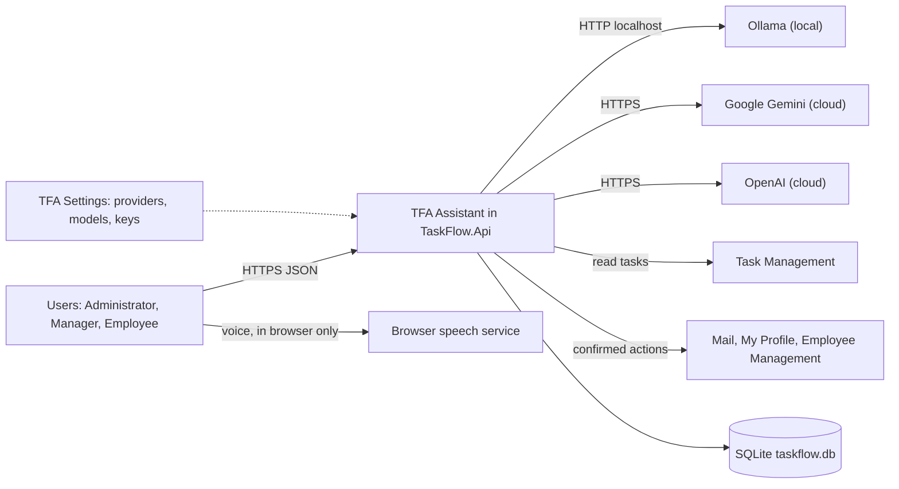
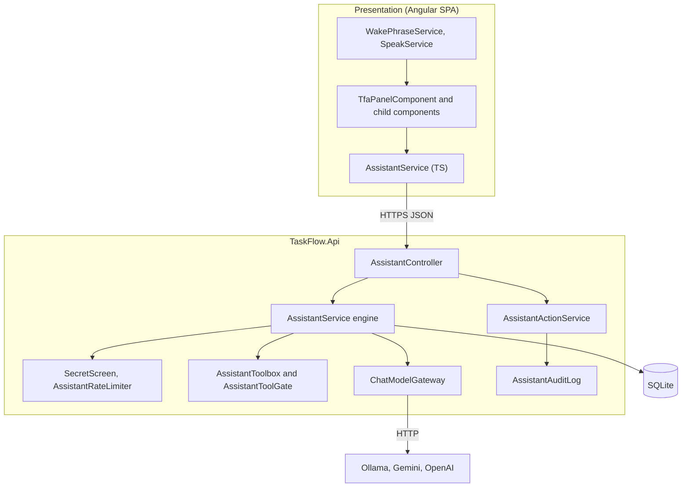
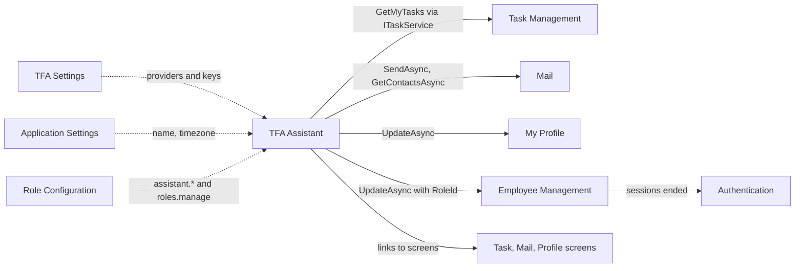
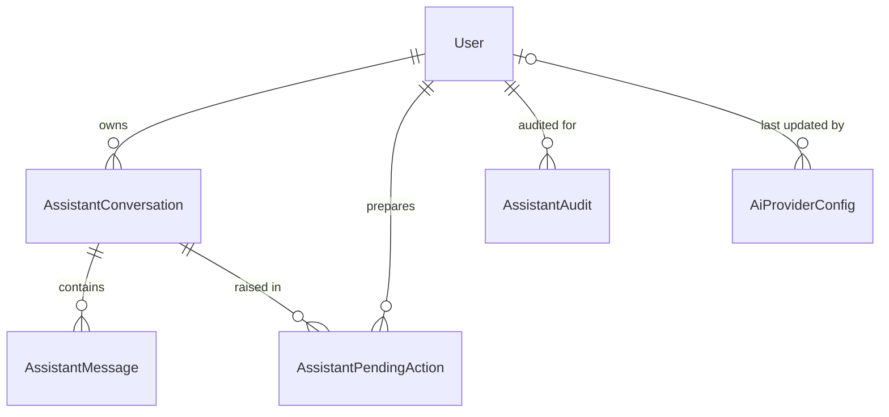
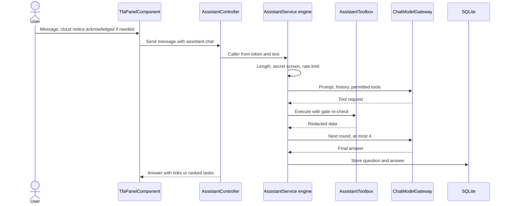
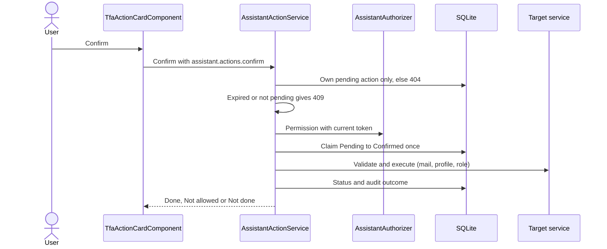
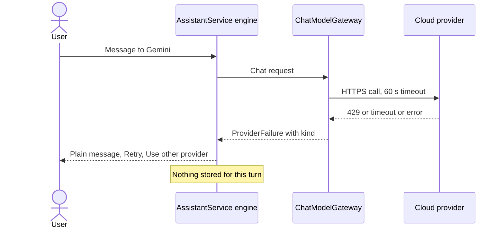
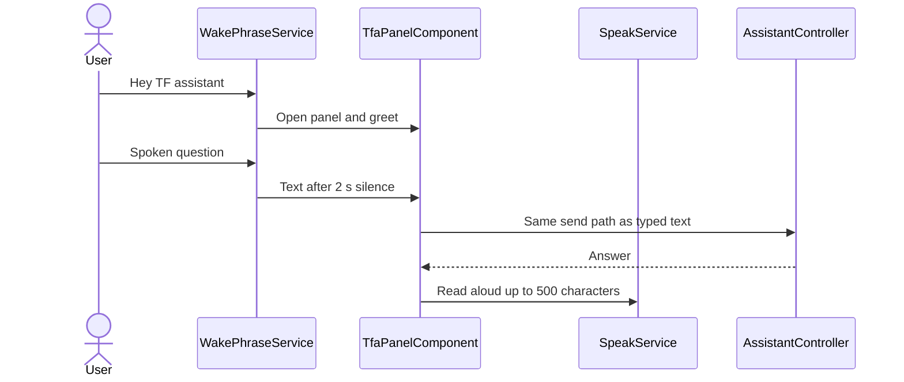

# High-Level Design – Assistant

## TaskFlow – Intelligent Task Allocation & Tracking System

> **Document:** High-Level Design (Sub-module: TFA Assistant, code `TFA`)  ·  **Version:** 1.0  ·  **Status:** Draft
> **Project type:** Personal Project (Skill Development)  ·  **Date:** 31-Oct-2026
> **Author:** Jojo George (jojogeorge3344@gmail.com)
> **Based on:** BRD-Assistant v1.0, FRD-Assistant v1.0
> © 2026 Jojo George. All rights reserved.

---

## Document Control

| Version | Date | Author | Summary of changes |
|---|---|---|---|
| 1.0 | 31-Oct-2026 | Jojo George | Initial version |

**Related documents:**

| Document | Location |
|---|---|
| Overall HLD (stack, deployment, cross-cutting design, decisions `D-nn`) | `../../00-Overall/HLD-TaskFlow-Overall.md` |
| BRD – Assistant | `../../../BRD/08-TFA-Assistant/08.1-Assistant/BRD-Assistant.md` |
| FRD – Assistant (`FR-TFA-nn`, `UC-TFA-nn`) | `../../../FRD/08-TFA-Assistant/08.1-Assistant/FRD-Assistant.md` |
| LLD – Assistant (classes, endpoints, tables) | `../../../LLD/08-TFA-Assistant/08.1-Assistant/LLD-Assistant.md` |
| HLD – TFA Settings (provider, model and API key configuration) | `../../06-Settings/06.3-TFA-Settings/HLD-TFA-Settings.md` |
| HLD – Mail, My Profile, Employee Management (targets of confirmed actions) | `../../04-Communication/04.1-Mail/HLD-Mail.md`, `../../07-My-Profile/07.1-My-Profile/HLD-My-Profile.md`, `../../03-TaskFlow-Management/03.1-Employee-Management/HLD-Employee-Management.md` |
| TDD v2.0 – §16 TFA Assistant Design | `TF - Documents/TF - TDD/TDD-TaskFlow.md` |

---

## 1. Introduction

### 1.1 Purpose
This HLD describes how TFA (TaskFlow Assistant) is built: a tool-calling chat assistant hosted inside the TaskFlow API,
with a panel on every signed-in screen. It covers the conversation engine, the model gateway to Ollama, Gemini and
OpenAI, the permission-gated tools, the confirm-before-act mechanism for actions, the built-in help knowledge, voice
input in the browser, and the safety controls (secret screen, rate limit, audit). Classes, endpoint details and columns
are in the LLD.

### 1.2 Scope
**In scope:** TFA Panel (conversation, model selector, cloud notice, new chat, provider failures), task answers and the
ranked work order, how-to help from 19 topics, Action Cards (mail draft, own-profile update, role change), user lookup
and fixed guidance, voice controls, message limit and action audit.

**Out of scope:** configuring providers, models and API keys (TFA Settings HLD); the mailbox, profile and employee rules
themselves (their HLDs); creating, editing or reassigning tasks through TFA; password changes through TFA; an audit
screen. Shared stack and deployment are in the overall HLD.

**Change from original BRD:** the original BRD has no assistant; TFA is an addition (TDD D11). It uses the BRD's
existing rules through the target modules (Mail, My Profile, Employee Management, Task Management).

### 1.3 Audience
Developer, tester and reviewer of TaskFlow; the product owner (Jojo George).

### 1.4 Definitions & Abbreviations

| Term | Meaning |
|---|---|
| Provider | AI service that writes answers: Ollama (local), Gemini or OpenAI (cloud) – `AiProviderKind` |
| Tool | Server function the model may ask to run (read tool or action tool) |
| Tool round | One model call that may request tools; at most 4 per answer |
| Pending action | Prepared action stored with its exact payload, waiting for the user's confirm (10-minute lifetime) |
| Action Card | Panel card that shows a pending action with Confirm / Edit / Cancel |
| Secret screen | Check that stops passwords and API keys from reaching a provider or the database |
| SPA | Single Page Application (Angular frontend) |

---

## 2. System Context

### 2.1 Context Diagram

### 2.2 Actors & External Systems

| Actor / system | Interaction | Protocol |
|---|---|---|
| Users with `assistant.chat` | Chat, read answers, ranked tasks, help | HTTPS / REST (JSON) |
| Users with `assistant.actions.confirm` (and `roles.manage` for role changes) | Edit, confirm or cancel Action Cards | HTTPS / REST |
| Ollama | Local chat model (default `llama3.2:3b`) | HTTP to `{BaseUrl or http://localhost:11434}/api/chat` |
| Google Gemini | Cloud chat model (default `gemini-2.0-flash`) | HTTPS, key in `x-goog-api-key` header |
| OpenAI | Cloud chat model (default `gpt-4o-mini`) | HTTPS, Bearer key |
| Browser speech service | Wake phrase, dictation, read-aloud (Chrome, Edge) | Web Speech API in the browser; nothing sent to TaskFlow but recognised text |
| TFA Settings | Which providers are enabled, model names, encrypted keys | In-process reads |
| Task Management, Mail, My Profile, Employee Management | Data for answers; execution of confirmed actions | In-process service calls |

---

## 3. Architecture Goals, Constraints & Principles

### 3.1 Quality Goals

| Goal | How the architecture supports it |
|---|---|
| Never exceed the user's rights | Tools advertised and executed only when the caller passes the same permission policies as the screens; re-checked at confirm (NFR-TFA-02) |
| Human in control | Action tools only prepare; only the user's confirm call executes (D-TFA-2) |
| Trustworthy answers | Ranking computed in code; how-to only from built-in topics (D-TFA-4, D-TFA-5) |
| Privacy | Secret screen before any provider call; local provider option; cloud notice (NFR-TFA-01, NFR-TFA-03) |
| Resilience to provider problems | Classified failures, plain messages, Retry / other provider, nothing stored on failure (NFR-TFA-04, NFR-TFA-08) |
| Fair use | 20 messages per user per minute (NFR-TFA-06) |

### 3.2 Constraints
- Single server; rate limiter and provider list refresh are per process.
- Providers are external and may be slow, rate-limited or offline; HTTP timeout `AiProviders:TimeoutSeconds` (60).
- Voice depends on the browser's speech recognition (Chrome, Edge).
- The model is untrusted: its output and the data it reads must never be able to change permissions or run actions.

### 3.3 Architecture Principles
- **The model proposes, the system disposes:** permissions, ranking, help selection and action execution are code, not model decisions.
- **Caller from the token only:** no tool accepts a user id, role or password.
- **Data is data:** task, comment and mail text returned by tools is marked as data and redacted for secrets before reaching the model.
- **Reuse target rules:** a confirmed action runs through the target module's own validator and service.

---

## 4. Architecture Overview

### 4.1 Architecture Style
Assistant feature inside the TaskFlow three-tier application: Angular panel components → REST controller under
`/api/v1/assistant` → conversation engine with a bounded tool loop → model gateway with pluggable provider adapters
(typed `HttpClient`s) → tools that call other modules' services; pending actions and audit stored in SQLite. The shared
pipeline is in the overall HLD.

### 4.2 Logical Architecture

### 4.3 Layers & Responsibilities

| Layer | Responsibility | May call |
|---|---|---|
| Presentation | `TfaPanelComponent` (button, panel, feed, cloud notice, failure card), `TfaHeaderComponent` (new chat, close, model selector), `TfaComposerComponent` (message box, suggestions, mic), `TfaMessageComponent` (text, ranked list, links, cards), `TfaActionCardComponent` (confirm / edit / cancel); `AssistantService` (TS) signals; `WakePhraseService`, `SpeakService`; browser storage `tfa.provider`, `tfa.cloudAck`, `tfa.handsfree` | API, browser speech |
| API / Controllers | `AssistantController`: caller from the token (`AssistantCaller`), `perm:assistant.chat` / `perm:assistant.actions.confirm` per action | Services |
| Conversation engine | `AssistantService`, `AssistantPrompt`, `AssistantTexts`, `ProviderFailureMessages`: length check, secret screen, provider choice, rate limit, history window, tool loop, persistence | Gateway, tools, repositories |
| Tools | `AssistantToolbox` + `AssistantToolGate` (via `IAssistantAuthorizer`); read tools (tasks, ranking, help, user lookup, guidance) and action tools (draft mail, profile update, role change) | Other modules' services, `HelpKnowledgeBase`, `TaskPrioritiser` |
| Actions | `AssistantActionService`, `AssistantActionRules`: ownership, expiry, permission re-check, single claim, execution, audit | Mail, Profile, Employee services |
| Model gateway / integrations | `ChatModelGateway` → `ChatModelProviderRegistry` → `OllamaProvider`, `GeminiProvider`, `OpenAiProvider`; `ProviderHttp`, `ProviderFailure`, `AiProviderRuntime` | External providers |
| Repositories | Conversation, message, pending action, audit, directory repositories | Database |

---

## 5. Component / Module Design

| Module | Responsibility | Key components (high level) | Depends on |
|---|---|---|---|
| TFA Panel (chat) | Panel on every signed-in screen; conversation load, send, new chat, model selector, cloud notice, provider failure card | `TfaPanelComponent`, `TfaHeaderComponent`, `TfaComposerComponent`, `TfaMessageComponent`, `AssistantService` (TS); `AssistantController`; `AssistantService` engine | TFA Settings (configured providers) |
| Conversation engine | Validate, screen secrets, limit rate, build prompt and history, run up to 4 tool rounds, store question and answer | `AssistantService`, `AssistantPrompt`, `SecretScreen`, `AssistantRateLimiter`, conversation and message repositories | Application Settings (name, timezone) |
| Model gateway | One interface over three providers; failure classification (`ProviderFailureKind`) | `ChatModelGateway`, `ChatModelProviderRegistry`, provider adapters | TFA Settings (`AiProviderConfig`, `AiModel`, encrypted keys via `AiKeyProtector`) |
| Task answers and work order | Own / accessible open tasks; deterministic ranking | `GetMyTasksTool`, `PrioritiseTasksTool`, `TaskPrioritiser` | Task Management (`ITaskService`, access rules) |
| How-to help | Keyword-scored, role-aware answers from 19 embedded topics with screen links | `SearchHelpTool`, `HelpKnowledgeBase` | – |
| Lookup and guidance | Find users for mail; fixed password and "needs an administrator" guidance | `FindUserTool`, `ExplainPasswordChangeTool`, `ContactAdminGuidanceTool` | Mail (`IMailService` contacts) |
| Action Cards | Prepare, edit (mail only), confirm, cancel; expiry; run once; audit | `DraftMailTool`, `ProposeProfileUpdateTool`, `ProposeRoleChangeTool`, `AssistantActionService`, `TfaActionCardComponent`, pending-action repository | Mail, My Profile, Employee Management services and validators |
| Voice controls | Wake phrase, dictation, read-aloud, hands-free toggle | `WakePhraseService`, `SpeakService` (frontend only) | Browser Web Speech API |
| Background safeguards | Rate limit, outcome audit | `AssistantRateLimiter`, `AssistantAuditLog`, audit repository | – |

### 5.1 Module Interaction

| From → To | What | Coupling |
|---|---|---|
| TFA → Task Management | Open tasks in the user's scope (`mine` or `accessible`, max 20) | `ITaskService`, so Task Management scope applies (BR-TFA-05) |
| TFA → Mail | Contacts lookup; send a confirmed draft from the user's mailbox | `IMailService` + `SendMailRequestValidator` (BR-TFA-09) |
| TFA → My Profile | Apply a confirmed own name / email change, mobile unchanged | `IProfileService.UpdateAsync` + `UpdateOwnProfileRequestValidator` |
| TFA → Employee Management | Apply a confirmed role change; target user's sessions end | `IEmployeeService.UpdateAsync` |
| TFA Settings → TFA | Enabled providers, model names, keys | Read per request; panel refreshes the list every 60 s |

---

## 6. Data Architecture (high level)

### 6.1 Data Stores

| Store | Technology | Holds | Notes |
|---|---|---|---|
| Main database | SQLite `taskflow.db` (EF Core) | Conversations, messages, pending actions, audit records; reads provider configuration | Migrations `20261018183210_AddAssistant`, `20261019163241_AddAiModels`; conversations kept indefinitely |
| Embedded resources | Assembly `TaskFlow.Api` | 19 help topics (`Services/Assistant/Knowledge/*.md`) | Read only, shipped with the application |
| In-memory | Process | Rate-limit windows | Reset on restart |
| Browser storage | `localStorage` | Chosen provider, cloud acknowledgements, hands-free off | Not on the server |

### 6.2 Main Data Domains

| Domain | Owned / used | Purpose |
|---|---|---|
| `AssistantConversation` | Owned | A user's chat thread; the latest is active |
| `AssistantMessage` | Owned | Question, answer or tool message (`AssistantMessageRole`: User, Assistant, Tool) with provider used and display metadata |
| `AssistantPendingAction` | Owned | Prepared action (`AssistantActionKind`: SendMail, UpdateOwnProfile, ChangeUserRole) with exact payload, `AssistantActionStatus` (Pending, Confirmed, Cancelled, Expired, Refused, Failed) and expiry |
| `AssistantAudit` | Owned | Outcome record: user, kind, outcome, time – no bodies |
| `AiProviderConfig`, `AiModel` | Used (TFA Settings) | Enabled providers (`AiProviderKind`: Ollama, Gemini, OpenAI), model names, encrypted keys |
| `User`, `Task`, `MailMessage`, `Role` | Used through other modules' services | Answers and action targets |

### 6.3 Data Flow
- **Question:** panel → length and secret checks → rate limit → last 12 messages (about 6000 characters) + prompt →
  provider, with tool rounds whose results are redacted → question and answer stored together only after a successful
  answer; a provider failure stores nothing.
- **Action:** action tool stores a pending action with the payload shown on the card → user confirms → ownership, expiry
  and permission re-checked → single atomic claim → target service executes → status and audit outcome stored.
- **Voice:** browser recognises speech locally (browser service) → text goes through the normal send path; no audio
  reaches TaskFlow.

---

## 7. Integration Design

| Integration | Direction | Purpose | Failure behaviour |
|---|---|---|---|
| Ollama (`OllamaProvider`) | Outbound HTTP | Local answers | Unreachable / model missing → plain message, Retry, Use another provider; nothing stored |
| Gemini (`GeminiProvider`) | Outbound HTTPS | Cloud answers | Rate limited, invalid key, timeout, unreachable, model unavailable, unexpected → `ProviderFailureKind` message; no automatic switch |
| OpenAI (`OpenAiProvider`) | Outbound HTTPS | Cloud answers | As Gemini |
| All providers | – | Typed `HttpClient`s, timeout 60 s, redirects not followed, no header or body logging | Raw provider bodies never shown or logged (provider, kind, HTTP status only) |
| Browser speech (`WakePhraseService`, `SpeakService`) | Browser local | Wake phrase, dictation, read-aloud | Matching message (unsupported browser, microphone blocked or missing, no internet); typing still works |
| Mail / My Profile / Employee Management | Outbound in-process | Execute confirmed actions | Status `Failed`, "I could not do that: … Nothing was sent." / "Nothing was changed." |
| Task Management | Outbound in-process | Task answers | Inaccessible task → "That task was not found, or you do not have access to it." |

---

## 8. Key Flows (high level)

### 8.1 Ask a question (UC-TFA-01, main business flow)

### 8.2 Confirm a prepared action (UC-TFA-05 – UC-TFA-07)

### 8.3 Provider failure (integration)

### 8.4 Ask by voice (UC-TFA-08)

---

## 9. Security Architecture

| Concern | Approach |
|---|---|
| Authentication | Shared JWT bearer + refresh cookie, session validation, MFA setup gate (overall HLD) |
| Authorization | `perm:assistant.chat` on conversation, messages, new chat and providers; `perm:assistant.actions.confirm` on edit, confirm and cancel; `roles.manage` required by the role-change tool and its confirm. `AssistantAuthorizer` evaluates the API's own `perm:{key}` policies through `IAuthorizationService`, so TFA can never do more than the screens. The panel is mounted by `ShellComponent` only with `assistant.chat` |
| Data scope | Own conversation and actions only; foreign ids (Guids) return 404, Administrators included; task answers follow Task Management access |
| Model containment | The model sees only tools the caller may use; every tool call re-checks the gate; action tools only prepare; refusals and confirmations use fixed texts; tool output treated as data (prompt-injection defence, R-TFA-02) |
| Secrets | `SecretScreen` blocks messages that look like passwords, API keys, Bearer tokens or JWTs before any provider call or storage; tool output passed through redaction; provider keys stored encrypted by TFA Settings (`AiKeyProtector`) and never sent to the SPA |
| Cloud data | One-time cloud notice per provider; local Ollama option where nothing leaves the machine (R-TFA-03) |
| Abuse | `AssistantRateLimiter`: 20 messages per user per sliding minute → 429 with `Retry-After` |
| Auditing | `AssistantAuditLog` records prepared, confirmed, cancelled, expired, refused and failed outcomes without bodies; 403s also logged by `DeniedActionAuditHandler` |

---

## 10. Technology Stack

TFA uses the shared TaskFlow stack: ASP.NET Core on .NET 10 (`net10.0`) with typed `HttpClient`s for the three providers
(no vendor AI SDK is installed), EF Core 10.0.12 with SQLite, FluentValidation 12.2.0 (reused target validators),
ASP.NET Core Data Protection for provider keys (TFA Settings), Angular 19.2 with signals for the panel, and the browser
Web Speech API for voice (no package). Versions and rationale: overall HLD (`../../00-Overall/HLD-TaskFlow-Overall.md`).

---

## 11. Deployment Architecture

TFA runs inside the single `TaskFlow.Api` process. Deployment-specific items: an optional Ollama service on the same
machine or network (`BaseUrl`, default `http://localhost:11434`), outbound internet access only when Gemini or OpenAI are
enabled, `AiProviders:TimeoutSeconds` (60) and the Data Protection key ring (`AiProviders:KeyRingPath`) that holds the keys
protecting provider API keys. On a new installation `AiProviderSeeder` enables Ollama with `llama3.2:3b`; Gemini and OpenAI
start off without a key. Environments and the deployment diagram: overall HLD (`../../00-Overall/HLD-TaskFlow-Overall.md`).

---

## 12. Non-Functional Design

| Area | Design decision |
|---|---|
| Performance | History window of 12 messages / about 6000 characters; at most 4 tool rounds; conversation load limited to the last 100 messages; task tool max 20, ranking max 10 |
| Scalability | Single instance; provider throughput is the limit; rate limiter protects quotas (NFR-TFA-06) |
| Reliability | Atomic claim prevents double execution (NFR-TFA-05); nothing stored on provider failure, Retry resends the same text (NFR-TFA-04) |
| Availability | Local Ollama works offline; cloud providers optional; plain message and next step for every failure (NFR-TFA-08) |
| Security | Secret screen on every message (NFR-TFA-01); permission re-check at confirm (NFR-TFA-02) |
| Maintainability | Provider adapters behind one gateway; help topics are markdown files with front matter; tools registered in one toolbox |
| Observability | Audit outcomes; provider failures logged with provider, kind and HTTP status only |
| Compatibility | Voice in Chrome and Edge; typing in every supported browser (NFR-TFA-07) |
| Backup & Recovery | Conversations, actions and audit in `taskflow.db`; key ring folder backed up with it |

---

## 13. Design Decisions

| ID | Decision | Alternatives considered | Rationale |
|---|---|---|---|
| D-TFA-1 | Tool-calling assistant hosted in the API; the model sees only tools the caller may use and every call is re-checked | Model with direct database access; free-form answers only | Answers grounded in TaskFlow data; the model can never exceed the user's rights (BR-TFA-01) |
| D-TFA-2 | Confirm-before-act: action tools store a pending action with the exact payload; only the user's confirm executes it; 10-minute expiry; single atomic claim | Let the model execute actions; client-side confirm only | Human control, no replay, no double execution (BR-TFA-02, BR-TFA-08) |
| D-TFA-3 | Permission checks evaluate the API's own `perm:{key}` policies with the caller's current token, at prepare and at confirm | Separate assistant permission logic | One source of truth; a permission removed after preparing makes the confirm fail |
| D-TFA-4 | Work order calculated by `TaskPrioritiser`; the model only explains it | Ask the model to rank | Same order for every provider (BR-TFA-06) |
| D-TFA-5 | How-to answers only from 19 embedded, role-aware markdown topics | Let the model answer from its own knowledge | No invented screens or features (BR-TFA-07) |
| D-TFA-6 | Secret screen before provider and storage; redaction of tool output | Rely on user care | Passwords and keys never leave the browser request (BR-TFA-03) |
| D-TFA-7 | Pluggable providers (Ollama, Gemini, OpenAI) behind `ChatModelGateway` with classified failures and no automatic fallback | Single vendor; silent fallback to another provider | Free local option; the user decides where data goes (BR-TFA-11) |
| D-TFA-8 | Per-user in-memory rate limit of 20 messages per minute | Distributed limiter; no limit | Protects provider quotas on a single server (BR-TFA-12) |
| D-TFA-9 | Voice entirely in the browser (Web Speech API); recognised text uses the normal send path | Server-side speech-to-text | No audio stored or uploaded by TaskFlow; same permission checks (BR-TFA-14) |
| D-TFA-10 | Audit stores outcomes only (user, kind, outcome, time) | Store full prompts and answers | No message bodies, passwords or keys in the audit (BR-TFA-13) |

---

## 14. Risks, Assumptions & Open Issues

| Type | Description | Mitigation / owner |
|---|---|---|
| Risk | Wrong or invented answer (R-TFA-01) | Help only from topics; ranking in code; footer warning |
| Risk | Prompt injection through task, comment or mail text (R-TFA-02) | Data marking, redaction, confirm and permission re-check |
| Risk | Company data sent to a cloud provider (R-TFA-03) | Cloud notice; local Ollama; secret screen |
| Risk | Conversations kept indefinitely (R-TFA-04) | ⚠️ To be confirmed: retention period or "delete my history" – Jojo George |
| Open issue | ⚠️ To be confirmed: role change checks only `roles.manage`, while Employee Management also needs `employees.role.assign` (and `roles.administrator.assign` for Administrator) | Jojo George |
| Open issue | ⚠️ To be confirmed: Confirm / Edit / Cancel are not hidden for users without `assistant.actions.confirm` | Jojo George |
| Open issue | ⚠️ To be confirmed: role-restricted help topics and "my manager" match by role name, so custom roles are treated as others | Jojo George |
| Open issue | ⚠️ To be confirmed: password guidance text still mentions the current password (R-TFA-06) | Jojo George |
| Assumption | An administrator configures at least one provider; users understand AI answers can be wrong | Jojo George |

---

## 15. Traceability (requirements → components)

| BRD/FRD item | Module / component | Section |
|---|---|---|
| FR-TFA-01 – FR-TFA-02 | TFA Panel › `TfaPanelComponent` mounted by `ShellComponent` with `assistant.chat`; `AssistantController` policies | §5, §9 |
| FR-TFA-03 – FR-TFA-05 | TFA Panel › conversation load (last 100), suggestions, `TfaComposerComponent` | §5 |
| FR-TFA-06 | Own-scope repositories; 404 for foreign ids | §9 |
| FR-TFA-07 – FR-TFA-08 | Conversation engine › length check, `SecretScreen` | §8.1, D-TFA-6 |
| FR-TFA-09 | Task answers › `GetMyTasksTool` via `ITaskService` | §5.1 |
| FR-TFA-10 – FR-TFA-11 | Work order › `PrioritiseTasksTool`, `TaskPrioritiser`; ranked list in `TfaMessageComponent` | D-TFA-4 |
| FR-TFA-12 – FR-TFA-14 | Model selector (`TfaHeaderComponent`), providers action, `ChatModelGateway` | §7, D-TFA-7 |
| FR-TFA-15 | `TfaPanelComponent` cloud notice (`tfa.cloudAck`) | §9 |
| FR-TFA-16 | `ProviderFailure` classification, `ProviderFailureMessages`, failure card | §8.3 |
| FR-TFA-17 – FR-TFA-19 | Conversation engine › new chat, history window, tool-round limit | §6.3, §12 |
| FR-TFA-20 | Tool output marked as data and redacted | §9, D-TFA-1 |
| FR-TFA-21 | `AssistantService` (TS) resets on user change | §5 |
| FR-TFA-22 | `AssistantPrompt` with application name and timezone | §5 |
| FR-TFA-23 – FR-TFA-24 | Fixed refusal text (`AssistantTexts`); panel footer | §9 |
| FR-TFA-25 – FR-TFA-28 | How-to help › `SearchHelpTool`, `HelpKnowledgeBase` (19 topics, role-aware, screen links) | §5, D-TFA-5 |
| FR-TFA-29 – FR-TFA-33 | Action Cards › action tools, `AssistantActionService` (prepare, re-check, expiry, single claim, cancel), `TfaActionCardComponent` | §8.2, D-TFA-2, D-TFA-3 |
| FR-TFA-34 – FR-TFA-38 | Mail draft › `DraftMailTool`, edit action, `SendMailRequestValidator`, `IMailService.SendAsync` | §5.1 |
| FR-TFA-39 | Profile card › `ProposeProfileUpdateTool`, `IProfileService.UpdateAsync` | §5.1 |
| FR-TFA-40 – FR-TFA-41 | Role card › `ProposeRoleChangeTool` (`roles.manage`), `IEmployeeService.UpdateAsync`, sessions ended | §5.1, §14 |
| FR-TFA-42 – FR-TFA-44 | Lookup and guidance › `FindUserTool`, `ExplainPasswordChangeTool`, `ContactAdminGuidanceTool` | §5 |
| FR-TFA-45 – FR-TFA-46 | `AssistantActionService` failure status; card error messages | §7 |
| FR-TFA-47 – FR-TFA-52 | Voice controls › `WakePhraseService`, `SpeakService`, `TfaComposerComponent` mic | §8.4, D-TFA-9 |
| FR-TFA-53 | `AssistantRateLimiter` | §9, D-TFA-8 |
| FR-TFA-54 – FR-TFA-56 | `AssistantAuditLog` and audit repository | §9, D-TFA-10 |
| NFR-TFA-01 – NFR-TFA-08 | Non-functional design | §12 |
| BR-TFA-01 – BR-TFA-14 | Covered through the FR rows above (see FRD §11) | §15 |

---
© 2026 Jojo George. All rights reserved. Unauthorized copying or distribution of this document is prohibited.
