# Low-Level Design (LLD)

## TaskFlow – Intelligent Task Allocation & Tracking System

> **Document:** Low-Level Design – Overall (shared design, Authentication, Legal, index of 16 sub-module LLDs)  ·  **Version:** 1.0  ·  **Status:** Draft
> **Project type:** Personal Project (Skill Development)  ·  **Date:** 31-Oct-2026
> **Author:** Jojo George (jojogeorge3344@gmail.com)
> **Based on:** FRD-TaskFlow-Overall v1.0, BRD-TaskFlow-Overall v1.0, TDD-TaskFlow v2.0, code snapshot of 31-Oct-2026
> © 2026 Jojo George. All rights reserved.

---

## Document Control

| Version | Date | Author | Summary of changes |
|---|---|---|---|
| 1.0 | 31-Oct-2026 | Jojo George | Initial version: code structure and layer rules, cross-cutting design (validation, errors, unit of work, middleware, MFA gate, session validation, permission policies, `TaskAccess`, logging, time zone), shared identity tables and the ER overview of all 31 entities, enums, migrations, configuration, test projects, full design of Authentication (7 actions) and Legal (frontend only), index of the 16 sub-module LLDs (114 actions in total) |

**Related documents:**

| Document | Location |
|---|---|
| BRD – Overall (`REQ-AUTH-nn`, `REQ-LEGAL-nn`, `BR-nn`) | `../../BRD/00-Overall/BRD-TaskFlow-Overall.md` |
| FRD – Overall (`FR-AUTH-01` – `FR-AUTH-51`, `FR-LEGAL-01` – `FR-LEGAL-16`, `UC-AUTH-01` – `UC-AUTH-05`, `UC-LEGAL-01` – `UC-LEGAL-02`) | `../../FRD/00-Overall/FRD-TaskFlow-Overall.md` |
| HLD – Overall | `../../HLD/00-Overall/HLD-TaskFlow-Overall.md` |
| Sub-module LLDs (16) | Section 1.3 (links relative to this file) |
| TDD | `TDD-TaskFlow.md` v2.0 (§6 architecture, §7 data model, §8 API, §9 security) |
| Module technical docs (verified from code) | `TFTechnicalWorkflow` – `01-Auth` (01.1 – 01.4), `10-Legal` (10.1 – 10.2) |

---

## 1. Introduction

### 1.1 Purpose
This document holds the low-level design that is **shared by every module** of TaskFlow as built: the backend and
frontend code structure and its layer rules, the cross-cutting mechanisms that every request passes through, the
shared identity and access tables, the ER overview of all 31 entities, every enumeration, every migration, all
configuration keys and the test projects. It also gives the **full module design of Authentication** (the only module
whose controllers have no sub-module LLD) and of **Legal** (frontend only). The detail of every other module lives in
its sub-module LLD (section 1.3) and is not repeated here.

### 1.2 Scope & Conventions
- **Modules covered in full (section 4):** Authentication (`AuthController` 5 actions, `PasswordRecoveryController`
  2 actions = **7 actions**) and Legal (0 actions, 5 public client routes). The self-service MFA endpoints used by
  Security Setup are `ProfileController` actions and are designed in the My Profile LLD
  (`../07-My-Profile/07.1-My-Profile/LLD-My-Profile.md`, child module 4.1.3 Two-Step Verification); the administrator
  MFA reset is designed in the Employee Management LLD.
- Naming: `*Controller`, `I*Service` / `*Service`, `I*Repository` / `*Repository`, request DTOs `*Request`, response DTOs
  `*Response` / `*Dto`, validators `*RequestValidator` (FluentValidation), options `*Options`.
- API base path `/api/v1`; JSON camelCase; enums travel as their names (`JsonStringEnumConverter`); errors are RFC 7807
  `ProblemDetails` (`application/problem+json`), field errors as `ValidationProblemDetails` with an `errors` map.
- Backend paths are relative to `backend/src/TaskFlow.Api/`, frontend paths to `frontend/src/app/`, test paths to
  `backend/tests/`.
- Target framework `net10.0`; EF Core 10 with SQLite; Angular 19 (standalone components, signals).

### 1.3 Sub-module LLD Index and Endpoint Count

Endpoint counts are the controller actions of facts.md §3, counted by controller and route. Every action is counted
exactly once; the Board's `GET /api/v1/tasks/board` is a `TasksController` action and is documented in both the Task
Management and the Board LLD, so it is counted once (under Board) in the total column.

| # | Code | Sub-module | LLD | Controllers (actions) | Actions in the LLD | Counted toward the total |
|---|---|---|---|---|:---:|:---:|
| 0 | ALL | Overall – Authentication, Legal | This document | `AuthController` (5), `PasswordRecoveryController` (2) | 7 | 7 |
| 1 | DASH | Dashboard | [LLD-Dashboard](../01-Dashboard/01.1-Dashboard/LLD-Dashboard.md) | `DashboardController` (3), `AnalyticsController` (5) | 8 | 8 |
| 2 | TASK | Task Management (incl. comments, activity) | [LLD-Task-Management](../02-TaskFlow-Monitoring/02.1-Task-Management/LLD-Task-Management.md) | `TasksController` (12), `TaskCommentsController` (4), `TaskActivityController` (3) | 19 | 18 |
| 3 | WORK | Employee Workload | [LLD-Employee-Workload](../02-TaskFlow-Monitoring/02.2-Employee-Workload/LLD-Employee-Workload.md) | `WorkloadController` (1) | 1 | 1 |
| 4 | BOARD | Board | [LLD-Board](../02-TaskFlow-Monitoring/02.3-Board/LLD-Board.md) | `TasksController` – `GET /api/v1/tasks/board` (1) | 1 | 1 |
| 5 | EMP | Employee Management | [LLD-Employee-Management](../03-TaskFlow-Management/03.1-Employee-Management/LLD-Employee-Management.md) | `EmployeesController` (8) | 8 | 8 |
| 6 | PROJ | Project Management (incl. positions) | [LLD-Project-Management](../03-TaskFlow-Management/03.2-Project-Management/LLD-Project-Management.md) | `ProjectsController` (9), `PositionsController` (2) | 11 | 11 |
| 7 | DEPT | Department Management | [LLD-Department-Management](../03-TaskFlow-Management/03.3-Department-Management/LLD-Department-Management.md) | `DepartmentsController` (7) | 7 | 7 |
| 8 | MAIL | Mail | [LLD-Mail](../04-Communication/04.1-Mail/LLD-Mail.md) | `MailController` (16) | 16 | 16 |
| 9 | NOTIF | Notification (incl. reminder engine) | [LLD-Notification](../04-Communication/04.2-Notification/LLD-Notification.md) | `NotificationsController` (4) | 4 | 4 |
| 10 | RPT | Reports | [LLD-Reports](../05-Reports/05.1-Reports/LLD-Reports.md) | `ReportController` (2) | 2 | 2 |
| 11 | REM | Reminder Settings | [LLD-Reminder-Settings](../06-Settings/06.1-Reminder-Settings/LLD-Reminder-Settings.md) | `ReminderSettingsController` (2) | 2 | 2 |
| 12 | APP | Application Settings | [LLD-Application-Settings](../06-Settings/06.2-Application-Settings/LLD-Application-Settings.md) | `ApplicationSettingsController` (2) | 2 | 2 |
| 13 | TFAS | TFA Settings | [LLD-TFA-Settings](../06-Settings/06.3-TFA-Settings/LLD-TFA-Settings.md) | `AiProvidersController` (4) | 4 | 4 |
| 14 | ROLE | Role Configuration | [LLD-Role-Configuration](../06-Settings/06.4-Role-Configuration/LLD-Role-Configuration.md) | `RolesController` (9) | 9 | 9 |
| 15 | PROF | My Profile (profile, password, two-step verification) | [LLD-My-Profile](../07-My-Profile/07.1-My-Profile/LLD-My-Profile.md) | `ProfileController` (7) | 7 | 7 |
| 16 | TFA | Assistant | [LLD-Assistant](../08-TFA-Assistant/08.1-Assistant/LLD-Assistant.md) | `AssistantController` (7) | 7 | 7 |
| | | **Total** | | **23 controllers** | **115** (1 shared) | **114** |

**Check:** 7 + 8 + 18 + 1 + 1 + 8 + 11 + 7 + 16 + 4 + 2 + 2 + 4 + 9 + 7 + 7 = **114**, equal to "Total HTTP actions:
**114**" of facts.md §3 (83 distinct routes). The Task Management LLD lists 19 actions because it documents all 12
`TasksController` actions including the board query; subtracting that one shared action gives 18. The Board also calls
`GET /api/v1/tasks/assignees` and `PATCH /api/v1/tasks/{id}/status`, which are Task Management actions and are not
counted again. The development-only `/api/v1/diagnostics/throw` (mapped in `Program.cs`, not a controller action) is
not counted.

---

## 2. Code Structure

### 2.1 Backend Folder Layout

```
TaskFlow.Api/
  Program.cs                      startup: storage check, migrate, seed, middleware pipeline
  Controllers/<Module>/           Assistant, Auth, Communication, Dashboard, Management, Monitoring, Profile, Reports, Settings
  Services/<Module>/<SubModule>/  e.g. Auth/{Login, Mfa, PasswordRecovery, Sessions, AttemptLimits}
  Repositories/<Module>/<SubModule>/  e.g. Auth/{Accounts, RefreshTokens, Mfa, PasswordRecovery}
  Repositories/Base/              IBaseRepository, BaseRepository, IUnitOfWork, UnitOfWork
  Dtos/<Module>/<SubModule>/      requests / responses (+ Validators/)
  Models/Entities/, Models/Enums/ 31 entities, 14 stored enums
  Integrations/                   Ai/{KeyProtection, Providers, Registry}, Security/{MfaSecrets, OneTimeCodes, Tokens}, Storage/
  Middleware/                     GlobalExceptionHandler, MfaSetupGateMiddleware, RequestLoggingMiddleware, SessionValidation
  Filters/                        ValidationFilter
  Authorization/                  Policies/ (RequirePermissionAttribute, AuthPolicies), TaskAccess/, Auditing/, Assistant/
  Common/                         Constants/, Exceptions/, Models/ (PagedResult), Rules/, Security/, Utils/
  Config/                         CrossCuttingRegistration, RepositoryRegistration, ServiceRegistration, IntegrationRegistration, *Options
  Persistence/                    AppDbContext, AppDbContextFactory, DatabasePathResolver, StorageRoot, Migrations/, Seeders/
```

### 2.2 Frontend Folder Layout

```
src/app/
  config/          app.config.ts (router, HTTP interceptors, provideAppInitializer), api-base-url.ts, api-base-url.interceptor.ts
  routes/          app.routes.ts (root table: auth, legal, shell with authGuard + mfaSetupGuard, wildcard -> login)
  layouts/         shell.component.*, nav-items.ts, layout.service.ts, theme-menu.component.*
  modules/<module>/<module>.routes.ts
  modules/<module>/<sub-module>/{pages,components,services,models,utils}
                   assistant, auth, communication, dashboard, legal, management, monitoring, profile, reports, settings
  shared/auth/     auth.service.ts, auth.interceptor.ts, auth.guard.ts, auth.models.ts, token.store.ts,
                   role-routes.ts, login-reasons.ts, permissions.ts
  shared/          components/ (backdrop, confirm-dialog, drawer, icon, legal-footer, toast-host), directives/, services/,
                   testing/, utils/
```

### 2.3 Layer Rules

| Rule | Enforced by |
|---|---|
| Controller → Service → Repository; controllers never use `AppDbContext`; repositories never call services | `TaskFlow.UnitTests/Architecture/ArchitectureTests.cs` |
| Repositories stage changes only; the service that owns the use case commits through `IUnitOfWork` | `IUnitOfWork` contract (`Repositories/Base/IUnitOfWork.cs`), code review |
| Each layer registers its own types (`AddCrossCutting`, `AddRepositories`, `AddServices`, `AddIntegrations`) | `Config/*Registration.cs`; `TaskFlow.IntegrationTests/Common/DependencyInjectionTests.cs` |
| Request DTOs are validated only by FluentValidation validators picked up from the assembly | `ValidationFilter` (global MVC filter) |
| Every protected action carries a policy (`RequirePermission`, `Authorize(Policy = PermissionPolicy.Prefix + ...)`) or `[Authorize]`; public actions are explicit `[AllowAnonymous]` | `TaskFlow.IntegrationTests/Common/ApiConventionsTests.cs`, `PermissionAuthorizationTests.cs`, `ModuleBasedPermissionEndpointsTests.cs` |
| Frontend: one folder per module and sub-module with `pages`, `components`, `services`, `models`, `utils`; module routes in `<module>.routes.ts` | `npm run check:structure` (`scripts/check-frontend-structure.mjs`, runs before `ng test`) |
| The access token is held in memory only (`TokenStore`), never in browser storage | `shared/auth/token.store.ts` |

> ⚠️ To be confirmed: the bodies of `ArchitectureTests.cs` and `scripts/check-frontend-structure.mjs` are not in the
> snapshot (only the file names); the rules above are the ones the code comments and the sub-module LLDs state.

---

## 3. Cross-Cutting Design

| Concern | Design |
|---|---|
| Validation | `ValidationFilter` (`Filters/ValidationFilter.cs`) is added to every controller (`AddControllers(options => options.Filters.Add<ValidationFilter>())`). Before the action runs it resolves `IValidator<T>` for every bound argument, runs it, and on any failure short-circuits with **400** `ValidationProblemDetails` whose `errors` map is keyed by property name. Validators are registered with `AddValidatorsFromAssemblyContaining<LoginRequestValidator>()`. Services repeat critical rules and throw `RequestValidationException` / `BusinessRuleException` |
| Error handling | `GlobalExceptionHandler : IExceptionHandler` (registered with `AddExceptionHandler`, used by `UseExceptionHandler`) is the one place that maps exceptions to responses (section 3.1). `AppException` messages are safe to show; anything else is logged with method, path and trace id and returned as **500** "Something went wrong. Please try again.". Controllers also return `Problem(...)` directly for expected outcomes (for example the sign-in and recovery messages) |
| Transactions | `IUnitOfWork` / `UnitOfWork` over the request-scoped `AppDbContext`: `SaveChangesAsync` (turns `DbUpdateConcurrencyException` into `ConcurrencyConflictException` and a SQLite `UNIQUE` failure into `UniqueConstraintException`), `ExecuteInTransactionAsync` (one transaction, joins an open one, commit on return, rollback on throw) and `DetachAll` (clears the change tracker after a failed write). All repositories of a request share the context, so one save commits everything they staged |
| Authentication | JWT bearer (HMAC-SHA256, `Jwt:Key`), `MapInboundClaims = false`, issuer and lifetime validated, audience not validated. `JwtBearerEvents.OnTokenValidated = SessionValidation.ValidateAsync` re-reads the session on every request (section 3.4) |
| MFA gate | `MfaSetupGateMiddleware` between `UseAuthentication` and `UseAuthorization` (section 3.3) |
| Authorization | One policy per catalogue permission `perm:{key}` (`PermissionPolicy.NameFor`, `RequireClaim("permission", key)`), applied with `[RequirePermission(PermissionKeys.X)]` or `[Authorize(Policy = PermissionPolicy.Prefix + PermissionKeys.X)]`; the resource policy `TaskAccess` (section 3.6); refused authorizations logged by `DeniedActionAuditHandler` (section 3.5) |
| Data scope | Services take the caller's id from `ClaimTypes.NameIdentifier`, never from the request; a resource owned by another user is reported as **404** (notifications, mail, assistant conversations) |
| Concurrency | EF concurrency tokens (`Users.MfaLastUsedStep`, `Users.MfaFailedAttempts`, `MfaBackupCodes.UsedAt`, `PasswordResetGrants.UsedAt`, `Tasks.ActualHours`) → `ConcurrencyConflictException` → **409** "Someone else changed this record while you were saving. Reload it and try again." |
| Logging | Section 3.7 |
| Time & time zone | Section 3.8 |
| JSON | `JsonStringEnumConverter` – enums as names; `AddProblemDetails()` for standard problem shapes; `AddOpenApi()` (mapped only in Development) |
| CORS | Policy `SpaClient` (`CorsPolicies.SpaClient`): origins from `Cors:AllowedOrigins`, any header, any method, credentials allowed (needed for the refresh cookie) |
| Forwarded headers | `ForwardedHeadersOptions` with `XForwardedFor`; only loopback proxies plus `Proxy:KnownProxies` are trusted, so the recovery throttle sees the real caller address |

### 3.1 Exception → HTTP Status

| Exception (`Common/Exceptions/`) | Status | When |
|---|---|---|
| `RequestValidationException` (and `MailValidationException`) | 400 `ValidationProblemDetails` | A service-level field rule fails (for example unknown mail recipients, attachment limits) |
| `BusinessRuleException` (and `AnalyticsFilterException`) | 400 | A business rule is broken (for example "Authenticator MFA is not on.") |
| `AssistantRequestException` | 400, title "TFA could not handle that" | The assistant cannot handle the request; nothing was sent to a provider |
| `ForbiddenException` (and `AnalyticsForbiddenException`) | 403 | The caller may not see or change the resource |
| `NotFoundException` (and `AnalyticsEntityNotFoundException`) | 404 | The resource does not exist or is not the caller's |
| `ConflictException` | 409 | The resource is not in a state that allows the change |
| `ConcurrencyConflictException` | 409, title "The record was changed at the same time." | Lost save race (raised by `UnitOfWork`) |
| `UniqueConstraintException` | 409 "That value is already in use." | A save broke a unique index |
| `AssistantActionConflictException` | 409, title "This action can no longer be done" | Pending action expired, done or cancelled |
| `RateLimitedException` | 429, title "Too many requests", optional `Retry-After` | An allowance is used up |
| `AssistantRateLimitedException` | 429 + `Retry-After` | More assistant messages per minute than allowed |
| `RoleException` (`RoleFailure`) | `NotFound` 404, `Invalid` 400, `ReadOnly` 403, `Duplicate` / `InUse` 409 | Role and permission rules (Role Configuration LLD) |
| `DbUpdateConcurrencyException` (not wrapped) | 409 | Same message as `ConcurrencyConflictException` |
| Any other exception | 500 "Something went wrong. Please try again." | Logged with `LogError` and trace id |
| (filter) `ValidationFilter` | 400 `ValidationProblemDetails` | FluentValidation failure before the action |
| (authentication) JWT invalid / `SessionValidation` fails | 401 | Expired token, stale security stamp, inactive or deleted user |
| (middleware) `MfaSetupGateMiddleware` | 403, `code` = `mfa_setup_required` | MFA setup pending and the path is not on the allow-list |
| (authorization) policy refused | 403 | Missing `perm:{key}` claim or `TaskAccess` failure |

### 3.2 Request Pipeline and Startup Order

`Program.cs` builds the pipeline in this order (each step is real code):

| # | Step | Purpose |
|---|---|---|
| S1 | `AddJsonFile("appsettings.Environment.json", optional: true)`, `AddEnvironmentVariables()` | Per-environment values (CORS, `Jwt:Key`, seeding) override `appsettings.json` |
| S2 | `AddCrossCutting`, `AddRepositories`, `AddServices`, `AddIntegrations` | Registration per layer |
| S3 | `StorageRoot.Resolve` + `EnsureAvailable`; `FindLegacyDatabase` warning | Data folder must exist and be writable (`Storage:Root`, default `C:\TaskFlow` on Windows) |
| S4 | Windows only: `KeyRingProtectionCheck.Check` | Warns about unprotected AI key-ring keys |
| S5 | `Database.MigrateAsync()` → `SettingsInitializer.InitializeAsync()` → `AccessControlSeeder.SeedAsync()` → `AiProviderSeeder.SeedAsync()` → `DatabaseSeeder.SeedAsync()` | Schema, settings rows, system roles and permission catalogue, AI defaults, optional demo accounts (`Seed:Enabled`) |
| S6 | Development only: `MapOpenApi()`, `/api/v1/diagnostics/throw` | OpenAPI document and a test route for the 500 path |
| P1 | `UseForwardedHeaders()` | Real client address |
| P2 | `RequestLoggingMiddleware` | One log entry per request, outside the exception handler so the final status is logged |
| P3 | `UseExceptionHandler()` → `GlobalExceptionHandler` | Exception → ProblemDetails |
| P4 | `UseHttpsRedirection()` | HTTPS |
| P5 | `UseCors(CorsPolicies.SpaClient)` | SPA origin with credentials |
| P6 | `UseAuthentication()` | JWT bearer + `SessionValidation` (claims refreshed from the database) |
| P7 | `MfaSetupGateMiddleware` | Mandatory MFA enrolment |
| P8 | `UseAuthorization()` | `perm:*` policies, `TaskAccess`, `DeniedActionAuditHandler` |
| P9 | `MapControllers()` | MVC: `ValidationFilter` → action |

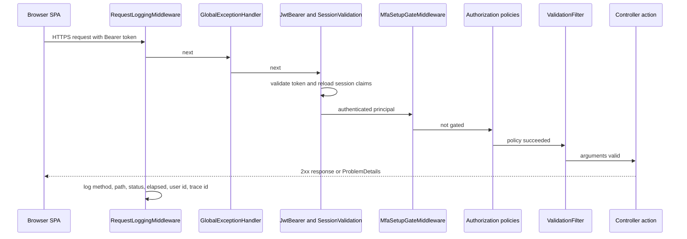

### 3.3 MFA Setup Gate

`Middleware/MfaSetupGateMiddleware.cs` is the server-side enforcement of mandatory two-step verification (FR-AUTH-28,
FR-AUTH-29). The Angular `mfaSetupGuard` only mirrors it.

1. Runs for every request after `UseAuthentication`.
2. Acts only when the user is authenticated, carries the claim `mfa_setup_required` (`AuthClaims.MfaSetupRequired`,
   added by `SessionValidation` when `Mfa:Required` is true and `Users.MfaEnabledAt` is null) and the path starts with
   `/api`.
3. Allow-list: prefixes `/api/v1/auth/` and `/api/v1/users/me/mfa/`, and exactly `/api/v1/users/me` (trailing slash
   trimmed, case-insensitive). Everything else is refused.
4. Refusal: **403** `ProblemDetails` with `detail` "Set up two-step verification to continue." and extension
   `code` = `mfa_setup_required` (`MfaSetupGateMiddleware.ErrorCode`). The SPA `authInterceptor` reacts with
   `markMfaRequired()` and navigates to `/security-setup`.
5. Break-glass: `Mfa:Required = false` (`Mfa__Required=false`) removes the claim, so the gate lets everything through.

### 3.4 Session Validation

`Middleware/SessionValidation.ValidateAsync(TokenValidatedContext)` runs as `JwtBearerEvents.OnTokenValidated` on every
authenticated request (FR-AUTH-44, FR-AUTH-45, FR-AUTH-48):

1. `ClaimTypes.NameIdentifier` must parse as an int, otherwise `context.Fail("Invalid token subject.")`.
2. Reads the token's `sstamp` claim (`AuthClaims.SecurityStamp`; empty for tokens issued before stamps existed).
3. `ISessionService.GetAsync(userId)` → `SessionService` → `IAccountRepository.GetSessionAsync` (`AsNoTracking`
   projection to `SessionUser`: stamp, `IsActive`, `MfaEnabledAt`, role name, stored role permission keys; soft-deleted
   users are excluded by the `Users` query filter) → `SessionState` with `EffectivePermissions.Expand(...)` applied and
   `MfaSetupRequired = Mfa:Required && MfaEnabledAt == null`.
4. Missing, inactive or stamp mismatch → `context.Fail("The session is no longer valid. Sign in again.")` → **401**.
5. Otherwise removes the token's role, `permission` and `mfa_setup_required` claims and adds the current role name, one
   `permission` claim per effective key, and `mfa_setup_required` when setup is pending.

Effect: a password change (My Profile), a password reset (4.1.2), an administrator MFA reset (Employee Management),
deactivation or deletion end every session on the next request; a role or permission change applies on the next
request without signing in again. `EffectivePermissions.Expand` adds the finer keys behind the six legacy keys
(`dashboard.admin`, `dashboard.manager`, `projects.manage`, `departments.manage`, `employees.manage`,
`settings.ai.manage`) and the lower levels of a scope group (Organization ⊃ Team ⊃ Own; `tasks.view.all` ⊃
`tasks.view.own`); always-on keys are not stored as grants.

### 3.5 Permission Policies

| Item | Design |
|---|---|
| Catalogue | `Common/Security/PermissionCatalog.cs` – `PermissionCatalog.All` (64 visible entries with name, description, module, sub-module, section, action, `AlwaysGranted`, `IsAssignable`, `ScopeGroup`, `ScopeRank`, role defaults); `PermissionCatalog.Stored` = entries that are not always granted. `PermissionKeys.cs` holds 70 constants = 64 catalogue keys + 6 legacy keys |
| Policy names | `PermissionPolicy.Prefix` = `perm:`; `PermissionPolicy.NameFor(key)`; one policy per `PermissionCatalog.All` entry, created in `CrossCuttingRegistration.AddCrossCutting` with `RequireClaim(AuthClaims.Permission, key)` |
| Attribute | `RequirePermissionAttribute : AuthorizeAttribute` – `[RequirePermission(PermissionKeys.X)]` sets the policy name; `[Authorize(Policy = PermissionPolicy.Prefix + PermissionKeys.X)]` is the equivalent long form used by several controllers |
| Claims source | `permission` claims are rebuilt from the database on every request (section 3.4), so policies never use stale tokens |
| Always-on keys | `dashboard.view.own`, `tasks.view.own`, `profile.view`, `profile.edit`, `profile.password.change`, `profile.mfa.manage` – not stored, not attribute-checked; their endpoints use `[Authorize]` |
| Administrator-only keys | `IsAssignable: false` entries such as `roles.administrator.assign` |
| Seeding | `AccessControlSeeder` inserts missing catalogue rows into `Permissions`, grants every permission to the Administrator role (id 1) on every start, and gives a new permission to Manager / Employee only when it is first created, from the catalogue defaults |
| Denied-action audit | `DeniedActionAuditHandler : IAuthorizationMiddlewareResultHandler` (singleton) logs `LogWarning("Denied action: user {UserId} attempted {Method} {Path}; authorization policy {Policy} refused.")` for authenticated forbidden results, then delegates to the default handler (401/403 unchanged); identifiers only, never bodies or query strings |

Permission keys of the catalogue (all 70, by module): dashboard – `dashboard.view.own`, `dashboard.view.team`,
`dashboard.view.organization`, `dashboard.analytics.view`, `dashboard.filters.use`, legacy `dashboard.admin`,
`dashboard.manager`; tasks – `tasks.view.own`, `tasks.view.all`, `tasks.create`, `tasks.update`, `tasks.delete`,
`tasks.status.change`, `tasks.reassign`, `tasks.recipients.manage`, `tasks.comment.create`, `tasks.comment.edit`,
`tasks.comment.delete`, `tasks.activity.view`; projects – `projects.view`, `projects.create`, `projects.edit`,
`projects.delete`, `projects.members.manage`, `positions.create`, legacy `projects.manage`; departments –
`departments.view`, `departments.create`, `departments.edit`, `departments.delete`, `departments.members.manage`, legacy
`departments.manage`; employees – `employees.view`, `employees.create`, `employees.edit`, `employees.status.change`,
`employees.delete`, `employees.role.assign`, `employees.mfa.reset`, legacy `employees.manage`; reports –
`reports.view`, `reports.export`; workload – `workload.view`, `workload.filters.use`, `workload.tasks.open`; board –
`board.view`, `board.filters.use`; settings – `settings.reminders.manage`, `settings.application.manage`,
`settings.ai.view`, `settings.ai.edit`, `settings.ai.test`, `settings.ai.model.remove`, legacy `settings.ai.manage`;
roles – `roles.manage`, `roles.view.all`, `roles.modify.access`, `roles.administrator.assign`; profile –
`profile.view`, `profile.edit`, `profile.password.change`, `profile.mfa.manage`; mail – `mail.read`, `mail.compose`,
`mail.organize`, `mail.attachments`; notifications – `notifications.view`, `notifications.manage`; assistant –
`assistant.chat`, `assistant.actions.confirm`. Which endpoint needs which key is listed in each sub-module LLD.

### 3.6 TaskAccess Resource Handler

| Item | Design |
|---|---|
| Policy | `AuthPolicies.TaskAccess` = `"TaskAccess"`, registered with `TaskAccessRequirement` |
| Handler | `Authorization/TaskAccess/TaskAccessHandler : AuthorizationHandler<TaskAccessRequirement>` (scoped) |
| Resource | The task id (`int`); any other resource → `Fail()` |
| Rule | `ITaskAccessService.CanAccessAsync(taskId, userId, canViewAll)` – allowed for the assignee, the creator, an additional recipient, or a user holding `tasks.view.all` (`HasClaim("permission", "tasks.view.all")`) |
| Callers | Task-scoped actions of `TasksController`, `TaskCommentsController` and `TaskActivityController` call `IAuthorizationService.AuthorizeAsync(User, id, AuthPolicies.TaskAccess)` before the service; failure → `Forbid()` (403). The exact action list and the extra Manager team scope are in the Task Management LLD §3 |

### 3.7 Logging

| Source | Level | Content |
|---|---|---|
| `RequestLoggingMiddleware` | Information | "HTTP {Method} {Path} responded {StatusCode} in {ElapsedMs} ms for user {UserId} (trace {TraceId})"; bodies are never logged |
| `GlobalExceptionHandler` | Error | "Unhandled exception for {Method} {Path} (trace {TraceId})" with the exception; the client gets only the generic 500 and the trace id in the problem |
| `DeniedActionAuditHandler` | Warning | Denied action (section 3.5) |
| `Program.cs` | Warning / Information | Legacy database found; unprotected AI key-ring keys; key ring not fully checked |
| `AppClock` | Error | Unknown application time zone, UTC used |
| Services | Warning | Best-effort side effects that failed (notifications, mail copies, recovery notice) – never undo the main change |
| Configuration | – | `Logging:LogLevel:Default` = Information, `Logging:LogLevel:Microsoft.AspNetCore` = Warning |

### 3.8 Time and Time Zone

- All timestamps are stored in UTC (`TimeProvider.System`, registered as a singleton; `GetUtcNow()`), as SQLite `TEXT`.
- `IAppClock` / `AppClock` (`Services/Settings/ApplicationSettings/Clock/`): `UtcNow`, `GetTimeZoneAsync()` (stored
  setting `Application.Timezone` in `ApplicationSettings`, else `Application:Timezone` from configuration, default
  `Asia/Kolkata`; an unknown id logs an error and falls back to UTC), `TodayLocalAsync()`.
- Local-day logic (task stage, deadline buckets, dashboard and report date bounds, reminder due dates) converts at the
  edge with the application time zone; details in the Dashboard, Task Management, Notification and Application
  Settings LLDs.
- Tests use `FakeTimeProvider` (`TaskFlow.UnitTests/TestSupport/FakeTimeProvider.cs`) and `AppClockTests.cs`.

---

## 4. Module Designs

### 4.1 Module: Authentication (`AUTH`)

Purpose: password sign-in with mandatory authenticator-app MFA, self-service password recovery with the authenticator,
the session lifecycle (access token, rotating refresh cookie), and the first-time Security Setup screen. Traces to
`FR-AUTH-01` – `FR-AUTH-51` and `UC-AUTH-01` – `UC-AUTH-05` of the overall FRD.

**Endpoints of this module (facts.md §3): 7** – `AuthController` 5 + `PasswordRecoveryController` 2, all documented
below. Security Setup uses 6 `ProfileController` actions that belong to My Profile (designed in
`../07-My-Profile/07.1-My-Profile/LLD-My-Profile.md` §4.1.1 and §4.1.3) and the MFA gate (§3.3).

| # | Child | Method | Route | Action |
|---|---|---|---|---|
| 1 | 4.1.1 Login | POST | `/api/v1/auth/login` | `AuthController.Login` |
| 2 | 4.1.1 Login | POST | `/api/v1/auth/mfa/verify` | `AuthController.VerifyMfa` |
| 3 | 4.1.1 Login | GET | `/api/v1/auth/me` | `AuthController.Me` |
| 4 | 4.1.2 Account Recovery | POST | `/api/v1/auth/password-recovery/authenticator/verify` | `PasswordRecoveryController.VerifyAuthenticator` |
| 5 | 4.1.2 Account Recovery | POST | `/api/v1/auth/password-recovery/reset` | `PasswordRecoveryController.Reset` |
| 6 | 4.1.3 Sessions and Tokens | POST | `/api/v1/auth/refresh` | `AuthController.Refresh` |
| 7 | 4.1.3 Sessions and Tokens | POST | `/api/v1/auth/logout` | `AuthController.Logout` |

**Module class / file inventory (shared by the children)**

| Layer | Type | File | Responsibility |
|---|---|---|---|
| Controller | `AuthController` | `Controllers/Auth/AuthController.cs` | Route `api/v1/auth`; login, MFA verify, refresh, logout, me; writes / clears the refresh cookie |
| Controller | `PasswordRecoveryController` | `Controllers/Auth/PasswordRecoveryController.cs` | Route `api/v1/auth/password-recovery`; one failure message for every reason |
| Service | `IAuthService` / `AuthService` | `Services/Auth/Login/` | `LoginAsync`, `VerifyMfaAsync`, `RefreshAsync`, `LogoutAsync`, `GetCurrentAsync`; private `IssueTokens`, `ToDtoAsync` |
| Service | `IPasswordRecoveryService` / `PasswordRecoveryService` | `Services/Auth/PasswordRecovery/` | `VerifyAuthenticatorAsync`, `IssueResetTokenAsync`, `ResetPasswordAsync`; `TokenLifetime` 10 min |
| Service | `IMfaService` / `MfaService` | `Services/Auth/Mfa/` | `VerifyAsync` (used here; enrolment in My Profile LLD); `LockedMessage` |
| Service | `ISessionService` / `SessionService` | `Services/Auth/Sessions/` | `GetAsync(userId)` → `SessionState` |
| Service | `IAttemptLimiter` / `AttemptLimiter` (singleton) | `Services/Auth/AttemptLimits/` | Sliding 5-minute window; `AttemptsPerAccount` 5, `AttemptsPerAddress` 20, `MaxTrackedKeys` 10 000; keys `user:{id}`, `name:{UPPER}`, `pwd:{id}` |
| Repository | `IAccountRepository` / `AccountRepository` | `Repositories/Auth/Accounts/` | `FindByLoginForUpdateAsync`, `FindActiveByLoginForUpdateAsync`, `FindWithRoleForUpdateAsync`, `FindLiveForUpdateAsync`, `GetPermissionKeysAsync`, `GetSessionAsync` (`SessionUser`) |
| Repository | `IRefreshTokenRepository` / `RefreshTokenRepository` | `Repositories/Auth/RefreshTokens/` | `FindByHashWithUserForUpdateAsync`, `FindByHashForUpdateAsync`, `GetActiveForUsersForUpdateAsync`, `Add` |
| Repository | `IPasswordResetGrantRepository` / `PasswordResetGrantRepository` | `Repositories/Auth/PasswordRecovery/` | `FindUnusedByHashWithUserForUpdateAsync`, `GetOtherUnusedForUpdateAsync`, `Add` |
| Repository | `IMfaBackupCodeRepository` / `MfaBackupCodeRepository` | `Repositories/Auth/Mfa/` | `FindUnusedForUpdateAsync` (backup code at sign-in), `GetForUserForUpdateAsync` |
| DTOs | `LoginRequest`, `AuthResponse`, `AuthenticatedUserResponse`, `AuthResult`, `MfaSignInResult`, `AuthTokens`, `UserDto`, `SessionState` | `Dtos/Auth/` | Contracts and internal results |
| DTOs | `MfaVerifyRequest`, `MfaChallengeResponse`, `MfaVerifyOutcome` | `Dtos/Auth/Mfa/` | Second sign-in step |
| DTOs | `AuthenticatorRecoveryRequest`, `RecoverPasswordRequest`, `RecoveryTokenResponse`, `RecoveryVerifyStatus`, `RecoveryVerifyResult` | `Dtos/Auth/PasswordRecovery/PasswordRecoveryRequests.cs` | Recovery |
| Validators | `LoginRequestValidator`; `MfaVerifyRequestValidator`; `AuthenticatorRecoveryRequestValidator`, `RecoverPasswordRequestValidator` | `Dtos/Auth/Validators/`, `Dtos/Auth/Mfa/Validators/`, `Dtos/Auth/PasswordRecovery/Validators/` | Input rules |
| Integrations | `ITokenService` / `JwtTokenService`, `AccessToken`, `RefreshTokenValue` | `Integrations/Security/Tokens/` | `CreateAccessToken(user)`, `CreateRefreshToken()`, `HashRefreshToken(token)` |
| Integrations | `IMfaSecretProtector` / `MfaSecretProtector` (singleton) | `Integrations/Security/MfaSecrets/` | Data Protection purposes `TaskFlow.MfaSecrets` and `TaskFlow.MfaChallenge`; `CreateChallenge`, `ReadChallenge`, `Protect` |
| Integrations | `Totp`, `Base32` | `Integrations/Security/OneTimeCodes/` | RFC 6238 TOTP (SHA1, 6 digits, 30 s, ±1 step) |
| Common | `AuthClaims`, `RefreshTokenCookie`, `EffectivePermissions`, `PermissionCatalog`, `PermissionKeys`, `PermissionPolicy`, `SystemRoles` | `Common/Security/` | Claim names, cookie options, permission expansion |
| Config | `JwtOptions`, `MfaOptions` | `Config/` | `Jwt:*`, `Mfa:*` |
| Middleware | `SessionValidation`, `MfaSetupGateMiddleware` | `Middleware/` | Sections 3.3 and 3.4 |
| Frontend routes | `AUTH_ROUTES` | `modules/auth/auth.routes.ts` | `login`, `account-recovery`, `security-setup` (`canActivate: [authGuard, securitySetupGuard]`), all outside the shell |
| Frontend pages | `LoginComponent` (+ `LoginBackgroundComponent`, `remembered-identifier.ts`), `AccountRecoveryComponent` (`RecoveryStep`), `SecuritySetupComponent` (`SetupStep`, `StepInfo`) | `modules/auth/login/`, `modules/auth/account-recovery/`, `modules/auth/security-setup/` | The four screens of the FRD |
| Frontend service | `AuthService` (Angular) | `shared/auth/auth.service.ts` | `login`, `verifyMfa`, `verifyAuthenticatorRecovery`, `recoverPassword`, `refresh`, `restoreSession`, `logout`, `checkSession`, `hasPermission`, `clearSession`, `applyProfile`, `markMfaConfigured`, `markMfaRequired`; `currentUser` signal |
| Frontend infra | `authInterceptor`, `authGuard`, `mfaSetupGuard`, `securitySetupGuard`, `permissionGuard`, `TokenStore`, `dashboardRouteFor` / `ROLE_ROUTES` / `DEFAULT_ROUTE`, `LOGIN_REASON_*` / `LOGIN_REASON_MESSAGES` | `shared/auth/` | Bearer header, silent refresh, routing, notices |

**Class diagram**

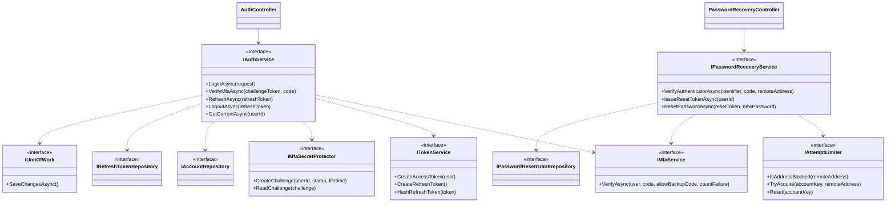

(Dependencies are drawn from the interfaces for brevity; the concrete `AuthService` and `PasswordRecoveryService`
receive them by constructor injection.)

#### 4.1.1 Child module: Login

Screens: Login and its Two-step verification step (FRD 4.1.1, 4.1.2). Actions 1 – 3.

**Class / file inventory** – `AuthController.Login`, `VerifyMfa`, `Me`; `AuthService.LoginAsync`, `VerifyMfaAsync`,
`GetCurrentAsync`; `MfaService.VerifyAsync`; `MfaSecretProtector.CreateChallenge` / `ReadChallenge`;
`AccountRepository`; `RefreshTokenRepository.Add`; `MfaBackupCodeRepository.FindUnusedForUpdateAsync`; frontend
`LoginComponent` (`modules/auth/login/pages/login.component.ts` / `.html`, `challenge` signal for the code step),
`remembered-identifier.ts` (`localStorage` key `taskflow.lastIdentifier`), `dashboardRouteFor`.

**API contracts**

| # | Method | Route | Permission / policy | Request | Response | Status codes |
|---|---|---|---|---|---|---|
| 1 | POST | `/api/v1/auth/login` | `[AllowAnonymous]` | `LoginRequest` (`emailOrUsername`, `password`) | `AuthResponse` + `Set-Cookie: taskflow_refresh`, or `MfaChallengeResponse` (`mfaRequired`, `challengeToken`) | 200, 400 (validation), 401 (empty body) |
| 2 | POST | `/api/v1/auth/mfa/verify` | `[AllowAnonymous]` | `MfaVerifyRequest` (`challengeToken`, `code`) | `AuthResponse` + cookie | 200, 400, 429 |
| 3 | GET | `/api/v1/auth/me` | `[Authorize]` (no permission key) | – | `AuthenticatedUserResponse` (`id`, `fullName`, `username`, `email`, `role`, `employeeCode`, `permissions`, `mfaSetupRequired`) | 200, 401 |

**Request / response example**

```json
{ "emailOrUsername": "jane.doe@taskflow.com", "password": "S3cret!" }
```

```json
{ "mfaRequired": true, "challengeToken": "CfDJ8...protected..." }
```

```json
{ "challengeToken": "CfDJ8...protected...", "code": "123456" }
```

```json
{
  "accessToken": "eyJhbGciOiJIUzI1NiIs...",
  "expiresAt": "2026-10-31T10:30:00Z",
  "user": { "id": 7, "fullName": "Jane Doe", "username": "jane", "email": "jane.doe@taskflow.com", "role": "Employee",
            "employeeCode": "EMP007", "permissions": ["dashboard.analytics.view", "tasks.status.change"], "mfaSetupRequired": false }
}
```

**Service logic – `AuthService.LoginAsync(LoginRequest)`**
1. `ValidationFilter` has run `LoginRequestValidator` (required, 256 / 128 characters).
2. `IAccountRepository.FindByLoginForUpdateAsync(request.EmailOrUsername.Trim())` – `Username == identifier ||
   Email == identifier`, `Include(Role)`, tracked; soft-deleted users excluded by the query filter.
3. Null or `!IsActive` → `AuthResult.Failure()` → controller `Unauthorized()` (401, empty body; the SPA shows
   "Invalid email or password.") – one answer for every reason (FR-AUTH-03).
4. `IPasswordHasher<User>.VerifyHashedPassword` (PBKDF2): `Failed` → failure; `SuccessRehashNeeded` → store the new
   hash (FR-AUTH-04).
5. `MfaEnabledAt` set → save a rehash if needed and return
   `AuthResult.RequiresMfa(IMfaSecretProtector.CreateChallenge(user.Id, user.SecurityStamp, Mfa:ChallengeMinutes))`;
   no token, no `LastLoginAt` (FR-AUTH-08, FR-AUTH-12).
6. Otherwise set `LastLoginAt`, `UpdatedAt`; `IssueTokens` (`ITokenService.CreateAccessToken`,
   `CreateRefreshToken`, add a `RefreshToken` row with the SHA-256 hash); `IUnitOfWork.SaveChangesAsync` (FR-AUTH-07).
7. `ToDtoAsync`: permissions = `EffectivePermissions.Expand(GetPermissionKeysAsync(roleId))` ordered ordinally;
   `MfaSetupRequired = Mfa:Required && MfaEnabledAt == null` (FR-AUTH-10).
8. Controller appends the cookie (`RefreshTokenCookie.CreateOptions(expiresAt)`) and returns `AuthResponse`.

**Service logic – `AuthService.VerifyMfaAsync(challengeToken, code)`**
1. `IMfaSecretProtector.ReadChallenge` – null for forged, tampered, malformed or expired (5 min) challenges → `Invalid`.
2. `FindWithRoleForUpdateAsync(userId)`; invalid when null, inactive, MFA off or `SecurityStamp` differs from the
   stamp in the challenge (FR-AUTH-12).
3. `IMfaService.VerifyAsync(user, code, allowBackupCode: true)` → `Success`, `Invalid` or `LockedOut`. Core
   (`MfaService.VerifyCoreAsync`, My Profile LLD 4.1.3): lock check; 6 ASCII digits → `Totp.TryValidate` (current step
   ±1, constant-time, step must be greater than `MfaLastUsedStep`, then stored – FR-AUTH-13); otherwise an unused backup
   code (`NormalizeBackupCode` → `FindUnusedForUpdateAsync` → `UsedAt`); wrong code increments `MfaFailedAttempts`,
   5 in a row set `MfaLockedUntil` = now + 5 min (FR-AUTH-14).
4. Success → `LastLoginAt`, `UpdatedAt`, `IssueTokens`, save → `MfaSignInResult(…, Success)`.
5. Controller: `Success` → cookie + `AuthResponse`; `LockedOut` → `Problem(MfaService.LockedMessage, 429)`;
   otherwise `Problem("The code is incorrect, or the sign-in has expired. Try again or sign in again.", 400)`.

**Service logic – `AuthService.GetCurrentAsync(userId)`** – loads the user with role and maps with `ToDtoAsync`; the
controller returns 401 when the subject claim is not an int or the user is not found. The shell calls it every 15 s
(`checkSession`, section 4.1.3).

**Frontend logic – `LoginComponent`**
1. Pre-fills **Email** from `taskflow.lastIdentifier` (FR-AUTH-06); eye button toggles the password (FR-AUTH-05).
2. Shows the notice for `reason` = `session-ended`, `credentials-changed` or `password-reset` from
   `LOGIN_REASON_MESSAGES` (FR-AUTH-11).
3. `AuthService.login` → `isMfaChallenge()` → code step; `verifyMfa`; a refused code clears the code box; **← Back to
   sign in** clears the password (FR-AUTH-15).
4. On success navigates to `returnUrl` when it is an internal path, else `dashboardRouteFor(role, permissions)`:
   `Administrator` → `/admin`, `Manager` → `/manager`, custom role with `dashboard.view.organization` → `/admin`, with
   `dashboard.view.team` → `/manager`, else `/me` (FR-AUTH-09). `mfaSetupRequired` → `mfaSetupGuard` sends the user to
   `/security-setup` (FR-AUTH-10).

**Sequence diagram**

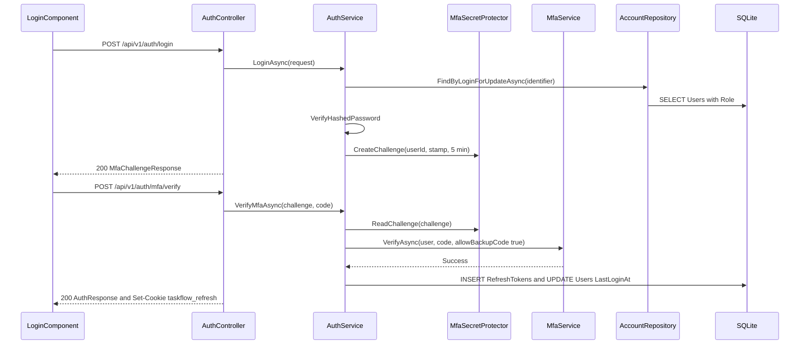

**Repository methods**

| Method | Query / purpose | Notes |
|---|---|---|
| `AccountRepository.FindByLoginForUpdateAsync(identifier)` | User by username or email, with role | Tracked; exact comparison; unique indexes `IX_Users_Username`, `IX_Users_Email` |
| `AccountRepository.FindWithRoleForUpdateAsync(userId)` | User by id with role | Tracked |
| `AccountRepository.GetPermissionKeysAsync(roleId)` | Stored permission keys of the role | `AsNoTracking`, `RolePermissions` → `Permission.Key` |
| `RefreshTokenRepository.Add(RefreshToken)` | New refresh-token row | `BaseRepository` |
| `MfaBackupCodeRepository.FindUnusedForUpdateAsync(userId, codeHash)` | Unused backup code | Index `IX_MfaBackupCodes_UserId_CodeHash`; `UsedAt` concurrency token |

**Validation rules**

| Field | Rule | Message |
|---|---|---|
| `LoginRequest.EmailOrUsername` | `NotEmpty`, `MaximumLength(256)` | FluentValidation default; screen: "Email is required." / "Enter a valid email address." |
| `LoginRequest.Password` | `NotEmpty`, `MaximumLength(128)` | FluentValidation default; screen: "Password is required." |
| `MfaVerifyRequest.ChallengeToken` | `NotEmpty`, `MaximumLength(2048)` | FluentValidation default |
| `MfaVerifyRequest.Code` | `NotEmpty`, `MaximumLength(32)` | FluentValidation default; screen: "Enter the code to continue." |

**Error cases**

| Case | Exception / result | Status |
|---|---|---|
| Unknown, inactive or deleted account; wrong password | `AuthResult.Failure()` → `Unauthorized()` | 401 |
| Wrong, reused or expired code; challenge forged or stale stamp | `MfaVerifyOutcome.Invalid` → `Problem` "The code is incorrect, or the sign-in has expired. Try again or sign in again." | 400 |
| 5 wrong codes in a row | `MfaVerifyOutcome.LockedOut` → `Problem` "Too many wrong codes. Try again in a few minutes." | 429 |
| Parallel code spend | `ConcurrencyConflictException` | 409 |
| `GET /api/v1/auth/me` with a bad subject or missing user | `Unauthorized()` | 401 |

**State machine – sign-in attempt**

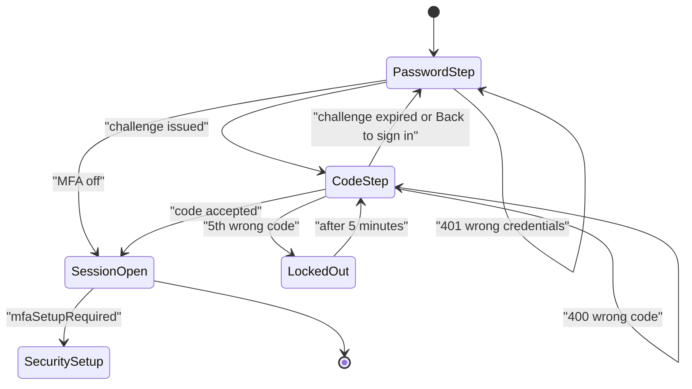

#### 4.1.2 Child module: Account Recovery

Screen: Forgot your password? (`/account-recovery`, FRD 4.1.3). Actions 4 – 5.

**Class / file inventory** – `PasswordRecoveryController`; `PasswordRecoveryService`; `AttemptLimiter`;
`MfaService.VerifyAsync`; `PasswordResetGrantRepository`; `AccountRepository.FindActiveByLoginForUpdateAsync`;
`RefreshTokenRepository.GetActiveForUsersForUpdateAsync`; `INotificationPublisher` (Notification LLD); entity
`PasswordResetGrant`; frontend `AccountRecoveryComponent` (`RecoveryStep` = `verify` / `password`, inline template with
`app-legal-footer variant="dark"`), `AuthService.verifyAuthenticatorRecovery`, `recoverPassword`.

**API contracts**

| # | Method | Route | Permission / policy | Request | Response | Status codes |
|---|---|---|---|---|---|---|
| 4 | POST | `/api/v1/auth/password-recovery/authenticator/verify` | `[AllowAnonymous]` | `AuthenticatorRecoveryRequest` (`identifier`, `code`) | `RecoveryTokenResponse` (`resetToken`) | 200, 400, 429 |
| 5 | POST | `/api/v1/auth/password-recovery/reset` | `[AllowAnonymous]` | `RecoverPasswordRequest` (`resetToken`, `newPassword`, `confirmPassword`) | – | 204, 400 |

**Request / response example**

```json
{ "identifier": "jane", "code": "654321" }
```

```json
{ "resetToken": "q3V0b2tlbl9leGFtcGxlX2Jhc2U2NHVybA" }
```

```json
{ "resetToken": "q3V0b2tlbl9leGFtcGxlX2Jhc2U2NHVybA", "newPassword": "NewPass1", "confirmPassword": "NewPass1" }
```

**Service logic – `PasswordRecoveryService.VerifyAuthenticatorAsync(identifier, code, remoteAddress)`**
1. Trim the identifier; `IAttemptLimiter.IsAddressBlocked(remoteAddress)` → `Throttled` before any database work.
2. `FindActiveByLoginForUpdateAsync(identifier)` – active, not deleted.
3. Budget key `IAttemptLimiter.AccountKey(user.Id)` (`user:{id}`) or `UnknownKey(identifier)` (`name:{UPPER}`);
   `TryAcquire(accountKey, remoteAddress)` reserves an attempt **before** the code check; refused → `Throttled`
   (FR-AUTH-20: 5 per account, 20 per address, sliding 5 minutes).
4. User null or `MfaEnabledAt` null → `Failed` (FR-AUTH-17, FR-AUTH-19).
5. `IMfaService.VerifyAsync(user, code, allowBackupCode: false, countFailure: false)` – backup codes refused
   (FR-AUTH-18); a wrong code does not touch `MfaFailedAttempts`, an existing lock still refuses (FR-AUTH-21).
6. Success → `Reset(accountKey)`, `IssueResetTokenAsync(user.Id)` → `Verified`.
7. Controller: `Verified` → 200; `Throttled` → 429 "Too many attempts. Try again in a few minutes."; otherwise 400
   "The details are incorrect, or the code has expired. Check them and try again.". Address from
   `HttpContext.Connection.RemoteIpAddress` (after `UseForwardedHeaders`).

**Service logic – `IssueResetTokenAsync(userId)`** – 32 random bytes, Base64Url without padding; a
`PasswordResetGrant` with `TokenHash` = SHA-256 hex, `ExpiresAt` = now + 10 minutes; save (FR-AUTH-22).

**Service logic – `ResetPasswordAsync(resetToken, newPassword)`**
1. `ValidationFilter` has run `RecoverPasswordRequestValidator` (6 – 128 characters, confirmation equal – FR-AUTH-23);
   a rejected password does not touch the grant, so it stays usable until it expires.
2. `FindUnusedByHashWithUserForUpdateAsync(hash)`; false when no grant, no user, expired, deleted or inactive.
3. Hash the new password; rotate `SecurityStamp` (`Guid.NewGuid().ToString("N")`); `UpdatedAt`; `grant.UsedAt`.
4. Revoke every active refresh token (`GetActiveForUsersForUpdateAsync`) and mark every other unused grant used
   (`GetOtherUnusedForUpdateAsync`) (FR-AUTH-22, FR-AUTH-24).
5. `IUnitOfWork.SaveChangesAsync`; `ConcurrencyConflictException` (token spent in parallel – `UsedAt` concurrency
   token) → false.
6. `INotificationPublisher.PublishAsync(..., NotificationType.System, ...)` "Your password was reset with your
   authenticator app. If this was not you, contact an administrator now."; failure logged as a warning (FR-AUTH-25).
7. Controller: true → 204; false → 400 "This reset link is no longer valid. Start again from the login page."; the SPA
   shows **Start over** (FR-AUTH-27) and after success opens `/login?reason=password-reset` (FR-AUTH-26).

**Sequence diagram**

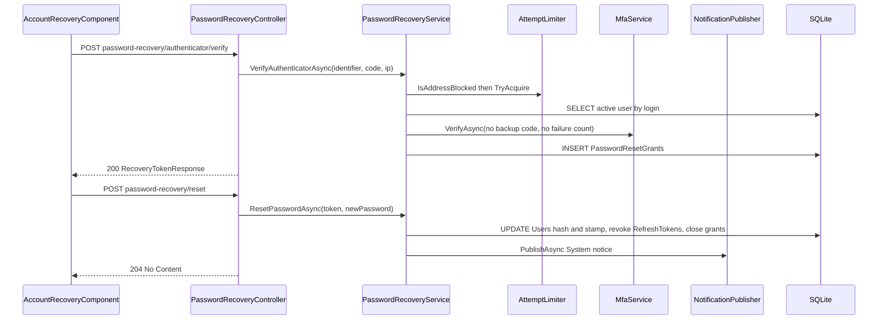

**Repository methods**

| Method | Query / purpose | Notes |
|---|---|---|
| `AccountRepository.FindActiveByLoginForUpdateAsync(identifier)` | Active, not deleted user by username or email | Tracked, no role include |
| `PasswordResetGrantRepository.FindUnusedByHashWithUserForUpdateAsync(tokenHash)` | Unused grant with user | `UsedAt == null`; index `IX_PasswordResetGrants_TokenHash` |
| `PasswordResetGrantRepository.GetOtherUnusedForUpdateAsync(userId, exceptGrantId)` | The user's other open grants | Index `IX_PasswordResetGrants_UserId_UsedAt` |
| `RefreshTokenRepository.GetActiveForUsersForUpdateAsync(userIds)` | Unrevoked tokens of the users | `RevokedAt == null`; index `IX_RefreshTokens_UserId` |

**Validation rules**

| Field | Rule | Message |
|---|---|---|
| `AuthenticatorRecoveryRequest.Identifier` | `NotEmpty`, `MaximumLength(256)` | FluentValidation default; screen "Email or username is required." |
| `AuthenticatorRecoveryRequest.Code` | `NotEmpty`, `MaximumLength(32)` | FluentValidation default; screen "Enter the 6-digit code from the app." (exactly 6 digits on the screen) |
| `RecoverPasswordRequest.ResetToken` | `NotEmpty` | FluentValidation default |
| `RecoverPasswordRequest.NewPassword` | `NotEmpty`, `MinimumLength(ChangePasswordRequestValidator.MinPasswordLength)` = 6, `MaximumLength(MaxPasswordLength)` = 128 | FluentValidation default; screen "Use at least 6 and at most 128 characters." |
| `RecoverPasswordRequest.ConfirmPassword` | `Equal(NewPassword)` | "Passwords do not match." |

**Error cases**

| Case | Exception / result | Status |
|---|---|---|
| Address or account budget used up | `RecoveryVerifyStatus.Throttled` | 429 |
| Unknown or inactive account, MFA off, wrong code, backup code, MFA locked | `RecoveryVerifyStatus.Failed` | 400 (one message) |
| Reset token unknown, used, expired, cancelled; user inactive or deleted | `false` | 400 |
| Token spent in parallel | `ConcurrencyConflictException` caught → `false` | 400 |
| Notification write fails | Logged warning only | 204 (reset kept) |

**State machine – `PasswordResetGrant`**

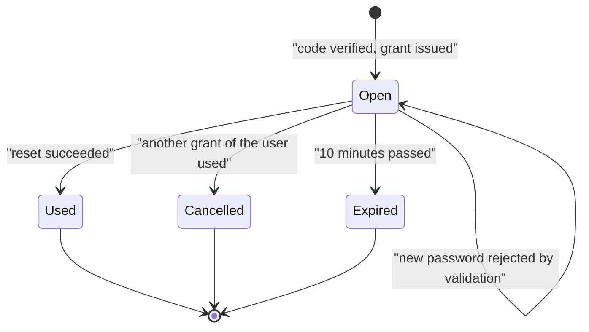

(`Used` and `Cancelled` both set `UsedAt`; `Expired` is evaluated at read time from `ExpiresAt`.)

#### 4.1.3 Child module: Sessions and Tokens

Screen: Sessions and Sign out (FRD 4.1.5). Actions 6 – 7, plus `GET /api/v1/auth/me` (action 3) as the session check
and the session validation of section 3.4.

**Class / file inventory** – `AuthController.Refresh`, `Logout`; `AuthService.RefreshAsync`, `LogoutAsync`,
`IssueTokens`; `JwtTokenService` (`CreateAccessToken` – claims `sub`, `ClaimTypes.NameIdentifier`, `ClaimTypes.Name`,
`ClaimTypes.Role`, `sstamp`, `jti`; issuer `Jwt:Issuer`; HMAC-SHA256; `CreateRefreshToken` – 64 random bytes Base64,
`ExpiresAt` = now + `Jwt:RefreshTokenDays`; `HashRefreshToken` – SHA-256 hex); `RefreshTokenCookie` (`taskflow_refresh`,
path `/api/v1/auth`, HttpOnly, Secure, SameSite Strict); `SessionValidation`; `SessionService`; frontend
`authInterceptor`, `AuthService.refresh` / `restoreSession` / `logout` / `checkSession`, `TokenStore`, `authGuard`,
`ShellComponent` (`SESSION_CHECK_INTERVAL_MS` = 15 000 and `visibilitychange`), `provideAppInitializer(restoreSession)`.

**API contracts**

| # | Method | Route | Permission / policy | Request | Response | Status codes |
|---|---|---|---|---|---|---|
| 6 | POST | `/api/v1/auth/refresh` | `[AllowAnonymous]`; cookie `taskflow_refresh` | – (cookie) | `AuthResponse` + new cookie | 200, 401 (cookie cleared) |
| 7 | POST | `/api/v1/auth/logout` | `[AllowAnonymous]`; cookie | – (cookie) | – | 204 |

**Request / response example**

```json
{ "accessToken": "eyJhbGciOiJIUzI1NiIs...", "expiresAt": "2026-10-31T11:00:00Z",
  "user": { "id": 7, "role": "Employee", "permissions": ["tasks.status.change"], "mfaSetupRequired": false } }
```

(Request: empty body, `Cookie: taskflow_refresh=...`; response also sets a new `taskflow_refresh` cookie.)

**Service logic – `AuthService.RefreshAsync(refreshToken)`**
1. Empty → failure. `FindByHashWithUserForUpdateAsync(ITokenService.HashRefreshToken(token))` (with user and role).
2. Failure when not found, revoked, expired, user missing or inactive (tokens of deleted users are hidden by the
   `RefreshTokens` query filter) (FR-AUTH-43).
3. Revoke the presented token (`RevokedAt` = now) and issue a new pair with `IssueTokens` (rotation); save; map to
   `UserDto` with the current permissions.
4. Controller: failure → `ClearRefreshCookie()` + 401; success → new cookie + `AuthResponse` (FR-AUTH-41, FR-AUTH-42).

**Service logic – `AuthService.LogoutAsync(refreshToken)`** – no token, unknown or already revoked → no-op; otherwise
`FindByHashForUpdateAsync` and set `RevokedAt`; save. The controller always deletes the cookie and returns 204
(FR-AUTH-46).

**Frontend logic**
1. `restoreSession()` runs at start-up (`provideAppInitializer`): a refresh restores the session after a reload
   (FR-AUTH-41).
2. `authInterceptor` adds `Authorization: Bearer` (except for login and refresh); on 401 from a non-credential
   endpoint calls `refresh()` once (shared in-flight observable) and repeats the request; refresh failure →
   `clearSession()` and `/login?reason=session-ended` (FR-AUTH-42, FR-AUTH-47); on 403 with `code` =
   `mfa_setup_required` → `markMfaRequired()` and `/security-setup`.
3. `ShellComponent` calls `checkSession()` (`GET /api/v1/auth/me`) every 15 s and when the tab becomes visible, and
   updates the `currentUser` signal, menus and guards (FR-AUTH-44, FR-AUTH-50).
4. `authGuard` sends visitors to `/login?returnUrl=…`; the root wildcard `**` and the empty path redirect to `login`
   (FR-AUTH-51); `permissionGuard` sends a user without the screen's permission to `dashboardRouteFor(...)`.

**Sequence diagram**

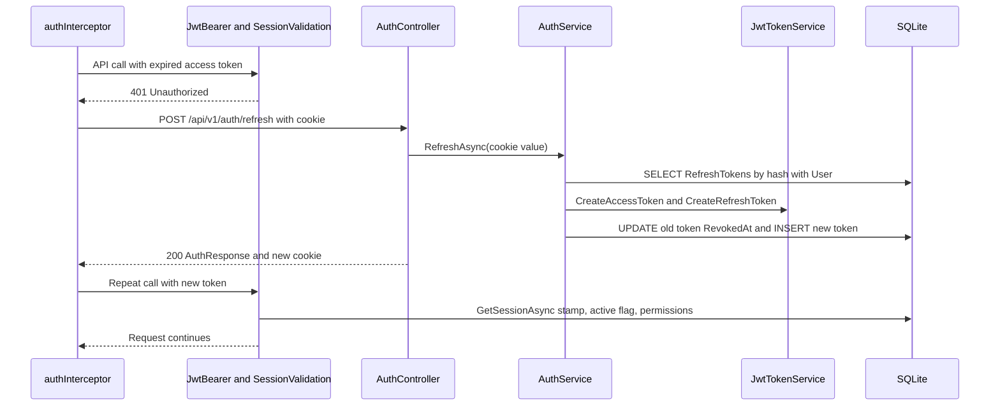

**Repository methods**

| Method | Query / purpose | Notes |
|---|---|---|
| `RefreshTokenRepository.FindByHashWithUserForUpdateAsync(tokenHash)` | Token with user and role | `Include(User).ThenInclude(Role)`; index `IX_RefreshTokens_TokenHash` |
| `RefreshTokenRepository.FindByHashForUpdateAsync(tokenHash)` | Token only (logout) | Tracked |
| `AccountRepository.GetSessionAsync(userId)` | Stamp, active flag, `MfaEnabledAt`, role name, role keys | `AsNoTracking` projection to `SessionUser`; runs on every authenticated request |

**Validation rules**

| Field | Rule | Message |
|---|---|---|
| Cookie `taskflow_refresh` | Present, known, not revoked, not expired, user active | 401 (no body) |

**Error cases**

| Case | Exception / result | Status |
|---|---|---|
| Refresh cookie missing, unknown, revoked or expired; user inactive or deleted | `AuthResult.Failure()`; cookie cleared | 401 |
| Access token with stale `sstamp`, inactive user | `SessionValidation` → `context.Fail(...)` | 401 |
| Logout without cookie or with a revoked one | No-op | 204 |

**State machine – `RefreshToken`**

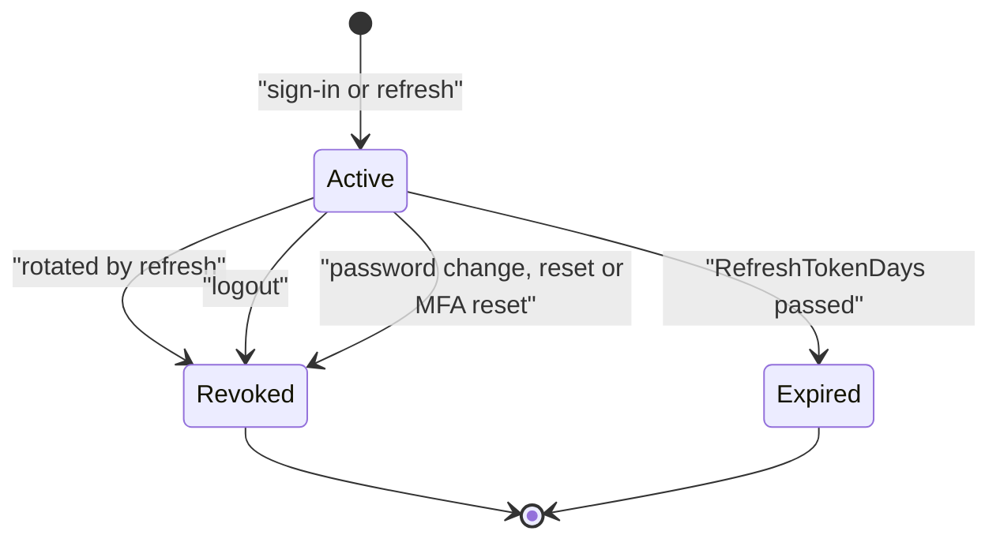

#### 4.1.4 Child module: Security Setup (first-time MFA enrolment)

Screen: Let's secure your account (`/security-setup`, FRD 4.1.4, `FR-AUTH-28` – `FR-AUTH-40`). This child has **no
controller action of its own**: the screen calls `ProfileController` actions, whose design is in
[LLD-My-Profile](../07-My-Profile/07.1-My-Profile/LLD-My-Profile.md) – §4.1.1 User Profile (`GET` / `PUT`
`/api/v1/users/me`) and §4.1.3 Two-Step Verification (`POST /api/v1/users/me/mfa/setup`,
`POST /api/v1/users/me/mfa/enable`, also `/api/v1/users/me/mfa/check` and `/api/v1/users/me/mfa/backup-codes`, which
the setup screen does not call). The server-side enforcement is the MFA gate (§3.3) and `SessionValidation` (§3.4).
The administrator reset (`POST /api/v1/users/{id}/mfa/reset`, `employees.mfa.reset`) is in the Employee Management LLD.

**Class / file inventory**

| Layer | Type | File | Responsibility |
|---|---|---|---|
| Route | `security-setup` | `modules/auth/auth.routes.ts` | `canActivate: [authGuard, securitySetupGuard]` |
| Page | `SecuritySetupComponent`, `SetupStep`, `StepInfo` | `modules/auth/security-setup/pages/security-setup.component.ts`, `security-setup.model.ts` | Steps **Your details** → **Authenticator app** → **Backup codes**; QR code via the `qrcode` package |
| Frontend service | `ProfileService` (Angular) | `modules/profile/services/profile.service.ts` | `get()`, `update(...)`, `startMfaSetup(currentPassword)`, `enableMfa(code)` on `/api/v1/users/me` |
| Frontend service | `AuthService` | `shared/auth/auth.service.ts` | `applyProfile`, `markMfaConfigured`, `logout` |
| Guards | `mfaSetupGuard`, `securitySetupGuard` | `shared/auth/auth.guard.ts` | Shell → setup while `mfaSetupRequired`; setup → dashboard once done (FR-AUTH-30) |
| Backend gate | `MfaSetupGateMiddleware` | `Middleware/MfaSetupGateMiddleware.cs` | 403 `mfa_setup_required` outside the allow-list (FR-AUTH-29) |
| Backend services | `ProfileService` → `MfaService` (`BeginSetupAsync` / `EnableAsync` behind `BeginMfaSetupAsync`, `EnableMfaAsync`) | `Services/Profile/`, `Services/Auth/Mfa/` | Password re-entry (limiter key `pwd:{id}`), `Totp.NewSecret()`, `MfaSecretProtector.Protect`, 10 backup codes `XXXXX-XXXXX` stored as SHA-256 hashes – designed in My Profile LLD §4.1.3 |

**Frontend logic – `SecuritySetupComponent`**
1. Step 1: `ProfileService.get()` shows the read-only facts; **Save and continue** → `update(...)` with **Full name**,
   **Email** (`@taskflow.com` fixed) and **Mobile number** (FR-AUTH-31); load failure → "We could not load your
   details." with **Try again** (FR-AUTH-40); **Sign out** → `AuthService.logout()` (FR-AUTH-39).
2. Step 2: **Show my QR code** → `startMfaSetup(currentPassword)` → key and `otpauth://` URI rendered as QR code and
   typed key with **Copy key** (FR-AUTH-32, FR-AUTH-33); **Verify and turn on** → `enableMfa(code)` (FR-AUTH-34);
   **Start over** requests a new key.
3. Step 3: shows the 10 backup codes once with **Copy all** / **Download** (FR-AUTH-36); **Open TaskFlow** is enabled
   only after the check box (FR-AUTH-37); `markMfaConfigured()` clears `mfaSetupRequired` and the guard lets the shell
   open.

**Sequence diagram**

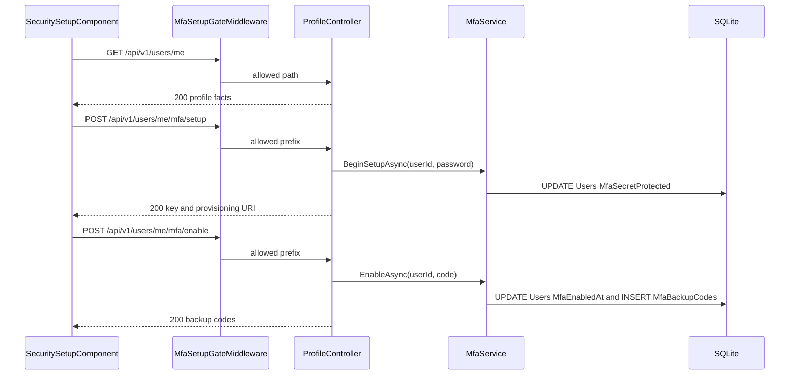

**Error cases** – any other API call while setup is pending → 403 "Set up two-step verification to continue."
(`code` `mfa_setup_required`); wrong password → "Current password is incorrect."; 6th password attempt in 5 minutes →
"Too many attempts. Try again in a few minutes."; wrong code → "The code is incorrect or has expired."; MFA already on
→ "Authenticator MFA is already on. Turn it off first to set it up again." (all designed in My Profile LLD §4.1.3).

### 4.2 Module: Legal (`LEGAL`)

Purpose: five public, read-only legal documents and an ownership footer, built entirely in the frontend
(`FR-LEGAL-01` – `FR-LEGAL-16`, `UC-LEGAL-01` – `UC-LEGAL-02`). **Endpoints: 0** (no controller, service, table or
permission key; a search of the backend found no legal code). 5 public client routes.

#### 4.2.1 Child module: Legal Documents

**Class / file inventory**

| Layer | Type | File | Responsibility |
|---|---|---|---|
| Routes | `LEGAL_ROUTES` | `modules/legal/legal.routes.ts` | `legal/copyright`, `legal/terms`, `legal/privacy`, `legal/disclaimer`, `legal/licenses`; each `loadComponent` → `LegalPageComponent` with `data: { documentId }`; registered at root, outside the shell (no `authGuard`, no `mfaSetupGuard`) |
| Page | `LegalPageComponent` | `modules/legal/pages/legal-page.component.ts` / `.html` | Heading, **Contents**, sections by block kind, back link, not-found fallback |
| Models | `LegalDocumentId`, `LegalBlock` (`paragraph` / `list` / `note` / `table`), `LegalSection`, `LegalDocument` | `modules/legal/models/legal-document.model.ts` | Document shape |
| Data | `LEGAL_DOCUMENTS`, `getLegalDocument(id)`, `LEGAL_DOCUMENT_IDS` | `modules/legal/utils/legal-documents.ts` | Static registry of the five documents |
| Owner record | `LEGAL_OWNER`, `LEGAL_APPLICATION`, `LEGAL_TOKENS`, `resolveLegalTokens(text)`, `legalOwnershipLine()` | `modules/legal/utils/legal-owner.ts` | Owner name "Jojo George", year 2026, email "jojogeorge3344@gmail.com", rights "All Rights Reserved" |
| Used | `AuthService.currentUser()`, `dashboardRouteFor` | `shared/auth/` | Back-link target only |

| # | Route | `documentId` | Title | Footer label | Sections |
|---|---|---|---|---|:---:|
| 1 | `/legal/copyright` | `copyright` | Copyright Notice | Copyright | 8 |
| 2 | `/legal/terms` | `terms` | Terms of Use | Terms of Use | 14 |
| 3 | `/legal/privacy` | `privacy` | Privacy Policy | Privacy Policy | 11 |
| 4 | `/legal/disclaimer` | `disclaimer` | Disclaimer | Disclaimer | 7 |
| 5 | `/legal/licenses` | `licenses` | Third-Party Licence Notices | Licences | 3 |

**Class diagram**

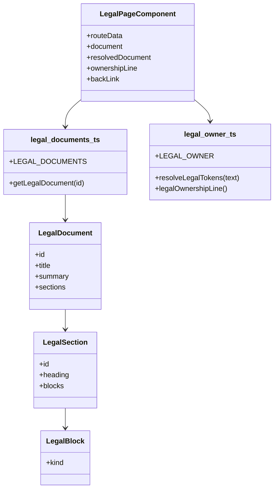

**API contracts** – _Not applicable for this module._ (no HTTP call).

**Frontend logic – `LegalPageComponent`**
1. `routeData` = `toSignal(route.data.pipe(map(d => d['documentId'])))`.
2. `document` (`computed`) = `getLegalDocument(id)` (`Array.find` in `LEGAL_DOCUMENTS`); undefined → fallback
   "Legal document not found" / "The document you requested is not available." (FR-LEGAL-07).
3. `resolvedDocument` deep-clones the document and runs `resolveLegalTokens()` over title, summary, headings and every
   block text, so owner values come from the single owner record (FR-LEGAL-05).
4. `ownershipLine` = `legalOwnershipLine()` → "© 2026 Jojo George. All Rights Reserved." (FR-LEGAL-03).
5. **Contents** anchors `#section.id` scroll to the section (FR-LEGAL-04).
6. `backLink`: signed in → `{ path: dashboardRouteFor(user.role), label: 'Back to the application' }`, otherwise
   `{ path: '/login', label: 'Back to sign in' }` (FR-LEGAL-06).
7. All text is rendered through Angular interpolation (HTML-escaped; no `innerHTML`); nothing is stored or sent
   (FR-LEGAL-08).

**Sequence diagram**

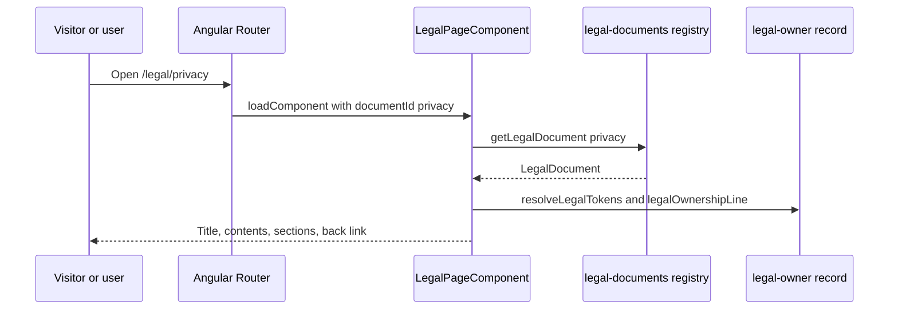

**Validation rules / error cases**

| Case | Handling | Status |
|---|---|---|
| Route without a matching registry entry | Not-found fallback in the page | – (client) |
| Any other `/legal/...` path | Root wildcard `**` → `/login` | – (client) |

#### 4.2.2 Child module: Legal Footer and Ownership Notice

**Class / file inventory**

| Layer | Type | File | Responsibility |
|---|---|---|---|
| Shared component | `LegalFooterComponent` (`app-legal-footer`), `LegalFooterVariant` = `'surface'` / `'dark'` | `shared/components/legal-footer/legal-footer.component.ts` / `.html`, `legal-footer.model.ts` | Ownership line "… · TaskFlow — Intelligent Task Allocation & Tracking System." and five links in the fixed order built from `LEGAL_DOCUMENTS` (FR-LEGAL-12 – FR-LEGAL-14) |
| Consumers | `ShellComponent` (`variant="surface"`), `LoginComponent` (`variant="dark"`), `AccountRecoveryComponent` (`variant="dark"`) | `layouts/shell.component.html`, `modules/auth/login/pages/login.component.html`, `modules/auth/account-recovery/pages/account-recovery.component.ts` | Embed the footer; legal pages do not (FR-LEGAL-15) |
| Metadata | `AppComponent.ngOnInit` | `app.component.ts` | `Title.setTitle('TaskFlow — Intelligent Task Allocation & Tracking System')`; `Meta.updateTag` for `author` "Jojo George", `description` (`LEGAL_APPLICATION.description`), `copyright` (`legalOwnershipLine()`) (FR-LEGAL-16) |

**API contracts** – _Not applicable for this module._

**Sequence diagram**

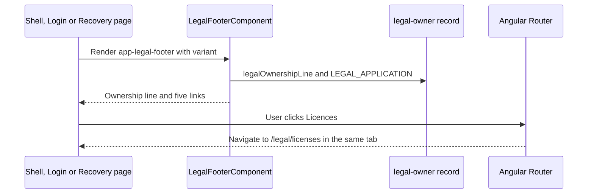

---

## 5. Database Design

SQLite through EF Core 10; one `AppDbContext` (`Persistence/AppDbContext.cs`) with 31 `DbSet`s. Soft delete with
global query filters on `Users`, `Projects`, `Departments` (and dependent filters on `RefreshTokens`,
`UserProjectAllocations`, `UserDepartments`). Timestamps are UTC `TEXT`; booleans `INTEGER`.

### 5.1 ER Diagram

The 31 entities are split into five diagrams (≤ 14 nodes each); `Users` appears in each. Detail of every table outside
the shared identity tables is in the owning sub-module LLD (table in 5.2.2).

**5.1.1 Identity and access (shared – this document)**

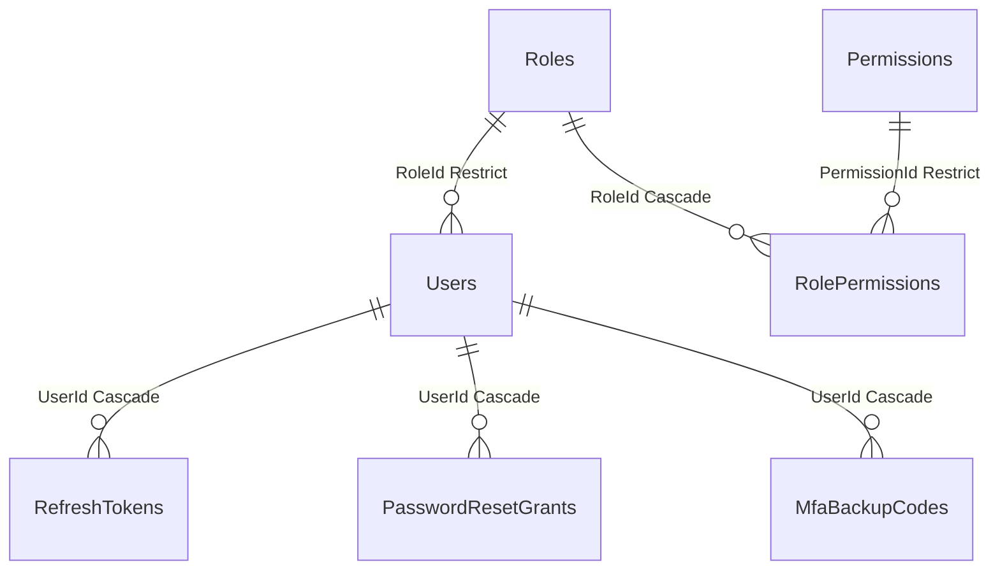

**5.1.2 Organisation (Employee, Project, Department Management)**

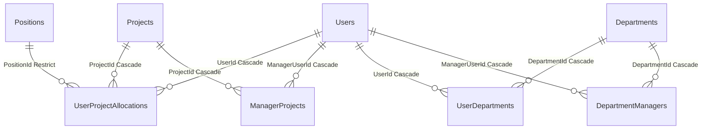

**5.1.3 Tasks, notifications and reminders (Task Management, Notification, Settings)**

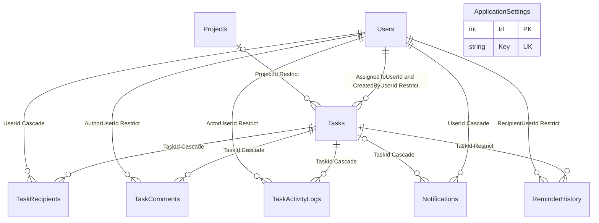

**5.1.4 Mail**

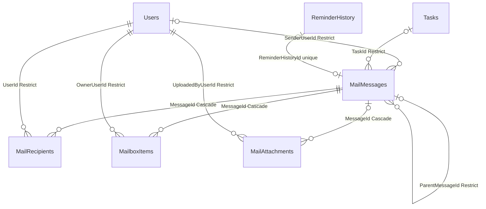

**5.1.5 TFA Assistant and TFA Settings**

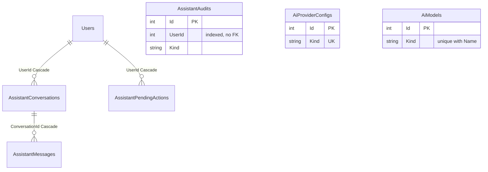

### 5.2 Tables

#### 5.2.1 Shared identity and access tables

#### `Users` (User)

| Column | Type | Null | Key / index | Default | Description |
|---|---|:---:|---|---|---|
| Id | int (INTEGER) | No | PK | identity | JWT subject, challenge user id |
| EmployeeCode | string(32) (TEXT) | Yes | – | – | Employee code |
| FullName | string(200) (TEXT) | No | – | `""` | Display name |
| Username | string(100) (TEXT) | No | Unique `IX_Users_Username` | `""` | Sign-in name (matched exactly) |
| Email | string(256) (TEXT) | No | Unique `IX_Users_Email` | `""` | Sign-in email, stored lower-case `@taskflow.com` (`EmailPolicy`) |
| MobileNumber | string(20) (TEXT) | Yes | – | – | E.164 number (`MobileNumberPolicy`) |
| MfaSecretProtected | string(512) (TEXT) | Yes | – | – | Data-Protection-encrypted TOTP key (purpose `TaskFlow.MfaSecrets`) |
| MfaEnabledAt | DateTime (TEXT) | Yes | – | – | MFA on since; null = off |
| MfaLastUsedStep | long (INTEGER) | No | Concurrency token | 0 | Last accepted TOTP step (replay protection) |
| MfaFailedAttempts | int (INTEGER) | No | Concurrency token | 0 | Consecutive wrong codes |
| MfaLockedUntil | DateTime (TEXT) | Yes | – | – | Code lockout end |
| PasswordHash | string (TEXT) | No | – | `""` | `PasswordHasher<User>` (PBKDF2) |
| SecurityStamp | string(64) (TEXT) | No | – | `""` | Rotated on password change, reset, MFA reset; compared with JWT `sstamp` |
| RoleId | int (INTEGER) | No | FK → `Roles.Id` (Restrict), `IX_Users_RoleId` | – | Role |
| IsActive | bool (INTEGER) | No | – | true | Inactive users cannot sign in or keep a session |
| CreatedAt / UpdatedAt | DateTime (TEXT) | No | – | – | UTC audit times |
| LastLoginAt | DateTime (TEXT) | Yes | – | – | Last successful sign-in |
| IsDeleted | bool (INTEGER) | No | Global query filter `!IsDeleted` | false | Soft delete |

Navigation collections (not columns): `ProjectAllocations`, `DepartmentMemberships`, `ManagerProjects`,
`ManagedDepartments`, `RefreshTokens`, `MfaBackupCodes`.

#### `Roles` (Role)

| Column | Type | Null | Key / index | Default | Description |
|---|---|:---:|---|---|---|
| Id | int (INTEGER) | No | PK | identity; system ids 1, 2, 3 | `SystemRoles.AdministratorId` 1, `ManagerId` 2, `EmployeeId` 3 |
| Name | string(100) (TEXT, collation `NOCASE`) | No | Unique `IX_Roles_Name` | `""` | Case-insensitive unique |
| IsSystem | bool (INTEGER) | No | – | false | System roles are read-only (triggers) |
| CreatedAt | DateTime (TEXT) | No | – | – | UTC |

#### `Permissions` (Permission)

| Column | Type | Null | Key / index | Default | Description |
|---|---|:---:|---|---|---|
| Id | int (INTEGER) | No | PK | identity | – |
| Key | string(100) (TEXT) | No | Unique `IX_Permissions_Key` | `""` | Permission key, e.g. `employees.mfa.reset` |
| Name | string(200) (TEXT) | No | – | `""` | Display name |
| Description | string(500) (TEXT) | No | – | `""` | Description |
| Group | string(100) (TEXT) | No | – | `""` | Catalogue module |
| IsAssignable | bool (INTEGER) | No | – | true | False = Administrator only |

#### `RolePermissions` (RolePermission)

| Column | Type | Null | Key / index | Default | Description |
|---|---|:---:|---|---|---|
| RoleId | int (INTEGER) | No | PK (`RoleId`, `PermissionId`); FK → `Roles.Id` Cascade | – | Role |
| PermissionId | int (INTEGER) | No | PK; FK → `Permissions.Id` Restrict; `IX_RolePermissions_PermissionId` | – | Granted permission |

#### `RefreshTokens` (RefreshToken)

| Column | Type | Null | Key / index | Default | Description |
|---|---|:---:|---|---|---|
| Id | int (INTEGER) | No | PK | identity | – |
| UserId | int (INTEGER) | No | FK → `Users.Id` Cascade; `IX_RefreshTokens_UserId` | – | Owner; query filter hides tokens of deleted users |
| TokenHash | string (TEXT) | No | `IX_RefreshTokens_TokenHash` | `""` | SHA-256 hex of the cookie value |
| ExpiresAt | DateTime (TEXT) | No | – | – | now + `Jwt:RefreshTokenDays` |
| CreatedAt | DateTime (TEXT) | No | – | – | Issued |
| RevokedAt | DateTime (TEXT) | Yes | – | – | Set on rotation, logout, password change / reset, MFA reset, custom-role grant change |

#### `PasswordResetGrants` (PasswordResetGrant)

| Column | Type | Null | Key / index | Default | Description |
|---|---|:---:|---|---|---|
| Id | int (INTEGER) | No | PK | identity | – |
| UserId | int (INTEGER) | No | FK → `Users.Id` Cascade; `IX_PasswordResetGrants_UserId_UsedAt` (`UserId`, `UsedAt`) | – | Owner |
| TokenHash | string(64) (TEXT) | No | `IX_PasswordResetGrants_TokenHash` | `""` | SHA-256 hex of the reset token |
| CreatedAt | DateTime (TEXT) | No | – | – | Issued |
| ExpiresAt | DateTime (TEXT) | No | – | – | Issued + 10 minutes |
| UsedAt | DateTime (TEXT) | Yes | Concurrency token | – | Spent or cancelled |

#### `MfaBackupCodes` (MfaBackupCode)

| Column | Type | Null | Key / index | Default | Description |
|---|---|:---:|---|---|---|
| Id | int (INTEGER) | No | PK | identity | – |
| UserId | int (INTEGER) | No | FK → `Users.Id` Cascade; `IX_MfaBackupCodes_UserId_CodeHash` (`UserId`, `CodeHash`) | – | Owner |
| CodeHash | string(64) (TEXT) | No | (in the index above) | `""` | SHA-256 hex of the normalised 10-character code |
| CreatedAt | DateTime (TEXT) | No | – | – | Issued |
| UsedAt | DateTime (TEXT) | Yes | Concurrency token | – | Spent |

#### 5.2.2 All entities – owning LLD

| # | Entity | Table (`DbSet`) | Owning LLD (column detail) | Notes |
|---|---|---|---|---|
| 1 | `User` | `Users` | This document (5.2.1); also Employee Management, My Profile | Soft delete |
| 2 | `RefreshToken` | `RefreshTokens` | This document; My Profile | – |
| 3 | `PasswordResetGrant` | `PasswordResetGrants` | This document | Only Account Recovery uses it |
| 4 | `MfaBackupCode` | `MfaBackupCodes` | This document; My Profile | – |
| 5 | `Role` | `Roles` | This document; Role Configuration | Triggers |
| 6 | `Permission` | `Permissions` | This document; Role Configuration | Read-only catalogue |
| 7 | `RolePermission` | `RolePermissions` | This document; Role Configuration | Composite PK |
| 8 | `Project` | `Projects` | Project Management | Soft delete, filtered unique name |
| 9 | `ManagerProject` | `ManagerProjects` | Project Management | Composite PK |
| 10 | `Department` | `Departments` | Department Management | Soft delete, filtered unique name |
| 11 | `DepartmentManager` | `DepartmentManagers` | Department Management | Composite PK |
| 12 | `Position` | `Positions` | Project Management | Seeded 1 – 6, `NOCASE` unique name |
| 13 | `UserProjectAllocation` | `UserProjectAllocations` | Project Management (also Employee Management) | Check `CK_UserProjectAllocations_AllocationPercent` 1 – 100 |
| 14 | `UserDepartment` | `UserDepartments` | Department Management | Composite PK |
| 15 | `Task` | `Tasks` | Task Management | Unique `TaskCode`; `ActualHours` concurrency token |
| 16 | `TaskRecipient` | `TaskRecipients` | Task Management | Unique (`TaskId`, `UserId`) |
| 17 | `TaskComment` | `TaskComments` | Task Management | Index (`TaskId`, `CreatedAt`) |
| 18 | `TaskActivityLog` | `TaskActivityLogs` | Task Management | Index (`TaskId`, `CreatedAt`) |
| 19 | `Notification` | `Notifications` | Notification | Index (`UserId`, `IsRead`) |
| 20 | `ReminderHistory` | `ReminderHistory` | Notification | Unique dedup index |
| 21 | `ApplicationSetting` | `ApplicationSettings` | Application Settings (also Reminder Settings) | Unique `Key` |
| 22 | `MailMessage` | `MailMessages` | Mail | Filtered unique `ReminderHistoryId` |
| 23 | `MailRecipient` | `MailRecipients` | Mail | Unique (`MessageId`, `UserId`) |
| 24 | `MailboxItem` | `MailboxItems` | Mail | Unique (`MessageId`, `OwnerUserId`, `Folder`) |
| 25 | `MailAttachment` | `MailAttachments` | Mail | File stored under `Mail:AttachmentsPath` by `StorageKey` |
| 26 | `AiProviderConfig` | `AiProviderConfigs` | TFA Settings | Unique `Kind`; encrypted API key |
| 27 | `AiModel` | `AiModels` | TFA Settings | Unique (`Kind`, `Name`) |
| 28 | `AssistantConversation` | `AssistantConversations` | Assistant | – |
| 29 | `AssistantMessage` | `AssistantMessages` | Assistant | – |
| 30 | `AssistantPendingAction` | `AssistantPendingActions` | Assistant | Guid PK |
| 31 | `AssistantAudit` | `AssistantAudits` | Assistant | Index (`UserId`, `At`) |

### 5.3 Indexes, Constraints & Triggers (shared tables)

| Object | Definition | Purpose |
|---|---|---|
| `IX_Users_Username`, `IX_Users_Email` | Unique (`Username`), unique (`Email`) | Sign-in lookup, uniqueness |
| `IX_Users_RoleId` | (`RoleId`) | FK lookup, holder counts |
| Query filter `Users` | `!IsDeleted` | Soft delete; dependent filters on `RefreshTokens`, `UserProjectAllocations`, `UserDepartments` |
| Concurrency tokens | `Users.MfaLastUsedStep`, `Users.MfaFailedAttempts`, `MfaBackupCodes.UsedAt`, `PasswordResetGrants.UsedAt` | A code or a reset token wins a race exactly once |
| `IX_RefreshTokens_TokenHash`, `IX_RefreshTokens_UserId` | (`TokenHash`), (`UserId`) | Refresh / logout lookup; revoke all |
| `IX_PasswordResetGrants_TokenHash`, `IX_PasswordResetGrants_UserId_UsedAt` | (`TokenHash`), (`UserId`, `UsedAt`) | Reset lookup; cancel other open grants |
| `IX_MfaBackupCodes_UserId_CodeHash` | (`UserId`, `CodeHash`) | Backup code lookup |
| `IX_Roles_Name` | Unique (`Name`), `NOCASE` | Case-insensitive role names |
| `IX_Permissions_Key` | Unique (`Key`) | One row per key |
| `IX_RolePermissions_PermissionId` | (`PermissionId`) | FK lookup |
| `TR_Roles_SystemNoUpdate`, `TR_Roles_SystemNoDelete` | BEFORE UPDATE / DELETE ON `Roles` WHEN `OLD.IsSystem = 1` → `RAISE(ABORT, ...)` | System roles read-only |
| `TR_Permissions_NoUpdate`, `TR_Permissions_NoDelete` | BEFORE UPDATE / DELETE ON `Permissions` | Catalogue read-only |
| `TR_RolePermissions_SystemNoUpdate`, `TR_RolePermissions_SystemNoDelete` | BEFORE UPDATE / DELETE ON `RolePermissions` for system roles | Inserts stay allowed so the seeder can add grants |

Indexes, checks and filters of the other tables: see the owning LLD (5.2.2).

### 5.4 Enumerations

All enums in `Models/Enums/` (facts.md §6) and how they are stored:

| Enum | Values | Stored as | Owning LLD |
|---|---|---|---|
| `TaskStatus` | ToDo, InProgress, Blocked, Completed, Cancelled, InQA | INTEGER (0 – 5; InQA appended last) in `Tasks.Status` | Task Management, Board |
| `TaskPriority` | Low, Medium, High, Critical | INTEGER (0 – 3) | Task Management |
| `ReminderFrequency` | Daily, Weekly | INTEGER in `Tasks.OverdueReminderFrequency` | Task Management, Reminder Settings |
| `TaskActivityEventType` | Created, Assigned, Reassigned, StatusChanged, DeadlineChanged, PriorityChanged, Completed, CommentAdded, Administrative, HoursLogged, TimeLogged, Deleted, CommentEdited, CommentDeleted | TEXT (name, max 32) | Task Management |
| `NotificationType` | TaskAssigned, Reassigned, DeadlineReminder, Overdue, System, TaskComment | TEXT (max 32); `System` used by Account Recovery and the MFA reset | Notification |
| `ReminderType` | FirstReminder, SecondReminder, DueToday, Overdue | TEXT (max 32) | Notification |
| `ReminderStatus` | Pending, Sent, Failed, Skipped | TEXT (max 32) | Notification |
| `MailFolder` | Inbox, Sent, Drafts | TEXT (max 16) | Mail |
| `MailRecipientKind` | To, Cc | TEXT (max 8) | Mail |
| `AiProviderKind` | Ollama, Gemini, OpenAI | TEXT (max 16) in `AiProviderConfigs`, `AiModels`, `AssistantMessages.ProviderKind` | TFA Settings, Assistant |
| `AssistantMessageRole` | User, Assistant, Tool | TEXT (max 16) | Assistant |
| `AssistantActionKind` | SendMail, UpdateOwnProfile, ChangeUserRole | TEXT (max 32) | Assistant |
| `AssistantActionStatus` | Pending, Confirmed, Cancelled, Expired, Refused, Failed | TEXT (max 16) | Assistant |
| `ProviderFailureKind` | RateLimited, InvalidKey, Timeout, Unreachable, ModelUnavailable, Unexpected | Not stored (provider error mapping) | TFA Settings, Assistant |

Auth-only result enums (not stored): `MfaVerifyOutcome` (Success, Invalid, LockedOut – `Dtos/Auth/Mfa/MfaResults.cs`),
`RecoveryVerifyStatus` (Verified, Failed, Throttled); shared: `RoleFailure` (NotFound, Invalid, ReadOnly, Duplicate,
InUse).

### 5.5 Migrations

All 21 migrations in `Persistence/Migrations/`, applied by `Database.MigrateAsync()` at start-up:

| # | Migration | Change |
|---|---|---|
| 1 | `20261011171611_InitialAuth` | `Users`, `RefreshTokens` |
| 2 | `20261012104823_AddDepartmentsAndUserDepartment` | `Departments`, `Users.DepartmentId` (reshaped by 15 and 18) |
| 3 | `20261012124843_AddTasks` | `Tasks`, `TaskRecipients` |
| 4 | `20261012173144_AddUserSecurityStamp` | `Users.SecurityStamp` |
| 5 | `20261013075057_AddTaskTracking` | `TaskComments`, `TaskActivityLogs`, `Notifications` |
| 6 | `20261013104629_AddTaskReminderSettings` | `Tasks.FirstReminderDays`, `SecondReminderDays`, `OverdueReminderFrequency`; removes duplicate assignee / creator columns |
| 7 | `20261017062735_AddReminderEngine` | `ApplicationSettings`, `ReminderHistory` with the dedup index |
| 8 | `20261017074817_AddEmailDelivery` | `EmailDeliveryLogs` (SMTP – superseded) |
| 9 | `20261017090431_AddInternalMail` | Drops `EmailDeliveryLogs` and the SMTP settings; adds `MailMessages`, `MailRecipients`, `MailboxItems`, `MailAttachments` |
| 10 | `20261018183210_AddAssistant` | `AiProviderConfigs`, `AssistantConversations`, `AssistantMessages`, `AssistantPendingActions`, `AssistantAudits` |
| 11 | `20261019133820_AddRolesAndPermissions` | `Roles`, `Permissions`, `RolePermissions`, system roles; `Users.Role` → `Users.RoleId`; rotates security stamps; the six triggers |
| 12 | `20261019163241_AddAiModels` | `AiModels` |
| 13 | `20261019173718_NormalizeEmailDomain` | Data migration: every email moved to `@taskflow.com` (idempotent, irreversible) |
| 14 | `20261019174259_AddManagerAssignments` | Manager link table and `Users.ManagerId` (reshaped by 15 and 18) |
| 15 | `20261020173455_RenameDepartmentsToProjectsAndAddDepartments` | Old departments become `Projects` / `ManagerProjects`; new `Departments`, `DepartmentManagers` |
| 16 | `20261021070943_FixDepartmentFollowUps` | Grants `projects.*` to roles that held the old `departments.*` keys; indexes |
| 17 | `20261023101938_AddMfaAndAccountRecovery` | `MfaBackupCodes`, `PasswordResetGrants`; `Users.MfaSecretProtected`, `MfaEnabledAt`, `MfaLastUsedStep`, `MfaFailedAttempts`, `MfaLockedUntil`, `MobileNumber` |
| 18 | `20261023160825_UserProjectAllocationsAndDepartments` | `Positions` (seeded), `UserProjectAllocations`, `UserDepartments`; drops `Users.ProjectId`, `DepartmentId`, `ManagerId` |
| 19 | `20261023173211_AddProjectManagerFlag` | `UserProjectAllocations.IsProjectManager` |
| 20 | `20261024074305_AddTaskActualHours` | `Tasks.ActualHours` |
| 21 | `20261024122725_AddTaskCommentEditDelete` | `TaskComments.EditedAt`, `TaskComments.IsDeleted` |

Seeders after migration: `SettingsInitializer`, `AccessControlSeeder`, `AiProviderSeeder`, `DatabaseSeeder` (demo
accounts only when `Seed:Enabled`).

---

## 6. Algorithms & Background Jobs

| Job / algorithm | Trigger / schedule | Steps | Idempotency |
|---|---|---|---|
| Session validation (`SessionValidation`) | Every authenticated request | Section 3.4 | Read-only |
| MFA gate (`MfaSetupGateMiddleware`) | Every authenticated `/api` request | Section 3.3 | Stateless |
| TOTP (`Totp`, `Base32`) | Code step, recovery, setup, check | HMAC-SHA1, 6 digits, 30 s period, window current ±1, constant-time compare; accepted step must be greater than `MfaLastUsedStep` | Step stored; concurrency token |
| Code lockout (`MfaService`) | Wrong code | `MfaFailedAttempts` + 1; at `Mfa:MaxFailedAttempts` (5) set `MfaLockedUntil` = now + `Mfa:LockoutMinutes` (5); success resets | Concurrency token |
| Attempt limiter (`AttemptLimiter`, singleton, in memory) | Recovery verify; password re-entry for MFA setup | Sliding 5-minute window; 5 per account key, 20 per address (IPv6 pooled by /64, IPv4-mapped normalised); at most 10 000 keys (oldest evicted); idle keys swept | Reset on success; lost on restart |
| Refresh-token rotation (`AuthService.RefreshAsync`) | Every refresh | Revoke presented token, issue a new pair | A used token is refused |
| Reset token (`PasswordRecoveryService`) | Recovery step 1 | 32 random bytes Base64Url, SHA-256 hex stored, 10-minute single use | `UsedAt` concurrency token |
| Permission expansion (`EffectivePermissions.Expand`) | Sign-in, refresh, every request | Legacy key → finer keys; scope group → lower ranks | Pure function |
| Access-control seeding (`AccessControlSeeder`) | Every start | Ensure system roles; insert missing catalogue permissions; grant all to Administrator; first-time defaults to Manager / Employee | Inserts only |
| Reminder scheduler (`ReminderSchedulerService`, hosted service) | Every `Reminders:TickSeconds` (60 s) when `Reminders:SchedulerEnabled` | Designed in the Notification LLD | Unique index on `ReminderHistory` |

---

## 7. Security Design (detailed)

| Item | Implementation |
|---|---|
| Password hashing | ASP.NET Core Identity `PasswordHasher<User>` (PBKDF2, salted); rehash on `SuccessRehashNeeded` |
| Access token | JWT HMAC-SHA256 with `Jwt:Key`; issuer `Jwt:Issuer`; lifetime `Jwt:AccessTokenMinutes` (30); claims `sub`, `NameIdentifier`, `Name`, `Role`, `sstamp`, `jti`; kept in memory by `TokenStore` |
| Refresh token | 64 random bytes; cookie `taskflow_refresh`, HttpOnly, Secure, SameSite Strict, path `/api/v1/auth`, `Jwt:RefreshTokenDays` (7); stored only as SHA-256 hex; rotated on every refresh |
| Session revocation | `SecurityStamp` rotation + revoke all refresh tokens on password change, password reset and MFA reset; stamp and active flag checked on every request |
| MFA | TOTP key encrypted with Data Protection (`TaskFlow.MfaSecrets`); sign-in challenge protected with `TaskFlow.MfaChallenge`, bound to user id and stamp, `Mfa:ChallengeMinutes` (5); key ring under `AiProviders:KeyRingPath` (DPAPI-protected on Windows); backup codes SHA-256 hashed, single use |
| Mandatory enrolment | `Mfa:Required` + `MfaSetupGateMiddleware` (server) + `mfaSetupGuard` (client) |
| Anti-enumeration | Login: bare 401 for every failure; recovery: one message for every failure; recovery code failures do not lock the owner's sign-in |
| Throttling | `AttemptLimiter` (recovery, password re-entry); code lockout; assistant per-minute limit (Assistant LLD). Password sign-in itself has no attempt limit (section 10) |
| Permission checks | Policy per endpoint (`perm:{key}`), claims refreshed per request; `TaskAccess` resource handler; service re-checks and own-data scoping; denied actions logged |
| Transport / browser | HTTPS redirection; CORS `SpaClient` with explicit origins and credentials; forwarded headers trusted only from known proxies |
| Output safety | ProblemDetails only carry safe `AppException` messages; 500s are generic; Angular interpolation escapes all text |
| Secrets | `Jwt:Key`, connection string, seed passwords, AI API keys are not in `appsettings.json` (environment / `appsettings.Environment.json`; AI keys encrypted in `AiProviderConfigs.EncryptedApiKey`); request bodies are never logged |

---

## 8. Configuration

`appsettings.json` keys (facts.md §8) plus keys read with code defaults. Secrets are shown as `<secret>`.

| Key | Default | Purpose |
|---|---|---|
| `Logging:LogLevel:Default` | `Information` | Default log level |
| `Logging:LogLevel:Microsoft.AspNetCore` | `Warning` | Framework log level |
| `ConnectionStrings:Default` | `<secret>` | SQLite database (file under the storage root) |
| `Storage:Root` | `""` → `C:\TaskFlow` (Windows) or the common application data folder | Data folder for database, key ring, attachments |
| `Jwt:Issuer` | `TaskFlow` | Token issuer, validated |
| `Jwt:Key` | `<secret>` | HMAC signing key (environment / `appsettings.Environment.json` only) |
| `Jwt:AccessTokenMinutes` | `30` | Access token lifetime |
| `Jwt:RefreshTokenDays` | `7` | Refresh token / cookie lifetime |
| `Application:Timezone` | `Asia/Kolkata` | Seeds and backs up the `Application.Timezone` setting |
| `Reminders:SchedulerEnabled` | `true` | Runs `ReminderSchedulerService` |
| `Reminders:TickSeconds` | `60` | Scheduler tick |
| `Mail:AttachmentsPath` | `mail-attachments` | Attachment folder under the storage root |
| `Mail:AppBaseUrl` | – (code, optional) | Base URL for links in mail |
| `Proxy:KnownProxies` | `[]` | Trusted reverse proxies for `X-Forwarded-For` |
| `Cors:AllowedOrigins` | – (environment file) | SPA origins of policy `SpaClient` |
| `Mfa:Issuer` | `TaskFlow` | Name shown in the authenticator app |
| `Mfa:Required` | `true` | Mandatory MFA (break-glass `Mfa__Required=false`) |
| `Mfa:MaxFailedAttempts` | `5` (code) | Wrong codes before lockout |
| `Mfa:LockoutMinutes` | `5` (code) | Lockout length |
| `Mfa:BackupCodeCount` | `10` (code) | Backup codes per set |
| `Mfa:ChallengeMinutes` | `5` (code) | Sign-in challenge lifetime |
| `AiProviders:KeyRingPath` | `<secret>` (default folder `dp-keys`) | Data Protection key ring (AI keys, MFA keys, challenges) |
| `AiProviders:TimeoutSeconds` | `60` | AI provider HTTP timeout |
| `Seed:Enabled` | `false` (code) | Demo accounts on start |
| `Seed:AdministratorPassword`, `Seed:ManagerPassword`, `Seed:EmployeePassword` | `<secret>` | Demo account passwords |
| `AllowedHosts` | `*` | Host filtering |

Frontend: API base URL in `config/api-base-url.ts` (`apiBaseUrlInterceptor`); `SESSION_CHECK_INTERVAL_MS` = 15 000 in
the shell. Hard-coded: `RefreshTokenCookie.Name` `taskflow_refresh`, `PasswordRecoveryService.TokenLifetime` 10 min,
`AttemptLimiter` limits.

---

## 9. Testing Design

Two backend test projects under `backend/tests/` (150 files in `tests-filelist.json`): `TaskFlow.UnitTests` (xUnit,
service and rule tests with in-memory SQLite harnesses) and `TaskFlow.IntegrationTests` (`TaskFlowApiFactory` –
`WebApplicationFactory<Program>` end-to-end over HTTP). No frontend spec files are in the snapshot; `npm test` runs
`check:structure` and `ng test` (Karma / Jasmine).

| Area | Test class / file | Type | Covers |
|---|---|---|---|
| Architecture | `TaskFlow.UnitTests/Architecture/ArchitectureTests.cs` | Unit | Layer rules (2.3) |
| Exceptions | `TaskFlow.UnitTests/Common/AppExceptionTests.cs` | Unit | Status, title, `Retry-After` of `AppException` types |
| Exception handler | `TaskFlow.IntegrationTests/Common/GlobalExceptionHandlerTests.cs` | Integration | ProblemDetails mapping, generic 500 |
| API conventions | `TaskFlow.IntegrationTests/Common/ApiConventionsTests.cs` | Integration | Attributes and conventions on every controller |
| DI | `TaskFlow.IntegrationTests/Common/DependencyInjectionTests.cs` | Integration | Every registered type resolves |
| Forwarded headers | `TaskFlow.IntegrationTests/Common/ForwardedHeadersTests.cs` | Integration | Trusted proxies only |
| Key ring | `TaskFlow.IntegrationTests/Common/KeyRingStartupWarningTests.cs`; `TaskFlow.UnitTests/Integrations/Ai/KeyProtection/KeyRingProtectionCheckTests.cs` | Integration / Unit | Start-up warnings |
| Permissions | `TaskFlow.IntegrationTests/Common/PermissionAuthorizationTests.cs`, `ModuleBasedPermissionEndpointsTests.cs`; `TaskFlow.UnitTests/Settings/RoleConfiguration/PermissionCatalogTests.cs` | Integration / Unit | `perm:*` policies, catalogue |
| Authentication wiring | `TaskFlow.IntegrationTests/Common/AuthenticationWiringTests.cs` | Integration | JWT validation, `SessionValidation` |
| Login and sessions | `TaskFlow.IntegrationTests/Auth/Login/AuthEndpointsTests.cs`; `TaskFlow.UnitTests/Auth/Login/AuthServiceLoginTests.cs`, `AuthServiceRefreshAndLogoutTests.cs` (harness `AuthServiceHarness.cs`) | Integration / Unit | Actions 1, 3, 6, 7 |
| MFA sign-in | `TaskFlow.IntegrationTests/Auth/Mfa/MfaSignInEndpointsTests.cs`; `TaskFlow.UnitTests/Auth/Mfa/AuthServiceMfaTests.cs` | Integration / Unit | Action 2, challenge, lockout |
| MFA core | `TaskFlow.UnitTests/Auth/Mfa/MfaServiceTests.cs`; `TaskFlow.UnitTests/Integrations/Security/OneTimeCodes/TotpTests.cs` | Unit | TOTP, backup codes, lockout |
| Account recovery | `TaskFlow.IntegrationTests/Auth/PasswordRecovery/PasswordRecoveryEndpointsTests.cs`, `TaskFlow.IntegrationTests/Auth/Mfa/MfaRecoveryEndpointsTests.cs`; `TaskFlow.UnitTests/Auth/PasswordRecovery/PasswordRecoveryServiceTests.cs`; `TaskFlow.UnitTests/Auth/AttemptLimits/AttemptLimiterTests.cs` | Integration / Unit | Actions 4, 5, throttling |
| Security Setup | `TaskFlow.IntegrationTests/Auth/Mfa/MfaEnrolmentEndpointsTests.cs`, `MfaSetupGateEndpointsTests.cs`, `MfaStepUpEndpointsTests.cs`, `MfaAdminResetEndpointsTests.cs` | Integration | Enrolment via `ProfileController`, gate, step-up, admin reset |
| Tokens | `TaskFlow.UnitTests/Integrations/Security/Tokens/JwtTokenServiceTests.cs` | Unit | JWT claims, refresh token |
| Time | `TaskFlow.UnitTests/Settings/ApplicationSettings/Clock/AppClockTests.cs` | Unit | Time zone fallback |
| Persistence | `TaskFlow.UnitTests/Persistence/RolesMigrationTests.cs`, `EmailDomainMigrationTests.cs`, `DepartmentFollowUpMigrationTests.cs`, `UserProjectAllocationsMigrationTests.cs`, `DatabaseSeederTests.cs`, `SettingsInitializerTests.cs`, `StorageRootTests.cs` | Unit | Migrations, seeders, storage root |
| Shared rules | `TaskFlow.UnitTests/Common/EmailDomainTests.cs`, `MobileNumberPolicyTests.cs`, `TaskBucketRulesTests.cs` | Unit | `EmailPolicy`, `MobileNumberPolicy`, buckets |
| Test support | `TaskFlow.IntegrationTests/TestSupport/TaskFlowApiFactory.cs`, `MfaTestSupport.cs`, `CapturingLoggerProvider.cs`, `ScriptedChatProvider.cs`, `WindowsOnlyFactAttribute.cs`; `TaskFlow.UnitTests/TestSupport/*` (`FakeTimeProvider`, `TestAccessControl`, `AcceptingMfaService`, harnesses) | Support | Factories, fakes, harnesses |
| Legal | None | – | No backend code; no frontend spec in the snapshot |

Module tests: see section 9 of each sub-module LLD.

---

## 10. Known Limitations & Open Issues

- Password sign-in (`POST /api/v1/auth/login`) has no attempt limit or lockout; only codes, recovery and password
  re-entry are throttled.
- `AttemptLimiter` is in memory: a restart resets it and it is not shared between API instances.
- Refresh-token rotation does not detect reuse of a rotated token (no token-family revocation); a reused token is only
  refused.
- `FindByLoginForUpdateAsync` compares the identifier with `==` without lower-casing it, while emails are stored
  lower-case. > ⚠️ To be confirmed: whether a mixed-case email fails to sign in at runtime on SQLite.
- The login screen applies `Validators.email` and labels the field **Email**, so a plain username cannot be submitted
  from the UI although the API accepts it (FR-AUTH-01).
- > ⚠️ To be confirmed: the API accepts an unused backup code at `/api/v1/auth/mfa/verify`, but the code box has
  `maxlength="6"`, so 11-character `XXXXX-XXXXX` codes cannot be typed (FRD 4.1.2).
- `role-routes.ts` routes Administrator / Manager by role name before permissions; the legal back link calls
  `dashboardRouteFor(user.role)` without permissions, so a custom role with organization or team dashboard access is
  sent to `/me`.
- The Account Recovery note says "turned on two-step verification from your Profile", but setup happens on
  `/security-setup`; `auth.models.ts` comments still describe the reset as "SMS".
- `POST /api/v1/users/me/mfa/backup-codes` exists but no UI calls it (My Profile LLD).
- Legal: content is hard-coded (rebuild needed for changes, "Last updated" typed by hand); the not-found fallback cannot
  be reached by URL; `trackBlock` uses `block.kind`, so two blocks of the same kind in a section produce duplicate track
  keys; the footer's `aria-current` is never set because the footer is not rendered on legal pages.
- > ⚠️ To be confirmed: `login.component.css`, `security-setup.component.css`, `legal-page.component.css` and
  `legal-footer.component.css` are referenced by `styleUrl` but are not in the snapshot.
- > ⚠️ To be confirmed: bodies of `ArchitectureTests.cs` and `scripts/check-frontend-structure.mjs` (not in the
  snapshot).

---

## 11. Traceability (FRD → code)

| FRD requirement | Endpoint / class | Test |
|---|---|---|
| FR-AUTH-01 | `POST /api/v1/auth/login` · `AccountRepository.FindByLoginForUpdateAsync` (username or email) | `AuthServiceLoginTests`, `AuthEndpointsTests` |
| FR-AUTH-02 | `LoginRequestValidator` (256 / 128) · `LoginComponent` form validators | `AuthEndpointsTests` |
| FR-AUTH-03 | `AuthService.LoginAsync` → `AuthResult.Failure()` → 401 | `AuthServiceLoginTests`, `AuthEndpointsTests` |
| FR-AUTH-04 | `PasswordHasher<User>.VerifyHashedPassword`, rehash on `SuccessRehashNeeded` | `AuthServiceLoginTests` |
| FR-AUTH-05 | `LoginComponent` show / hide password | None (no frontend spec) |
| FR-AUTH-06 | `remembered-identifier.ts` (`taskflow.lastIdentifier`) | None (no frontend spec) |
| FR-AUTH-07 | `AuthService.LoginAsync` / `VerifyMfaAsync` set `Users.LastLoginAt` | `AuthServiceLoginTests`, `AuthServiceMfaTests` |
| FR-AUTH-08 | `AuthService.LoginAsync` → `AuthResult.RequiresMfa` · `MfaChallengeResponse` | `AuthServiceMfaTests`, `MfaSignInEndpointsTests` |
| FR-AUTH-09 | `dashboardRouteFor` / `ROLE_ROUTES` · `LoginComponent` `returnUrl` | None (no frontend spec) |
| FR-AUTH-10 | `UserDto.MfaSetupRequired` · `mfaSetupGuard` | `MfaSetupGateEndpointsTests` |
| FR-AUTH-11 | `LOGIN_REASON_MESSAGES` · `LoginComponent` notice | None (no frontend spec) |
| FR-AUTH-12 | `POST /api/v1/auth/mfa/verify` · `MfaSecretProtector.ReadChallenge` (5 min, stamp-bound) | `AuthServiceMfaTests`, `MfaSignInEndpointsTests` |
| FR-AUTH-13 | `MfaService.VerifyAsync` → `Totp.TryValidate` (±1 step, `MfaLastUsedStep`) | `MfaServiceTests`, `TotpTests` |
| FR-AUTH-14 | `MfaService` lockout (`Mfa:MaxFailedAttempts`, `Mfa:LockoutMinutes`) → 429 | `MfaServiceTests`, `MfaSignInEndpointsTests` |
| FR-AUTH-15 | `LoginComponent` clears code / password | None (no frontend spec) |
| FR-AUTH-16 | `POST /api/v1/auth/password-recovery/authenticator/verify` · `PasswordRecoveryService.VerifyAuthenticatorAsync` | `PasswordRecoveryServiceTests`, `MfaRecoveryEndpointsTests` |
| FR-AUTH-17 | `FindActiveByLoginForUpdateAsync`; `MfaEnabledAt` null → `Failed` | `PasswordRecoveryServiceTests` |
| FR-AUTH-18 | `VerifyAsync(allowBackupCode: false)` | `PasswordRecoveryServiceTests`, `MfaRecoveryEndpointsTests` |
| FR-AUTH-19 | `PasswordRecoveryController.FailureMessage` (one message) | `PasswordRecoveryEndpointsTests` |
| FR-AUTH-20 | `AttemptLimiter` (5 per account, 20 per address, 5 min) → 429 | `AttemptLimiterTests`, `PasswordRecoveryEndpointsTests` |
| FR-AUTH-21 | `VerifyAsync(countFailure: false)`; existing lock refuses | `PasswordRecoveryServiceTests` |
| FR-AUTH-22 | `IssueResetTokenAsync` (10 min) · `PasswordResetGrants.UsedAt` · `GetOtherUnusedForUpdateAsync` | `PasswordRecoveryServiceTests`, `PasswordRecoveryEndpointsTests` |
| FR-AUTH-23 | `POST /api/v1/auth/password-recovery/reset` · `RecoverPasswordRequestValidator` | `PasswordRecoveryEndpointsTests` |
| FR-AUTH-24 | `ResetPasswordAsync` – stamp rotation, `GetActiveForUsersForUpdateAsync` revoke | `PasswordRecoveryServiceTests` |
| FR-AUTH-25 | `INotificationPublisher.PublishAsync(NotificationType.System)` | `PasswordRecoveryServiceTests` |
| FR-AUTH-26 | `AccountRecoveryComponent` → `/login?reason=password-reset` | None (no frontend spec) |
| FR-AUTH-27 | 400 "This reset link is no longer valid…" · **Start over** | `PasswordRecoveryEndpointsTests` |
| FR-AUTH-28 | `MfaOptions.Required` · `SessionValidation` claim | `MfaSetupGateEndpointsTests` |
| FR-AUTH-29 | `MfaSetupGateMiddleware` (403 `mfa_setup_required`) | `MfaSetupGateEndpointsTests` |
| FR-AUTH-30 | `securitySetupGuard` | None (no frontend spec) |
| FR-AUTH-31 | `GET` / `PUT /api/v1/users/me` (My Profile LLD 4.1.1) · `SecuritySetupComponent` step 1 | `UserProfileEndpointsTests`, `UpdateOwnProfileRequestValidatorTests` |
| FR-AUTH-32 | `POST /api/v1/users/me/mfa/setup` (My Profile LLD 4.1.3) · limiter key `pwd:{id}` | `MfaEnrolmentEndpointsTests`, `MfaServiceTests` |
| FR-AUTH-33 | `SecuritySetupComponent` **Copy key** | None (no frontend spec) |
| FR-AUTH-34 | `POST /api/v1/users/me/mfa/enable` (My Profile LLD 4.1.3) | `MfaEnrolmentEndpointsTests`, `MfaServiceTests` |
| FR-AUTH-35 | `MfaService` "Authenticator MFA is already on…" | `MfaServiceTests` |
| FR-AUTH-36 | `MfaService` backup codes (`Mfa:BackupCodeCount`) · `MfaBackupCodes` | `MfaServiceTests`, `MfaEnrolmentEndpointsTests` |
| FR-AUTH-37 | `SecuritySetupComponent` step 3 check box | None (no frontend spec) |
| FR-AUTH-38 | `MfaSecretProtector.Protect`; `MfaBackupCodes.CodeHash` | `MfaServiceTests` |
| FR-AUTH-39 | `SecuritySetupComponent` **Sign out** → `POST /api/v1/auth/logout` | `AuthEndpointsTests` |
| FR-AUTH-40 | `SecuritySetupComponent` load error | None (no frontend spec) |
| FR-AUTH-41 | `IssueTokens` · `RefreshTokenCookie.CreateOptions` · `restoreSession` | `AuthEndpointsTests`, `JwtTokenServiceTests` |
| FR-AUTH-42 | `POST /api/v1/auth/refresh` · `authInterceptor` retry | `AuthServiceRefreshAndLogoutTests`, `AuthEndpointsTests` |
| FR-AUTH-43 | `AuthService.RefreshAsync` rotation, refusal of revoked / expired | `AuthServiceRefreshAndLogoutTests` |
| FR-AUTH-44 | `GET /api/v1/auth/me` · `ShellComponent` 15 s check · `SessionValidation` claims | `AuthEndpointsTests`, `AuthenticationWiringTests` |
| FR-AUTH-45 | `SessionValidation.ValidateAsync` · `SessionService.GetAsync` | `AuthenticationWiringTests` |
| FR-AUTH-46 | `POST /api/v1/auth/logout` · `AuthService.LogoutAsync` | `AuthServiceRefreshAndLogoutTests`, `AuthEndpointsTests` |
| FR-AUTH-47 | `authInterceptor` → `/login?reason=session-ended` | None (no frontend spec) |
| FR-AUTH-48 | `SecurityStamp` rotation + refresh-token revocation (recovery, My Profile, Employee Management) | `PasswordRecoveryServiceTests`, `MfaAdminResetEndpointsTests`, `AuthenticationWiringTests` |
| FR-AUTH-49 | `perm:*` policies · `RequirePermissionAttribute` · `DeniedActionAuditHandler` | `PermissionAuthorizationTests`, `ModuleBasedPermissionEndpointsTests` |
| FR-AUTH-50 | `nav-items.ts` · `permissionGuard` | None (no frontend spec) |
| FR-AUTH-51 | `routes/app.routes.ts` (public auth and legal routes, `**` → `login`) · `authGuard` | None (no frontend spec) |
| UC-AUTH-01 | Actions 1 – 3 · `AuthService` · `LoginComponent` | `AuthEndpointsTests`, `MfaSignInEndpointsTests` |
| UC-AUTH-02 | Actions 4 – 5 · `PasswordRecoveryService` · `AccountRecoveryComponent` | `PasswordRecoveryEndpointsTests`, `MfaRecoveryEndpointsTests` |
| UC-AUTH-03 | `SecuritySetupComponent` · `ProfileController` MFA actions · `MfaSetupGateMiddleware` | `MfaEnrolmentEndpointsTests`, `MfaSetupGateEndpointsTests` |
| UC-AUTH-04 | Action 6 · `SessionValidation` · `authInterceptor` · `ShellComponent` | `AuthServiceRefreshAndLogoutTests`, `AuthenticationWiringTests` |
| UC-AUTH-05 | Action 7 · `AuthService.LogoutAsync` | `AuthEndpointsTests` |
| FR-LEGAL-01 | `LEGAL_ROUTES` (5 routes) · `LEGAL_DOCUMENTS` | None (no frontend spec) |
| FR-LEGAL-02 | `LEGAL_ROUTES` registered outside the shell (no guard) | None (no frontend spec) |
| FR-LEGAL-03 | `LegalPageComponent` heading · `legalOwnershipLine()` | None (no frontend spec) |
| FR-LEGAL-04 | `LegalPageComponent` **Contents** anchors | None (no frontend spec) |
| FR-LEGAL-05 | `resolveLegalTokens` · `LEGAL_OWNER` | None (no frontend spec) |
| FR-LEGAL-06 | `LegalPageComponent.backLink` · `dashboardRouteFor` | None (no frontend spec) |
| FR-LEGAL-07 | `LegalPageComponent` not-found fallback | None (no frontend spec) |
| FR-LEGAL-08 | No backend, no write; interpolation only | None (no frontend spec) |
| FR-LEGAL-09 | `LEGAL_DOCUMENTS` – `privacy` (11 sections) | None (no frontend spec) |
| FR-LEGAL-10 | `LEGAL_DOCUMENTS` – `terms`, `privacy` | None (no frontend spec) |
| FR-LEGAL-11 | `LEGAL_DOCUMENTS` – `disclaimer` | None (no frontend spec) |
| FR-LEGAL-12 | `LegalFooterComponent` in shell, login, recovery | None (no frontend spec) |
| FR-LEGAL-13 | `LegalFooterComponent` links from `LEGAL_DOCUMENTS` | None (no frontend spec) |
| FR-LEGAL-14 | `legal-owner.ts` shared by footer and pages | None (no frontend spec) |
| FR-LEGAL-15 | Legal pages do not embed `app-legal-footer` | None (no frontend spec) |
| FR-LEGAL-16 | `AppComponent.ngOnInit` (`Title`, `Meta`) | None (no frontend spec) |
| UC-LEGAL-01 | `LegalPageComponent` | None (no frontend spec) |
| UC-LEGAL-02 | `LegalFooterComponent` → router | None (no frontend spec) |

**Coverage:** FR-AUTH-01 – FR-AUTH-51 (51 of 51) and FR-LEGAL-01 – FR-LEGAL-16 (16 of 16) trace to an endpoint or
class; 7 of 7 Authentication actions documented; all other requirements trace in their sub-module LLD (section 1.3).

---
<sub>© 2026 Jojo George. All rights reserved. Unauthorized copying or distribution of this document is prohibited.</sub>
