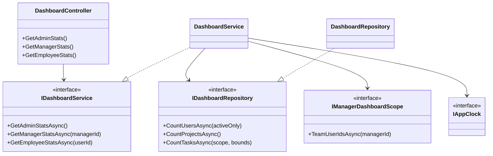
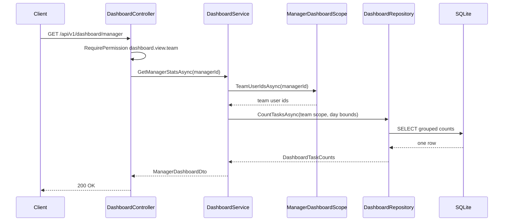
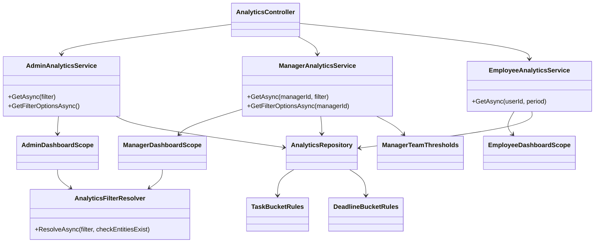
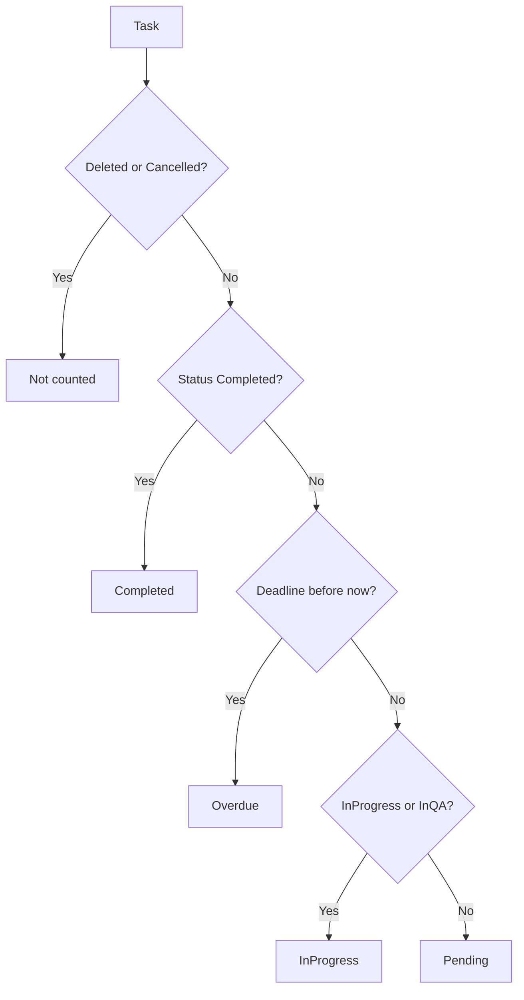
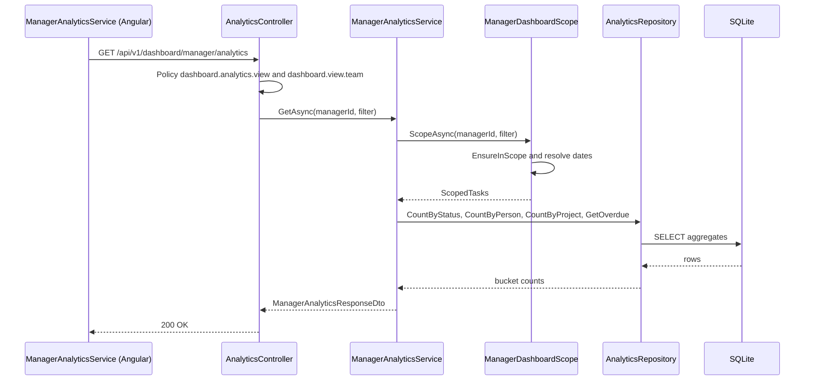
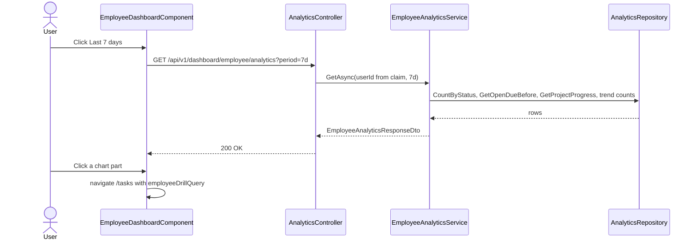
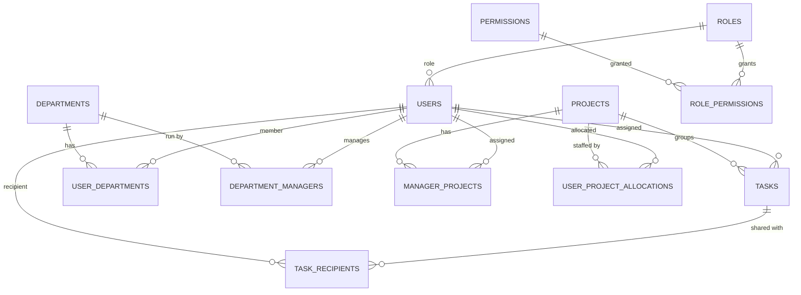

# Low-Level Design – Dashboard

## TaskFlow – Intelligent Task Allocation & Tracking System

> **Document:** Low-Level Design (sub-module 1 – DASH)  ·  **Version:** 1.0  ·  **Status:** Draft
> **Project type:** Personal Project (Skill Development)  ·  **Date:** 31-Oct-2026
> **Author:** Jojo George (jojogeorge3344@gmail.com)
> **Based on:** HLD – Dashboard v1.0, FRD – Dashboard v1.0 (FR-DASH-01 – FR-DASH-75), TaskFlow code as built
> © 2026 Jojo George. All rights reserved.

---

## Document Control

| Version | Date | Author | Summary of changes |
|---|---|---|---|
| 1.0 | 31-Oct-2026 | Jojo George | Initial version: Overview (route selection, counter endpoints) and Analytics (Administrator, Manager, Employee analytics, filters, drill-down rules), derived from and verified against the TaskFlow source code (backend, frontend and tests) |

**Related documents:** BRD – Dashboard (`../../../BRD/01-Dashboard/01.1-Dashboard/BRD-Dashboard.md`) · FRD – Dashboard
(`../../../FRD/01-Dashboard/01.1-Dashboard/FRD-Dashboard.md`) · HLD – Dashboard
(`../../../HLD/01-Dashboard/01.1-Dashboard/HLD-Dashboard.md`) · LLD – Overall (`../../00-Overall/LLD-TaskFlow-Overall.md`) ·
LLD – Task Management, drill-down target (`../../02-TaskFlow-Monitoring/02.1-Task-Management/LLD-Task-Management.md`) ·
TDD (`TF - Documents/TF - TDD/TDD-TaskFlow.md` v2.0)

---

## 1. Introduction

### 1.1 Purpose
Detailed design of the Dashboard sub-module: every controller action, the classes and files behind it, the DTOs, the
filter validation, the scope and bucket rules, the repository queries, the tables it reads, the tests, and the
traceability from FR-DASH-nn to endpoint, class and test. It is detailed enough to maintain the code without reading it
first.

### 1.2 Scope & Conventions
- Child modules: **Overview** (route selection, guards, the three page components, the counter endpoints of
  `DashboardController`) and **Analytics** (`AnalyticsController`, the three analytics services, the scopes, the shared
  bucket rules and the filter bar / chart components).
- **Endpoints in this sub-module: 8** (facts.md §3: `DashboardController` 3 + `AnalyticsController` 5). All are `GET`; the
  sub-module writes nothing.
- Naming: `*Controller`, `I*Service` / `*Service`, `I*Repository` / `*Repository`, DTOs `*Dto`, query records
  `AnalyticsFilter`; scopes `*DashboardScope`; shared rules `*Rules` in `Common/Rules`.
- API base path: `/api/v1/dashboard`; JSON camelCase with enums as names (`JsonStringEnumConverter`); errors as
  `ProblemDetails` (`application/problem+json`).
- Paths below are relative to `backend/src/TaskFlow.Api/` (backend) and `frontend/src/app/` (frontend).

---

## 2. Code Structure

### 2.1 Backend Folder Layout

```
TaskFlow.Api/
  Controllers/Dashboard/                 DashboardController.cs, AnalyticsController.cs
  Services/Dashboard/Overview/           IDashboardService.cs, DashboardService.cs
  Services/Dashboard/Analytics/Admin/    IAdminAnalyticsService.cs, AdminAnalyticsService.cs, AnalyticsBuckets.cs
  Services/Dashboard/Analytics/Manager/  IManagerAnalyticsService.cs, ManagerAnalyticsService.cs
  Services/Dashboard/Analytics/Employee/ IEmployeeAnalyticsService.cs, EmployeeAnalyticsService.cs
  Services/Dashboard/Analytics/Scopes/   IDashboardScope.cs, AdminDashboardScope.cs, IManagerDashboardScope.cs,
                                         ManagerDashboardScope.cs, IEmployeeDashboardScope.cs, EmployeeDashboardScope.cs,
                                         AnalyticsFilterResolver.cs, ResolvedAnalyticsFilter.cs, ScopedTasks.cs
  Repositories/Dashboard/Overview/       IDashboardRepository.cs, DashboardRepository.cs, DashboardTaskCounts.cs,
                                         DashboardDayBounds.cs, DashboardTaskScope.cs
  Repositories/Dashboard/Analytics/      IAnalyticsRepository.cs, AnalyticsRepository.cs, AnalyticsCounting.cs,
                                         AnalyticsTaskSet.cs, AnalyticsDateRange.cs, DashboardTaskFilters.cs,
                                         OverdueTaskRow.cs, DeadlineTaskRow.cs, ProjectProgressRow.cs, QuarterHourCount.cs
  Dtos/Dashboard/                        DashboardDto.cs
  Dtos/Dashboard/Analytics/              AnalyticsFilter.cs, AnalyticsDtos.cs, ManagerAnalyticsDtos.cs, EmployeeAnalyticsDtos.cs
  Common/Rules/                          TaskBucketRules.cs, DeadlineBucketRules.cs, ManagerTeamThresholds.cs (shared)
  Common/Exceptions/                     AnalyticsExceptions.cs
  Config/                                ServiceRegistration.cs, RepositoryRegistration.cs (DI, all scoped)
```

There is no FluentValidation validator in this sub-module: the analytics filter is validated in
`AnalyticsFilterResolver` and the employee period in `EmployeeAnalyticsService.ParsePeriod`.

### 2.2 Frontend Folder Layout

```
src/app/modules/dashboard/
  dashboard.routes.ts                    DASHBOARD_ROUTES: admin, manager, me
  pages/                                 admin-dashboard, manager-dashboard, employee-dashboard (.ts/.html)
  analytics/components/                  task-analytics (+ .model.ts), department-analytics, employee-analytics,
                                         manager-analytics, project-analytics, team-attention, team-task-analytics,
                                         team-employee-analytics
  analytics/services/                    dashboard-analytics.service.ts, manager-analytics.service.ts,
                                         employee-analytics.service.ts (each + .model.ts)
  analytics/models/analytics.model.ts    interfaces, ANALYTICS_BASES, EMPLOYEE_PERIODS
  components/                            dashboard-filter-bar.component.ts/.html
  components/charts/                     kpi-card, donut-chart, stacked-bar-chart, line-chart, progress-list (+ .model.ts)
  services/dashboard.service.ts          DashboardService (counter endpoint, not injected anywhere)
  models/dashboard.model.ts              EmployeeDashboardStats
  utils/                                 chart-colors.ts, chart-providers.ts
src/app/shared/utils/                    analytics-filter.ts, drill-down.ts
src/app/shared/auth/                     role-routes.ts (dashboardRouteFor), permissions.ts, auth.guard.ts (permissionGuard)
src/app/layouts/nav-items.ts             single "Dashboard" menu item
```

### 2.3 Layer Rules

| Rule | Enforced by |
|---|---|
| Controller → Service → Repository; controllers hold no query logic | Code structure; shared architecture rules in the overall LLD |
| Scope (which tasks) is decided only by a `*DashboardScope`; services never build task filters themselves | `IDashboardScope`, `IManagerDashboardScope`, `IEmployeeDashboardScope` |
| One bucket definition for every count and for the Task List drill-down | `TaskBucketRules`, `DeadlineBucketRules` (also used by the Task Management repository) |
| Read only: no `SaveChanges`, no notification, mail or activity entry | `AsNoTracking` queries; no `IUnitOfWork` dependency in this sub-module |
| Frontend pages call only their own analytics service; the services own the HTTP calls and state | `DashboardAnalyticsService`, `ManagerAnalyticsService`, `EmployeeAnalyticsService` |

---

## 3. Cross-Cutting Design

Shared cross-cutting design (JWT authentication, `perm:` policies, `ValidationFilter`, `GlobalExceptionHandler`,
`DeniedActionAuditHandler`, logging, DI) is described once in the overall LLD (`../../00-Overall/LLD-TaskFlow-Overall.md`).
Dashboard-specific points:

| Concern | Design |
|---|---|
| Validation | No FluentValidation validator. `AnalyticsFilterResolver.ResolveAsync` checks range, maximum span, date basis and (Administrator) that named ids exist; `EmployeeAnalyticsService.ParsePeriod` checks the period. The Angular `validateRange` stops an empty or reversed range before a request is sent. |
| Error handling | Analytics exceptions derive from `AppException` types and are turned into `ProblemDetails` by `GlobalExceptionHandler` (table 3.1). The Angular services ignore the server message and show MSG-DASH-01 / MSG-DASH-02. |
| Transactions | None – read only. |
| Authorization | Each analytics action needs **both** a `perm:` policy (`dashboard.analytics.view` or `dashboard.filters.use`) and a `RequirePermission` view key; scopes enforce data visibility (Organisation / Team / Own). |
| Logging | Refused policy checks are logged by `DeniedActionAuditHandler` (user id, method, path, policy). |
| Time & time zone | Tasks are stored in UTC. Day boundaries are computed in the application timezone (`IAppClock.GetTimeZoneAsync`, fallback `Application:Timezone`) with `ReminderCalculator.LocalDate` / `LocalMidnightUtc` and converted to UTC instants; ranges are end-exclusive (`ToUtcExclusive`). "Now" is `IAppClock.UtcNow`. |
| Caching | `ManagerDashboardScope` caches team ids and project ids per manager for the lifetime of one request (scoped service). |

### 3.1 Exception → HTTP Status

| Exception | Base class | Status | When |
|---|---|---|---|
| `AnalyticsFilterException` | `BusinessRuleException` | 400 | End before start, span ≥ 3660 days, undefined date basis, unknown employee period |
| `AnalyticsForbiddenException` | `ForbiddenException` | 403 | Manager filter names an employee outside the team or a project outside the manager's scope |
| `AnalyticsEntityNotFoundException` | `NotFoundException` | 404 | Named department, project, employee or manager does not exist |
| Policy failure (`perm:` or `RequirePermission`) | – | 403 | Missing `dashboard.analytics.view`, `dashboard.filters.use`, `dashboard.view.organization` or `dashboard.view.team` |
| Caller id claim not an integer | – (controller returns `Unauthorized()`) | 401 | Manager / employee endpoints |
| Any other exception | – | 500 | "Something went wrong. Please try again." |

---

## 4. Module Designs

### 4.1 Module: Dashboard (DASH)

#### 4.1.1 Child module: Overview

Route selection, route guards, the menu item and the three page components (frontend), plus the counter endpoints of
`DashboardController` (backend). The counter endpoints exist and are tested but no Angular screen calls them: the cards on
the three pages are loaded from the Analytics endpoints (4.1.2).

**Class / file inventory**

| Layer | Type | File | Responsibility |
|---|---|---|---|
| Controller | `DashboardController` | `Controllers/Dashboard/DashboardController.cs` | Three counter actions; reads the caller id with `TryGetCallerId` |
| Service | `IDashboardService` / `DashboardService` | `Services/Dashboard/Overview/` | Builds day bounds; calls the repository with an Organisation, Team or Own scope |
| Repository | `IDashboardRepository` / `DashboardRepository` | `Repositories/Dashboard/Overview/` | `CountUsersAsync`, `CountProjectsAsync`, `CountTasksAsync` (one grouped query) |
| Records | `DashboardTaskScope`, `DashboardDayBounds`, `DashboardTaskCounts` | `Repositories/Dashboard/Overview/` | Scope (team ids / own id), local-day bounds as UTC, the seven counters |
| DTOs | `AdminDashboardDto`, `ManagerDashboardDto`, `EmployeeDashboardDto` | `Dtos/Dashboard/DashboardDto.cs` | Response contracts |
| Dependency | `IManagerDashboardScope.TeamUserIdsAsync` | `Services/Dashboard/Analytics/Scopes/` | Manager's active team (owned by Analytics) |
| Dependency | `IAppClock` | `Services/Settings/ApplicationSettings/Clock/` | `UtcNow`, application timezone |
| Validator | – | – | No input |
| Frontend routes | `DASHBOARD_ROUTES` | `modules/dashboard/dashboard.routes.ts` | `admin` (`permissionGuard`, `dashboard.view.organization`), `manager` (`permissionGuard`, `dashboard.view.team`), `me` (no guard) |
| Frontend landing | `dashboardRouteFor`, `ROLE_ROUTES`, `DEFAULT_ROUTE` | `shared/auth/role-routes.ts` | Administrator → `/admin`, Manager → `/manager`, else by permission, else `/me` |
| Frontend menu | nav items | `layouts/nav-items.ts` | Single **Dashboard** item routed with `dashboardRouteFor(...)` |
| Frontend pages | `AdminDashboardComponent`, `ManagerDashboardComponent`, `EmployeeDashboardComponent` | `modules/dashboard/pages/` | The three screens (`/admin`, `/manager`, `/me`); inject the analytics services |
| Frontend service | `DashboardService` | `modules/dashboard/services/dashboard.service.ts` | `getEmployeeStats()` → counter endpoint; not injected anywhere |

**Class diagram**



**API contracts** (route prefix `[Route("api/v1/dashboard")]`)

| # | Method | Route | Permission / policy | Request | Response | Status codes |
|---|---|---|---|---|---|---|
| 1 | GET | `/api/v1/dashboard/admin` | `RequirePermission(dashboard.view.organization)` | – | `AdminDashboardDto` | 200, 401, 403 |
| 2 | GET | `/api/v1/dashboard/manager` | `RequirePermission(dashboard.view.team)` (Administrator passes by scope expansion) | – (caller id from `ClaimTypes.NameIdentifier`) | `ManagerDashboardDto` | 200, 401, 403 |
| 3 | GET | `/api/v1/dashboard/employee` | `[Authorize]` only (`dashboard.view.own` is Always On and not stored) | – (caller id from claim) | `EmployeeDashboardDto` | 200, 401 |

**Request / response example**

```json
{ "GET /api/v1/dashboard/manager": { "totalTasks": 64, "pendingTasks": 22, "tasksDueToday": 3,
  "upcomingDeadlines": 9, "overdueTasks": 4, "completedTasks": 40 } }
```

**Service logic – `DashboardService`**
1. `BoundsAsync`: read the timezone and `UtcNow` from `IAppClock`; `today` = `ReminderCalculator.LocalDate`; build
   `DashboardDayBounds(now, todayStart, tomorrowStart, upcomingHorizon)` where the horizon is the local midnight of
   today + `UpcomingDeadlineWindowDays` (7) + 1.
2. `GetAdminStatsAsync`: `CountUsersAsync(false)`, `CountUsersAsync(true)`, `CountProjectsAsync()`, then
   `CountTasksAsync(new DashboardTaskScope(), bounds)`; map to `AdminDashboardDto` with `PendingTasks` = the **open** count.
3. `GetManagerStatsAsync(managerId)`: team = `IManagerDashboardScope.TeamUserIdsAsync(managerId)`;
   `CountTasksAsync(new DashboardTaskScope(TeamUserIds: team), bounds)`; map to `ManagerDashboardDto`.
4. `GetEmployeeStatsAsync(userId)`: `CountTasksAsync(new DashboardTaskScope(OwnUserId: userId), bounds)`; map to
   `EmployeeDashboardDto`.
5. Nothing is persisted; no side effects.

**Sequence diagram**



**Repository methods**

| Method | Query / purpose | Notes |
|---|---|---|
| `CountUsersAsync(activeOnly)` | `Users.CountAsync(!activeOnly \|\| IsActive)` | Soft-delete query filter hides deleted users |
| `CountProjectsAsync()` | `Projects.CountAsync()` | Soft-delete query filter |
| `CountTasksAsync(scope, bounds)` | `AsNoTracking`, `!IsDeleted`; team / own = assignee **or** a `TaskRecipients` row; one `GroupBy(_ => 1)` producing Total, Open, DueToday, Upcoming, Overdue, InProgress, Completed | Open = not Completed and not Cancelled; DueToday / Upcoming / Overdue count open tasks only; InProgress = InProgress or InQA; zeros when no rows. Uses `IX_Tasks_AssignedToUserId`, `IX_TaskRecipients_TaskId_UserId`, `IX_Tasks_Deadline` |

**Frontend logic – route selection (FR-DASH-01 – FR-DASH-05)**
1. `dashboardRouteFor(role, permissions)`: `ROLE_ROUTES[role]` (Administrator → `/admin`, Manager → `/manager`) wins; else
   `dashboard.view.organization` → `/admin`; else `dashboard.view.team` → `/manager`; else `DEFAULT_ROUTE` `/me`.
2. Sign-in and Security Setup navigate to this route; the **Dashboard** menu item uses the same function.
3. `permissionGuard` on `admin` / `manager` checks `data.permissions`; when the key is missing it redirects to
   `dashboardRouteFor(...)` without a message. `me` has no guard (the shell `authGuard` + `mfaSetupGuard` apply).

**Validation rules**

| Field | Rule | Message |
|---|---|---|
| Caller id (`NameIdentifier` claim) | Must parse as `int` (manager, employee) | – (401) |

**Error cases**

| Case | Exception | Status |
|---|---|---|
| Caller id missing / not numeric | – (`Unauthorized()`) | 401 |
| Missing `dashboard.view.organization` / `dashboard.view.team` | Policy | 403 |

**State machine:** _Not applicable for this child module._

#### 4.1.2 Child module: Analytics

Every figure on the three dashboard pages: summary cards, donuts, trend, deadline buckets, department / employee /
manager / project breakdowns, the Manager attention lists and workload flags, the Employee deadlines, projects and
department overview, plus the filter options.

**Class / file inventory**

| Layer | Type | File | Responsibility |
|---|---|---|---|
| Controller | `AnalyticsController` | `Controllers/Dashboard/AnalyticsController.cs` | Five actions; policy + view-key attributes; caller id for manager / employee |
| Service | `IAdminAnalyticsService` / `AdminAnalyticsService` | `Services/Dashboard/Analytics/Admin/` | Organisation analytics and filter options |
| Service | `IManagerAnalyticsService` / `ManagerAnalyticsService` | `Services/Dashboard/Analytics/Manager/` | Team analytics, flags, attention lists, team filter options |
| Service | `IEmployeeAnalyticsService` / `EmployeeAnalyticsService` | `Services/Dashboard/Analytics/Employee/` | Own analytics, period, deadlines, projects, department overview |
| Helper | `AnalyticsBuckets` (internal static) | `Services/Dashboard/Analytics/Admin/AnalyticsBuckets.cs` | `Empty`, `Sum` of `BucketCountsDto` |
| Scope | `IDashboardScope` / `AdminDashboardScope` | `Services/Dashboard/Analytics/Scopes/` | Resolve with entity checks; build `AnalyticsTaskSet` with department / project / employee / manager |
| Scope | `IManagerDashboardScope` / `ManagerDashboardScope` | `Services/Dashboard/Analytics/Scopes/` | Drop department / manager; `EnsureInScopeAsync`; team and project ids (cached per request) |
| Scope | `IEmployeeDashboardScope` / `EmployeeDashboardScope` | `Services/Dashboard/Analytics/Scopes/` | `OwnTasks(userId)` = `AnalyticsTaskSet(OwnUserId: userId)` |
| Resolver | `AnalyticsFilterResolver`, `ResolvedAnalyticsFilter`, `ScopedTasks` | `Services/Dashboard/Analytics/Scopes/` | Default range, limits, basis, UTC bounds; resolved filter; set with and without dates |
| Repository | `IAnalyticsRepository` / `AnalyticsRepository` | `Repositories/Dashboard/Analytics/` | 38 query methods (counts, groupings, lists, lookups) |
| Repository helpers | `AnalyticsCounting` (internal), `DashboardTaskFilters` | `Repositories/Dashboard/Analytics/` | Bucket totals and per-key counts; `ApplyDateRange`, `ApplyEntityFilters`, `TeamUserIds` |
| Records | `AnalyticsTaskSet`, `AnalyticsDateRange`, `OverdueTaskRow`, `DeadlineTaskRow`, `ProjectProgressRow`, `QuarterHourCount` | `Repositories/Dashboard/Analytics/` | Query inputs and row shapes |
| Shared rules | `TaskBucketRules` (+ `TaskBucket`), `DeadlineBucketRules` (+ `DeadlineBucket`, `DeadlineBounds`), `ManagerTeamThresholds` | `Common/Rules/` | Bucket, deadline window, workload flag rules |
| Exceptions | `AnalyticsFilterException`, `AnalyticsEntityNotFoundException`, `AnalyticsForbiddenException` | `Common/Exceptions/AnalyticsExceptions.cs` | 400 / 404 / 403 |
| DTOs | `AnalyticsFilter`, `AnalyticsDateBasis` | `Dtos/Dashboard/Analytics/AnalyticsFilter.cs` | Query input |
| DTOs | `BucketCountsDto`, `AppliedFilterDto`, `AnalyticsSummaryDto`, `PriorityCountDto`, `DeadlineBucketsDto`, `TrendPointDto`, `TrendDto`, `DepartmentAnalyticsDto`, `EmployeeAnalyticsDto`, `EmployeeAnalyticsSectionDto`, `ManagerAnalyticsDto`, `ProjectAnalyticsDto`, `AdminAnalyticsDto`, `AnalyticsOptionDto`, `AnalyticsFilterOptionsDto` | `Dtos/Dashboard/Analytics/AnalyticsDtos.cs` | Administrator contracts (shared parts reused by Manager / Employee) |
| DTOs | `TeamSummaryDto`, `TeamEmployeeDto`, `DelayedTaskDto`, `ProjectAttentionDto`, `TeamAttentionDto`, `ManagerAnalyticsResponseDto`, `ManagerFilterOptionsDto` | `Dtos/Dashboard/Analytics/ManagerAnalyticsDtos.cs` | Manager contracts |
| DTOs | `EmployeeAnalyticsPeriod`, `EmployeeDepartmentDto`, `EmployeeSummaryDto`, `EmployeeDeadlineDto`, `EmployeeProjectDto`, `EmployeeAnalyticsResponseDto` | `Dtos/Dashboard/Analytics/EmployeeAnalyticsDtos.cs` | Employee contracts |
| Validator | – | – | Rules live in `AnalyticsFilterResolver` and `ParsePeriod` |
| Frontend services | `DashboardAnalyticsService`, `ManagerAnalyticsService`, `EmployeeAnalyticsService` | `modules/dashboard/analytics/services/` | Signal state (`filter`, `options`, `data`, `loading`, `error`), `start`, `update`, `reset`, `refresh`, `clear` (`setAllEmployees` Admin, `setPeriod` Employee); `switchMap` drops stale responses |
| Frontend filter bar | `DashboardFilterBarComponent` (`tf-dashboard-filter-bar`) | `modules/dashboard/components/` | Preset chips, From / To, basis, Department / Project / Manager / Employee |
| Frontend analytics components | `TaskAnalyticsComponent`, `DepartmentAnalyticsComponent`, `EmployeeAnalyticsComponent`, `ManagerAnalyticsComponent`, `ProjectAnalyticsComponent`, `TeamAttentionComponent`, `TeamTaskAnalyticsComponent`, `TeamEmployeeAnalyticsComponent` | `modules/dashboard/analytics/components/` | Sections of the Administrator and Manager pages |
| Frontend charts | `KpiCardComponent`, `DonutChartComponent`, `StackedBarChartComponent`, `LineChartComponent`, `ProgressListComponent`; `provideDashboardCharts` | `modules/dashboard/components/charts/`, `modules/dashboard/utils/` | Chart.js (`ng2-charts`) wrappers; colours in `chart-colors.ts` |
| Frontend utils | `RANGE_PRESETS`, `BASIS_LABELS`, `presetRange`, `defaultFilter`, `detectPreset`, `validateRange`, `toQueryParams`; `drillDownQuery`, `employeeDrillQuery`, `parseDrillDown`, `DRILL_BUCKETS`, `DRILL_DEADLINE_BUCKETS`, `NO_GROUP_ID` | `shared/utils/analytics-filter.ts`, `shared/utils/drill-down.ts` | Presets, client range check, query params, drill-down query builder |

**Class diagram**



The services depend on the interfaces (`IAdminAnalyticsService`, `IDashboardScope`, `IAnalyticsRepository`, …); all are
registered as scoped in `Config/ServiceRegistration.cs` and `Config/RepositoryRegistration.cs`.

**API contracts** (route prefix `[Route("api/v1/dashboard")]`; both the `perm:` policy and the `RequirePermission` key
must pass)

| # | Method | Route | Permission / policy | Request | Response | Status codes |
|---|---|---|---|---|---|---|
| 4 | GET | `/api/v1/dashboard/admin/analytics` | `perm:dashboard.analytics.view` + `RequirePermission(dashboard.view.organization)` | `AnalyticsFilter` (query) | `AdminAnalyticsDto` | 200, 400, 401, 403, 404 |
| 5 | GET | `/api/v1/dashboard/admin/analytics/filters` | `perm:dashboard.filters.use` + `RequirePermission(dashboard.view.organization)` | – | `AnalyticsFilterOptionsDto` | 200, 401, 403 |
| 6 | GET | `/api/v1/dashboard/manager/analytics` | `perm:dashboard.analytics.view` + `RequirePermission(dashboard.view.team)` | `AnalyticsFilter` (query; `departmentId`, `managerId` ignored) | `ManagerAnalyticsResponseDto` | 200, 400, 401, 403, 404 |
| 7 | GET | `/api/v1/dashboard/manager/analytics/filters` | `perm:dashboard.filters.use` + `RequirePermission(dashboard.view.team)` | – | `ManagerFilterOptionsDto` | 200, 401, 403 |
| 8 | GET | `/api/v1/dashboard/employee/analytics` | `perm:dashboard.analytics.view` (plus a plain `[Authorize]`) | `period` query: `7d`, `30d` (default), `month` | `EmployeeAnalyticsResponseDto` | 200, 400, 401, 403 |

`AnalyticsFilter` query parameters: `from`, `to` (`DateOnly`, `yyyy-MM-dd`), `basis` (`Created` default, `Deadline`,
`Completed`), `departmentId`, `projectId`, `employeeId`, `managerId` (int, optional; `0` means "No department" /
"No project" for drill-down), `allEmployees` (bool, Administrator only – every employee instead of the top 10).

**Request / response example**

```json
{
  "request": "GET /api/v1/dashboard/manager/analytics?from=2026-10-02&to=2026-10-31&basis=Created",
  "response": {
    "filter": { "from": "2026-10-02", "to": "2026-10-31", "basis": "Created", "departmentId": null,
                "projectId": null, "employeeId": null, "managerId": null },
    "summary": { "teamSize": 8, "totalProjects": 2, "totalTasks": 22, "completionPercent": 55,
                 "tasks": { "pending": 5, "inProgress": 3, "completed": 12, "overdue": 2, "total": 22, "open": 10, "completionPercent": 55 } },
    "byEmployee": [ { "userId": 7, "name": "Asha Nair", "highWorkload": true, "hasOverdue": true,
                      "tasks": { "pending": 3, "inProgress": 2, "completed": 1, "overdue": 1, "total": 7, "open": 6, "completionPercent": 14 } } ],
    "attention": {
      "delayedTasks": [ { "taskId": 91, "taskCode": "TSK-0091", "title": "Fix login", "assigneeName": "Asha Nair",
                          "projectName": "Portal", "daysOverdue": 3 } ],
      "projectsNeedingAttention": [ { "projectId": 3, "name": "Portal", "overdueTasks": 2 } ]
    }
  }
}
```

```json
{ "status": 400, "detail": "The end date cannot be before the start date." }
```

Values are illustrative; `tasksByStatus`, `tasksByPriority` and `byProject` are omitted for brevity. The Administrator
response (`AdminAnalyticsDto`) adds `deadlineBuckets`, `trend`, `byDepartment`, `byEmployee` (`items`, `totalEmployees`),
`byManager` and `byProject`; the Employee response (`EmployeeAnalyticsResponseDto`) has `period`, `from`, `to`,
`department`, `summary`, `tasksByStatus`, `tasksByPriority`, `upcomingDeadlines`, `projects`, `trend`, `completedInPeriod`.

**Service logic – `AnalyticsFilterResolver.ResolveAsync(filter, checkEntitiesExist)`** (Administrator and Manager)
1. Read timezone and `UtcNow` from `IAppClock`; `today` = local date.
2. `to` = `filter.To ?? today`; `from` = `filter.From ?? to - 29 days` (`DefaultRangeDays = 30`).
3. `from > to` → `AnalyticsFilterException("The end date cannot be before the start date.")`.
4. `to.DayNumber - from.DayNumber >= 3660` (`MaxRangeDays`) → `AnalyticsFilterException("The date range is too long.")`.
5. `!Enum.IsDefined(filter.Basis)` → `AnalyticsFilterException("The date basis is not valid.")`.
6. With `checkEntitiesExist` (Administrator): each given department / project / employee / manager id must exist
   (`DepartmentExistsAsync`, `ProjectExistsAsync`, `UserExistsAsync`), else
   `AnalyticsEntityNotFoundException("The {kind} does not exist.")`.
7. Return `ResolvedAnalyticsFilter` with `FromUtc` = local midnight of `from`, `ToUtcExclusive` = local midnight of
   `to + 1`, the ids, `AllEmployees`, `Today`, `NowUtc`, `TimeZone`.

**Service logic – `AdminAnalyticsService.GetAsync(filter)`** (FR-DASH-16 – FR-DASH-39)
1. `AdminDashboardScope.ScopeAsync` → `ScopedTasks(Tasks, TasksIgnoringDates, Filter)`.
2. `CountByStatusAsync(scoped.Tasks, now)` → `BucketCountsDto` (also the "Total tasks … Completion" cards).
3. Summary: `CountEmployeesAsync(PermissionKeys.TasksViewAll, employeeId, departmentId, managerId)` (active users whose
   role does not hold `tasks.view.all`), `CountManagersAsync` (`RoleId == SystemRoles.ManagerId`), `CountDepartmentsAsync`,
   `CountProjectsAsync`.
4. `CountByPriorityAsync` (every `TaskPriority`, zero-filled) and `CountByDeadlineAsync` with
   `DeadlineBucketRules.BoundsFor(now, timeZone)`.
5. `TrendAsync(scoped.TasksIgnoringDates)`: created and completed instants per quarter hour in
   [`FromUtc`, `ToUtcExclusive`) (`completedStatusOnly: false`), grouped into local days; weekly buckets starting Monday
   (`StartOfWeek`) when the range is longer than `DailyTrendMaxDays` (31); `Granularity` = `day` or `week`.
6. `ByDepartmentAsync`: `CountByDepartmentAsync` joined to `GetDepartmentsAsync(departmentId)`; unmatched keys summed into
   a `No department` row when its total is above 0.
7. `ByEmployeeAsync`: `CountByPersonAsync`, ordered by open, total, id; `Take(TopEmployees = 10)` unless `AllEmployees`;
   names from `GetUserNamesIncludingDeletedAsync` (fallback `Unknown`); `TotalEmployees` = number of people with tasks.
8. `ByManagerAsync`: `GetManagersAsync(managerId)` with `CountByDepartmentManagerAsync`, `GetDepartmentTeamSizesAsync`,
   `GetManagedDepartmentCountsAsync`, `GetManagedProjectCountsAsync`.
9. `ByProjectAsync`: `CountByProjectAsync` + `GetLatestDeadlineByProjectAsync` (`ProjectedEnd`) joined to
   `GetProjectsAsync(projectId, null)`; `No project` row for the rest.
10. `GetFilterOptionsAsync`: `today`, `timeZone.Id`, all departments, projects, users and Manager-role users by name.

**Service logic – `ManagerAnalyticsService.GetAsync(managerId, filter)`** (FR-DASH-40 – FR-DASH-58)
1. `ManagerDashboardScope.ScopeAsync`: `filter with { DepartmentId = null, ManagerId = null }`; `EnsureInScopeAsync`
   (employee not in `TeamUserIdsAsync` → `AnalyticsForbiddenException("The employee is outside your team.")` if the user
   exists, else `AnalyticsEntityNotFoundException("The employee does not exist.")`; project not in `ProjectIdsAsync` →
   `"The project is outside your scope."` / `"The project does not exist."`); resolve without entity checks; set =
   `AnalyticsTaskSet(TeamUserIds: team, ProjectId, EmployeeId)` + dates.
2. Team = `IEmployeeRepository.GetTeamMemberIdsAsync`: active users other than the manager in a department the manager
   manages (`DepartmentManagers`) or in a project where the manager's allocation has `IsProjectManager = true`; names via
   `GetUserNamesAsync`.
3. `CountByStatusAsync`, `CountByPriorityAsync`; `ByProjectAsync` limited to `ProjectIdsAsync` (`ManagerProjects` ∪
   projects of team tasks) plus `No project`.
4. `TeamSummaryDto(teamSize, totalProjects, byStatus)`: team size = 1 when an employee filter is set; projects = 1 when a
   project filter is set.
5. `ByEmployeeAsync`: baseline = whole team (with an employee filter the scope is re-run without the employee, dates pinned
   to the first resolution, same `NowUtc`); `CountByPersonAsync(baseline)`; mean open over all members;
   `HighWorkload = ManagerTeamThresholds.IsHighWorkload(open, mean)` (open ≥ 5 and ≥ 1.5 × mean);
   `HasOverdue = overdue > 0`; rows narrowed to the filtered employee; ordered by open, total, name.
6. `AttentionAsync`: `GetOverdueAsync(take: AttentionListSize = 5)` ordered by deadline then id; assignee and project names
   including deleted; `DaysOverdue` = whole local days between deadline day and today (never negative); projects
   needing attention = top 5 projects (not `No project`) by overdue count, then name.
7. `GetFilterOptionsAsync(managerId)`: team members (ordinal name order) and in-scope projects; no departments or managers.

**Service logic – `EmployeeAnalyticsService.GetAsync(userId, period)`** (FR-DASH-59 – FR-DASH-71)
1. `ParsePeriod`: `null`, `""`, `30d` → `Last30Days`; `7d` → `Last7Days`; `month` → `ThisMonth`; else
   `AnalyticsFilterException("The period is not valid.")`.
2. `from` = today − 6, today − 29 or the 1st of the month; `to` = today.
3. `own = EmployeeDashboardScope.OwnTasks(userId)` – the id always comes from the session claim; no other query key is read.
4. Status, priority, deadlines, projects and department use **all** own tasks; only the trend and `CompletedInPeriod` use
   the period. Trend: per local day, completed with `completedStatusOnly: true`.
5. `UpcomingAsync`: `GetOpenDueBeforeAsync(own, horizon, UpcomingListSize = 10)` with the 7-day horizon from
   `DeadlineBucketRules.BoundsFor`; `DaysRemaining` (local days), `IsOverdue` (`Deadline < now`), `DaysOverdue`.
6. `ProjectsAsync`: `GetProjectProgressAsync(own)` ∪ `GetAllocatedProjectIdsAsync(userId)`; `GetProjectsByIdsAsync`; by
   name; own total, completed, `ProgressPercent`, `LatestDeadline` (latest open deadline).
7. `DepartmentAsync`: `GetFirstDepartmentIdAsync` (first by name) → null if none; if
   `CountActiveDepartmentMembersAsync < MinDepartmentMembersForBreakdown (3)` → `EmployeeDepartmentDto(name, true, null,
   null)`; else `CountByStatusAsync(AnalyticsTaskSet(ActiveMembersOfDepartmentId: departmentId))`. The DTO has no
   per-user field.

**Bucket rule – `TaskBucketRules`** (FR-DASH-10 – FR-DASH-12)
- `IsCounted()` = `!IsDeleted && Status != Cancelled`.
- `BucketOf(now)`: Completed if `Status == Completed`; else Overdue if `Deadline < now`; else InProgress if `InProgress`
  or `InQA`; else Pending.
- `CompletionPercent(completed, total)` = 0 when total ≤ 0, else `Math.Round(completed × 100 / total,
  MidpointRounding.AwayFromZero)`.
- `DeadlineBucketRules.InBucket` (open = not Completed, not Cancelled): Overdue `Deadline < now`; DueToday `now ≤ Deadline
  < tomorrow`; Next7Days `tomorrow ≤ Deadline < horizon` (tomorrow + 7 days); Later `Deadline ≥ horizon`.



**Frontend logic**
1. Each page calls `start()` on its service in `ngOnInit`: Administrator / Manager load the options
   (`.../filters`, only when `canFilter()` = holds `dashboard.filters.use`) and the analytics with
   `defaultFilter(localToday())` (Last 30 days, `Created`), replacing "today" by the server `today` from the options.
2. Filter changes go through `update(patch)`; `rangeError` = `validateRange(from, to)` ("Choose both a start and an end
   date." / "The end date cannot be before the start date."); an invalid range sends no request. `reset()` restores
   `defaultFilter`. `switchMap` cancels stale responses.
3. Any HTTP error sets `error` to "Could not load analytics. Check your connection and try again." (Administrator /
   Manager) or "Could not load your dashboard. Check your connection and try again." (Employee); `retry()` calls
   `refresh()`.
4. Drill-down (FR-DASH-72 – FR-DASH-75): `openTasks(target)` navigates to `/tasks` with `drillDownQuery(filter, target)`
   (Administrator / Manager: `from`, `to`, `basis`, ids, `bucket` or `deadlineBucket`, `priority`; `0` for "No department"
   / "No project") or `employeeDrillQuery(userId, target)` (Employee). The Task List parses it with `parseDrillDown` and
   its repository reuses `TaskBucketRules` / `DeadlineBucketRules` and the caller's task access (Task Management LLD).

**Sequence diagram** – Manager analytics



**Sequence diagram** – Employee analytics and drill-down



**Repository methods** – `AnalyticsRepository` (`IAnalyticsRepository`). Every task query starts from
`Build(AnalyticsTaskSet)`: `AsNoTracking`, `TaskBucketRules.IsCounted()`, team / own / active-department-member filters,
`DashboardTaskFilters.ApplyEntityFilters`, then `ApplyDateRange` on `CreatedAt`, `Deadline` or `CompletedAt`
(`CompletedAt != null` for the Completed basis), end exclusive.

| Method | Query / purpose | Notes |
|---|---|---|
| `CountByStatusAsync(set, now)` | Pending / InProgress / Completed / Overdue | `AnalyticsCounting.TotalsAsync`: one `COUNT` per `TaskBucket` with `TaskBucketRules.InBucket` |
| `CountByPriorityAsync(set)` | Count per priority | `GROUP BY Priority`, zero-filled for every `TaskPriority` |
| `CountByDeadlineAsync(set, bounds)` | Overdue / DueToday / Next7Days / Later | Open tasks only (`DeadlineBucketRules.InBucket`) |
| `CountCreatedPerQuarterHourAsync`, `CountCompletedPerQuarterHourAsync(…, completedStatusOnly)` | Instants per 15-minute UTC slot | `AnalyticsCounting.QuarterHourCountsAsync` groups by year/month/day/hour/quarter; the service groups into local days |
| `CountByDepartmentAsync(set, now)` | Buckets per department of the assignee | Over `UserDepartments`; a person in several departments counts in each; key `0` = no department |
| `CountByPersonAsync(set, now)` | Buckets per person | Union of assignee pairs and `TaskRecipients` pairs |
| `CountByDepartmentManagerAsync(set, now)` | Buckets per department manager | `DepartmentManagers` × `UserDepartments` |
| `CountByProjectAsync(set, now)`, `GetLatestDeadlineByProjectAsync(set)` | Buckets / latest deadline per project | Key `0` = no project |
| `GetOverdueAsync(set, now, take)` | Most overdue tasks (`OverdueTaskRow`) | `ORDER BY Deadline, Id`, `TAKE` |
| `GetOpenDueBeforeAsync(set, beforeUtc, take)` | Open tasks due before a horizon (`DeadlineTaskRow`) | Status not Completed; soonest first |
| `GetProjectProgressAsync(set)` | Per project total, completed, latest open deadline (`ProjectProgressRow`) | Tasks with a project only |
| `GetDepartmentsAsync`, `GetProjectsAsync(only, within)`, `GetUsersAsync`, `GetManagersAsync` | Option lists (`AnalyticsOptionDto`) | Ordered by name; live rows |
| `CountEmployeesAsync`, `CountManagersAsync`, `CountDepartmentsAsync`, `CountProjectsAsync` | Summary counts | `CountEmployeesAsync` excludes roles holding `tasks.view.all` via `RolePermissions` / `Permissions` |
| `GetDepartmentTeamSizesAsync`, `GetManagedDepartmentCountsAsync`, `GetManagedProjectCountsAsync` | Per-manager sizes | `DepartmentManagers`, `ManagerProjects` |
| `GetUserNamesAsync`, `GetUserNamesIncludingDeletedAsync`, `GetProjectNamesIncludingDeletedAsync` | Name lookups | `IgnoreQueryFilters` for the "including deleted" variants |
| `DepartmentExistsAsync`, `ProjectExistsAsync`, `UserExistsAsync` | Existence checks | Respect soft-delete filters |
| `GetManagerProjectIdsAsync(managerId, teamUserIds)` | Manager's project scope | `ManagerProjects` ∪ projects of team tasks |
| `GetFirstDepartmentIdAsync`, `GetDepartmentNameAsync`, `CountActiveDepartmentMembersAsync`, `GetAllocatedProjectIdsAsync`, `GetProjectsByIdsAsync` | Employee helpers | – |
| `GetTaskIdsAsync`, `CountTasksAsync` | Ids / count of a set | On the interface; no caller found outside the repository |

`DashboardTaskFilters.ApplyEntityFilters`: department `0` = assignee in no department, else assignee is a member
(`IgnoreQueryFilters` on `Users`); project `0` = no project (or a deleted one), else `ProjectId == id`; employee = assignee
or recipient; manager = assignee in a department the manager manages (`TeamUserIds`, department membership only).

**Validation rules**

| Field | Rule | Message |
|---|---|---|
| `from` / `to` (client) | Both required | "Choose both a start and an end date." (no request sent) |
| `from` / `to` | `to` not before `from` | "The end date cannot be before the start date." |
| Range | `to - from` < 3660 days | "The date range is too long." |
| `basis` | Defined `AnalyticsDateBasis` value (an unparseable name is refused by model binding) | "The date basis is not valid." |
| `departmentId` / `projectId` / `employeeId` / `managerId` (Administrator) | Must exist | "The department does not exist." / "The project does not exist." / "The employee does not exist." / "The manager does not exist." |
| `employeeId` (Manager) | Must be a team member | "The employee is outside your team." |
| `projectId` (Manager) | Must be in `ProjectIdsAsync` | "The project is outside your scope." |
| `period` (Employee) | `7d`, `30d`, `month`, or empty | "The period is not valid." |

**Error cases**

| Case | Exception | Status |
|---|---|---|
| Reversed range, range too long, bad basis, bad period | `AnalyticsFilterException` | 400 |
| Employee / project outside the manager's scope | `AnalyticsForbiddenException` | 403 |
| Named id does not exist | `AnalyticsEntityNotFoundException` | 404 |
| Missing `dashboard.analytics.view` / `dashboard.filters.use` / view key | Policy | 403 |
| Caller id not numeric (manager, employee) | – | 401 |

**State machine:** _Not applicable for this child module_ – it reads task status; transitions are owned by Task
Management. The bucket classification is shown as a decision flow above.

---

## 5. Database Design

The Dashboard owns **no table** and runs **no migration**. It reads the tables below; their full definition is owned by
the Task Management, Employee, Department and Project Management LLDs and the overall LLD. Only the columns this
sub-module reads are listed.

### 5.1 ER Diagram



### 5.2 Tables

#### `Tasks` (Task)

| Column | Type | Null | Key / index | Default | Description |
|---|---|:---:|---|---|---|
| Id | int | No | PK | identity | Task id; drill-down link `/tasks/:id` |
| TaskCode | string(32) | No | Unique `IX_Tasks_TaskCode` | – | Shown in deadline / overdue lists |
| Title | string(200) | No | – | – | Shown in lists |
| AssignedToUserId | int | No | FK → `Users.Id` (Restrict), `IX_Tasks_AssignedToUserId` | – | Owner (with recipients); person, team, department grouping |
| ProjectId | int | Yes | FK → `Projects.Id` (Restrict), `IX_Tasks_ProjectId` | null | Project grouping; null = "No project" |
| Priority | `TaskPriority` (int) | No | – | – | Priority donut |
| Status | `TaskStatus` (int) | No | – | – | Buckets |
| Deadline | DateTime (UTC) | No | `IX_Tasks_Deadline` | – | Overdue, deadline windows, Deadline basis |
| CreatedAt | DateTime (UTC) | No | – | – | Created basis, trend |
| CompletedAt | DateTime (UTC) | Yes | – | null | Completed basis, trend |
| IsDeleted | bool | No | – | false | Deleted tasks are never counted |

#### `TaskRecipients` (TaskRecipient)

| Column | Type | Null | Key / index | Default | Description |
|---|---|:---:|---|---|---|
| Id | int | No | PK | identity | – |
| TaskId | int | No | FK → `Tasks.Id` (Cascade); unique `IX_TaskRecipients_TaskId_UserId` (TaskId, UserId) | – | A recipient owns the task for team / own figures |
| UserId | int | No | FK → `Users.Id` (Cascade), `IX_TaskRecipients_UserId` | – | Recipient |

#### `Users` (User)

| Column | Type | Null | Key / index | Default | Description |
|---|---|:---:|---|---|---|
| Id | int | No | PK | identity | Person |
| FullName | string(200) | No | – | – | Names in lists and options |
| RoleId | int | No | FK → `Roles.Id` (Restrict), `IX_Users_RoleId` | – | Managers = `SystemRoles.ManagerId` (2); Employees card excludes roles with `tasks.view.all` |
| IsActive | bool | No | – | – | Team and department members must be active |
| IsDeleted | bool | No | Query filter `!IsDeleted` | false | Deleted names still shown via `IgnoreQueryFilters` |

#### `Departments` (Department), `Projects` (Project)

| Column | Type | Null | Key / index | Default | Description |
|---|---|:---:|---|---|---|
| Id | int | No | PK | identity | – |
| Name | string(200) | No | Unique among live rows (`IX_Departments_Name` / `IX_Projects_Name`, filter `"IsDeleted" = 0`) | – | Labels, ordering |
| IsDeleted | bool | No | Query filter | false | Soft delete |

#### `UserDepartments` (UserDepartment), `DepartmentManagers` (DepartmentManager), `ManagerProjects` (ManagerProject)

| Table | Columns | Key / index | Description |
|---|---|---|---|
| `UserDepartments` | UserId, DepartmentId (int) | Composite PK; FKs Cascade; `IX_UserDepartments_DepartmentId`; query filter user and department not deleted | Department membership (team, department rows, department overview) |
| `DepartmentManagers` | ManagerUserId, DepartmentId (int) | Composite PK; FKs Cascade; `IX_DepartmentManagers_DepartmentId` | Departments a manager runs |
| `ManagerProjects` | ManagerUserId, ProjectId (int) | Composite PK; FKs Cascade; `IX_ManagerProjects_ProjectId` | Projects assigned to a manager (project scope, Projects column) |

#### `UserProjectAllocations` (UserProjectAllocation)

| Column | Type | Null | Key / index | Default | Description |
|---|---|:---:|---|---|---|
| UserId | int | No | Composite PK; FK → `Users.Id` (Cascade) | – | Member |
| ProjectId | int | No | Composite PK; FK → `Projects.Id` (Cascade), `IX_UserProjectAllocations_ProjectId` | – | Project |
| IsProjectManager | bool | No | – | false | Widens a manager's team to the project's members |
| AllocationPercent, PositionId | int | No | Check 1–100; FK → `Positions` (Restrict) | – | Not read by the Dashboard |

#### `Roles` (Role), `RolePermissions` (RolePermission), `Permissions` (Permission)

Read only by `CountEmployeesAsync` to exclude roles whose `RolePermissions` include the `Permissions.Key`
`tasks.view.all` (composite PK `RoleId`, `PermissionId`; unique `Permissions.Key`).

### 5.3 Indexes, Constraints & Triggers

| Object | Definition | Purpose |
|---|---|---|
| `IX_Tasks_AssignedToUserId` | (AssignedToUserId) | Team / own / person filters |
| `IX_Tasks_Deadline` | (Deadline) | Overdue and deadline windows, Deadline basis, ordering of lists |
| `IX_TaskRecipients_TaskId_UserId` | Unique (TaskId, UserId) | Recipient ownership lookups |
| Soft-delete query filters | `Users`, `Departments`, `Projects`, `UserDepartments`, `UserProjectAllocations` | Live rows only, unless `IgnoreQueryFilters` |

No triggers are used.

### 5.4 Enumerations

| Enum | Values | Stored as |
|---|---|---|
| `TaskStatus` | ToDo (0), InProgress (1), Blocked (2), Completed (3), Cancelled (4), InQA (5) | int; JSON name |
| `TaskPriority` | Low (0), Medium (1), High (2), Critical (3) | int; JSON name |
| `AnalyticsDateBasis` | Created, Deadline, Completed | Not stored; query parameter (name) |
| `EmployeeAnalyticsPeriod` | Last7Days, Last30Days, ThisMonth | Not stored; response field (query uses `7d`, `30d`, `month`) |
| `TaskBucket` | Pending, InProgress, Completed, Overdue | Not stored; computed |
| `DeadlineBucket` | Overdue, DueToday, Next7Days, Later | Not stored; computed |

### 5.5 Migrations

_Not applicable for this sub-module_ – it adds no migration. The tables it reads come from `20261012124843_AddTasks`,
`20261020173455_RenameDepartmentsToProjectsAndAddDepartments`, `20261023160825_UserProjectAllocationsAndDepartments` and
`20261023173211_AddProjectManagerFlag` (described in the owning LLDs).

---

## 6. Algorithms & Background Jobs

| Job / algorithm | Trigger / schedule | Steps | Idempotency |
|---|---|---|---|
| Bucket classification (`TaskBucketRules`) | Every analytics query | Counted → Completed → Overdue → InProgress → Pending (4.1.2) | Pure function of task and `now` |
| Deadline windows (`DeadlineBucketRules.BoundsFor`) | Admin deadline chart, Employee deadlines | `now`; tomorrow = local midnight of today + 1; horizon = tomorrow + 7 days, as UTC | Pure |
| Trend bucketing (`AdminAnalyticsService.TrendAsync`, `EmployeeAnalyticsService.TrendAsync`) | Admin / Employee analytics | Quarter-hour UTC counts → local day (or Monday week when > 31 days) → zero-filled points | Pure |
| High-workload flag (`ManagerTeamThresholds`) | Manager analytics | `open ≥ 5 && open ≥ 1.5 × team mean`; overdue flag `overdue > 0` | Pure |
| Background jobs | – | None in this sub-module | – |

---

## 7. Security Design (detailed)

Shared items (password hashing, tokens, cookies, secrets) are in the overall LLD.

| Item | Implementation |
|---|---|
| Permission checks | `AnalyticsController` actions: `[Authorize(Policy = PermissionPolicy.Prefix + PermissionKeys.DashboardAnalytics / DashboardFilters)]` + `[RequirePermission(DashboardViewOrganization / DashboardViewTeam)]`; `DashboardController`: `RequirePermission` (admin, manager) or `[Authorize]` (employee) |
| Scope expansion | `EffectivePermissions.Expand`: `dashboard.view.organization` implies `dashboard.view.team`; legacy `dashboard.admin` → `dashboard.view.organization`, `dashboard.manager` → `dashboard.view.team` |
| Catalogue defaults (`PermissionCatalog`) | `dashboard.view.own` AlwaysGranted, not assignable; `dashboard.view.team` GrantedToManager; `dashboard.view.organization` Administrator only; `dashboard.analytics.view` and `dashboard.filters.use` granted to Manager, Employee and all existing roles |
| Data scope | Organisation – `AdminDashboardScope`; Team – `ManagerDashboardScope` (403 outside scope); Own – `EmployeeDashboardScope` (session id only; no subject parameter) |
| Privacy | `EmployeeDepartmentDto` has no per-user field; departments with fewer than 3 active members return `Limited = true` and null figures |
| Frontend | `permissionGuard` on `/admin`, `/manager`; `canFilter()` hides the filter bar; no directive on cards |
| Audit | `DeniedActionAuditHandler` logs refused policy checks |

---

## 8. Configuration

| Key | Default | Purpose |
|---|---|---|
| `Application:Timezone` | `Asia/Kolkata` | Fallback application timezone (overridden by the stored application setting via `IAppClock`) for "today" and day bounds |
| `ConnectionStrings:Default` | `<secret>` | SQLite database |
| `Jwt:AccessTokenMinutes` / `Jwt:RefreshTokenDays` | `<secret>` | Session lifetime for dashboard calls |

Code constants (not configurable): `AnalyticsFilterResolver.DefaultRangeDays` 30, `MaxRangeDays` 3660;
`AdminAnalyticsService.DailyTrendMaxDays` 31, `TopEmployees` 10; `ManagerTeamThresholds.AttentionListSize` 5,
`HighWorkloadFactor` 1.5, `HighWorkloadMinimumOpen` 5; `EmployeeAnalyticsService.UpcomingListSize` 10,
`MinDepartmentMembersForBreakdown` 3; `DeadlineBucketRules.UpcomingWindowDays` 7; `DashboardService.UpcomingDeadlineWindowDays` 7.

---

## 9. Testing Design

Backend paths relative to `backend/tests`, frontend paths to `frontend/src/app/`. "Covers" was checked against the test
sources.

| Area | Test class / file | Type | Covers |
|---|---|---|---|
| Shared rules | `TaskFlow.UnitTests/Common/TaskBucketRulesTests.cs` | Unit | Bucket classification, completion percent |
| Overview | `TaskFlow.UnitTests/Dashboard/Overview/DashboardServiceTests.cs` (+ `DashboardServiceHarness.cs`) | Unit | Counter endpoints' service |
| Overview | `TaskFlow.IntegrationTests/Dashboard/Overview/DashboardEndpointsTests.cs` | Integration | Counter endpoints and authorization |
| Admin analytics | `TaskFlow.UnitTests/Dashboard/Analytics/Admin/AdminAnalyticsServiceTests.cs`, `AdminAnalyticsQueryShapeTests.cs` | Unit | Cards, charts, breakdowns, query shape |
| Manager analytics | `TaskFlow.UnitTests/Dashboard/Analytics/Manager/ManagerAnalyticsServiceTests.cs` | Unit | Team figures, flags, attention |
| Employee analytics | `TaskFlow.UnitTests/Dashboard/Analytics/Employee/EmployeeAnalyticsServiceTests.cs` | Unit | Periods, deadlines, projects, department privacy |
| Scopes | `TaskFlow.UnitTests/Dashboard/Analytics/Scopes/AnalyticsScopeTests.cs`, `ManagerScopeTests.cs` | Unit | Filter resolution, team / project scope |
| Drill-down | `TaskFlow.UnitTests/Dashboard/Analytics/Scopes/AnalyticsDrillDownTests.cs`, `ManagerDrillDownScopeTests.cs` | Unit | Chart count = Task List count |
| Support | `TaskFlow.UnitTests/TestSupport/AnalyticsHarness.cs` | Support | Shared harness |
| Endpoints | `TaskFlow.IntegrationTests/Dashboard/Analytics/AdminAnalyticsEndpointsTests.cs`, `ManagerAnalyticsEndpointsTests.cs`, `EmployeeAnalyticsEndpointsTests.cs` | Integration | Endpoints, policies, validation responses |
| Isolation | `TaskFlow.IntegrationTests/Dashboard/Analytics/ManagerAnalyticsIsolationTests.cs`, `EmployeeAnalyticsIsolationTests.cs` | Integration | Team and own-data isolation |
| Admin dashboard page | `modules/dashboard/pages/admin-dashboard.component.spec.ts` | Frontend unit | Load and greeting, summary cards, every section, filter change and reset, loading, empty and error-with-retry states, drill-down to the Task List with the dashboard filters |
| Manager dashboard page | `modules/dashboard/pages/manager-dashboard.component.spec.ts` | Frontend unit | Team summary cards, manager sections without a department view, in-scope filter options, loading, empty and error states, empty-team message, Administrator note with a link to their own dashboard, drill-down, delayed-task link |
| Employee dashboard page | `modules/dashboard/pages/employee-dashboard.component.spec.ts` | Frontend unit | Period selector only, summary, deadlines (soonest first, Overdue in text, task link), trend, own projects, department aggregates and small-department rule, empty, loading and error states, drill-down |
| Filter bar | `modules/dashboard/components/dashboard-filter-bar.component.spec.ts` | Frontend unit | Presets, custom range, basis and entity filters, end-before-start message, reset, selectors hidden per role |
| Shared charts | `modules/dashboard/components/charts/charts.spec.ts` | Frontend unit | KPI card, stacked bar, donut, line and progress list: values in text, empty and loading states, clicks (not on zero segments), tooltip text |
| Admin analytics sections | `modules/dashboard/analytics/components/analytics-sections.spec.ts` | Frontend unit | Department, task, employee (top 10 / view all), manager and project sections: counts, empty and loading states, drill-down clicks, weekly trend point |
| Manager team sections | `modules/dashboard/analytics/components/team-sections.spec.ts` | Frontend unit | Team employees (High workload and Overdue in text), team tasks, attention lists linking to tasks, empty and loading states |
| Admin analytics service | `modules/dashboard/analytics/services/dashboard-analytics.service.spec.ts` | Frontend unit | Options then default last-30-days load, kept filters, all employees, sign-out reset, entity filters, invalid range not sent, newest response wins, retry, reset |
| Manager analytics service | `modules/dashboard/analytics/services/manager-analytics.service.spec.ts` | Frontend unit | Scoped options, no department or manager parameter, invalid range, retry, sign-out, late responses, reset |
| Employee analytics service | `modules/dashboard/analytics/services/employee-analytics.service.spec.ts` | Frontend unit | Period only, reload per period, newest response wins, retry, sign-out |
| Overview service | `modules/dashboard/services/dashboard.service.spec.ts` | Frontend unit | Employee stats endpoint and error propagation |
| Dashboard routes | `routes/app.routes.spec.ts`, `shared/auth/role-routes.spec.ts` | Frontend unit | `permissionGuard` on `/admin` and `/manager`, `/me` open to every signed-in user; dashboard route per role |

---

## 10. Known Limitations & Open Issues

- The Overview counter endpoints and the Angular `DashboardService.getEmployeeStats()` are not used by any screen; their
  counting differs from Analytics (Cancelled counted in Total; "pending" = all open tasks).
- Team definition differs: Manager Dashboard team (`GetTeamMemberIdsAsync`: managed departments + projects where the
  manager is flagged project manager, active only) vs. Administrator Manager filter and "Manager-wise teams"
  (`DashboardTaskFilters.TeamUserIds` / `CountByDepartmentManagerAsync`: department membership only). > ⚠️ To be
  confirmed: one team definition (R-DASH-03).
- Trend completion rule differs: Administrator `completedStatusOnly: false`, Employee `true`. > ⚠️ To be confirmed: one
  rule (R-DASH-04).
- The UI does not check `dashboard.analytics.view`; a role without it sees only the load-error banner. > ⚠️ To be
  confirmed: a "no permission" message (R-DASH-01).
- The Angular services ignore the server `detail`, so 400 / 403 / 404 look like a connection problem. > ⚠️ To be
  confirmed (R-DASH-02).
- `GET /api/v1/dashboard/employee/analytics` stacks a redundant `[Authorize]`; the period is not gated by
  `dashboard.filters.use` (by design, BR-DASH-08).
- The "Managers" card counts only the Manager system role (`RoleId == 2`); custom roles with `dashboard.view.team` are not
  counted.
- `GetTaskIdsAsync` / `CountTasksAsync` on `IAnalyticsRepository` have no caller outside the repository.
- Many sequential aggregate queries per request (one per bucket per grouping). > ⚠️ To be confirmed: a measured load-time
  target (NFR-DASH-05).

---

## 11. Traceability (FRD → code)

| FRD requirement | Endpoint / class | Test |
|---|---|---|
| FR-DASH-01, FR-DASH-02 | `dashboardRouteFor`, `ROLE_ROUTES` (`shared/auth/role-routes.ts`); `nav-items.ts` | `role-routes.spec.ts` (AC-DASH-01) |
| FR-DASH-03, FR-DASH-04 | `DASHBOARD_ROUTES` + `permissionGuard` (`/admin`, `/manager`) | `AnalyticsScopeTests`; `app.routes.spec.ts` |
| FR-DASH-05 | `DASHBOARD_ROUTES` `me` (no guard) · `GET /api/v1/dashboard/employee/analytics` | `EmployeeAnalyticsEndpointsTests` |
| FR-DASH-06 | `RequirePermission(dashboard.view.organization / dashboard.view.team)` on endpoints 1, 2, 4 – 7 | `AdminAnalyticsEndpointsTests`, `ManagerAnalyticsEndpointsTests`, `DashboardEndpointsTests` |
| FR-DASH-07 | `perm:dashboard.analytics.view` on endpoints 4, 6, 8 | `AdminAnalyticsEndpointsTests`, `EmployeeAnalyticsEndpointsTests` |
| FR-DASH-08, FR-DASH-09 | `loading` / `error` signals, `retry()` in the three analytics services and pages | `dashboard-analytics.service.spec.ts`, `manager-analytics.service.spec.ts`, `employee-analytics.service.spec.ts`, the three dashboard page specs (AC-DASH-03) |
| FR-DASH-10, FR-DASH-11, FR-DASH-12 | `TaskBucketRules.IsCounted`, `BucketOf`, `CompletionPercent`; `BucketCountsDto` | `TaskBucketRulesTests`, `AdminAnalyticsServiceTests` |
| FR-DASH-13 | `AnalyticsTaskSet.TeamUserIds` / `OwnUserId` (assignee or `TaskRecipients`) · `CountByPersonAsync` | `ManagerAnalyticsServiceTests`, `EmployeeAnalyticsServiceTests` |
| FR-DASH-14 | `IAppClock.GetTimeZoneAsync`, `ReminderCalculator.LocalMidnightUtc`, `DeadlineBucketRules.BoundsFor` | `EmployeeAnalyticsServiceTests`, `AnalyticsScopeTests` |
| FR-DASH-15 | All queries `AsNoTracking`; no `IUnitOfWork` in the sub-module | Manual check – no data change |
| FR-DASH-16, FR-DASH-17, FR-DASH-18 | `GET /api/v1/dashboard/admin/analytics` · `AdminAnalyticsService.SummaryAsync` (`CountEmployeesAsync`, `CountManagersAsync`) | `AdminAnalyticsServiceTests` |
| FR-DASH-19 | `CountByStatusAsync`, `CountByPriorityAsync` · `TaskAnalyticsComponent`, `DonutChartComponent` | `AdminAnalyticsServiceTests` |
| FR-DASH-20, FR-DASH-21, FR-DASH-22 | `AdminAnalyticsService.TrendAsync` (`DailyTrendMaxDays`, `StartOfWeek`, `TasksIgnoringDates`) · `LineChartComponent` | `AdminAnalyticsServiceTests` |
| FR-DASH-23 | `CountByDeadlineAsync` + `DeadlineBucketRules` | `AdminAnalyticsServiceTests` |
| FR-DASH-24 | `ByDepartmentAsync` / `CountByDepartmentAsync` · `DepartmentAnalyticsComponent`, `StackedBarChartComponent` | `AdminAnalyticsServiceTests` |
| FR-DASH-25, FR-DASH-26 | `ByEmployeeAsync` (`TopEmployees`, `AllEmployees`) · `DashboardAnalyticsService.setAllEmployees`, `EmployeeAnalyticsComponent` | `AdminAnalyticsServiceTests`; `analytics-sections.spec.ts`, `dashboard-analytics.service.spec.ts` |
| FR-DASH-27 | `ByManagerAsync` · `ManagerAnalyticsComponent` | `AdminAnalyticsServiceTests` |
| FR-DASH-28 | `ByProjectAsync` (`ProjectedEnd`) · `ProjectAnalyticsComponent`, `ProgressListComponent` | `AdminAnalyticsServiceTests` |
| FR-DASH-29 | Empty-state templates in `admin-dashboard.component.html` and analytics components (`isEmpty`) | `admin-dashboard.component.spec.ts`, `analytics-sections.spec.ts`, `charts.spec.ts` |
| FR-DASH-30, FR-DASH-31 | `canFilter()` · `GET /api/v1/dashboard/admin/analytics/filters` (`perm:dashboard.filters.use`) · `GetFilterOptionsAsync` | `AdminAnalyticsEndpointsTests` |
| FR-DASH-32, FR-DASH-33, FR-DASH-39 | `defaultFilter`, `RANGE_PRESETS`, `presetRange`, `reset()` · `DashboardFilterBarComponent` | `dashboard-filter-bar.component.spec.ts`, `dashboard-analytics.service.spec.ts` |
| FR-DASH-34 | `DashboardTaskFilters.ApplyDateRange` (`AnalyticsDateBasis`) | `AdminAnalyticsServiceTests` |
| FR-DASH-35 | `DashboardTaskFilters.ApplyEntityFilters` | `AdminAnalyticsServiceTests` |
| FR-DASH-36 | `validateRange` / `rangeError` | `dashboard-filter-bar.component.spec.ts`, `dashboard-analytics.service.spec.ts` |
| FR-DASH-37 | `AnalyticsFilterResolver.ResolveAsync` (`MaxRangeDays`, basis, `EnsureExistsAsync`) | `AnalyticsScopeTests`, `AdminAnalyticsEndpointsTests` |
| FR-DASH-38 | `DashboardAnalyticsService.update` + `switchMap`; `rangeLabel`, `basisLabel` | `dashboard-analytics.service.spec.ts` |
| FR-DASH-40, FR-DASH-49, FR-DASH-57 | `GET /api/v1/dashboard/manager/analytics` · `ManagerAnalyticsService.GetAsync` (`TeamSummaryDto`, `ByProjectAsync`) · `TeamTaskAnalyticsComponent` | `ManagerAnalyticsServiceTests` |
| FR-DASH-41, FR-DASH-42 | `ManagerDashboardScope.TeamUserIdsAsync` → `EmployeeRepository.GetTeamMemberIdsAsync`; `AnalyticsTaskSet.TeamUserIds` | `ManagerScopeTests`, `ManagerAnalyticsIsolationTests` |
| FR-DASH-43, FR-DASH-44 | `noTeam`, `isAdministrator` in `ManagerDashboardComponent` (`teamSize == 0`) | `ManagerAnalyticsServiceTests`; `manager-dashboard.component.spec.ts` |
| FR-DASH-45, FR-DASH-46 | `AttentionAsync` / `GetOverdueAsync` (`DaysOverdue`) · `TeamAttentionComponent` → `/tasks/:id` | `ManagerAnalyticsServiceTests`; `team-sections.spec.ts` |
| FR-DASH-47, FR-DASH-48 | `AttentionAsync` projects needing attention · `drillDownQuery` | `ManagerAnalyticsServiceTests`, `ManagerDrillDownScopeTests` |
| FR-DASH-50, FR-DASH-51, FR-DASH-52, FR-DASH-53 | `ManagerAnalyticsService.ByEmployeeAsync`, `ManagerTeamThresholds.IsHighWorkload`, `HasOverdue` · `TeamEmployeeAnalyticsComponent` | `ManagerAnalyticsServiceTests` |
| FR-DASH-54 | `ManagerDashboardScope.ScopeAsync` drops `DepartmentId`, `ManagerId` | `ManagerScopeTests` |
| FR-DASH-55 | `GET /api/v1/dashboard/manager/analytics/filters` · `ManagerAnalyticsService.GetFilterOptionsAsync` | `ManagerAnalyticsEndpointsTests` |
| FR-DASH-56 | `ManagerDashboardScope.EnsureInScopeAsync` → `AnalyticsForbiddenException` | `ManagerScopeTests`, `ManagerAnalyticsIsolationTests` |
| FR-DASH-58 | `EffectivePermissions.Expand` (organization ⇒ team) · `GET /api/v1/dashboard/manager/analytics` | `ManagerAnalyticsEndpointsTests` |
| FR-DASH-59, FR-DASH-61 | `GET /api/v1/dashboard/employee/analytics` · `EmployeeAnalyticsService.GetAsync` (`EmployeeSummaryDto`) | `EmployeeAnalyticsServiceTests` |
| FR-DASH-60 | `EmployeeDashboardScope.OwnTasks(userId)`; controller reads only `period` | `EmployeeAnalyticsIsolationTests` |
| FR-DASH-62, FR-DASH-63, FR-DASH-64 | `UpcomingAsync` / `GetOpenDueBeforeAsync` · `deadlineLabel()` in `EmployeeDashboardComponent` → `/tasks/:id` | `EmployeeAnalyticsServiceTests`; `employee-dashboard.component.spec.ts` |
| FR-DASH-65 | `ParsePeriod`, `EMPLOYEE_PERIODS`, `EmployeeAnalyticsService.setPeriod` (Angular) | `EmployeeAnalyticsEndpointsTests` |
| FR-DASH-66, FR-DASH-67 | `EmployeeAnalyticsService.TrendAsync`, `CompletedInPeriod` | `EmployeeAnalyticsServiceTests` |
| FR-DASH-68 | `ProjectsAsync` (`GetProjectProgressAsync`, `GetAllocatedProjectIdsAsync`) | `EmployeeAnalyticsServiceTests` |
| FR-DASH-69, FR-DASH-70, FR-DASH-71 | `DepartmentAsync` (`GetFirstDepartmentIdAsync`, `MinDepartmentMembersForBreakdown`), `EmployeeDepartmentDto` | `EmployeeAnalyticsServiceTests`, `EmployeeAnalyticsIsolationTests` |
| FR-DASH-72, FR-DASH-73 | `openTasks()` + `drillDownQuery` / `employeeDrillQuery`; `parseDrillDown` (Task List banner) | `AnalyticsDrillDownTests` |
| FR-DASH-74, FR-DASH-75 | `TaskBucketRules`, `DeadlineBucketRules` reused by the Task List repository; Task List access rules | `AnalyticsDrillDownTests`, `ManagerDrillDownScopeTests` |
| (no FR – unused counters) | `GET /api/v1/dashboard/admin`, `GET /api/v1/dashboard/manager`, `GET /api/v1/dashboard/employee` · `DashboardService` | `DashboardServiceTests`, `DashboardEndpointsTests` |

---
<sub>© 2026 Jojo George. All rights reserved. Unauthorized copying or distribution of this document is prohibited.</sub>
