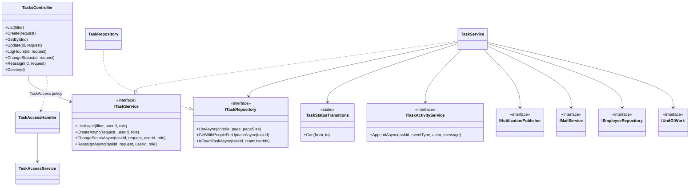
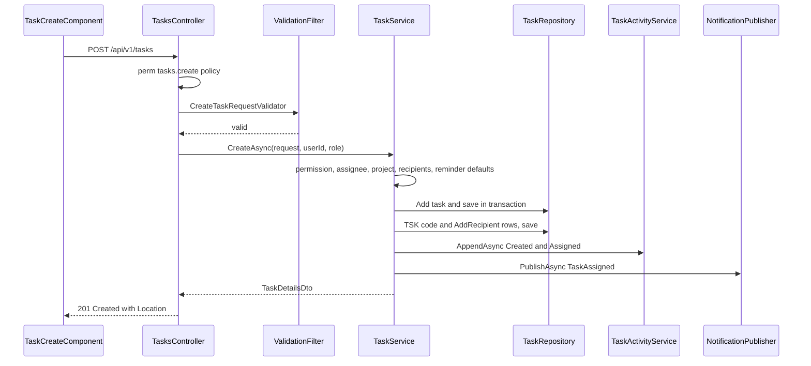
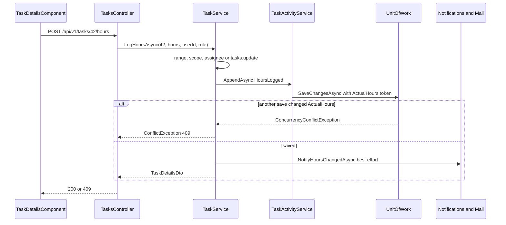
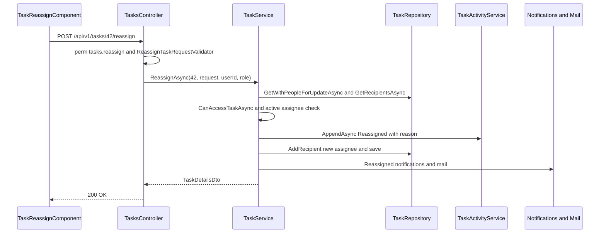
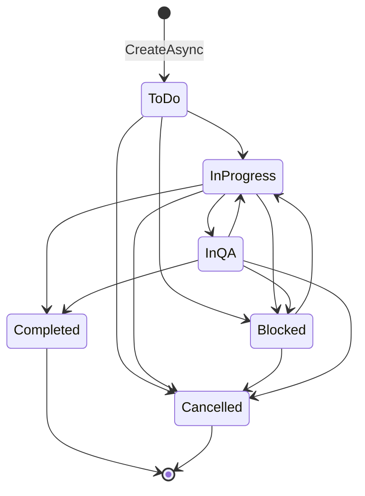
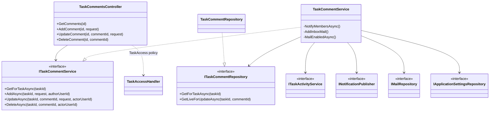
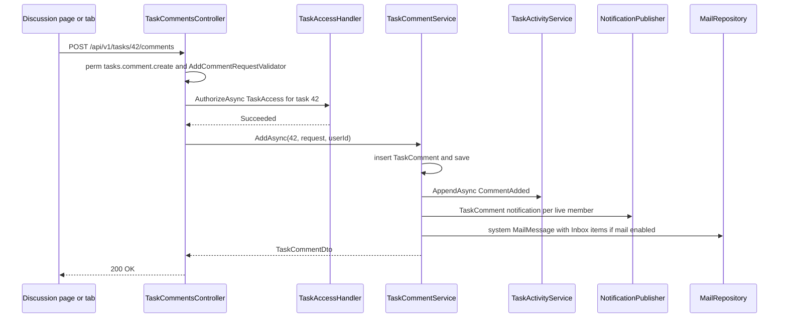
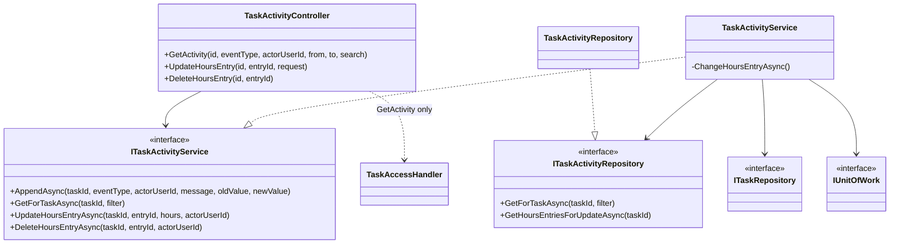
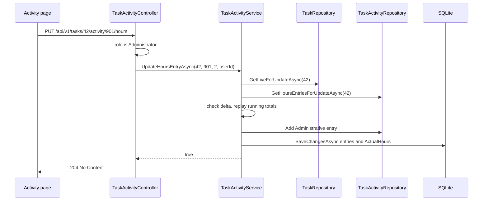
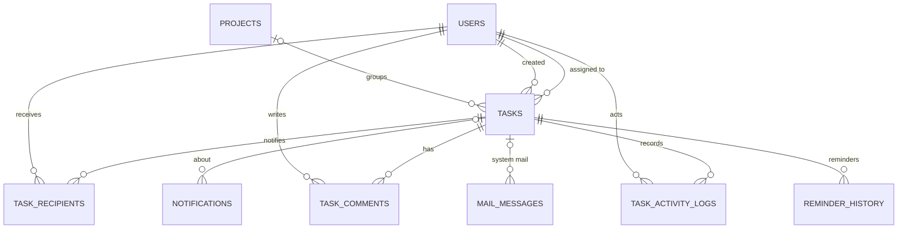

# Low-Level Design – Task Management

## TaskFlow – Intelligent Task Allocation & Tracking System

> **Document:** Low-Level Design (sub-module 02.1 Task Management, code `TASK`)  ·  **Version:** 1.0  ·  **Status:** Draft
> **Project type:** Personal Project (Skill Development)  ·  **Date:** 31-Oct-2026
> **Author:** Jojo George (jojogeorge3344@gmail.com)
> **Based on:** FRD-Task-Management v1.0, BRD-Task-Management v1.0, TDD-TaskFlow v2.0, code snapshot of 31-Oct-2026
> © 2026 Jojo George. All rights reserved.

---

## Document Control

| Version | Date | Author | Summary of changes |
|---|---|---|---|
| 1.0 | 31-Oct-2026 | Jojo George | Initial version, derived from the code (`TasksController`, `TaskCommentsController`, `TaskActivityController` and their services, repositories, DTOs, validators, entities and migrations) and traced to FRD-Task-Management v1.0 |

**Related documents:**

| Document | Location |
|---|---|
| BRD – Task Management | `../../../BRD/02-TaskFlow-Monitoring/02.1-Task-Management/BRD-Task-Management.md` |
| FRD – Task Management (`FR-TASK-nn`, `UC-TASK-nn`) | `../../../FRD/02-TaskFlow-Monitoring/02.1-Task-Management/FRD-Task-Management.md` |
| HLD – Task Management | `../../../HLD/02-TaskFlow-Monitoring/02.1-Task-Management/HLD-Task-Management.md` |
| Overall LLD (shared stack, cross-cutting design, Auth, Legal) | `../../00-Overall/LLD-TaskFlow-Overall.md` |
| Sibling LLDs – Board, Employee Workload, Notification, Mail | `../02.3-Board/LLD-Board.md`, `../02.2-Employee-Workload/LLD-Employee-Workload.md`, `../../04-Communication/04.2-Notification/LLD-Notification.md`, `../../04-Communication/04.1-Mail/LLD-Mail.md` |
| TDD | `TDD-TaskFlow.md` v2.0 (§7 data model, §8 API, §10 business logic) |

---

## 1. Introduction

### 1.1 Purpose
Detailed design of the Task Management sub-module as built: the classes and layers behind the Task List, Create Task
(and Copy), Task Details, Reassign Task, Task Discussion and Activity History screens; every controller action with
its route, authorization, request, response and status codes; service logic step by step; repository queries; the
`Tasks`, `TaskRecipients`, `TaskComments` and `TaskActivityLogs` tables; validation and error rules; tests; and the
trace from each `FR-TASK-nn` to endpoint, class and test.

### 1.2 Scope & Conventions
- **Controllers covered (3) and actions (19)** – counted from the code fact sheet §3:

  | Controller | File | Actions |
  |---|---|:---:|
  | `TasksController` | `Controllers/Monitoring/TasksController.cs` | 12 |
  | `TaskCommentsController` | `Controllers/Monitoring/TaskCommentsController.cs` | 4 |
  | `TaskActivityController` | `Controllers/Monitoring/TaskActivityController.cs` | 3 |
  | **Total** | | **19** (of 114 in the system) |

  `GET /api/v1/tasks/board` (and the shared `GET /api/v1/tasks/assignees` and `PATCH /api/v1/tasks/{id}/status`) are
  also the Board's endpoints; they are listed here because they are `TasksController` actions, and the Board-specific
  client behaviour is in `../02.3-Board/LLD-Board.md`.
- Child modules: 4.1.1 Tasks (list, create, details, edit, hours, status, reassign, recipients, delete), 4.1.2 Task
  Discussion (comments), 4.1.3 Activity History (history and Administrator worked-hours corrections).
- Naming: `*Controller`, `I*Service` / `*Service`, `I*Repository` / `*Repository`, DTOs `*Request` / `*Dto`, validators
  `*RequestValidator` (FluentValidation).
- API base path `/api/v1/tasks`; JSON camelCase; enums travel as their names (`JsonStringEnumConverter`); errors are
  RFC 7807 `ProblemDetails` (validation errors as `ValidationProblemDetails` with an `errors` map).
- Backend paths are relative to `backend/src/TaskFlow.Api/`; frontend paths to `frontend/src/app/`; test paths to
  `backend/tests/`.

---

## 2. Code Structure

### 2.1 Backend Folder Layout

```
TaskFlow.Api/
  Controllers/Monitoring/            TasksController.cs, TaskCommentsController.cs, TaskActivityController.cs
  Services/Monitoring/TaskManagement/
    Tasks/                           ITaskService.cs, TaskService.cs
    Discussion/                      ITaskCommentService.cs, TaskCommentService.cs
    Activity/                        ITaskActivityService.cs, TaskActivityService.cs
    Access/                          ITaskAccessService.cs, TaskAccessService.cs
    Rules/                           TaskAccessScope.cs, TaskStatusTransitions.cs
  Repositories/Monitoring/TaskManagement/
    Tasks/                           ITaskRepository.cs, TaskRepository.cs, TaskListCriteria.cs, TaskVisibility.cs,
                                     TaskDateRange.cs, TaskBucketSelection.cs
    Discussion/                      ITaskCommentRepository.cs, TaskCommentRepository.cs
    Activity/                        ITaskActivityRepository.cs, TaskActivityRepository.cs
  Dtos/Monitoring/TaskManagement/    TaskDtos.cs, TaskRequests.cs, Validators/*.cs
    Discussion/                      TaskCommentDtos.cs, Validators/AddCommentRequestValidator.cs
    Activity/                        TaskActivityDtos.cs, ActivityFilter.cs
  Models/Entities/                   Task.cs, TaskRecipient.cs, TaskComment.cs, TaskActivityLog.cs
  Models/Enums/                      TaskStatus.cs, TaskPriority.cs, TaskActivityEventType.cs (+ ReminderFrequency, NotificationType)
  Common/Rules/                      TaskStageCalculator.cs, TaskBucketRules.cs, ReminderIntervals.cs
  Authorization/TaskAccess/          TaskAccessRequirement.cs, TaskAccessHandler.cs
  Authorization/Policies/            RequirePermissionAttribute.cs, AuthPolicies.cs
  Persistence/                       AppDbContext.cs, Migrations/
```

### 2.2 Frontend Folder Layout

```
src/app/modules/monitoring/
  monitoring.routes.ts                       routes /tasks, /tasks/new, /tasks/:id, /tasks/:id/discussion,
                                             /tasks/:id/activity, /tasks/:id/reassign
  task-management/
    pages/      task-list.component.*        TaskListComponent      (Task List)
                task-create.component.*      TaskCreateComponent    (Create Task and Copy), task-create.model.ts (FieldName)
                task-details.component.*     TaskDetailsComponent   (Task Details + Discussion / Activity / Reassign tabs)
                reassign.component.*         TaskReassignComponent  (Reassign Task)
    services/   task.service.ts              TaskService (Angular) – all 19 HTTP calls
                task.model.ts                ActivityFilter
    models/     task.model.ts                TaskCard, TaskDetails, TaskListItem, TaskComment, ActivityEntry, PagedResult,
                                             TaskListFilter, request types, TASK_STATUSES, TASK_PRIORITIES, BOARD_STATUSES
    utils/      return-url.ts                safeReturnUrl, backTarget, DEFAULT_RETURN_URL
    discussion/pages/task-discussion.component   TaskDiscussionComponent – referenced by the route, not in the snapshot
    activity/pages/activity.component            ActivityComponent – referenced by the route, not in the snapshot
    activity/utils/activity-meta                 ActivityEventMeta, eventMeta – imported, not in the snapshot
```

### 2.3 Layer Rules

| Rule | Enforced by |
|---|---|
| Controller → Service → Repository; controllers never touch `AppDbContext` | `TaskFlow.UnitTests/Architecture/ArchitectureTests.cs` |
| Repositories stage changes only; the service commits with `IUnitOfWork.SaveChangesAsync` / `ExecuteInTransactionAsync` | `IUnitOfWork` contract (`Repositories/Base/IUnitOfWork.cs`) |
| Frontend folder structure per module (`pages`, `services`, `models`, `utils`) | `npm run check:structure` (`scripts/check-frontend-structure.mjs`) |

---

## 3. Cross-Cutting Design

Shared mechanisms (JWT authentication with `SessionValidation`, permission claims refreshed from the database on every
request, `GlobalExceptionHandler`, `ValidationFilter`, `UnitOfWork`, logging, time zone) are designed in the overall LLD
(`../../00-Overall/LLD-TaskFlow-Overall.md`). How Task Management uses them:

| Concern | Design in this sub-module |
|---|---|
| Validation | FluentValidation validators for `CreateTaskRequest`, `UpdateTaskRequest`, `UpdateTaskStatusRequest`, `ReassignTaskRequest`, `SetRecipientsRequest`, `AddCommentRequest` run in the global `ValidationFilter` (400 validation problem). `LogHoursRequest` and `UpdateHoursEntryRequest` have no validator; their range is checked in the service. `TaskService.ValidateCreate` / `ValidateUpdate` repeat the main rules (defence in depth) |
| Error handling | Services throw `AppException` subclasses; `GlobalExceptionHandler` maps them to `ProblemDetails` (§3.1). Controllers map `null` / `false` results to 404 and failed resource checks to 403 (`Forbid()`) |
| Transactions | `IUnitOfWork.ExecuteInTransactionAsync` for create (task + code + recipients + history + assignment notification) and delete (soft delete + history). Other writes use one or more `SaveChangesAsync` calls; `TaskActivityService.AppendAsync` saves immediately, so "the caller owns the transaction" |
| Authorization | (1) `perm:<key>` policies via `RequirePermission(PermissionKeys.X)` or `Authorize(Policy = PermissionPolicy.Prefix + PermissionKeys.X)`; (2) the `TaskAccess` resource policy (`TaskAccessHandler` → `TaskAccessService`) on details, status, get-recipients, all comment endpoints and get-activity; (3) service re-checks of the key (`HasPermissionAsync`, read from the database) and the Manager team scope (`CanAccessTaskAsync`); (4) the inline `role == SystemRoles.Administrator` check for hours corrections |
| Concurrency | `Tasks.ActualHours` is an EF concurrency token; `UnitOfWork` turns `DbUpdateConcurrencyException` into `ConcurrencyConflictException`, which `LogHoursAsync` rethrows as `ConflictException` (409) |
| Side effects | `INotificationPublisher.PublishAsync` (skipped when `Notification.InAppEnabled` is false), `IMailService.SendAsync` (reassign, hours), direct system mail through `IMailRepository` (comments, skipped when `Notification.MailEnabled` is false). All except the create-time assignment notification are best effort: caught, logged with `LogWarning`, never undo the change |
| Logging | `ILogger<TaskService>`, `ILogger<TaskCommentService>` warnings for failed notifications; refused authorizations logged by `DeniedActionAuditHandler` ("Denied action: user … attempted …") |
| Time & time zone | All dates stored in UTC (`TimeProvider.GetUtcNow()`); stage, deadline buckets and drill-down date bounds use `IAppClock.GetTimeZoneAsync` (stored setting `Application.Timezone`, otherwise `Application:Timezone` from `appsettings.json`) |

### 3.1 Exception → HTTP Status

| Exception | Status | When (this sub-module) |
|---|---|---|
| `BusinessRuleException` | 400 | Service rule broken: inactive assignee/project, missing recipients, reminder order, disallowed status move, missing reason, hours out of range, empty comment, hours entry that added nothing |
| `AnalyticsFilterException` (a `BusinessRuleException`) | 400 | Drill-down `from` after `to` |
| Validation problem (`ValidationFilter`) | 400 | A FluentValidation rule fails; body carries `errors` per field |
| `ForbiddenException` | 403 | Service permission re-check, out of scope, not the assignee (hours), not the comment author |
| `Forbid()` from the controller | 403 | `TaskAccess` resource policy fails (also when the task does not exist or is deleted), or non-Administrator on hours corrections |
| Policy failure (`perm:<key>`) | 403 | Role lacks the endpoint's key (logged by `DeniedActionAuditHandler`) |
| `NotFound()` from the controller | 404 | Service returns `null` / `false` (task, comment or hours entry not found; details/recipients out of the Manager's team) |
| `ConflictException` | 409 | Concurrent worked-hours save in `LogHoursAsync` |
| `ConcurrencyConflictException` / `DbUpdateConcurrencyException` | 409 | Concurrency clash on any other save touching `ActualHours` (edit, hours correction) – generic "Someone else changed this record while you were saving. Reload it and try again." |
| `UniqueConstraintException` | 409 | Unique index broken (e.g. duplicate `TaskRecipients (TaskId, UserId)` in a race) – "That value is already in use." |
| Any other exception | 500 | Generic problem detail; logged with trace id |

---

## 4. Module Designs

### 4.1 Module: Task Management (TASK)

Shared authorization building blocks used by all three child modules:

| Class | File | Rule |
|---|---|---|
| `TaskAccessHandler` (`AuthorizationHandler<TaskAccessRequirement>`) | `Authorization/TaskAccess/TaskAccessHandler.cs` | Resource = task id (int). Reads the user id (`ClaimTypes.NameIdentifier`) and whether the JWT principal holds the `tasks.view.all` permission claim, then calls `ITaskAccessService.CanAccessAsync` |
| `TaskAccessService` | `Services/Monitoring/TaskManagement/Access/TaskAccessService.cs` | `false` when the task is missing or soft-deleted; `true` for view-all; otherwise `TaskAccessScope.CanAccess` for assignee/creator, then (only if needed) for recipients via `GetRecipientIdsAsync`. **No Manager team scope** |
| `TaskAccessScope` | `Services/Monitoring/TaskManagement/Rules/TaskAccessScope.cs` | `CanAccess(userId, canViewAll, task, recipientUserIds)`: view-all, assignee, creator or recipient |
| `TaskService.CanAccessTaskAsync` (private) | `Services/Monitoring/TaskManagement/Tasks/TaskService.cs` | `TaskAccessScope.CanAccess`, plus for a manager-scoped view-all caller not personally on the task, `ITaskRepository.IsTeamTaskAsync(taskId, GetTeamMemberIdsAsync(userId))` |
| `TaskService.VisibilityForCallerAsync` (private) | same | Builds `TaskVisibility(UserId, ViewAll, TeamUserIds, OrOwn)` for list, board and assignees |
| `TaskService.IsManagerScopedAsync` (private) | same | Holds `dashboard.view.team` and not `dashboard.view.organization` (keys expanded with `EffectivePermissions.Expand`) |

A Manager's team (`IEmployeeRepository.GetTeamMemberIdsAsync`) is the active users, other than the manager, in a
department the manager manages (`DepartmentManagers`) or on a project where the manager's allocation has
`IsProjectManager = true` (`UserProjectAllocations`).

#### 4.1.1 Child module: Tasks (`TasksController`)

**Class / file inventory**

| Layer | Type | File | Responsibility |
|---|---|---|---|
| Controller | `TasksController` | `Controllers/Monitoring/TasksController.cs` | 12 actions; reads user id and role from the JWT (`TryGetCurrentUser`); `CanAccessTaskAsync` runs the `TaskAccess` policy |
| Service | `ITaskService` / `TaskService` | `Services/Monitoring/TaskManagement/Tasks/` | Scope, permission re-checks, create/edit/reassign rules, worked hours, status transitions, recipients, soft delete, notifications and mail |
| Rules | `TaskStatusTransitions`, `TaskAccessScope` | `Services/Monitoring/TaskManagement/Rules/` | Transition table; resource access rule |
| Rules (shared) | `TaskStageCalculator` (+ enum `TaskStage`), `TaskBucketRules`, `ReminderIntervals` | `Common/Rules/` | Stage at read time; dashboard bucket predicates; reminder order rule and message |
| Repository | `ITaskRepository` / `TaskRepository` (`BaseRepository<Task>`) | `Repositories/Monitoring/TaskManagement/Tasks/` | Visible queries, list paging, recipients |
| Query models | `TaskListCriteria`, `TaskVisibility`, `TaskDateRange`, `TaskBucketSelection` | same folder | Criteria records passed from service to repository |
| Collaborators | `IEmployeeRepository`, `IProjectRepository`, `IRoleRepository`, `IReminderSettingsService`, `IAppClock`, `ITaskActivityService`, `INotificationPublisher`, `IMailService`, `IUnitOfWork`, `TimeProvider` | other modules | Assignee/recipient/team lookups, project check, role keys, reminder defaults, time zone, history, side effects, commit |
| DTOs | `TaskListItemDto`, `TaskDetailsDto`, `TaskCardDto`, `TaskRecipientDto`, `PagedResult<TaskListItemDto>` | `Dtos/Monitoring/TaskManagement/TaskDtos.cs`, `Common/Models` | Responses |
| DTOs | `CreateTaskRequest`, `UpdateTaskRequest`, `UpdateTaskStatusRequest`, `ReassignTaskRequest`, `LogHoursRequest`, `SetRecipientsRequest`, `TaskListFilter`, enum `TaskBucketFilter` | `Dtos/Monitoring/TaskManagement/TaskRequests.cs` | Requests |
| Validators | `CreateTaskRequestValidator`, `UpdateTaskRequestValidator`, `UpdateTaskStatusRequestValidator`, `ReassignTaskRequestValidator`, `SetRecipientsRequestValidator` | `Dtos/Monitoring/TaskManagement/Validators/` | Input rules |
| Entities | `Task`, `TaskRecipient` | `Models/Entities/` | Persistence |
| Frontend pages | `TaskListComponent`, `TaskCreateComponent`, `TaskDetailsComponent`, `TaskReassignComponent` | `modules/monitoring/task-management/pages/` | Screens; gating signals `canManage`, `canCreate`, `canDelete`, `canEdit`, `canLogHours`, `canReassign` |
| Frontend service | `TaskService` (Angular) | `modules/monitoring/task-management/services/task.service.ts` | `list`, `getAssignees`, `create`, `getBoard`, `getById`, `update`, `logHours`, `changeStatus`, `delete`, `reassign`, `getRecipients`, `setRecipients` |
| Frontend guard | `permissionGuard` | `shared/auth/auth.guard.ts` | `/tasks/new` → `tasks.create`; `/tasks/:id/reassign` → `tasks.reassign` |

**Class diagram**



**API contracts** (class route `api/v1/tasks`, class-level `[Authorize]`)

| # | Method | Route | Action | Permission / policy | Request | Response | Status codes |
|---|---|---|---|---|---|---|---|
| 1 | GET | `/api/v1/tasks` | `List` | `[Authorize]`; scope in service (`tasks.view.own` Always On, `tasks.view.all`) | `TaskListFilter` (query) | `PagedResult<TaskListItemDto>` | 200, 400 (drill-down dates), 401 |
| 2 | POST | `/api/v1/tasks` | `Create` | `RequirePermission(PermissionKeys.TasksCreate)` → `perm:tasks.create`; service re-check | `CreateTaskRequest` | `TaskDetailsDto` (`CreatedAtAction(GetById)`, `Location` header) | 201, 400, 401, 403 |
| 3 | GET | `/api/v1/tasks/assignees` | `GetAssignees` | `[Authorize]`; visibility in service | – | `IReadOnlyCollection<TaskRecipientDto>` | 200, 401 |
| 4 | GET | `/api/v1/tasks/board` | `GetBoard` | `RequirePermission(PermissionKeys.BoardView)` → `perm:board.view` | – | `IReadOnlyCollection<TaskCardDto>` | 200, 401, 403 |
| 5 | GET | `/api/v1/tasks/{id}` | `GetById` | `TaskAccess` resource policy; service team scope | – | `TaskDetailsDto` | 200, 401, 403 (no access, missing or deleted), 404 (outside the Manager's team) |
| 6 | PUT | `/api/v1/tasks/{id}` | `Update` | `perm:tasks.update`; service re-check and scope | `UpdateTaskRequest` | `TaskDetailsDto` | 200, 400, 401, 403, 404, 409 |
| 7 | POST | `/api/v1/tasks/{id}/hours` | `LogHours` | `[Authorize]` only; service: scope, then assignee or `tasks.update` | `LogHoursRequest` | `TaskDetailsDto` | 200, 400, 401, 403, 404, 409 |
| 8 | DELETE | `/api/v1/tasks/{id}` | `Delete` | `perm:tasks.delete` (no scope check, §10) | – | – | 204, 401, 403, 404 |
| 9 | PATCH | `/api/v1/tasks/{id}/status` | `ChangeStatus` | `Authorize(Policy = perm:tasks.status.change)` + `TaskAccess`; service scope | `UpdateTaskStatusRequest` | `TaskCardDto` | 200, 400, 401, 403, 404 |
| 10 | POST | `/api/v1/tasks/{id}/reassign` | `Reassign` | `perm:tasks.reassign`; service re-check and scope | `ReassignTaskRequest` | `TaskDetailsDto` | 200, 400, 401, 403, 404 |
| 11 | GET | `/api/v1/tasks/{id}/recipients` | `GetRecipients` | `TaskAccess`; service scope | – | `IReadOnlyCollection<TaskRecipientDto>` | 200, 401, 403, 404 |
| 12 | PUT | `/api/v1/tasks/{id}/recipients` | `SetRecipients` | `perm:tasks.recipients.manage`; service re-check (no scope check, §10) | `SetRecipientsRequest` | – | 204, 400, 401, 403, 404 |

401 = the JWT has no parseable `NameIdentifier` claim (`TryGetCurrentUser` fails) or no valid token.

**`TaskListFilter` (query string of #1)**

| Parameter | Type | Default | Meaning |
|---|---|---|---|
| `assignedToUserId` | int? | – | Employee filter (offered only with `tasks.view.all`) |
| `status`, `priority` | `TaskStatus?`, `TaskPriority?` | – | Exact match |
| `deadlineFrom`, `deadlineTo` | DateTime? | – | `Deadline >= from`, `Deadline <= to` |
| `search` | string? | – | `LIKE %term%` on `Title` or `TaskCode`, `%` `_` `\` escaped |
| `page` | int | 1 | Values < 1 become 1 |
| `pageSize` | int | 20 | Values outside 1–100 become 20 |
| `bucket` | `TaskBucketFilter?` (`All`, `Pending`, `InProgress`, `Completed`, `Overdue`) | – | Dashboard drill-down (`TaskBucketRules`) |
| `deadlineBucket` | `DeadlineBucket?` | – | Dashboard deadline bucket (`DeadlineBucketRules.BoundsFor(now, timeZone)`) |
| `departmentId`, `projectId`, `employeeId`, `managerId` | int? | – | Entity filters (`ApplyEntityFilters`) |
| `from`, `to` | DateOnly? | – | Local-day range on `basis`, converted with `ReminderCalculator.LocalMidnightUtc` (`to` exclusive next midnight) |
| `basis` | `AnalyticsDateBasis` | `Created` | Which task date the range applies to |

Any of `bucket`, `deadlineBucket`, `departmentId`, `projectId`, `employeeId`, `managerId`, `from`, `to` makes the
request a drill-down (`IsDrillDown`).

**Request / response examples**

```json
// POST /api/v1/tasks   (CreateTaskRequest)
{
  "title": "Prepare Q4 release notes",
  "description": "Collect changes from all teams",
  "assignedToUserId": 12,
  "projectId": 3,
  "priority": "High",
  "startDate": "2026-10-31T04:30:00Z",
  "deadline": "2026-11-03T12:30:00Z",
  "estimatedHours": 6,
  "additionalRecipientUserIds": [7, 9],
  "firstReminderDays": 2,
  "secondReminderDays": 1,
  "overdueReminderFrequency": "Daily"
}
// 201 Created   (TaskDetailsDto)
{
  "id": 42, "taskCode": "TSK-000042", "title": "Prepare Q4 release notes",
  "description": "Collect changes from all teams",
  "assignedToUserId": 12, "assignedToName": "Asha Nair",
  "createdByUserId": 4, "createdByName": "Ravi Menon",
  "priority": "High", "startDate": "2026-10-31T04:30:00Z", "deadline": "2026-11-03T12:30:00Z",
  "estimatedHours": 6, "actualHours": null, "status": "ToDo", "stage": "Upcoming",
  "recipients": [ { "userId": 7, "fullName": "Divya K" }, { "userId": 9, "fullName": "John P" }, { "userId": 12, "fullName": "Asha Nair" } ],
  "createdAt": "2026-10-31T10:00:00Z", "updatedAt": "2026-10-31T10:00:00Z",
  "projectId": 3, "projectName": "Website Revamp",
  "firstReminderDays": 2, "secondReminderDays": 1, "overdueReminderFrequency": "Daily"
}
```

```json
// PUT /api/v1/tasks/42   (UpdateTaskRequest) -> 200 TaskDetailsDto
{ "title": "Prepare Q4 release notes", "description": "Collect changes from all teams", "priority": "Critical",
  "startDate": "2026-10-31T04:30:00Z", "deadline": "2026-11-04T12:30:00Z", "estimatedHours": 8, "actualHours": 3 }

// POST /api/v1/tasks/42/hours   (LogHoursRequest) -> 200 TaskDetailsDto
{ "hours": 2.5 }

// PATCH /api/v1/tasks/42/status   (UpdateTaskStatusRequest) -> 200 TaskCardDto
{ "status": "InQA" }
{ "id": 42, "taskCode": "TSK-000042", "title": "Prepare Q4 release notes", "assignedToUserId": 12,
  "assignedToName": "Asha Nair", "priority": "High", "deadline": "2026-11-03T12:30:00Z", "status": "InQA",
  "isOverdue": false, "projectId": 3, "projectName": "Website Revamp" }

// POST /api/v1/tasks/42/reassign   (ReassignTaskRequest) -> 200 TaskDetailsDto
{ "newAssigneeUserId": 15, "reason": "Asha is on leave next week" }

// PUT /api/v1/tasks/42/recipients   (SetRecipientsRequest) -> 204
{ "recipientUserIds": [7, 9] }

// GET /api/v1/tasks?status=InProgress&search=release -> 200 PagedResult of TaskListItemDto
{ "items": [ { "id": 42, "taskCode": "TSK-000042", "title": "Prepare Q4 release notes", "assignedToUserId": 12,
  "assignedToName": "Asha Nair", "createdByUserId": 4, "createdByName": "Ravi Menon", "priority": "High",
  "startDate": "2026-10-31T04:30:00Z", "deadline": "2026-11-03T12:30:00Z", "estimatedHours": 6,
  "status": "InProgress", "stage": "Upcoming", "isOverdue": false, "projectId": 3, "projectName": "Website Revamp" } ],
  "total": 1, "page": 1, "pageSize": 20 }
```

Names and values are illustrative; property names are those of the DTO records serialised in camelCase.

**Service logic – `ListAsync(filter, currentUserId, currentUserRole)`** (FR-TASK-01…09)
1. Clamp `page` (min 1) and `pageSize` (1–100, otherwise 20).
2. `VisibilityForCallerAsync`: without `tasks.view.all`, or not manager-scoped → `TaskVisibility(userId, canViewAll)`;
   a manager-scoped view-all caller → `TaskVisibility(userId, ViewAll: true, TeamUserIds, OrOwn: true)`.
3. Drill-down from a manager-scoped caller → `OrOwn = false` (team tasks only, so the list equals the chart count).
4. `DrillDownCriteriaAsync`: bucket → `TaskBucketSelection`; deadline bucket → bounds in the app time zone; `from` /
   `to` → UTC local-midnight bounds, `from > to` throws `AnalyticsFilterException("The end date cannot be before the start date.")`;
   copy the entity filters.
5. `ITaskRepository.ListAsync(criteria, page, pageSize)`; map each row with `ToListItem` – `Stage =
   TaskStageCalculator.Calculate(status, deadline, now, timeZone)`, `IsOverdue = stage == Overdue`.
6. Return `new PagedResult<TaskListItemDto>(items, total, page, pageSize)`.

**Service logic – `CreateAsync(request, currentUserId, currentUserRole)`** (FR-TASK-14…27)
1. `HasPermissionAsync(role, tasks.create)` else `ForbiddenException("Your role is not allowed to create tasks.")`.
2. `ValidateCreate` (title, assignee > 0, project > 0, deadline after start, estimate > 0).
3. `IEmployeeRepository.GetLiveAsync(assignee)` must be non-null and `IsActive` else `BusinessRuleException("The assigned employee does not exist or is not active.")`.
4. `IProjectRepository.ExistsActiveAsync(projectId)` else `"The selected project does not exist."`.
5. Distinct additional recipients; `CountLiveAsync(ids) == ids.Count` else `"One or more recipients do not exist."`.
6. Null reminder fields → `IReminderSettingsService.GetAsync` (`DefaultFirstDays`, `DefaultSecondDays`,
   `DefaultOverdueFrequency`); `ReminderIntervals.AreOrdered(first, second)` else `ReminderIntervals.OrderMessage`.
7. Build the `Task` entity: placeholder `TaskCode = "P-{guid:N}"` cut to 32 characters, trimmed title/description,
   `Status = ToDo`, `CreatedByUserId = caller`, `CreatedAt = UpdatedAt = now`.
8. `IUnitOfWork.ExecuteInTransactionAsync`: add and save (identity id) → `TaskCode = "TSK-{Id:D6}"` → add one
   `TaskRecipient` per user in {assignee} ∪ additional → save → `AppendAsync(Created, "Task created", newValue: title)`
   → `AppendAsync(Assigned, "Assigned to {name}", newValue: assigneeId)` → `PublishAsync(assignee, TaskAssigned,
   "A task was assigned to you: {title}")`. Inside the transaction: a failed notification rolls everything back.
9. Reload with `GetWithPeopleForUpdateAsync` and `GetRecipientsAsync`; return `ToDetails(...)`.

**Service logic – `GetDetailsAsync`** (FR-TASK-31…33)
1. `GetWithPeopleForUpdateAsync(taskId)` (live task; `IgnoreQueryFilters` so deleted people still show) → `null` if missing.
2. `GetRecipientsAsync`; `CanAccessTaskAsync` → `null` if outside scope (controller 404).
3. `ToDetails` with the stage in the application time zone.

**Service logic – `UpdateAsync`** (FR-TASK-34…36, 43)
1. `tasks.update` re-check → `"Your role is not allowed to edit tasks."`; `ValidateUpdate`.
2. Load task (`null` → 404); `CanAccessTaskAsync` else `"You do not have access to this task."`.
3. History for changed values: `DeadlineChanged` "Deadline updated" (old/new ISO `O`), `PriorityChanged` "Priority
   updated", and – when `ActualHours` is given and differs – `HoursLogged` "Worked hours logged: {X}h (total)" (values
   formatted `0.##`, `InvariantCulture`).
4. Overwrite title (trimmed), description, priority, start, deadline, estimate, `UpdatedAt`; `SaveChangesAsync`.
5. Hours changed → `NotifyHoursChangedAsync` (best effort).

**Service logic – `LogHoursAsync`** (FR-TASK-41…44)
1. `0 < hours ≤ 24` else `BusinessRuleException("Hours must be greater than 0 and at most 24 per entry.")`.
2. Load task (`null` → 404); `CanAccessTaskAsync` else 403 "You do not have access to this task.".
3. Caller is the assignee or holds `tasks.update`, else `ForbiddenException("Only the assignee can log hours on this task.")`.
4. `ActualHours = previous + hours`; `UpdatedAt = now`; `AppendAsync(HoursLogged, ...)` (saves the shared context) then
   `SaveChangesAsync`. A `ConcurrencyConflictException` (token `ActualHours`) → `ConflictException("The task's worked hours changed while you were saving. Please try again.")`.
5. `NotifyHoursChangedAsync`: targets = recipients ∪ assignee; message "{actor} added {X}h of worked time (was {Y}h) on
   task {title}. Total worked now: …h of …h estimated (…h remaining | over by …h)." ("cleared the worked hours" when
   the new total is 0, "updated the worked hours" when it went down); `NotificationType.System` per target; mail
   "Worked hours changed: {title}" to `GetActiveEmailsAsync(targets)` via `IMailService.SendAsync`.

**Service logic – `ChangeStatusAsync`** (FR-TASK-37…40, 47)
1. Load task (`null` → 404); `CanAccessTaskAsync` else 403.
2. `TaskStatusTransitions.Can(from, to)` else `BusinessRuleException("Cannot move a task from {from} to {to}.")`.
3. Set status and `UpdatedAt`; `CompletedAt = now` on Completed, `CancelledAt = now` on Cancelled.
4. `AppendAsync(StatusChanged, "Status changed from {X} to {Y}")`, plus `AppendAsync(Completed, "Task completed")`;
   save; return `ToCard` (`IsOverdue = Deadline < UtcNow` and not Completed/Cancelled). No notification is sent. The
   reminder engine (`ReminderRepository`) excludes Completed and Cancelled tasks, which stops reminders (FR-TASK-47).

**Service logic – `ReassignAsync`** (FR-TASK-48…55)
1. `tasks.reassign` re-check → `"Your role is not allowed to reassign tasks."`.
2. Blank reason → `"A reassignment reason is required."`.
3. Load task (`null` → 404); `CanAccessTaskAsync` else 403.
4. New assignee live and active else `"The target employee does not exist or is not active."`.
5. Set `AssignedToUserId`, `UpdatedAt`; `AppendAsync(Reassigned, "Reassigned from {A} to {B}. Reason: {reason}", oldName, newName)`.
6. New assignee not yet a recipient → `AddRecipient`; save. The previous assignee stays a recipient.
7. `NotifyReassignedAsync` (best effort): targets = recipients ∪ new ∪ old assignee ∪ actor; the new assignee gets
   "A task was reassigned to you: {title}. Reason: {reason}", others "{actor} reassigned task "{title}" ({code}) from A
   to B. Reason: …" (`NotificationType.Reassigned`); mail "Task reassigned: {title}".

**Service logic – `GetRecipientsAsync` / `SetRecipientsAsync`**
- Get: load, scope check; `null` → 404.
- Set: `tasks.recipients.manage` re-check → `"Your role is not allowed to manage task recipients."`; task missing →
  `false` (404); desired = request ids ∪ {assignee}; add missing, remove extras (never the assignee); save;
  `AppendAsync(Assigned, "Task recipients updated")`. No scope check and no check that the users exist.

**Service logic – `DeleteAsync`** (FR-TASK-46)
1. `GetLiveForUpdateAsync(taskId)` → `false` (404) if missing or already deleted.
2. Transaction: `IsDeleted = true`, `UpdatedAt = now`, save; `AppendAsync(Deleted, "Task deleted", oldValue: title)`.
   Comments, recipients and history rows are kept.

**Sequence diagram – create a task**



**Sequence diagram – log hours with a concurrent save**



**Sequence diagram – reassign**



**Repository methods** (`TaskRepository : BaseRepository<Task>, ITaskRepository`)

| Method | Query / purpose | Notes |
|---|---|---|
| `ListAsync(TaskListCriteria, page, pageSize)` | `Visible(visibility)` + assignee, status, priority, deadline range, escaped `EF.Functions.Like` on Title/TaskCode, `TaskBucketRules.IsCounted()` / `InBucket`, `DeadlineBucketRules.InBucket`, `ApplyDateRange`, `ApplyEntityFilters`; `CountAsync`; then `IgnoreQueryFilters` + Include AssignedTo, CreatedBy, Project; order Deadline, Id; Skip/Take | `AsNoTracking` (from `Scoped`); uses `IX_Tasks_Deadline` |
| `GetBoardAsync(TaskVisibility)` | Every visible task with AssignedTo, Project, ordered by Deadline | Board |
| `GetAssigneesAsync(TaskVisibility)` | Distinct (AssignedToUserId, FullName), ordered by name in memory | Employee / Assignee filter |
| `IsTeamTaskAsync(taskId, teamUserIds)` | `TeamTasks` (assignee or any recipient in the team) + `AnyAsync` | Manager scope |
| `GetWithPeopleForUpdateAsync(taskId)` | Tracked live task with AssignedTo, CreatedBy, Project; `IgnoreQueryFilters` | Details, edit, hours, status, reassign, recipients |
| `GetLiveForUpdateAsync(taskId)` | Tracked live task (`!IsDeleted`) | Delete, hours correction |
| `GetLiveAsync(taskId)` | Read-only live task | `TaskAccessService`, comments |
| `GetRecipientsAsync(taskId)` | Recipients with names, ordered by UserId | `AsNoTracking` |
| `GetRecipientRowsForUpdateAsync(taskId)` | Tracked `TaskRecipient` rows | Set recipients |
| `GetRecipientIdsAsync(taskId)` | Recipient user ids | `AsNoTracking` |
| `AddRecipient(recipient)` / `RemoveRecipients(rows)` | Stage insert / delete | Committed by the service |
| `CountUnfinishedAssignedToAsync(userId)` | Live tasks not Completed/Cancelled for a user | Used by Employee Management |
| `Visible(TaskVisibility)` (private) | `Scoped(userId, viewAll)`; with `TeamUserIds`, team tasks only, or team ∪ own when `OrOwn` | – |
| `Scoped(userId, viewAll)` (private) | `!IsDeleted`; without view-all: assignee, creator or recipient | `AsNoTracking` |

**Validation rules** (server; UI messages per FRD §4.1.2–4.1.4)

| Request | Field | Rule | Server message |
|---|---|---|---|
| `CreateTaskRequest` | `Title` | `NotEmpty`, `MaximumLength(200)` | FluentValidation default (UI: "Title is required." / "Title must be 200 characters or fewer.") |
| | `Description` | `MaximumLength(4000)` when not null | FluentValidation default |
| | `AssignedToUserId` | `> 0` | "An assigned employee is required." |
| | `ProjectId` | `> 0` | "A project is required." |
| | `Priority`, `OverdueReminderFrequency` | `IsInEnum` | FluentValidation default |
| | `Deadline` | `> StartDate` | "Deadline must be after the start date." |
| | `EstimatedHours` | `> 0` | "Estimated hours must be a positive number." |
| | `AdditionalRecipientUserIds` | null or count ≤ 50; each `> 0` | "A task can have at most 50 additional recipients." |
| | `FirstReminderDays`, `SecondReminderDays` | `InclusiveBetween(0, 30)`; `ReminderIntervals.AreOrdered` (first = 0 or second ≤ first) when both given | "The second reminder cannot come before the first reminder." |
| `UpdateTaskRequest` | `Title`, `Description`, `Deadline`, `EstimatedHours` | As create (no rule on `ActualHours`) | As create (UI additionally requires estimate ≥ 0.5: "Enter at least 0.5 hours.") |
| `UpdateTaskStatusRequest` | `Status` | `IsInEnum` | FluentValidation default |
| `ReassignTaskRequest` | `NewAssigneeUserId` | `> 0` | FluentValidation default |
| | `Reason` | `NotEmpty`, `MaximumLength(500)` | FluentValidation default (service: "A reassignment reason is required.") |
| `SetRecipientsRequest` | `RecipientUserIds` | `NotNull`, count ≤ 50, each `> 0` | FluentValidation default |
| `LogHoursRequest` | `Hours` | Service: `> 0` and `≤ 24` | "Hours must be greater than 0 and at most 24 per entry." |

**Error cases**

| Case | Exception / result | Status |
|---|---|---|
| Role lacks `tasks.create` / `tasks.update` / `tasks.reassign` / `tasks.recipients.manage` | Policy failure, then service `ForbiddenException("Your role is not allowed to … tasks.")` | 403 |
| Assignee missing or inactive (create) | `BusinessRuleException("The assigned employee does not exist or is not active.")` | 400 |
| Project missing or inactive | `BusinessRuleException("The selected project does not exist.")` | 400 |
| Recipient missing | `BusinessRuleException("One or more recipients do not exist.")` | 400 |
| Reminder order wrong (defaults applied) | `BusinessRuleException(ReminderIntervals.OrderMessage)` | 400 |
| Status move not allowed | `BusinessRuleException("Cannot move a task from {from} to {to}.")` | 400 |
| New assignee missing or inactive | `BusinessRuleException("The target employee does not exist or is not active.")` | 400 |
| Hours out of range | `BusinessRuleException("Hours must be greater than 0 and at most 24 per entry.")` | 400 |
| Drill-down dates reversed | `AnalyticsFilterException("The end date cannot be before the start date.")` | 400 |
| Task outside scope (edit, hours, status, reassign) | `ForbiddenException("You do not have access to this task.")` | 403 |
| Not assignee and no `tasks.update` (hours) | `ForbiddenException("Only the assignee can log hours on this task.")` | 403 |
| `TaskAccess` fails (details, status, get recipients) – including a missing or deleted task | `Forbid()` | 403 |
| Task not found (edit, hours, reassign, delete, set recipients) or details/recipients outside the Manager's team | `NotFound()` | 404 |
| Concurrent worked-hours save | `ConflictException("The task's worked hours changed while you were saving. Please try again.")` | 409 |

**State machine** – `TaskStatusTransitions.Can(from, to)`; a same-status move is always allowed; Completed and
Cancelled are terminal.



**Frontend behaviour relevant to the API**

| Component | Detail |
|---|---|
| `TaskListComponent` | `PAGE_SIZE` 20; search `debounceTime(SEARCH_DEBOUNCE_MS)` (300 ms); `canManage` (`tasks.view.all`) switches title and Employee filter and calls `getAssignees()`; drill-down request merged into the list request; `canCreate`, `canDelete` gate Create/Copy/Delete |
| `TaskCreateComponent` | Loads users (`employees.view`), projects (`projects.view`), reminder defaults and application default priority; `assigneeOptions` = users with `role === 'Employee'`; `recipientOptions` excludes the assignee; Copy reads `copyFrom` and calls `getById` |
| `TaskDetailsComponent` | `canEdit` (`tasks.update`), `canLogHours` (`canEdit` or assignee), `canViewActivity`, `canCreate`, `canReassign`, `canDelete`; Move-to buttons call `changeStatus` (not gated by `tasks.status.change`); `latestComments` = last 3 of `getComments`; `latestActivity` = 4 newest of `getActivity` sorted newest first |
| `TaskReassignComponent` | `eligibleEmployees` = active users except the current assignee; `canSubmit` needs a person and a non-blank reason; `notifyList` shows who will be told; confirm dialog before `reassign` |

#### 4.1.2 Child module: Task Discussion (`TaskCommentsController`)

**Class / file inventory**

| Layer | Type | File | Responsibility |
|---|---|---|---|
| Controller | `TaskCommentsController` | `Controllers/Monitoring/TaskCommentsController.cs` | 4 actions; `TaskAccess` check first on every action |
| Service | `ITaskCommentService` / `TaskCommentService` | `Services/Monitoring/TaskManagement/Discussion/` | Add, author-only edit and soft delete, history entries, member notifications and system Inbox mail |
| Repository | `ITaskCommentRepository` / `TaskCommentRepository` | `Repositories/Monitoring/TaskManagement/Discussion/` | Live comments with authors |
| Collaborators | `ITaskRepository`, `IEmployeeRepository`, `IMailRepository`, `IApplicationSettingsRepository`, `ITaskActivityService`, `INotificationPublisher`, `IUnitOfWork`, `TimeProvider` | other modules | Task lookup, names and live ids, mail rows, mail switch, history, notifications, commit |
| DTOs | `TaskCommentDto`, `AddCommentRequest` | `Dtos/Monitoring/TaskManagement/Discussion/TaskCommentDtos.cs` | Contracts |
| Validator | `AddCommentRequestValidator` | `Dtos/Monitoring/TaskManagement/Discussion/Validators/` | `Body` not empty, ≤ 4000 |
| Entity | `TaskComment` | `Models/Entities/TaskComment.cs` | Persistence |
| Frontend | Discussion tab in `TaskDetailsComponent`; `TaskDiscussionComponent` (route only) | `pages/task-details.component.*`; `discussion/pages/task-discussion.component` | Summary and full page |
| Frontend service | `TaskService` (Angular) | `services/task.service.ts` | `getComments`, `addComment`, `updateComment`, `deleteComment` |

**Class diagram**



**API contracts**

| # | Method | Route | Action | Permission / policy | Request | Response | Status codes |
|---|---|---|---|---|---|---|---|
| 13 | GET | `/api/v1/tasks/{id}/comments` | `GetComments` | `[Authorize]` + `TaskAccess` | – | `IReadOnlyCollection<TaskCommentDto>` (oldest first) | 200, 401, 403 |
| 14 | POST | `/api/v1/tasks/{id}/comments` | `AddComment` | `perm:tasks.comment.create` + `TaskAccess` | `AddCommentRequest` | `TaskCommentDto` | 200, 400, 401, 403 |
| 15 | PUT | `/api/v1/tasks/{id}/comments/{commentId}` | `UpdateComment` | `perm:tasks.comment.edit` + `TaskAccess` + author check | `AddCommentRequest` | `TaskCommentDto` | 200, 400, 401, 403, 404 |
| 16 | DELETE | `/api/v1/tasks/{id}/comments/{commentId}` | `DeleteComment` | `perm:tasks.comment.delete` + `TaskAccess` + author check | – | – | 204, 400, 401, 403, 404 |

POST returns **200 OK** (not 201).

**Request / response examples**

```json
// POST /api/v1/tasks/42/comments   (AddCommentRequest) -> 200 TaskCommentDto
{ "body": "Draft is ready for review." }
{ "id": 310, "body": "Draft is ready for review.", "authorUserId": 12, "authorName": "Asha Nair",
  "createdAt": "2026-10-31T10:05:00Z", "editedAt": null }

// PUT /api/v1/tasks/42/comments/310   (AddCommentRequest) -> 200 TaskCommentDto
{ "body": "Draft is ready for review - see section 2." }
{ "id": 310, "body": "Draft is ready for review - see section 2.", "authorUserId": 12, "authorName": "Asha Nair",
  "createdAt": "2026-10-31T10:05:00Z", "editedAt": "2026-10-31T10:20:00Z" }
```

**Service logic – `AddAsync(taskId, request, authorUserId)`** (FR-TASK-58, 61, 62)
1. Blank body → `BusinessRuleException("Comment must not be empty.")`.
2. `ITaskRepository.GetLiveAsync(taskId)` else `BusinessRuleException("Task not found.")`.
3. Insert `TaskComment` (trimmed body, `CreatedAt = now`); save.
4. `AppendAsync(CommentAdded, "New comment added", newValue: Excerpt(body))` – excerpt = first 200 characters + "…".
5. `NotifyMembersAsync(task, actor, name, "added", …)`; return `TaskCommentDto`.

**Service logic – `UpdateAsync` / `DeleteAsync`** (FR-TASK-59, 60)
1. (Update only) blank body → "Comment must not be empty."; task live check → "Task not found.".
2. `GetLiveForUpdateAsync(taskId, commentId)` → `null` / `false` (404) if missing, of another task, or deleted.
3. `AuthorUserId != actor` → `ForbiddenException("Only the author can edit this comment.")` / `("Only the author can delete this comment.")` – whatever other permissions the caller has.
4. Update: `Body`, `EditedAt = now`, save, `AppendAsync(CommentEdited, "Comment edited", oldExcerpt, newExcerpt)`.
   Delete: `IsDeleted = true`, save, `AppendAsync(CommentDeleted, "Comment deleted", oldValue: excerpt)`.
5. `NotifyMembersAsync` with "edited" / "deleted".

**Service logic – `NotifyMembersAsync`** (FR-TASK-62, 70, 71; best effort)
1. Members = recipient ids + assignee + actor → `IEmployeeRepository.GetLiveIdsAsync` (soft-deleted users dropped).
2. `PublishAsync(userId, taskId, NotificationType.TaskComment, "{who} {verb} a comment on "{title}": {detail}")` per member.
3. If `Notification.MailEnabled` is true, missing or unreadable (`MailEnabledAsync`): `AddInboxMail` stages one
   `MailMessage` (`IsSystem = true`, `TaskId`, subject "Comment {verb}: {title}" cut to `MailRules.MaxSubjectLength`,
   body ending "This is an automatic message from TaskFlow.") with one `MailRecipient` (`To`) and one Inbox
   `MailboxItem` per member; save.
4. Any exception (except cancellation) → `IMailRepository.DiscardStagedMail()` and `LogWarning`; the comment change stays.

**Sequence diagram – post a comment**



**Repository methods**

| Method | Query / purpose | Notes |
|---|---|---|
| `TaskCommentRepository.GetForTaskAsync(taskId)` | `TaskId == id && !IsDeleted`, Include Author, order CreatedAt, Id | `AsNoTracking`, `IgnoreQueryFilters` (deleted authors still named); uses `IX_TaskComments_TaskId_CreatedAt` |
| `TaskCommentRepository.GetLiveForUpdateAsync(taskId, commentId)` | Tracked comment matching Id and TaskId, not deleted | Edit, delete |
| `Add` (from `BaseRepository<TaskComment>`) | Stage insert | Committed by the service |

**Validation rules**

| Field | Rule | Message |
|---|---|---|
| `Body` (`AddCommentRequest`) | `NotEmpty`, `MaximumLength(4000)` (validator) | FluentValidation default |
| `Body` | Not blank after trimming (service) | "Comment must not be empty." |

**Error cases**

| Case | Exception / result | Status |
|---|---|---|
| No task access (or task missing or deleted) | `Forbid()` from `TaskAccess` | 403 |
| Role lacks the comment key | Policy failure | 403 |
| Not the author | `ForbiddenException("Only the author can edit this comment.")` / `("Only the author can delete this comment.")` | 403 |
| Empty / too long body | Validation problem (or `BusinessRuleException("Comment must not be empty.")`) | 400 |
| Task deleted between the access check and the service | `BusinessRuleException("Task not found.")` | 400 |
| Comment not found on the task | `NotFound()` | 404 |

**State machine:** _Not applicable for this child module_ (a comment is live or soft-deleted; `EditedAt` marks an edit).

#### 4.1.3 Child module: Activity History (`TaskActivityController`)

**Class / file inventory**

| Layer | Type | File | Responsibility |
|---|---|---|---|
| Controller | `TaskActivityController` | `Controllers/Monitoring/TaskActivityController.cs` | 3 actions; converts `from` / `to` to UTC and extends a date-only `to` to the end of the day; inline Administrator check for corrections |
| Service | `ITaskActivityService` / `TaskActivityService` | `Services/Monitoring/TaskManagement/Activity/` | Single writer of the history (`AppendAsync`), filtered read, worked-hours corrections with replay |
| Repository | `ITaskActivityRepository` / `TaskActivityRepository` | `Repositories/Monitoring/TaskManagement/Activity/` | Filtered history, tracked `HoursLogged` entries |
| DTOs | `ActivityEntryDto`, `UpdateHoursEntryRequest`, `ActivityFilter` | `Dtos/Monitoring/TaskManagement/Activity/` | Contracts and filter |
| Entity / enum | `TaskActivityLog`, `TaskActivityEventType` | `Models/Entities/`, `Models/Enums/` | Persistence |
| Security | `SystemRoles.Administrator` | `Common/Security/SystemRoles.cs` | Role name compared with the JWT role claim |
| Frontend | Activity history tab in `TaskDetailsComponent`; `ActivityComponent` (route only, guard `tasks.activity.view`) | `pages/task-details.component.*`; `activity/pages/activity.component` | Summary and full page |
| Frontend service | `TaskService` (Angular), `ActivityFilter` | `services/task.service.ts`, `services/task.model.ts` | `getActivity(id, filter)`, `updateHoursEntry`, `deleteHoursEntry` |

**Class diagram**



**API contracts**

| # | Method | Route | Action | Permission / policy | Request | Response | Status codes |
|---|---|---|---|---|---|---|---|
| 17 | GET | `/api/v1/tasks/{id}/activity` | `GetActivity` | `perm:tasks.activity.view` + `TaskAccess` | Query `eventType` (`TaskActivityEventType`), `actorUserId`, `from`, `to`, `search` | `IReadOnlyCollection<ActivityEntryDto>` (oldest first) | 200, 401, 403 |
| 18 | PUT | `/api/v1/tasks/{id}/activity/{entryId}/hours` | `UpdateHoursEntry` | `[Authorize]` + inline `role == SystemRoles.Administrator` | `UpdateHoursEntryRequest` | – | 204, 400, 401, 403, 404, 409 |
| 19 | DELETE | `/api/v1/tasks/{id}/activity/{entryId}/hours` | `DeleteHoursEntry` | `[Authorize]` + inline `role == SystemRoles.Administrator` | – | – | 204, 401, 403, 404, 409 |

**Request / response examples**

```json
// GET /api/v1/tasks/42/activity?eventType=HoursLogged -> 200 ActivityEntryDto list
[ { "id": 901, "eventType": "HoursLogged", "actorUserId": 12, "actorName": "Asha Nair",
    "oldValue": "0", "newValue": "3", "message": "Worked hours logged: 3h (total)",
    "createdAt": "2026-10-31T11:00:00Z" } ]

// PUT /api/v1/tasks/42/activity/901/hours   (UpdateHoursEntryRequest) -> 204 No Content
{ "hours": 2 }
// resulting Administrative entry message:
// "Administrator changed a worked-hours entry from 3h to 2h; worked total is now 2h"
```

**Service logic – `AppendAsync(taskId, eventType, actorUserId, message, oldValue, newValue)`** (FR-TASK-63)
1. Add a `TaskActivityLog` with `CreatedAt = TimeProvider` UTC now.
2. `SaveChangesAsync` (the caller owns any surrounding transaction). Writers and event types:

| Caller | Event types |
|---|---|
| `TaskService.CreateAsync` | `Created`, `Assigned` |
| `TaskService.UpdateAsync` | `DeadlineChanged`, `PriorityChanged`, `HoursLogged` |
| `TaskService.LogHoursAsync` | `HoursLogged` |
| `TaskService.ChangeStatusAsync` | `StatusChanged`, `Completed` |
| `TaskService.ReassignAsync` | `Reassigned` |
| `TaskService.SetRecipientsAsync` | `Assigned` ("Task recipients updated") |
| `TaskService.DeleteAsync` | `Deleted` |
| `TaskCommentService` | `CommentAdded`, `CommentEdited`, `CommentDeleted` |
| `TaskActivityService.ChangeHoursEntryAsync` | `Administrative` (written directly with `_activity.Add`) |

`TimeLogged` exists in the enum but no code writes it.

**Service logic – `GetForTaskAsync(taskId, ActivityFilter)`** (FR-TASK-64, 65)
1. Controller: `from` → UTC; `to` → UTC and, when its time of day is 00:00, `Date.AddDays(1).AddTicks(-1)` (whole day).
2. Repository filter; map to `ActivityEntryDto` with `EventType.ToString()` and the actor's name (deleted actors included).

**Service logic – `UpdateHoursEntryAsync` / `DeleteHoursEntryAsync` → `ChangeHoursEntryAsync`** (FR-TASK-68)
1. Update only: `0 < hours ≤ 24` else `BusinessRuleException("Hours must be greater than 0 and at most 24 per entry.")`.
2. `GetLiveForUpdateAsync(taskId)` → `false` (404) if missing; `GetHoursEntriesForUpdateAsync(taskId)`; target entry
   not among them → `false` (404).
3. Delta per entry = `NewValue − OldValue` (parsed with `InvariantCulture`). Editing an entry with delta ≤ 0 →
   `BusinessRuleException("This entry did not add hours, so it can only be deleted.")`.
4. Baseline = first entry's `OldValue`. Delete: remove the target row; update: replace its delta.
5. Replay all entries in order: `next = max(0, running + delta)`, rewrite `OldValue`, `NewValue` and `Message`
   ("Worked hours logged: {X}h (total)").
6. `Task.ActualHours = running`; `UpdatedAt = now`; add an `Administrative` entry "Administrator changed a
   worked-hours entry from {A}h to {B}h; worked total is now {C}h" (or "Administrator deleted a worked-hours entry of
   {A}h; worked total is now {C}h") with old/new totals; one `SaveChangesAsync`. No notification.

**Sequence diagram – Administrator corrects a worked-hours entry**



**Repository methods**

| Method | Query / purpose | Notes |
|---|---|---|
| `TaskActivityRepository.GetForTaskAsync(taskId, ActivityFilter)` | `TaskId == id` + optional `EventType`, `ActorUserId`, `CreatedAt >= From`, `CreatedAt <= To`, `Message.Contains(Search)`; Include Actor; order CreatedAt | `AsNoTracking`, `IgnoreQueryFilters`; uses `IX_TaskActivityLogs_TaskId_CreatedAt` |
| `TaskActivityRepository.GetHoursEntriesForUpdateAsync(taskId)` | Tracked `HoursLogged` entries ordered CreatedAt, Id | Correction replay |
| `Add` / `Remove` (from `BaseRepository<TaskActivityLog>`) | Stage insert / delete | Only the correction removes a row |

**Validation rules**

| Field | Rule | Message |
|---|---|---|
| `Hours` (`UpdateHoursEntryRequest`) | `> 0` and `≤ 24` (service; no validator) | "Hours must be greater than 0 and at most 24 per entry." |
| Target entry | Must be a `HoursLogged` entry of the task; update needs delta > 0 | "This entry did not add hours, so it can only be deleted." |
| `eventType` (query) | Must bind to `TaskActivityEventType` | Model-binding 400 when not an enum name or number |

**Error cases**

| Case | Exception / result | Status |
|---|---|---|
| Role lacks `tasks.activity.view` (GET) | Policy failure | 403 |
| No task access (GET), task missing or deleted | `Forbid()` | 403 |
| Caller's role is not `Administrator` (corrections) | `Forbid()` (empty body) | 403 |
| Task or hours entry not found | `NotFound()` | 404 |
| Hours out of range / non-adding entry edited | `BusinessRuleException` | 400 |
| Concurrent change of `ActualHours` during a correction | `ConcurrencyConflictException` | 409 |

**State machine:** _Not applicable for this child module_ (entries are append-only except the Administrator correction).

---

## 5. Database Design

### 5.1 ER Diagram



Owned tables: `Tasks`, `TaskRecipients`, `TaskComments`, `TaskActivityLogs`. Read or written but owned elsewhere:
`Users` (`User`), `Projects` (`Project`), `DepartmentManagers` (`DepartmentManager`) and `UserProjectAllocations`
(`UserProjectAllocation.IsProjectManager`) for the Manager team, `Roles` / `RolePermissions` / `Permissions` for
permission re-checks, `Notifications` (`Notification`), `MailMessages` / `MailRecipients` / `MailboxItems`
(`MailMessage`, `MailRecipient`, `MailboxItem`), `ReminderHistory` (`ReminderHistory`, written by the reminder engine
from the task's reminder fields) and `ApplicationSettings` (`ApplicationSetting`).

### 5.2 Tables

SQLite storage: int, bool and enums stored as int → `INTEGER`; string, DateTime and decimal → `TEXT`. String lengths are
EF model limits (SQLite does not enforce them).

#### `Tasks` (`Task`)

| Column | Type | Null | Key / index | Default | Description |
|---|---|:---:|---|---|---|
| Id | int | No | PK, identity | autoincrement | Task id |
| TaskCode | string(32) | No | Unique `IX_Tasks_TaskCode` | – | `TSK-` + `Id:D6`; placeholder `P-{guid}` during insert |
| Title | string(200) | No | – | – | Title (trimmed) |
| Description | string(4000) | Yes | – | – | Description |
| AssignedToUserId | int | No | FK → `Users.Id` (Restrict), `IX_Tasks_AssignedToUserId` | – | Assignee |
| CreatedByUserId | int | No | FK → `Users.Id` (Restrict), `IX_Tasks_CreatedByUserId` | – | Creator |
| ProjectId | int | Yes | FK → `Projects.Id` (Restrict), `IX_Tasks_ProjectId` | – | Project (required by the API on create); renamed from `DepartmentId` |
| Priority | `TaskPriority` (INTEGER) | No | – | – | Low=0, Medium=1, High=2, Critical=3 |
| StartDate | DateTime (UTC) | No | – | – | Start |
| Deadline | DateTime (UTC) | No | `IX_Tasks_Deadline` | – | Deadline; list order |
| EstimatedHours | decimal | No | – | – | Estimate (> 0) |
| ActualHours | decimal | Yes | **Concurrency token** | null | Worked total |
| Status | `TaskStatus` (INTEGER) | No | – | 0 (ToDo) | ToDo=0, InProgress=1, Blocked=2, Completed=3, Cancelled=4, InQA=5 |
| FirstReminderDays | int | No | – | 2 (entity and migration) | Days before deadline, 0–30 |
| SecondReminderDays | int | No | – | 1 | Days before deadline, 0–30 |
| OverdueReminderFrequency | `ReminderFrequency` (INTEGER) | No | – | 0 (Daily) | Daily=0, Weekly=1 |
| CreatedAt, UpdatedAt | DateTime (UTC) | No | – | – | Audit times |
| CompletedAt, CancelledAt | DateTime (UTC) | Yes | – | null | Set on those transitions |
| IsDeleted | bool | No | – | false | Soft delete |

#### `TaskRecipients` (`TaskRecipient`)

| Column | Type | Null | Key / index | Default | Description |
|---|---|:---:|---|---|---|
| Id | int | No | PK, identity | autoincrement | – |
| TaskId | int | No | FK → `Tasks.Id` (Cascade); unique `IX_TaskRecipients_TaskId_UserId` (TaskId, UserId) | – | Task |
| UserId | int | No | FK → `Users.Id` (Cascade); `IX_TaskRecipients_UserId` | – | Notified user (assignee always included) |

#### `TaskComments` (`TaskComment`)

| Column | Type | Null | Key / index | Default | Description |
|---|---|:---:|---|---|---|
| Id | int | No | PK, identity | autoincrement | – |
| TaskId | int | No | FK → `Tasks.Id` (Cascade); `IX_TaskComments_TaskId_CreatedAt` | – | Task |
| AuthorUserId | int | No | FK → `Users.Id` (Restrict); `IX_TaskComments_AuthorUserId` | – | Author |
| Body | string | No | – | – | Text (validator ≤ 4000) |
| CreatedAt | DateTime (UTC) | No | part of `IX_TaskComments_TaskId_CreatedAt` | – | Posted |
| EditedAt | DateTime (UTC) | Yes | – | null | Last edit ("(edited)" mark) |
| IsDeleted | bool | No | – | false (`HasDefaultValue`) | Soft delete |

#### `TaskActivityLogs` (`TaskActivityLog`)

| Column | Type | Null | Key / index | Default | Description |
|---|---|:---:|---|---|---|
| Id | int | No | PK, identity | autoincrement | – |
| TaskId | int | No | FK → `Tasks.Id` (Cascade); `IX_TaskActivityLogs_TaskId_CreatedAt` | – | Task |
| EventType | `TaskActivityEventType` stored as **string(32)** (`HasConversion<string>`) | No | – | – | Event name |
| ActorUserId | int | No | FK → `Users.Id` (Restrict); `IX_TaskActivityLogs_ActorUserId` | – | Who acted |
| OldValue, NewValue | string | Yes | – | null | Before / after (hours as `0.##` invariant) |
| Message | string | No | – | – | Human-readable text |
| CreatedAt | DateTime (UTC) | No | part of `IX_TaskActivityLogs_TaskId_CreatedAt` | – | When |

### 5.3 Indexes, Constraints & Triggers

| Object | Definition | Purpose |
|---|---|---|
| `IX_Tasks_TaskCode` | Unique (TaskCode) | Code never reused (FR-TASK-14) |
| `IX_Tasks_Deadline` | (Deadline) | List and board ordering, deadline filters |
| `IX_Tasks_AssignedToUserId` | (AssignedToUserId) | Own scope, team scope, workload |
| `IX_Tasks_CreatedByUserId`, `IX_Tasks_ProjectId` | FK indexes | Joins, project filter |
| `IX_TaskRecipients_TaskId_UserId` | Unique (TaskId, UserId) | One recipient row per user per task (BR-TASK-05) |
| `IX_TaskRecipients_UserId` | (UserId) | Own scope via recipients |
| `IX_TaskComments_TaskId_CreatedAt` | (TaskId, CreatedAt) | Chronological comment list |
| `IX_TaskActivityLogs_TaskId_CreatedAt` | (TaskId, CreatedAt) | Chronological history |
| `IX_TaskComments_AuthorUserId`, `IX_TaskActivityLogs_ActorUserId` | FK indexes | Joins |
| Concurrency token | `Tasks.ActualHours` (`IsConcurrencyToken`) | Lost-update protection for worked hours (FR-TASK-44) |
| Delete behaviour | Task → recipients, comments, history: Cascade; task → users/project: Restrict | Tasks are only soft-deleted, so cascades do not fire in normal use |
| Query filters | `Users` and `Projects` have `HasQueryFilter(!IsDeleted)`; task queries use `IgnoreQueryFilters` where names of deleted people must still show | History keeps names |
| Triggers | None | – |

### 5.4 Enumerations

| Enum | Values | Stored as |
|---|---|---|
| `TaskStatus` | ToDo, InProgress, Blocked, Completed, Cancelled, InQA (appended last) | INTEGER (0–5) |
| `TaskPriority` | Low, Medium, High, Critical | INTEGER (0–3) |
| `ReminderFrequency` | Daily, Weekly | INTEGER (0–1) |
| `TaskActivityEventType` | Created, Assigned, Reassigned, StatusChanged, DeadlineChanged, PriorityChanged, Completed, CommentAdded, Administrative, HoursLogged, TimeLogged, Deleted, CommentEdited, CommentDeleted | TEXT (name, max 32) |
| `NotificationType` (used) | TaskAssigned, Reassigned, System, TaskComment (DeadlineReminder and Overdue are sent by the reminder engine) | TEXT in `Notifications` |
| `TaskStage` (`Common/Rules/TaskStageCalculator.cs`) | Upcoming, DueToday, Overdue, Completed | Not stored – computed per read |
| `TaskBucketFilter` (`TaskRequests.cs`) | All, Pending, InProgress, Completed, Overdue | Query parameter only |

### 5.5 Migrations

| Migration | Change for this sub-module |
|---|---|
| `20261012124843_AddTasks` | Creates `Tasks` (then with `DepartmentId`) and `TaskRecipients` |
| `20261013075057_AddTaskTracking` | Creates `TaskActivityLogs` (EventType text 32), `TaskComments` and `Notifications`; indexes `(TaskId, CreatedAt)` |
| `20261013104629_AddTaskReminderSettings` | Adds `FirstReminderDays` (2), `SecondReminderDays` (1), `OverdueReminderFrequency` (0); indexes `IX_Tasks_TaskCode` (unique), `IX_Tasks_Deadline`, `IX_Tasks_AssignedToUserId`, `IX_TaskRecipients_TaskId_UserId` (unique); FKs renamed to `AssignedToUserId` / `CreatedByUserId` |
| `20261017062735_AddReminderEngine`, `20261017090431_AddInternalMail` | `ReminderHistory` and `MailMessages.TaskId` reference `Tasks` |
| `20261020173455_RenameDepartmentsToProjectsAndAddDepartments` | `Tasks.DepartmentId` → `ProjectId`, `IX_Tasks_ProjectId`, FK `FK_Tasks_Projects_ProjectId` (Restrict) |
| `20261024074305_AddTaskActualHours` | Adds `Tasks.ActualHours` (nullable) |
| `20261024122725_AddTaskCommentEditDelete` | Adds `TaskComments.EditedAt` and `TaskComments.IsDeleted` (default false) |

---

## 6. Algorithms & Background Jobs

| Job / algorithm | Trigger / schedule | Steps | Idempotency |
|---|---|---|---|
| Task code generation | `TaskService.CreateAsync` | Insert with placeholder `P-{guid}` → save → `TSK-{Id:D6}` → save, in one transaction | Unique `IX_Tasks_TaskCode`; identity ids never reused |
| Scope resolution | Every list, board, assignees, details and mutation | `VisibilityForCallerAsync` / `CanAccessTaskAsync` (§4.1) | Read-only |
| Stage calculation | Every details / list read | `TaskStageCalculator.Calculate`: Completed/Cancelled → Completed; deadline local day < today → Overdue; = today → DueToday; else Upcoming (app time zone) | Never stored |
| Worked-hours replay | `ChangeHoursEntryAsync` (Administrator) | Deltas from stored totals, remove/replace target, replay with clamp at 0, rewrite messages, set `ActualHours`, add `Administrative` entry | One save; `ActualHours` concurrency token |
| Deadline reminders | `ReminderSchedulerService` (hosted), every `Reminders:TickSeconds` (60 s) when `Reminders:SchedulerEnabled` | Owned by Notification (`../../04-Communication/04.2-Notification/LLD-Notification.md`); reads `FirstReminderDays`, `SecondReminderDays`, `OverdueReminderFrequency`; `ReminderRepository` skips deleted, Completed and Cancelled tasks | Unique index on `ReminderHistory` per task, recipient, type and slot |

No background job is owned by this sub-module.

---

## 7. Security Design (detailed)

| Item | Implementation |
|---|---|
| Authentication | JWT bearer (class-level `[Authorize]` on all three controllers); `SessionValidation.ValidateAsync` on token validation refreshes the permission claims from the database |
| Permission checks | `perm:<key>` policies (one per catalog key, `RequireClaim(AuthClaims.Permission, key)`): `tasks.create`, `tasks.update`, `tasks.delete`, `tasks.status.change`, `tasks.reassign`, `tasks.recipients.manage`, `tasks.comment.create`, `tasks.comment.edit`, `tasks.comment.delete`, `tasks.activity.view`, `board.view` |
| Service re-checks | `TaskService.HasPermissionAsync` reads the role's keys with `IRoleRepository.GetPermissionKeysByRoleNameAsync` and `EffectivePermissions.Expand` (create, update, reassign, recipients, hours via `tasks.update`, `tasks.view.all`, `dashboard.view.team`, `dashboard.view.organization`) |
| Data scope | `tasks.view.own` is Always On (own = assignee, creator, recipient); `tasks.view.all` gives Organization, or Team + own for a manager-scoped role (`IsManagerScopedAsync`) |
| Resource check | `TaskAccess` policy (`TaskAccessHandler`) – view-all claim, assignee, creator or recipient; no team scope (gap §10) |
| Ownership | Comment edit/delete: author only (`TaskCommentService`); hours: assignee or `tasks.update` |
| Role check | Hours corrections: `role == SystemRoles.Administrator` (role name, not a key) |
| Audit | Refused policies logged by `DeniedActionAuditHandler`; business history in `TaskActivityLogs` |
| Input safety | LIKE wildcards escaped in search; EF parameterised queries; enums bound by name |
| Frontend | `permissionGuard` on `/tasks/new` (`tasks.create`), `/tasks/:id/reassign` (`tasks.reassign`), `/tasks/:id/activity` (`tasks.activity.view`); buttons gated by the computed `can*` signals. Hiding is never the only protection (FR-TASK-72) |
| Secrets | None handled by this sub-module |

Role defaults (from `PermissionCatalog.cs`, see FRD §3.2): Administrator and Manager hold every task key except that
Manager lacks `tasks.delete`; Employee holds `tasks.view.own`, `tasks.status.change`, `tasks.comment.create`,
`tasks.comment.edit`, `tasks.comment.delete`, `tasks.activity.view`; custom roles are configurable.

---

## 8. Configuration

| Key | Default | Purpose |
|---|---|---|
| `Application:Timezone` (`appsettings.json`) | `Asia/Kolkata` | Fallback time zone for stage, deadline buckets and drill-down bounds when the stored setting is empty |
| `Application.Timezone` (stored setting, `SettingKeys.ApplicationTimezone`) | – | Preferred application time zone (`AppClock.GetTimeZoneAsync`) |
| `Application.DefaultPriority` (stored setting) | `Medium` | Preselected priority on Create Task (read by the frontend) |
| `Reminder.DefaultFirstDays`, `Reminder.DefaultSecondDays`, `Reminder.DefaultOverdueFrequency` (stored settings via `IReminderSettingsService`) | per Reminder Settings (`DefaultOverdueFrequency` "Daily") | Defaults for omitted reminder fields on create |
| `Notification.InAppEnabled` (stored setting) | enabled when missing | `NotificationPublisher` skips in-app notifications when false |
| `Notification.MailEnabled` (stored setting) | enabled when missing | `TaskCommentService` skips comment system mail when false |
| `Reminders:SchedulerEnabled` / `Reminders:TickSeconds` | `true` / `60` | Reminder engine that consumes the task reminder fields |
| `ConnectionStrings:Default` | `<secret>` | SQLite database (shared) |

---

## 9. Testing Design

Only test file names are available in the snapshot; coverage is inferred from the names.

| Area | Test class / file | Type | Covers |
|---|---|---|---|
| Task endpoints | `TaskFlow.IntegrationTests/Monitoring/TaskManagement/TasksEndpointsTests.cs` | Integration | Routes, authorization, status codes of the task endpoints |
| Permissions | `TaskFlow.IntegrationTests/Common/PermissionAuthorizationTests.cs`, `ModuleBasedPermissionEndpointsTests.cs` | Integration | `perm:<key>` policies across modules |
| Error mapping | `TaskFlow.IntegrationTests/Common/GlobalExceptionHandlerTests.cs` | Integration | Exception → status |
| Task service | `TaskFlow.UnitTests/Monitoring/TaskManagement/Tasks/TaskServiceTests.cs`, `TaskManagementServiceTests.cs` | Unit | Scope, create, edit, reassign, history |
| Validators | `.../Tasks/CreateTaskRequestValidatorTests.cs`, `.../Tasks/TaskValidatorsTests.cs` | Unit | Create, update, status, reassign, recipients rules |
| Custom roles | `.../Tasks/CustomRolePermissionTests.cs` | Unit | Task keys on custom roles |
| Project on tasks | `.../Tasks/ProjectTaskTests.cs` | Unit | Active project rule |
| Soft delete | `.../Tasks/TaskDeletionTests.cs` | Unit | Delete keeps comments and history |
| Worked hours | `.../Tasks/TaskLogHoursTests.cs`, `.../Tasks/TaskWorkedHoursNotificationTests.cs` | Unit | Log hours, conflicts, corrections, notifications |
| Domain rules | `TaskFlow.UnitTests/Monitoring/TaskManagement/Rules/TaskTrackingDomainTests.cs` | Unit | Transitions, access scope, stage |
| Discussion | `TaskFlow.UnitTests/Monitoring/TaskManagement/Discussion/TaskCommentActivityNotificationTests.cs` | Unit | Comment history entries and notifications |
| Drill-down rules | `TaskFlow.UnitTests/Common/TaskBucketRulesTests.cs` | Unit | Bucket predicates |
| Reminders stop | `TaskFlow.UnitTests/Communication/Notification/Reminders/ReminderServiceTests.cs` | Unit | No reminders for closed tasks |
| Architecture | `TaskFlow.UnitTests/Architecture/ArchitectureTests.cs` | Unit | Layer rules |
| Harness | `TaskFlow.UnitTests/TestSupport/TaskTrackingServiceHarness.cs`, `TaskFlow.IntegrationTests/TestSupport/TaskFlowApiFactory.cs` | Support | Service and API test setup |
| Frontend | – | – | No spec files in the snapshot; UI behaviour is checked manually |

> ⚠️ To be confirmed: whether `TasksEndpointsTests.cs` also covers the comment and activity endpoints and the
> Administrator hours correction; no dedicated `TaskActivityService` test file is in the list.

---

## 10. Known Limitations & Open Issues

- **`DELETE /api/v1/tasks/{id}` has no task-scope check** – any `tasks.delete` holder can delete any live task (R-TASK-01).
- **`TaskAccessHandler` has no Manager team scope** – a Manager with `tasks.view.all` can read and write comments and
  read the history of another team's task by direct request (R-TASK-02); details, edit, hours, status and reassign do
  apply the team check in `TaskService`.
- **`PUT /api/v1/tasks/{id}/recipients`** has no scope check and does not check that user ids exist; it has no UI caller
  (R-TASK-05).
  > ⚠️ To be confirmed: the HTTP result for a non-existent recipient id (SQLite FK failure → probably 500).
- **Move to buttons** on Task Details are not gated by `tasks.status.change`; the API refuses with 403 (R-TASK-03).
- **Create Task assignee list** is limited to `role === 'Employee'` in `TaskCreateComponent`; the API accepts any active
  user (R-TASK-04).
- **Edit form** sends `actualHours: 0` when Worked hours is cleared, recording a change to 0; `UpdateTaskRequestValidator`
  has no rule against negative `ActualHours` (R-TASK-06).
- **Reminder fields** cannot be edited after creation (`UpdateTaskRequest` has none).
- **Project filter = drill-down** – for a Manager, `projectId` in the normal list sets `OrOwn = false`, dropping the
  manager's own non-team tasks.
- **Missing/deleted task on `TaskAccess` endpoints** returns 403, not 404, because `TaskAccessService` returns false.
- **Hours corrections** are tied to the role name `Administrator`, not a permission key, and do not run the `TaskAccess` check.
- **Status changes** have no service-level permission re-check (policy only) and send no notification.
- **`TimeLogged`** event type is never written.
- **Unreachable service messages** – `ValidateCreate` / `ValidateUpdate` and "Comment must not be empty." are normally
  pre-empted by the `ValidationFilter`, so clients see FluentValidation's default messages.
- **Frontend files missing from the snapshot:** `TaskDiscussionComponent`, `ActivityComponent`, `activity-meta`.
- > ⚠️ To be confirmed: reassign and worked-hours notifications are published to every recipient id without a live-user
  filter (mail uses `GetActiveEmailsAsync`, comments use `GetLiveIdsAsync`), so a soft-deleted recipient may still
  receive an in-app notification row, contrary to FR-TASK-70.

---

## 11. Traceability (FRD → code)

| FRD requirement | Endpoint / class | Test |
|---|---|---|
| FR-TASK-01 | `GET /api/v1/tasks` · `TaskService.ListAsync`, `VisibilityForCallerAsync`, `TaskRepository.Visible` | `TasksEndpointsTests.cs`, `TaskServiceTests.cs` |
| FR-TASK-02 | `IEmployeeRepository.GetTeamMemberIdsAsync`, `TaskRepository.TeamTasks` | `TaskServiceTests.cs` |
| FR-TASK-03 | `TaskService.ListAsync` (page clamp) · `TaskRepository.ListAsync` (order Deadline, Id) | `TasksEndpointsTests.cs` |
| FR-TASK-04 | `TaskRepository.ListAsync` (escaped LIKE) · `TaskListComponent` (`debounceTime` 300 ms) | Manual UI |
| FR-TASK-05 | `TaskListFilter` · `TaskRepository.ListAsync` | `TaskServiceTests.cs` |
| FR-TASK-06 | `GET /api/v1/tasks/assignees` · `TaskService.GetAssigneesAsync` · `TaskListComponent.canManage` | Manual UI |
| FR-TASK-07 | `TaskStageCalculator.Calculate` · `TaskListItemDto.Stage`, `IsOverdue` | `TaskTrackingDomainTests.cs` |
| FR-TASK-08 | `TaskService.DrillDownCriteriaAsync`, `TaskBucketRules`, `DeadlineBucketRules` | `TaskServiceTests.cs`, `TaskBucketRulesTests.cs` |
| FR-TASK-09 | `TaskService.ListAsync` (`IsDrillDown` → `OrOwn = false`) | `TaskServiceTests.cs` |
| FR-TASK-10 | `TaskListComponent` (title link → `/tasks/:id`) | Manual UI |
| FR-TASK-11 | `TaskListComponent.canCreate`, `canDelete` · policies `perm:tasks.create`, `perm:tasks.delete` | `CustomRolePermissionTests.cs` |
| FR-TASK-12 | `TaskListComponent.canManage` | Manual UI |
| FR-TASK-13 | `TaskListComponent` empty and error states | Manual UI |
| FR-TASK-14 | `POST /api/v1/tasks` · `TaskService.CreateAsync` (`TSK-{Id:D6}`) · `IX_Tasks_TaskCode` | `TaskServiceTests.cs` |
| FR-TASK-15 | `CreateTaskRequestValidator`, `TaskService.ValidateCreate` | `CreateTaskRequestValidatorTests.cs` |
| FR-TASK-16 | `CreateTaskRequestValidator` (`MaximumLength` 200 / 4000) | `CreateTaskRequestValidatorTests.cs`, `TaskValidatorsTests.cs` |
| FR-TASK-17 | `TaskPriority` · `TaskCreateComponent` (default priority setting) | Manual UI |
| FR-TASK-18 | `TaskCreateComponent` (start now, deadline + 3 days) | Manual UI |
| FR-TASK-19 | `CreateTaskRequestValidator` (`Deadline > StartDate`) | `CreateTaskRequestValidatorTests.cs` |
| FR-TASK-20 | `CreateTaskRequestValidator` (`EstimatedHours > 0`) | `CreateTaskRequestValidatorTests.cs` |
| FR-TASK-21 | `TaskService.CreateAsync` (`Status = ToDo`) | `TaskServiceTests.cs` |
| FR-TASK-22 | `TaskService.CreateAsync` (recipients, `CountLiveAsync`) · `CreateTaskRequestValidator` (≤ 50) · `IX_TaskRecipients_TaskId_UserId` | `CreateTaskRequestValidatorTests.cs` |
| FR-TASK-23 | `CreateTaskRequestValidator` (0–30, order) · `IReminderSettingsService.GetAsync` · `ReminderIntervals.AreOrdered` | `CreateTaskRequestValidatorTests.cs` |
| FR-TASK-24 | `TaskService.CreateAsync` (`GetLiveAsync`, `ExistsActiveAsync`) | `ProjectTaskTests.cs`, `TaskServiceTests.cs` |
| FR-TASK-25 | `TaskCreateComponent.assigneeOptions` | Manual UI |
| FR-TASK-26 | `TaskService.CreateAsync` · `TaskActivityService.AppendAsync` (`Created`, `Assigned`) | `TaskManagementServiceTests.cs` |
| FR-TASK-27 | `TaskService.CreateAsync` · `INotificationPublisher.PublishAsync` (`TaskAssigned`) | `TaskManagementServiceTests.cs` |
| FR-TASK-28 | `TaskCreateComponent` (toast, navigate) · 201 `CreatedAtAction` | Manual UI |
| FR-TASK-29 | `TaskCreateComponent` (`copyFrom`, `getById`) | Manual UI |
| FR-TASK-30 | `TaskCreateComponent` (copy warnings) | Manual UI |
| FR-TASK-31 | `GET /api/v1/tasks/{id}` · `TaskService.GetDetailsAsync` · `TaskDetailsDto` | `TasksEndpointsTests.cs` |
| FR-TASK-32 | `TaskAccessHandler`, `TaskService.CanAccessTaskAsync` | `TasksEndpointsTests.cs` |
| FR-TASK-33 | `TaskStageCalculator.Calculate`, `IAppClock.GetTimeZoneAsync` | `TaskTrackingDomainTests.cs` |
| FR-TASK-34 | `PUT /api/v1/tasks/{id}` · `TaskService.UpdateAsync` | `TaskValidatorsTests.cs` |
| FR-TASK-35 | `UpdateTaskRequestValidator`, `TaskService.ValidateUpdate` · `TaskDetailsComponent` (≥ 0.5) | `TaskValidatorsTests.cs` |
| FR-TASK-36 | `TaskService.UpdateAsync` (`DeadlineChanged`, `PriorityChanged`, `HoursLogged`) | `TaskManagementServiceTests.cs` |
| FR-TASK-37 | `TaskStatusTransitions.Can` · `TaskDetailsComponent` Move to | `TaskTrackingDomainTests.cs` |
| FR-TASK-38 | `PATCH /api/v1/tasks/{id}/status` · `perm:tasks.status.change` · `TaskService.ChangeStatusAsync` | `TaskTrackingDomainTests.cs` |
| FR-TASK-39 | `TaskService.ChangeStatusAsync` (`StatusChanged`, `Completed`) | `TaskTrackingDomainTests.cs` |
| FR-TASK-40 | `TaskService.ChangeStatusAsync` (`CompletedAt`, `CancelledAt`) | `TaskTrackingDomainTests.cs` |
| FR-TASK-41 | `POST /api/v1/tasks/{id}/hours` · `TaskService.LogHoursAsync` | `TaskLogHoursTests.cs` |
| FR-TASK-42 | `TaskDetailsComponent.remainingHours` · `TaskDetailsDto.ActualHours` | Manual UI |
| FR-TASK-43 | `TaskService.NotifyHoursChangedAsync` (`System` notification, "Worked hours changed" mail) | `TaskWorkedHoursNotificationTests.cs` |
| FR-TASK-44 | `Tasks.ActualHours` concurrency token · `ConflictException` (409) | `TaskLogHoursTests.cs` |
| FR-TASK-45 | `GET /api/v1/tasks/{id}/comments`, `GET /api/v1/tasks/{id}/activity` · `TaskDetailsComponent.latestComments`, `latestActivity` | Manual UI |
| FR-TASK-46 | `DELETE /api/v1/tasks/{id}` · `TaskService.DeleteAsync` (`IsDeleted`, `Deleted` entry) | `TaskDeletionTests.cs` |
| FR-TASK-47 | `ReminderRepository` (excludes Completed / Cancelled) | `ReminderServiceTests.cs` |
| FR-TASK-48 | `TaskReassignComponent.eligibleEmployees`, `visibleEmployees` | `TaskServiceTests.cs` |
| FR-TASK-49 | `POST /api/v1/tasks/{id}/reassign` · `perm:tasks.reassign` · `TaskService.ReassignAsync` (re-check, scope) | `TaskServiceTests.cs` |
| FR-TASK-50 | `ReassignTaskRequestValidator` (`Reason` ≤ 500) · `TaskService.ReassignAsync` | `TaskValidatorsTests.cs` |
| FR-TASK-51 | `TaskService.ReassignAsync` (`GetLiveAsync`, `IsActive`) | `TaskServiceTests.cs` |
| FR-TASK-52 | `TaskReassignComponent` (confirm dialog) | Manual UI |
| FR-TASK-53 | `TaskService.ReassignAsync` (`Reassigned` entry with reason) | `TaskManagementServiceTests.cs` |
| FR-TASK-54 | `TaskService.ReassignAsync` (`AddRecipient`; previous assignee kept) | `TaskManagementServiceTests.cs` |
| FR-TASK-55 | `TaskService.NotifyReassignedAsync` (`Reassigned`, "Task reassigned" mail) | `TaskManagementServiceTests.cs` |
| FR-TASK-56 | `TaskReassignComponent.notifyList` | Manual UI |
| FR-TASK-57 | `GET /api/v1/tasks/{id}/comments` · `TaskCommentService.GetForTaskAsync` · `TaskCommentRepository.GetForTaskAsync` | `TaskCommentActivityNotificationTests.cs` |
| FR-TASK-58 | `POST /api/v1/tasks/{id}/comments` · `AddCommentRequestValidator` · `TaskCommentService.AddAsync` | `TaskCommentActivityNotificationTests.cs` |
| FR-TASK-59 | `PUT` / `DELETE /api/v1/tasks/{id}/comments/{commentId}` · author check in `TaskCommentService` | `TaskCommentActivityNotificationTests.cs` |
| FR-TASK-60 | `TaskCommentService.DeleteAsync` (`IsDeleted`, excerpt ≤ 200) | `TaskCommentActivityNotificationTests.cs` |
| FR-TASK-61 | `TaskCommentService` → `AppendAsync` (`CommentAdded`, `CommentEdited`, `CommentDeleted`) | `TaskCommentActivityNotificationTests.cs` |
| FR-TASK-62 | `TaskCommentService.NotifyMembersAsync`, `AddInboxMail`, `MailEnabledAsync` | `TaskCommentActivityNotificationTests.cs` |
| FR-TASK-63 | `TaskActivityService.AppendAsync` (all writers, §4.1.3) | `TaskManagementServiceTests.cs` |
| FR-TASK-64 | `GET /api/v1/tasks/{id}/activity` · `TaskActivityService.GetForTaskAsync` | `TasksEndpointsTests.cs` |
| FR-TASK-65 | `TaskActivityController.GetActivity` (UTC, whole-day `to`) · `TaskActivityRepository.GetForTaskAsync` | `TasksEndpointsTests.cs` |
| FR-TASK-66 | `perm:tasks.activity.view` + `TaskAccess` · `permissionGuard` on `/tasks/:id/activity` · `canViewActivity` | `CustomRolePermissionTests.cs` |
| FR-TASK-67 | No update/delete endpoint for history except #18–#19 | `TasksEndpointsTests.cs` |
| FR-TASK-68 | `PUT` / `DELETE /api/v1/tasks/{id}/activity/{entryId}/hours` · `TaskActivityService.ChangeHoursEntryAsync` | `TaskLogHoursTests.cs` |
| FR-TASK-69 | `TaskDetailsComponent` link → activity filtered `eventType=HoursLogged` | Manual UI |
| FR-TASK-70 | `NotificationPublisher` (`Notification.InAppEnabled`), `TaskCommentService.MailEnabledAsync`, `GetLiveIdsAsync` (see §10 item) | `TaskCommentActivityNotificationTests.cs` |
| FR-TASK-71 | Best-effort `try/catch` in `NotifyHoursChangedAsync`, `NotifyReassignedAsync`, `NotifyMembersAsync` | `TaskWorkedHoursNotificationTests.cs`, `TaskCommentActivityNotificationTests.cs` |
| FR-TASK-72 | `perm:<key>` policies, `TaskAccessHandler`, `TaskService` re-checks (gaps in §10) | `PermissionAuthorizationTests.cs`, `CustomRolePermissionTests.cs` |
| FR-TASK-73 | `permissionGuard` on `/tasks/new`, `/tasks/:id/reassign`, `/tasks/:id/activity` | Manual UI |

---
<sub>© 2026 Jojo George. All rights reserved. Unauthorized copying or distribution of this document is prohibited.</sub>
