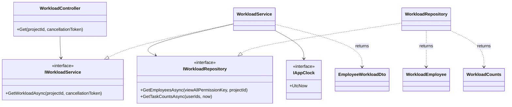
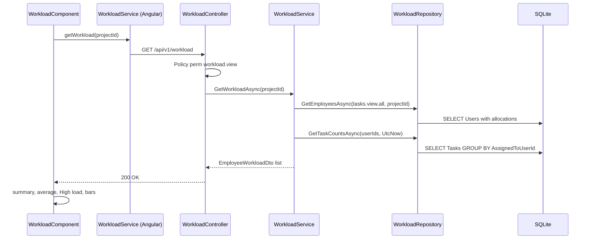
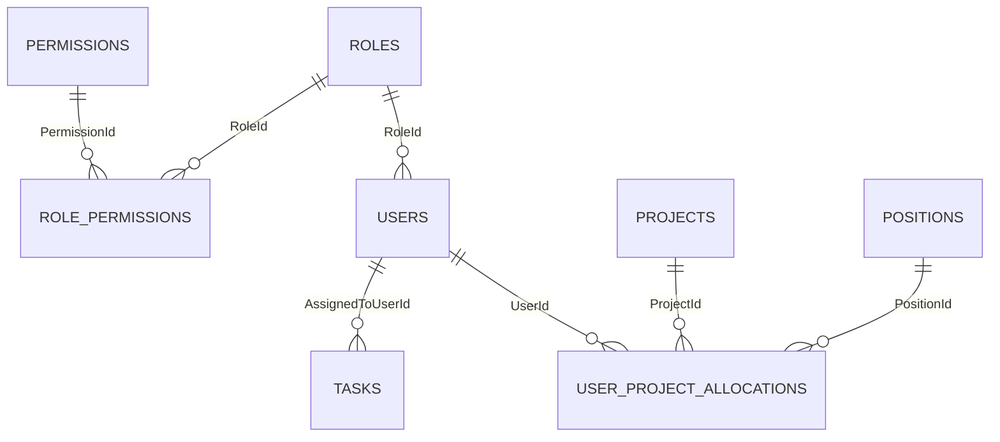

# Low-Level Design – Employee Workload

## TaskFlow – Intelligent Task Allocation & Tracking System

> **Document:** Low-Level Design (sub-module 02.2 Employee Workload, code `WORK`)  ·  **Version:** 1.0  ·  **Status:** Draft
> **Project type:** Personal Project (Skill Development)  ·  **Date:** 31-Oct-2026
> **Author:** Jojo George (jojogeorge3344@gmail.com)
> **Based on:** FRD-Employee-Workload v1.0, BRD-Employee-Workload v1.0, HLD-Employee-Workload v1.0, TDD v2.0
> © 2026 Jojo George. All rights reserved.

---

## Document Control

| Version | Date | Author | Summary of changes |
|---|---|---|---|
| 1.0 | 31-Oct-2026 | Jojo George | Initial version, derived from the code (`WorkloadController`, `WorkloadService`, `WorkloadRepository`, `WorkloadComponent`) and FRD-Employee-Workload v1.0 |

**Related documents:** BRD · FRD · HLD · TDD · Specs

| Document | Location |
|---|---|
| BRD – Employee Workload | `../../../BRD/02-TaskFlow-Monitoring/02.2-Employee-Workload/BRD-Employee-Workload.md` |
| FRD – Employee Workload (`FR-WORK-nn`) | `../../../FRD/02-TaskFlow-Monitoring/02.2-Employee-Workload/FRD-Employee-Workload.md` |
| HLD – Employee Workload | `../../../HLD/02-TaskFlow-Monitoring/02.2-Employee-Workload/HLD-Employee-Workload.md` |
| Overall LLD (stack, cross-cutting design, all tables) | `../../00-Overall/LLD-TaskFlow-Overall.md` |
| Sibling LLD – Task Management (owner of `Tasks`) | `../02.1-Task-Management/LLD-Task-Management.md` |
| TDD v2.0 | `TDD-TaskFlow.md` §6.6, §8.5 |

---

## 1. Introduction

### 1.1 Purpose
Detailed design of the Employee Workload screen (`/workload`): the single read-only endpoint, its service and repository
logic, the four task counts, the client-side average / "High load" rule, the filters and the **Tasks →** link, the tables
it reads, its security checks and its tests. It is detailed enough to maintain the code without reading it first.

### 1.2 Scope & Conventions
- Covered: sub-module `WORK` – backend `WorkloadController`, `IWorkloadService` / `WorkloadService`,
  `IWorkloadRepository` / `WorkloadRepository`, `WorkloadEmployee`, `WorkloadCounts`, `EmployeeWorkloadDto`; frontend
  `WorkloadComponent`, `WorkloadService` (Angular), `EmployeeWorkload`, `WorkloadSummary`.
- Not covered here (see the overall LLD and sibling LLDs): authentication, the `Tasks` table design (Task Management),
  `UserProjectAllocations` maintenance (Employee / Project Management), role and permission storage (Role Configuration).
- Naming: `*Controller`, `I*Service` / `*Service`, `I*Repository` / `*Repository`, DTOs `*Dto`; repository result records
  (`WorkloadEmployee`, `WorkloadCounts`) keep EF queries inside the repository layer.
- API base path: `/api/v1`; JSON camelCase with enums as names (`JsonStringEnumConverter`); errors as ProblemDetails.
- **Endpoint count:** facts.md §3 lists **1** controller action for this sub-module – `WorkloadController` `GET /api/v1/workload`.
  The screen also calls GET `/api/v1/projects` (owned by Project Management) to fill the Project filter.

---

## 2. Code Structure

### 2.1 Backend Folder Layout

```
backend/src/TaskFlow.Api/
  Controllers/Monitoring/WorkloadController.cs
  Services/Monitoring/EmployeeWorkload/IWorkloadService.cs, WorkloadService.cs
  Repositories/Monitoring/EmployeeWorkload/IWorkloadRepository.cs, WorkloadRepository.cs,
                                           WorkloadEmployee.cs, WorkloadCounts.cs
  Dtos/Monitoring/EmployeeWorkload/WorkloadDto.cs            (EmployeeWorkloadDto)
  Dtos/Management/EmployeeManagement/UserDto.cs              (ProjectAllocationDto, reused)
  Authorization/Policies/RequirePermissionAttribute.cs       (shared)
  Services/Settings/ApplicationSettings/Clock/IAppClock.cs   (shared clock)
  Config/ServiceRegistration.cs, Config/RepositoryRegistration.cs (DI, scoped)
```

### 2.2 Frontend Folder Layout

```
frontend/src/app/modules/monitoring/
  employee-workload/
    pages/workload.component.ts, workload.component.html     (WorkloadComponent)
    services/workload.service.ts                             (WorkloadService)
    models/workload.model.ts                                 (EmployeeWorkload, WorkloadSummary)
  monitoring.routes.ts                                       (path 'workload' + permissionGuard)
frontend/src/app/layouts/nav-items.ts                        (menu item "Employee Workload")
frontend/src/app/modules/management/project-management/services/project.service.ts (Project filter options)
frontend/src/app/shared/auth/  auth.guard.ts (permissionGuard), permissions.ts, auth.service.ts
```

### 2.3 Layer Rules

| Rule | Enforced by |
|---|---|
| Controller → Service → Repository only, through interfaces | `ArchitectureTests` (`TaskFlow.UnitTests/Architecture/ArchitectureTests.cs`) |
| Only `Persistence`, `Repositories` and startup touch `AppDbContext`; repositories never return `IQueryable` | `ArchitectureTests` |
| Controllers take/return no entities (the controller returns `EmployeeWorkloadDto`) | `ArchitectureTests` |
| Namespaces match folders; one interface per file beside its class | `ArchitectureTests` |
| Frontend module layout (`pages`, `services`, `models`) | `npm run check:structure` (`scripts/check-frontend-structure.mjs`, first step of `npm test`) |

---

## 3. Cross-Cutting Design

Shared design (pipeline, JWT and `SessionValidation`, `MfaSetupGateMiddleware`, ProblemDetails, logging) is described once
in the overall LLD (`../../00-Overall/LLD-TaskFlow-Overall.md`). Only what applies to this sub-module is listed.

| Concern | Design |
|---|---|
| Validation | No request body. `projectId` is bound from the query as `int?`; a non-integer value fails model binding (400 by `[ApiController]`). No FluentValidation validator exists for this endpoint |
| Error handling | `GlobalExceptionHandler` – any unexpected fault becomes a generic 500 "Something went wrong. Please try again." |
| Transactions | None – read-only; no `IUnitOfWork` call |
| Authorization | Class-level `[RequirePermission(PermissionKeys.WorkloadView)]` = policy `perm:workload.view`, satisfied by the `permission` claim that `SessionValidation` refreshes from the database on every request |
| Logging | `RequestLoggingMiddleware` (shared); refused authorizations recorded by `DeniedActionAuditHandler` |
| Time & time zone | "Overdue" is an instant comparison `Deadline < IAppClock.UtcNow` (UTC). The application time zone (`Application:Timezone`) is not used by this sub-module |

### 3.1 Exception → HTTP Status

| Exception / outcome | Status | When |
|---|---|---|
| Policy `perm:workload.view` fails | 403 | Caller's role lacks `workload.view` (empty body) |
| No / invalid token | 401 | Not signed in, token expired or session revoked |
| Model-binding failure | 400 | `projectId` is not an integer |
| Unhandled exception | 500 | Database or other fault (`GlobalExceptionHandler.GenericErrorDetail`) |

`BusinessRuleException`, `NotFoundException` and `ConflictException` are not raised by this sub-module; an unknown
`projectId` simply returns an empty array.

---

## 4. Module Designs

### 4.1 Module: TaskFlow Monitoring

#### 4.1.1 Child module: Employee Workload (`WORK`)

**Class / file inventory**

| Layer | Type | File | Responsibility |
|---|---|---|---|
| Controller | `WorkloadController` | `Controllers/Monitoring/WorkloadController.cs` | `[Route("api/v1/workload")]`, class-level `[RequirePermission(PermissionKeys.WorkloadView)]`; action `Get(int? projectId)` |
| Service | `IWorkloadService` / `WorkloadService` | `Services/Monitoring/EmployeeWorkload/` | `GetWorkloadAsync(projectId)` – joins employees with counts, sums allocations |
| Repository | `IWorkloadRepository` / `WorkloadRepository` (: `BaseRepository<User>`) | `Repositories/Monitoring/EmployeeWorkload/` | `GetEmployeesAsync`, `GetTaskCountsAsync` |
| Repository records | `WorkloadEmployee(Id, FullName, Projects)`, `WorkloadCounts(UserId, Active, HighPriority, Overdue, Completed)` | `Repositories/Monitoring/EmployeeWorkload/WorkloadEmployee.cs`, `WorkloadCounts.cs` | Typed query results |
| DTOs | `EmployeeWorkloadDto`; `ProjectAllocationDto` (reused) | `Dtos/Monitoring/EmployeeWorkload/WorkloadDto.cs`; `Dtos/Management/EmployeeManagement/UserDto.cs` | Response contract |
| Validator | – | – | None (query parameter only) |
| Clock | `IAppClock` / `AppClock` | `Services/Settings/ApplicationSettings/Clock/` | `UtcNow` for the Overdue count |
| Frontend page | `WorkloadComponent` (`app-workload`) | `modules/monitoring/employee-workload/pages/workload.component.ts` / `.html` | Screen, summary, high-load rule, filters, bars, link |
| Frontend service | `WorkloadService` | `modules/monitoring/employee-workload/services/workload.service.ts` | `getWorkload(projectId)` → `GET /api/v1/workload` |
| Frontend models | `EmployeeWorkload`, `WorkloadSummary` | `modules/monitoring/employee-workload/models/workload.model.ts` | Row and summary shapes |
| Frontend service (other module) | `ProjectService.getAll()` | `modules/management/project-management/services/project.service.ts` | Project filter options (GET `/api/v1/projects`) |
| Route / guard | path `'workload'`, `permissionGuard`, `data.permissions = [Permissions.WorkloadView]` | `modules/monitoring/monitoring.routes.ts` | Screen access |
| Menu | "Employee Workload" (`/workload`, icon `gauge`) | `layouts/nav-items.ts` | Shown only with `workload.view` |

**Class diagram**



**API contracts**

| # | Method | Route | Permission / policy | Request | Response | Status codes |
|---|---|---|---|---|---|---|
| 1 | GET | `/api/v1/workload` | `workload.view` (policy `perm:workload.view`, class-level `[RequirePermission]`) | Query `projectId` (optional `int`) | `IReadOnlyCollection<EmployeeWorkloadDto>` | 200, 400 (binding), 401, 403, 500 |

Consumed endpoint of another sub-module: GET `/api/v1/projects` (`projects.view`, Project Management) – options of the
Project filter. If it fails the drop-down simply stays at "All projects" (the subscription has no error handler).

**`EmployeeWorkloadDto`** (`record`, camelCase JSON)

| Property | Type | Source |
|---|---|---|
| `userId` | `int` | `User.Id` |
| `fullName` | `string` | `User.FullName` |
| `projects` | `IReadOnlyList<ProjectAllocationDto>` | Allocations ordered by project name |
| `allocatedPercent` | `int` | `Sum(projects.percent)` |
| `activeTasks` | `int` | `WorkloadCounts.Active` (0 when the user has no live task) |
| `highPriorityTasks` | `int` | `WorkloadCounts.HighPriority` |
| `overdueTasks` | `int` | `WorkloadCounts.Overdue` |
| `completedTasks` | `int` | `WorkloadCounts.Completed` |

**`ProjectAllocationDto`** (`record ProjectAllocationDto(int ProjectId, string ProjectName, int PositionId, string PositionName, int Percent)`)
→ JSON `projectId`, `projectName`, `positionId`, `positionName`, `percent` (matches the frontend `EmployeeWorkload.projects` type).

**Request / response example**

The endpoint is read-only (no write endpoint in this sub-module). Example: `GET /api/v1/workload` with query `projectId=3` → 200 OK

```json
[
  {
    "userId": 12,
    "fullName": "Asha Nair",
    "projects": [
      { "projectId": 3, "projectName": "Website Revamp", "positionId": 4, "positionName": "Developer", "percent": 60 }
    ],
    "allocatedPercent": 60,
    "activeTasks": 4,
    "highPriorityTasks": 1,
    "overdueTasks": 1,
    "completedTasks": 9
  }
]
```

**Service logic – `WorkloadService.GetWorkloadAsync(int? projectId, CancellationToken)`**
1. Authorization has already run (policy `perm:workload.view`); the service takes no user id – the result is
   organization-wide for every caller (FR-WORK-19).
2. Call `IWorkloadRepository.GetEmployeesAsync(PermissionKeys.TasksViewAll, projectId)` – active, non-deleted users whose
   role has **no stored grant** of `tasks.view.all`, optionally only those allocated to `projectId`, ordered by
   `FullName` then `Id`, each with its allocations (FR-WORK-01, FR-WORK-02, FR-WORK-08, FR-WORK-13).
3. If the list is empty, return `Array.Empty<EmployeeWorkloadDto>()` without a second query (FR-WORK-21).
4. Call `GetTaskCountsAsync(userIds, IAppClock.UtcNow)` – one grouped query over live tasks of those users (FR-WORK-03…06).
5. Build `byUser = counts.ToDictionary(UserId)`; for each employee (keeping the repository order) create an
   `EmployeeWorkloadDto` with the counts or **0** when the user has no live task (FR-WORK-07), and
   `AllocatedPercent = Projects.Sum(Percent)` (FR-WORK-08).
6. Return the list. Nothing is written (FR-WORK-20).

> Note: the Project filter narrows **who** is listed, not **which tasks** are counted – the four counts always cover all of
> the person's live tasks across every project (see §10).

**Frontend logic – `WorkloadComponent`**

| Member | Logic | FR |
|---|---|---|
| `ngOnInit()` | `projectService.getAll()` → `projects`; then `load()` | FR-WORK-13 |
| `load()` | `loading = true`, `error = null`; `workloadService.getWorkload(projectId())`; on error (`catchError → of(null)`) `error = "Could not load the workload. Check your connection and try again."`, else `rows.set(rows)` | FR-WORK-21, NFR-WORK-01 |
| `setProject(value)` | `projectId = Number(value)` or `null`; `employeeId = null`; `load()` (server reload) | FR-WORK-13 |
| `setEmployee(value)` | `employeeId = Number(value)` or `null` – no reload | FR-WORK-14 |
| `reset()` | Clears `projectId` and `employeeId`, `load()`; the **Reset** button is disabled while both are `null` | FR-WORK-14 |
| `filteredRows` (computed) | `rows` or only the row whose `userId === employeeId` | FR-WORK-14 |
| `summary` (computed) | `headcount = filteredRows.length`; `totalActive = Σ activeTasks`; `averageActive = headcount ? totalActive / headcount : 0`; `highLoadThreshold = 2 × averageActive` | FR-WORK-09 |
| `isHighLoad(row)` | `threshold > 0 && row.activeTasks >= threshold` → badge "High load" and class `workload-row--high` | FR-WORK-10 |
| `averageLabel()` | `averageActive.toFixed(1)` – used in the header and in the legend "Highlighted rows carry at least twice the average active load (X active tasks)." | FR-WORK-09, FR-WORK-11 |
| `maxActive` / `barWidth(row)` | `max(1, …activeTasks)`; width `round(activeTasks / maxActive × 100)` % | FR-WORK-12 |
| Overdue cell | class `workload-cell--overdue` when `overdueTasks > 0` | FR-WORK-05 |
| `canFilter` (computed) | `auth.hasPermission(Permissions.WorkloadFilters)` – shows the filter toolbar | FR-WORK-16 |
| `canOpenTasks` (computed) | `auth.hasPermission(Permissions.WorkloadTasksOpen)` – shows the **Tasks →** column; link `routerLink ['/tasks']` with `queryParams { assignedToUserId: row.userId }` | FR-WORK-15, FR-WORK-17 |
| Empty state | `!loading && rows.length === 0` → "No employees to show" / "There are no active employees in this project." | FR-WORK-21 |
| Header text | "Loading workload…" while loading with no rows; otherwise "N employee(s) · average X active tasks" | FR-WORK-09 |

**Sequence diagram**



**Repository methods**

| Method | Query / purpose | Notes |
|---|---|---|
| `GetEmployeesAsync(string viewAllPermissionKey, int? projectId)` | `Users` (`Set`) where `IsActive` and `!Role.Permissions.Any(grant => grant.Permission.Key == viewAllPermissionKey)`; if `projectId` given, `ProjectAllocations.Any(a => a.ProjectId == projectId)`; `OrderBy(FullName).ThenBy(Id)`; projected to `WorkloadEmployee` with `ProjectAllocations.OrderBy(a => a.Project.Name)` → `new ProjectAllocationDto(a.ProjectId, a.Project.Name, a.PositionId, a.Position.Name, a.AllocationPercent)` | Projection (untracked). Global query filters apply: `User` `!IsDeleted`; `UserProjectAllocation` `!User.IsDeleted && !Project.IsDeleted`. Checks the **stored** grant only (no `EffectivePermissions.Expand`). Uses PK of `RolePermissions` and `IX_Permissions_Key`, `IX_UserProjectAllocations_ProjectId` |
| `GetTaskCountsAsync(IReadOnlyCollection<int> userIds, DateTime now)` | `Db.Tasks` where `!IsDeleted && userIds.Contains(AssignedToUserId)`; `GroupBy(AssignedToUserId)` → `WorkloadCounts(Key, Active, HighPriority, Overdue, Completed)` | Active = `Status != Completed && Status != Cancelled`; HighPriority = Active and `Priority is High or Critical`; Overdue = Active and `Deadline < now`; Completed = `Status == Completed`. Users without live tasks are absent from the result. Uses `IX_Tasks_AssignedToUserId` |

**Validation rules**

| Field | Rule | Message |
|---|---|---|
| `projectId` (query) | Optional; must bind to `int` | Framework model-binding 400 (ProblemDetails `errors`) |
| `projectId` value | Not checked for existence | – (an unknown or deleted project yields `[]`) |

**Error cases**

| Case | Exception / result | Status |
|---|---|---|
| Caller lacks `workload.view` | Policy failure | 403 |
| Not signed in / session invalid | JWT bearer challenge | 401 |
| No matching employees | Empty array (screen: "No employees to show") | 200 |
| Database fault | Unhandled → `GlobalExceptionHandler` | 500 |
| Client receives any error | `WorkloadComponent.load` shows "Could not load the workload. Check your connection and try again." with **Retry** | – |

**State machine (if any)**

_Not applicable for this sub-module._ The screen changes no state; task statuses are only read.

---

## 5. Database Design

The sub-module **owns no tables and writes nothing**. It reads the tables below; their full design (all columns, migrations)
is in the owning LLDs (Task Management for `Tasks`; Employee / Project Management for `Users`, `UserProjectAllocations`,
`Projects`, `Positions`; Role Configuration for `Roles`, `Permissions`, `RolePermissions`). Only the columns used here are listed.

### 5.1 ER Diagram



### 5.2 Tables

#### `Users` (`User`) – read

| Column | Type | Null | Key / index | Default | Description |
|---|---|:---:|---|---|---|
| Id | INTEGER | No | PK | identity | `userId` |
| FullName | TEXT(200) | No | – | – | `fullName`; sort key |
| RoleId | INTEGER | No | FK → `Roles.Id` (Restrict), `IX_Users_RoleId` | – | Joins to the role's grants |
| IsActive | INTEGER (bool) | No | – | – | Only active users are listed |
| IsDeleted | INTEGER (bool) | No | Global query filter `!IsDeleted` | – | Deleted users never listed |

#### `RolePermissions` (`RolePermission`) and `Permissions` (`Permission`) – read

| Column | Type | Null | Key / index | Default | Description |
|---|---|:---:|---|---|---|
| RolePermissions.RoleId | INTEGER | No | PK (`RoleId`, `PermissionId`), FK → `Roles.Id` (Cascade) | – | Role holding a grant |
| RolePermissions.PermissionId | INTEGER | No | PK, FK → `Permissions.Id` (Restrict), `IX_RolePermissions_PermissionId` | – | Granted permission |
| Permissions.Key | TEXT(100) | No | Unique `IX_Permissions_Key` | – | Compared with `tasks.view.all` |

#### `UserProjectAllocations` (`UserProjectAllocation`) – read

| Column | Type | Null | Key / index | Default | Description |
|---|---|:---:|---|---|---|
| UserId | INTEGER | No | PK (`UserId`, `ProjectId`), FK → `Users.Id` (Cascade) | – | Employee |
| ProjectId | INTEGER | No | PK, FK → `Projects.Id` (Cascade), `IX_UserProjectAllocations_ProjectId` | – | Project filter, Projects column |
| PositionId | INTEGER | No | FK → `Positions.Id` (Restrict), `IX_UserProjectAllocations_PositionId` | – | `positionId` / `positionName` |
| AllocationPercent | INTEGER | No | Check `CK_UserProjectAllocations_AllocationPercent` (1–100) | – | `percent`, summed into `allocatedPercent` |
| IsProjectManager | INTEGER (bool) | No | – | – | Not used by this sub-module |

#### `Projects` (`Project`) and `Positions` (`Position`) – read

| Column | Type | Null | Key / index | Default | Description |
|---|---|:---:|---|---|---|
| Projects.Name | TEXT(200) | No | Unique `IX_Projects_Name` (filter `IsDeleted = 0`) | – | `projectName`; allocation order |
| Projects.IsDeleted | INTEGER (bool) | No | Global query filter | – | Deleted projects drop out of allocations |
| Positions.Name | TEXT(100) NOCASE | No | Unique `IX_Positions_Name` | – | `positionName` |

#### `Tasks` (`Task`) – read

| Column | Type | Null | Key / index | Default | Description |
|---|---|:---:|---|---|---|
| AssignedToUserId | INTEGER | No | FK → `Users.Id` (Restrict), `IX_Tasks_AssignedToUserId` | – | Group key |
| Status | INTEGER (`TaskStatus`) | No | – | – | Active / Completed |
| Priority | INTEGER (`TaskPriority`) | No | – | – | High priority count |
| Deadline | TEXT (UTC `DateTime`) | No | `IX_Tasks_Deadline` | – | Overdue count |
| IsDeleted | INTEGER (bool) | No | **No global filter** – explicit `!IsDeleted` in the query | – | Deleted tasks never counted |

### 5.3 Indexes, Constraints & Triggers

| Object | Definition | Purpose |
|---|---|---|
| `IX_Tasks_AssignedToUserId` | `Tasks (AssignedToUserId)` | Grouped count per assignee |
| `IX_UserProjectAllocations_ProjectId` | `UserProjectAllocations (ProjectId)` | Project filter |
| `IX_Permissions_Key` | Unique `Permissions (Key)` | `tasks.view.all` lookup |
| `CK_UserProjectAllocations_AllocationPercent` | `"AllocationPercent" BETWEEN 1 AND 100` | Valid percentages |
| Global query filters | `User: !IsDeleted`; `UserProjectAllocation: !User.IsDeleted && !Project.IsDeleted`; `Project: !IsDeleted` | Soft-deleted rows excluded |
| Triggers | – | None used by this sub-module |

### 5.4 Enumerations

| Enum | Values | Stored as |
|---|---|---|
| `TaskStatus` | `ToDo`, `InProgress`, `Blocked`, `Completed`, `Cancelled`, `InQA` (appended last) | INTEGER (no conversion on `Tasks`); JSON as names |
| `TaskPriority` | `Low`, `Medium`, `High`, `Critical` | INTEGER; JSON as names |

Count mapping: Active = not `Completed`/`Cancelled` (so `ToDo`, `InProgress`, `Blocked`, `InQA`); High priority = Active and
`High`/`Critical`.

### 5.5 Migrations

| Migration | Change relevant to this sub-module |
|---|---|
| `20261012124843_AddTasks` | Creates `Tasks` |
| `20261013104629_AddTaskReminderSettings` | Creates `IX_Tasks_AssignedToUserId`, `IX_Tasks_Deadline` |
| `20261019133820_AddRolesAndPermissions` | Creates `Roles`, `Permissions`, `RolePermissions`, `Users.RoleId` |
| `20261023160825_UserProjectAllocationsAndDepartments` | Creates `Positions`, `UserProjectAllocations` (check constraint, indexes) |
| `20261023173211_AddProjectManagerFlag` | Adds `UserProjectAllocations.IsProjectManager` |

The workload keys `workload.view`, `workload.filters.use`, `workload.tasks.open` are seeded from `PermissionCatalog`
(granted to the Manager system role on first seeding; `AccessControlSeeder` grants the Administrator every permission on every start).

---

## 6. Algorithms & Background Jobs

| Job / algorithm | Trigger / schedule | Steps | Idempotency |
|---|---|---|---|
| Workload aggregation (`WorkloadService.GetWorkloadAsync`) | Each `GET /api/v1/workload` | Candidate users → grouped counts → left-join with zero default → sum allocations | Pure read; same input and clock give the same result |
| High-load rule (`WorkloadComponent.isHighLoad`) | Whenever `filteredRows` changes | `avg = Σ active / rows`; badge when `active ≥ 2 × avg` and `avg > 0` | Client-only, recomputed by Angular signals |
| Bar scaling (`barWidth`) | Same | `round(active / max(1, max active) × 100)` % | Client-only |

No background job belongs to this sub-module.

---

## 7. Security Design (detailed)

| Item | Implementation |
|---|---|
| Endpoint permission | `[RequirePermission(PermissionKeys.WorkloadView)]` on the class → policy `perm:workload.view` (`RequireClaim(AuthClaims.Permission, "workload.view")`) |
| Claim freshness | `SessionValidation` replaces role and permission claims from the database on every request, so a role change applies to the next call |
| Data scope | Organization for every caller holding `workload.view`; the service takes no caller id (FR-WORK-19) |
| Who is listed | Users whose role has **no stored** `tasks.view.all` grant (`PermissionKeys.TasksViewAll`) |
| `workload.filters.use` | **Frontend only** (`canFilter`); the API accepts `projectId` without it |
| `workload.tasks.open` | **Frontend only** (`canOpenTasks`); the Task List it opens applies the caller's own task scope (`TaskService.VisibilityForCallerAsync`) |
| Screen access | `permissionGuard` with `Permissions.WorkloadView`; otherwise redirect to `dashboardRouteFor(role, permissions)` |
| Menu | `nav-items.ts` adds "Employee Workload" only when `workload.view` is held (under **TaskFlow Monitoring** with `tasks.view.all`, otherwise under **Task Management**) |
| Audit | Refused authorizations recorded by `DeniedActionAuditHandler` (identifiers only) |
| Secrets | None handled |

---

## 8. Configuration

_Not applicable for this sub-module._ Workload has no configuration keys of its own. Inherited keys that affect it:

| Key | Default | Purpose |
|---|---|---|
| `Mfa:Required` | `true` | `MfaSetupGateMiddleware` blocks the call until the user has set up MFA |
| `Jwt:Issuer` | `TaskFlow` | Token validation for the bearer token |
| `ConnectionStrings:Default` | `<secret>` | SQLite database |

---

## 9. Testing Design

Paths are relative to `backend/tests`. Only the file names are available; coverage is inferred from them.

| Area | Test class / file | Type | Covers |
|---|---|---|---|
| Workload endpoint | `TaskFlow.IntegrationTests/Monitoring/EmployeeWorkload/WorkloadEndpointsTests.cs` | Integration | `GET /api/v1/workload` – 200 / 403, project filter, response shape |
| Workload service | `TaskFlow.UnitTests/Monitoring/EmployeeWorkload/WorkloadServiceTests.cs` | Unit | Counts (active, high priority, overdue, completed), zero rows, ordering |
| Custom roles | `TaskFlow.UnitTests/Monitoring/EmployeeWorkload/CustomRoleWorkloadTests.cs` | Unit | Who is listed when a custom role holds or lacks `tasks.view.all` |
| Harness | `TaskFlow.UnitTests/TestSupport/WorkloadReportHarness.cs` | Support | Shared fixture for workload and report tests |
| Architecture | `TaskFlow.UnitTests/Architecture/ArchitectureTests.cs` | Unit | Layer, folder and naming rules |
| Frontend | – | – | No spec file for `WorkloadComponent` (facts: 0 frontend spec files); client rules checked manually |

> ⚠️ To be confirmed: the exact cases inside each test file (only file names are available).

---

## 10. Known Limitations & Open Issues

- `workload.filters.use` and `workload.tasks.open` are enforced only in the frontend (R-WORK-01).
- Workload is organization-wide, not narrowed to a Manager's team (FR-WORK-19, R-WORK-02).
- The Project filter limits the listed people but **not the counted tasks**: counts include the person's tasks in every project.
- The "listed employee" test reads the stored grant only. `EffectivePermissions.LegacyChildren` currently maps no legacy key
  to `tasks.view.all`, so the case described in R-WORK-03 cannot occur with today's catalog; it would if such a mapping were added.
- "High load" is relative to the rows shown, so selecting a single Employee never shows the badge.
- No Department column or filter, unlike original BRD Screen 16 (R-WORK-04).
- The Project filter options come from GET `/api/v1/projects`, which needs `projects.view`; without it the drop-down only
  offers "All projects".
- No paging: every listed employee is returned in one response.

---

## 11. Traceability (FRD → code)

| FRD requirement | Endpoint / class | Test |
|---|---|---|
| FR-WORK-01 | `GET /api/v1/workload` · `WorkloadRepository.GetEmployeesAsync` (role without stored `tasks.view.all`, ordered by name) | `WorkloadServiceTests.cs`, `CustomRoleWorkloadTests.cs` |
| FR-WORK-02 | `WorkloadRepository.GetEmployeesAsync` (`IsActive`, `User` query filter) | `WorkloadServiceTests.cs` |
| FR-WORK-03 | `WorkloadRepository.GetTaskCountsAsync` (Active) · `EmployeeWorkloadDto.ActiveTasks` | `WorkloadServiceTests.cs` |
| FR-WORK-04 | `GetTaskCountsAsync` (HighPriority) | `WorkloadServiceTests.cs` |
| FR-WORK-05 | `GetTaskCountsAsync` (Overdue, `IAppClock.UtcNow`) · `workload-cell--overdue` | `WorkloadServiceTests.cs` |
| FR-WORK-06 | `GetTaskCountsAsync` (Completed) | `WorkloadServiceTests.cs` |
| FR-WORK-07 | `WorkloadService.GetWorkloadAsync` (zero default) | `WorkloadServiceTests.cs` |
| FR-WORK-08 | `GetEmployeesAsync` (`ProjectAllocationDto`) · `AllocatedPercent` sum | `WorkloadEndpointsTests.cs` |
| FR-WORK-09 | `WorkloadComponent.summary`, `averageLabel()` | Manual UI |
| FR-WORK-10 | `WorkloadComponent.isHighLoad` | Manual UI |
| FR-WORK-11 | `workload.component.html` legend | Manual UI |
| FR-WORK-12 | `WorkloadComponent.maxActive`, `barWidth` | Manual UI |
| FR-WORK-13 | `GET /api/v1/workload` (`projectId`) · `WorkloadComponent.setProject` | `WorkloadEndpointsTests.cs` |
| FR-WORK-14 | `WorkloadComponent.setEmployee`, `filteredRows`, `reset` | Manual UI |
| FR-WORK-15 | **Tasks →** `routerLink ['/tasks']` + `assignedToUserId` · `GET /api/v1/tasks` scope in `TaskService` | `TasksEndpointsTests.cs` |
| FR-WORK-16 | `WorkloadComponent.canFilter` (`workload.filters.use`) | Manual UI |
| FR-WORK-17 | `WorkloadComponent.canOpenTasks` (`workload.tasks.open`) | Manual UI |
| FR-WORK-18 | `[RequirePermission(PermissionKeys.WorkloadView)]` · `permissionGuard` · `nav-items.ts` | `WorkloadEndpointsTests.cs` |
| FR-WORK-19 | `WorkloadService.GetWorkloadAsync` (no caller scope) | `WorkloadServiceTests.cs` |
| FR-WORK-20 | Only `GET`; no `IUnitOfWork` in `WorkloadService` | Code inspection (no write path) |
| FR-WORK-21 | Empty array · `WorkloadComponent.load` error text and empty state | Manual UI |
| FR-WORK-22 | Same rules as `TaskBucketRules` / `ToCard` (`Deadline < now`, not Completed/Cancelled, not deleted) | `WorkloadServiceTests.cs` |

---
<sub>© 2026 Jojo George. All rights reserved. Unauthorized copying or distribution of this document is prohibited.</sub>
