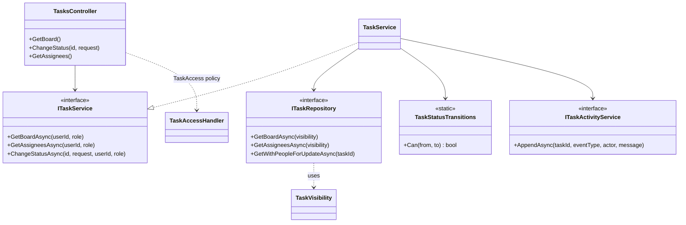
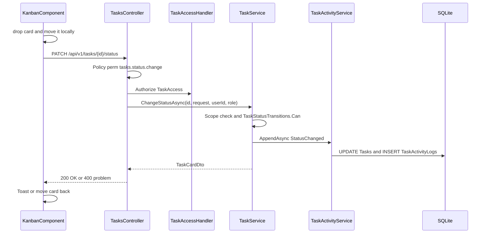
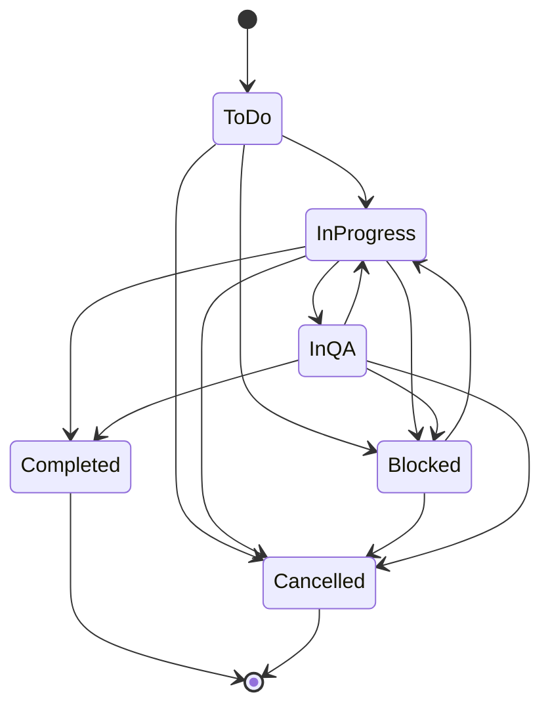
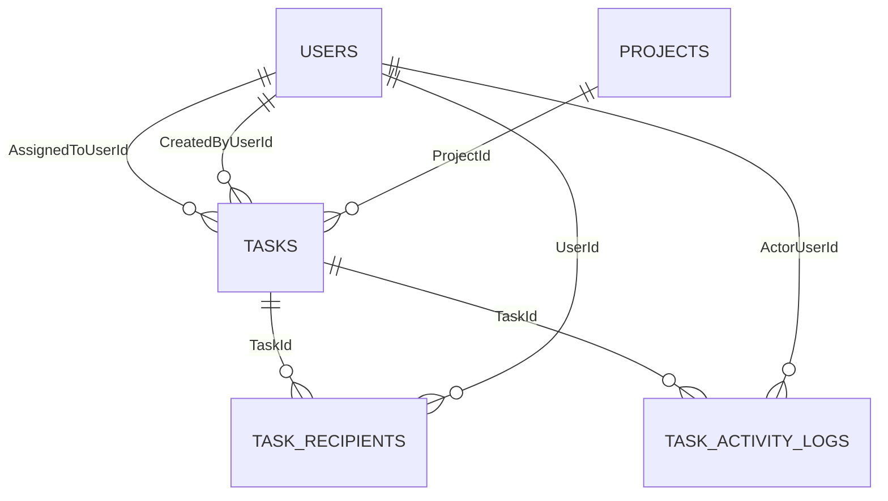

# Low-Level Design – Board

## TaskFlow – Intelligent Task Allocation & Tracking System

> **Document:** Low-Level Design (sub-module 02.3 Board, code `BOARD`)  ·  **Version:** 1.0  ·  **Status:** Draft
> **Project type:** Personal Project (Skill Development)  ·  **Date:** 31-Oct-2026
> **Author:** Jojo George (jojogeorge3344@gmail.com)
> **Based on:** FRD-Board v1.0, BRD-Board v1.0, HLD-Board v1.0, TDD v2.0
> © 2026 Jojo George. All rights reserved.

---

## Document Control

| Version | Date | Author | Summary of changes |
|---|---|---|---|
| 1.0 | 31-Oct-2026 | Jojo George | Initial version, derived from the code (`TasksController` board actions, `TaskService`, `TaskRepository`, `TaskStatusTransitions`, `KanbanComponent`) and FRD-Board v1.0 |

**Related documents:** BRD · FRD · HLD · TDD · Specs

| Document | Location |
|---|---|
| BRD – Board | `../../../BRD/02-TaskFlow-Monitoring/02.3-Board/BRD-Board.md` |
| FRD – Board (`FR-BOARD-nn`) | `../../../FRD/02-TaskFlow-Monitoring/02.3-Board/FRD-Board.md` |
| HLD – Board | `../../../HLD/02-TaskFlow-Monitoring/02.3-Board/HLD-Board.md` |
| Overall LLD (stack, cross-cutting design, all tables) | `../../00-Overall/LLD-TaskFlow-Overall.md` |
| Sibling LLD – Task Management (owner of `TasksController`, `TaskService`, `Tasks`, `TaskActivityLogs`) | `../02.1-Task-Management/LLD-Task-Management.md` |
| TDD v2.0 | `TDD-TaskFlow.md` §6.6, §8.5, Appendix A (transition table) |

---

## 1. Introduction

### 1.1 Purpose
Detailed design of the Kanban Board (`/board`): the three backend actions it calls, the task-scope and transition logic
behind them, the client-side grouping, filtering and optimistic drag-and-drop, the data it reads and writes, its security
checks and its tests.

### 1.2 Scope & Conventions
- The Board has **no backend classes of its own**. It is a frontend screen (`KanbanComponent`) over `TasksController`
  actions that belong to Task Management. This LLD documents only the parts the board uses; the full classes are in the
  Task Management LLD.
- Naming: `*Controller`, `I*Service` / `*Service`, `I*Repository` / `*Repository`, DTOs `*Dto` / `*Request`.
- API base path: `/api/v1`; JSON camelCase with enums as names (`JsonStringEnumConverter`); errors as ProblemDetails.
- **Endpoint count:** facts.md §3 lists **1** controller action authorized by a board key – `TasksController`
  `GET /api/v1/tasks/board` (`board.view`). The board also calls **2** shared `TasksController` actions –
  `PATCH /api/v1/tasks/{id}/status` (`tasks.status.change`) and `GET /api/v1/tasks/assignees` – so **3** actions in total,
  all counted once under Task Management. It also calls GET `/api/v1/projects` (Project Management) for the Project filter.

---

## 2. Code Structure

### 2.1 Backend Folder Layout

```
backend/src/TaskFlow.Api/            (all shared with Task Management)
  Controllers/Monitoring/TasksController.cs                     GetBoard, ChangeStatus, GetAssignees
  Services/Monitoring/TaskManagement/Tasks/ITaskService.cs, TaskService.cs
  Services/Monitoring/TaskManagement/Rules/TaskStatusTransitions.cs, TaskAccessScope.cs
  Services/Monitoring/TaskManagement/Access/ITaskAccessService.cs, TaskAccessService.cs
  Services/Monitoring/TaskManagement/Activity/ITaskActivityService.cs, TaskActivityService.cs
  Repositories/Monitoring/TaskManagement/Tasks/ITaskRepository.cs, TaskRepository.cs, TaskVisibility.cs
  Dtos/Monitoring/TaskManagement/TaskDtos.cs (TaskCardDto, TaskRecipientDto), TaskRequests.cs (UpdateTaskStatusRequest)
  Dtos/Monitoring/TaskManagement/Validators/UpdateTaskStatusRequestValidator.cs
  Authorization/TaskAccess/TaskAccessRequirement.cs, TaskAccessHandler.cs
  Models/Enums/TaskStatus.cs, TaskPriority.cs, TaskActivityEventType.cs
```

### 2.2 Frontend Folder Layout

```
frontend/src/app/modules/monitoring/
  board/pages/kanban.component.ts, kanban.component.html, kanban.model.ts   (KanbanComponent, BoardColumn)
  task-management/models/task.model.ts      (TaskCard, TaskRecipient, TaskStatus, BOARD_STATUSES)
  task-management/services/task.service.ts  (getBoard, changeStatus, getAssignees)
  monitoring.routes.ts                      (path 'board' + permissionGuard)
frontend/src/app/layouts/nav-items.ts       (menu item "Board")
frontend/src/app/shared/utils/api-error.ts  (apiErrorMessage), shared/services/toast.service.ts (ToastService)
```

### 2.3 Layer Rules

| Rule | Enforced by |
|---|---|
| Controller → Service → Repository only, through interfaces | `ArchitectureTests` (`TaskFlow.UnitTests/Architecture/ArchitectureTests.cs`) |
| Repositories never save; services commit via `IUnitOfWork` | `ArchitectureTests` |
| Controllers do not validate (validation in `ValidationFilter`) and return DTOs only | `ArchitectureTests` |
| Transition rules in a pure class (`TaskStatusTransitions`) shared by board and Task Details | Code structure; unit-tested in `TaskTrackingDomainTests` |
| Frontend module layout | `npm run check:structure` |

---

## 3. Cross-Cutting Design

Shared design (pipeline, JWT and `SessionValidation`, `MfaSetupGateMiddleware`, logging) is in the overall LLD
(`../../00-Overall/LLD-TaskFlow-Overall.md`). Only what applies here:

| Concern | Design |
|---|---|
| Validation | `ValidationFilter` runs `UpdateTaskStatusRequestValidator` (`Status` `IsInEnum`); an unknown status name fails JSON binding first (400) |
| Error handling | `GlobalExceptionHandler`: `AppException` → its status with the message as `detail`; `ConcurrencyConflictException` → 409; anything else → 500 |
| Transactions | Request-scoped `AppDbContext` shared through `IUnitOfWork`. `TaskActivityService.AppendAsync` saves on each call, so the status update and the `StatusChanged` entry are committed together by the first save; the `Completed` entry and the final `SaveChangesAsync` follow |
| Authorization | Permission policies `perm:board.view`, `perm:tasks.status.change` + resource policy `AuthPolicies.TaskAccess` (`TaskAccessHandler`) + scope check in `TaskService` |
| Logging | `RequestLoggingMiddleware`; refused authorizations recorded by `DeniedActionAuditHandler` |
| Time & time zone | `TaskService.Now` = `TimeProvider.GetUtcNow()` (UTC). Overdue is the instant rule `Deadline < now`. The client deadline filter and the card date use the **browser** time zone (`localDateKey`, `toLocaleDateString`) |

### 3.1 Exception → HTTP Status

| Exception / outcome | Status | When |
|---|---|---|
| `BusinessRuleException` | 400 | Transition not allowed – "Cannot move a task from {from} to {to}." |
| Validation / binding failure | 400 | `status` missing, not a `TaskStatus` name |
| Policy failure / `Forbid()` | 403 | Lacks `board.view` or `tasks.status.change`; `TaskAccess` fails (task not live or not the caller's) |
| `ForbiddenException` | 403 | Manager-scoped caller outside the team – "You do not have access to this task." |
| `NotFound()` | 404 | Task vanished between the access check and the load |
| `ConcurrencyConflictException` | 409 | Concurrent change of the same task row ("Someone else changed this record while you were saving. Reload it and try again.") |
| Unhandled | 500 | "Something went wrong. Please try again." |

---

## 4. Module Designs

### 4.1 Module: TaskFlow Monitoring

#### 4.1.1 Child module: Board (`BOARD`)

**Class / file inventory**

| Layer | Type | File | Responsibility |
|---|---|---|---|
| Controller | `TasksController` (shared) | `Controllers/Monitoring/TasksController.cs` | `GetBoard`, `ChangeStatus`, `GetAssignees`; `TryGetCurrentUser` (claims `NameIdentifier`, `Role`), `CanAccessTaskAsync` |
| Service | `ITaskService` / `TaskService` (shared) | `Services/Monitoring/TaskManagement/Tasks/` | `GetBoardAsync`, `GetAssigneesAsync`, `ChangeStatusAsync`, `VisibilityForCallerAsync`, `CanAccessTaskAsync`, `ToCard` |
| Rules | `TaskStatusTransitions`, `TaskAccessScope` | `Services/Monitoring/TaskManagement/Rules/` | Transition table; resource access rule |
| Access | `ITaskAccessService` / `TaskAccessService`; `TaskAccessHandler`, `TaskAccessRequirement` | `Services/Monitoring/TaskManagement/Access/`; `Authorization/TaskAccess/` | Resource policy `TaskAccess` |
| Activity | `ITaskActivityService` / `TaskActivityService` | `Services/Monitoring/TaskManagement/Activity/` | `AppendAsync` history entries |
| Repository | `ITaskRepository` / `TaskRepository`, `TaskVisibility` | `Repositories/Monitoring/TaskManagement/Tasks/` | `GetBoardAsync`, `GetAssigneesAsync`, `GetWithPeopleForUpdateAsync`, `GetRecipientsAsync`, `IsTeamTaskAsync`, `GetLiveAsync`, `GetRecipientIdsAsync` |
| Other repositories | `IRoleRepository.GetPermissionKeysByRoleNameAsync`, `IEmployeeRepository.GetTeamMemberIdsAsync` | `Repositories/Settings/RoleConfiguration/Roles/`, `Repositories/Management/EmployeeManagement/Employees/` | Caller's effective keys; Manager team |
| DTOs | `TaskCardDto`, `TaskRecipientDto`, `UpdateTaskStatusRequest` | `Dtos/Monitoring/TaskManagement/TaskDtos.cs`, `TaskRequests.cs` | Contracts |
| Validator | `UpdateTaskStatusRequestValidator` | `Dtos/Monitoring/TaskManagement/Validators/` | `Status` in enum |
| Frontend page | `KanbanComponent` (`app-kanban`) | `modules/monitoring/board/pages/kanban.component.ts` / `.html` | Columns, cards, filters, drag-and-drop (`@angular/cdk/drag-drop`: `CdkDropListGroup`, `CdkDropList`, `CdkDrag`) |
| Frontend model | `BoardColumn`; `TaskCard`, `TaskRecipient`, `TaskStatus`, `BOARD_STATUSES` | `board/pages/kanban.model.ts`; `task-management/models/task.model.ts` | Shapes |
| Frontend service | `TaskService` (Angular, shared) | `task-management/services/task.service.ts` | `getBoard()`, `changeStatus(id, request)`, `getAssignees()` |
| Route / guard | path `'board'`, `permissionGuard`, `data.permissions = [Permissions.BoardView]` | `modules/monitoring/monitoring.routes.ts` | Screen access |
| Menu | "Board" (`/board`, icon `kanban`) | `layouts/nav-items.ts` | Shown only with `board.view` |

**Class diagram**



**API contracts**

| # | Method | Route | Permission / policy | Request | Response | Status codes |
|---|---|---|---|---|---|---|
| 1 | GET | `/api/v1/tasks/board` | `[Authorize]` + `board.view` (`[RequirePermission(PermissionKeys.BoardView)]`) | – | `IReadOnlyCollection<TaskCardDto>` (ordered by `Deadline`) | 200, 401, 403, 500 |
| 2 | PATCH | `/api/v1/tasks/{id}/status` | `[Authorize]` + `tasks.status.change` (`Policy = perm:tasks.status.change`) + `TaskAccess` + service scope | `UpdateTaskStatusRequest` | `TaskCardDto` | 200, 400, 401, 403, 404, 409, 500 |
| 3 | GET | `/api/v1/tasks/assignees` | `[Authorize]` (scope applied by the service); the board calls it only with `tasks.view.all` | – | `IReadOnlyCollection<TaskRecipientDto>` (ordered by `FullName`) | 200, 401, 500 |

Consumed endpoint of another sub-module: GET `/api/v1/projects` (`projects.view`) – Project filter options; on error the list is empty.

**`TaskCardDto`** (`record`)

| Property | Type | Source |
|---|---|---|
| `id`, `taskCode`, `title` | `int`, `string`, `string` | `Task` |
| `assignedToUserId`, `assignedToName` | `int`, `string` | `Task.AssignedToUserId`, `AssignedTo.FullName` (`""` when missing) |
| `priority` | `TaskPriority` (name) | `Task.Priority` |
| `deadline` | `DateTime` (UTC) | `Task.Deadline` |
| `status` | `TaskStatus` (name) | `Task.Status` → column |
| `isOverdue` | `bool` | `Deadline < now && Status != Completed && Status != Cancelled` |
| `projectId`, `projectName` | `int?`, `string?` | `Task.ProjectId`, `Project.Name` |

`TaskRecipientDto(int UserId, string FullName)`; `UpdateTaskStatusRequest(TaskStatus Status)`.

**Request / response example** – `PATCH /api/v1/tasks/{id}/status` for task 42

```json
{ "status": "Completed" }
```

200 OK

```json
{ "id": 42, "taskCode": "TSK-000042", "title": "Prepare Q4 release notes", "assignedToUserId": 12,
  "assignedToName": "Asha Nair", "priority": "High", "deadline": "2026-11-03T12:30:00Z",
  "status": "Completed", "isOverdue": false, "projectId": 3, "projectName": "Website Revamp" }
```

400 when not allowed (ProblemDetails)

```json
{ "status": 400, "detail": "Cannot move a task from Completed to InProgress." }
```

**Service logic – `TaskService.GetBoardAsync(userId, role)`**
1. `now = TimeProvider.GetUtcNow().UtcDateTime`.
2. `VisibilityForCallerAsync(userId, role)`: read the role's keys (`GetPermissionKeysByRoleNameAsync` + `EffectivePermissions.Expand`).
   - No `tasks.view.all` → `TaskVisibility(userId, ViewAll: false)` (Own: assigned, created or recipient).
   - `tasks.view.all` and manager-scoped (`dashboard.view.team` without `dashboard.view.organization`) →
     `TaskVisibility(userId, ViewAll: true, TeamUserIds: GetTeamMemberIdsAsync(userId), OrOwn: true)` (Team + own).
   - Otherwise → `TaskVisibility(userId, ViewAll: true)` (Organization). (FR-BOARD-01)
3. `ITaskRepository.GetBoardAsync(visibility)` – all live (`!IsDeleted`) visible tasks, ordered by `Deadline`, no paging (FR-BOARD-05).
4. Map each with `ToCard(task, now)` (sets `IsOverdue`, FR-BOARD-04). Cancelled tasks are returned; the client drops them (FR-BOARD-02).

**Service logic – `TaskService.ChangeStatusAsync(taskId, request, userId, role)`** (after controller checks)
1. Controller: policy `perm:tasks.status.change`; `CanAccessTaskAsync(id)` → `AuthorizeAsync(User, id, AuthPolicies.TaskAccess)`;
   `TaskAccessHandler` → `TaskAccessService.CanAccessAsync` (live task; `tasks.view.all` claim, or assignee / creator / recipient). Failure → `Forbid()` (403).
2. `GetWithPeopleForUpdateAsync(taskId)` (tracked, `IgnoreQueryFilters`, includes `AssignedTo`, `CreatedBy`, `Project`); `null` → 404.
3. `CanAccessTaskAsync(task, recipients, userId, role)` – `TaskAccessScope.CanAccess` and, for manager-scoped callers,
   `IsTeamTaskAsync`; failure → `ForbiddenException("You do not have access to this task.")` (FR-BOARD-08).
4. `TaskStatusTransitions.Can(task.Status, request.Status)`; false → `BusinessRuleException("Cannot move a task from {from} to {to}.")` (FR-BOARD-08).
5. Set `Status`, `UpdatedAt = now`; `CompletedAt = now` for Completed; `CancelledAt = now` for Cancelled.
6. `AppendAsync(StatusChanged, "Status changed from {old} to {new}", oldValue, newValue)`; for Completed also
   `AppendAsync(Completed, "Task completed")` (FR-BOARD-12).
7. `IUnitOfWork.SaveChangesAsync`; return `ToCard(task, Now)`. No notification or mail is sent.

**Service logic – `TaskService.GetAssigneesAsync`** – same `VisibilityForCallerAsync`, then `TaskRepository.GetAssigneesAsync`
(distinct assignee id and name of visible tasks, ordered by name) (FR-BOARD-14).

**Frontend logic – `KanbanComponent`**

| Member | Logic | FR |
|---|---|---|
| `ngOnInit()` | If `canManage` (`tasks.view.all`) → `getAssignees()`; `projectService.getAll()`; `load()` | FR-BOARD-14 |
| `load()` | `getBoard()` → `tasks`, `rebuild()`; on error `tasks = []`, `error = "Could not load the board. Try again."`; also used by **Refresh** and **Retry** | FR-BOARD-18, FR-BOARD-19 |
| `rebuild()` | `matched = tasks.filter(matches)`; `columns = BOARD_STATUSES.map(status → matched with that status)` – `BOARD_STATUSES` = `ToDo`, `InProgress`, `InQA`, `Blocked`, `Completed` (no `Cancelled`) | FR-BOARD-01, FR-BOARD-02 |
| `matches(task)` | AND of Project, Assignee, Status, and `localDateKey(deadline)` within `deadlineFrom`…`deadlineTo` (inclusive) | FR-BOARD-13 |
| Header | "Loading board…" or "`taskCount()` tasks across `columns().length` stages" | FR-BOARD-06 |
| `drop(event, targetStatus)` | Same container → return (sorting disabled by `[cdkDropListSortingDisabled]="true"`); resolve source/target columns; ignore if same status or card status differs; else `commitStatusChange` | FR-BOARD-05, FR-BOARD-09 |
| `commitStatusChange(card, from, to)` | `updateLocalStatus(card, to)` at once; `changeStatus(card.id, { status: to })`; success → toast "{code} moved to {label}"; error → `updateLocalStatus(card, from)` and toast `apiErrorMessage(err, "Could not move {code}.")` | FR-BOARD-10, FR-BOARD-11 |
| `canMove` | `hasPermission(Permissions.TasksStatus)` → `[cdkDragDisabled]="!canMove()"` | FR-BOARD-07 |
| `canFilter` | `hasPermission(Permissions.BoardFilters)` → filter row | FR-BOARD-15 |
| `canManage` | `hasPermission(Permissions.TasksViewAll)` → Assignee filter | FR-BOARD-14 |
| `clearFilters()` / `hasFilters` | Reset all five filters; **Clear** disabled while `!hasFilters()` | FR-BOARD-16 |
| `filteredEmpty` | `hasFilters && tasks.length > 0 && matchedCount === 0` → "No tasks match the current filters." + **Clear filters** | FR-BOARD-17 |
| Empty column | `@empty` → "Drop tasks here" | FR-BOARD-17 |
| `open(task)` | `router.navigate(['/tasks', id], { queryParams: { returnUrl: '/board' } })` (click or Enter) | FR-BOARD-20 |
| Card | `kanban__card--overdue` and `kanban__deadline--overdue` when `isOverdue`; priority chip `kanban__priority--{priority}` | FR-BOARD-03, FR-BOARD-04 |

**Sequence diagram – move a card**



**Repository methods**

| Method | Query / purpose | Notes |
|---|---|---|
| `TaskRepository.GetBoardAsync(TaskVisibility)` | `Visible(visibility).IgnoreQueryFilters().Include(AssignedTo).Include(Project).OrderBy(Deadline)` | `AsNoTracking`; `!IsDeleted`; no status filter, no paging; `IX_Tasks_Deadline` |
| `TaskRepository.GetAssigneesAsync(TaskVisibility)` | `Visible(...)` → distinct `{ AssignedToUserId, AssignedTo.FullName }`, ordered by name in memory | `IgnoreQueryFilters` keeps deleted users' names |
| `Visible(visibility)` (private) | `Scoped(userId, viewAll)`; with `TeamUserIds`, limited to `TeamTasks` (assignee or a recipient in the team), plus own when `OrOwn` | `Scoped` without view-all = assigned, created or `TaskRecipients` row |
| `GetWithPeopleForUpdateAsync(taskId)` | Tracked task with `AssignedTo`, `CreatedBy`, `Project`, `!IsDeleted` | Used by the status change |
| `GetRecipientsAsync(taskId)` | `TaskRecipients` with user names | Scope check |
| `IsTeamTaskAsync(taskId, teamUserIds)` | `TeamTasks(...).AnyAsync` | Manager-scoped callers |
| `GetLiveAsync(taskId)`, `GetRecipientIdsAsync(taskId)` | Used by `TaskAccessService` | Resource policy |
| `EmployeeRepository.GetTeamMemberIdsAsync(managerId)` | Active users in departments the manager manages or projects where the manager has `IsProjectManager` | Team scope |
| `RoleRepository.GetPermissionKeysByRoleNameAsync(roleName)` | Stored keys of the role | Expanded by `EffectivePermissions.Expand` |

**Validation rules**

| Field | Rule | Message |
|---|---|---|
| `status` (body) | Required `TaskStatus` name (`ToDo`, `InProgress`, `Blocked`, `Completed`, `Cancelled`, `InQA`); `IsInEnum` | Binding / FluentValidation default (400 ProblemDetails `errors`) |
| Transition | `TaskStatusTransitions.Can(from, to)` | "Cannot move a task from {from} to {to}." |
| Deadline to (client) | `[min]="deadlineFrom()"`; Deadline from `[max]="deadlineTo()"` | – (date picker blocks it) |

**Error cases**

| Case | Exception | Status |
|---|---|---|
| No `board.view` on `GET /api/v1/tasks/board` | Policy failure | 403 |
| No `tasks.status.change` | Policy failure (drag also disabled on screen) | 403 |
| Task not live or not the caller's | `TaskAccess` fails → `Forbid()` | 403 |
| Manager-scoped caller, task outside team | `ForbiddenException` | 403 |
| Transition not allowed | `BusinessRuleException` | 400 |
| Concurrent save on the same task | `ConcurrencyConflictException` | 409 |
| Any failed move (client) | Card moved back; toast with server `detail` or "Could not move {code}." | – |
| Board load fails (client) | "Could not load the board. Try again." with **Retry** | – |

**State machine (`TaskStatusTransitions.Can`)** – same table for the board and Task Details; staying in the same status is
always allowed (the board never sends it); `Completed` and `Cancelled` are terminal.



The board has no Cancelled column, so `Cancelled` targets are reached only from Task Details.

---

## 5. Database Design

The Board **owns no tables**. It reads `Tasks`, `Users`, `Projects`, `TaskRecipients` and the role tables, updates `Tasks`
and appends to `TaskActivityLogs`. The full table designs are in the Task Management LLD; only the columns used are listed.

### 5.1 ER Diagram



### 5.2 Tables

#### `Tasks` (`Task`) – read and updated

| Column | Type | Null | Key / index | Default | Description |
|---|---|:---:|---|---|---|
| Id | INTEGER | No | PK | identity | Card id |
| TaskCode | TEXT(32) | No | Unique `IX_Tasks_TaskCode` | – | Card code, toast text |
| Title | TEXT(200) | No | – | – | Card title |
| AssignedToUserId | INTEGER | No | FK → `Users.Id` (Restrict), `IX_Tasks_AssignedToUserId` | – | Assignee, scope, Assignee filter |
| CreatedByUserId | INTEGER | No | FK → `Users.Id` (Restrict), `IX_Tasks_CreatedByUserId` | – | Own scope |
| ProjectId | INTEGER | Yes | FK → `Projects.Id` (Restrict), `IX_Tasks_ProjectId` | – | Card project, Project filter |
| Priority | INTEGER (`TaskPriority`) | No | – | – | Priority chip |
| Deadline | TEXT (UTC) | No | `IX_Tasks_Deadline` | – | Order, overdue, deadline filter |
| Status | INTEGER (`TaskStatus`) | No | – | – | Column; **updated** on drop |
| UpdatedAt | TEXT (UTC) | No | – | – | **Set** on every move |
| CompletedAt | TEXT (UTC) | Yes | – | – | **Set** when moved to Completed |
| CancelledAt | TEXT (UTC) | Yes | – | – | Set for Cancelled (not reachable from the board) |
| ActualHours | TEXT (decimal) | Yes | Concurrency token | – | Not changed here; a concurrent hours update causes 409 |
| IsDeleted | INTEGER (bool) | No | **No global filter** – explicit `!IsDeleted` | – | Deleted tasks excluded |

#### `TaskActivityLogs` (`TaskActivityLog`) – inserted

| Column | Type | Null | Key / index | Default | Description |
|---|---|:---:|---|---|---|
| Id | INTEGER | No | PK | identity | – |
| TaskId | INTEGER | No | FK → `Tasks.Id` (Cascade), `IX_TaskActivityLogs_TaskId_CreatedAt` | – | Task |
| EventType | TEXT(32) (`TaskActivityEventType` as string) | No | – | – | `StatusChanged`, `Completed` |
| ActorUserId | INTEGER | No | FK → `Users.Id` (Restrict), `IX_TaskActivityLogs_ActorUserId` | – | Caller |
| OldValue / NewValue | TEXT | Yes | – | – | Old and new status names |
| Message | TEXT | No | – | – | "Status changed from X to Y" / "Task completed" |
| CreatedAt | TEXT (UTC) | No | `IX_TaskActivityLogs_TaskId_CreatedAt` | – | `TimeProvider` now |

#### `TaskRecipients` (`TaskRecipient`) – read

| Column | Type | Null | Key / index | Default | Description |
|---|---|:---:|---|---|---|
| Id | INTEGER | No | PK | identity | – |
| TaskId | INTEGER | No | FK → `Tasks.Id` (Cascade), unique `IX_TaskRecipients_TaskId_UserId` | – | Own / team scope |
| UserId | INTEGER | No | FK → `Users.Id` (Cascade) | – | Recipient |

`Users` (`FullName`, `IsActive`, `IsDeleted`), `Projects` (`Name`), `RolePermissions` / `Permissions` (`Key`),
`DepartmentManagers`, `UserDepartments` and `UserProjectAllocations` (`IsProjectManager`) are read for names and scope only.

### 5.3 Indexes, Constraints & Triggers

| Object | Definition | Purpose |
|---|---|---|
| `IX_Tasks_Deadline` | `Tasks (Deadline)` | Board ordering |
| `IX_Tasks_AssignedToUserId`, `IX_Tasks_CreatedByUserId` | Single-column | Own scope |
| `IX_TaskRecipients_TaskId_UserId` | Unique `(TaskId, UserId)` | Recipient scope |
| `IX_TaskActivityLogs_TaskId_CreatedAt` | `(TaskId, CreatedAt)` | History per task |
| `Tasks.ActualHours` concurrency token | `IsConcurrencyToken()` | Lost-update protection (409) |
| `User` global query filter | `!IsDeleted` – bypassed with `IgnoreQueryFilters` so deleted assignees keep their name | Card assignee |
| Triggers | – | None used |

### 5.4 Enumerations

| Enum | Values | Stored as |
|---|---|---|
| `TaskStatus` | `ToDo`, `InProgress`, `Blocked`, `Completed`, `Cancelled`, `InQA` (appended last to keep stored values) | INTEGER; JSON names; frontend `TaskStatus` union |
| `TaskPriority` | `Low`, `Medium`, `High`, `Critical` | INTEGER; JSON names |
| `TaskActivityEventType` (used) | `StatusChanged`, `Completed` (full enum in the Task Management LLD) | TEXT(32) |

Board column labels (`STATUS_LABELS`): `ToDo` "To Do", `InProgress` "In Progress", `InQA` "In QA", `Blocked` "Blocked",
`Completed` "Completed".

### 5.5 Migrations

| Migration | Change relevant to the board |
|---|---|
| `20261012124843_AddTasks` | Creates `Tasks`, `TaskRecipients` |
| `20261013075057_AddTaskTracking` | Creates `TaskActivityLogs` (and its indexes) |
| `20261013104629_AddTaskReminderSettings` | Creates `IX_Tasks_Deadline`, `IX_Tasks_TaskCode`, `IX_TaskRecipients_TaskId_UserId` |
| `20261020173455_RenameDepartmentsToProjectsAndAddDepartments` | `Tasks.DepartmentId` → `ProjectId`, index `IX_Tasks_ProjectId` |
| `20261024074305_AddTaskActualHours` | Adds `Tasks.ActualHours` (concurrency token) |

`InQA` needs no migration: `TaskStatus` is stored as an integer and `InQA` was appended last.

---

## 6. Algorithms & Background Jobs

| Job / algorithm | Trigger / schedule | Steps | Idempotency |
|---|---|---|---|
| Task visibility (`VisibilityForCallerAsync` + `Visible`) | Each board / assignees call | Effective keys → Own / Team+own / Organization query | Pure read |
| Overdue flag (`ToCard`) | Each card mapping | `Deadline < UtcNow` and not Completed/Cancelled | Not stored |
| Transition check (`TaskStatusTransitions.Can`) | Each status change | Table lookup (§4.1.1) | Same status → allowed |
| Optimistic move (`commitStatusChange`) | Drop on another column | Local update → PATCH → keep or roll back | Rollback restores the previous status |
| Reminder engine (Notification, `ReminderSchedulerService`) | `Reminders:TickSeconds` (60) | Candidate query excludes `Completed` / `Cancelled`, so a task moved to Completed gets no further reminders | `ReminderHistory` unique index (Notification LLD) |

---

## 7. Security Design (detailed)

| Item | Implementation |
|---|---|
| Board data | `[RequirePermission(PermissionKeys.BoardView)]` → `perm:board.view`; content limited by `TaskVisibility` |
| Status change | `[Authorize(Policy = PermissionPolicy.Prefix + PermissionKeys.TasksStatus)]` → `perm:tasks.status.change`; then `TaskAccess` (`TaskAccessHandler` uses the `tasks.view.all` claim); then `TaskService.CanAccessTaskAsync` (team check, defence in depth) |
| Assignees | `[Authorize]` only; scoped by the service; client calls it only with `tasks.view.all` |
| Caller identity | `ClaimTypes.NameIdentifier` and `ClaimTypes.Role` from the token (`TryGetCurrentUser`); never from the request |
| Claim freshness | `SessionValidation` refreshes role and permission claims on every request |
| `board.filters.use` | **Frontend only** (`canFilter`); filters only narrow already-authorized data |
| Screen / menu | `permissionGuard` (`Permissions.BoardView`) → else `dashboardRouteFor(...)`; `nav-items.ts` places "Board" under **TaskFlow Monitoring** with `tasks.view.all`, otherwise under **Task Management** |
| Task Details from a card | `/tasks/{id}` route; Task Details applies its own `TaskAccess` check |
| Audit | `DeniedActionAuditHandler` records refused authorizations; every accepted move is in `TaskActivityLogs` |
| Default grants | `board.view`, `board.filters.use`, `tasks.status.change`: Manager and Employee (`GrantToAllExistingRoles`); `tasks.view.own` always on; Administrator holds every key |

---

## 8. Configuration

_Not applicable for this sub-module._ The board has no configuration keys of its own. Inherited keys that affect it:

| Key | Default | Purpose |
|---|---|---|
| `Reminders:SchedulerEnabled` / `Reminders:TickSeconds` | `true` / `60` | Reminder engine that stops reminding once a task is Completed |
| `Mfa:Required` | `true` | `MfaSetupGateMiddleware` blocks calls until MFA is set up |
| `ConnectionStrings:Default` | `<secret>` | SQLite database |

---

## 9. Testing Design

Backend paths are relative to `backend/tests`, frontend paths to `frontend/src/app/`. "Covers" was checked against the
test sources.

| Area | Test class / file | Type | Covers |
|---|---|---|---|
| Transition table | `TaskFlow.UnitTests/Monitoring/TaskManagement/Rules/TaskTrackingDomainTests.cs` | Unit | `TaskStatusTransitions.Can`, overdue rule |
| Task service | `TaskFlow.UnitTests/Monitoring/TaskManagement/Tasks/TaskServiceTests.cs` | Unit | Visibility / scope, board list and project on cards, `ChangeStatusAsync` (allowed and disallowed moves, unrelated employee, `StatusChanged` / `Completed` entries, `CompletedAt`) |
| Deleted tasks | `TaskFlow.UnitTests/Monitoring/TaskManagement/Tasks/TaskDeletionTests.cs` | Unit | A deleted task is gone from the board |
| Custom roles | `TaskFlow.UnitTests/Monitoring/TaskManagement/Tasks/CustomRolePermissionTests.cs` | Unit | Task scope for custom roles (`tasks.view.all`); no `tasks.status.change` case |
| Harness | `TaskFlow.UnitTests/TestSupport/TaskTrackingServiceHarness.cs` | Support | Shared fixture |
| Task endpoints | `TaskFlow.IntegrationTests/Monitoring/TaskManagement/TasksEndpointsTests.cs` | Integration | `GET /api/v1/tasks/board` (Manager all, Employee scoped, 401), status change (allowed with history, disallowed 400) |
| Module permissions | `TaskFlow.IntegrationTests/Common/ModuleBasedPermissionEndpointsTests.cs` | Integration | Endpoint keys such as `board.view` |
| Architecture | `TaskFlow.UnitTests/Architecture/ArchitectureTests.cs` | Unit | Layer rules |
| Board page | `modules/monitoring/board/pages/kanban.component.spec.ts` | Frontend unit | Five columns, card click to details with `returnUrl`, drop to another column, same-column drop ignored, rollback and toast on 4xx, error state, filter row by `board.filters.use`, Assignee filter for Managers only, Project / Status / Deadline filters (AND), Clear, filtered-empty state, drop while filtered |
| Board route and menu | `routes/app.routes.spec.ts`, `layouts/nav-items.spec.ts` | Frontend unit | `permissionGuard` with `board.view`; Board menu placement and `board.view` gate |

Both `TasksEndpointsTests.cs` (`GetBoard_*`) and `ModuleBasedPermissionEndpointsTests.cs` (`board.view` row) call
`GET /api/v1/tasks/board` directly.

---

## 10. Known Limitations & Open Issues

- `GET /api/v1/tasks/board` is not paged; every visible task (including Cancelled ones) is returned and filtered on the client (R-BOARD-01).
- Cancelled tasks are dropped by the client (`BOARD_STATUSES`), not by the server. They still count in `matchedCount`, so when the
  filters match only cancelled tasks the "No tasks match the current filters." state is not shown (empty columns instead).
- `board.filters.use` is enforced only on the screen (R-BOARD-02).
- The Task List **Board view** button is not gated by `board.view`; the guard then redirects (R-BOARD-04).
- The deadline filter uses the browser's calendar date; Overdue is an instant comparison in UTC. Users in another time zone
  can see a card in a deadline range that differs from the application-time-zone date.
- The status change is committed in more than one `SaveChangesAsync` (each `AppendAsync` saves). If the `Completed` entry fails
  after the first save, the new status and `StatusChanged` entry are already stored.
- The API allows a same-status PATCH (records "Status changed from X to X"); the board never sends it.
- Original BRD Screen 10 specified four columns; the built board has five (adds In QA) and no Cancelled column.

---

## 11. Traceability (FRD → code)

| FRD requirement | Endpoint / class | Test |
|---|---|---|
| FR-BOARD-01 | `GET /api/v1/tasks/board` · `TaskService.GetBoardAsync`, `VisibilityForCallerAsync`, `TaskRepository.GetBoardAsync` · `KanbanComponent.rebuild` | `TaskServiceTests.cs`, `TasksEndpointsTests.cs`, `kanban.component.spec.ts` |
| FR-BOARD-02 | `BOARD_STATUSES` (no Cancelled) · `!IsDeleted` in `Scoped` | `TaskDeletionTests.cs` (deleted tasks; no test for hiding cancelled cards) |
| FR-BOARD-03 | `TaskCardDto` · `kanban.component.html` card | `TaskServiceTests.cs`, `kanban.component.spec.ts` |
| FR-BOARD-04 | `TaskService.ToCard` (`IsOverdue`) · `kanban__card--overdue` | `TaskTrackingDomainTests.cs` |
| FR-BOARD-05 | `OrderBy(Deadline)` · `[cdkDropListSortingDisabled]` · `drop` same-container return | `kanban.component.spec.ts` (same-column drop ignored; the deadline order is not asserted) |
| FR-BOARD-06 | `taskCount()` header | Manual UI |
| FR-BOARD-07 | `PATCH /api/v1/tasks/{id}/status` policy `perm:tasks.status.change` · `canMove` / `cdkDragDisabled` | `PermissionAuthorizationTests.cs` (every catalog key has a policy); `cdkDragDisabled`: Manual UI |
| FR-BOARD-08 | `TaskAccessHandler`, `TaskService.CanAccessTaskAsync`, `TaskStatusTransitions.Can`, `BusinessRuleException` | `TaskTrackingDomainTests.cs`, `TaskServiceTests.cs`, `TasksEndpointsTests.cs` |
| FR-BOARD-09 | `KanbanComponent.drop` (same column / same status ignored) | `kanban.component.spec.ts` |
| FR-BOARD-10 | `commitStatusChange`, `updateLocalStatus`, `apiErrorMessage` | `kanban.component.spec.ts` |
| FR-BOARD-11 | `commitStatusChange` success toast | `kanban.component.spec.ts` |
| FR-BOARD-12 | `TaskService.ChangeStatusAsync` · `TaskActivityService.AppendAsync` (`StatusChanged`, `Completed`) · `CompletedAt` | `TaskServiceTests.cs`, `TasksEndpointsTests.cs` |
| FR-BOARD-13 | `KanbanComponent.matches`, `localDateKey` | `kanban.component.spec.ts` |
| FR-BOARD-14 | `GET /api/v1/tasks/assignees` · `TaskService.GetAssigneesAsync` · `canManage` | `kanban.component.spec.ts` |
| FR-BOARD-15 | `canFilter` (`board.filters.use`) | `kanban.component.spec.ts` |
| FR-BOARD-16 | `clearFilters`, `hasFilters` | `kanban.component.spec.ts` |
| FR-BOARD-17 | `@empty` "Drop tasks here" · `filteredEmpty` | `kanban.component.spec.ts` (filtered-empty state; "Drop tasks here" is not asserted) |
| FR-BOARD-18 | **Refresh** → `load()` | Manual UI |
| FR-BOARD-19 | `load()` error branch | `kanban.component.spec.ts` |
| FR-BOARD-20 | `open(task)` → `/tasks/{id}` with `returnUrl` | `kanban.component.spec.ts`, `task-details.component.spec.ts` |
| FR-BOARD-21 | `[RequirePermission(PermissionKeys.BoardView)]` · `permissionGuard` · `nav-items.ts` | `ModuleBasedPermissionEndpointsTests.cs`, `app.routes.spec.ts`, `nav-items.spec.ts` |
| FR-BOARD-22 | `nav-items.ts` (`canViewAllTasks` branch) | `nav-items.spec.ts` |

---
<sub>© 2026 Jojo George. All rights reserved. Unauthorized copying or distribution of this document is prohibited.</sub>
