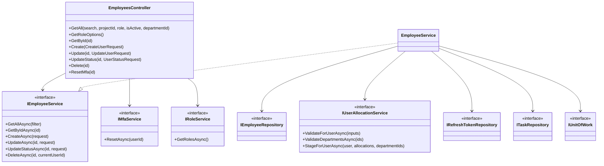
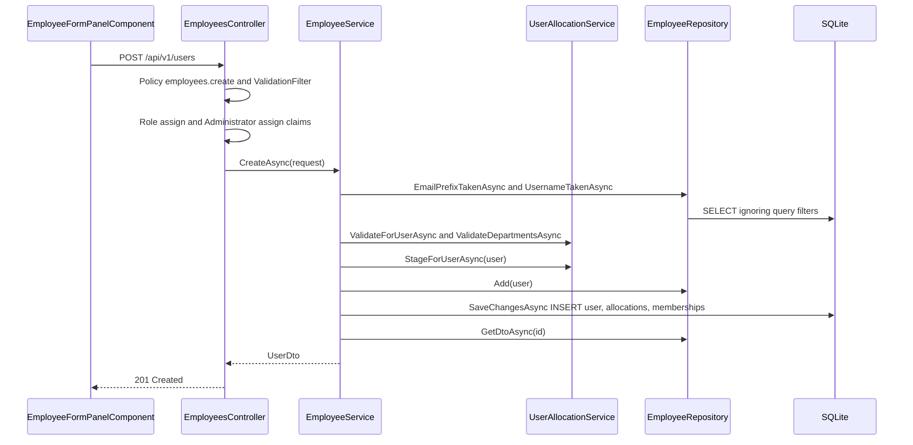
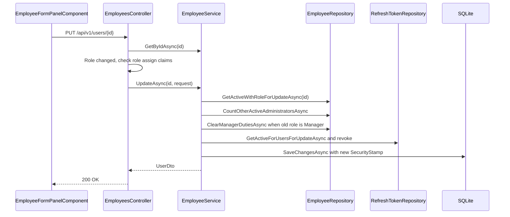
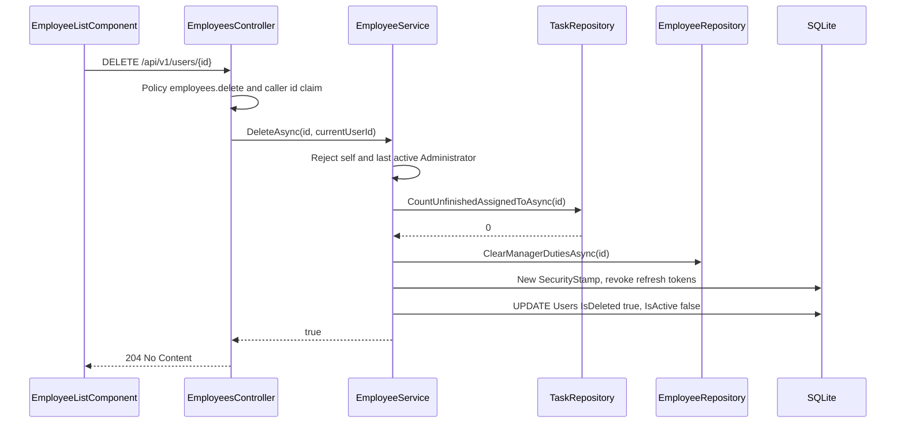
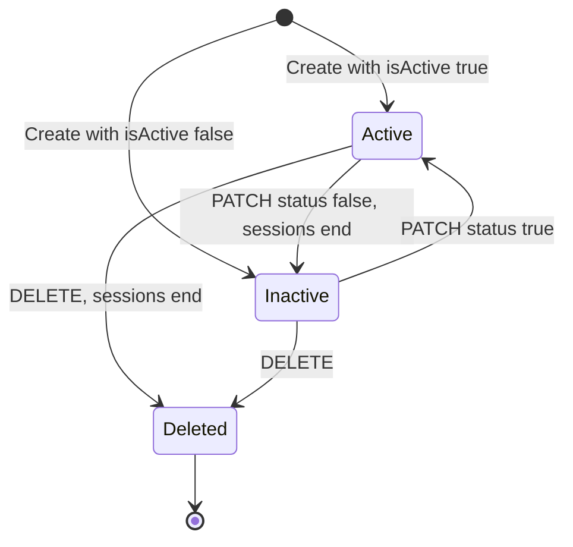
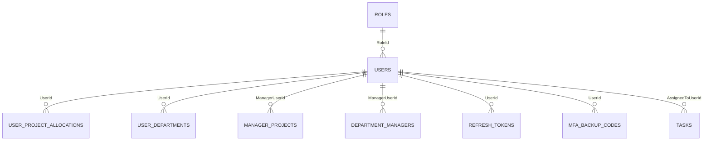

# Low-Level Design – Employee Management

## TaskFlow – Intelligent Task Allocation & Tracking System

> **Document:** Low-Level Design (sub-module EMP)  ·  **Version:** 1.0  ·  **Status:** Draft
> **Project type:** Personal Project (Skill Development)  ·  **Date:** 31-Oct-2026
> **Author:** Jojo George (jojogeorge3344@gmail.com)
> **Module:** TaskFlow Management  ·  **Sub-module:** 03.1 Employee Management (code `EMP`)
> **Based on:** HLD – Employee Management v1.0, FRD – Employee Management v1.0, TaskFlow as built
> © 2026 Jojo George. All rights reserved.

---

## Document Control

| Version | Date | Author | Summary of changes |
|---|---|---|---|
| 1.0 | 31-Oct-2026 | Jojo George | Initial version, derived from and verified against the TaskFlow source code (backend, frontend and tests) |

**Related documents:**

| Document | Location |
|---|---|
| BRD – Employee Management | `../../../BRD/03-TaskFlow-Management/03.1-Employee-Management/BRD-Employee-Management.md` |
| FRD – Employee Management (`FR-EMP-nn`, traced in section 11) | `../../../FRD/03-TaskFlow-Management/03.1-Employee-Management/FRD-Employee-Management.md` |
| HLD – Employee Management | `../../../HLD/03-TaskFlow-Management/03.1-Employee-Management/HLD-Employee-Management.md` |
| LLD – Overall (shared stack, cross-cutting design, Authentication) | `../../00-Overall/LLD-TaskFlow-Overall.md` |
| Related LLDs | `../03.2-Project-Management/LLD-Project-Management.md`, `../03.3-Department-Management/LLD-Department-Management.md` |
| TDD | `TF - Documents/TF - TDD/TDD-TaskFlow.md` |

---

## 1. Introduction

### 1.1 Purpose
Detailed design of the Employee Management sub-module: the `EmployeesController` actions on `/api/v1/users`, the
`EmployeeService` business rules, the allocation and department staging done through `UserAllocationService` when an
employee is created, the `EmployeeRepository` queries, the `Users` table, and the Angular screen that calls them – enough
to implement or maintain the code.

### 1.2 Scope & Conventions
- Covers: employee list, details, create, edit (incl. role change), activate / deactivate, soft delete, administrator
  MFA reset, and the role options list for the employee form.
- Not covered here: project teams and positions (Project Management LLD), department members (Department Management
  LLD), sign-in, session validation and MFA enrolment (overall LLD, Authentication).
- Naming: `*Controller`, `I*Service` / `*Service`, `I*Repository` / `*Repository`, DTOs `*Dto` / `*Request`,
  validators `*RequestValidator`.
- API base path `/api/v1`; JSON camelCase; enums serialised as strings (`JsonStringEnumConverter`); errors as
  RFC 7807 ProblemDetails (`ValidationProblemDetails` for field errors).
- **Endpoint count:** `EmployeesController` has **8** actions (counted from the code); all 8 are documented in 4.1.1.

---

## 2. Code Structure

### 2.1 Backend Folder Layout

```
backend/src/TaskFlow.Api/
  Controllers/Management/EmployeesController.cs
  Services/Management/EmployeeManagement/Employees/        IEmployeeService.cs, EmployeeService.cs
  Services/Management/EmployeeManagement/Allocations/      IUserAllocationService.cs, UserAllocationService.cs (shared with PROJ)
  Repositories/Management/EmployeeManagement/Employees/    IEmployeeRepository.cs, EmployeeRepository.cs
  Repositories/Management/EmployeeManagement/Allocations/  IUserAllocationRepository.cs, UserAllocationRepository.cs (shared with PROJ)
  Dtos/Management/EmployeeManagement/                      UserDto.cs (all records)
  Dtos/Management/EmployeeManagement/Validators/           CreateUserRequestValidator.cs, UpdateUserRequestValidator.cs, UserStatusRequestValidator.cs
  Models/Entities/                                         User.cs (UserProjectAllocation.cs, UserDepartment.cs staged on create)
  Common/Rules/EmailPolicy.cs
  Common/Security/                                         PermissionKeys.cs, PermissionCatalog.cs, EffectivePermissions.cs, SystemRoles.cs
  Services/Auth/Mfa/                                       IMfaService.cs, MfaService.cs (ResetAsync, owned by Authentication)
```

### 2.2 Frontend Folder Layout

```
frontend/src/app/modules/management/
  management.routes.ts                                     path 'employees' (permissionGuard, EmployeeScreenPermissions)
  employee-management/pages/                               employee-list.component.ts/.html, employee-list.model.ts
  employee-management/components/                          employee-form-panel.component.ts/.html, employee-form-panel.model.ts,
                                                           employee-details-panel.component.ts
  employee-management/services/user.service.ts
  employee-management/models/user.model.ts
  components/position-combobox.component.ts                (owned by PROJ, used in allocation rows)
frontend/src/app/shared/auth/permissions.ts                EmployeeScreenPermissions
frontend/src/app/layouts/nav-items.ts                      Employee Management menu item
```

### 2.3 Layer Rules

| Rule | Enforced by |
|---|---|
| Controller → Service → Repository; controllers never touch `AppDbContext` | `ArchitectureTests` (`TaskFlow.UnitTests/Architecture/ArchitectureTests.cs`) |
| Repositories stage changes; the service commits through `IUnitOfWork.SaveChangesAsync` | Code convention (`EmployeeService`, `UserAllocationService`) |
| Frontend module folder shape (`pages`, `components`, `services`, `models`) | `npm run check:structure` (`scripts/check-frontend-structure.mjs`) |

---

## 3. Cross-Cutting Design

Shared mechanisms are described once in the overall LLD (`../../00-Overall/LLD-TaskFlow-Overall.md`); this table lists
how they apply to Employee Management.

| Concern | Design |
|---|---|
| Validation | `ValidationFilter` (registered globally in `CrossCuttingRegistration`) runs the FluentValidation validator of each bound argument; failure → 400 `ValidationProblemDetails`. Business checks run in `EmployeeService` / `UserAllocationService` |
| Error handling | `GlobalExceptionHandler` maps `AppException` subclasses to ProblemDetails (3.1) |
| Transactions | One `IUnitOfWork.SaveChangesAsync` per write; user row, allocations, memberships, manager-link removals and refresh-token revocations commit together |
| Authorization | `[RequirePermission(PermissionKeys.X)]` policy per action, plus inline claim checks `CanManageRoles()` (`employees.role.assign`) and `CanAssignAdministrator()` (`roles.administrator.assign`); permission claims are refreshed from the database on every request; legacy `employees.manage` expands to create / edit / status / MFA reset (`EffectivePermissions.LegacyChildren`) |
| Sessions | `EndSessionsAsync` rotates `User.SecurityStamp` and sets `RefreshToken.RevokedAt`; the session validation in Authentication rejects tokens carrying the old stamp |
| Soft delete | Global query filter `!IsDeleted` on `Users`; dependent filters on `UserProjectAllocations`, `UserDepartments`, `RefreshTokens` |
| Time | `DateTime.UtcNow` for `CreatedAt` / `UpdatedAt`; `MfaService` uses `TimeProvider` |
| Logging | No module-specific logging; unhandled exceptions logged by `GlobalExceptionHandler` |

### 3.1 Exception → HTTP Status

| Exception | Status | When (this sub-module) |
|---|---|---|
| `BusinessRuleException` | 400 | Invalid / duplicate email or username, unknown role / department / project / position, allocation rules, last active Administrator, self-delete, unfinished tasks |
| `RequestValidationException` / validator failure | 400 | Field rules of `CreateUserRequestValidator`, `UpdateUserRequestValidator` (field-error map) |
| `Forbid()` from the controller | 403 | Role change without `employees.role.assign`; Administrator role without `roles.administrator.assign`; `GET /api/v1/users/roles` without `employees.role.assign` or `roles.manage`; `GET /api/v1/users/{id}` for another person without `employees.edit` |
| Policy failure | 403 | Missing `employees.*` permission on the action |
| `NotFound()` | 404 | Unknown or deleted user (service returns `null` / `false`) |
| `UniqueConstraintException` | 409 | Two saves race past the uniqueness checks and hit `IX_Users_Username` / `IX_Users_Email` ("That value is already in use.") |
| `ConcurrencyConflictException` / `DbUpdateConcurrencyException` | 409 | Concurrent change of the MFA concurrency tokens (`MfaLastUsedStep`, `MfaFailedAttempts`) during an edit |
| `Unauthorized()` | 401 | Missing or non-numeric `NameIdentifier` claim in `GetById` / `Delete` |

---

## 4. Module Designs

### 4.1 Module: TaskFlow Management

#### 4.1.1 Child module: Employee Management

**Class / file inventory**

| Layer | Type | File | Responsibility |
|---|---|---|---|
| Controller | `EmployeesController` | `Controllers/Management/EmployeesController.cs` | Route `api/v1/users`; 8 actions; inline role-assignment checks |
| Service | `IEmployeeService` / `EmployeeService` | `Services/Management/EmployeeManagement/Employees/` | List, get, create, update, status, soft delete; email / username uniqueness; last-Administrator guard; session end |
| Service (shared) | `IUserAllocationService` / `UserAllocationService` | `Services/Management/EmployeeManagement/Allocations/` | `ValidateForUserAsync`, `ValidateDepartmentsAsync`, `StageForUserAsync` (create); `MaxTotalPercent = 100` |
| Service (Auth) | `IMfaService` / `MfaService` | `Services/Auth/Mfa/` | `ResetAsync(userId)` for the administrator MFA reset |
| Service (Settings) | `IRoleService` | `Services/Settings/RoleConfiguration/` | `GetRolesAsync` for the role options |
| Repository | `IEmployeeRepository` / `EmployeeRepository` | `Repositories/Management/EmployeeManagement/Employees/` | `Users` queries, DTO projection, uniqueness, manager-duty clean-up, team ids |
| Repository (shared) | `IUserAllocationRepository` / `UserAllocationRepository` | `Repositories/Management/EmployeeManagement/Allocations/` | Tracked allocation rows and `ManagerProjects` links |
| Repository (other) | `IRoleRepository`, `IRefreshTokenRepository`, `ITaskRepository`, `IUnitOfWork` | `Repositories/Settings/…`, `Repositories/Auth/RefreshTokens/`, `Repositories/Monitoring/TaskManagement/Tasks/`, `Repositories/Base/` | Role lookup, active refresh tokens, unfinished-task count, commit |
| DTOs | `UserDto`, `ProjectAllocationDto`, `UserDepartmentDto`, `UserManagerDto`, `ManagerProjectDto`, `ManagerReportDto`, `ProjectAllocationInput`, `CreateUserRequest`, `UpdateUserRequest`, `UserStatusRequest`, `UserListFilter`; `RoleOptionDto` | `Dtos/Management/EmployeeManagement/UserDto.cs`; `Dtos/Settings/RoleConfiguration/RoleDtos.cs` | Contracts |
| Validators | `CreateUserRequestValidator`, `UpdateUserRequestValidator`, `UserStatusRequestValidator` | `Dtos/Management/EmployeeManagement/Validators/` | Field rules (status validator has no rules) |
| Rule | `EmailPolicy` | `Common/Rules/EmailPolicy.cs` | Fixed domain `taskflow.com`, local-part pattern, normalisation |
| Constants | `SystemRoles` (`AdministratorId = 1`, `ManagerId = 2`, `EmployeeId = 3`), `PermissionKeys` | `Common/Security/` | Role ids, permission keys |
| Entity | `User` | `Models/Entities/User.cs` | `Users` table |
| Frontend page | `EmployeeListComponent` | `modules/management/employee-management/pages/employee-list.component.ts` | List, filters, row actions, confirm dialogs, drawer host |
| Frontend components | `EmployeeFormPanelComponent`, `EmployeeDetailsPanelComponent` | `modules/management/employee-management/components/` | Add / edit drawer; read-only details drawer with **Reset MFA** |
| Frontend models | `User`, `ProjectAllocation`, `ProjectAllocationInput`, `CreateUserRequest`, `UpdateUserRequest`, `UserStatusRequest`, `MAX_TOTAL_PERCENT`; `StatusFilter`, `Panel`; `AllocationRow` | `models/user.model.ts`, `pages/employee-list.model.ts`, `components/employee-form-panel.model.ts` | Client contracts and view state |
| Frontend service | `UserService` | `modules/management/employee-management/services/user.service.ts` | `getAll`, `getById`, `create`, `update`, `updateStatus`, `resetMfa`, `delete` on `/api/v1/users` |
| Frontend (other) | `RoleService.assignable()`, `ProjectService.getAll()`, `DepartmentService.getAll()`, `PositionService` | `modules/settings/role-configuration/services/role.service.ts`, `modules/management/…/services/` | Role, project, department and position option lists |

**Class diagram**



`EmployeeService` also depends on `IRoleRepository` (role lookup) and `IPasswordHasher<User>` (hashing).

**API contracts**

| # | Method | Route | Permission / policy | Request | Response | Status codes |
|---|---|---|---|---|---|---|
| 1 | GET | `/api/v1/users` | `employees.view` | Query `search`, `projectId`, `role`, `isActive`, `departmentId` → `UserListFilter` | `IReadOnlyCollection<UserDto>` | 200, 401, 403 |
| 2 | GET | `/api/v1/users/roles` | `[Authorize]` + inline: `employees.role.assign` or `roles.manage`; role id 1 listed only with `roles.administrator.assign` | – | `IReadOnlyList<RoleOptionDto>` | 200, 401, 403 |
| 3 | GET | `/api/v1/users/{id}` | `[Authorize]` + inline: caller's own id, or the `employees.edit` claim | – | `UserDto` | 200, 401, 403, 404 |
| 4 | POST | `/api/v1/users` | `employees.create`; inline: `RoleId != 3` needs `employees.role.assign`; `RoleId == 1` needs `roles.administrator.assign` | `CreateUserRequest` | `UserDto` (+ `Location` via `CreatedAtAction(GetById)`) | 201, 400, 401, 403, 409 |
| 5 | PUT | `/api/v1/users/{id}` | `employees.edit`; inline when `RoleId` changes: `employees.role.assign`, plus `roles.administrator.assign` if the old or new role is Administrator | `UpdateUserRequest` | `UserDto` | 200, 400, 401, 403, 404, 409 |
| 6 | PATCH | `/api/v1/users/{id}/status` | `employees.status.change` | `UserStatusRequest` | `UserDto` | 200, 400, 401, 403, 404 |
| 7 | DELETE | `/api/v1/users/{id}` | `employees.delete` | – | – | 204, 400, 401, 403, 404 |
| 8 | POST | `/api/v1/users/{id}/mfa/reset` (route constraint `{id:int}`) | `employees.mfa.reset` | – | – | 204, 401, 403, 404 |

**DTO shapes**

| DTO | Fields |
|---|---|
| `UserDto` | `Id`, `EmployeeCode?`, `FullName`, `Username`, `Email`, `RoleId`, `Role`, `IsActive`, `CreatedAt`, `UpdatedAt?`, `LastLoginAt?`, `ProjectAllocations` (`ProjectAllocationDto[]`), `Departments` (`UserDepartmentDto[]`), `Managers` (`UserManagerDto[]`), `ManagerProjects?`, `Reports?`, `MfaEnabled`, `BackupCodesRemaining`, `MobileNumber?`; computed `TotalAllocatedPercent`, `RemainingPercent` (= 100 − total) |
| `ProjectAllocationDto` | `ProjectId`, `ProjectName`, `PositionId`, `PositionName`, `Percent` |
| `UserDepartmentDto` / `UserManagerDto` / `ManagerProjectDto` / `ManagerReportDto` | `Id` + `Name` / `FullName` |
| `ProjectAllocationInput` | `ProjectId`, `PositionId`, `Percent` |
| `CreateUserRequest` | `EmployeeCode?`, `FullName`, `Username`, `Email`, `Password`, `RoleId`, `IsActive`, `ProjectAllocations?`, `DepartmentIds?` |
| `UpdateUserRequest` | `EmployeeCode?`, `FullName`, `Username`, `Email`, `RoleId`, `ProjectAllocations?`, `DepartmentIds?`, `Password?` (ignored) |
| `UserStatusRequest` | `IsActive` |
| `UserListFilter` | `Search?`, `ProjectId?`, `Role?`, `IsActive?`, `DepartmentId?` |
| `RoleOptionDto` | `Id`, `Name`, `IsSystem` |

**Request / response examples**

`POST /api/v1/users`

```json
{
  "employeeCode": "EMP-050",
  "fullName": "Anu Thomas",
  "username": "anu",
  "email": "anu.thomas@taskflow.com",
  "password": "Temp#123",
  "roleId": 3,
  "isActive": true,
  "projectAllocations": [ { "projectId": 2, "positionId": 4, "percent": 60 } ],
  "departmentIds": [1]
}
```

201 Created (`UserDto`)

```json
{
  "id": 14, "employeeCode": "EMP-050", "fullName": "Anu Thomas", "username": "anu",
  "email": "anu.thomas@taskflow.com", "roleId": 3, "role": "Employee", "isActive": true,
  "createdAt": "2026-10-31T10:00:00Z", "updatedAt": "2026-10-31T10:00:00Z", "lastLoginAt": null,
  "projectAllocations": [ { "projectId": 2, "projectName": "Website", "positionId": 4, "positionName": "Developer", "percent": 60 } ],
  "departments": [ { "id": 1, "name": "Engineering" } ],
  "managers": [ { "id": 5, "fullName": "Ravi Menon" } ],
  "managerProjects": [], "reports": [],
  "mfaEnabled": false, "backupCodesRemaining": 0, "mobileNumber": null,
  "totalAllocatedPercent": 60, "remainingPercent": 40
}
```

`PUT /api/v1/users/{id}` (role change Employee → Manager; allocations and departments omitted = unchanged)

```json
{ "employeeCode": "EMP-050", "fullName": "Anu Thomas", "username": "anu", "email": "anu.thomas@taskflow.com", "roleId": 2 }
```

`PATCH /api/v1/users/{id}/status`

```json
{ "isActive": false }
```

400 Bad Request (`BusinessRuleException` as ProblemDetails)

```json
{ "status": 400, "title": "Bad Request", "detail": "The only active Administrator cannot be deactivated." }
```

`DELETE /api/v1/users/{id}` and `POST /api/v1/users/{id}/mfa/reset` have no body and return 204.

**Service logic – `EmployeeService.CreateAsync(request)`**
1. `ValidationFilter` has run `CreateUserRequestValidator`; the controller has checked `employees.role.assign` (role ≠ Employee) and `roles.administrator.assign` (role = Administrator).
2. `RequireValidEmail`: `EmailPolicy.Normalize` (trim, lower-case); `EmailPolicy.IsValid` else `BusinessRuleException(EmailPolicy.InvalidMessage)`.
3. `EmailTakenAsync` → `EmailPrefixTakenAsync(LocalPart(email) + "@", null)` (deleted users included) → "Email already exists.".
4. `UsernameTakenAsync(username.Trim(), null)` (case-insensitive, deleted users included) → "Email or username already exists.".
5. When `ProjectAllocations` is not null → `UserAllocationService.ValidateForUserAsync`; when `DepartmentIds` is not null → `ValidateDepartmentsAsync`.
6. `RequireRoleAsync(RoleId)` via `IRoleRepository.FindAsync` → "Role does not exist.".
7. Build `User` (trimmed `EmployeeCode`, `FullName`, `Username`; normalised `Email`; `IsActive` from the request; `SecurityStamp = Guid.NewGuid().ToString("N")`; `CreatedAt = UpdatedAt = DateTime.UtcNow`); `PasswordHash = IPasswordHasher<User>.HashPassword`.
8. `StageForUserAsync(user, allocations, departmentIds)` adds `UserProjectAllocation` (`IsProjectManager = false`) and `UserDepartment` rows to the new user's collections.
9. `_employees.Add(user)`; `IUnitOfWork.SaveChangesAsync` (one INSERT batch).
10. Return `GetByIdAsync(user.Id)` (full `UserDto`).

**Service logic – `EmployeeService.UpdateAsync(id, request)`**
1. The controller loads the current `UserDto`; if `RoleId` differs it enforces `employees.role.assign` and, when the old or new role is Administrator (id 1), `roles.administrator.assign` → 403.
2. `GetActiveWithRoleForUpdateAsync(id)` → `null` (404) if missing or deleted.
3. Email and username checks as in create, excluding `id`; optional allocation / department validation when the lists are sent.
4. Password is ignored (`const bool passwordChanged = false`).
5. `RequireRoleAsync`; `usernameChanged` (ordinal compare) and `roleChanged` computed.
6. If `roleChanged` → `EnsureAnotherActiveAdministratorAsync` ("The only active Administrator cannot be moved to another role."); if the old role is Manager → `ClearManagerDutiesAsync(user.Id)`.
7. Apply `EmployeeCode`, `FullName`, `Username`, `Email`, `RoleId`; `StageForUserAsync` (null list = unchanged, empty = cleared); `UpdatedAt = now`.
8. If `usernameChanged || roleChanged` → `EndSessionsAsync` (new `SecurityStamp`, `RevokedAt = now` on active refresh tokens).
9. `SaveChangesAsync`; return `GetByIdAsync`.

**Service logic – `EmployeeService.UpdateStatusAsync(id, request)`**
1. `GetActiveWithRoleForUpdateAsync(id)` → `null` (404).
2. Only on Active → Inactive: `EnsureAnotherActiveAdministratorAsync` ("The only active Administrator cannot be deactivated.") then `EndSessionsAsync`.
3. Set `IsActive`, `UpdatedAt`; `SaveChangesAsync`; return `GetByIdAsync`. Activation needs no guard and keeps old sessions ended.

**Service logic – `EmployeeService.DeleteAsync(id, currentUserId)`**
1. Controller parses `ClaimTypes.NameIdentifier` → 401 if not an int.
2. `GetForUpdateAsync(id)` → `false` (404).
3. `user.Id == currentUserId` → "You cannot delete your own account.".
4. `EnsureAnotherActiveAdministratorAsync` → "The only active Administrator cannot be deleted.".
5. `ITaskRepository.CountUnfinishedAssignedToAsync(id)` (status not `Completed` / `Cancelled`, task not deleted) > 0 → "{FullName} still has {n} unfinished task(s). Reassign it/them before deleting this employee." (singular "task … it" when n = 1).
6. `ClearManagerDutiesAsync(id)`; `EndSessionsAsync`; `IsActive = false`, `IsDeleted = true`, `UpdatedAt = now`; `SaveChangesAsync`; return `true` (204).
7. Allocation and membership rows stay; the query filters hide them. Email and username stay on the row and stay reserved.

**Service logic – `EmployeesController.GetRoleOptions()` and `MfaService.ResetAsync(userId)`**
- Role options: 403 unless `employees.role.assign` or `roles.manage`; `IRoleService.GetRolesAsync`; drop `SystemRoles.AdministratorId` unless `roles.administrator.assign`; map to `RoleOptionDto`.
- MFA reset: `FindLiveForUpdateAsync` → `false` (404); `ClearAsync` (`MfaSecretProtected`, `MfaEnabledAt`, `MfaLockedUntil` = null, `MfaLastUsedStep` = 0, `MfaFailedAttempts` = 0, backup codes removed); new `SecurityStamp`; revoke active refresh tokens; `SaveChangesAsync`; `NotificationPublisher.PublishAsync(userId, null, NotificationType.System, "An administrator reset your authenticator MFA. Sign in with your password and set it up again from Profile.")`.

**Private helpers of `EmployeeService`**

| Helper | Logic |
|---|---|
| `RequireValidEmail(email)` | Normalise, validate with `EmailPolicy`, throw `EmailPolicy.InvalidMessage` |
| `EmailTakenAsync(email, exceptUserId)` | Local part + "@" prefix search, deleted users included |
| `EnsureAnotherActiveAdministratorAsync(user, message)` | Only when `user.RoleId == 1 && user.IsActive`; `CountOtherActiveAdministratorsAsync == 0` → throw `message` |
| `RequireRoleAsync(roleId)` | `IRoleRepository.FindAsync` or "Role does not exist." |
| `EndSessionsAsync(user, now)` | New stamp; `GetActiveForUsersForUpdateAsync([user.Id])` → `RevokedAt = now` (saved by caller) |

**Sequence diagram – create an employee**



**Sequence diagram – change role (sessions end)**



**Sequence diagram – delete an employee**



**Repository methods – `EmployeeRepository`**

| Method | Query / purpose | Notes |
|---|---|---|
| `GetListAsync(filter)` | Live users matching the filter, ordered by `FullName`, projected by `LoadDtosAsync` | `AsNoTracking`; `Search` = lower-case `Contains` on `FullName`, `Email`, `Username`; `ProjectId` / `DepartmentId` via `Any()` on the link collections; `Role` = exact `Role.Name`; `IsActive` exact |
| `GetDtoAsync(id)` | One live user as `UserDto` | `LoadDtosAsync` |
| `LoadDtosAsync` (private) | Projects users with allocations, departments, `ManagerProjects`, MFA state, unused backup-code count | Managers and reports loaded in separate batched join queries (department-manager links plus `IsProjectManager` flags), because correlated subqueries are not translatable on SQLite |
| `GetActiveWithRoleForUpdateAsync(id)` | Tracked live user with `Role` | `Include(u => u.Role)` |
| `GetForUpdateAsync(id)` | Tracked user | Deleted rows hidden by the filter |
| `EmailPrefixTakenAsync(prefix, exceptUserId)` | Email uniqueness by local part | `IgnoreQueryFilters()`; `Email.ToLower().StartsWith(prefix)` |
| `UsernameTakenAsync(username, exceptUserId)` | Username uniqueness | `IgnoreQueryFilters()`; `Username.ToLower() == username.ToLower()` |
| `CountOtherActiveAdministratorsAsync(userId)` | Last-Administrator guard | `Id != userId && !IsDeleted && IsActive && RoleId == SystemRoles.AdministratorId` |
| `ClearManagerDutiesAsync(managerUserId)` | Stage removal of `ManagerProjects` and `DepartmentManagers` links; `IsProjectManager = false` on the user's allocations | Saved by the caller |
| `GetDepartmentMembershipsForUpdateAsync(userId)` / `RemoveDepartmentMemberships` | Department diff in `StageForUserAsync` | Tracked |
| `GetByIdsAsync(ids)` / `GetActiveByIdsAsync(ids)` | Bulk lookups (used by PROJ and DEPT) | `AsNoTracking` |
| `GetTeamMemberIdsAsync(managerId)` | A manager's team: active users (not the manager) in a managed department or on a project where the manager has `IsProjectManager` | Consumed by Task Management and the manager dashboard |
| `CountHoldingRoleAsync`, `GetHoldingRoleForUpdateAsync`, `EmailAndMobileTakenAsync`, `GetLiveAsync`, `CountLiveAsync`, `GetFullNameAsync`, `GetFullNameIncludingDeletedAsync`, `GetActiveEmailsAsync`, `GetLiveIdsAsync` | Lookups for other sub-modules (Role Configuration, My Profile, Task Management, Notification, Mail) | Not called by `EmployeeService` |

**Repository methods – shared, used by this sub-module**

| Method | Query / purpose | Notes |
|---|---|---|
| `UserAllocationRepository.GetForUserForUpdateAsync(userId)` | Tracked allocation rows of the user (empty for a new user) | Used by `StageForUserAsync` |
| `UserAllocationRepository.GetManagerLinksForUserForUpdateAsync(userId, projectIds)` / `RemoveManagerLinks` | Remove `ManagerProjects` links for removed flagged rows | Tracked |
| `IProjectRepository.CountActiveAsync(ids)` / `IPositionRepository.CountAsync(ids)` / `IDepartmentRepository.CountActiveAsync(ids)` | Existence checks for allocations and departments | Count must equal the distinct id count |
| `IRefreshTokenRepository.GetActiveForUsersForUpdateAsync(userIds)` | Active refresh tokens (`RevokedAt == null`) | Revoked by `EndSessionsAsync` |
| `ITaskRepository.CountUnfinishedAssignedToAsync(userId)` | Unfinished assigned tasks | `!IsDeleted`, status not `Completed` / `Cancelled` |
| `IRoleRepository.FindAsync(roleId)` | Role exists | – |

**Validation rules**

| Field | Rule | Message |
|---|---|---|
| `FullName` | `NotEmpty`, `MaximumLength(200)` (create and update) | FluentValidation default ("'Full Name' must not be empty." / length message) |
| `Username` | `NotEmpty`, `MaximumLength(100)`; unique ignoring case incl. deleted (service) | Default messages · "Email or username already exists." |
| `Email` | `NotEmpty`, `Must(EmailPolicy.IsValid)`, `MaximumLength(256)`; local part ≤ 64 chars, pattern `^[a-z0-9_-]+(\.[a-z0-9_-]+)*$`, suffix `@taskflow.com`; unique by local part incl. deleted (service) | "Email must be a name using letters, digits, dot, underscore or hyphen followed by @taskflow.com." · "Email already exists." |
| `Password` (create) | `NotEmpty`, `MinimumLength(6)`; ignored on update | Default messages |
| `RoleId` | Must exist (service); assignment rights (controller, 403) | "Role does not exist." |
| `DepartmentIds` | Distinct ids must all be live departments | "Department does not exist." |
| `ProjectAllocations[].Percent` | Whole number 1–100 | "Allocation percentage must be a whole number from 1 to 100." |
| `ProjectAllocations[].ProjectId` | No duplicates; live project | "A project can only appear once for a person." · "Project does not exist." |
| `ProjectAllocations[].PositionId` | Position exists | "Position does not exist." |
| `ProjectAllocations` total | Sum ≤ 100 | "Allocations total {n}%, which is over 100%. A person can be allocated at most 100% in total." |
| `UserStatusRequest` | No rules (`UserStatusRequestValidator` is empty) | – |

Client-side messages (form) are listed in the FRD section 4.1.3; the server messages above are authoritative.

**Error cases**

| Case | Exception / result | Status |
|---|---|---|
| User not found or deleted (get, update, status, delete, MFA reset) | `null` / `false` → `NotFound()` | 404 |
| Duplicate email / username | `BusinessRuleException` | 400 |
| Unique index race on `Username` / `Email` | `UniqueConstraintException` | 409 |
| Last active Administrator moved, deactivated or deleted | `BusinessRuleException` | 400 |
| Self-delete | `BusinessRuleException` | 400 |
| Unfinished assigned tasks on delete | `BusinessRuleException` | 400 |
| Role change / Administrator role without the key | `Forbid()` | 403 |
| Another person's record without `employees.edit` | `Forbid()` | 403 |
| Missing caller id claim | `Unauthorized()` | 401 |

**State machine – employee account**



`Deleted` is terminal (`IsDeleted = true`, `IsActive = false`); there is no restore endpoint.

**Frontend design**

| Item | Design |
|---|---|
| Route | `/employees` in `MANAGEMENT_ROUTES`, `canActivate: [permissionGuard]`, `data.permissions = EmployeeScreenPermissions` (any of create, edit, status, delete, role.assign, mfa.reset); lazy `EmployeeListComponent` |
| List | `EmployeeListComponent` debounces search (`Subject` + `debounceTime`) and calls `UserService.getAll({ search, projectId, role, isActive })`; reads a `projectId` query parameter when opened from a project card; loads `ProjectService.getAll()`, `DepartmentService.getAll()` and, with `employees.role.assign`, `RoleService.assignable()` (falls back to Employee / Manager / Administrator) |
| Drawer state | `Panel` = `{ mode: 'create' }` / `{ mode: 'edit', employee }` / `{ mode: 'details', employee }` in a `DrawerComponent` |
| Row actions | `ConfirmDialogComponent` for Deactivate and Delete; delete icon hidden on the signed-in user's row; `ToastService` messages |
| Form | `EmployeeFormPanelComponent` (reactive form, `EmailLocalPartDirective`, `EMAIL_SUFFIX`, `PositionComboboxComponent` per `AllocationRow`, `MAX_TOTAL_PERCENT` bar); on edit, allocations and departments are read only; when the saved user is the signed-in user and the username or role changed, `AuthService.clearSession()` and navigate to login with `LOGIN_REASON_CREDENTIALS_CHANGED` |
| Details | `EmployeeDetailsPanelComponent` (inputs `User`, outputs edit / reset MFA); **Reset MFA** shown when `mfaEnabled` and `employees.mfa.reset` |

---

## 5. Database Design

### 5.1 ER Diagram



### 5.2 Tables

#### `Users` (`User`) – owned by this sub-module

SQLite storage: `int` / `long` / `bool` → INTEGER, `string` / `DateTime` → TEXT.

| Column | Type | Null | Key / index | Default | Description |
|---|---|:---:|---|---|---|
| Id | int | No | PK (`PK_Users`), identity | identity | User id |
| EmployeeCode | string(32) | Yes | – | – | Optional HR code |
| FullName | string(200) | No | – | – | Display name |
| Username | string(100) | No | Unique `IX_Users_Username` | – | Sign-in name; kept on soft delete |
| Email | string(256) | No | Unique `IX_Users_Email` | – | `@taskflow.com` address, lower case; kept on soft delete |
| MobileNumber | string(20) | Yes | – | – | Set from My Profile |
| MfaSecretProtected | string(512) | Yes | – | – | Protected TOTP secret (Authentication) |
| MfaEnabledAt | DateTime | Yes | – | – | MFA enrolment time |
| MfaLastUsedStep | long | No | Concurrency token | 0 | Last accepted TOTP step |
| MfaFailedAttempts | int | No | Concurrency token | 0 | Failed MFA attempts |
| MfaLockedUntil | DateTime | Yes | – | – | MFA lock-out end |
| PasswordHash | string | No | – | – | `PasswordHasher<User>` hash |
| SecurityStamp | string(64) | No | – | GUID "N" | Rotated to end sessions |
| RoleId | int | No | FK → `Roles.Id` (Restrict); `IX_Users_RoleId` | – | Role |
| IsActive | bool | No | – | `true` (CLR initialiser) | Can sign in |
| CreatedAt | DateTime | No | – | – | UTC |
| UpdatedAt | DateTime | No | – | – | UTC |
| LastLoginAt | DateTime | Yes | – | – | Set by Authentication |
| IsDeleted | bool | No | Global query filter `!IsDeleted` | `false` | Soft delete |

Navigation collections: `ProjectAllocations`, `DepartmentMemberships`, `ManagerProjects`, `ManagedDepartments`,
`RefreshTokens`, `MfaBackupCodes`.

#### Tables read or written but owned elsewhere

| Table (entity) | Owner LLD | Use in this sub-module |
|---|---|---|
| `UserProjectAllocations` (`UserProjectAllocation`) | PROJ | Rows added on create; `IsProjectManager` cleared by `ClearManagerDutiesAsync`; read into `projectAllocations` |
| `ManagerProjects` (`ManagerProject`) | PROJ | Removed by `ClearManagerDutiesAsync` and by `StageForUserAsync` for removed flagged rows; read into `managerProjects` |
| `UserDepartments` (`UserDepartment`) | DEPT | Rows added on create; read into `departments` |
| `DepartmentManagers` (`DepartmentManager`) | DEPT | Removed by `ClearManagerDutiesAsync`; read to derive `managers` and `reports` |
| `Roles` (`Role`) | ROLE | FK target; `GetRolesAsync` for role options |
| `RefreshTokens` (`RefreshToken`) | Overall (Authentication) | `RevokedAt` set by `EndSessionsAsync` and `MfaService.ResetAsync` |
| `MfaBackupCodes` (`MfaBackupCode`) | Overall (Authentication) | Removed by `MfaService.ResetAsync`; unused count read into `backupCodesRemaining` |
| `Tasks` (`Task`) | TASK | Unfinished count before delete |
| `Notifications` (`Notification`) | NOTIF | One `System` notification on MFA reset |

### 5.3 Indexes, Constraints & Triggers

| Object | Definition | Purpose |
|---|---|---|
| `IX_Users_Username` | Unique (`Username`) | Username uniqueness incl. deleted rows; backstop for the service check |
| `IX_Users_Email` | Unique (`Email`) | Email uniqueness incl. deleted rows; the service also blocks the same local part |
| `IX_Users_RoleId` | (`RoleId`) | FK lookup |
| FK `Users.RoleId → Roles.Id` | `OnDelete(Restrict)` | A role in use cannot be deleted |
| FKs `UserProjectAllocations.UserId`, `UserDepartments.UserId`, `ManagerProjects.ManagerUserId`, `DepartmentManagers.ManagerUserId → Users.Id` | `OnDelete(Cascade)` | Rarely fires (users are soft-deleted) |
| Query filter on `Users` | `!IsDeleted` | Hides deleted users; `IgnoreQueryFilters()` only in uniqueness checks |
| Triggers | None | – |

### 5.4 Enumerations

| Enum | Values | Stored as |
|---|---|---|
| `TaskStatus` (read only, delete guard) | ToDo, InProgress, Blocked, Completed, Cancelled, InQA – "unfinished" = not Completed and not Cancelled | Defined in the Task Management LLD |
| `NotificationType` (MFA reset) | `System` is used here; full list in the Notification LLD | Text |

Roles are table rows, not an enum; fixed ids are constants in `SystemRoles`.

### 5.5 Migrations

| Migration | Change relevant to this sub-module |
|---|---|
| `20261011171611_InitialAuth` | Creates `Users` and `RefreshTokens` |
| `20261012173144_AddUserSecurityStamp` | Adds `Users.SecurityStamp` |
| `20261019133820_AddRolesAndPermissions` | Roles and permissions; `Users.RoleId` FK |
| `20261019173718_NormalizeEmailDomain` | Rewrites emails to the fixed domain in two steps to avoid unique-index collisions |
| `20261019174259_AddManagerAssignments` | Manager links (later `ManagerProjects`) |
| `20261023101938_AddMfaAndAccountRecovery` | MFA columns on `Users`, backup codes, reset grants |
| `20261023160825_UserProjectAllocationsAndDepartments` | Moves single project / department / manager columns off `Users` into `UserProjectAllocations` and `UserDepartments`; drops `Users.ProjectId`, `DepartmentId`, `ManagerId` |

---

## 6. Algorithms & Background Jobs

| Job / algorithm | Trigger / schedule | Steps | Idempotency |
|---|---|---|---|
| Session end (`EndSessionsAsync`) | Username or role change, deactivation, delete; same steps in `MfaService.ResetAsync` | New `SecurityStamp`; revoke active refresh tokens; saved with the change | Repeat is harmless (new stamp, already-revoked tokens skipped) |
| Allocation staging (`StageForUserAsync`) | Create (and update when lists are sent) | Diff existing vs input: remove missing rows (+ their `ManagerProjects` link if flagged), update kept rows, add new rows; same diff for `UserDepartment` | Same input gives the same rows |
| Derived managers (`LoadDtosAsync`) | Every list / get | Managers = managers of the user's departments + flagged project managers of the user's projects; reports = inverse | Read only |
| Last-Administrator guard | Role change, deactivate, delete | Only for an active Administrator; count other live active Administrators | Read only |
| Background jobs | – | _Not applicable for this sub-module._ | – |

---

## 7. Security Design (detailed)

| Item | Implementation |
|---|---|
| Password hashing | `PasswordHasher<User>` (`IPasswordHasher<User>`, registered in `IntegrationRegistration`); temporary password on create only; never returned in any DTO; ignored on update |
| Tokens | Rotating `SecurityStamp` invalidates access tokens; refresh tokens revoked (`RevokedAt`); lifetimes from `Jwt:AccessTokenMinutes` / `Jwt:RefreshTokenDays` |
| Permission checks | Policy per action (table in 4.1.1); inline `CanManageRoles()` / `CanAssignAdministrator()`; `roles.administrator.assign` is not assignable (Administrator role only) |
| Data scope | None – list and details are organisation-wide for holders of `employees.view` |
| MFA data | `MfaSecretProtected` never leaves the server; `UserDto` carries only `MfaEnabled` and `BackupCodesRemaining` |
| Frontend gating | Menu and route via `EmployeeScreenPermissions`; buttons per key (`employees.create`, `employees.edit`, `employees.status.change`, `employees.delete`, `employees.mfa.reset`); server remains authoritative |
| Secrets | None owned by this sub-module |

**Permission keys used**

| Key | Default (Admin / Manager / Employee / Custom) | Endpoint(s) |
|---|---|---|
| `employees.view` | Granted / Granted / Not granted / Configurable | `GET /api/v1/users` |
| `employees.create` | Granted / Not granted / Not granted / Configurable | `POST /api/v1/users` |
| `employees.edit` | Granted / Not granted / Not granted / Configurable | `PUT /api/v1/users/{id}`; `GET /api/v1/users/{id}` for others |
| `employees.status.change` | Granted / Not granted / Not granted / Configurable | `PATCH /api/v1/users/{id}/status` |
| `employees.delete` | Granted / Not granted / Not granted / Configurable | `DELETE /api/v1/users/{id}` |
| `employees.role.assign` | Granted / Not granted / Not granted / Configurable | Role on POST / PUT; `GET /api/v1/users/roles` |
| `employees.mfa.reset` | Granted / Not granted / Not granted / Configurable | `POST /api/v1/users/{id}/mfa/reset` |
| `employees.manage` (legacy) | Expands to create, edit, status.change, mfa.reset | – |
| `roles.administrator.assign` | Granted / Not granted / Not granted / Not assignable | Role id 1 on POST / PUT; Administrator in role options |
| `roles.manage` | Granted / Not granted / Not granted / Configurable | Alternative key for `GET /api/v1/users/roles` |

All `employees.*` keys except `employees.view` require `employees.view` (`PermissionCatalog`).

---

## 8. Configuration

| Key | Default | Purpose |
|---|---|---|
| `Jwt:AccessTokenMinutes` | 30 | Lifetime of the access tokens that a stamp rotation invalidates |
| `Jwt:RefreshTokenDays` | 7 | Lifetime of the refresh tokens revoked by `EndSessionsAsync` |
| `Mfa:Required` | true | New users must set up MFA after sign-in (setup gate); affects the post-reset flow |
| `ConnectionStrings:Default` | `Data Source=taskflow.db` | SQLite database (shared) |
| Code constant `EmailPolicy.Domain` | `taskflow.com` | Fixed employee email domain (`MaxLocalPartLength = 64`) |
| Code constant `IUserAllocationService.MaxTotalPercent` | 100 | Allocation cap per person |
| Code constants `SystemRoles.AdministratorId` / `ManagerId` / `EmployeeId` | 1 / 2 / 3 | Role checks |

---

## 9. Testing Design

"Covers" was checked against the test sources. Backend paths are relative to `backend/tests`; frontend paths to
`frontend/src/app/modules/management`.

| Area | Test class / file | Type | Covers |
|---|---|---|---|
| Endpoints | `TaskFlow.IntegrationTests/Management/EmployeeManagement/UsersEndpointsTests.cs` | Integration | List for a Manager, 403 for an Employee, create with a role name, short-password 400, password ignored on update, sessions ended on username / role change and on deactivation |
| Delete | `TaskFlow.IntegrationTests/Management/EmployeeManagement/AdminDeleteEndpointsTests.cs` | Integration | `DELETE /api/v1/users/{id}`: Administrator only, unknown 404, self-delete, unfinished tasks, manager clean-up, history kept |
| Last Administrator | `TaskFlow.IntegrationTests/Management/EmployeeManagement/LastAdministratorTests.cs` | Integration | Role-change and delete guard |
| Last Administrator | `TaskFlow.IntegrationTests/Management/EmployeeManagement/LastAdministratorStatusTests.cs` | Integration | Deactivation guard |
| Manager links | `TaskFlow.IntegrationTests/Management/EmployeeManagement/ManagerAssignmentEndpointsTests.cs` | Integration | Derived managers, clean-up on role change |
| MFA reset | `TaskFlow.IntegrationTests/Auth/Mfa/MfaAdminResetEndpointsTests.cs` | Integration | `POST /api/v1/users/{id}/mfa/reset` |
| Manager derivation | `TaskFlow.UnitTests/Management/EmployeeManagement/Employees/ManagerAssignmentTests.cs` | Unit | Managers and reports from departments; role change removes manager projects |
| Soft delete | `TaskFlow.UnitTests/Management/EmployeeManagement/Employees/UserDeletionTests.cs` | Unit | Soft delete keeps email / username, sessions revoked, self / last Administrator / unfinished tasks refused, manager links cleared |
| Role safeguards | `TaskFlow.IntegrationTests/Settings/RoleConfiguration/RoleAssignmentSafeguardTests.cs` | Integration | Administrator role needs `roles.administrator.assign`; update never changes the password; role list needs `employees.role.assign` |
| Own profile | `TaskFlow.UnitTests/Management/EmployeeManagement/Employees/UserServiceSelfServiceTests.cs` | Unit | Own-profile and own-password paths of `UserService` (not the admin update) |
| Allocations | `TaskFlow.UnitTests/Management/EmployeeManagement/Allocations/UserAllocationServiceTests.cs` | Unit | 1–100, same project twice, unknown project / position, 100% cap, departments saved with the user, project / department filters (shared with PROJ) |
| MFA service | `TaskFlow.UnitTests/Auth/Mfa/MfaServiceTests.cs` | Unit | Admin reset clears MFA, ends sessions and notifies the user |
| Email policy | `TaskFlow.UnitTests/Common/EmailDomainTests.cs`, `TaskFlow.UnitTests/Persistence/EmailDomainMigrationTests.cs` | Unit | Fixed domain, lower case, 64-character local part, duplicate address / username including deleted users; domain migration |
| Allocation migration | `TaskFlow.UnitTests/Persistence/UserProjectAllocationsMigrationTests.cs` | Unit | Column-to-table migration |
| Permissions | `TaskFlow.UnitTests/Settings/RoleConfiguration/PermissionCatalogTests.cs`, `TaskFlow.IntegrationTests/Common/PermissionAuthorizationTests.cs` | Unit / Integration | Catalogue, policy wiring |
| List page | `employee-management/pages/employee-list.component.spec.ts` | Frontend unit | Header count and badges, 300 ms search, select filters, `projectId` query parameter, empty / error states, deactivate / activate, delete offered only to an Administrator and not on the own row |
| MFA reset | `employee-management/pages/employee-mfa-reset.spec.ts` | Frontend unit | Two-step status in the details panel, Reset MFA shown only with the permission and MFA on, confirm, toast, server error |
| Form and details panels | `employee-management/components/employee-form-panel.component.spec.ts` | Frontend unit | Add / edit fields, fixed email domain, 6-character password, roles, departments, allocation rows and 100% cap, read-only lists when editing, own username / role change signs out, 409 message; details panel managers, projects and departments |
| Frontend services | `employee-management/services/allocation-services.spec.ts` | Frontend unit | `PositionService` list and get-or-create, `ProjectService` members, `UserService` project / department filters |

---

## 10. Known Limitations & Open Issues

- The details drawer always shows **Edit**, even without `employees.edit` (the save is refused by the server).
- `GET /api/v1/users/{id}` is gated by `employees.edit` (or own id), while the list returns the same data with `employees.view`.
- The screen needs `projects.view` and `departments.view` silently for its option lists; failures leave the lists empty.
- Allocations and departments given on create need only `employees.create`, not `projects.members.manage` / `departments.members.manage`.
- The frontend still sends `password` on update (`newPassword`); the server ignores it.
- The API supports `departmentId` on the list, but the screen offers only Project, Role and Status filters.
- Search placeholder says "Name or email" but the query also matches `Username`.
- ⚠️ To be confirmed: the Assistant tool `propose_role_change` (policy `roles.manage`) reaches `EmployeeService.UpdateAsync` without the controller's `employees.role.assign` / `roles.administrator.assign` checks.
- ⚠️ To be confirmed: `PermissionCatalog` describes `employees.delete` as "Permanently remove an employee account", but the delete is soft.
- `IEmployeeService.DeleteAsync` XML comment mentions `InvalidOperationException`; the code throws `BusinessRuleException`.

---

## 11. Traceability (FRD → code)

| FRD requirement | Endpoint / class | Test |
|---|---|---|
| FR-EMP-01, FR-EMP-02, FR-EMP-03, FR-EMP-04 | `GET /api/v1/users` · `EmployeeRepository.GetListAsync`, `LoadDtosAsync`, `UserDto.TotalAllocatedPercent` · `EmployeeListComponent` | `UsersEndpointsTests` |
| FR-EMP-05, FR-EMP-06, FR-EMP-09, FR-EMP-10 | `GET /api/v1/users` (`search`, `projectId`, `isActive`) · `UserListFilter` · `UserService.getAll` | `UsersEndpointsTests` |
| FR-EMP-07, FR-EMP-08 | `GET /api/v1/users` (`role`); `GET /api/v1/users/roles` · `EmployeesController.GetRoleOptions`, `RoleService.assignable` | `UsersEndpointsTests`, `RoleAssignmentSafeguardTests`; Manual UI (filter and fallback message) |
| FR-EMP-11 | `EmployeeListComponent` empty / error states | `employee-list.component.spec.ts` |
| FR-EMP-12, FR-EMP-13 | `management.routes.ts` `permissionGuard` + `EmployeeScreenPermissions`; `nav-items.ts`; button bindings | `app.routes.spec.ts`, `nav-items.spec.ts`, `employee-list.component.spec.ts` |
| FR-EMP-14 | `[RequirePermission]` on every action; `PermissionPolicy` | `UsersEndpointsTests`, `PermissionAuthorizationTests` |
| FR-EMP-15, FR-EMP-21 | Own-row check in `EmployeeListComponent`; `EmployeeService.DeleteAsync` self check | `AdminDeleteEndpointsTests`, `UserDeletionTests` |
| FR-EMP-16, FR-EMP-19 | `ConfirmDialogComponent`, `ToastService` · `PATCH /api/v1/users/{id}/status` | `employee-list.component.spec.ts` |
| FR-EMP-17 | `EmployeeService.UpdateStatusAsync` → `EnsureAnotherActiveAdministratorAsync` | `LastAdministratorStatusTests` |
| FR-EMP-18 | `PATCH /api/v1/users/{id}/status` · `EndSessionsAsync` | `LastAdministratorStatusTests`, `UsersEndpointsTests` |
| FR-EMP-20, FR-EMP-27 | Delete confirm and toast · `DELETE /api/v1/users/{id}` | `employee-list.component.spec.ts` |
| FR-EMP-22 | `EmployeeService.DeleteAsync` → `EnsureAnotherActiveAdministratorAsync` | `LastAdministratorTests` |
| FR-EMP-23 | `ITaskRepository.CountUnfinishedAssignedToAsync` | `UserDeletionTests` |
| FR-EMP-24, FR-EMP-26 | `DeleteAsync` (`IsDeleted`, `IsActive`); query filter; `EmailPrefixTakenAsync` / `UsernameTakenAsync` with `IgnoreQueryFilters()` | `UserDeletionTests`, `AdminDeleteEndpointsTests` |
| FR-EMP-25 | `ClearManagerDutiesAsync`, `EndSessionsAsync` | `UserDeletionTests`, `ManagerAssignmentTests` |
| FR-EMP-28, FR-EMP-29, FR-EMP-30, FR-EMP-31 | `EmployeeDetailsPanelComponent` · `UserDto` (`Managers`, `ManagerProjects`, `Reports`, `MfaEnabled`, `LastLoginAt`) | `UsersEndpointsTests`, `ManagerAssignmentTests` |
| FR-EMP-32 | `EmployeeRepository.LoadDtosAsync` (derived managers) | `ManagerAssignmentTests`, `ManagerAssignmentEndpointsTests` |
| FR-EMP-33 | Details **Edit** → `Panel` `{ mode: 'edit' }` | `employee-list.component.spec.ts`, `employee-form-panel.component.spec.ts` |
| FR-EMP-34, FR-EMP-35, FR-EMP-38 | Details **Reset MFA** button, confirm, toast · `UserService.resetMfa` | `employee-mfa-reset.spec.ts` |
| FR-EMP-36, FR-EMP-37 | `POST /api/v1/users/{id}/mfa/reset` · `MfaService.ResetAsync`, `NotificationPublisher.PublishAsync` | `MfaAdminResetEndpointsTests`, `MfaServiceTests` |
| FR-EMP-39, FR-EMP-44, FR-EMP-45 | `POST /api/v1/users` · `CreateUserRequestValidator`, `EmployeeService.CreateAsync`, `IPasswordHasher<User>` | `UsersEndpointsTests` |
| FR-EMP-40 | `EmailPolicy`, `RequireValidEmail` | `UsersEndpointsTests`, `EmailDomainTests` |
| FR-EMP-41, FR-EMP-42 | `EmailPrefixTakenAsync`, `UsernameTakenAsync` | `UsersEndpointsTests` |
| FR-EMP-43 | `IX_Users_Username`, `IX_Users_Email` · `UnitOfWork` → `UniqueConstraintException` (409) | No automated test of two saves at the same moment; `EmailDomainTests` covers the duplicate checks |
| FR-EMP-46, FR-EMP-47 | `EmployeesController.Create` / `Update` inline checks `CanManageRoles()`, `CanAssignAdministrator()` | `UsersEndpointsTests`, `RoleAssignmentSafeguardTests` |
| FR-EMP-48, FR-EMP-50 | `UserAllocationService.ValidateDepartmentsAsync`, `ValidateForUserAsync`, `RequireRoleAsync` | `UserAllocationServiceTests`, `UsersEndpointsTests` |
| FR-EMP-49, FR-EMP-51, FR-EMP-52 | `ValidateForUserAsync`, `StageForUserAsync`; form allocation bar (`MAX_TOTAL_PERCENT`) | `UserAllocationServiceTests` |
| FR-EMP-53, FR-EMP-55 | `EmployeeFormPanelComponent` edit mode (read-only lists, notice) | `employee-form-panel.component.spec.ts` |
| FR-EMP-54 | `EmployeeService.UpdateAsync` (`passwordChanged = false`); `UpdateUserRequestValidator` has no password rule | `UsersEndpointsTests`, `RoleAssignmentSafeguardTests` |
| FR-EMP-56 | `UpdateAsync` → `EndSessionsAsync` on username / role change | `UsersEndpointsTests` |
| FR-EMP-57 | `EmployeeFormPanelComponent` → `AuthService.clearSession()`, `LOGIN_REASON_CREDENTIALS_CHANGED` | `employee-form-panel.component.spec.ts` |
| FR-EMP-58 | `UpdateAsync` → `EnsureAnotherActiveAdministratorAsync` | `LastAdministratorTests` |
| FR-EMP-59 | `UpdateAsync` → `ClearManagerDutiesAsync` when the old role is Manager | `ManagerAssignmentTests`, `ManagerAssignmentEndpointsTests` |
| FR-EMP-60 | Form toasts; `apiErrorMessage` | `employee-form-panel.component.spec.ts` |

**Coverage:** FR-EMP-01 – FR-EMP-60 (60 of 60) trace to an endpoint or class; 8 of 8 endpoints documented.

---
<sub>© 2026 Jojo George. All rights reserved. Unauthorized copying or distribution of this document is prohibited.</sub>
