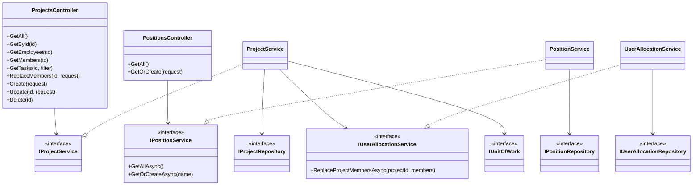
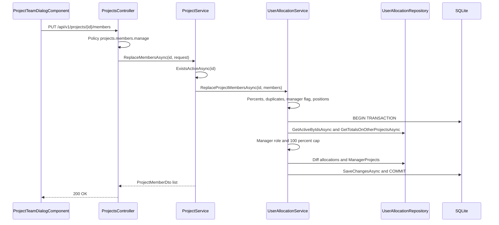
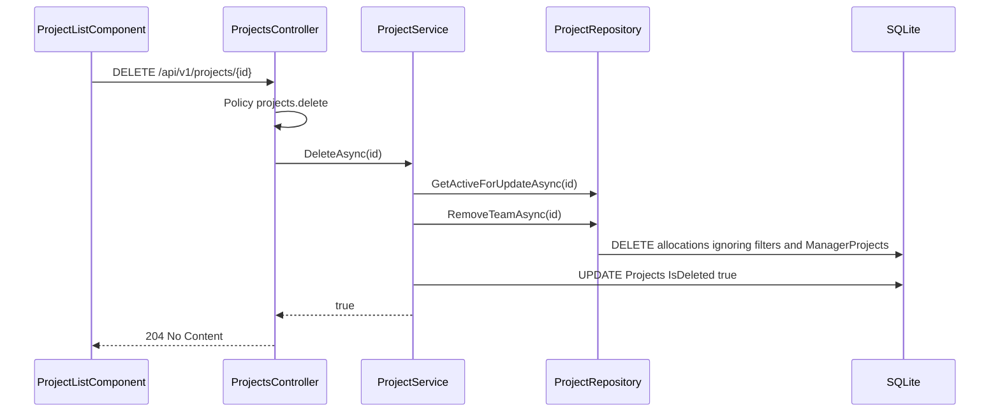
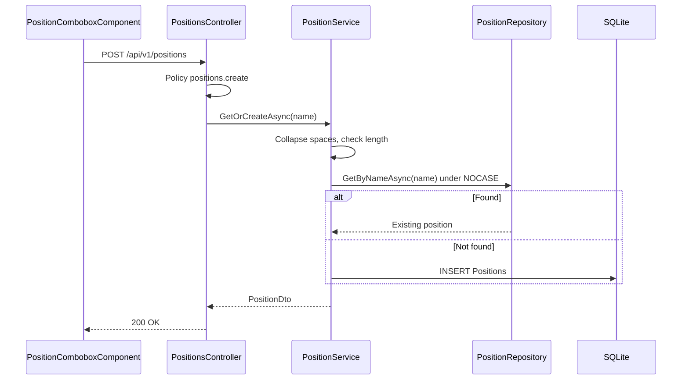
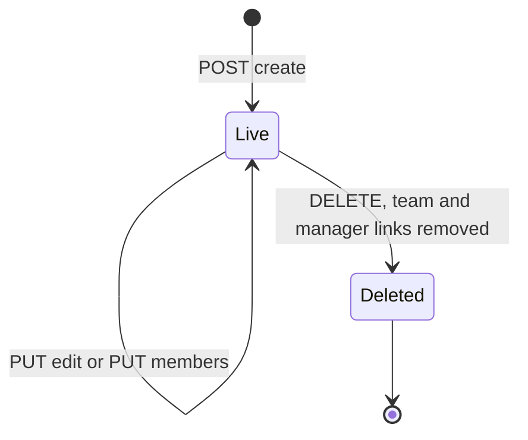
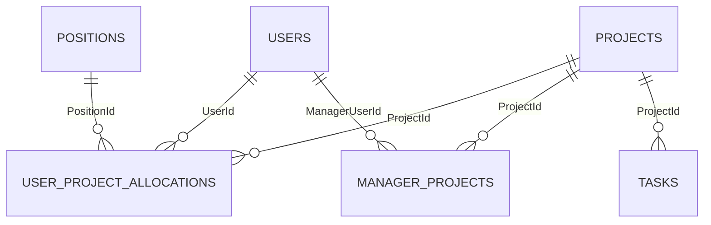

# Low-Level Design – Project Management

## TaskFlow – Intelligent Task Allocation & Tracking System

> **Document:** Low-Level Design (sub-module PROJ)  ·  **Version:** 1.0  ·  **Status:** Draft
> **Project type:** Personal Project (Skill Development)  ·  **Date:** 31-Oct-2026
> **Author:** Jojo George (jojogeorge3344@gmail.com)
> **Module:** TaskFlow Management  ·  **Sub-module:** 03.2 Project Management (code `PROJ`, incl. positions)
> **Based on:** HLD – Project Management v1.0, FRD – Project Management v1.0, TaskFlow as built
> © 2026 Jojo George. All rights reserved.

---

## Document Control

| Version | Date | Author | Summary of changes |
|---|---|---|---|
| 1.0 | 31-Oct-2026 | Jojo George | Initial version, derived from and verified against the TaskFlow source code (backend, frontend and tests) |

**Related documents:**

| Document | Location |
|---|---|
| BRD – Project Management | `../../../BRD/03-TaskFlow-Management/03.2-Project-Management/BRD-Project-Management.md` |
| FRD – Project Management (`FR-PROJ-nn`, traced in section 11) | `../../../FRD/03-TaskFlow-Management/03.2-Project-Management/FRD-Project-Management.md` |
| HLD – Project Management | `../../../HLD/03-TaskFlow-Management/03.2-Project-Management/HLD-Project-Management.md` |
| LLD – Overall (shared stack, cross-cutting design) | `../../00-Overall/LLD-TaskFlow-Overall.md` |
| Related LLDs | `../03.1-Employee-Management/LLD-Employee-Management.md` (owns `UserAllocationService`), `../03.3-Department-Management/LLD-Department-Management.md` |
| TDD | `TF - Documents/TF - TDD/TDD-TaskFlow.md` |

---

## 1. Introduction

### 1.1 Purpose
Detailed design of the Project Management sub-module: projects (list, details, create, edit, soft delete), project
teams (allocations with position, percentage and project-manager flag, under the 100% cap per person), project tasks
for the Project Details screen, and positions (list, get-or-create) – enough to implement or maintain the code.

### 1.2 Scope & Conventions
- Covers `ProjectsController` (route `api/v1/projects`), `PositionsController` (route `api/v1/positions`),
  `ProjectService`, `PositionService`, the team logic `UserAllocationService.ReplaceProjectMembersAsync`, and the
  tables `Projects`, `Positions`, `UserProjectAllocations`, `ManagerProjects`.
- Not covered: allocations given when an employee is created (Employee Management LLD), task CRUD (Task Management LLD).
- Naming: `*Controller`, `I*Service` / `*Service`, `I*Repository` / `*Repository`, DTOs `*Dto` / `*Request` / `*Input`.
- API base path `/api/v1`; JSON camelCase; enums as strings; errors as ProblemDetails.
- **Endpoint count:** `ProjectsController` **9** + `PositionsController` **2** = **11** actions (counted from the code); all 11
  are documented in 4.1.1.

---

## 2. Code Structure

### 2.1 Backend Folder Layout

```
backend/src/TaskFlow.Api/
  Controllers/Management/ProjectsController.cs, PositionsController.cs
  Services/Management/ProjectManagement/Projects/          IProjectService.cs, ProjectService.cs
  Services/Management/ProjectManagement/Positions/         IPositionService.cs, PositionService.cs
  Services/Management/EmployeeManagement/Allocations/      IUserAllocationService.cs, UserAllocationService.cs (ReplaceProjectMembersAsync)
  Repositories/Management/ProjectManagement/Projects/      IProjectRepository.cs, ProjectRepository.cs
  Repositories/Management/ProjectManagement/Positions/     IPositionRepository.cs, PositionRepository.cs
  Repositories/Management/EmployeeManagement/Allocations/  IUserAllocationRepository.cs, UserAllocationRepository.cs
  Dtos/Management/ProjectManagement/                       ProjectDto.cs, ProjectMemberDtos.cs, ProjectMemberInput.cs
  Dtos/Management/ProjectManagement/Positions/             PositionDtos.cs
  Dtos/Management/ProjectManagement/Validators/            CreateProjectRequestValidator.cs, UpdateProjectRequestValidator.cs
  Models/Entities/                                         Project.cs, Position.cs, UserProjectAllocation.cs, ManagerProject.cs
```

### 2.2 Frontend Folder Layout

```
frontend/src/app/modules/management/
  management.routes.ts                                     paths 'projects', 'projects/:id' (permissionGuard, projects.view)
  project-management/pages/                                project-list.component.ts/.html, project-detail.component.ts/.html, project-detail.model.ts
  project-management/components/                           project-form-dialog.component.ts, project-team-dialog.component.ts,
                                                           project-team-dialog.model.ts, employee-picker.component.ts
  project-management/services/project.service.ts
  project-management/models/project.model.ts
  project-management/positions/services/position.service.ts
  components/position-combobox.component.ts                (shared with Employee Management)
```

### 2.3 Layer Rules

| Rule | Enforced by |
|---|---|
| Controller → Service → Repository | `ArchitectureTests` |
| Team writes go only through `UserAllocationService` (the single owner of the allocation rules) | Code convention (`ProjectService.ReplaceMembersAsync` delegates) |
| Frontend module folder shape | `npm run check:structure` |

---

## 3. Cross-Cutting Design

Shared mechanisms are in the overall LLD (`../../00-Overall/LLD-TaskFlow-Overall.md`); how they apply here:

| Concern | Design |
|---|---|
| Validation | `ValidationFilter` runs `CreateProjectRequestValidator` / `UpdateProjectRequestValidator`; team and position rules are checked in the services (no validator for `ReplaceProjectMembersRequest` or `CreatePositionRequest`) |
| Error handling | `GlobalExceptionHandler` (3.1) |
| Transactions | Project create / update / delete: one `SaveChangesAsync`. Team replace: `IUnitOfWork.ExecuteInTransactionAsync` wraps the capacity check and the write, so two concurrent saves cannot both pass the 100% cap |
| Authorization | `[RequirePermission]` per action; `projects.manage` (legacy) expands to create, edit, delete, members.manage and `positions.create` |
| Soft delete | Global filter `!IsDeleted` on `Projects`; `UserProjectAllocations` filter hides rows of deleted users or projects |
| Time | `CreatedAt = DateTime.UtcNow` |
| Logging | None specific |

### 3.1 Exception → HTTP Status

| Exception | Status | When (this sub-module) |
|---|---|---|
| `BusinessRuleException` | 400 | Duplicate project name; team rules (percent, duplicates, no manager, non-Manager flagged, inactive person, 100% cap, unknown position); position name empty / too long |
| Validator failure | 400 | `Name` empty or > 200, `Description` > 500 |
| Policy failure | 403 | Missing `projects.*` / `positions.create` |
| `NotFound()` | 404 | Unknown or deleted project (get, members, tasks, update, delete, replace team) |
| `UniqueConstraintException` | 409 | Race on `IX_Projects_Name` or `IX_Positions_Name` ("That value is already in use.") |

---

## 4. Module Designs

### 4.1 Module: TaskFlow Management

#### 4.1.1 Child module: Project Management

**Class / file inventory**

| Layer | Type | File | Responsibility |
|---|---|---|---|
| Controller | `ProjectsController` | `Controllers/Management/ProjectsController.cs` | 9 actions on `api/v1/projects` |
| Controller | `PositionsController` | `Controllers/Management/PositionsController.cs` | 2 actions on `api/v1/positions` |
| Service | `IProjectService` / `ProjectService` | `Services/Management/ProjectManagement/Projects/` | Project CRUD, existence checks, team replace delegation, tasks |
| Service | `IPositionService` / `PositionService` | `Services/Management/ProjectManagement/Positions/` | List; get-or-create by name (`MaxNameLength = 100`) |
| Service (shared) | `IUserAllocationService` / `UserAllocationService` | `Services/Management/EmployeeManagement/Allocations/` | `ReplaceProjectMembersAsync` – all team rules |
| Repository | `IProjectRepository` / `ProjectRepository` | `Repositories/Management/ProjectManagement/Projects/` | Projects, counts, members, employees, tasks, `RemoveTeamAsync` |
| Repository | `IPositionRepository` / `PositionRepository` | `Repositories/Management/ProjectManagement/Positions/` | `GetAllAsync`, `GetByNameAsync`, `CountAsync` |
| Repository (shared) | `IUserAllocationRepository` / `UserAllocationRepository`; `IEmployeeRepository` | `Repositories/Management/EmployeeManagement/…` | Tracked allocations, totals on other projects, `ManagerProjects` links; active users |
| DTOs | `ProjectDto`, `ProjectWithCountDto`, `ProjectEmployeeDto`, `CreateProjectRequest`, `UpdateProjectRequest`, `ProjectTaskDto`, `ProjectTaskFilter`, `ProjectMemberDto`, `ReplaceProjectMembersRequest`, `ProjectMemberInput`, `PositionDto`, `CreatePositionRequest` | `Dtos/Management/ProjectManagement/…` | Contracts |
| Validators | `CreateProjectRequestValidator`, `UpdateProjectRequestValidator` | `Dtos/Management/ProjectManagement/Validators/` | Name and description length |
| Entities | `Project`, `Position`, `UserProjectAllocation`, `ManagerProject` | `Models/Entities/` | Tables in section 5 |
| Frontend pages | `ProjectListComponent`, `ProjectDetailComponent` (+ `Filters`) | `project-management/pages/` | Cards, delete confirm; details summary, team, filtered tasks |
| Frontend components | `ProjectFormDialogComponent`, `ProjectTeamDialogComponent` (+ `TeamRow`), `EmployeePickerComponent` (`EMPLOYEE_SEARCH_DEBOUNCE_MS = 250`), `PositionComboboxComponent` | `project-management/components/`, `management/components/` | Add / edit dialog; team dialog; person picker (`UserService.getAll({ search, isActive: true })`); position pick-or-type |
| Frontend service | `ProjectService` | `project-management/services/project.service.ts` | `getAll`, `getById`, `getEmployees`, `getMembers`, `getTasks`, `replaceMembers`, `create`, `update`, `delete` |
| Frontend service | `PositionService` | `project-management/positions/services/position.service.ts` | `getAll`, `getOrCreate` on `/api/v1/positions` |
| Frontend models | `Project`, `ProjectWithCount`, `CreateProjectRequest`, `UpdateProjectRequest`, `Position`, `ProjectMember`, `ProjectMemberInput`, `ProjectTask`, `ProjectTaskFilter` | `project-management/models/project.model.ts` | Client contracts |

**Class diagram**



`UserAllocationService` also uses `IEmployeeRepository`, `IProjectRepository`, `IPositionRepository`,
`IDepartmentRepository` and `IUnitOfWork`.

**API contracts**

| # | Method | Route | Permission / policy | Request | Response | Status codes |
|---|---|---|---|---|---|---|
| 1 | GET | `/api/v1/projects` | `projects.view` | – | `IReadOnlyCollection<ProjectWithCountDto>` | 200, 401, 403 |
| 2 | GET | `/api/v1/projects/{id}` | `projects.view` | – | `ProjectDto` | 200, 401, 403, 404 |
| 3 | GET | `/api/v1/projects/{id}/employees` | `projects.view` | – | `IReadOnlyCollection<ProjectEmployeeDto>` (empty list for an unknown project) | 200, 401, 403 |
| 4 | GET | `/api/v1/projects/{id}/members` | `projects.view` | – | `IReadOnlyCollection<ProjectMemberDto>` | 200, 401, 403, 404 |
| 5 | GET | `/api/v1/projects/{id}/tasks` | `projects.view` | Query `status`, `priority`, `deadlineFrom`, `deadlineTo`, `assignedToUserId`, `positionId` → `ProjectTaskFilter` | `IReadOnlyCollection<ProjectTaskDto>` | 200, 400 (bad enum / date), 401, 403, 404 |
| 6 | PUT | `/api/v1/projects/{id}/members` | `projects.members.manage` | `ReplaceProjectMembersRequest` | `IReadOnlyCollection<ProjectMemberDto>` | 200, 400, 401, 403, 404 |
| 7 | POST | `/api/v1/projects` | `projects.create` | `CreateProjectRequest` | `ProjectDto` (+ `Location` via `CreatedAtAction(GetById)`) | 201, 400, 401, 403, 409 |
| 8 | PUT | `/api/v1/projects/{id}` | `projects.edit` | `UpdateProjectRequest` | `ProjectDto` | 200, 400, 401, 403, 404, 409 |
| 9 | DELETE | `/api/v1/projects/{id}` | `projects.delete` | – | – | 204, 401, 403, 404 |
| 10 | GET | `/api/v1/positions` | `projects.view` | – | `IReadOnlyCollection<PositionDto>` | 200, 401, 403 |
| 11 | POST | `/api/v1/positions` | `positions.create` | `CreatePositionRequest` | `PositionDto` (existing or new; 200 in both cases) | 200, 400, 401, 403, 409 |

**DTO shapes**

| DTO | Fields |
|---|---|
| `ProjectDto` | `Id`, `Name`, `Description?`, `CreatedAt` |
| `ProjectWithCountDto` | `Id`, `Name`, `Description?`, `CreatedAt`, `EmployeeCount`, `Managers` (names of flagged project managers, by name) |
| `ProjectEmployeeDto` | `Id`, `EmployeeCode?`, `FullName`, `Username`, `Email`, `MobileNumber?`, `RoleId`, `IsActive`, `CreatedAt`, `UpdatedAt`, `LastLoginAt?` (no credentials or MFA state) |
| `ProjectMemberDto` | `UserId`, `FullName`, `Email`, `PositionId`, `PositionName`, `Percent`, `IsManager`, `IsManagerRole` |
| `ProjectMemberInput` | `UserId`, `PositionId`, `Percent`, `IsManager` (default false) |
| `ReplaceProjectMembersRequest` | `Members?` (`null` treated as empty – removes everyone) |
| `ProjectTaskDto` | `Id`, `TaskCode`, `Title`, `Status`, `Priority`, `StartDate`, `Deadline`, `AssignedToUserId`, `AssignedToName`, `AssigneePositionId?`, `AssigneePositionName?` |
| `ProjectTaskFilter` | `Status?`, `Priority?`, `DeadlineFrom?`, `DeadlineTo?`, `AssignedToUserId?`, `PositionId?` |
| `CreateProjectRequest` / `UpdateProjectRequest` | `Name`, `Description?` |
| `PositionDto` / `CreatePositionRequest` | `Id`, `Name` / `Name` |

**Request / response examples**

`POST /api/v1/projects`

```json
{ "name": "Website Revamp", "description": "Public site redesign" }
```

201 Created (`ProjectDto`)

```json
{ "id": 7, "name": "Website Revamp", "description": "Public site redesign", "createdAt": "2026-10-31T09:30:00Z" }
```

`PUT /api/v1/projects/{id}` uses the same body as create and returns `ProjectDto` with 200.

`PUT /api/v1/projects/{id}/members`

```json
{
  "members": [
    { "userId": 5,  "positionId": 2, "percent": 30, "isManager": true },
    { "userId": 14, "positionId": 4, "percent": 60, "isManager": false }
  ]
}
```

200 OK (`ProjectMemberDto[]`, ordered by name)

```json
[
  { "userId": 14, "fullName": "Anu Thomas", "email": "anu.thomas@taskflow.com", "positionId": 4, "positionName": "Developer", "percent": 60, "isManager": false, "isManagerRole": false },
  { "userId": 5, "fullName": "Ravi Menon", "email": "ravi@taskflow.com", "positionId": 2, "positionName": "Manager", "percent": 30, "isManager": true, "isManagerRole": true }
]
```

400 Bad Request (capacity)

```json
{ "status": 400, "title": "Bad Request", "detail": "Anu Thomas would be allocated 110% in total. They already have 50% on other projects, so 50% remains." }
```

`POST /api/v1/positions` – "qa" matches the seeded "QA" under the NOCASE collation

```json
{ "name": "qa" }
```

```json
{ "id": 3, "name": "QA" }
```

**Service logic – `ProjectService.CreateAsync` / `UpdateAsync`**
1. Validator has checked `Name` (required, ≤ 200) and `Description` (≤ 500).
2. Update only: `GetActiveForUpdateAsync(id)` → `null` (404).
3. `name = request.Name.Trim()`; `NameTakenAsync(name, exceptId)` (live projects, `ToLower()` compare) → "Project name already exists.".
4. Set `Name`, `Description?.Trim()`; create also sets `CreatedAt = DateTime.UtcNow` and `_projects.Add`.
5. `SaveChangesAsync`; return `ToDto(project)`.

**Service logic – `ProjectService.DeleteAsync(id)`**
1. `GetActiveForUpdateAsync(id)` → `false` (404).
2. `RemoveTeamAsync(id)`: remove all `UserProjectAllocations` of the project with `IgnoreQueryFilters()` (also rows of deleted users) and all `ManagerProjects` links.
3. `IsDeleted = true`; `SaveChangesAsync`; return `true` (204). Tasks with this `ProjectId` are not checked or changed.

**Service logic – `ProjectService.ReplaceMembersAsync` → `UserAllocationService.ReplaceProjectMembersAsync(projectId, members)`**
1. `ExistsActiveAsync(projectId)` → `null` (404).
2. Any `Percent` < 1 or > 100 → "Allocation percentage must be a whole number from 1 to 100.".
3. Duplicate `UserId` → "A person can only appear once on a project.".
4. Non-empty list with no `IsManager` → "Mark at least one person on the team as the project's manager.".
5. `RequirePositionsAsync` (distinct ids; `IPositionRepository.CountAsync`) → "Position does not exist.".
6. Inside `ExecuteInTransactionAsync`:
   1. `IEmployeeRepository.GetActiveByIdsAsync(userIds)`; count mismatch → "One or more people do not exist or are not active.".
   2. Flagged members whose `RoleId != SystemRoles.ManagerId` → "Only a person with the Manager role can manage a project: {names}.".
   3. `GetTotalsOnOtherProjectsAsync(userIds, projectId)`; for each member `other + percent > 100` → "{name} would be allocated {total}% in total. They already have {other}% on other projects, so {100 − other}% remains.".
   4. Diff `GetForProjectForUpdateAsync(projectId)`: remove rows of people not in the list; update `PositionId`, `AllocationPercent`, `IsProjectManager` on kept rows; add new rows.
   5. Sync `ManagerProjects` to the flagged ids (remove unflagged links, add missing links).
   6. `SaveChangesAsync`; commit.
7. Return `GetMembersAsync(projectId)`.

**Service logic – `ProjectService` reads**
- `GetAllAsync` → `GetAllWithCountsAsync` (no `ORDER BY` in the query; the UI shows the order returned).
- `GetByIdAsync` → `GetAsync` (query filter hides deleted) → `ToDto` or `null`.
- `GetEmployeesAsync` → `GetEmployeesAsync` without an existence check.
- `GetMembersAsync`, `GetTasksAsync` → `ExistsActiveAsync` first, else `null` (404).

**Service logic – `PositionService.GetOrCreateAsync(name)`**
1. Collapse repeated spaces and trim (`Split(' ', RemoveEmptyEntries)` + `Join(' ')`).
2. Empty → "Position name is required."; longer than 100 → "Position name must be 100 characters or fewer.".
3. `GetByNameAsync(trimmed)` (NOCASE column) → return the existing `PositionDto`.
4. Else add `Position { Name = trimmed }`, `SaveChangesAsync`, return the new `PositionDto`.

**Sequence diagram – replace a project team**



**Sequence diagram – delete a project**



**Sequence diagram – type a new position**



**Repository methods**

| Method | Query / purpose | Notes |
|---|---|---|
| `ProjectRepository.GetAllWithCountsAsync()` | All live projects with `EmployeeCount` (count of filtered `UserProjectAllocations`) and `Managers` (names of rows with `IsProjectManager`, by `FullName`) | `AsNoTracking`; correlated sub-queries |
| `GetAsync(id)` | One live project | `AsNoTracking` |
| `GetActiveForUpdateAsync(id)` | Tracked live project | `!IsDeleted` |
| `ExistsActiveAsync(id)` / `CountActiveAsync(ids)` | Existence | `!IsDeleted`; `CountActiveAsync` also used by Employee Management allocations |
| `NameTakenAsync(name, exceptProjectId)` | Unique live name | `p.Name.ToLower() == name.ToLower() && !p.IsDeleted` |
| `GetEmployeesAsync(projectId)` | Live users with an allocation on the project → `ProjectEmployeeDto` | `AsNoTracking`; no UI caller |
| `GetMembersAsync(projectId)` | Allocations → `ProjectMemberDto`, by `User.FullName`; `IsManagerRole = User.RoleId == SystemRoles.ManagerId` | `AsNoTracking` |
| `GetTasksAsync(projectId, filter)` | `Tasks` with `ProjectId` and `!IsDeleted`; each set filter ANDed; `PositionId` via the assignee's allocation on this project; ordered by `Deadline`, then `Id`; assignee position projected per row | `AsNoTracking`; uses `IX_Tasks_ProjectId` |
| `RemoveTeamAsync(projectId)` | Stage removal of all allocations (`IgnoreQueryFilters()`) and `ManagerProjects` links | Saved by the caller |
| `PositionRepository.GetAllAsync()` | All positions → `PositionDto`, by `Name` | – |
| `PositionRepository.GetByNameAsync(name)` | Exact match under NOCASE | – |
| `PositionRepository.CountAsync(ids)` | Existence of positions | – |
| `UserAllocationRepository.GetForProjectForUpdateAsync(projectId)` | Tracked team rows | – |
| `UserAllocationRepository.GetTotalsOnOtherProjectsAsync(userIds, projectId)` | `GroupBy(UserId)`, `Sum(AllocationPercent)` for other projects | Inside the transaction |
| `UserAllocationRepository.GetManagerLinksForProjectForUpdateAsync`, `AddManagerLink`, `RemoveManagerLinks`, `Add`, `RemoveRange` | `ManagerProjects` and allocation staging | Tracked |
| `EmployeeRepository.GetActiveByIdsAsync(ids)` | Live active users | `AsNoTracking` |

**Validation rules**

| Field | Rule | Message |
|---|---|---|
| `Name` (project) | `NotEmpty`, `MaximumLength(200)`; unique among live projects ignoring case (service) | Default FluentValidation messages · "Project name already exists." |
| `Description` (project) | `MaximumLength(500)` when not null | Default message |
| `Members[].Percent` | Whole 1–100 | "Allocation percentage must be a whole number from 1 to 100." |
| `Members[].UserId` | Once per project; live and active | "A person can only appear once on a project." · "One or more people do not exist or are not active." |
| `Members[].IsManager` | At least one on a non-empty team; only `RoleId == 2` | "Mark at least one person on the team as the project's manager." · "Only a person with the Manager role can manage a project: {names}." |
| `Members[].PositionId` | Position exists | "Position does not exist." |
| Person total | Other projects + this row ≤ 100 | "{name} would be allocated {total}% in total. They already have {other}% on other projects, so {left}% remains." |
| `Name` (position) | Required after space collapse; ≤ 100; unique NOCASE (get-or-create) | "Position name is required." · "Position name must be 100 characters or fewer." |

Client-side messages are in the FRD (sections 4.1.2 – 4.1.4).

**Error cases**

| Case | Exception / result | Status |
|---|---|---|
| Project unknown or deleted | `null` / `false` → `NotFound()` | 404 |
| Duplicate project name | `BusinessRuleException` | 400 |
| Any team rule fails | `BusinessRuleException`; transaction rolled back, nothing saved | 400 |
| Name race on unique index | `UniqueConstraintException` | 409 |
| Invalid position name | `BusinessRuleException` | 400 |

**State machine – project**



A deleted project keeps its row (`IsDeleted = true`); its name becomes free for a new project (filtered unique index).

**Frontend design**

| Item | Design |
|---|---|
| Routes | `/projects` → `ProjectListComponent`, `/projects/:id` → `ProjectDetailComponent`; both `permissionGuard` with `Permissions.ProjectsView` |
| List | Cards from `ProjectService.getAll()`; client-side search on name / description; buttons by `Permissions.ProjectsCreate`, `ProjectsMembers`, `ProjectsEdit`, `ProjectsDelete`; **View employees** opens `/employees` with the project filter |
| Create flow | `ProjectFormDialogComponent` → `create`; on success opens `ProjectTeamDialogComponent` titled **Assign team: {name}** with **Skip for now** |
| Team dialog | Loads `PositionService.getAll()` and `ProjectService.getMembers(id)`; rows are `TeamRow`; `EmployeePickerComponent` searches `UserService.getAll({ search, isActive: true })` (needs `employees.view`); new rows default to position **Member**; save → `replaceMembers(id, members)` |
| Details | `getById`, then `getMembers` and `getTasks`; `Filters` (status, priority, assignee, position, deadline range) → `getTasks(id, filter)` with only non-empty params |

---

## 5. Database Design

### 5.1 ER Diagram



### 5.2 Tables

SQLite storage: `int` / `bool` → INTEGER, `string` / `DateTime` → TEXT.

#### `Projects` (`Project`)

| Column | Type | Null | Key / index | Default | Description |
|---|---|:---:|---|---|---|
| Id | int | No | PK, identity | identity | Project id |
| Name | string(200) | No | Unique filtered `IX_Projects_Name` (`"IsDeleted" = 0`) | – | Project name |
| Description | string(500) | Yes | – | – | Optional text |
| CreatedAt | DateTime | No | – | – | UTC |
| IsDeleted | bool | No | Global query filter `!IsDeleted` | `false` | Soft delete |

Navigation: `Allocations` (`UserProjectAllocation`).

#### `Positions` (`Position`)

| Column | Type | Null | Key / index | Default | Description |
|---|---|:---:|---|---|---|
| Id | int | No | PK, identity | identity | Position id |
| Name | string(100), collation NOCASE | No | Unique `IX_Positions_Name` | – | Label; seeded (`HasData`) 1 Member, 2 Manager, 3 QA, 4 Developer, 5 DevOps, 6 System Admin |

#### `UserProjectAllocations` (`UserProjectAllocation`)

| Column | Type | Null | Key / index | Default | Description |
|---|---|:---:|---|---|---|
| UserId | int | No | PK part; FK → `Users.Id` (Cascade) | – | Person |
| ProjectId | int | No | PK part; FK → `Projects.Id` (Cascade); `IX_UserProjectAllocations_ProjectId` | – | Project |
| AllocationPercent | int | No | Check `CK_UserProjectAllocations_AllocationPercent` | – | `BETWEEN 1 AND 100` |
| IsProjectManager | bool | No | – | `false` | Project-manager flag |
| PositionId | int | No | FK → `Positions.Id` (Restrict); `IX_UserProjectAllocations_PositionId` | – | Position on this project |

Query filter: `!User.IsDeleted && !Project.IsDeleted`.

#### `ManagerProjects` (`ManagerProject`)

| Column | Type | Null | Key / index | Default | Description |
|---|---|:---:|---|---|---|
| ManagerUserId | int | No | PK part; FK → `Users.Id` (Cascade) | – | Manager |
| ProjectId | int | No | PK part; FK → `Projects.Id` (Cascade); `IX_ManagerProjects_ProjectId` | – | Project overseen; kept in step with `IsProjectManager` |

#### Tables read but owned elsewhere

| Table (entity) | Owner LLD | Use |
|---|---|---|
| `Users` (`User`) | EMP | Team members must be active; `RoleId == 2` for project managers; names and emails |
| `Tasks` (`Task`) | TASK | Read by `GetTasksAsync`; not changed on project delete |

### 5.3 Indexes, Constraints & Triggers

| Object | Definition | Purpose |
|---|---|---|
| `IX_Projects_Name` | Unique (`Name`) filtered `"IsDeleted" = 0` | Live names unique; a deleted project's name can be reused |
| `IX_Positions_Name` | Unique (`Name`), NOCASE column | "qa" cannot be added when "QA" exists |
| PK `UserProjectAllocations` | (`UserId`, `ProjectId`) | One row per person per project |
| `CK_UserProjectAllocations_AllocationPercent` | `"AllocationPercent" BETWEEN 1 AND 100` | Row-level percent rule |
| `IX_UserProjectAllocations_ProjectId`, `IX_UserProjectAllocations_PositionId` | Single-column | Team and position lookups |
| PK `ManagerProjects` | (`ManagerUserId`, `ProjectId`) | One link per manager per project |
| `IX_ManagerProjects_ProjectId` | (`ProjectId`) | Links of a project |
| FK `UserProjectAllocations.PositionId → Positions.Id` | Restrict | A used position cannot be deleted |
| FK `Tasks.ProjectId → Projects.Id` | Restrict (Task Management) | Tasks keep their project |
| 100% total per person | Not a database constraint; enforced in `UserAllocationService` inside a transaction | Cross-row rule |
| Triggers | None | – |

### 5.4 Enumerations

| Enum | Values | Stored as |
|---|---|---|
| `TaskStatus` (task filter and `ProjectTaskDto.Status`) | ToDo, InProgress, Blocked, Completed, Cancelled, InQA | As defined in the Task Management LLD; string in JSON |
| `TaskPriority` (task filter and `ProjectTaskDto.Priority`) | Low, Medium, High, Critical | As defined in the Task Management LLD; string in JSON |

### 5.5 Migrations

| Migration | Change relevant to this sub-module |
|---|---|
| `20261012104823_AddDepartmentsAndUserDepartment` | First "Departments" table and `Users.DepartmentId` (renamed to Projects later) |
| `20261019174259_AddManagerAssignments` | `ManagerDepartments` link table and `Users.ManagerId` |
| `20261020173455_RenameDepartmentsToProjectsAndAddDepartments` | Renames `Departments` → `Projects`, `ManagerDepartments` → `ManagerProjects`, `DepartmentId` → `ProjectId` (Users, Tasks, links) without data loss |
| `20261021070943_FixDepartmentFollowUps` | Re-creates `IX_Projects_Name`; gives roles that held `departments.*` the `projects.*` keys too |
| `20261023160825_UserProjectAllocationsAndDepartments` | Creates `Positions` and `UserProjectAllocations`; moves each user's single project into one 100% allocation with position Member; drops `Users.ProjectId` |
| `20261023173211_AddProjectManagerFlag` | Adds `UserProjectAllocations.IsProjectManager` (default false) |

---

## 6. Algorithms & Background Jobs

| Job / algorithm | Trigger / schedule | Steps | Idempotency |
|---|---|---|---|
| Team replace with capacity check | `PUT /api/v1/projects/{id}/members` | Pre-checks → transaction: active users → Manager role → totals on other projects → diff rows → sync `ManagerProjects` → save | Same request gives the same team; whole-or-nothing |
| Manager link sync | Inside team replace | `ManagerProjects` = set of flagged user ids for the project | Set semantics |
| Team removal on delete | `DELETE /api/v1/projects/{id}` | Remove all allocations (incl. filtered rows) and links, flag project | Second call → 404 |
| Position get-or-create | `POST /api/v1/positions` | Normalise, look up NOCASE, insert if missing | Same name returns the same row |
| Background jobs | – | _Not applicable for this sub-module._ | – |

---

## 7. Security Design (detailed)

| Item | Implementation |
|---|---|
| Password hashing / tokens | _Not applicable for this sub-module._ |
| Permission checks | Policy per action (4.1.1); `GET /api/v1/positions` needs only `projects.view` |
| Data scope | None – every holder of `projects.view` sees all projects, teams and project tasks (task-view scope is not applied to `GET /api/v1/projects/{id}/tasks`) |
| Data minimisation | `ProjectEmployeeDto` and `ProjectMemberDto` carry no credentials or MFA state |
| Frontend gating | Route and menu by `projects.view`; buttons by `projects.create`, `projects.members.manage`, `projects.edit`, `projects.delete` |
| Secrets | None |

**Permission keys used**

| Key | Default (Admin / Manager / Employee / Custom) | Endpoint(s) |
|---|---|---|
| `projects.view` | Granted / Granted / Not granted / Configurable | GET project routes; `GET /api/v1/positions` |
| `projects.create` | Granted / Not granted / Not granted / Configurable | `POST /api/v1/projects` |
| `projects.edit` | Granted / Not granted / Not granted / Configurable | `PUT /api/v1/projects/{id}` |
| `projects.delete` | Granted / Not granted / Not granted / Configurable | `DELETE /api/v1/projects/{id}` |
| `projects.members.manage` | Granted / Not granted / Not granted / Configurable | `PUT /api/v1/projects/{id}/members` |
| `positions.create` | Granted / Not granted / Not granted / Configurable | `POST /api/v1/positions` |
| `projects.manage` (legacy) | Expands to create, edit, delete, members.manage, `positions.create` | – |
| `employees.view` (supporting) | Granted / Granted / Not granted / Configurable | Person picker in the team dialog (`GET /api/v1/users`) |

All keys except `projects.view` require `projects.view` (`PermissionCatalog`).

---

## 8. Configuration

| Key | Default | Purpose |
|---|---|---|
| `ConnectionStrings:Default` | `Data Source=taskflow.db` | SQLite database (shared) |
| Code constant `IUserAllocationService.MaxTotalPercent` | 100 | Cap on one person's allocations across projects |
| Code constant `PositionService.MaxNameLength` | 100 | Position name length |
| Code constant `SystemRoles.ManagerId` | 2 | Only this role may be a project manager |
| Code constant `EMPLOYEE_SEARCH_DEBOUNCE_MS` (frontend) | 250 | Person picker search debounce |

---

## 9. Testing Design

"Covers" was checked against the test sources. Backend paths are relative to `backend/tests`; frontend paths to
`frontend/src/app/modules/management`.

| Area | Test class / file | Type | Covers |
|---|---|---|---|
| Team endpoints | `TaskFlow.IntegrationTests/Management/ProjectManagement/ProjectTeamEndpointsTests.cs` | Integration | Positions list / get-or-create (case-insensitive, blank 400, `positions.create`); team save after create; 100% cap with nothing saved; manager flag rules; view-only users refused; project delete frees allocations; employee list hides credentials |
| Allocation rules | `TaskFlow.UnitTests/Management/EmployeeManagement/Allocations/UserAllocationServiceTests.cs` | Unit | Project-side rows (1–100, person once, unknown position, inactive person), manager flag and links, 100% cap and concurrent saves, all-or-nothing, delete frees percentages, position get-or-create and length, position grants nothing |
| Project tasks | `TaskFlow.UnitTests/Monitoring/TaskManagement/Tasks/ProjectTaskTests.cs` | Unit | Task project validation and mapping; `GetTasksAsync` filters and assignee role |
| Manager links | `TaskFlow.UnitTests/Management/EmployeeManagement/Employees/ManagerAssignmentTests.cs` | Unit | A manager's projects listed by name; deleted project drops out; role change removes manager projects |
| Migrations | `TaskFlow.UnitTests/Persistence/UserProjectAllocationsMigrationTests.cs`, `TaskFlow.UnitTests/Persistence/DepartmentFollowUpMigrationTests.cs` | Unit | Allocation data move and seeded positions; `projects.*` key follow-up |
| Permissions | `TaskFlow.UnitTests/Settings/RoleConfiguration/PermissionCatalogTests.cs`, `TaskFlow.IntegrationTests/Common/ModuleBasedPermissionEndpointsTests.cs` | Unit / Integration | Catalogue and policy wiring |
| Project validators | `TaskFlow.UnitTests/Management/ProjectManagement/ProjectRequestValidatorsTests.cs` | Unit | `CreateProjectRequestValidator` and `UpdateProjectRequestValidator`: blank name, 200 / 201-character name, 500 / 501-character description |
| Project create (validation) | `TaskFlow.IntegrationTests/Management/EmployeeManagement/UsersEndpointsTests.cs` (`CreateProject_WithoutAName_IsRejectedByTheValidator`) | Integration | `POST /api/v1/projects` without a name returns 400 |
| List page | `project-management/pages/project-list.component.spec.ts` | Frontend unit | Cards, header count, managers by name, client-side search, View employees link, delete with team warning, team dialog after create (skippable), view-only user has no Add / Edit / Delete, empty / error states |
| Details page | `project-management/pages/project-detail.component.spec.ts` | Frontend unit | Summary, team, tasks with return link, overdue badge and count, role filter options, server-side filters and clearing, no-match / empty states, "Project not found" |
| Add / edit dialog | `project-management/components/project-form-dialog.component.spec.ts` | Frontend unit | "Add project" title, "Name is required", duplicate-name server error, `created` emitted only for a new project, update and toast |
| Team dialog | `project-management/components/project-team-dialog.component.spec.ts` | Frontend unit | Assign team step, current members, row layout, new row with no position, employee search and remaining percentage, typed position created, 1–100, unfinished rows, 100% server error, manager required / several / only Manager role, load error |
| Person picker | `project-management/components/employee-picker.component.spec.ts` | Frontend unit | Server search of active employees with remaining percentage, people on other rows left out, emits the choice |
| Position combobox | `components/position-combobox.component.spec.ts` | Frontend unit | Lists positions, picks existing (ignoring case), creates a typed one, clears, shows the create error |
| Frontend services | `employee-management/services/allocation-services.spec.ts` | Frontend unit | `PositionService` list and get-or-create; `ProjectService` read and replace members |

---

## 10. Known Limitations & Open Issues

- Positions can be neither renamed nor deleted (only get-or-create).
- The team dialog opens after creation without checking `projects.members.manage`; the position combobox calls create without checking `positions.create` (the server refuses).
- `positions.create` has no frontend reference.
- The team picker needs `employees.view` silently.
- `GET /api/v1/projects/{id}/tasks` ignores the task-view scope (`tasks.view.all`). ⚠️ To be confirmed whether intended.
- `GET /api/v1/projects/{id}/employees` has no UI caller and returns 200 with an empty list for an unknown project.
- The delete confirmation says "permanently deleted" but the delete is soft; tasks of a deleted project are not changed. ⚠️ To be confirmed how they should be shown.
- `GetAllWithCountsAsync` has no explicit ordering.
- Only the Manager system role (id 2) can be a project manager; custom roles cannot.

---

## 11. Traceability (FRD → code)

| FRD requirement | Endpoint / class | Test |
|---|---|---|
| FR-PROJ-01, FR-PROJ-02, FR-PROJ-03, FR-PROJ-12, FR-PROJ-13 | `GET /api/v1/projects` · `ProjectRepository.GetAllWithCountsAsync` · `ProjectListComponent` | `UserAllocationServiceTests` (managers by name), `project-list.component.spec.ts` |
| FR-PROJ-04 | `management.routes.ts` (`projects`, `projects/:id`, `Permissions.ProjectsView`) | `app.routes.spec.ts`, `nav-items.spec.ts` |
| FR-PROJ-05, FR-PROJ-06 | `[RequirePermission]` on every action; list button bindings | `ProjectTeamEndpointsTests`, `ModuleBasedPermissionEndpointsTests` |
| FR-PROJ-07 | **View employees** → `/employees` with project filter (`EmployeeScreenPermissions`) | `project-list.component.spec.ts` |
| FR-PROJ-08, FR-PROJ-11 | Delete confirm and toast · `ProjectService.delete` | `project-list.component.spec.ts` |
| FR-PROJ-09, FR-PROJ-10 | `DELETE /api/v1/projects/{id}` · `ProjectService.DeleteAsync`, `ProjectRepository.RemoveTeamAsync` | `ProjectTeamEndpointsTests`, `UserAllocationServiceTests`, `ManagerAssignmentTests` (tasks kept: no automated test) |
| FR-PROJ-14, FR-PROJ-15, FR-PROJ-16 | `POST /api/v1/projects`, `PUT /api/v1/projects/{id}` · `CreateProjectRequestValidator`, `UpdateProjectRequestValidator`, `NameTakenAsync`, `IX_Projects_Name` | `ProjectRequestValidatorsTests`, `UsersEndpointsTests`, `project-form-dialog.component.spec.ts` (duplicate name: UI only) |
| FR-PROJ-17, FR-PROJ-18 | `ProjectFormDialogComponent` → `ProjectTeamDialogComponent` (**Assign team**, **Skip for now**) | `project-form-dialog.component.spec.ts`, `project-list.component.spec.ts`, `project-team-dialog.component.spec.ts` |
| FR-PROJ-19 | `GET /api/v1/projects/{id}/members` · `ProjectRepository.GetMembersAsync` | `ProjectTeamEndpointsTests` |
| FR-PROJ-20, FR-PROJ-21 | `EmployeePickerComponent` (`GET /api/v1/users`, `remainingPercent`); team dialog row check | `employee-picker.component.spec.ts`, `project-team-dialog.component.spec.ts` |
| FR-PROJ-22, FR-PROJ-23, FR-PROJ-24, FR-PROJ-25, FR-PROJ-26 | `PUT /api/v1/projects/{id}/members` · `UserAllocationService.ReplaceProjectMembersAsync` | `ProjectTeamEndpointsTests`, `UserAllocationServiceTests` |
| FR-PROJ-27 | `GetTotalsOnOtherProjectsAsync` + cap check | `UserAllocationServiceTests` |
| FR-PROJ-28 | `IUnitOfWork.ExecuteInTransactionAsync` around check and write | `ProjectTeamEndpointsTests`, `UserAllocationServiceTests` |
| FR-PROJ-29 | Diff of `UserProjectAllocations`; toasts "Team saved" / "Team cleared" | `ProjectTeamEndpointsTests` |
| FR-PROJ-30 | `ManagerProjects` sync; `EmployeeRepository.GetTeamMemberIdsAsync` | `ManagerAssignmentTests` |
| FR-PROJ-31 | Team dialog default position **Member** | Manual UI |
| FR-PROJ-32, FR-PROJ-33, FR-PROJ-34 | `GET /api/v1/positions`, `POST /api/v1/positions` · `PositionService.GetOrCreateAsync`, `PositionRepository.GetByNameAsync`, `PositionComboboxComponent` | `ProjectTeamEndpointsTests`, `UserAllocationServiceTests`, `position-combobox.component.spec.ts` |
| FR-PROJ-35 | `Position` seed (`HasData`) in `AppDbContext` | `ProjectTeamEndpointsTests`, `UserAllocationServiceTests`, `UserProjectAllocationsMigrationTests` |
| FR-PROJ-36 | No position rename / delete endpoint; positions not in the permission model | `ProjectTeamEndpointsTests`, `UserAllocationServiceTests` (no permission from a position); Manual check (no rename / delete) |
| FR-PROJ-37, FR-PROJ-39, FR-PROJ-43 | `GET /api/v1/projects/{id}`, `GET /api/v1/projects/{id}/members` · `ProjectDetailComponent` | `project-list.component.spec.ts`, `project-detail.component.spec.ts` |
| FR-PROJ-38, FR-PROJ-40, FR-PROJ-41, FR-PROJ-45 | `GET /api/v1/projects/{id}/tasks` · `ProjectRepository.GetTasksAsync`, `ProjectTaskFilter` | `ProjectTaskTests` |
| FR-PROJ-42, FR-PROJ-44 | `ProjectDetailComponent` (`Filters` reset, empty / error states) | `project-detail.component.spec.ts` |

`GET /api/v1/projects/{id}/employees` traces to no FR (no UI caller).

**Coverage:** FR-PROJ-01 – FR-PROJ-45 (45 of 45) trace to an endpoint or class; 11 of 11 endpoints documented.

---
<sub>© 2026 Jojo George. All rights reserved. Unauthorized copying or distribution of this document is prohibited.</sub>
