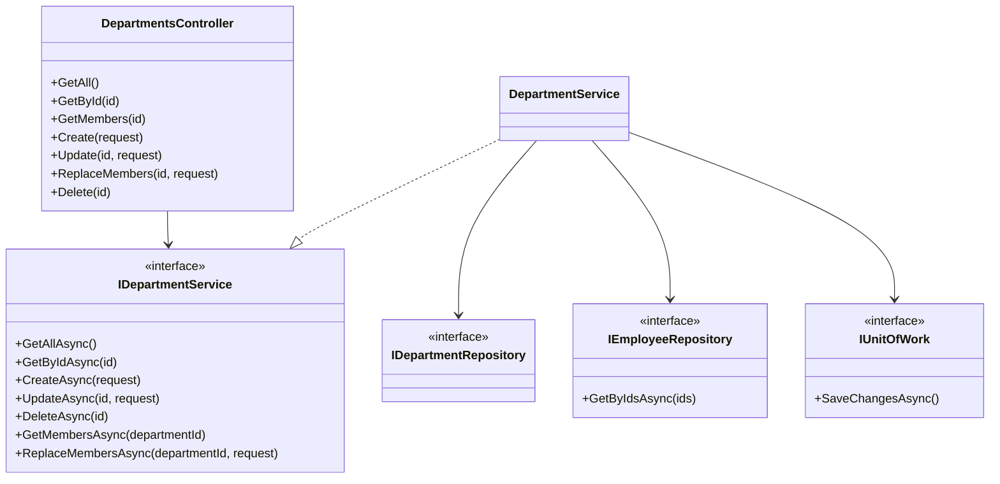
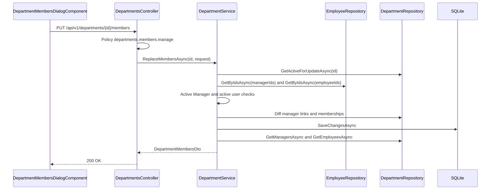
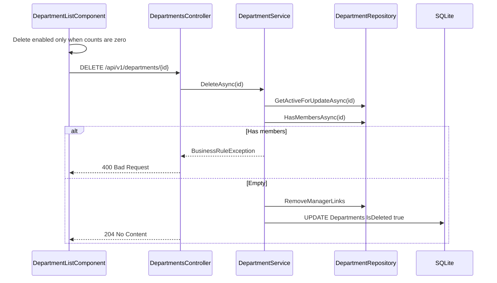
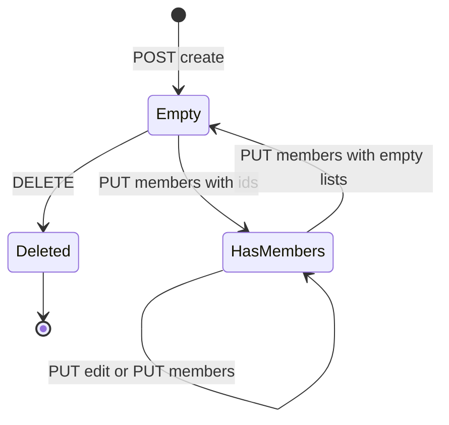
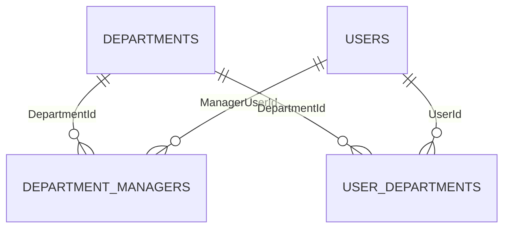

# Low-Level Design – Department Management

## TaskFlow – Intelligent Task Allocation & Tracking System

> **Document:** Low-Level Design (sub-module DEPT)  ·  **Version:** 1.0  ·  **Status:** Draft
> **Project type:** Personal Project (Skill Development)  ·  **Date:** 31-Oct-2026
> **Author:** Jojo George (jojogeorge3344@gmail.com)
> **Module:** TaskFlow Management  ·  **Sub-module:** 03.3 Department Management (code `DEPT`)
> **Based on:** HLD – Department Management v1.0, FRD – Department Management v1.0, TaskFlow as built
> © 2026 Jojo George. All rights reserved.

---

## Document Control

| Version | Date | Author | Summary of changes |
|---|---|---|---|
| 1.0 | 31-Oct-2026 | Jojo George | Initial version, derived from the code and verified against the code fact sheet |

**Related documents:**

| Document | Location |
|---|---|
| BRD – Department Management | `../../../BRD/03-TaskFlow-Management/03.3-Department-Management/BRD-Department-Management.md` |
| FRD – Department Management (`FR-DEPT-nn`, traced in section 11) | `../../../FRD/03-TaskFlow-Management/03.3-Department-Management/FRD-Department-Management.md` |
| HLD – Department Management | `../../../HLD/03-TaskFlow-Management/03.3-Department-Management/HLD-Department-Management.md` |
| LLD – Overall (shared stack, cross-cutting design) | `../../00-Overall/LLD-TaskFlow-Overall.md` |
| Related LLDs | `../03.1-Employee-Management/LLD-Employee-Management.md`, `../03.2-Project-Management/LLD-Project-Management.md` |
| TDD | `TF - Documents/TF - TDD/TDD-TaskFlow.md` |

---

## 1. Introduction

### 1.1 Purpose
Detailed design of the Department Management sub-module: departments (list with counts, get, create, edit, soft
delete when empty) and their membership – department managers (`DepartmentManagers`) and department employees
(`UserDepartments`) replaced in one request – enough to implement or maintain the code.

### 1.2 Scope & Conventions
- Covers `DepartmentsController` (route `api/v1/departments`), `DepartmentService`, `DepartmentRepository` and the
  tables `Departments`, `DepartmentManagers`, `UserDepartments`.
- Not covered: departments ticked when an employee is created (staged by `UserAllocationService.StageForUserAsync`,
  Employee Management LLD) and manager-duty clean-up on role change or delete (`EmployeeRepository.ClearManagerDutiesAsync`).
- Naming: `*Controller`, `I*Service` / `*Service`, `I*Repository` / `*Repository`, DTOs `*Dto` / `*Request`.
- API base path `/api/v1`; JSON camelCase; errors as ProblemDetails.
- **Endpoint count:** `DepartmentsController` has **7** actions (code fact sheet section 3); all 7 are documented in 4.1.1.

---

## 2. Code Structure

### 2.1 Backend Folder Layout

```
backend/src/TaskFlow.Api/
  Controllers/Management/DepartmentsController.cs
  Services/Management/DepartmentManagement/            IDepartmentService.cs, DepartmentService.cs
  Repositories/Management/DepartmentManagement/        IDepartmentRepository.cs, DepartmentRepository.cs
  Dtos/Management/DepartmentManagement/                DepartmentDto.cs (all records)
  Dtos/Management/DepartmentManagement/Validators/     CreateDepartmentRequestValidator.cs, UpdateDepartmentRequestValidator.cs
  Models/Entities/                                     Department.cs, DepartmentManager.cs, UserDepartment.cs
```

### 2.2 Frontend Folder Layout

```
frontend/src/app/modules/management/
  management.routes.ts                                 path 'departments' (permissionGuard, DepartmentScreenPermissions)
  department-management/pages/                         department-list.component.ts/.html
  department-management/components/                    department-form-dialog.component.ts,
                                                       department-members-dialog.component.ts/.html, department-members-dialog.model.ts
  department-management/services/department.service.ts
  department-management/models/department.model.ts
frontend/src/app/shared/auth/permissions.ts            DepartmentScreenPermissions
```

### 2.3 Layer Rules

| Rule | Enforced by |
|---|---|
| Controller → Service → Repository | `ArchitectureTests` |
| Repository methods only stage; `DepartmentService` commits through `IUnitOfWork.SaveChangesAsync` | Code convention |
| Frontend module folder shape | `npm run check:structure` |

---

## 3. Cross-Cutting Design

Shared mechanisms are in the overall LLD (`../../00-Overall/LLD-TaskFlow-Overall.md`); how they apply here:

| Concern | Design |
|---|---|
| Validation | `ValidationFilter` runs `CreateDepartmentRequestValidator` / `UpdateDepartmentRequestValidator`; member rules checked in `DepartmentService.ReplaceMembersAsync` (no validator for `UpdateDepartmentMembersRequest`) |
| Error handling | `GlobalExceptionHandler` (3.1) |
| Transactions | Every write is one `SaveChangesAsync`; the member replace validates every id before staging, so one bad id changes nothing |
| Authorization | `[RequirePermission]` per action; `departments.manage` (legacy) expands to create, edit, delete, members.manage |
| Soft delete | Global filter `!IsDeleted` on `Departments`; `UserDepartments` filter hides rows of deleted users or departments; deleted users are excluded from manager counts by the `Users` filter |
| Time | `CreatedAt = DateTime.UtcNow` |
| Logging | None specific |

### 3.1 Exception → HTTP Status

| Exception | Status | When (this sub-module) |
|---|---|---|
| `BusinessRuleException` | 400 | Duplicate name; delete with members; picked manager not an active Manager; picked employee not active |
| Validator failure | 400 | `Name` empty or > 200; `Description` > 500 |
| Policy failure | 403 | Missing `departments.*` permission |
| `NotFound()` | 404 | Unknown or deleted department |
| `UniqueConstraintException` | 409 | Race on `IX_Departments_Name` ("That value is already in use.") |

---

## 4. Module Designs

### 4.1 Module: TaskFlow Management

#### 4.1.1 Child module: Department Management

**Class / file inventory**

| Layer | Type | File | Responsibility |
|---|---|---|---|
| Controller | `DepartmentsController` | `Controllers/Management/DepartmentsController.cs` | 7 actions on `api/v1/departments` |
| Service | `IDepartmentService` / `DepartmentService` | `Services/Management/DepartmentManagement/` | CRUD, delete guard, member replace with validation |
| Repository | `IDepartmentRepository` / `DepartmentRepository` | `Repositories/Management/DepartmentManagement/` | Departments, counts, members, link staging |
| Repository (shared) | `IEmployeeRepository` (`GetByIdsAsync`), `IUnitOfWork` | `Repositories/Management/EmployeeManagement/Employees/`, `Repositories/Base/` | Look up picked people; commit |
| DTOs | `DepartmentDto`, `DepartmentWithCountsDto`, `CreateDepartmentRequest`, `UpdateDepartmentRequest`, `MemberRefDto`, `DepartmentMembersDto`, `UpdateDepartmentMembersRequest` | `Dtos/Management/DepartmentManagement/DepartmentDto.cs` | Contracts |
| Validators | `CreateDepartmentRequestValidator`, `UpdateDepartmentRequestValidator` | `Dtos/Management/DepartmentManagement/Validators/` | Name and description length |
| Entities | `Department`, `DepartmentManager`, `UserDepartment` | `Models/Entities/` | Tables in section 5 |
| Constants | `SystemRoles.ManagerId = 2` | `Common/Security/SystemRoles.cs` | Only Managers may manage a department |
| Frontend page | `DepartmentListComponent` | `department-management/pages/department-list.component.ts` | Cards, client-side search, delete guard and confirm; `canCreate`, `canEdit`, `canDelete`, `canMembers` computed from permissions |
| Frontend components | `DepartmentFormDialogComponent`, `DepartmentMembersDialogComponent` (+ `MemberSort`, `MemberOption`) | `department-management/components/` | Add / edit dialog; members dialog with search, sort, select all / clear |
| Frontend service | `DepartmentService` | `department-management/services/department.service.ts` | `getAll`, `getById`, `create`, `update`, `remove`, `getMembers`, `replaceMembers` |
| Frontend models | `Department`, `DepartmentWithCount`, `CreateDepartmentRequest`, `UpdateDepartmentRequest`, `MemberRef`, `DepartmentMembers`, `UpdateDepartmentMembersRequest` | `department-management/models/department.model.ts` | Client contracts |

**Class diagram**



**API contracts**

| # | Method | Route | Permission / policy | Request | Response | Status codes |
|---|---|---|---|---|---|---|
| 1 | GET | `/api/v1/departments` | `departments.view` | – | `IReadOnlyCollection<DepartmentWithCountsDto>` | 200, 401, 403 |
| 2 | GET | `/api/v1/departments/{id}` | `departments.view` | – | `DepartmentDto` | 200, 401, 403, 404 |
| 3 | GET | `/api/v1/departments/{id}/members` | `departments.view` | – | `DepartmentMembersDto` | 200, 401, 403, 404 |
| 4 | POST | `/api/v1/departments` | `departments.create` | `CreateDepartmentRequest` | `DepartmentDto` (+ `Location` via `CreatedAtAction(GetById)`) | 201, 400, 401, 403, 409 |
| 5 | PUT | `/api/v1/departments/{id}` | `departments.edit` | `UpdateDepartmentRequest` | `DepartmentDto` | 200, 400, 401, 403, 404, 409 |
| 6 | PUT | `/api/v1/departments/{id}/members` | `departments.members.manage` | `UpdateDepartmentMembersRequest` | `DepartmentMembersDto` | 200, 400, 401, 403, 404 |
| 7 | DELETE | `/api/v1/departments/{id}` | `departments.delete` | – | – | 204, 400, 401, 403, 404 |

**DTO shapes**

| DTO | Fields |
|---|---|
| `DepartmentDto` | `Id`, `Name`, `Description?`, `CreatedAt` |
| `DepartmentWithCountsDto` | `Id`, `Name`, `Description?`, `CreatedAt`, `ManagerCount`, `EmployeeCount` |
| `CreateDepartmentRequest` / `UpdateDepartmentRequest` | `Name`, `Description?` |
| `MemberRefDto` | `Id`, `FullName`, `Username`, `Email?`, `IsActive` (inactive current members stay selectable for removal) |
| `DepartmentMembersDto` | `DepartmentId`, `Managers` (`MemberRefDto[]`), `Employees` (`MemberRefDto[]`) |
| `UpdateDepartmentMembersRequest` | `ManagerIds` (int collection), `EmployeeIds` (int collection) – full replacement |

**Request / response examples**

`POST /api/v1/departments`

```json
{ "name": "Engineering", "description": "Product engineering teams" }
```

201 Created (`DepartmentDto`)

```json
{ "id": 3, "name": "Engineering", "description": "Product engineering teams", "createdAt": "2026-10-31T09:00:00Z" }
```

`PUT /api/v1/departments/{id}` uses the same body and returns `DepartmentDto` with 200.

`PUT /api/v1/departments/{id}/members`

```json
{ "managerIds": [5], "employeeIds": [14, 21] }
```

200 OK (`DepartmentMembersDto`)

```json
{
  "departmentId": 3,
  "managers":  [ { "id": 5,  "fullName": "Ravi Menon", "username": "ravi", "email": "ravi@taskflow.com", "isActive": true } ],
  "employees": [ { "id": 14, "fullName": "Anu Thomas", "username": "anu", "email": "anu.thomas@taskflow.com", "isActive": true },
                 { "id": 21, "fullName": "Sanjay Nair", "username": "sanjay", "email": "sanjay@taskflow.com", "isActive": true } ]
}
```

400 Bad Request

```json
{ "status": 400, "title": "Bad Request", "detail": "User 14 is not an active manager." }
```

**Service logic – `DepartmentService.CreateAsync` / `UpdateAsync`**
1. Validator has checked `Name` (required, ≤ 200) and `Description` (≤ 500 when given).
2. Update only: `GetActiveForUpdateAsync(id)` → `null` (404).
3. `name = request.Name.Trim()`; `NameTakenAsync(name, exceptId)` (live departments, `ToLower()` compare) → "Department name already exists.".
4. Set `Name`, `Description?.Trim()`; create sets `CreatedAt = DateTime.UtcNow` and `_departments.Add`.
5. `SaveChangesAsync`; return `ToDto`.

**Service logic – `DepartmentService.DeleteAsync(id)`**
1. `GetActiveForUpdateAsync(id)` → `false` (404).
2. `HasMembersAsync(id)` (any manager link whose user is live, or any membership) → "Department cannot be deleted because it still has members. Remove them first.".
3. Remove the remaining manager links (`GetManagerLinksForUpdateAsync` – also links to deleted users) so they do not linger on a flagged row.
4. `IsDeleted = true`; `SaveChangesAsync`; return `true` (204).

**Service logic – `DepartmentService.GetMembersAsync(departmentId)`**
1. `ExistsActiveAsync` → `null` (404).
2. `GetManagersAsync` (users with a `DepartmentManagers` link) and `GetEmployeesAsync` (users with a `UserDepartments` row), both ordered by `FullName`, as `MemberRefDto`.
3. Return `DepartmentMembersDto(departmentId, managers, employees)`.

**Service logic – `DepartmentService.ReplaceMembersAsync(departmentId, request)`**
1. `GetActiveForUpdateAsync` → `null` (404).
2. `managerIds = ManagerIds.Distinct()`, `employeeIds = EmployeeIds.Distinct()`.
3. `IEmployeeRepository.GetByIdsAsync(managerIds)`: each id must be live, `IsActive` and `RoleId == SystemRoles.ManagerId`, else "User {id} is not an active manager.".
4. `GetByIdsAsync(employeeIds)`: each id must be live and `IsActive`, else "User {id} is not an active user.".
5. Diff manager links: remove links not in `managerIds`; add `DepartmentManager` for new ids.
6. Diff memberships of this department only: remove rows not in `employeeIds`; add `UserDepartment` for new ids (other departments' rows are untouched, so a person may belong to several departments).
7. `SaveChangesAsync`; return `GetMembersAsync(departmentId)`.

**Sequence diagram – replace department members**



**Sequence diagram – delete a department**



**Repository methods**

| Method | Query / purpose | Notes |
|---|---|---|
| `GetAllWithCountsAsync()` | Live departments with `ManagerCount` (links whose user is live) and `EmployeeCount` (filtered `UserDepartments`) | `AsNoTracking`; correlated counts |
| `GetAsync(id)` | One live department | `AsNoTracking` |
| `GetActiveForUpdateAsync(id)` | Tracked live department | `!IsDeleted` |
| `ExistsActiveAsync(id)` / `CountActiveAsync(ids)` | Existence | `CountActiveAsync` used by Employee Management (`ValidateDepartmentsAsync`) |
| `NameTakenAsync(name, exceptDepartmentId)` | Unique live name | `d.Name.ToLower() == name.ToLower() && !d.IsDeleted` |
| `HasMembersAsync(id)` | Delete guard | Live manager link or any membership |
| `GetManagersAsync(id)` / `GetEmployeesAsync(id)` | Users → `MemberRefDto`, by `FullName` | `AsNoTracking`; `IsActive` included |
| `GetManagerLinksForUpdateAsync(id)` / `GetMembershipsForUpdateAsync(id)` | Tracked rows for the diff | – |
| `AddManagerLink` / `RemoveManagerLinks` / `AddMembership` / `RemoveMemberships` | Stage changes | Saved by the service |
| `EmployeeRepository.GetByIdsAsync(ids)` | Live users keyed by id | `AsNoTracking`; deleted ids absent |

**Validation rules**

| Field | Rule | Message |
|---|---|---|
| `Name` | `NotEmpty`, `MaximumLength(200)`; unique among live departments ignoring case (service) | Default FluentValidation messages · "Department name already exists." |
| `Description` | `MaximumLength(500)` when not null | Default message |
| `ManagerIds[]` | Live, active, `RoleId == 2` | "User {id} is not an active manager." |
| `EmployeeIds[]` | Live, active | "User {id} is not an active user." |
| Delete | No live manager link and no membership | "Department cannot be deleted because it still has members. Remove them first." |

Client-side messages are in the FRD (sections 4.1.1 – 4.1.3).

**Error cases**

| Case | Exception / result | Status |
|---|---|---|
| Department unknown or deleted | `null` / `false` → `NotFound()` | 404 |
| Duplicate name | `BusinessRuleException` | 400 |
| Delete with members | `BusinessRuleException` | 400 |
| Invalid manager or employee id | `BusinessRuleException`; nothing staged | 400 |
| Name race on unique index | `UniqueConstraintException` | 409 |

**State machine – department**



`HasMembers` → `Deleted` is refused (400). A deleted department's name can be reused (filtered unique index).

**Frontend design**

| Item | Design |
|---|---|
| Route | `/departments` → `DepartmentListComponent`, `permissionGuard` with `DepartmentScreenPermissions` (any of `departments.create`, `departments.edit`, `departments.delete`, `departments.members.manage`) |
| List | `DepartmentService.getAll()`; client-side name search; Delete disabled with tooltip when `managerCount + employeeCount > 0`; confirm dialog; toasts |
| Form | `DepartmentFormDialogComponent` → `create` / `update` |
| Members dialog | Loads `getMembers(id)` and `UserService.getAll({ role: 'Manager', isActive: true })` and `UserService.getAll({ role: 'Employee', isActive: true })` (needs `employees.view`); inactive current members kept with an "Inactive" badge; `MemberSort` = `name-asc`, `name-desc`, `selected`, `role`; save sends `managerIds` (options of kind `manager`) and `employeeIds` (kind `employee`), sorted |

---

## 5. Database Design

### 5.1 ER Diagram



### 5.2 Tables

SQLite storage: `int` / `bool` → INTEGER, `string` / `DateTime` → TEXT.

#### `Departments` (`Department`)

| Column | Type | Null | Key / index | Default | Description |
|---|---|:---:|---|---|---|
| Id | int | No | PK, identity | identity | Department id |
| Name | string(200) | No | Unique filtered `IX_Departments_Name` (`"IsDeleted" = 0`) | – | Department name |
| Description | string(500) | Yes | – | – | Optional text |
| CreatedAt | DateTime | No | – | – | UTC |
| IsDeleted | bool | No | Global query filter `!IsDeleted` | `false` | Soft delete |

Navigation: `ManagerLinks` (`DepartmentManager`), `Memberships` (`UserDepartment`).

#### `DepartmentManagers` (`DepartmentManager`)

| Column | Type | Null | Key / index | Default | Description |
|---|---|:---:|---|---|---|
| ManagerUserId | int | No | PK part; FK → `Users.Id` (Cascade) | – | Manager |
| DepartmentId | int | No | PK part; FK → `Departments.Id` (Cascade); `IX_DepartmentManagers_DepartmentId` | – | Department managed |

#### `UserDepartments` (`UserDepartment`)

| Column | Type | Null | Key / index | Default | Description |
|---|---|:---:|---|---|---|
| UserId | int | No | PK part; FK → `Users.Id` (Cascade) | – | Employee |
| DepartmentId | int | No | PK part; FK → `Departments.Id` (Cascade); `IX_UserDepartments_DepartmentId` | – | Department |

Query filter: `!User.IsDeleted && !Department.IsDeleted`.

#### Tables read but owned elsewhere

| Table (entity) | Owner LLD | Use |
|---|---|---|
| `Users` (`User`) | EMP | Picked people checked for `IsActive` and, for managers, `RoleId == 2`; names, usernames, emails into `MemberRefDto` |

### 5.3 Indexes, Constraints & Triggers

| Object | Definition | Purpose |
|---|---|---|
| `IX_Departments_Name` | Unique (`Name`) filtered `"IsDeleted" = 0` | Live names unique; deleted names reusable |
| PK `DepartmentManagers` | (`ManagerUserId`, `DepartmentId`) | One link per manager per department |
| `IX_DepartmentManagers_DepartmentId` | (`DepartmentId`) | Managers of a department |
| PK `UserDepartments` | (`UserId`, `DepartmentId`) | One membership per person per department; several departments per person allowed |
| `IX_UserDepartments_DepartmentId` | (`DepartmentId`) | Members of a department |
| FKs to `Users` and `Departments` | Cascade | Rarely fires (both soft-deleted); `DeleteAsync` removes manager links itself |
| Triggers | None | – |

### 5.4 Enumerations

_Not applicable for this sub-module._ Roles are rows; the Manager role is the constant `SystemRoles.ManagerId = 2`.

### 5.5 Migrations

| Migration | Change relevant to this sub-module |
|---|---|
| `20261012104823_AddDepartmentsAndUserDepartment` | First `Departments` table (later renamed to Projects) |
| `20261020173455_RenameDepartmentsToProjectsAndAddDepartments` | Old Departments become Projects; new `Departments` and `DepartmentManagers` tables created |
| `20261021070943_FixDepartmentFollowUps` | Re-creates `IX_Departments_Name` / `IX_Projects_Name`; copies `departments.*` grants to `projects.*` |
| `20261023160825_UserProjectAllocationsAndDepartments` | Creates `UserDepartments`; each user's single department becomes one membership; drops `Users.DepartmentId` |

---

## 6. Algorithms & Background Jobs

| Job / algorithm | Trigger / schedule | Steps | Idempotency |
|---|---|---|---|
| Member replace | `PUT /api/v1/departments/{id}/members` | Validate all ids → diff manager links → diff this department's memberships → save | Same request gives the same members |
| Derived managers and manager team | Read by Employee Management (`LoadDtosAsync`) and `EmployeeRepository.GetTeamMemberIdsAsync` | Department managers manage every employee of the department | Read only |
| Delete guard | `DELETE /api/v1/departments/{id}` | Members present → refuse; else remove links and flag | Second call → 404 |
| Background jobs | – | _Not applicable for this sub-module._ | – |

---

## 7. Security Design (detailed)

| Item | Implementation |
|---|---|
| Password hashing / tokens | _Not applicable for this sub-module._ |
| Permission checks | Policy per action (4.1.1) |
| Data scope | None – holders of `departments.view` see all departments and members |
| Frontend gating | Route and menu by `DepartmentScreenPermissions`; buttons by `canCreate`, `canEdit`, `canDelete`, `canMembers`; `departments.view` has no frontend reference |
| Secrets | None |

**Permission keys used**

| Key | Default (Admin / Manager / Employee / Custom) | Endpoint(s) |
|---|---|---|
| `departments.view` | Granted / Granted / Not granted / Configurable | GET department routes |
| `departments.create` | Granted / Not granted / Not granted / Configurable | `POST /api/v1/departments` |
| `departments.edit` | Granted / Not granted / Not granted / Configurable | `PUT /api/v1/departments/{id}` |
| `departments.delete` | Granted / Not granted / Not granted / Configurable | `DELETE /api/v1/departments/{id}` |
| `departments.members.manage` | Granted / Not granted / Not granted / Configurable | `PUT /api/v1/departments/{id}/members` |
| `departments.manage` (legacy) | Expands to create, edit, delete, members.manage | – |
| `employees.view` (supporting) | Granted / Granted / Not granted / Configurable | People lists in the members dialog (`GET /api/v1/users`) |

All keys except `departments.view` require `departments.view` (`PermissionCatalog`).

---

## 8. Configuration

| Key | Default | Purpose |
|---|---|---|
| `ConnectionStrings:Default` | `<secret>` | SQLite database (shared) |
| Code constant `SystemRoles.ManagerId` | 2 | Only this role may be a department manager |

Department Management has no settings of its own.

---

## 9. Testing Design

Test contents were not available (file names only); "Covers" is inferred (⚠️ To be confirmed).

| Area | Test class / file | Type | Covers |
|---|---|---|---|
| Endpoints | `TaskFlow.IntegrationTests/Management/DepartmentManagement/DepartmentsEndpointsTests.cs` | Integration | All 7 actions, authorization, delete guard, member rules, name reuse |
| Validators | `TaskFlow.UnitTests/Management/DepartmentManagement/DepartmentRequestValidatorsTests.cs` | Unit | `CreateDepartmentRequestValidator`, `UpdateDepartmentRequestValidator` |
| Manager derivation | `TaskFlow.UnitTests/Management/EmployeeManagement/Employees/ManagerAssignmentTests.cs` | Unit | Department managers as managers and team |
| Migration | `TaskFlow.UnitTests/Persistence/DepartmentFollowUpMigrationTests.cs` | Unit | `FixDepartmentFollowUps` |
| Frontend | – | – | No frontend spec files in the snapshot |

---

## 10. Known Limitations & Open Issues

- No read-only member view for users without `departments.members.manage`.
- The empty-state **Add department** button is shown without checking `departments.create` (the server refuses). ⚠️ To be confirmed.
- The members dialog lists only Manager and Employee roles, so Administrators and custom-role users can never be picked, although the API accepts any active user as an employee. ⚠️ To be confirmed.
- The members dialog needs `employees.view` silently.
- Search is client-side; the list is not paged.
- The delete confirmation says "permanently deleted" but the delete is soft. ⚠️ To be confirmed.
- `UpdateDepartmentMembersRequest` has no validator; the same id in both lists is not rejected. ⚠️ To be confirmed.
- The help topic `Services/Assistant/Knowledge/department-management.md` is titled "Project management".

---

## 11. Traceability (FRD → code)

| FRD requirement | Endpoint / class | Test |
|---|---|---|
| FR-DEPT-01, FR-DEPT-02, FR-DEPT-03, FR-DEPT-12 | `GET /api/v1/departments` · `DepartmentRepository.GetAllWithCountsAsync` · `DepartmentListComponent` | `DepartmentsEndpointsTests` |
| FR-DEPT-04 | `DepartmentListComponent` client-side search | Manual UI |
| FR-DEPT-05 | `management.routes.ts` (`departments`, `DepartmentScreenPermissions`); `nav-items.ts` | Manual UI |
| FR-DEPT-06, FR-DEPT-07 | `canCreate` / `canEdit` / `canDelete` / `canMembers`; `[RequirePermission]` per action | `DepartmentsEndpointsTests` |
| FR-DEPT-08 | Delete disabled with tooltip when counts > 0 | Manual UI |
| FR-DEPT-09, FR-DEPT-10 | `DELETE /api/v1/departments/{id}` · `DepartmentService.DeleteAsync`, `HasMembersAsync` | `DepartmentsEndpointsTests` |
| FR-DEPT-11 | `IX_Departments_Name` filtered `"IsDeleted" = 0`; `NameTakenAsync` live only | `DepartmentsEndpointsTests` |
| FR-DEPT-13 | `POST /api/v1/departments` · `CreateDepartmentRequestValidator` | `DepartmentRequestValidatorsTests` |
| FR-DEPT-14, FR-DEPT-15 | `NameTakenAsync`; `PUT /api/v1/departments/{id}` · `UpdateDepartmentRequestValidator` | `DepartmentsEndpointsTests`, `DepartmentRequestValidatorsTests` |
| FR-DEPT-16 | `DepartmentFormDialogComponent` toasts | Manual UI |
| FR-DEPT-17, FR-DEPT-18 | `GET /api/v1/departments/{id}/members` · `GetManagersAsync`, `GetEmployeesAsync` (`MemberRefDto.IsActive`); dialog people lists | Manual UI |
| FR-DEPT-19, FR-DEPT-20, FR-DEPT-21, FR-DEPT-22 | `DepartmentMembersDialogComponent` (`MemberSort`, `MemberOption`) | Manual UI |
| FR-DEPT-23 | Dialog split by option kind into `managerIds` / `employeeIds` | `DepartmentsEndpointsTests` |
| FR-DEPT-24, FR-DEPT-25, FR-DEPT-26 | `PUT /api/v1/departments/{id}/members` · `DepartmentService.ReplaceMembersAsync` checks | `DepartmentsEndpointsTests` |
| FR-DEPT-27, FR-DEPT-28 | Diff of this department's `DepartmentManagers` and `UserDepartments` only | `DepartmentsEndpointsTests` |
| FR-DEPT-29, FR-DEPT-30 | `EmployeeRepository.LoadDtosAsync` (managers), `GetTeamMemberIdsAsync` | `ManagerAssignmentTests` |
| FR-DEPT-31 | Members dialog toast | Manual UI |
| FR-DEPT-32 | `UserAllocationService.StageForUserAsync` (Employee Management create) | Manual UI |
| FR-DEPT-33 | `EmployeeRepository.ClearManagerDutiesAsync` (role change away from Manager, delete) | `ManagerAssignmentTests` |

**Coverage:** FR-DEPT-01 – FR-DEPT-33 (33 of 33) trace to an endpoint or class; 7 of 7 endpoints documented.

---
<sub>© 2026 Jojo George. All rights reserved. Unauthorized copying or distribution of this document is prohibited.</sub>
