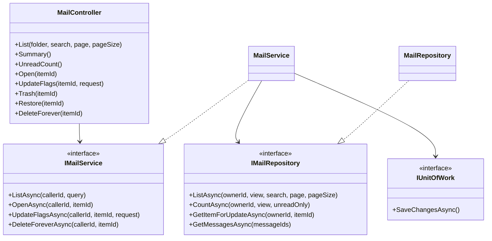
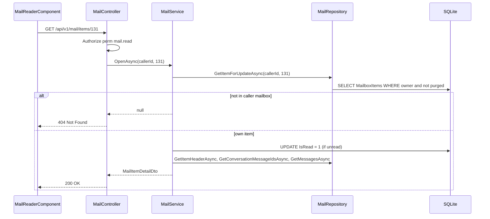
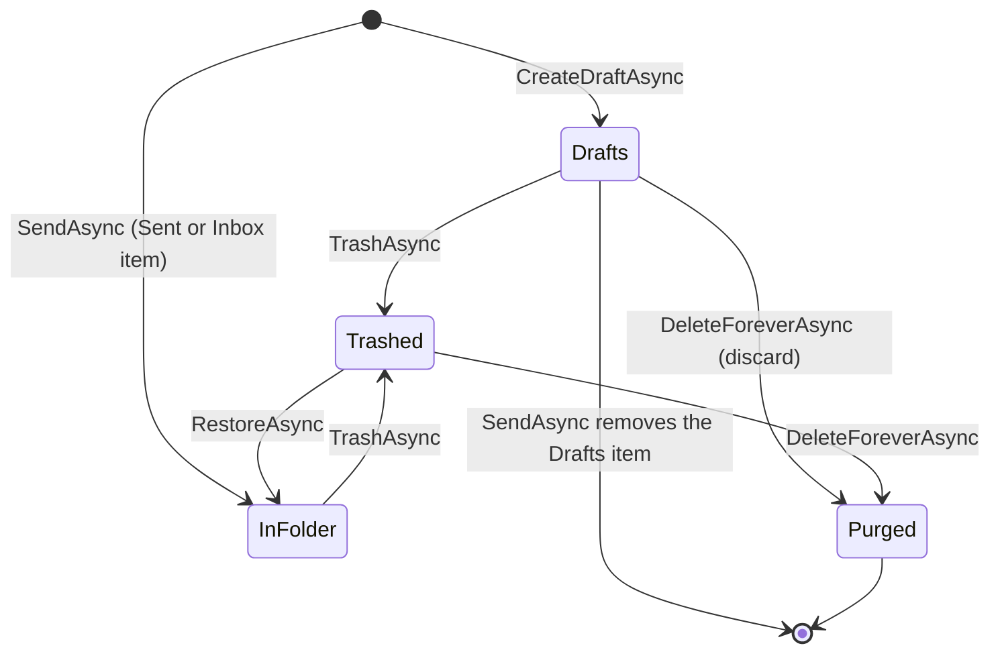
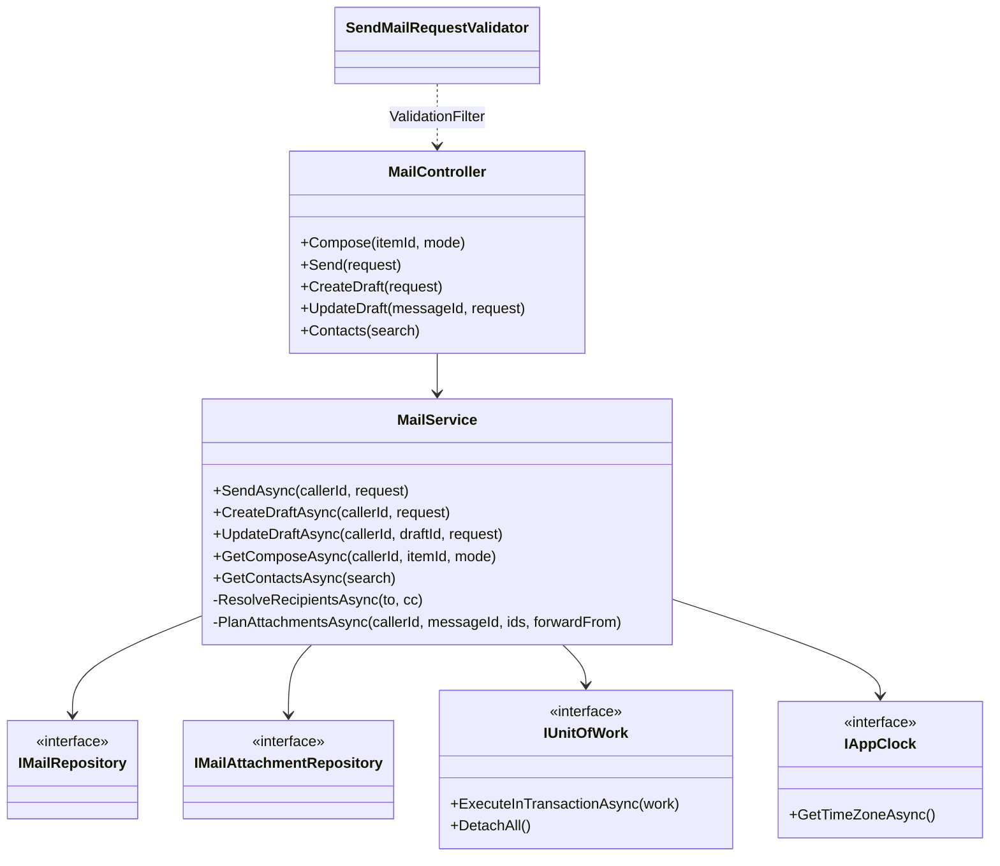
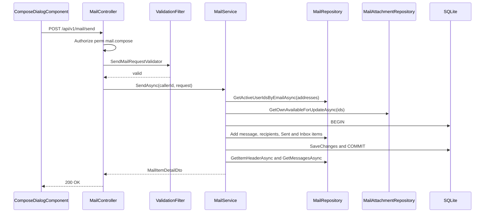
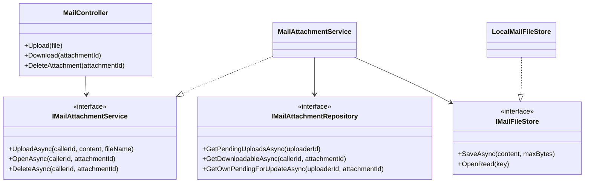
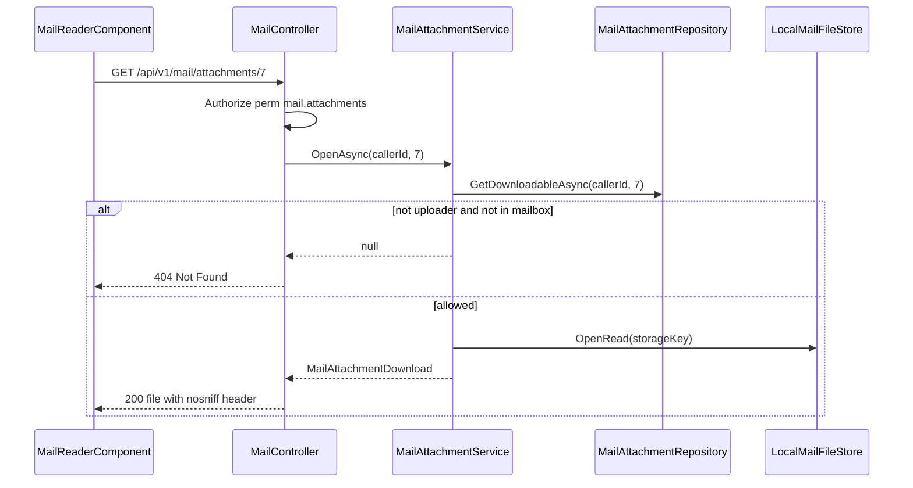
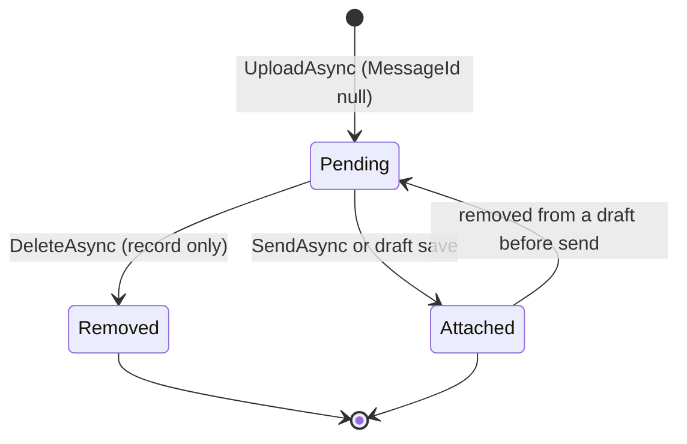
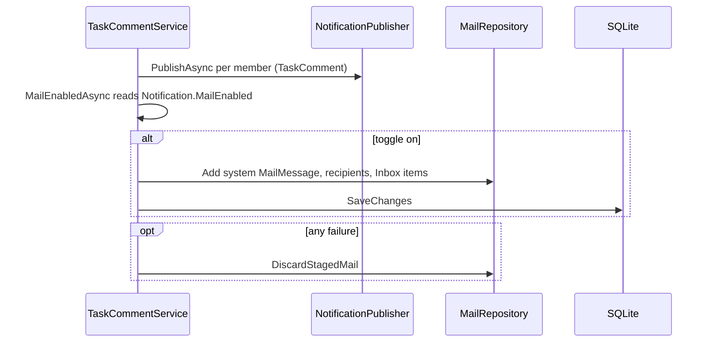
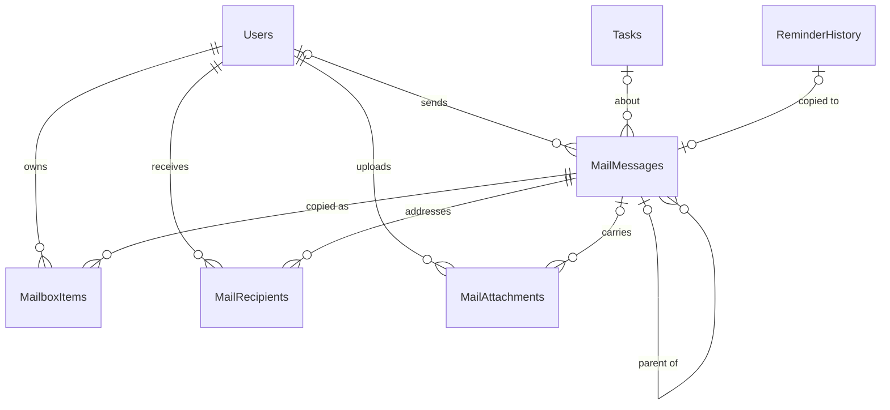

# Low-Level Design – Mail

## TaskFlow – Intelligent Task Allocation & Tracking System

> **Document:** Low-Level Design (Sub-module: Communication → Mail, code `MAIL`)  ·  **Version:** 1.0  ·  **Status:** Draft
> **Project type:** Personal Project (Skill Development)  ·  **Date:** 31-Oct-2026
> **Author:** Jojo George (jojogeorge3344@gmail.com)
> **Based on:** HLD-Mail v1.0, FRD-Mail v1.0, TDD-TaskFlow v2.0
> © 2026 Jojo George. All rights reserved.

---

## Document Control

| Version | Date | Author | Summary of changes |
|---|---|---|---|
| 1.0 | 31-Oct-2026 | Jojo George | Initial version, derived from the code of `TaskFlow.Api` and the Angular `communication/mail` module |

**Related documents**

| Document | Location |
|---|---|
| BRD – Mail | `../../../BRD/04-Communication/04.1-Mail/BRD-Mail.md` |
| FRD – Mail (`FR-MAIL-01` – `FR-MAIL-56`, `UC-MAIL-01` – `UC-MAIL-09`) | `../../../FRD/04-Communication/04.1-Mail/FRD-Mail.md` |
| HLD – Mail | `../../../HLD/04-Communication/04.1-Mail/HLD-Mail.md` |
| LLD – Overall (stack, cross-cutting design, shared tables `Users`, `Tasks`, `ApplicationSettings`) | `../../00-Overall/LLD-TaskFlow-Overall.md` |
| LLD – Notification (sibling; reminder engine that writes system mails, owns `ReminderHistory`) | `../04.2-Notification/LLD-Notification.md` |
| TDD v2.0 | `TDD-TaskFlow.md` §15 (Internal Mail), §8 (API) |

---

## 1. Introduction

### 1.1 Purpose
Detailed design of the Mail sub-module as built: the `MailController` actions, the `MailService` and
`MailAttachmentService` logic, the `MailRepository` and `MailAttachmentRepository` queries, the `LocalMailFileStore`
file store, the four mail tables, validation and error rules, the Angular Mail screen and the system mails other
sub-modules write into the Inbox. It is detailed enough to maintain or re-implement the sub-module.

### 1.2 Scope & Conventions
- Covered: Mailbox (folders, items, flags, trash), Compose (send, reply / reply all / forward, drafts, contacts),
  Attachments (upload, download, remove), system mails received from Task Management and the reminder engine.
- Not covered here: the reminder engine itself (see the Notification LLD), Reminder Settings (owner of the
  `Notification.MailEnabled` toggle), the Assistant's `DraftMailTool` (Assistant LLD).
- Naming: `*Controller`, `I*Service` / `*Service`, `I*Repository` / `*Repository`, request DTOs `*Request`,
  response DTOs `*Dto`, query record `MailListQuery`.
- API base path `/api/v1/mail`; JSON camelCase; enums serialized as strings (`JsonStringEnumConverter`); errors as
  ProblemDetails / ValidationProblemDetails.
- Controller actions in this sub-module: **16** (all in `MailController`, facts.md §3).
- Data scope is always **Own**: a mail or attachment outside the caller's mailbox is reported as **404, never 403**.

---

## 2. Code Structure

### 2.1 Backend Folder Layout

```
TaskFlow.Api/
  Controllers/Communication/MailController.cs
  Services/Communication/Mail/Messages/        IMailService.cs, MailService.cs
  Services/Communication/Mail/Attachments/     IMailAttachmentService.cs, MailAttachmentService.cs, MailAttachmentDownload.cs
  Repositories/Communication/Mail/Messages/    IMailRepository.cs, MailRepository.cs, MailItemHeader.cs
  Repositories/Communication/Mail/Attachments/ IMailAttachmentRepository.cs, MailAttachmentRepository.cs, AttachmentFile.cs, PendingUploads.cs
  Dtos/Communication/Mail/                     MailDtos.cs
  Dtos/Communication/Mail/Validators/          MailRequestValidators.cs
  Common/Rules/                                MailRules.cs, EmailPolicy.cs
  Common/Exceptions/                           MailValidationException.cs, AppException.cs (ConflictException)
  Models/Entities/                             MailMessage.cs, MailRecipient.cs, MailboxItem.cs, MailAttachment.cs
  Models/Enums/                                MailFolder.cs, MailRecipientKind.cs
  Integrations/Storage/                        IMailFileStore.cs, LocalMailFileStore.cs
  Config/                                      MailOptions.cs, IntegrationRegistration.cs, ServiceRegistration.cs, RepositoryRegistration.cs
  Persistence/                                 AppDbContext.cs, Migrations/20261017090431_AddInternalMail.cs
```

### 2.2 Frontend Folder Layout

```
src/app/modules/communication/
  communication.routes.ts                 COMMUNICATION_ROUTES: 'mail' (permissionGuard, mail.read)
  mail/pages/mail.component.ts|html       MailComponent (shell, folder rail, URL state ?folder=&item=, narrow panes)
  mail/components/                        MailListComponent, MailReaderComponent, ComposeDialogComponent, RecipientPickerComponent
                                          compose-dialog.model.ts (ComposeRequest, ComposeResult, ComposeField), recipient-picker.model.ts (RecipientChip)
  mail/services/mail.service.ts           MailService (all /api/v1/mail calls, unreadCount signal)
  mail/models/mail.model.ts               Mail interfaces, MAIL_LIMITS
  mail/utils/mail-format.ts, linkify.ts   MAIL_FOLDERS, MAIL_NARROW_QUERY, date/size formatting, linkify()
src/app/shared/auth/permissions.ts        MailRead, MailCompose, MailOrganize, MailAttachments
src/app/layouts/nav-items.ts              Communication Management → Mail (badge 'mail')
src/app/layouts/shell.component.ts        refreshBadges() on navigation, every SESSION_CHECK_INTERVAL_MS (15 000 ms) and on tab visible
```

### 2.3 Layer Rules

| Rule | Enforced by |
|---|---|
| `MailController` → `IMailService` / `IMailAttachmentService` → `IMailRepository` / `IMailAttachmentRepository` only | `TaskFlow.UnitTests/Architecture/ArchitectureTests.cs` |
| Repositories never save; services commit through `IUnitOfWork` (`SaveChangesAsync`, `ExecuteInTransactionAsync`) | `ArchitectureTests` |
| Controllers take and return DTOs only, do not validate (validators run in `ValidationFilter`) and do not catch | `ArchitectureTests` |
| File bytes only through `IMailFileStore` (Integrations layer) | Code structure (`IntegrationRegistration` registers `LocalMailFileStore` as singleton) |
| Frontend: API service in the module whose endpoints it calls; `loadComponent` target in `pages/` | `npm run check:structure` |

Shared stack, DI and middleware: see the overall LLD (`../../00-Overall/LLD-TaskFlow-Overall.md`).

---

## 3. Cross-Cutting Design

| Concern | Design in Mail |
|---|---|
| Validation | FluentValidation `SendMailRequestValidator`, `SaveDraftRequestValidator` run by the global `ValidationFilter` (400 ValidationProblemDetails). Rules needing the database (recipients, attachments, system mail) throw `MailValidationException` from the services. |
| Error handling | `GlobalExceptionHandler`: `RequestValidationException` (incl. `MailValidationException`) → 400 with `errors` keyed `To`, `Cc`, `Body`, `AttachmentIds`, `Mode`, `File`; `ConflictException` → 409; null results from services → controller `NotFound()` (404). |
| Transactions | `MailService.InTransactionAsync` wraps `IUnitOfWork.ExecuteInTransactionAsync` and always calls `DetachAll()` in `finally`. Single-row flag updates use `SaveChangesAsync`. |
| Authorization | Class `[Authorize]` (JWT) + one `[Authorize(Policy = PermissionPolicy.Prefix + PermissionKeys.Mail*)]` per action; caller id from `ClaimTypes.NameIdentifier` (`TryGetCallerId`, else 401). Ownership: every query starts from `MailRepository.Mine(ownerId)`. |
| Logging | No mail-specific logging; request bodies (mail content) are never logged by `RequestLoggingMiddleware`. Refused policies logged by `DeniedActionAuditHandler`. |
| Time & time zone | Stored UTC from `TimeProvider`; quoted / forwarded dates converted with `IAppClock.GetTimeZoneAsync()` and formatted `dd MMM yyyy, HH:mm` (invariant culture). |
| File storage | `LocalMailFileStore` under `Storage:Root` + `Mail:AttachmentsPath`, path `<root>/<first 2 chars of key>/<key "N">`; the user's file name is never part of the path. |

### 3.1 Exception → HTTP Status

| Exception / result | Status | When (Mail) |
|---|---|---|
| `MailValidationException` (: `RequestValidationException`) | 400 | Unknown recipients, recipient count, empty mail, attachment rules, reply to system mail, upload rules |
| FluentValidation failure (`ValidationFilter`) | 400 | Length, address shape, recipient count, `Mode` missing |
| Policy failure | 403 | Caller lacks the action's `mail.*` key |
| Service returns `null` / `false` | 404 | Item, draft, parent item or attachment not in the caller's mailbox |
| `ConflictException` | 409 | Delete forever on an item that is neither trashed nor a draft |
| No / invalid `NameIdentifier` claim | 401 | `TryGetCallerId` fails |

---

## 4. Module Designs

### 4.1 Module: Communication → Mail (`MAIL`)

Endpoint count: **16** controller actions = Mailbox 8 + Compose 5 + Attachments 3.

#### 4.1.1 Child module: Mailbox (folders, items, flags, trash)

**Class / file inventory**

| Layer | Type | File | Responsibility |
|---|---|---|---|
| Controller | `MailController` (`List`, `Summary`, `UnreadCount`, `Open`, `UpdateFlags`, `Trash`, `Restore`, `DeleteForever`) | `Controllers/Communication/MailController.cs` | HTTP routing, policy per action, caller id |
| Service | `IMailService` / `MailService` (`ListAsync`, `GetSummaryAsync`, `GetUnreadCountAsync`, `OpenAsync`, `UpdateFlagsAsync`, `TrashAsync`, `RestoreAsync`, `DeleteForeverAsync`) | `Services/Communication/Mail/Messages/` | Paging rules, read-on-open, personal flags, trash / purge rules |
| Repository | `IMailRepository` / `MailRepository` (`Mine`, `InView`, `ListAsync`, `CountAsync`, `GetItemForUpdateAsync`, `GetItemHeaderAsync`, `GetConversationMessageIdsAsync`, `GetMessagesAsync`) | `Repositories/Communication/Mail/Messages/` | Owner-rooted queries, views, search, thread loading |
| Projection | `MailItemHeader` | `Repositories/Communication/Mail/Messages/MailItemHeader.cs` | Item header + `ConversationId`, `DraftTo`, `DraftCc` |
| DTOs | `MailView`, `MailListQuery`, `MailListItemDto`, `MailItemDetailDto`, `MailMessageDto`, `MailAddressDto`, `MailAttachmentDto`, `MailSummaryDto`, `MailUnreadCountDto`, `UpdateMailFlagsRequest`, `PagedResult<T>` | `Dtos/Communication/Mail/MailDtos.cs`, `Common/Models/PagedResult.cs` | Contracts |
| Rules | `MailRules` (`DefaultPageSize` 25, `MaxPageSize` 50, `Preview`, `SystemSenderName` "TaskFlow") | `Common/Rules/MailRules.cs` | Limits and pure helpers |
| Frontend page | `MailComponent` | `modules/communication/mail/pages/mail.component.ts` | Folder rail, counts, URL state, narrow-screen panes (`MAIL_NARROW_QUERY` `(max-width: 767.98px)`) |
| Frontend components | `MailListComponent`, `MailReaderComponent` | `modules/communication/mail/components/` | List with search / paging / star; reader with thread, actions, downloads, `linkify` |
| Frontend service | `MailService` (`list`, `summary`, `refreshUnreadCount`, `open`, `setFlags`, `trash`, `restore`, `deleteForever`) | `modules/communication/mail/services/mail.service.ts` | HTTP calls, `unreadCount` signal for the menu badge |

**Class diagram**



**API contracts**

| # | Method | Route | Permission / policy | Request | Response | Status codes |
|---|---|---|---|---|---|---|
| 1 | GET | `/api/v1/mail` | `mail.read` | Query `folder` (`MailView`, default `Inbox`), `search`, `page` (default 1), `pageSize` (default 25, clamped 1–50) → `MailListQuery` | `PagedResult<MailListItemDto>` | 200, 401, 403 |
| 2 | GET | `/api/v1/mail/summary` | `mail.read` | – | `MailSummaryDto` | 200, 401, 403 |
| 3 | GET | `/api/v1/mail/unread-count` | `mail.read` | – | `MailUnreadCountDto` | 200, 401, 403 |
| 4 | GET | `/api/v1/mail/items/{itemId}` | `mail.read` | Route `itemId` (int) | `MailItemDetailDto` (item marked read) | 200, 401, 403, 404 |
| 5 | PATCH | `/api/v1/mail/items/{itemId}` | `mail.organize` | `UpdateMailFlagsRequest` | – | 204, 401, 403, 404 |
| 6 | POST | `/api/v1/mail/items/{itemId}/trash` | `mail.organize` | – | – | 204, 401, 403, 404 |
| 7 | POST | `/api/v1/mail/items/{itemId}/restore` | `mail.organize` | – | – | 204, 401, 403, 404 |
| 8 | DELETE | `/api/v1/mail/items/{itemId}` | `mail.organize` | – | – (delete forever / discard draft) | 204, 401, 403, 404, 409 |

**Request / response example**

```json
// GET /api/v1/mail?folder=Inbox&page=1&pageSize=25  ->  200 OK (PagedResult<MailListItemDto>)
{
  "items": [
    {
      "itemId": 131, "messageId": 90, "folder": "Inbox",
      "from": { "userId": null, "name": "TaskFlow", "email": "" },
      "to": [{ "userId": 4, "name": "Rahul Nair", "email": "rahul.nair@taskflow.com" }],
      "draftTo": null, "subject": "Task due today: Prepare Monthly Report",
      "preview": "Reminder: \"Prepare Monthly Report\" is due today at 17:00. This is an automatic reminder from TaskFlow.",
      "date": "2026-10-15T00:01:00Z", "isRead": false, "isStarred": false, "isImportant": false,
      "hasAttachments": false, "isTrashed": false, "isSystem": true
    }
  ],
  "total": 1, "page": 1, "pageSize": 25
}
```

```json
// PATCH /api/v1/mail/items/131   (null or missing = unchanged)  ->  204 No Content
{ "isRead": false, "isStarred": true, "isImportant": null }
```

```json
// GET /api/v1/mail/summary  ->  200 OK
{ "inboxUnread": 3, "starredUnread": 1, "importantUnread": 0, "drafts": 2 }
```

`POST …/trash`, `POST …/restore` and `DELETE /api/v1/mail/items/{itemId}` have no body and return 204. A 409 body:
`{ "status": 409, "detail": "Move the mail to Trash before deleting it forever." }`. Names and ids are illustrative.

**Service logic – `ListAsync` / `GetSummaryAsync` / `GetUnreadCountAsync`**
1. `page = Math.Max(1, query.Page)`; `pageSize = Math.Clamp(query.PageSize, 1, MailRules.MaxPageSize)` (50).
2. `MailRepository.ListAsync(callerId, query.Folder, query.Search, page, pageSize)`.
3. Summary = `CountAsync(Inbox, unreadOnly)`, `CountAsync(Starred, unreadOnly)`, `CountAsync(Important, unreadOnly)`,
   `CountAsync(Drafts, all)`; unread count = `CountAsync(Inbox, unreadOnly)` (menu badge).

**Service logic – `OpenAsync(callerId, itemId)`**
1. `GetItemForUpdateAsync(callerId, itemId)` (rooted in `Mine`); `null` → 404.
2. If `!item.IsRead` → `IsRead = true`, `SaveChangesAsync` (FR-MAIL-10).
3. `BuildDetailAsync`: `GetItemHeaderAsync`; thread ids = `[MessageId]` for a draft, otherwise
   `GetConversationMessageIdsAsync(callerId, ConversationId)` (drafts excluded); `GetMessagesAsync(ids)`; order by
   `SentAt` (null last) then `MessageId`; return `MailItemDetailDto` with `Message` = the opened message.

**Service logic – flags, trash, restore, delete forever**
1. `UpdateFlagsAsync`: load own item; `IsRead`, `IsStarred`, `IsImportant` = request value `??` current; save.
2. `TrashAsync`: `TrashedAt ??= now` (idempotent). `RestoreAsync`: `TrashedAt = null`.
3. `DeleteForeverAsync`: if `TrashedAt is null && Folder != Drafts` → `ConflictException("Move the mail to Trash before
   deleting it forever.")`; else `PurgedAt = now` (soft purge, row and files kept).
4. Each returns `false` (→ 404) when the item is not the caller's. Only the caller's `MailboxItem` changes; other
   participants' items for the same `MailMessage` are untouched (FR-MAIL-19).

**Sequence diagram – open a mail**



**Repository methods**

| Method | Query / purpose | Notes |
|---|---|---|
| `Mine(ownerId)` (private) | `MailboxItems.Where(OwnerUserId == ownerId && PurgedAt == null)` | Root of every mailbox query (ownership, FR-MAIL-20) |
| `InView(items, view)` (private) | Inbox / Sent / Drafts: `Folder == x && TrashedAt == null`; Starred / Important: flag set, not trashed, `Folder != Drafts`; Trash: `TrashedAt != null` | Served by index `(OwnerUserId, Folder, PurgedAt, TrashedAt, SortAt)` |
| `ListAsync(ownerId, view, search, page, pageSize)` | Escaped `LIKE` (`\` escape) on `Subject`, `Body`, `DraftTo`, the "TaskFlow" sender of system mail, sender and recipient `FullName` / `Email` (`IgnoreQueryFilters` on `Users`); order `SortAt` desc, `Id` desc; `Skip/Take` | Body read as `Substring(0, 300)` then `MailRules.Preview` (120 chars + "…"); `To` recipients only in the row; `HasAttachments = Attachments.Any()` |
| `CountAsync(ownerId, view, unreadOnly)` | `InView(...).CountAsync(!IsRead)` or all | Folder counts, badge |
| `GetItemForUpdateAsync(ownerId, itemId)` | Tracked own item | Flags, trash, purge, open |
| `GetItemHeaderAsync(ownerId, itemId)` | `AsNoTracking` projection to `MailItemHeader` | `IsTrashed = TrashedAt != null` |
| `GetConversationMessageIdsAsync(ownerId, conversationId)` | Own non-draft items whose message has the `ConversationId`; `Distinct` | Thread as the caller sees it |
| `GetMessagesAsync(messageIds)` | `AsNoTracking` messages with recipients (`Kind`) and attachments ordered by `Id`; people loaded with `IgnoreQueryFilters` | System sender → `MailAddressDto(null, "TaskFlow", "")`; missing user → "Unknown user" (FR-MAIL-23) |

**Validation rules**

| Field | Rule | Message |
|---|---|---|
| `folder` | Must bind to `MailView` (Inbox, Starred, Important, Sent, Drafts, Trash) | ASP.NET model-binding 400 |
| `page` / `pageSize` | Clamped (no error): page ≥ 1, pageSize 1–50 | – |
| `UpdateMailFlagsRequest` | All fields optional `bool?` | – |
| Delete forever | `TrashedAt != null` or `Folder == Drafts` | "Move the mail to Trash before deleting it forever." |

**Error cases**

| Case | Exception / result | Status |
|---|---|---|
| Item not in caller's mailbox, or purged | `null` / `false` | 404 |
| Delete forever on a non-trashed, non-draft item | `ConflictException` | 409 |
| Missing `mail.read` / `mail.organize` | Policy failure | 403 |

**State machine – `MailboxItem` (one user's copy)**



`IsRead`, `IsStarred` and `IsImportant` are independent personal flags in every non-purged state.

#### 4.1.2 Child module: Compose, send and drafts

**Class / file inventory**

| Layer | Type | File | Responsibility |
|---|---|---|---|
| Controller | `MailController` (`Compose`, `Send`, `CreateDraft`, `UpdateDraft`, `Contacts`, private `SaveDraft`) | `Controllers/Communication/MailController.cs` | Routing, policy `mail.compose` |
| Service | `MailService` (`GetComposeAsync`, `SendAsync`, `CreateDraftAsync`, `UpdateDraftAsync`, `GetContactsAsync`; private `LoadParentAsync`, `ResolveRecipientsAsync`, `PlanAttachmentsAsync`, `ApplyAttachments`, `ApplyDraftFields`, `InTransactionAsync`, `BuildDetailAsync`, `LocalTimeAsync`) | `Services/Communication/Mail/Messages/MailService.cs` | Recipient resolution, all-or-nothing send, reply / forward pre-fill, drafts |
| Repository | `MailRepository` (`GetDraftForUpdateAsync`, `GetMessageOfItemAsync`, `GetMessageIdOfItemAsync`, `GetActiveUserIdsByEmailAsync`, `SearchContactsAsync`, `AddRecipient`, `AddMailboxItem`, `RemoveMailboxItem`, `DiscardStagedMail`) | `Repositories/Communication/Mail/Messages/MailRepository.cs` | Writes and lookups |
| Repository | `MailAttachmentRepository` (`GetOwnAvailableForUpdateAsync`, `GetOnMessageAsync`, `GetIdsOnMessageAsync`, `GetOthersOnMessageForUpdateAsync`) | `Repositories/Communication/Mail/Attachments/` | Attachment planning for send / draft |
| DTOs | `SendMailRequest`, `SaveDraftRequest`, `MailComposeMode`, `MailComposeDto`, `MailContactDto`, `MailItemDetailDto` | `Dtos/Communication/Mail/MailDtos.cs` | Contracts |
| Validators | `SendMailRequestValidator` (`BeAnAddress`), `SaveDraftRequestValidator` | `Dtos/Communication/Mail/Validators/MailRequestValidators.cs` | Input rules |
| Rules | `MailRules` (`NormalizeAddresses`, `WithPrefix`, `ReplyPrefix` "Re: ", `ForwardPrefix` "Fwd: ", `MaxSubjectLength` 200, `MaxBodyLength` 20 000, `MaxRecipients` 50, `MaxAddressLength` 320, `MaxContacts` 10) | `Common/Rules/MailRules.cs` | Pure rules |
| Exception | `MailValidationException` | `Common/Exceptions/MailValidationException.cs` | Field errors (400) |
| Frontend | `ComposeDialogComponent` (drawer "New mail" / "Reply" / "Reply all" / "Forward" / "Draft"), `RecipientPickerComponent` (chips, 250 ms debounced suggestions, per-chip check via `contacts`) | `modules/communication/mail/components/` | Compose UI, server error keys mapped through `ComposeField` |
| Frontend service | `MailService` (`compose`, `send`, `createDraft`, `updateDraft`, `contacts`) | `modules/communication/mail/services/mail.service.ts` | HTTP calls; `send` refreshes the badge |

**Class diagram**



**API contracts**

| # | Method | Route | Permission / policy | Request | Response | Status codes |
|---|---|---|---|---|---|---|
| 9 | GET | `/api/v1/mail/items/{itemId}/compose` | `mail.compose` | Route `itemId`; query `mode` (`MailComposeMode`: Reply, ReplyAll, Forward) | `MailComposeDto` | 200, 400, 401, 403, 404 |
| 10 | POST | `/api/v1/mail/send` | `mail.compose` | `SendMailRequest` | `MailItemDetailDto` (sender's Sent item) | 200, 400, 401, 403, 404 |
| 11 | POST | `/api/v1/mail/drafts` | `mail.compose` | `SaveDraftRequest` | `MailItemDetailDto` (Drafts item) | 200, 400, 401, 403, 404 |
| 12 | PUT | `/api/v1/mail/drafts/{messageId}` | `mail.compose` | Route `messageId` (the draft's **message** id); `SaveDraftRequest` | `MailItemDetailDto` | 200, 400, 401, 403, 404 |
| 13 | GET | `/api/v1/mail/contacts` | `mail.compose` | Query `search` | `IReadOnlyList<MailContactDto>` (max 10; `[]` for blank) | 200, 401, 403 |

**Request / response example**

```json
// POST /api/v1/mail/send  (new mail; reply = parentItemId + mode "Reply"; saved draft = draftId)
{
  "to": ["anita.k@taskflow.com"],
  "cc": ["ravi.m@taskflow.com"],
  "subject": "Q3 report",
  "body": "Please review the attached draft.",
  "attachmentIds": [7],
  "draftId": null,
  "parentItemId": null,
  "mode": null
}
```

```json
// 200 OK (MailItemDetailDto – the sender's Sent item)
{
  "itemId": 120, "folder": "Sent", "isRead": true, "isStarred": false, "isImportant": false, "isTrashed": false,
  "draftTo": null, "draftCc": null,
  "message": {
    "messageId": 88,
    "from": { "userId": 4, "name": "Jojo George", "email": "jojo.george@taskflow.com" },
    "to": [{ "userId": 9, "name": "Anita K", "email": "anita.k@taskflow.com" }],
    "cc": [{ "userId": 11, "name": "Ravi M", "email": "ravi.m@taskflow.com" }],
    "subject": "Q3 report", "body": "Please review the attached draft.",
    "sentAt": "2026-10-31T10:00:00Z", "isSystem": false, "taskId": null,
    "attachments": [{ "id": 7, "fileName": "q3.pdf", "contentType": "application/pdf", "sizeBytes": 245760 }]
  },
  "thread": ["…MailMessageDto, oldest first…"]
}
```

```json
// 400 Bad Request (MailValidationException -> ValidationProblemDetails)
{ "status": 400, "errors": { "To": ["Not an active TaskFlow user: someone@taskflow.com."] } }
```

```json
// POST /api/v1/mail/drafts  and  PUT /api/v1/mail/drafts/95   (recipients may be incomplete)
{ "to": ["anita.k@taskflow.com", "not-yet"], "cc": [], "subject": "Plan", "body": "Draft text", "attachmentIds": [], "parentItemId": null, "mode": null }
```

```json
// GET /api/v1/mail/items/131/compose?mode=Forward  ->  200 OK (MailComposeDto)
{
  "mode": "Forward", "parentItemId": 131, "to": [], "cc": [],
  "subject": "Fwd: Task due today: Prepare Monthly Report",
  "body": "\n\n---------- Forwarded message ----------\nFrom: TaskFlow\nDate: 15 Oct 2026, 05:31\nSubject: …\nTo: Rahul Nair <rahul.nair@taskflow.com>\n\nReminder: …",
  "forwardedAttachments": []
}
```

**Service logic – `SendAsync(callerId, request)`**
1. If `DraftId` set: `GetDraftForUpdateAsync(callerId, draftId)`; missing or `SentAt != null` → `null` (404). Else if
   `ParentItemId` set: `LoadParentAsync` → `GetMessageOfItemAsync` (non-draft own item, else `null` → 404); a system
   parent with `Mode` Reply / ReplyAll → `MailValidationException("Mode", "Mails from TaskFlow cannot be replied to.
   Forward it instead.")`.
2. Subject = request ?? draft (trimmed), body = request ?? draft; both empty → `MailValidationException("Body", "Write a
   subject or a message before sending.")`.
3. `ResolveRecipientsAsync(request.To ?? draft.DraftTo split, request.Cc ?? draft.DraftCc split)`:
   `NormalizeAddresses` (trim, lower-case, de-duplicate), Cc minus To (FR-MAIL-38); 0 → "Add at least one recipient.";
   more than 50 → "A mail can have at most 50 recipients."; `GetActiveUserIdsByEmailAsync`; unknown addresses →
   `errors["To"]` / `errors["Cc"]` = "Not an active TaskFlow user: *list*." (whole send refused, FR-MAIL-35).
4. Attachment ids = request ?? (draft) `GetIdsOnMessageAsync(draft.Id)`. `PlanAttachmentsAsync(callerId, draft?.Id, ids,
   forwardFrom = parent when Mode = Forward)`: `GetOwnAvailableForUpdateAsync` must return every id ("One or more
   attachments are not available."); chosen + forwarded ≤ 5 and ≤ 25 MB; `GetOthersOnMessageForUpdateAsync` gives the
   uploads to detach from the draft. All checks run before any write (NFR-MAIL-06).
5. `InTransactionAsync`: reuse the draft or add a new `MailMessage` (`ConversationId` = parent's or `Guid.NewGuid()`,
   `ParentMessageId`, `SenderUserId = callerId`); set subject, body, `DraftTo = DraftCc = null`, `UpdatedAt = SentAt =
   now`; `SaveChangesAsync` (to get the id); `ApplyAttachments` (dropped → `MessageId = null`, chosen → `MessageId`,
   forwarded → new `MailAttachment` rows sharing `StorageKey`); add `MailRecipient` (To / Cc); add Sent `MailboxItem`
   (`IsRead = true`) and one Inbox `MailboxItem` per recipient (`SortAt = now`); remove the Drafts item; save; commit.
   `DetachAll()` in `finally`.
6. Return `BuildDetailAsync(callerId, sentItemId)`.

**Service logic – drafts and compose**
1. `CreateDraftAsync`: optional `LoadParentAsync`; `PlanAttachmentsAsync`; transaction: new `MailMessage` with
   `ApplyDraftFields` (trimmed subject, body, `DraftTo` / `DraftCc` = raw addresses joined ", ", `UpdatedAt`) and
   `SentAt = null`; Drafts `MailboxItem` (`IsRead = true`). Recipients are **not** checked (FR-MAIL-47).
2. `UpdateDraftAsync(callerId, draftId, …)`: `GetDraftForUpdateAsync` by **message** id; `null` or sent → 404;
   `ApplyDraftFields`, `SortAt = now`, `ApplyAttachments`.
3. `GetComposeAsync(callerId, itemId, mode)`: `GetMessageIdOfItemAsync` (null → 404); `GetMessagesAsync`; system +
   Reply / ReplyAll → 400. Reply: To = sender, or original To when the caller sent it. ReplyAll: sender (unless caller)
   + To + Cc minus caller. Forward: no recipients, `ForwardedAttachments` = original attachments. Subject via
   `MailRules.WithPrefix` (no double prefix, max 200). Body: reply = blank lines + "On *dd MMM yyyy, HH:mm*, *name*
   wrote:" + lines prefixed "> "; forward = "---------- Forwarded message ----------" with From, Date, Subject, To and
   the body. Date in the application timezone (`LocalTimeAsync`); body cut at 20 000 characters.
4. `GetContactsAsync(search)`: blank → `[]`; else `SearchContactsAsync(term, 10)`.

**Sequence diagram – send**



**Repository methods**

| Method | Query / purpose | Notes |
|---|---|---|
| `GetDraftForUpdateAsync(ownerId, draftMessageId)` | Own `Drafts` item by `MessageId`, `Include(Message)` | Draft id in the API is the **message** id |
| `GetMessageOfItemAsync(ownerId, itemId)` / `GetMessageIdOfItemAsync` | Own non-draft item's message / id | Parent for reply / forward |
| `GetActiveUserIdsByEmailAsync(emails)` | `Users.Where(IsActive && emails.Contains(Email.ToLower()))` | Global query filter hides deleted users |
| `SearchContactsAsync(term, max)` | Active users, escaped `LIKE` on `FullName` or `Email`, order `FullName`, `Take(max)` | Directory-wide (see §10) |
| `AddRecipient` / `AddMailboxItem` / `RemoveMailboxItem` | Change-tracker helpers | Saved by the service |
| `DiscardStagedMail()` | Detaches `Added` `MailMessage`, `MailRecipient`, `MailboxItem` entries | Used by `TaskCommentService` when the comment mail fails |
| `MailAttachmentRepository.GetOwnAvailableForUpdateAsync(uploaderId, ids, messageId)` | Uploader matches and `MessageId` is null or `messageId` | Ownership + not used elsewhere (FR-MAIL-55) |
| `GetOnMessageAsync(messageId)` / `GetIdsOnMessageAsync` / `GetOthersOnMessageForUpdateAsync(messageId, keepIds)` | Attachment sets on a message | Forward copies, draft send, draft detach |

**Validation rules**

| Field | Rule | Message |
|---|---|---|
| `Subject` | `MaximumLength(200)` (send and draft) | FluentValidation default maximum-length message |
| `Body` | `MaximumLength(20000)` (send and draft) | FluentValidation default maximum-length message |
| Subject / Body (send, `DraftId` null) | At least one not blank (validator, error key `Body`; service re-checks incl. drafts) | "Write a subject or a message before sending." |
| To + Cc count (send, `DraftId` null) | `InclusiveBetween(1, 50)` after `NormalizeAddresses` (key `To`) | "Add between 1 and 50 recipients." |
| Each To / Cc (send) | `BeAnAddress`: trimmed, 1–320 chars, an "@" not first or last, no space | "'*address*' is not an email address." |
| `AttachmentIds` (send and draft) | ≤ 5 distinct | "A mail can have at most 5 attachments." |
| `Mode` | `NotNull().IsInEnum()` when `ParentItemId` set | FluentValidation default message |
| To / Cc (draft) | Each list ≤ 50 entries, each ≤ 320 chars | FluentValidation default message |
| Recipients (service) | ≥ 1 after normalising; ≤ 50; every address an active user | "Add at least one recipient." / "A mail can have at most 50 recipients." / "Not an active TaskFlow user: *list*." |
| Attachments (service) | Own and unused; chosen + forwarded ≤ 5 and ≤ 25 MB | "One or more attachments are not available." / "A mail can have at most 5 attachments." / "Attachments on one mail can total at most 25 MB." |
| Parent (service) | No Reply / ReplyAll to a system mail | "Mails from TaskFlow cannot be replied to. Forward it instead." |

Frontend pre-checks (`MAIL_LIMITS`, `RecipientPickerComponent`) mirror these rules; the server is authoritative.

**Error cases**

| Case | Exception / result | Status |
|---|---|---|
| Draft not the caller's or already sent | `null` | 404 |
| Parent item not the caller's (or a draft) | `null` | 404 |
| Reply / Reply all to a system mail | `MailValidationException` (`Mode`) | 400 |
| Unknown or inactive recipient | `MailValidationException` (`To` / `Cc`) | 400 |
| Attachment not own / already used / limits | `MailValidationException` (`AttachmentIds`) | 400 |
| Validator failure | `ValidationFilter` | 400 |

#### 4.1.3 Child module: Attachments

**Class / file inventory**

| Layer | Type | File | Responsibility |
|---|---|---|---|
| Controller | `MailController` (`Upload`, `Download`, `DeleteAttachment`; `UploadRequestLimit` = 10 MB + 1 MB) | `Controllers/Communication/MailController.cs` | Multipart upload, file result with `X-Content-Type-Options: nosniff` |
| Service | `IMailAttachmentService` / `MailAttachmentService` (`UploadAsync`, `OpenAsync`, `DeleteAsync`; `SafeTypes` allow-list) | `Services/Communication/Mail/Attachments/` | Name sanitising, blocked types, pending limits, content type |
| Result | `MailAttachmentDownload(Content, FileName, ContentType)` | `Services/Communication/Mail/Attachments/MailAttachmentDownload.cs` | Stream to return |
| Repository | `IMailAttachmentRepository` / `MailAttachmentRepository` (`GetPendingUploadsAsync`, `GetDownloadableAsync`, `GetOwnPendingForUpdateAsync`) | `Repositories/Communication/Mail/Attachments/` | Access checks, pending totals |
| Projections | `AttachmentFile(FileName, ContentType, StorageKey)`, `PendingUploads(Count, Bytes)` | same folder | Query results |
| Integration | `IMailFileStore` / `LocalMailFileStore` (`SaveAsync(stream, maxBytes)`, `OpenRead(key)`, `ResolveRoot`) | `Integrations/Storage/` | Bytes on disk |
| Config | `MailOptions.AttachmentsPath` | `Config/MailOptions.cs` | Folder |
| Frontend | `ComposeDialogComponent` (Attach, chips, "Uploading…"), `MailReaderComponent` (download buttons), `MailService.uploadAttachment` / `deleteAttachment` / `download` (blob) | `modules/communication/mail/` | UI |

**Class diagram**



**API contracts**

| # | Method | Route | Permission / policy | Request | Response | Status codes |
|---|---|---|---|---|---|---|
| 14 | POST | `/api/v1/mail/attachments` | `mail.attachments` | multipart/form-data field `file` (`IFormFile`); `RequestSizeLimit` 11 MB | `MailAttachmentDto` | 200, 400, 401, 403 |
| 15 | GET | `/api/v1/mail/attachments/{attachmentId}` | `mail.attachments` | Route `attachmentId` | File stream (server content type, original file name, `nosniff`) | 200, 401, 403, 404 |
| 16 | DELETE | `/api/v1/mail/attachments/{attachmentId}` | `mail.attachments` | Route `attachmentId` | – | 204, 401, 403, 404 |

**Request / response example**

```
POST /api/v1/mail/attachments
Content-Type: multipart/form-data; boundary=----b
------b
Content-Disposition: form-data; name="file"; filename="q3.pdf"
Content-Type: application/pdf
(binary)
------b--
```

```json
// 200 OK (MailAttachmentDto)
{ "id": 7, "fileName": "q3.pdf", "contentType": "application/pdf", "sizeBytes": 245760 }
```

```json
// 400 Bad Request
{ "status": 400, "errors": { "File": ["Files of type .exe are not allowed."] } }
```

`DELETE /api/v1/mail/attachments/{attachmentId}` has no body and returns 204.

**Service logic – `UploadAsync(callerId, content, fileName)`**
1. `MailRules.SanitizeFileName`: last path segment, invalid / control characters removed, trimmed of dots, at most 255
   characters (keeps the end), "file" when empty.
2. Extension in `MailRules.BlockedExtensions` → "Files of type *.ext* are not allowed."
3. `GetPendingUploadsAsync(callerId)`: `Count >= 20` → "You have *N* files waiting to be attached. Send or discard a mail
   before uploading more."; `room = 100 MB − Bytes ≤ 0` → "Your files waiting to be attached already total 100 MB. Send
   or discard a mail before uploading more."
4. `IMailFileStore.SaveAsync(content, min(10 MB, room))` streams in 80 KB buffers to `FileMode.CreateNew`; over the
   limit → "A file can be at most *n* MB." and the partial file is deleted; when the pending room was the limit the
   error is re-worded "This file would take your files waiting to be attached past 100 MB. Send or discard a mail
   first."
5. Size 0 → "The file is empty."
6. Content type from `SafeTypes` (png, jpg/jpeg, gif, webp, pdf, txt, csv, doc/docx, xls/xlsx, ppt/pptx, zip), else
   `application/octet-stream`; never from the client.
7. Add `MailAttachment` (`MessageId = null` = pending, `UploadedByUserId`, `StorageKey`, `CreatedAt`), save, return DTO.

**Service logic – `OpenAsync` / `DeleteAsync`**
1. `OpenAsync`: `GetDownloadableAsync(callerId, id)` (uploader, **or** a non-purged `MailboxItem` of the caller for the
   attachment's message); `_store.OpenRead(StorageKey)`; record or file missing → `null` (404).
2. `DeleteAsync`: `GetOwnPendingForUpdateAsync` (uploader and `MessageId == null`); remove the **record only** (the file
   may be shared by a forwarded copy); save.

**Sequence diagram – download**



**Repository methods**

| Method | Query / purpose | Notes |
|---|---|---|
| `GetPendingUploadsAsync(uploaderId)` | Uploader's attachments with `MessageId == null`, `GroupBy` → `Count` / `Sum(SizeBytes)` | `PendingUploads(0, 0)` when none |
| `GetDownloadableAsync(callerId, attachmentId)` | Uploader **or** `MailboxItems` row for the message owned by the caller with `PurgedAt == null` | Returns `AttachmentFile` |
| `GetOwnPendingForUpdateAsync(uploaderId, attachmentId)` | Uploader matches and `MessageId == null` | Tracked |

**Validation rules**

| Field | Rule | Message |
|---|---|---|
| `file` | Present | "Choose a file to upload." (controller, key `File`) |
| Extension | Not in `.exe`, `.dll`, `.bat`, `.cmd`, `.com`, `.msi`, `.ps1`, `.sh`, `.js`, `.vbs`, `.scr` | "Files of type *.ext* are not allowed." |
| Size | 1 byte – 10 MB | "The file is empty." / "A file can be at most 10 MB." |
| Pending uploads | < 20 files and < 100 MB | see service logic step 3–4 |

**Error cases**

| Case | Exception / result | Status |
|---|---|---|
| Rule broken | `MailValidationException` (`File`) | 400 |
| Download not allowed, record or file missing | `null` | 404 |
| Delete of an attached or foreign upload | `false` | 404 |

**State machine – `MailAttachment`**



#### 4.1.4 Child module: System and task mails written by other sub-modules

No endpoint; these writers create mail rows directly or through `IMailService.SendAsync`.

| Writer (sub-module) | Class / method | Sender | Subject | Condition | Notes |
|---|---|---|---|---|---|
| Notification (reminder engine) | `ReminderService.TryDeliverAsync` | System (`IsSystem = true`, `SenderUserId = null`) | "Task reminder: ", "Task due today: " or "Overdue task: " + title (max 200) | `Notification.MailEnabled` true | `TaskId`, `ReminderHistoryId` (unique), one To recipient, Inbox item; same transaction as the history row (Notification LLD) |
| Task Management (comments) | `TaskCommentService.AddInboxMail` | System | "Comment *verb*: *title*" (max 200) | `Notification.MailEnabled` true (missing / unreadable = on) | Body ends "This is an automatic message from TaskFlow."; `TaskId` set; recipients = task recipients + assignee + actor (live users); on failure `DiscardStagedMail()` and the comment is kept |
| Task Management (reassign) | `TaskService` → `IMailService.SendAsync(actorId, …)` | The acting user | "Task reassigned: *title*" | Always (not toggled) | Ordinary mail; no `TaskId`; recipients = active emails of the targets |
| Task Management (worked hours) | `TaskService` → `IMailService.SendAsync(actorId, …)` | The acting user | "Worked hours changed: *title*" | Always (not toggled) | Same as above |
| Assistant | `AssistantActionService` → `IMailService.SendAsync` after the user confirms a `SendMail` pending action (`DraftMailTool`); `FindUserTool` → `GetContactsAsync` | The user | As drafted | User confirmation | Assistant LLD |

The reader shows "Open the task" from `MailMessageDto.TaskId`; only system mails carry it.



---

## 5. Database Design

### 5.1 ER Diagram



### 5.2 Tables

Types: C# type / SQLite storage. Enums with `HasConversion<string>()` are TEXT. No database defaults are configured;
values are set by the services. All four tables were created by `20261017090431_AddInternalMail`.

#### `MailMessages` (`MailMessage`)

| Column | Type | Null | Key / index | Default | Description |
|---|---|:---:|---|---|---|
| Id | int / INTEGER | No | PK, autoincrement | identity | Message id (draft id in `PUT /api/v1/mail/drafts/{messageId}`) |
| ConversationId | Guid / TEXT | No | `IX_MailMessages_ConversationId` | – | Thread key |
| ParentMessageId | int? / INTEGER | Yes | FK → `MailMessages.Id` (Restrict), `IX_MailMessages_ParentMessageId` | – | Reply / forward source |
| SenderUserId | int? / INTEGER | Yes | FK → `Users.Id` (Restrict), `IX_MailMessages_SenderUserId` | – | Null for system mail |
| IsSystem | bool / INTEGER | No | – | – | Sender "TaskFlow" |
| Subject | string / TEXT(200) | No | – | – | Required |
| Body | string / TEXT(20000) | No | – | – | Plain text |
| TaskId | int? / INTEGER | Yes | FK → `Tasks.Id` (Restrict), `IX_MailMessages_TaskId` | – | "Open the task" link |
| ReminderHistoryId | int? / INTEGER | Yes | FK → `ReminderHistory.Id` (Restrict); **unique filtered** `IX_MailMessages_ReminderHistoryId` (`"ReminderHistoryId" IS NOT NULL`) | – | One mail per reminder |
| DraftTo / DraftCc | string? / TEXT(4000) | Yes | – | – | Raw draft recipients joined ", " |
| CreatedAt / UpdatedAt | DateTime / TEXT | No | – | – | UTC |
| SentAt | DateTime? / TEXT | Yes | – | – | Null = draft |

#### `MailRecipients` (`MailRecipient`)

| Column | Type | Null | Key / index | Default | Description |
|---|---|:---:|---|---|---|
| Id | int / INTEGER | No | PK | identity | – |
| MessageId | int / INTEGER | No | FK → `MailMessages.Id` (Cascade); **unique** `IX_MailRecipients_MessageId_UserId` | – | – |
| UserId | int / INTEGER | No | FK → `Users.Id` (Restrict), `IX_MailRecipients_UserId` | – | Recipient user |
| Kind | `MailRecipientKind` / TEXT(8) | No | – | – | To / Cc |

#### `MailboxItems` (`MailboxItem`)

| Column | Type | Null | Key / index | Default | Description |
|---|---|:---:|---|---|---|
| Id | int / INTEGER | No | PK | identity | Item id used by the API (`{itemId}`) |
| MessageId | int / INTEGER | No | FK → `MailMessages.Id` (Cascade); **unique** `IX_MailboxItems_MessageId_OwnerUserId_Folder` | – | – |
| OwnerUserId | int / INTEGER | No | FK → `Users.Id` (Restrict); `IX_MailboxItems_OwnerUserId_Folder_PurgedAt_TrashedAt_SortAt` | – | Mailbox owner |
| Folder | `MailFolder` / TEXT(16) | No | (in composite index) | – | Inbox / Sent / Drafts |
| IsRead / IsStarred / IsImportant | bool / INTEGER | No | – | – | Personal flags |
| TrashedAt | DateTime? / TEXT | Yes | (in composite index) | – | In Trash when set |
| PurgedAt | DateTime? / TEXT | Yes | (in composite index) | – | Deleted forever (soft) |
| SortAt | DateTime / TEXT | No | (in composite index) | – | Sent time or last draft save |

#### `MailAttachments` (`MailAttachment`)

| Column | Type | Null | Key / index | Default | Description |
|---|---|:---:|---|---|---|
| Id | int / INTEGER | No | PK | identity | – |
| MessageId | int? / INTEGER | Yes | FK → `MailMessages.Id` (Cascade), `IX_MailAttachments_MessageId` | – | Null = pending upload |
| UploadedByUserId | int / INTEGER | No | FK → `Users.Id` (Restrict), `IX_MailAttachments_UploadedByUserId` | – | Uploader (forwarder for copies) |
| FileName | string / TEXT(255) | No | – | – | Sanitised |
| ContentType | string / TEXT(128) | No | – | – | From the allow-list |
| SizeBytes | long / INTEGER | No | – | – | – |
| StorageKey | Guid / TEXT | No | – | – | File name in the store; shared by forwarded copies |
| CreatedAt | DateTime / TEXT | No | – | – | UTC |

Read-only use of shared tables: `Users` (`FullName`, `Email`, `IsActive`, `IsDeleted` query filter), `Tasks` (FK only),
`ApplicationSettings` (`Application.Timezone`, `Notification.MailEnabled`) – see the overall LLD.

### 5.3 Indexes, Constraints & Triggers

| Object | Definition | Purpose |
|---|---|---|
| `IX_MailboxItems_OwnerUserId_Folder_PurgedAt_TrashedAt_SortAt` | `(OwnerUserId, Folder, PurgedAt, TrashedAt, SortAt)` | Folder lists and counts |
| `IX_MailboxItems_MessageId_OwnerUserId_Folder` | Unique `(MessageId, OwnerUserId, Folder)` | One copy per owner and folder |
| `IX_MailRecipients_MessageId_UserId` | Unique `(MessageId, UserId)` | A user is To or Cc, once (FR-MAIL-38) |
| `IX_MailMessages_ReminderHistoryId` | Unique, filter `"ReminderHistoryId" IS NOT NULL` | At most one mail per reminder event |
| `IX_MailMessages_ConversationId` | `(ConversationId)` | Thread loading |
| FK delete behaviour | Message → recipients / items / attachments **Cascade**; every FK to `Users`, `Tasks`, `ReminderHistory`, parent message **Restrict** | Users and tasks are soft-deleted, so mail is kept |
| Triggers | None | – |

### 5.4 Enumerations

| Enum | Values | Stored as |
|---|---|---|
| `MailFolder` (`Models/Enums`) | Inbox, Sent, Drafts | TEXT(16) in `MailboxItems.Folder` |
| `MailRecipientKind` (`Models/Enums`) | To, Cc | TEXT(8) in `MailRecipients.Kind` |
| `MailView` (`Dtos/Communication/Mail`, API only) | Inbox, Starred, Important, Sent, Drafts, Trash | Query string |
| `MailComposeMode` (`Dtos/Communication/Mail`, API only) | Reply, ReplyAll, Forward | Query string / JSON string |

### 5.5 Migrations

| Migration | Change |
|---|---|
| `20261017074817_AddEmailDelivery` | Created `EmailDeliveryLogs` for the original SMTP design (superseded) |
| `20261017090431_AddInternalMail` | Dropped `EmailDeliveryLogs`; deleted settings `Email.%` and `Notification.EmailEnabled`; created `MailMessages`, `MailRecipients`, `MailboxItems`, `MailAttachments` with the indexes in §5.3 |
| `20261019173718_NormalizeEmailDomain` | Rewrote `Users.Email` onto the fixed `@taskflow.com` domain (`EmailPolicy`), which recipient resolution matches |

---

## 6. Algorithms & Background Jobs

| Job / algorithm | Trigger / schedule | Steps | Idempotency |
|---|---|---|---|
| Recipient resolution (`ResolveRecipientsAsync`) | Every send | Normalise → Cc minus To → count 1–50 → resolve active users by lower-case email → per-field unknown list | Pure; no writes |
| Attachment plan (`PlanAttachmentsAsync` + `ApplyAttachments`) | Send, draft create / update | Own + unused check → count / size limits incl. forwarded → detach dropped → attach chosen → copy forwarded rows sharing `StorageKey` | Checked before the transaction; re-sending a sent draft returns 404 |
| Thread building (`BuildDetailAsync`) | Open, send, draft | Own non-draft items of the conversation → messages ordered by `SentAt` | Read-only |
| Unread badge | Frontend: `shell.component.ts` `refreshBadges()` on navigation, every 15 s and on tab visible | `GET /api/v1/mail/unread-count` → `MailService.unreadCount` signal | Read-only |
| Background jobs | – | Mail has none; reminder mails come from `ReminderSchedulerService` (Notification LLD) | `IX_MailMessages_ReminderHistoryId` |

---

## 7. Security Design (detailed)

| Item | Implementation |
|---|---|
| Authentication | JWT bearer, class-level `[Authorize]`; caller id from `ClaimTypes.NameIdentifier` |
| Permission checks | One policy per action (`perm:` + `mail.read` / `mail.compose` / `mail.organize` / `mail.attachments`); defaults Granted for Administrator, Manager, Employee, Configurable for custom roles; denied attempts logged by `DeniedActionAuditHandler` |
| Ownership | `MailRepository.Mine(ownerId)` roots every mailbox query; attachment download needs uploader or a non-purged own item; foreign ids → 404 |
| Content safety | Plain-text bodies; frontend `linkify` makes only http(s) links clickable through Angular bindings (no HTML injection); attachments always downloaded with server-chosen content type and `X-Content-Type-Options: nosniff`; blocked executable types; sanitised file names never used in paths |
| Upload limits | `RequestSizeLimit` / `MultipartBodyLengthLimit` 11 MB; streamed size check in `LocalMailFileStore`; pending caps 20 files / 100 MB per user |
| Frontend gating | `permissionGuard` on `/mail` (`mail.read`); menu and badge from `has(Permissions.MailRead)`; `canCompose()` / `canOrganize()` hide buttons; attachment controls and draft Discard are not gated (§10) |
| Secrets | None in Mail; `Mail:AttachmentsPath` is a path only |

---

## 8. Configuration

| Key | Default | Purpose |
|---|---|---|
| `Mail:AttachmentsPath` | `mail-attachments` | Attachment folder; relative path resolved under `Storage:Root` by `LocalMailFileStore.ResolveRoot` |
| `Mail:AppBaseUrl` | not set | Used only by reminder mails ("Open the task:" link), see Notification LLD |
| `Storage:Root` | `""` (platform data folder, `C:\TaskFlow` on Windows) | Data folder holding `taskflow.db` and `mail-attachments` (overall LLD) |
| `Application:Timezone` | `Asia/Kolkata` | Fallback timezone for quoted dates when `Application.Timezone` is not stored |
| `ApplicationSettings` row `Notification.MailEnabled` | `true` (`SettingKeys.DefaultMailEnabled`) | Comment and reminder system mails on / off (edited in Reminder Settings) |
| `ApplicationSettings` row `Application.Timezone` | – | Application timezone (Application Settings) |
| `MailRules` constants (code) | 25 / 50 page size, 200 / 20 000 chars, 50 recipients, 320 chars address, 5 files, 10 MB, 25 MB, 20 pending / 100 MB, 10 contacts | Limits |

---

## 9. Testing Design

Test sources were not available; only file names (`tests-filelist.json`). Coverage below is inferred from the names.

| Area | Test class / file | Type | Covers |
|---|---|---|---|
| Send | `TaskFlow.UnitTests/Communication/Mail/Messages/MailSendTests.cs` | Unit | Recipient resolution, all-or-nothing send, Cc de-duplication, limits |
| Drafts and threads | `TaskFlow.UnitTests/Communication/Mail/Messages/MailDraftAndThreadTests.cs` | Unit | Drafts, reply / forward pre-fill, conversation, system-mail reply refusal |
| Mailbox | `TaskFlow.UnitTests/Communication/Mail/Messages/MailboxTests.cs` | Unit | Views, counts, flags, trash / restore / delete forever, ownership |
| Harness | `TaskFlow.UnitTests/Communication/Mail/Messages/MailTestHarness.cs` | Unit (helper) | Shared setup |
| Attachments | `TaskFlow.UnitTests/Communication/Mail/Attachments/MailAttachmentTests.cs` | Unit | Upload limits, blocked types, pending caps, download access |
| Email policy | `TaskFlow.UnitTests/Common/EmailDomainTests.cs`, `TaskFlow.UnitTests/Persistence/EmailDomainMigrationTests.cs` | Unit | `EmailPolicy`, domain migration |
| Endpoints | `TaskFlow.IntegrationTests/Communication/Mail/MailEndpointsTests.cs` | Integration | 16 endpoints, `mail.*` policies, 404 for foreign items, download headers |
| Cross-module | `TaskFlow.UnitTests/Monitoring/TaskManagement/Discussion/TaskCommentActivityNotificationTests.cs`, `TaskFlow.UnitTests/Monitoring/TaskManagement/Tasks/TaskWorkedHoursNotificationTests.cs` | Unit | Comment and worked-hours mails |
| Cross-cutting | `ArchitectureTests.cs`, `GlobalExceptionHandlerTests.cs`, `PermissionAuthorizationTests.cs` | Unit / Integration | Layer rules, 400 / 409 mapping, policies |
| Frontend | – (no spec files in the fact sheet) | Manual UI check | Screen behaviour, narrow layout, linkify |

> ⚠️ To be confirmed: the per-test mapping above (and in §11) is inferred from file names; confirm against the test sources.

---

## 10. Known Limitations & Open Issues

- "Delete forever" is a soft purge (`PurgedAt`); rows and attachment files are never physically removed, and abandoned
  pending uploads are not cleaned up (no job).
- `MailAttachmentService.DeleteAsync` removes only the record; a file whose last record is removed stays on disk.
- `GET /api/v1/mail/contacts` returns the organisation-wide active-user directory (name, email) to anyone with
  `mail.compose`.
- Reassignment and worked-hours mails are sent through `SendAsync` as the actor and ignore `Notification.MailEnabled`.
  > ⚠️ To be confirmed: whether they should follow the toggle (FRD §10).
- The Attach button, chip removal and download buttons are not gated by `mail.attachments` in the UI (users without the
  key get 403).
  > ⚠️ To be confirmed: whether they should be hidden (FRD §10).
- Draft Discard in `ComposeDialogComponent` calls `DELETE /api/v1/mail/items/{itemId}` (`mail.organize`) but is shown
  with `mail.compose` only.
  > ⚠️ To be confirmed: intended (FRD §10).
- The XML comment on `IMailService.DeleteForeverAsync` says `InvalidOperationException`; the code throws
  `ConflictException` (409).
- In Trash, `MailReaderComponent` hides Forward as well as Reply / Reply all (`!item.isTrashed`), while FRD UC-MAIL-07
  A2 says Forward stays offered.
  > ⚠️ To be confirmed: which behaviour is intended.
- Mails sent by `TaskService` carry no `TaskId`, so they show no "Open the task" link.

> ⚠️ To be confirmed: the status returned when an upload exceeds the 11 MB request limit (raised by the server before
> the action runs).

---

## 11. Traceability (FRD → code)

| FRD requirement | Endpoint / class | Test |
|---|---|---|
| FR-MAIL-01 | `COMMUNICATION_ROUTES` `mail` + `permissionGuard` (`mail.read`); server `GET /api/v1/mail` policy | `MailEndpointsTests`; Manual UI check |
| FR-MAIL-02, FR-MAIL-05 | `GET /api/v1/mail` · `MailService.ListAsync` · `MailRepository.InView` / `ListAsync`; `MAIL_FOLDERS` | `MailboxTests` |
| FR-MAIL-03 | `GET /api/v1/mail/summary` · `MailService.GetSummaryAsync` · `CountAsync` | `MailboxTests` |
| FR-MAIL-04 | `GET /api/v1/mail/unread-count` · `GetUnreadCountAsync`; `shell.component.ts` `refreshBadges()` | `MailEndpointsTests`; Manual UI check |
| FR-MAIL-06 | `MailListItemDto` · `MailRepository.ListAsync` (`Preview`, `HasAttachments`, system sender) · `MailListComponent` | `MailboxTests` |
| FR-MAIL-07 | `GET /api/v1/mail` `search` · escaped `LIKE` in `MailRepository.ListAsync` | `MailboxTests` |
| FR-MAIL-08 | `MailListComponent` / `MailReaderComponent` empty states | Manual UI check |
| FR-MAIL-09 | `GET /api/v1/mail/items/{itemId}` · `BuildDetailAsync` · `GetConversationMessageIdsAsync` | `MailDraftAndThreadTests` |
| FR-MAIL-10 | `MailService.OpenAsync` (`IsRead = true`) | `MailboxTests` |
| FR-MAIL-11 | `linkify.ts` `linkify()` in `MailReaderComponent` | Manual UI check |
| FR-MAIL-12 | `MailMessageDto.TaskId` · `MailReaderComponent` "Open the task" | Manual UI check |
| FR-MAIL-13, FR-MAIL-14, FR-MAIL-15 | `PATCH /api/v1/mail/items/{itemId}` · `UpdateFlagsAsync` · `UpdateMailFlagsRequest` | `MailboxTests` |
| FR-MAIL-16 | `POST /api/v1/mail/items/{itemId}/trash` · `TrashAsync` | `MailboxTests` |
| FR-MAIL-17 | `POST /api/v1/mail/items/{itemId}/restore` · `RestoreAsync` | `MailboxTests` |
| FR-MAIL-18 | `DELETE /api/v1/mail/items/{itemId}` · `DeleteForeverAsync` · `ConflictException` | `MailboxTests` |
| FR-MAIL-19 | Per-owner `MailboxItem` rows · `GetItemForUpdateAsync` | `MailboxTests` |
| FR-MAIL-20 | `MailRepository.Mine` · null → 404 in `MailController` | `MailboxTests`, `MailEndpointsTests` |
| FR-MAIL-21 | `LoadParentAsync` / `GetComposeAsync` system check · `MailReaderComponent` hides Reply | `MailDraftAndThreadTests` |
| FR-MAIL-22 | `MailReaderComponent.canReply()` (`!isSystem && !isTrashed`); Forward also hidden for trashed items | Manual UI check |
| FR-MAIL-23 | `MailRepository.LoadPeopleAsync` (`IgnoreQueryFilters`, "Unknown user") | `MailboxTests` |
| FR-MAIL-24 | `MailComponent` (`MAIL_NARROW_QUERY`, folder button) | Manual UI check |
| FR-MAIL-25 | `TaskCommentService.AddInboxMail` · `MailEnabledAsync` · `DiscardStagedMail` | `TaskCommentActivityNotificationTests` |
| FR-MAIL-26 | `TaskService` reassign → `IMailService.SendAsync` | `TaskServiceTests` (inferred from the name; no dedicated reassignment-mail test file) |
| FR-MAIL-27 | `TaskService` worked hours → `IMailService.SendAsync` | `TaskWorkedHoursNotificationTests` |
| FR-MAIL-28 | `GET /api/v1/mail/attachments/{attachmentId}` · `MailAttachmentService.OpenAsync` · `GetDownloadableAsync` | `MailAttachmentTests` |
| FR-MAIL-29 | `MailController.Download` (`File(...)`, `nosniff`) · `SafeTypes` | `MailEndpointsTests` |
| FR-MAIL-30 | `MailComponent` / `MailReaderComponent` error messages on 403 / 404 | Manual UI check |
| FR-MAIL-31, FR-MAIL-32 | `canCompose()` · `ComposeDialogComponent` titles (`ComposeRequest`) | `MailEndpointsTests` (policy); Manual UI check |
| FR-MAIL-33 | `GET /api/v1/mail/contacts` · `GetContactsAsync` · `SearchContactsAsync` (10) · `RecipientPickerComponent` | `MailSendTests` |
| FR-MAIL-34, FR-MAIL-35 | `RecipientPickerComponent` check · `ResolveRecipientsAsync` (`GetActiveUserIdsByEmailAsync`) | `MailSendTests` |
| FR-MAIL-36, FR-MAIL-37 | `SendMailRequestValidator` (`InclusiveBetween`, `BeAnAddress`) · `ResolveRecipientsAsync` | `MailSendTests` |
| FR-MAIL-38 | `ResolveRecipientsAsync` (Cc minus To) · unique `IX_MailRecipients_MessageId_UserId` | `MailSendTests` |
| FR-MAIL-39, FR-MAIL-40 | `SendMailRequestValidator` · `SendAsync` empty check | `MailSendTests` |
| FR-MAIL-41 | `POST /api/v1/mail/send` · `SendAsync` (Sent + Inbox items) | `MailSendTests` |
| FR-MAIL-42, FR-MAIL-43, FR-MAIL-44, FR-MAIL-46 | `GET /api/v1/mail/items/{itemId}/compose` · `GetComposeAsync` · `MailRules.WithPrefix` · `LocalTimeAsync` | `MailDraftAndThreadTests` |
| FR-MAIL-45 | `SendAsync` (`ConversationId`, `ParentMessageId`) | `MailDraftAndThreadTests` |
| FR-MAIL-47 | `POST /api/v1/mail/drafts` · `CreateDraftAsync` · `ApplyDraftFields` | `MailDraftAndThreadTests` |
| FR-MAIL-48 | `PUT /api/v1/mail/drafts/{messageId}` · `UpdateDraftAsync`; `SendAsync` with `DraftId` | `MailDraftAndThreadTests` |
| FR-MAIL-49 | `ComposeDialogComponent` Discard → `DELETE /api/v1/mail/items/{itemId}` and `DELETE /api/v1/mail/attachments/{attachmentId}` | `MailAttachmentTests`; Manual UI check |
| FR-MAIL-50, FR-MAIL-51 | `POST /api/v1/mail/attachments` · `UploadAsync` · `LocalMailFileStore.SaveAsync` · `PlanAttachmentsAsync` | `MailAttachmentTests` |
| FR-MAIL-52 | `MailRules.BlockedExtensions` · `UploadAsync` · `MAIL_LIMITS.blockedExtensions` | `MailAttachmentTests` |
| FR-MAIL-53 | `GetPendingUploadsAsync` · `UploadAsync` | `MailAttachmentTests` |
| FR-MAIL-54 | `DELETE /api/v1/mail/attachments/{attachmentId}` · `DeleteAsync` | `MailAttachmentTests` |
| FR-MAIL-55 | `GetOwnAvailableForUpdateAsync` · `PlanAttachmentsAsync` | `MailAttachmentTests` |
| FR-MAIL-56 | `GlobalExceptionHandler` `errors` keys · `ComposeField` mapping in `ComposeDialogComponent` | `GlobalExceptionHandlerTests`; Manual UI check |

FR coverage: 56 of 56 FR-MAIL requirements traced; endpoints documented: 16 of 16.

---
<sub>© 2026 Jojo George. All rights reserved. Unauthorized copying or distribution of this document is prohibited.</sub>
