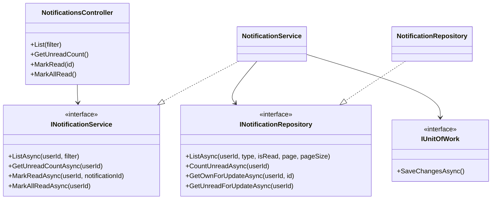
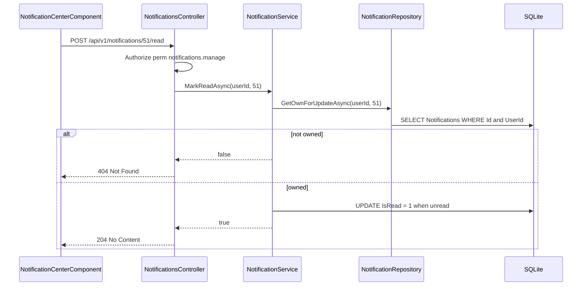
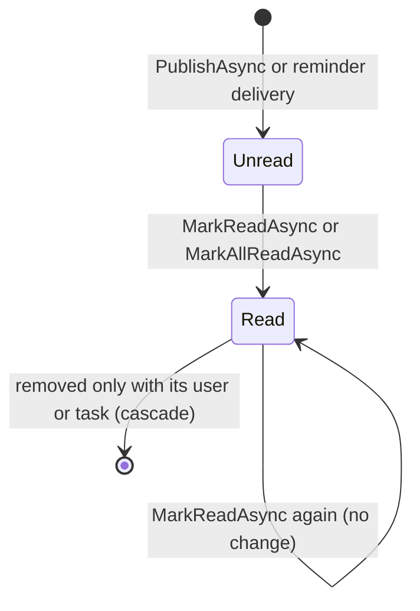
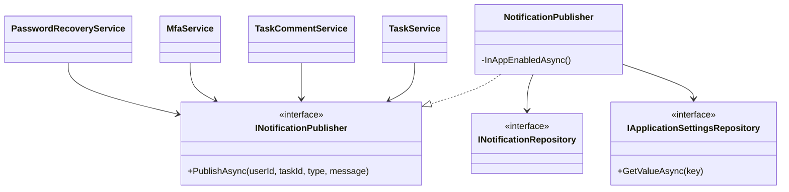
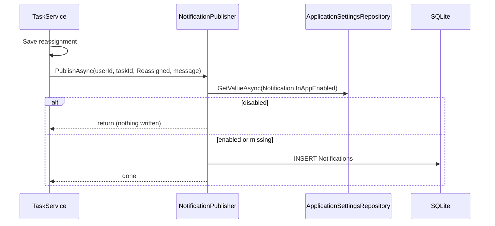
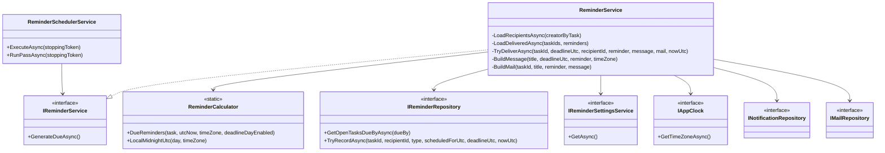
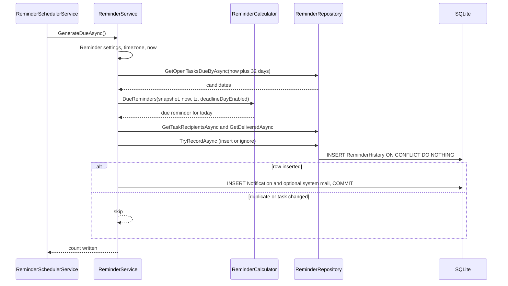
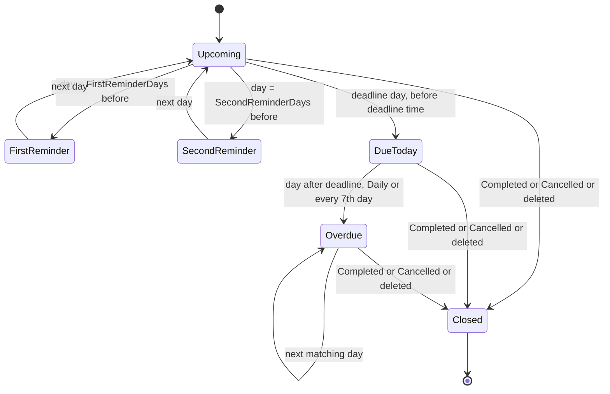
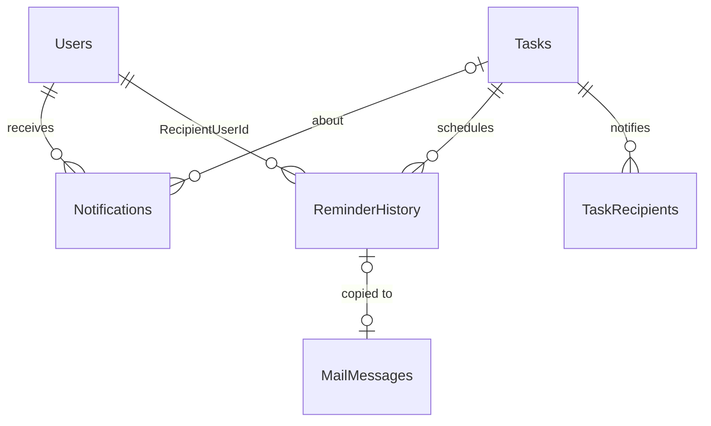

# Low-Level Design – Notification

## TaskFlow – Intelligent Task Allocation & Tracking System

> **Document:** Low-Level Design (Sub-module: Communication → Notification, incl. deadline reminder engine, code `NOTIF`)  ·  **Version:** 1.0  ·  **Status:** Draft
> **Project type:** Personal Project (Skill Development)  ·  **Date:** 31-Oct-2026
> **Author:** Jojo George (jojogeorge3344@gmail.com)
> **Based on:** HLD-Notification v1.0, FRD-Notification v1.0, TDD-TaskFlow v2.0
> © 2026 Jojo George. All rights reserved.

---

## Document Control

| Version | Date | Author | Summary of changes |
|---|---|---|---|
| 1.0 | 31-Oct-2026 | Jojo George | Initial version, derived from the code of `TaskFlow.Api` and the Angular `communication/notification` module |

**Related documents**

| Document | Location |
|---|---|
| BRD – Notification | `../../../BRD/04-Communication/04.2-Notification/BRD-Notification.md` |
| FRD – Notification (`FR-NOTIF-01` – `FR-NOTIF-50`, `UC-NOTIF-01` – `UC-NOTIF-05`) | `../../../FRD/04-Communication/04.2-Notification/FRD-Notification.md` |
| HLD – Notification | `../../../HLD/04-Communication/04.2-Notification/HLD-Notification.md` |
| LLD – Overall (stack, cross-cutting design, shared tables `Users`, `Tasks`, `TaskRecipients`, `ApplicationSettings`) | `../../00-Overall/LLD-TaskFlow-Overall.md` |
| LLD – Mail (sibling; owns `MailMessages`, `MailRecipients`, `MailboxItems` written for reminder mails) | `../04.1-Mail/LLD-Mail.md` |
| LLD – Reminder Settings (`Reminder.*`, `Notification.MailEnabled`) | `../../06-Settings/06.1-Reminder-Settings/LLD-Reminder-Settings.md` |
| TDD v2.0 | `TDD-TaskFlow.md` §11 (Notification & Reminder Engine), §8 (API) |

---

## 1. Introduction

### 1.1 Purpose
Detailed design of the Notification sub-module as built: the `NotificationsController` actions and the read side
(`NotificationService`, `NotificationRepository`), the append-only write seam `NotificationPublisher` used by other
sub-modules, and the deadline reminder engine (`ReminderSchedulerService`, `ReminderService`, `ReminderCalculator`,
`ReminderRepository`) with its idempotent `ReminderHistory` table and optional Inbox mail.

### 1.2 Scope & Conventions
- Covered: Notification Center and header bell, event notifications, deadline reminder engine.
- Not covered here: editing reminder switches (Reminder Settings LLD), the in-app toggle and timezone (Application
  Settings LLD), task reminder fields and recipients (Task Management LLD), the mail tables (Mail LLD).
- Naming: `*Controller`, `I*Service` / `*Service`, `I*Repository` / `*Repository`, DTOs `*Dto` / `NotificationFilter`.
- API base path `/api/v1/notifications`; JSON camelCase; ProblemDetails errors.
- Controller actions in this sub-module: **4** (all in `NotificationsController`, facts.md §3). The reminder engine has
  no endpoint; it runs in-process as a hosted service.
- Data scope is always **Own**: a notification of another user is reported as **404, never 403**.

---

## 2. Code Structure

### 2.1 Backend Folder Layout

```
TaskFlow.Api/
  Controllers/Communication/NotificationsController.cs
  Services/Communication/Notification/Notifications/   INotificationService.cs, NotificationService.cs
  Services/Communication/Notification/Publishing/      INotificationPublisher.cs, NotificationPublisher.cs
  Services/Communication/Notification/Reminders/       IReminderService.cs, ReminderService.cs, ReminderSchedulerService.cs
  Repositories/Communication/Notification/Notifications/ INotificationRepository.cs, NotificationRepository.cs
  Repositories/Communication/Notification/Reminders/   IReminderRepository.cs, ReminderRepository.cs, ReminderCandidate.cs, DeliveredReminder.cs, TaskRecipientLink.cs
  Dtos/Communication/Notification/                     NotificationDtos.cs (NotificationDto, NotificationFilter, UnreadCountDto)
  Common/Rules/                                        ReminderCalculator.cs (ReminderTaskSnapshot, DueReminder), ReminderIntervals.cs
  Common/Constants/SettingKeys.cs                      Reminder.*, Notification.*, Application.Timezone keys and defaults
  Models/Entities/                                     Notification.cs, ReminderHistory.cs
  Models/Enums/                                        NotificationType.cs, ReminderType.cs, ReminderStatus.cs, ReminderFrequency.cs
  Config/                                              ReminderEngineOptions.cs, MailOptions.cs (AppBaseUrl), ServiceRegistration.cs (AddHostedService)
  Services/Settings/ApplicationSettings/Clock/         IAppClock.cs, AppClock.cs (used, owned by Application Settings)
  Persistence/Migrations/                              20261013075057_AddTaskTracking, 20261017062735_AddReminderEngine
```

### 2.2 Frontend Folder Layout

```
src/app/modules/communication/
  communication.routes.ts                                   'notifications' (permissionGuard, notifications.view)
  notification/pages/notification-center.component.ts|html  NotificationCenterComponent (filters, list, paging, mark read / all)
  notification/pages/notification-center.model.ts           ReadState ('' | 'unread' | 'read')
  notification/services/notification.service.ts             NotificationService (list, refreshUnreadCount, markRead, markAllRead; unreadCount signal)
  notification/models/notification.model.ts                 NotificationType, NOTIFICATION_TYPES, NOTIFICATION_TYPE_LABELS, NotificationItem, NotificationFilter, UnreadCount
src/app/shared/auth/permissions.ts                          NotificationsView, NotificationsManage
src/app/layouts/nav-items.ts                                Communication Management → Notifications
src/app/layouts/shell.component.ts|html                     Header bell (canSeeNotifications) with unread dot; refreshBadges()
```

### 2.3 Layer Rules

| Rule | Enforced by |
|---|---|
| `NotificationsController` → `INotificationService` → `INotificationRepository` only | `TaskFlow.UnitTests/Architecture/ArchitectureTests.cs` |
| Other sub-modules write notifications only through `INotificationPublisher` (the reminder engine writes through `INotificationRepository` inside its own transaction) | Code structure (see §10 gap) |
| Pure rules in `Common/Rules` (`ReminderCalculator`) without I/O | `ArchitectureTests` (rules folder), unit tests |
| Hosted service resolves scoped services through `IServiceScopeFactory` per pass | `ReminderSchedulerService.RunPassAsync` |
| Frontend API service in the module whose endpoints it calls | `npm run check:structure` |

Shared stack, DI and middleware: see the overall LLD (`../../00-Overall/LLD-TaskFlow-Overall.md`).

---

## 3. Cross-Cutting Design

| Concern | Design in Notification |
|---|---|
| Validation | No request body; `NotificationFilter` bound from the query; `page` < 1 → 1, `pageSize` outside 1–100 → 20 (no error). |
| Error handling | Not owned → service `false` → controller `NotFound()` (empty 404). Reminder pass errors are logged and swallowed. |
| Transactions | Mark read / all: one `SaveChangesAsync`. Reminder delivery: one `IUnitOfWork.ExecuteInTransactionAsync` per (task, recipient, reminder), then `DetachAll()`. Publisher: one `SaveChangesAsync` per notification (joins the caller's transaction when one is open). |
| Authorization | Class `[Authorize]` + `perm:notifications.view` / `perm:notifications.manage` per action; caller from `ClaimTypes.NameIdentifier` (`TryGetCurrentUser`, else 401). Engine runs with no user context. |
| Logging | `ReminderSchedulerService`: "Reminder scheduler is disabled by configuration.", "Reminder scheduler started; checking every {Interval}.", "Reminder pass failed." (error). `ReminderService`: "Generated {Count} deadline reminder notification(s)." `AppClock`: "Unknown application timezone '{TimezoneId}'; using UTC." |
| Time & time zone | `CreatedAt`, `ProcessedAt`, `ScheduledFor` stored UTC. Reminder days, texts and slots computed in the application timezone from `IAppClock.GetTimeZoneAsync()`; DST gaps / overlaps handled by `ReminderCalculator.LocalMidnightUtc`. |
| Concurrency / idempotency | Unique index on `ReminderHistory (TaskId, RecipientUserId, ReminderType, ScheduledFor)` + raw `INSERT … ON CONFLICT DO NOTHING`; unique filtered `MailMessages.ReminderHistoryId`. |

### 3.1 Exception → HTTP Status

| Exception / result | Status | When (Notification) |
|---|---|---|
| Policy failure | 403 | Caller lacks `notifications.view` / `notifications.manage` |
| `MarkReadAsync` returns `false` | 404 | Notification not found or not the caller's |
| No / invalid `NameIdentifier` claim | 401 | `TryGetCurrentUser` fails |
| Any exception in a reminder pass | – (logged) | `RunPassAsync` catch; next tick retries |

---

## 4. Module Designs

### 4.1 Module: Communication → Notification (`NOTIF`)

Endpoint count: **4** controller actions (Notification Center). Event publishing and the reminder engine have no
endpoints.

#### 4.1.1 Child module: Notification Center (read side and header bell)

**Class / file inventory**

| Layer | Type | File | Responsibility |
|---|---|---|---|
| Controller | `NotificationsController` (`List`, `GetUnreadCount`, `MarkRead`, `MarkAllRead`) | `Controllers/Communication/NotificationsController.cs` | HTTP routing, policies, caller id |
| Service | `INotificationService` / `NotificationService` (`ListAsync`, `GetUnreadCountAsync`, `MarkReadAsync`, `MarkAllReadAsync`) | `Services/Communication/Notification/Notifications/` | Paging rules, idempotent mark read |
| Repository | `INotificationRepository` / `NotificationRepository` (`ListAsync`, `CountUnreadAsync`, `GetOwnForUpdateAsync`, `GetUnreadForUpdateAsync`, private `ToDto`) | `Repositories/Communication/Notification/Notifications/` | Own-row queries, task link projection |
| DTOs | `NotificationDto`, `NotificationFilter`, `UnreadCountDto`, `PagedResult<T>` | `Dtos/Communication/Notification/NotificationDtos.cs`, `Common/Models/PagedResult.cs` | Contracts |
| Frontend page | `NotificationCenterComponent` (`PAGE_SIZE` 20, `canManage()`, `markRead`, `markAllRead`, filters, range label) | `modules/communication/notification/pages/notification-center.component.ts` | Screen |
| Frontend service | `NotificationService` (`list`, `refreshUnreadCount`, `markRead`, `markAllRead`, `unreadCount` signal) | `modules/communication/notification/services/notification.service.ts` | HTTP calls, bell state |
| Shell | `shell.component.ts` (`refreshBadges()`; `SESSION_CHECK_INTERVAL_MS` = 15 000; `visibilitychange`) | `layouts/` | Bell dot refresh |

**Class diagram**



**API contracts**

| # | Method | Route | Permission / policy | Request | Response | Status codes |
|---|---|---|---|---|---|---|
| 1 | GET | `/api/v1/notifications` | `notifications.view` | Query `NotificationFilter`: `type` (`NotificationType`, optional), `isRead` (bool, optional), `page` (default 1), `pageSize` (default 20, 1–100 else 20) | `PagedResult<NotificationDto>` | 200, 400 (unbindable `type`), 401, 403 |
| 2 | GET | `/api/v1/notifications/unread-count` | `notifications.view` | – | `UnreadCountDto` | 200, 401, 403 |
| 3 | POST | `/api/v1/notifications/{id}/read` | `notifications.manage` | Route `id` (int); no body | – | 204, 401, 403, 404 |
| 4 | POST | `/api/v1/notifications/read-all` | `notifications.manage` | No body | – | 204, 401, 403 |

**Request / response example**

```json
// GET /api/v1/notifications?type=Overdue&isRead=false&page=1&pageSize=20  ->  200 OK
{
  "items": [
    {
      "id": 51,
      "type": "Overdue",
      "message": "Overdue: \"Prepare Monthly Report\" was due on 15 Oct 2026, 17:00.",
      "isRead": false,
      "createdAt": "2026-10-16T00:01:00Z",
      "taskId": 12,
      "taskCode": "TSK-0012"
    }
  ],
  "total": 1,
  "page": 1,
  "pageSize": 20
}
```

```json
// GET /api/v1/notifications/unread-count  ->  200 OK
{ "count": 3 }
```

`POST /api/v1/notifications/{id}/read` and `POST /api/v1/notifications/read-all` take no body and return
`204 No Content`; an unknown or foreign id returns an empty `404`. Ids, titles and codes are illustrative.

**Service logic – `ListAsync(userId, filter)`**
1. `page = filter.Page < 1 ? 1 : filter.Page`; `pageSize = filter.PageSize is < 1 or > 100 ? 20 : filter.PageSize`.
2. `NotificationRepository.ListAsync(userId, filter.Type, filter.IsRead, page, pageSize)`.
3. `ToDto` sets `TaskId` / `TaskCode` only when `Task` is loaded and `IsDeleted == false` (FR-NOTIF-07, FR-NOTIF-17).

**Service logic – `MarkReadAsync` / `MarkAllReadAsync`**
1. `MarkReadAsync`: `GetOwnForUpdateAsync(userId, id)` (matches `Id` **and** `UserId`); `null` → `false` (404). If
   unread → `IsRead = true`, save. Returns `true` also when already read (idempotent, FR-NOTIF-12).
2. `MarkAllReadAsync`: `GetUnreadForUpdateAsync(userId)`; none → return; else set `IsRead = true` on each, save once.
3. Nothing deletes notifications (FR-NOTIF-18); there is no delete endpoint.

**Frontend logic**
1. `NotificationCenterComponent` loads `{ page, pageSize: PAGE_SIZE, type?, isRead? }`; a filter change or Reset /
   Clear filters reloads from page 1; when the requested page is past the last page it reloads the last page.
2. `markRead` → `NotificationService.markRead` decrements `unreadCount`; `markAllRead` sets it to 0; with a Read-state
   filter the list is reloaded (FR-NOTIF-15).
3. `shell.component.ts` `refreshBadges()` calls `refreshUnreadCount()` on navigation, every 15 s and when the tab
   becomes visible; the bell shows a dot while `unreadCount() > 0` (FR-NOTIF-03).

**Sequence diagram – mark one as read**



**Repository methods**

| Method | Query / purpose | Notes |
|---|---|---|
| `ListAsync(userId, type, isRead, page, pageSize)` | `AsNoTracking`, `Where UserId`, optional `Type`, optional `IsRead`, `CountAsync` for total, `Include(Task)`, order `CreatedAt` desc then `Id` desc, `Skip/Take` | Index `IX_Notifications_UserId_IsRead` |
| `CountUnreadAsync(userId)` | `CountAsync(UserId && !IsRead)` | Bell |
| `GetOwnForUpdateAsync(userId, notificationId)` | Tracked `FirstOrDefault(Id && UserId)` | Ownership check |
| `GetUnreadForUpdateAsync(userId)` | Tracked `Where(UserId && !IsRead)` | Mark all |

**Validation rules**

| Field | Rule | Message |
|---|---|---|
| `page` | < 1 → 1 | None |
| `pageSize` | Outside 1–100 → 20 | None |
| `type` | Must bind to `NotificationType` | ASP.NET model-binding 400 |
| `isRead` | Optional bool | ASP.NET model-binding 400 |
| `id` (mark read) | Must belong to the caller | Empty 404 (UI: "Could not mark the notification as read.") |

**Error cases**

| Case | Exception / result | Status |
|---|---|---|
| Notification not found or foreign | `false` | 404 |
| Missing key | Policy failure | 403 (UI: "Could not mark …" / dashboard redirect for the route) |

**State machine – `Notification`**



#### 4.1.2 Child module: Event notifications (`NotificationPublisher`)

**Class / file inventory**

| Layer | Type | File | Responsibility |
|---|---|---|---|
| Service | `INotificationPublisher` / `NotificationPublisher` (`PublishAsync(userId, taskId, type, message)`, private `InAppEnabledAsync`) | `Services/Communication/Notification/Publishing/` | Append-only write seam; honours `Notification.InAppEnabled` |
| Repository | `INotificationRepository.Add` (base), `IApplicationSettingsRepository.GetValueAsync` | `Repositories/…` | Insert, setting read |
| Callers | `TaskService`, `TaskCommentService`, `MfaService`, `PasswordRecoveryService` | `Services/Monitoring/TaskManagement/…`, `Services/Auth/…` | Event sources (other sub-modules) |

**Class diagram**



**API contracts:** _Not applicable for this child module_ (in-process interface, no endpoint).

**Service logic – `PublishAsync(userId, taskId, type, message)`**
1. Read `Notification.InAppEnabled`; missing or not a bool → treated as enabled.
2. Disabled → return without writing (FR-NOTIF-29); existing rows are kept.
3. Add `Notification { UserId, TaskId, Type, Message, IsRead = false, CreatedAt = TimeProvider UTC now }`;
   `SaveChangesAsync`.

**Callers and texts**

| Caller | When | Recipients | Type | Message |
|---|---|---|---|---|
| `TaskService` (create, inside the create transaction) | Task created | Assignee | `TaskAssigned` | `A task was assigned to you: {title}` |
| `TaskService` (reassign) | Task reassigned | New assignee | `Reassigned` | `A task was reassigned to you: {title}. Reason: {reason}` |
| `TaskService` (reassign) | Task reassigned | Recipients, previous assignee, actor (live users) | `Reassigned` | `{actor} reassigned task "{title}" ({code}) from {old} to {new}. Reason: {reason}` |
| `TaskService` (worked hours) | Actual hours changed | Assignee and recipients | `System` | `{actor} {added … / updated … / cleared …} on task {title}. Total worked now: …h of …h estimated (…).` |
| `TaskCommentService` | Comment added / edited / deleted | Recipients, assignee, actor (live users) | `TaskComment` | `{who} {verb} a comment on "{title}": {detail}` |
| `MfaService` | Administrator resets MFA | Account owner | `System` | `An administrator reset your authenticator MFA. Sign in with your password and set it up again from Profile.` |
| `PasswordRecoveryService` | Password reset with authenticator | Account owner | `System` | `Your password was reset with your authenticator app. If this was not you, contact an administrator now.` |

Task-side callers wrap notification and mail side effects in `try … catch` and log a warning ("Could not notify …"),
so the task change is kept when publishing fails (FR-NOTIF-31). Deleted users are excluded by the `Users` query
filter (`GetLiveIdsAsync` / `GetActiveEmailsAsync`) before publishing (FR-NOTIF-30).

**Sequence diagram – event notification**



**Validation rules / error cases:** no user input. A publishing exception propagates to the caller, which logs it and
keeps its own change.

#### 4.1.3 Child module: Deadline reminder engine

**Class / file inventory**

| Layer | Type | File | Responsibility |
|---|---|---|---|
| Hosted service | `ReminderSchedulerService` : `BackgroundService` (`ExecuteAsync`, `RunPassAsync`) | `Services/Communication/Notification/Reminders/ReminderSchedulerService.cs` | Pass at start-up, then every `Reminders:TickSeconds` via `PeriodicTimer`; swallows pass errors |
| Service | `IReminderService` / `ReminderService` (`GenerateDueAsync`; private `LoadDeliveredAsync`, `LoadRecipientsAsync`, `TryDeliverAsync`, `BuildMail`, `BuildMessage`; `UpcomingWindow` = 32 days) | `Services/Communication/Notification/Reminders/` | One pass |
| Rules | `ReminderCalculator` (`DueReminders`, `LocalDate`, `LocalMidnightUtc`; private `PreDeadlineReminder`, `DueTodayReminder`, `OverdueReminder`; `WeeklyStepDays` = 7), `ReminderTaskSnapshot`, `DueReminder` | `Common/Rules/ReminderCalculator.cs` | Pure decision for "today" |
| Rules | `ReminderIntervals` (`AreOrdered`, `OrderMessage`) | `Common/Rules/ReminderIntervals.cs` | Interval ordering used by Task / Reminder Settings validators |
| Repository | `IReminderRepository` / `ReminderRepository` (`GetOpenTasksDueByAsync`, `GetDeliveredAsync`, `GetTaskRecipientsAsync`, `TryRecordAsync`, `GetIdAsync`) | `Repositories/Communication/Notification/Reminders/` | Candidates, history, idempotent insert |
| Projections | `ReminderCandidate(Id, Title, CreatedByUserId, Snapshot)`, `DeliveredReminder(TaskId, RecipientUserId, Type, ScheduledFor)`, `TaskRecipientLink(TaskId, UserId)` | same folder | Query results |
| Dependencies | `INotificationRepository`, `IMailRepository`, `IEmployeeRepository.GetActiveByIdsAsync`, `IUnitOfWork`, `IAppClock`, `IReminderSettingsService.GetAsync` (`ReminderSettingsDto`), `IOptions<MailOptions>` | other sub-modules | Writes, recipients, settings, time |
| Config | `ReminderEngineOptions` (`SchedulerEnabled`, `TickSeconds`), `MailOptions.AppBaseUrl` | `Config/` | Options |

**Class diagram**



**API contracts:** _Not applicable for this child module_ (no endpoint; `ReminderSchedulerService` is registered with
`services.AddHostedService` in `Config/ServiceRegistration.cs`).

**Service logic – `ReminderSchedulerService.ExecuteAsync`**
1. `Reminders:SchedulerEnabled` false → log "Reminder scheduler is disabled by configuration." and return.
2. `interval = TimeSpan.FromSeconds(Math.Max(1, TickSeconds))`; log start; `RunPassAsync` immediately (FR-NOTIF-32).
3. `PeriodicTimer(interval)`; on every tick `RunPassAsync`; `OperationCanceledException` on shutdown ends the loop.
4. `RunPassAsync`: new async DI scope → `IReminderService.GenerateDueAsync`; any exception except shutdown
   cancellation → `LogError("Reminder pass failed.")` and continue (FR-NOTIF-49). The service keeps no state, so a
   restart simply resumes.

**Service logic – `ReminderService.GenerateDueAsync`**
1. `IReminderSettingsService.GetAsync()`; `Enabled` false → return 0 (FR-NOTIF-33).
2. `timeZone = IAppClock.GetTimeZoneAsync()` (`Application.Timezone` row → `Application:Timezone` config → UTC when the
   id is unknown); `nowUtc = IAppClock.UtcNow`.
3. `GetOpenTasksDueByAsync(nowUtc + 32 days)`: not deleted, not Completed / Cancelled, `Deadline <= dueBy` (no lower
   bound, so overdue tasks stay in) (FR-NOTIF-34).
4. Per task `ReminderCalculator.DueReminders(snapshot, nowUtc, timeZone, settings.DeadlineDayEnabled)` → zero or one
   `DueReminder` for **today**; tasks without one are dropped.
5. `LoadRecipientsAsync`: `GetTaskRecipientsAsync` (`TaskRecipients.UserId`) + `CreatedByUserId`, distinct, filtered by
   `IEmployeeRepository.GetActiveByIdsAsync` (active, not deleted) (FR-NOTIF-41).
6. `LoadDeliveredAsync`: `GetDeliveredAsync(taskIds, earliest ScheduledForUtc)` → set of
   (TaskId, RecipientId, Type, ScheduledFor) already recorded, skipped without a write transaction.
7. Per task and reminder: `BuildMessage` (texts below); when `settings.MailEnabled` `BuildMail`: subject prefix
   "Overdue task: " / "Task due today: " / "Task reminder: " + title (cut at 200); body = message, then
   "Open the task: {AppBaseUrl}/tasks/{id}" when `Mail:AppBaseUrl` is set, then "This is an automatic reminder from
   TaskFlow." (FR-NOTIF-47).
8. Per recipient not in the delivered set → `TryDeliverAsync` (below); count successes; log "Generated {Count} deadline
   reminder notification(s)." when > 0; return the count.

**Service logic – `TryDeliverAsync` (one transaction per recipient and reminder)**
1. `ReminderRepository.TryRecordAsync(taskId, recipientId, type, scheduledForUtc, deadlineUtc, nowUtc)` – raw SQL
   `INSERT INTO "ReminderHistory" … SELECT … WHERE EXISTS (task Id, IsDeleted = 0, Status NOT IN (Completed, Cancelled),
   Deadline = deadlineUtc) ON CONFLICT (TaskId, RecipientUserId, ReminderType, ScheduledFor) DO NOTHING` with
   `Status = 'Sent'`, `ProcessedAt = nowUtc`, `DeliveryAttempts = 0`. 0 rows → return `false`; nothing else written
   (FR-NOTIF-42, FR-NOTIF-44).
2. Add `Notification` (`UserId = recipientId`, `TaskId`, `Type = Overdue` for `ReminderType.Overdue` else
   `DeadlineReminder`, `IsRead = false`, `CreatedAt = nowUtc`) through `INotificationRepository` (FR-NOTIF-46).
3. When a mail is built: `GetIdAsync` (history id) → add `MailMessage` (`IsSystem = true`, `SenderUserId = null`,
   `TaskId`, `ReminderHistoryId`, new `ConversationId`, `SentAt = nowUtc`), one `MailRecipient` (To) and one Inbox
   `MailboxItem` through `IMailRepository`.
4. `SaveChangesAsync`, commit; on success `DetachAll()`.

**Calculation – `ReminderCalculator.DueReminders`**

| Days until deadline day (`deadlineDay − today`, local dates) | Result | Rule |
|---|---|---|
| Status Completed or Cancelled | none | BR-NOTIF-03 |
| > 0 and = `SecondReminderDays` (> 0) | `SecondReminder` | Checked first, so equal intervals give one reminder (FR-NOTIF-38) |
| > 0 and = `FirstReminderDays` (> 0) | `FirstReminder` | FR-NOTIF-36 |
| = 0 and `now < deadline` and (`DeadlineDayEnabled` or first / second days = 0) | `DueToday` | FR-NOTIF-39 |
| = 0 and `now >= deadline` | none | Overdue starts next day |
| < 0 and `daysOverdue % step == 0` (step 1 Daily, 7 Weekly) | `Overdue` | FR-NOTIF-40 |

`ScheduledForUtc = LocalMidnightUtc(today, tz)`: local midnight, moved forward minute by minute through a DST gap; for
an ambiguous midnight the earlier (daylight) instant. This slot is part of the dedup key, so each reminder is once per
local day (FR-NOTIF-35, FR-NOTIF-43).

**Texts – `BuildMessage`** (deadline converted to the application timezone, invariant culture)

| Reminder type | Text |
|---|---|
| `FirstReminder`, `SecondReminder` | `Reminder: "{title}" is due in {N} days ({dd MMM yyyy, HH:mm}).` ("1 day" when N = 1) |
| `DueToday` | `Reminder: "{title}" is due today at {HH:mm}.` |
| `Overdue` | `Overdue: "{title}" was due on {dd MMM yyyy, HH:mm}.` |

**Sequence diagram – reminder pass**



**Repository methods**

| Method | Query / purpose | Notes |
|---|---|---|
| `GetOpenTasksDueByAsync(dueBy)` | `Tasks.AsNoTracking().Where(!IsDeleted && Status != Completed && Status != Cancelled && Deadline <= dueBy)` → `ReminderCandidate` with `ReminderTaskSnapshot` | `IX_Tasks_Deadline` |
| `GetDeliveredAsync(taskIds, earliestSlot)` | History rows of the tasks with `ScheduledFor >= earliestSlot` | Pre-read to avoid write locks |
| `GetTaskRecipientsAsync(taskIds)` | `TaskRecipients` → `TaskRecipientLink` | Assignee is always a recipient (Task Management rule) |
| `TryRecordAsync(...)` | Raw `ExecuteSqlInterpolatedAsync` insert-or-ignore guarded by `WHERE EXISTS` on the live task with the same `Deadline` | `Tasks.Status` compared as integers (no string conversion on `Tasks`) |
| `GetIdAsync(taskId, recipientId, type, scheduledForUtc)` | `SingleAsync` on the unique key | Id for `MailMessages.ReminderHistoryId` |

**Validation rules**

| Field | Rule | Message |
|---|---|---|
| `Tasks.FirstReminderDays` / `SecondReminderDays` | 0–30; `ReminderIntervals.AreOrdered` (second ≤ first unless first = 0) – validated in Task Management | "The second reminder cannot come before the first reminder." (Task Management) |
| `Tasks.OverdueReminderFrequency` | `ReminderFrequency` Daily / Weekly | Task Management |
| `Reminders:TickSeconds` | `Math.Max(1, value)` | None |

**Error cases**

| Case | Handling | Effect |
|---|---|---|
| Task completed, cancelled, deleted or rescheduled during the pass | `TryRecordAsync` `WHERE EXISTS` fails | Nothing written (FR-NOTIF-44) |
| Reminder already recorded (other pass, restart) | `ON CONFLICT DO NOTHING` / pre-read set | Nothing written (FR-NOTIF-42) |
| Unknown timezone id | `AppClock` logs error, uses UTC | Pass continues |
| Any other exception | `RunPassAsync` logs "Reminder pass failed." | Next tick retries; days already ended are not caught up |

**State machine – one open task across days**



---

## 5. Database Design

### 5.1 ER Diagram



### 5.2 Tables

Types: C# type / SQLite storage. Enums with `HasConversion<string>()` are TEXT. No database defaults are configured;
values are set by the code.

#### `Notifications` (`Notification`)

| Column | Type | Null | Key / index | Default | Description |
|---|---|:---:|---|---|---|
| Id | int / INTEGER | No | PK, autoincrement | identity | – |
| UserId | int / INTEGER | No | FK → `Users.Id` (**Cascade**); `IX_Notifications_UserId_IsRead` | – | Recipient |
| TaskId | int? / INTEGER | Yes | FK → `Tasks.Id` (**Cascade**); `IX_Notifications_TaskId` | – | Related task |
| Type | `NotificationType` / TEXT(32) | No | – | – | TaskAssigned, Reassigned, DeadlineReminder, Overdue, System, TaskComment |
| Message | string / TEXT | No | – | – | Display text (required) |
| IsRead | bool / INTEGER | No | in `IX_Notifications_UserId_IsRead` | – | Only column that changes |
| CreatedAt | DateTime / TEXT | No | – | – | UTC |

#### `ReminderHistory` (`ReminderHistory`)

| Column | Type | Null | Key / index | Default | Description |
|---|---|:---:|---|---|---|
| Id | int / INTEGER | No | PK, autoincrement | identity | Referenced by `MailMessages.ReminderHistoryId` |
| TaskId | int / INTEGER | No | FK → `Tasks.Id` (Restrict); part of unique key | – | – |
| RecipientUserId | int / INTEGER | No | FK → `Users.Id` (Restrict); `IX_ReminderHistory_RecipientUserId` | – | – |
| ReminderType | `ReminderType` / TEXT(32) | No | part of unique key | – | FirstReminder, SecondReminder, DueToday, Overdue |
| ScheduledFor | DateTime / TEXT | No | part of unique key | – | UTC instant of local midnight of the reminder day |
| Status | `ReminderStatus` / TEXT(32) | No | – | – | Engine writes only `Sent` |
| ProcessedAt | DateTime? / TEXT | Yes | – | – | Delivery time (UTC) |
| DeliveryAttempts | int / INTEGER | No | – | – | Always 0 from the engine |

Read-only use: `Tasks` (`Status` stored as integer, `Deadline`, `FirstReminderDays`, `SecondReminderDays`,
`OverdueReminderFrequency`, `CreatedByUserId`, `IsDeleted`, `TaskCode`), `TaskRecipients`, `Users`, `ApplicationSettings`.
Writes owned by Mail: `MailMessages`, `MailRecipients`, `MailboxItems` (see the Mail LLD).

### 5.3 Indexes, Constraints & Triggers

| Object | Definition | Purpose |
|---|---|---|
| `IX_ReminderHistory_TaskId_RecipientUserId_ReminderType_ScheduledFor` | Unique `(TaskId, RecipientUserId, ReminderType, ScheduledFor)` | Exactly-once delivery; target of `ON CONFLICT` |
| `IX_ReminderHistory_RecipientUserId` | `(RecipientUserId)` | FK index |
| `IX_Notifications_UserId_IsRead` | `(UserId, IsRead)` | List filter and unread count |
| `IX_Notifications_TaskId` | `(TaskId)` | FK index |
| `IX_MailMessages_ReminderHistoryId` (Mail) | Unique, filtered `IS NOT NULL` | One mail per reminder |
| `IX_Tasks_Deadline` (Task Management) | `(Deadline)` | Candidate query |
| FK delete behaviour | `Notifications` → `Users`, `Tasks` **Cascade**; `ReminderHistory` → `Tasks`, `Users` **Restrict** | Notifications go with their user / task; history is kept (both are soft-deleted in practice) |
| Triggers | None | – |

### 5.4 Enumerations

| Enum | Values | Stored as |
|---|---|---|
| `NotificationType` | TaskAssigned, Reassigned, DeadlineReminder, Overdue, System, TaskComment | TEXT(32) in `Notifications.Type`; string in `NotificationDto.Type` |
| `ReminderType` | FirstReminder, SecondReminder, DueToday, Overdue | TEXT(32) in `ReminderHistory.ReminderType` |
| `ReminderStatus` | Pending, Sent, Failed, Skipped (only Sent is written; the others are reserved) | TEXT(32) in `ReminderHistory.Status` |
| `ReminderFrequency` (read from `Tasks`) | Daily, Weekly | INTEGER in `Tasks.OverdueReminderFrequency` (0 = Daily) |

### 5.5 Migrations

| Migration | Change |
|---|---|
| `20261013075057_AddTaskTracking` | Created `Notifications` with `IX_Notifications_TaskId`, `IX_Notifications_UserId_IsRead` |
| `20261013104629_AddTaskReminderSettings` | Added `Tasks.FirstReminderDays` (default 2), `SecondReminderDays` (default 1), `OverdueReminderFrequency` (default 0) and `IX_Tasks_Deadline` |
| `20261017062735_AddReminderEngine` | Created `ApplicationSettings` and `ReminderHistory` with the unique dedup index |
| `20261017074817_AddEmailDelivery` | Created `EmailDeliveryLogs` (SMTP outbox referencing `ReminderHistory`) – superseded |
| `20261017090431_AddInternalMail` | Dropped `EmailDeliveryLogs` and `Notification.EmailEnabled`; added `MailMessages.ReminderHistoryId` with the unique filtered index |

---

## 6. Algorithms & Background Jobs

| Job / algorithm | Trigger / schedule | Steps | Idempotency |
|---|---|---|---|
| `ReminderSchedulerService` | Application start, then every `Reminders:TickSeconds` (60 s, minimum 1) via `PeriodicTimer`; off when `Reminders:SchedulerEnabled` = false | New DI scope → `ReminderService.GenerateDueAsync`; log and swallow errors | Stateless; restart-safe |
| `ReminderService.GenerateDueAsync` | Each pass | Settings → timezone → candidates (≤ now + 32 days) → `DueReminders` → recipients → delivered pre-read → `TryDeliverAsync` per recipient | Unique `ReminderHistory` key + `ON CONFLICT DO NOTHING`; notification and mail only when a row was inserted; unique `MailMessages.ReminderHistoryId` |
| `ReminderCalculator.DueReminders` | Per candidate task | Local dates in the application timezone → days until deadline → one type or none → slot = local midnight in UTC | Pure function |
| Recalculation | Implicit | Every pass reads the current `Deadline`, `Status`, intervals; `TryRecordAsync` re-checks `Deadline` and status at insert time | A deadline change produces new slots; old ones are never re-sent |
| Bell refresh | Frontend `refreshBadges()` on navigation, every 15 s, tab visible | `GET /api/v1/notifications/unread-count` → `unreadCount` signal | Read-only |

**Worked example** (defaults 2 / 1 days, Daily, deadline-day reminder on; task deadline 15-Oct-2026 17:00 local;
recipients Rahul (assignee), Priya (recipient), Anita (creator)): 13-Oct → `FirstReminder`; 14-Oct → `SecondReminder`;
15-Oct before 17:00 → `DueToday`; from 16-Oct daily → `Overdue`; three `ReminderHistory` rows per day (one per person),
each written once however many 60-second passes run that day.

---

## 7. Security Design (detailed)

| Item | Implementation |
|---|---|
| Authentication | JWT bearer, class-level `[Authorize]`; caller id from `ClaimTypes.NameIdentifier` |
| Permission checks | `perm:notifications.view` (list, unread count), `perm:notifications.manage` (mark read, mark all); defaults Granted for Administrator, Manager, Employee, Configurable for custom roles; refusals logged by `DeniedActionAuditHandler` |
| Ownership | Every query filters `UserId == caller`; `GetOwnForUpdateAsync` matches `Id` and `UserId`; foreign rows → 404 |
| Reminder engine | In-process, no user context and no permission; switches edited under `settings.reminders.manage` (Reminder Settings) |
| SQL safety | `TryRecordAsync` uses `ExecuteSqlInterpolatedAsync` (parameterised) |
| Frontend gating | `permissionGuard` on `/notifications`; menu entry and bell from `has(Permissions.NotificationsView)`; Mark all as read hidden by `canManage()`; per-row Mark as read not gated (§10) |
| Secrets | None in this sub-module |

---

## 8. Configuration

| Key | Default | Purpose |
|---|---|---|
| `Reminders:SchedulerEnabled` | `true` | Starts the hosted reminder scheduler (`ReminderEngineOptions`) |
| `Reminders:TickSeconds` | `60` | Seconds between passes (minimum 1) |
| `Mail:AppBaseUrl` | `http://localhost:4200` in `appsettings.Environment.json` (Local line active; not set in `appsettings.json`) | Base address for the "Open the task:" line in reminder mails (omitted when not set) |
| `Application:Timezone` | `Asia/Kolkata` | Fallback when the `Application.Timezone` row is empty |
| `ApplicationSettings` `Reminder.Enabled` | `true` | Engine on / off (FR-NOTIF-33) |
| `ApplicationSettings` `Reminder.DeadlineDayEnabled` | `true` | Due-today reminder (FR-NOTIF-39) |
| `ApplicationSettings` `Reminder.DefaultFirstDays` / `Reminder.DefaultSecondDays` / `Reminder.DefaultOverdueFrequency` | `2` / `1` / `Daily` | Defaults for new tasks (Task Management) |
| `ApplicationSettings` `Notification.MailEnabled` | `true` | Reminder (and comment) mails to the Inbox (FR-NOTIF-47) |
| `ApplicationSettings` `Notification.InAppEnabled` | `true` | Event notifications through `NotificationPublisher` (FR-NOTIF-29) |
| `ApplicationSettings` `Application.Timezone` | – | Application timezone for days and texts |

Setting rows are seeded by `Persistence/Seeders/SettingsInitializer.cs`; defaults are in `Common/Constants/SettingKeys.cs`.

---

## 9. Testing Design

Coverage below was checked against the test sources (backend test methods and frontend `describe` / `it` names).

| Area | Test class / file | Type | Covers |
|---|---|---|---|
| Read side | `TaskFlow.UnitTests/Communication/Notification/Notifications/NotificationServiceTests.cs` | Unit | List, paging clamp, filters, mark read (idempotent, ownership), mark all |
| Calculator | `TaskFlow.UnitTests/Communication/Notification/Reminders/ReminderCalculatorTests.cs` | Unit | First / second / equal days, due-today (setting and 0-day), overdue Daily / Weekly, DST slots |
| Engine | `TaskFlow.UnitTests/Communication/Notification/Reminders/ReminderServiceTests.cs` | Unit | Settings off, candidates, recipients (creator, active only), texts, mail copy |
| Idempotency | `TaskFlow.UnitTests/Communication/Notification/Reminders/ReminderIdempotencyTests.cs` | Unit | Repeated / overlapping passes, task changed during pass |
| Scheduler | `TaskFlow.UnitTests/Communication/Notification/Reminders/ReminderSchedulerServiceTests.cs` | Unit | Start-up pass, interval, disabled, error swallowed |
| Event sources | `TaskFlow.UnitTests/Monitoring/TaskManagement/Discussion/TaskCommentActivityNotificationTests.cs`, `TaskFlow.UnitTests/Monitoring/TaskManagement/Tasks/TaskWorkedHoursNotificationTests.cs`, `TaskFlow.UnitTests/Monitoring/TaskManagement/Tasks/TaskManagementServiceTests.cs`, `TaskFlow.UnitTests/Monitoring/TaskManagement/Tasks/TaskServiceTests.cs`, `TaskFlow.UnitTests/Auth/Mfa/MfaServiceTests.cs`, `TaskFlow.IntegrationTests/Auth/Mfa/MfaAdminResetEndpointsTests.cs`, `TaskFlow.UnitTests/Auth/PasswordRecovery/PasswordRecoveryServiceTests.cs` | Unit / Integration | Comment, worked-hours, assignment (create) / reassignment, MFA reset and password-reset notifications |
| Publisher | `NotificationPublisherTests` in `TaskFlow.UnitTests/Monitoring/TaskManagement/Discussion/TaskCommentActivityNotificationTests.cs` | Unit | Unread row with task link, skipped when `Notification.InAppEnabled` is off, on when the setting row is missing |
| Endpoints | `TaskFlow.IntegrationTests/Communication/Notification/NotificationsEndpointsTests.cs` | Integration | 4 endpoints, `notifications.*` policies, 404 for foreign rows |
| Settings | `TaskFlow.IntegrationTests/Settings/ReminderSettings/SettingsEndpointsTests.cs`, `TaskFlow.UnitTests/Settings/ReminderSettings/ReminderSettingsServiceTests.cs` | Integration / Unit | Settings that drive the engine |
| Cross-cutting | `ArchitectureTests.cs`, `PermissionAuthorizationTests.cs` | Unit / Integration | Layer rules, policies |
| Notification Center | `frontend/src/app/modules/communication/notification/pages/notification-center.component.spec.ts` | Frontend unit | Type, message, time and task link per row, no link when the task is gone, type and read-state filters from page one, mark one / mark all read with the shared unread count, empty state, error state and Retry, last-page fallback after marking read |
| Notification API client | `frontend/src/app/modules/communication/notification/services/notification.service.spec.ts` | Frontend unit | Query parameters from the filter, empty values left out, shared unread count, last count kept when the refresh fails, count lowered on mark read and reset on mark all |
| Header bell | `frontend/src/app/layouts/shell.component.spec.ts` | Frontend unit | Bell linking to the center, dot only when the unread count is above zero, count refreshed on the interval |

---

## 10. Known Limitations & Open Issues

- Notifications are never deleted or archived; no `ReadAt` column.
- `ReminderHistory.Status` is always `Sent` and `DeliveryAttempts` always 0; retries and failures are not tracked.
- No live push; new notifications appear on navigation, every 15 s or when the tab becomes visible.
- `Mail:AppBaseUrl` is set only in `appsettings.Environment.json` (`http://localhost:4200` on the active Local line);
  when it is not set, reminder mails carry no "Open the task:" line (the Mail reader still links the task through `TaskId`).
- Single-instance design: one scheduler per process; the database dedup also protects overlapping passes.
- Reminder notifications are written through `INotificationRepository`, not `NotificationPublisher`, so they are
  written even when `Notification.InAppEnabled` is false.
  > ⚠️ To be confirmed: intended behaviour (FRD §10).
- The frontend `NotificationType` / `NOTIFICATION_TYPES` / `NOTIFICATION_TYPE_LABELS` omit `TaskComment`: comment rows
  show an empty chip and cannot be filtered.
  > ⚠️ To be confirmed: add "Task comment" to the Type filter (FRD §10).
- Per-row Mark as read is shown to every viewer, but `POST /api/v1/notifications/{id}/read` requires
  `notifications.manage` (403 for others).
  > ⚠️ To be confirmed: whether it should be hidden (FRD §10).
- With Weekly overdue frequency the first overdue reminder is 7 days after the deadline day (`daysOverdue % 7 == 0`).
  > ⚠️ To be confirmed: intended (FRD §10).
- `AppClock` falls back to the configured `Application:Timezone` (`Asia/Kolkata`) when no timezone row is stored, and to
  UTC only for an unknown id; FR-NOTIF-35 says UTC when not set.
  > ⚠️ To be confirmed: which wording is the requirement.
- A pass that is not running for a whole day (application stopped) does not catch that day up (by design, FR-NOTIF-43).

---

## 11. Traceability (FRD → code)

| FRD requirement | Endpoint / class | Test |
|---|---|---|
| FR-NOTIF-01 | `COMMUNICATION_ROUTES` `notifications` + `permissionGuard` (`notifications.view`); server policy on `GET /api/v1/notifications` | `NotificationsEndpointsTests`; Manual UI check |
| FR-NOTIF-02 | `shell.component.html` bell (`canSeeNotifications`) · `nav-items.ts` | `shell.component.spec.ts` |
| FR-NOTIF-03 | `GET /api/v1/notifications/unread-count` · `CountUnreadAsync` · `refreshBadges()` | `NotificationsEndpointsTests`; `shell.component.spec.ts`, `notification.service.spec.ts` |
| FR-NOTIF-04 | `GET /api/v1/notifications` · `NotificationRepository.ListAsync` (`UserId`, `CreatedAt` desc) | `NotificationServiceTests` |
| FR-NOTIF-05, FR-NOTIF-06 | `NotificationService.ListAsync` (page clamp, pageSize 1–100 else 20) · `PAGE_SIZE` · range label | `NotificationServiceTests` |
| FR-NOTIF-07, FR-NOTIF-17 | `NotificationRepository.ToDto` (task link only when not deleted) | `NotificationServiceTests`; `notification-center.component.spec.ts` |
| FR-NOTIF-08 | `NotificationCenterComponent` unread highlight | Manual UI check |
| FR-NOTIF-09, FR-NOTIF-10, FR-NOTIF-11 | `NotificationFilter` (`type`, `isRead`) · `NotificationCenterComponent` filters, Reset / Clear filters | `NotificationServiceTests`; `notification-center.component.spec.ts`, `notification.service.spec.ts` |
| FR-NOTIF-12 | `POST /api/v1/notifications/{id}/read` · `MarkReadAsync` | `NotificationServiceTests`, `NotificationsEndpointsTests`; `notification-center.component.spec.ts` |
| FR-NOTIF-13 | `NotificationCenterComponent.canManage()` | Manual UI check |
| FR-NOTIF-14 | `POST /api/v1/notifications/read-all` · `MarkAllReadAsync` | `NotificationServiceTests`, `NotificationsEndpointsTests`; `notification-center.component.spec.ts` |
| FR-NOTIF-15 | `NotificationService` (TS) `unreadCount` updates; reload with Read-state filter | `notification-center.component.spec.ts`, `notification.service.spec.ts` |
| FR-NOTIF-16 | Task code link → task details route (Task Management access rules) | `notification-center.component.spec.ts` (link target) |
| FR-NOTIF-18 | No delete endpoint in `NotificationsController` | `NotificationsEndpointsTests` |
| FR-NOTIF-19, FR-NOTIF-21 | `NotificationCenterComponent` empty / no-match / error states and messages | `notification-center.component.spec.ts` (empty and load-error states); mark-failure messages: Manual UI check |
| FR-NOTIF-20 | `GetOwnForUpdateAsync` (Id + UserId) · 404 | `NotificationServiceTests` |
| FR-NOTIF-22, FR-NOTIF-23, FR-NOTIF-24 | `TaskService` → `INotificationPublisher.PublishAsync` (`TaskAssigned`, `Reassigned`) | `TaskManagementServiceTests` (create), `TaskServiceTests` (reassign) |
| FR-NOTIF-25 | `TaskCommentService` → `PublishAsync` (`TaskComment`) | `TaskCommentActivityNotificationTests` |
| FR-NOTIF-26 | `TaskService` worked hours → `PublishAsync` (`System`) | `TaskWorkedHoursNotificationTests` |
| FR-NOTIF-27 | `MfaService` → `PublishAsync` (`System`) | `MfaServiceTests`, `MfaAdminResetEndpointsTests` |
| FR-NOTIF-28 | `PasswordRecoveryService` → `PublishAsync` (`System`) | `PasswordRecoveryServiceTests` |
| FR-NOTIF-29 | `NotificationPublisher.InAppEnabledAsync` (`Notification.InAppEnabled`) | `NotificationPublisherTests` (in `TaskCommentActivityNotificationTests.cs`), `TaskCommentActivityNotificationTests` (`AddComment_InAppDisabled_SavesCommentWithoutNotifications`) |
| FR-NOTIF-30 | `IEmployeeRepository.GetLiveIdsAsync` / `GetActiveByIdsAsync` (`Users` query filter) | `ReminderServiceTests` (`Inactive_and_deleted_recipients_are_skipped`) |
| FR-NOTIF-31 | `try … catch` + `LogWarning` in `TaskService` / `TaskCommentService`; `DiscardStagedMail` | `TaskWorkedHoursNotificationTests` (`Update_WhenMailFails_StillSavesTheHours`, mail failure only); no test fails a notification during a task change, and `TaskManagementServiceTests.CreateAsync_NotificationFails_RollsBackTheTask` expects task creation to roll back |
| FR-NOTIF-32 | `ReminderSchedulerService.ExecuteAsync` (start-up pass, `PeriodicTimer`, `Reminders:TickSeconds`) | `ReminderSchedulerServiceTests` |
| FR-NOTIF-33 | `GenerateDueAsync` (`ReminderSettingsDto.Enabled`) | `ReminderServiceTests` |
| FR-NOTIF-34 | `ReminderRepository.GetOpenTasksDueByAsync` (`UpcomingWindow` 32 days) | `ReminderServiceTests` |
| FR-NOTIF-35 | `IAppClock.GetTimeZoneAsync` · `ReminderCalculator.LocalDate` / `LocalMidnightUtc` | `ReminderCalculatorTests` |
| FR-NOTIF-36, FR-NOTIF-37, FR-NOTIF-38 | `ReminderCalculator.PreDeadlineReminder` | `ReminderCalculatorTests` |
| FR-NOTIF-39 | `ReminderCalculator.DueTodayReminder` | `ReminderCalculatorTests` |
| FR-NOTIF-40 | `ReminderCalculator.OverdueReminder` (`WeeklyStepDays`) | `ReminderCalculatorTests` |
| FR-NOTIF-41 | `ReminderService.LoadRecipientsAsync` · `GetTaskRecipientsAsync` | `ReminderServiceTests` |
| FR-NOTIF-42 | `ReminderRepository.TryRecordAsync` (`ON CONFLICT DO NOTHING`) · unique `ReminderHistory` index · `LoadDeliveredAsync` | `ReminderIdempotencyTests` |
| FR-NOTIF-43 | `DueReminders` returns only today's slot | `ReminderCalculatorTests` |
| FR-NOTIF-44, FR-NOTIF-50 | `TryRecordAsync` `WHERE EXISTS` (live, open, same `Deadline`); snapshot read every pass | `ReminderIdempotencyTests` |
| FR-NOTIF-45 | `ReminderService.BuildMessage` | `ReminderServiceTests` |
| FR-NOTIF-46 | `TryDeliverAsync` type mapping (`Overdue` / `DeadlineReminder`) | `ReminderServiceTests` |
| FR-NOTIF-47 | `ReminderService.BuildMail` · `TryDeliverAsync` mail rows (`Notification.MailEnabled`, `Mail:AppBaseUrl`) | `ReminderServiceTests` |
| FR-NOTIF-48 | `ReminderHistory` row (`Status = 'Sent'`, `ProcessedAt`, `ReminderType`, `ScheduledFor`) | `ReminderIdempotencyTests` |
| FR-NOTIF-49 | `ReminderSchedulerService.RunPassAsync` catch + `LogError` | `ReminderSchedulerServiceTests` |

FR coverage: 50 of 50 FR-NOTIF requirements traced; endpoints documented: 4 of 4.

---
<sub>© 2026 Jojo George. All rights reserved. Unauthorized copying or distribution of this document is prohibited.</sub>
