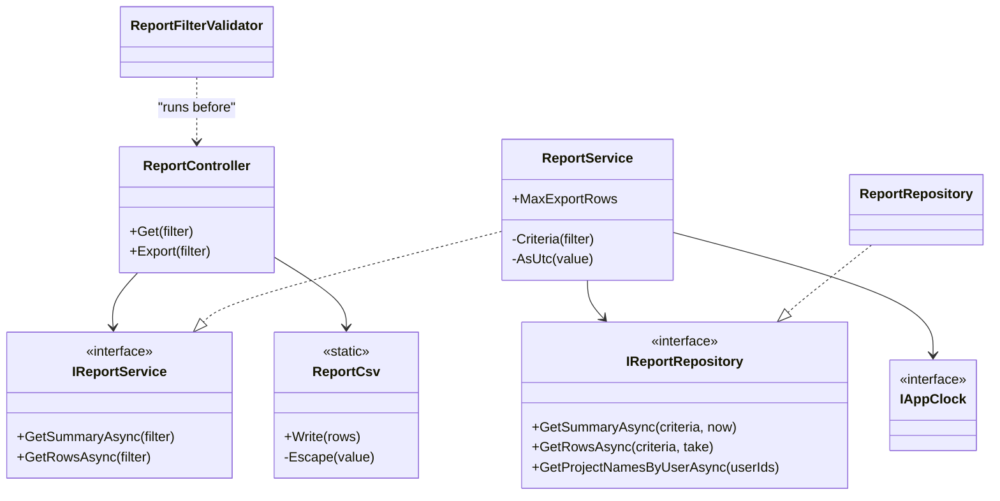
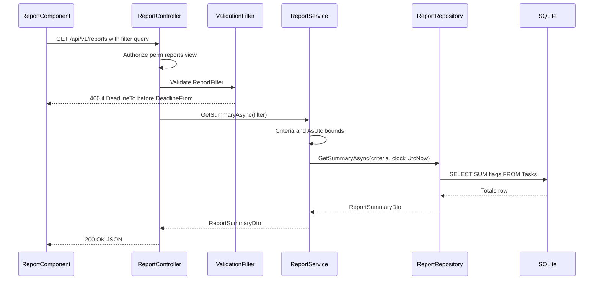
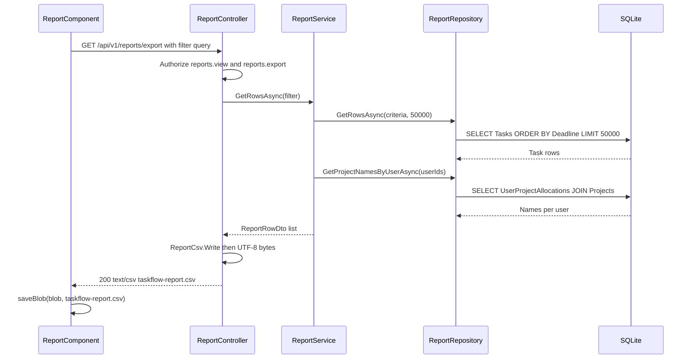
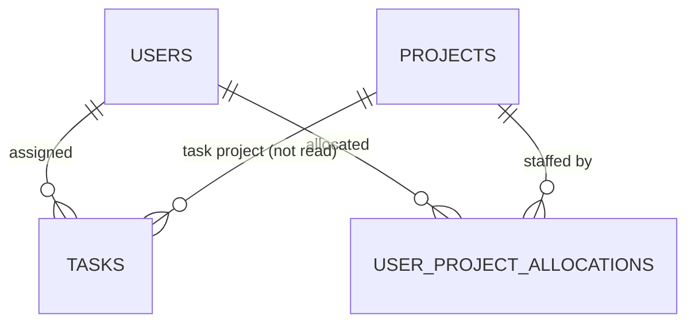

# Low-Level Design – Reports

## TaskFlow – Intelligent Task Allocation & Tracking System

> **Document:** Low-Level Design (sub-module 10 – RPT)  ·  **Version:** 1.0  ·  **Status:** Draft
> **Project type:** Personal Project (Skill Development)  ·  **Date:** 31-Oct-2026
> **Author:** Jojo George (jojogeorge3344@gmail.com)
> **Based on:** HLD – Reports v1.0, FRD – Reports v1.0 (FR-RPT-01 – FR-RPT-42), TaskFlow code as built
> © 2026 Jojo George. All rights reserved.

---

## Document Control

| Version | Date | Author | Summary of changes |
|---|---|---|---|
| 1.0 | 31-Oct-2026 | Jojo George | Initial version: Task Reports summary and CSV export (controller, service, CSV writer, repository, validator, Angular page), derived from the code and verified against the code fact sheet |

**Related documents:** BRD – Reports (`../../../BRD/05-Reports/05.1-Reports/BRD-Reports.md`) · FRD – Reports
(`../../../FRD/05-Reports/05.1-Reports/FRD-Reports.md`) · HLD – Reports (`../../../HLD/05-Reports/05.1-Reports/HLD-Reports.md`) ·
LLD – Overall (`../../00-Overall/LLD-TaskFlow-Overall.md`) · LLD – Dashboard (`../../01-Dashboard/01.1-Dashboard/LLD-Dashboard.md`) ·
TDD (`TF - Documents/TF - TDD/TDD-TaskFlow.md` v2.0)

---

## 1. Introduction

### 1.1 Purpose
Detailed design of the Reports sub-module (Task Reports screen, original BRD Screen 17): the two controller actions, the
classes and files behind them, the filter DTO and its validator, the summary and export logic, the CSV format with
formula protection, the repository queries, the tables read, the tests, and the traceability from FR-RPT-nn to endpoint,
class and test.

### 1.2 Scope & Conventions
- One child module: **Task Reports** (summary totals, filters, CSV export).
- **Endpoints in this sub-module: 2** (facts.md §3: `ReportController` – `GET /api/v1/reports`,
  `GET /api/v1/reports/export`). Both are read only.
- Naming: `ReportController`, `IReportService` / `ReportService`, `IReportRepository` / `ReportRepository`, static writer
  `ReportCsv`, query DTO `ReportFilter`, records `ReportCriteria`, `ReportTaskRow`, DTOs `ReportSummaryDto`, `ReportRowDto`.
- API base path: `/api/v1/reports`; JSON camelCase, enums as names (`JsonStringEnumConverter`); errors as
  `ProblemDetails` / `ValidationProblemDetails`.
- Paths are relative to `backend/src/TaskFlow.Api/` (backend) and `frontend/src/app/` (frontend).

---

## 2. Code Structure

### 2.1 Backend Folder Layout

```
TaskFlow.Api/
  Controllers/Reports/          ReportController.cs
  Services/Reports/             IReportService.cs, ReportService.cs, ReportCsv.cs (static CSV writer)
  Repositories/Reports/         IReportRepository.cs, ReportRepository.cs, ReportCriteria.cs, ReportTaskRow.cs
  Dtos/Reports/                 ReportDto.cs (ReportFilter, ReportSummaryDto, ReportRowDto)
  Dtos/Reports/Validators/      ReportFilterValidator.cs
  Services/Assistant/Knowledge/ reports-and-workload.md (help article, not code)
  Config/                       ServiceRegistration.cs, RepositoryRegistration.cs (scoped registrations)
```

### 2.2 Frontend Folder Layout

```
src/app/modules/reports/
  reports.routes.ts              REPORTS_ROUTES: path 'reports', permissionGuard, reports.view
  pages/report.component.ts/.html ReportComponent (selector app-report, standalone)
  services/report.service.ts     ReportService: getSummary, exportCsv, toParams
  models/report.model.ts         ReportFilter, ReportSummary
src/app/shared/utils/            local-day.ts (startOfLocalDay, endOfLocalDay), save-blob.ts (saveBlob)
src/app/shared/services/         toast.service.ts (ToastService)
src/app/layouts/nav-items.ts     "Reports" item when reports.view is held
```

### 2.3 Layer Rules

| Rule | Enforced by |
|---|---|
| Controller → Service → Repository; the controller only encodes the CSV bytes | Code structure; shared architecture rules in the overall LLD |
| Input validated before the action runs | `ValidationFilter` with `ReportFilterValidator` |
| Read only: no `SaveChanges`, no notification, mail or activity entry | `AsNoTracking` queries; no `IUnitOfWork` dependency |
| CSV formatting in one static class | `ReportCsv` |
| The page calls only `ReportService`; option lists come from the owning modules' services | `ProjectService.getAll`, `TaskService.getAssignees` |

---

## 3. Cross-Cutting Design

Shared cross-cutting design (JWT, `perm:` policies, `ValidationFilter`, `GlobalExceptionHandler`,
`DeniedActionAuditHandler`, logging, DI) is described once in the overall LLD (`../../00-Overall/LLD-TaskFlow-Overall.md`).
Reports-specific points:

| Concern | Design |
|---|---|
| Validation | `ReportFilterValidator` (FluentValidation) run by the global `ValidationFilter` for the bound `ReportFilter`; MVC model binding refuses unparseable dates and enum names. The date pickers set `min` / `max`. |
| Error handling | Validation → 400 `ValidationProblemDetails`; policy → 403; anything else → 500 via `GlobalExceptionHandler`. The page shows MSG-RPT-01 (load) or the toast MSG-RPT-03 (export) whatever the server says. No `AppException` is thrown by this sub-module. |
| Transactions | None – read only. |
| Authorization | Class-level `RequirePermission(reports.view)`; the export action adds `perm:reports.export`, so export needs both keys. Data scope is the whole organisation (design note D3 in `ReportService`). |
| Logging | Refused policy checks are logged by `DeniedActionAuditHandler` (user id, method, path, policy). |
| Time & time zone | The browser turns the chosen local days into UTC instants (`startOfLocalDay`, `endOfLocalDay`); `ReportService.AsUtc` normalises them; "overdue" uses `IAppClock.UtcNow`. The application timezone is not used. |

### 3.1 Exception → HTTP Status

| Exception / outcome | Status | When |
|---|---|---|
| `ValidationFilter` failure | 400 | `DeadlineTo` before `DeadlineFrom`; `Status` / `Priority` not a defined enum value |
| Model-binding failure (`[ApiController]`) | 400 | Unparseable date, unknown enum name, non-numeric id |
| Authentication failure | 401 | No or expired access token |
| Policy failure | 403 | Missing `reports.view` (both actions) or `reports.export` (export) |
| Any other exception | 500 | "Something went wrong. Please try again." |

---

## 4. Module Designs

### 4.1 Module: Reports (RPT)

#### 4.1.1 Child module: Task Reports

**Class / file inventory**

| Layer | Type | File | Responsibility |
|---|---|---|---|
| Controller | `ReportController` | `Controllers/Reports/ReportController.cs` | `Get` (summary), `Export` (CSV file) |
| Service | `IReportService` / `ReportService` | `Services/Reports/` | `GetSummaryAsync`, `GetRowsAsync`; `Criteria`, `AsUtc`; `MaxExportRows = 50_000` |
| CSV writer | `ReportCsv` (static) | `Services/Reports/ReportCsv.cs` | `Write(rows)`, `Escape`, `FormatDate`; `ContentType = "text/csv"`, `FileName = "taskflow-report.csv"` |
| Repository | `IReportRepository` / `ReportRepository` (extends `BaseRepository` of `Task`) | `Repositories/Reports/` | `GetSummaryAsync`, `GetRowsAsync`, `GetProjectNamesByUserAsync`, private `Covered` |
| Records | `ReportCriteria`, `ReportTaskRow` | `Repositories/Reports/` | UTC criteria; row before the Project column is filled |
| DTOs | `ReportFilter`, `ReportSummaryDto`, `ReportRowDto` | `Dtos/Reports/ReportDto.cs` | Query input, totals, export row |
| Validator | `ReportFilterValidator` | `Dtos/Reports/Validators/ReportFilterValidator.cs` | Range order, enum values |
| Dependency | `IAppClock` | `Services/Settings/ApplicationSettings/Clock/` | `UtcNow` for "overdue" |
| Frontend route | `REPORTS_ROUTES` | `modules/reports/reports.routes.ts` | `/reports`, `permissionGuard` with `reports.view` (under the shell `authGuard`, `mfaSetupGuard`) |
| Frontend page | `ReportComponent` (`app-report`) | `modules/reports/pages/report.component.ts/.html` | Filters, count cards, completion bar, error panel, Export CSV |
| Frontend service | `ReportService` | `modules/reports/services/report.service.ts` | `getSummary(filter)`, `exportCsv(filter)` (blob), `toParams` drops empty values |
| Frontend models | `ReportFilter`, `ReportSummary` | `modules/reports/models/report.model.ts` | TypeScript contracts |
| Frontend utils | `startOfLocalDay`, `endOfLocalDay`, `saveBlob`, `ToastService` | `shared/utils/local-day.ts`, `shared/utils/save-blob.ts`, `shared/services/toast.service.ts` | Local day → UTC, download, error toast |
| Cross-module | `ProjectService.getAll`, `TaskService.getAssignees` | `modules/management/project-management/services/project.service.ts`, `modules/monitoring/task-management/services/task.service.ts` | Project and Employee options |

**Class diagram**



**API contracts** (route prefix `[Route("api/v1/reports")]`, class attribute `[RequirePermission(PermissionKeys.ReportsView)]`)

| # | Method | Route | Permission / policy | Request | Response | Status codes |
|---|---|---|---|---|---|---|
| 1 | GET | `/api/v1/reports` | `reports.view` (class) | `ReportFilter` (query) | `ReportSummaryDto` | 200, 400, 401, 403 |
| 2 | GET | `/api/v1/reports/export` | `reports.view` (class) **and** `[Authorize(Policy = PermissionPolicy.Prefix + PermissionKeys.ReportsExport)]` | `ReportFilter` (query) | `text/csv` file `taskflow-report.csv` | 200, 400, 401, 403 |

`ReportFilter` query parameters (all optional): `deadlineFrom`, `deadlineTo` (`DateTime`, ISO instants), `assignedToUserId`
(int), `projectId` (int), `status` (`TaskStatus` name), `priority` (`TaskPriority` name).

Dependency endpoints called by the page (owned by other sub-modules): `/api/v1/projects` (`projects.view`, Project list) and
`/api/v1/tasks/assignees` (`[Authorize]`, scoped to the caller's task access, Employee list).

**Request / response example**

```json
{
  "request": "GET /api/v1/reports?deadlineFrom=2026-09-30T18:30:00.000Z&deadlineTo=2026-10-31T18:29:59.999Z&assignedToUserId=7&priority=High",
  "response": { "totalTasks": 6, "pendingTasks": 4, "completedTasks": 2, "overdueTasks": 1 }
}
```

```json
{
  "type": "https://tools.ietf.org/html/rfc9110#section-15.5.1",
  "title": "One or more validation errors occurred.",
  "status": 400,
  "errors": { "DeadlineTo": ["The report 'to' deadline must be on or after the 'from' deadline."] }
}
```

```text
GET /api/v1/reports/export?priority=High  ->  200, Content-Type: text/csv, attachment; filename=taskflow-report.csv
TaskCode,Title,Assignee,Project,Priority,Status,StartDate,Deadline,EstimatedHours,CompletedAt
TF-0012,'=SUM(A1),Arun Kumar,"Portal, Website",High,InProgress,2026-10-01,2026-10-20,6.5,
```

Values are illustrative (the task-code format belongs to Task Management); lines end with CRLF.

**Service logic – `ReportService.GetSummaryAsync(filter)`** (FR-RPT-07 – FR-RPT-30)
1. `ValidationFilter` has already run `ReportFilterValidator`.
2. `Criteria(filter)` → `ReportCriteria(AsUtc(DeadlineFrom), AsUtc(DeadlineTo), AssignedToUserId, ProjectId, Status,
   Priority)`. `AsUtc`: `Local` kind → `ToUniversalTime()`; `Unspecified` → `SpecifyKind(Utc)`; `Utc` unchanged.
3. `_reports.GetSummaryAsync(criteria, _clock.UtcNow)` – "overdue" is measured at the application clock's current UTC time.
4. Return `ReportSummaryDto`; `(0, 0, 0, 0)` when nothing matches.

**Service logic – `ReportService.GetRowsAsync(filter)`** (FR-RPT-33 – FR-RPT-38)
1. Same `Criteria(filter)`.
2. `_reports.GetRowsAsync(criteria, MaxExportRows)` – ordered by `Deadline`, then `Id`, at most 50,000 rows.
3. Distinct `AssignedToUserId` values → `_reports.GetProjectNamesByUserAsync(userIds)` (report filters not applied, so a
   deleted person's work keeps its projects).
4. Map each `ReportTaskRow` to `ReportRowDto`; `Project` = `string.Join(", ", names)` of the assignee's allocations sorted
   by project name, or empty.

**CSV logic – `ReportCsv.Write(rows)`** (FR-RPT-36 – FR-RPT-39)
1. Header `TaskCode,Title,Assignee,Project,Priority,Status,StartDate,Deadline,EstimatedHours,CompletedAt` + `\r\n`.
2. Per row, every cell through `Escape`: `null` → empty; a value starting with `=`, `+`, `-` or `@` gets a leading `'`
   (formula-injection guard, D8); a value containing `,`, `"`, CR or LF is quoted with inner quotes doubled.
3. Dates `yyyy-MM-dd` (invariant culture); `EstimatedHours` invariant culture; `CompletedAt` empty when null; `Priority`
   and `Status` as enum names.
4. Controller: `File(Encoding.UTF8.GetBytes(csv), ReportCsv.ContentType, ReportCsv.FileName)` (no BOM added explicitly).

**Frontend logic – `ReportComponent`**
1. `ngOnInit`: `projectService.getAll()` → `projects`; `taskService.getAssignees()` → `assignees` (no error handler – the
   list stays empty on failure); `load()`.
2. `load()`: `loading = true`, `error = null`; `reportService.getSummary(currentFilter())` with `catchError(() => of(null))`;
   `null` → `error` = "Could not load the report. Check your connection and try again." (panel "Something went wrong" +
   **Retry** → `load()`); else `summary`.
3. Each `setDeadlineFrom`, `setDeadlineTo`, `setAssignee`, `setProject`, `setStatus`, `setPriority` updates its signal and
   calls `load()` (no Apply button); `resetFilters()` clears all and calls `load()`.
4. `currentFilter()`: `deadlineFrom` = `startOfLocalDay(day)`, `deadlineTo` = `endOfLocalDay(day)` (last millisecond of
   the local day), ids and enum names only when set.
5. `completionRate` = 0 when total is 0, else `Math.round(completed / total × 100)`; text "X of Y completed · Z%".
6. `canExport()` = `authService.hasPermission(Permissions.ReportsExport)`; `exportCsv()`: `exporting = true` (label
   "Exporting…", button disabled) → `exportCsv(currentFilter())` blob → `saveBlob(blob, REPORT_FILE_NAME)`; error → toast
   "Could not export the report. Please try again."; `exporting = false` in both cases.

**Sequence diagram** – summary



**Sequence diagram** – export



**Repository methods** – `ReportRepository`

| Method | Query / purpose | Notes |
|---|---|---|
| `Covered(criteria)` (private) | Base query: `Set.AsNoTracking().IgnoreQueryFilters().Where(!IsDeleted)`; optional `Deadline >= DeadlineFromUtc`, `Deadline <= DeadlineToUtc` (both inclusive), `AssignedToUserId == x`, `AssignedTo.ProjectAllocations.Any(ProjectId == x)` (the **assignee's** allocation, not `Tasks.ProjectId`), `Status == x`, `Priority == x` | `IgnoreQueryFilters` keeps tasks of soft-deleted users; uses `IX_Tasks_Deadline`, `IX_Tasks_AssignedToUserId` |
| `GetSummaryAsync(criteria, now)` | Each task → 0/1 flags (Total, Pending, Completed, Overdue); `GroupBy(_ => 1)`; `Sum` per flag; `SingleOrDefaultAsync` | Pending = not Completed and not Cancelled; Completed = Completed; Overdue = pending and `Deadline < now`; zeros when no rows |
| `GetRowsAsync(criteria, take)` | `OrderBy(Deadline).ThenBy(Id).Take(take)` → `ReportTaskRow` | `Assignee` = `AssignedTo.FullName` or empty |
| `GetProjectNamesByUserAsync(userIds)` | `Db.UserProjectAllocations.IgnoreQueryFilters().Where(userIds.Contains(UserId)).OrderBy(Project.Name)`; grouped in memory | Returns `IReadOnlyDictionary` of user id → project names |

**Validation rules** (`ReportFilterValidator`)

| Field | Rule | Message |
|---|---|---|
| `DeadlineTo` | `>= DeadlineFrom` when both are given | "The report 'to' deadline must be on or after the 'from' deadline." |
| `Status` | `IsInEnum()` when given | FluentValidation default enum message |
| `Priority` | `IsInEnum()` when given | FluentValidation default enum message |
| `DeadlineFrom` / `DeadlineTo` / ids / enum names | Must bind (model binding) | Default model-state problem |
| Deadline to (client) | Picker `min` = Deadline from, Deadline from picker `max` = Deadline to | – (earlier date not selectable) |

**Error cases**

| Case | Exception / outcome | Status |
|---|---|---|
| "To" before "from" | `ValidationFilter` result | 400 |
| Unknown status / priority value | `ValidationFilter` or model binding | 400 |
| Missing `reports.view` | Policy (audited) | 403 |
| Export without `reports.export` | Policy (audited) | 403 |
| Unexpected fault | `GlobalExceptionHandler` | 500 |

**State machine:** _Not applicable for this sub-module_ – Reports reads task status; transitions belong to Task Management.

---

## 5. Database Design

Reports owns **no table** and runs **no migration**. It reads the tables below (full definitions in the Task Management,
Employee Management and Project Management LLDs). Only the columns read are listed.

### 5.1 ER Diagram



### 5.2 Tables

#### `Tasks` (Task)

| Column | Type | Null | Key / index | Default | Description |
|---|---|:---:|---|---|---|
| Id | int | No | PK | identity | Export tie-break sort |
| TaskCode | string(32) | No | Unique `IX_Tasks_TaskCode` | – | CSV TaskCode |
| Title | string(200) | No | – | – | CSV Title |
| AssignedToUserId | int | No | FK → `Users.Id` (Restrict), `IX_Tasks_AssignedToUserId` | – | Employee filter, Assignee, project lookup |
| Priority | `TaskPriority` (int) | No | – | – | Priority filter, CSV Priority |
| Status | `TaskStatus` (int) | No | – | – | Status filter, Pending / Completed / Overdue |
| StartDate | DateTime | No | – | – | CSV StartDate |
| Deadline | DateTime (UTC) | No | `IX_Tasks_Deadline` | – | Range filter, overdue, export order |
| EstimatedHours | decimal | No | – | – | CSV EstimatedHours |
| CompletedAt | DateTime | Yes | – | null | CSV CompletedAt |
| IsDeleted | bool | No | – | false | Deleted tasks excluded |
| ProjectId | int | Yes | FK → `Projects.Id` (Restrict), `IX_Tasks_ProjectId` | null | **Not read** by Reports |

#### `Users` (User)

| Column | Type | Null | Key / index | Default | Description |
|---|---|:---:|---|---|---|
| Id | int | No | PK | identity | Assignee |
| FullName | string(200) | No | – | – | CSV Assignee |
| IsDeleted | bool | No | Query filter `!IsDeleted` (bypassed with `IgnoreQueryFilters`) | false | Deleted people's tasks and names are kept |

#### `UserProjectAllocations` (UserProjectAllocation)

| Column | Type | Null | Key / index | Default | Description |
|---|---|:---:|---|---|---|
| UserId | int | No | Composite PK; FK → `Users.Id` (Cascade) | – | Allocated person |
| ProjectId | int | No | Composite PK; FK → `Projects.Id` (Cascade), `IX_UserProjectAllocations_ProjectId` | – | Project filter and CSV Project |
| (query filter) | – | – | User and project not deleted (bypassed with `IgnoreQueryFilters`) | – | – |

#### `Projects` (Project)

| Column | Type | Null | Key / index | Default | Description |
|---|---|:---:|---|---|---|
| Id | int | No | PK | identity | – |
| Name | string(200) | No | Unique among live rows (`IX_Projects_Name`, filter `"IsDeleted" = 0`) | – | CSV Project names, sorted |
| IsDeleted | bool | No | Query filter | false | Soft delete |

### 5.3 Indexes, Constraints & Triggers

| Object | Definition | Purpose |
|---|---|---|
| `IX_Tasks_Deadline` | (Deadline) | Deadline range filter, export ordering |
| `IX_Tasks_AssignedToUserId` | (AssignedToUserId) | Employee filter, assignee join |
| `IX_UserProjectAllocations_ProjectId` | (ProjectId) | Project filter (`ProjectAllocations.Any`) |
| Composite PK `UserProjectAllocations` | (UserId, ProjectId) | Project names per user |

No triggers are used.

### 5.4 Enumerations

| Enum | Values | Stored as |
|---|---|---|
| `TaskStatus` | ToDo (0), InProgress (1), Blocked (2), Completed (3), Cancelled (4), InQA (5) | int; JSON / query / CSV as name |
| `TaskPriority` | Low (0), Medium (1), High (2), Critical (3) | int; JSON / query / CSV as name |

### 5.5 Migrations

_Not applicable for this sub-module_ – no migration; the tables read come from `20261012124843_AddTasks`,
`20261020173455_RenameDepartmentsToProjectsAndAddDepartments` and `20261023160825_UserProjectAllocationsAndDepartments`
(described in the owning LLDs).

---

## 6. Algorithms & Background Jobs

| Job / algorithm | Trigger / schedule | Steps | Idempotency |
|---|---|---|---|
| Summary aggregation | `GET /api/v1/reports` | Covered tasks → 0/1 flags → one grouped `SUM` row | Pure read |
| Export | `GET /api/v1/reports/export` | Covered tasks by deadline (cap 50,000) → project names per assignee → `ReportCsv.Write` → UTF-8 bytes | Pure read |
| Formula protection | Every CSV cell | Prefix `'` for leading `=`, `+`, `-`, `@`; then RFC 4180 quoting | Deterministic |
| Background jobs | – | None in this sub-module | – |

---

## 7. Security Design (detailed)

Shared items (password hashing, tokens, cookies, secrets) are in the overall LLD.

| Item | Implementation |
|---|---|
| Permission checks | `[RequirePermission(PermissionKeys.ReportsView)]` on `ReportController`; `Export` adds `[Authorize(Policy = PermissionPolicy.Prefix + PermissionKeys.ReportsExport)]` |
| Catalogue defaults (`PermissionCatalog`) | `reports.view` "View reports" (`GrantedToManager`); `reports.export` "Export reports" (`GrantedToManager`, `GrantFrom` and `Requires` `reports.view`); Administrator re-granted all keys on start (`AccessControlSeeder`); Employee has neither |
| Data scope | Organisation for every holder of `reports.view`; no Own / Team selector (D3) |
| Hidden dependency | Project list needs `projects.view` (not declared in the catalogue `Requires`); Employee list follows the caller's task access |
| CSV safety | Formula-injection guard in `ReportCsv.Escape` (D8) |
| Frontend | `permissionGuard` on `/reports` redirects to `dashboardRouteFor(...)`; menu item shown with `has(Permissions.ReportsView)`; Export button only when `canExport()` |
| Audit | `DeniedActionAuditHandler` logs every refused policy check |

---

## 8. Configuration

| Key | Default | Purpose |
|---|---|---|
| `ConnectionStrings:Default` | `<secret>` | SQLite database |
| `Jwt:AccessTokenMinutes` / `Jwt:RefreshTokenDays` | `<secret>` | Session lifetime for report calls |
| `Application:Timezone` | `Asia/Kolkata` | Not used by the report calculations (deadline bounds come from the browser) |

Code constants: `ReportService.MaxExportRows` = 50000; `ReportCsv.FileName` = `taskflow-report.csv`, `ReportCsv.ContentType`
= `text/csv`; Angular `REPORT_FILE_NAME` = `taskflow-report.csv`.

---

## 9. Testing Design

Paths relative to `backend/tests`. Only file names are available; "Covers" is inferred from the names.

| Area | Test class / file | Type | Covers |
|---|---|---|---|
| Service | `TaskFlow.UnitTests/Reports/ReportServiceTests.cs` | Unit | Totals, filters, deleted tasks / people, project semantics, row cap and order |
| CSV | `TaskFlow.UnitTests/Reports/ReportCsvTests.cs` | Unit | Header, column order, quoting, formula guard, date format |
| Endpoints | `TaskFlow.IntegrationTests/Reports/ReportEndpointsTests.cs` | Integration | Both endpoints, validation, `reports.view` / `reports.export` |
| Permissions | `TaskFlow.UnitTests/Settings/RoleConfiguration/PermissionCatalogTests.cs` | Unit | Catalogue entries incl. report keys |
| Permissions | `TaskFlow.IntegrationTests/Common/PermissionAuthorizationTests.cs`, `ModuleBasedPermissionEndpointsTests.cs` | Integration | Policy enforcement across modules |
| Support | `TaskFlow.UnitTests/TestSupport/WorkloadReportHarness.cs` | Support | > ⚠️ To be confirmed: whether the report tests use it |
| Frontend | – | – | No spec file for `ReportComponent` in the snapshot |

---

## 10. Known Limitations & Open Issues

- Organisation-wide data for every `reports.view` holder; the original BRD asked for records the user may access.
  > ⚠️ To be confirmed (R-RPT-01).
- Export capped at 50,000 rows without a warning; built fully in memory, not streamed. > ⚠️ To be confirmed (R-RPT-02).
- Deadline-day bounds use the browser's time zone, not `Application:Timezone` (BR-17). > ⚠️ To be confirmed (R-RPT-03).
- Project and Employee option loads have no error handler; a missing `projects.view` leaves the list empty silently.
  > ⚠️ To be confirmed (R-RPT-04, R-RPT-05).
- Project filter and CSV Project use the assignee's allocations, not `Tasks.ProjectId`; allocations to soft-deleted
  projects may appear because of `IgnoreQueryFilters`. > ⚠️ To be confirmed (R-RPT-06).
- Counting differs from the Dashboard: Reports counts Cancelled in Total and all open tasks as Pending (BR-RPT-10).
- The server message MSG-RPT-02 is not shown; the page shows MSG-RPT-01.
- `report.component.ts` declares `styleUrl: './report.component.css'`, but the file is not in the source snapshot.
  > ⚠️ To be confirmed.
- The TDD names reports/tasks and reports/tasks/export routes and `ReportsComponent`; the code uses the two routes in §4
  and `ReportComponent`.
- The help article `reports-and-workload.md` mentions summaries "by status, priority and employee"; the code returns four
  totals only.

---

## 11. Traceability (FRD → code)

| FRD requirement | Endpoint / class | Test |
|---|---|---|
| FR-RPT-01 | `nav-items.ts` (`has(Permissions.ReportsView)`) | Manual UI check (AC-RPT-01) |
| FR-RPT-02 | `REPORTS_ROUTES` + `permissionGuard` → `dashboardRouteFor` | Manual UI check (AC-RPT-01) |
| FR-RPT-03 | `[RequirePermission(PermissionKeys.ReportsView)]` on `ReportController`; `DeniedActionAuditHandler` | `ReportEndpointsTests`, `PermissionAuthorizationTests` |
| FR-RPT-04 | `ReportComponent.ngOnInit` → `GET /api/v1/reports`, `/api/v1/projects`, `/api/v1/tasks/assignees` | `ReportEndpointsTests` |
| FR-RPT-05, FR-RPT-06 | `loading` / `error` signals, `load()` retry in `ReportComponent` | Manual UI check |
| FR-RPT-07 | `report.component.html` count cards | Manual UI check |
| FR-RPT-08, FR-RPT-09, FR-RPT-10, FR-RPT-11, FR-RPT-12 | `ReportRepository.GetSummaryAsync` (flags), `ReportService.GetSummaryAsync` (`IAppClock.UtcNow`) | `ReportServiceTests` |
| FR-RPT-13 | `ReportComponent.completionRate` | Manual UI check |
| FR-RPT-14 | `GetSummaryAsync` fallback `ReportSummaryDto(0, 0, 0, 0)` | `ReportServiceTests` |
| FR-RPT-15, FR-RPT-16 | `startOfLocalDay` / `endOfLocalDay`; `ReportService.AsUtc`; `Covered` inclusive bounds | `ReportServiceTests` |
| FR-RPT-17 | Date inputs `[min]` / `[max]` in `report.component.html` | Manual UI check |
| FR-RPT-18 | `ReportFilterValidator` (`DeadlineTo` rule) via `ValidationFilter` | `ReportEndpointsTests` |
| FR-RPT-19 | `Covered` – `AssignedToUserId == x` | `ReportServiceTests` |
| FR-RPT-20 | `TaskService.getAssignees()` → `/api/v1/tasks/assignees` | Manual UI check |
| FR-RPT-21 | `Covered` – `AssignedTo.ProjectAllocations.Any(ProjectId == x)` | `ReportServiceTests` |
| FR-RPT-22 | `ProjectService.getAll()` → `/api/v1/projects` (`projects.view`) | Manual UI check |
| FR-RPT-23, FR-RPT-24 | `Covered` – `Status`, `Priority`; `ReportFilterValidator.IsInEnum` | `ReportEndpointsTests` |
| FR-RPT-25 | `ReportFilter` optional fields; `toParams` drops empty values; `Covered` adds only given filters | `ReportServiceTests` |
| FR-RPT-26, FR-RPT-27 | `set*()` methods and `resetFilters()` call `load()` | Manual UI check |
| FR-RPT-28, FR-RPT-29 | `Covered` – `IgnoreQueryFilters().Where(!IsDeleted)`; `GetProjectNamesByUserAsync` `IgnoreQueryFilters` | `ReportServiceTests` |
| FR-RPT-30 | `ReportService` (no scope selector, D3) | `ReportEndpointsTests` |
| FR-RPT-31 | `ReportComponent.canExport()` | Manual UI check |
| FR-RPT-32 | `GET /api/v1/reports/export` – class `reports.view` + `perm:reports.export` | `ReportEndpointsTests`, `PermissionCatalogTests` |
| FR-RPT-33, FR-RPT-34 | `ReportService.GetRowsAsync` (`MaxExportRows`), `ReportRepository.GetRowsAsync` (`OrderBy(Deadline).ThenBy(Id).Take`) | `ReportServiceTests` |
| FR-RPT-35 | `ReportController.Export` → `File(…, ReportCsv.ContentType, ReportCsv.FileName)`; `saveBlob(blob, REPORT_FILE_NAME)` | `ReportEndpointsTests` |
| FR-RPT-36, FR-RPT-38 | `ReportCsv.Headers`, `ReportCsv.Write`, `FormatDate` | `ReportCsvTests` |
| FR-RPT-37 | `ReportService.GetRowsAsync` (`string.Join(", ", names)`), `GetProjectNamesByUserAsync` (`OrderBy(Project.Name)`) | `ReportServiceTests`, `ReportCsvTests` |
| FR-RPT-39 | `ReportCsv.Escape` (leading `=`, `+`, `-`, `@`) | `ReportCsvTests` |
| FR-RPT-40, FR-RPT-41 | `ReportComponent.exporting`, `exportCsv()` error → `ToastService.error` | Manual UI check |
| FR-RPT-42 | Read-only queries (`AsNoTracking`); no notification, mail or activity dependency | Manual check – no data change |

---
<sub>© 2026 Jojo George. All rights reserved. Unauthorized copying or distribution of this document is prohibited.</sub>
