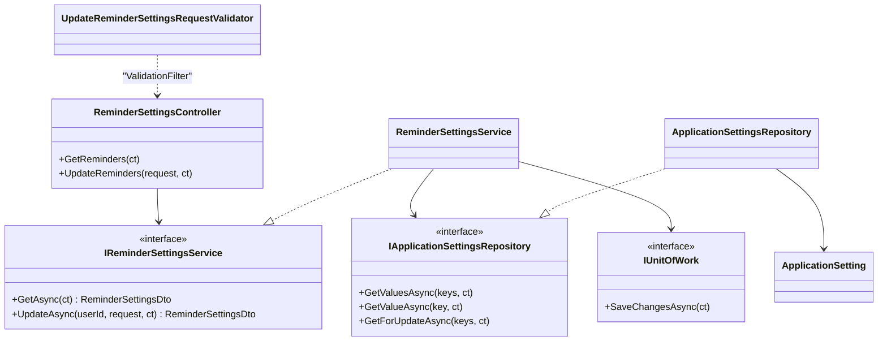
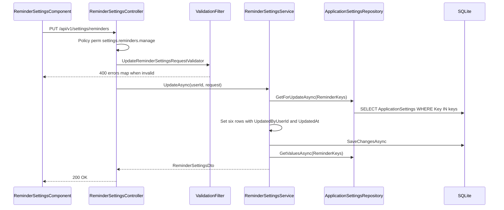
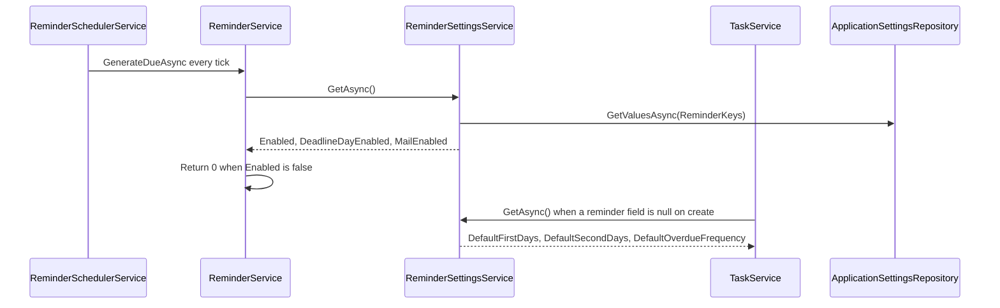
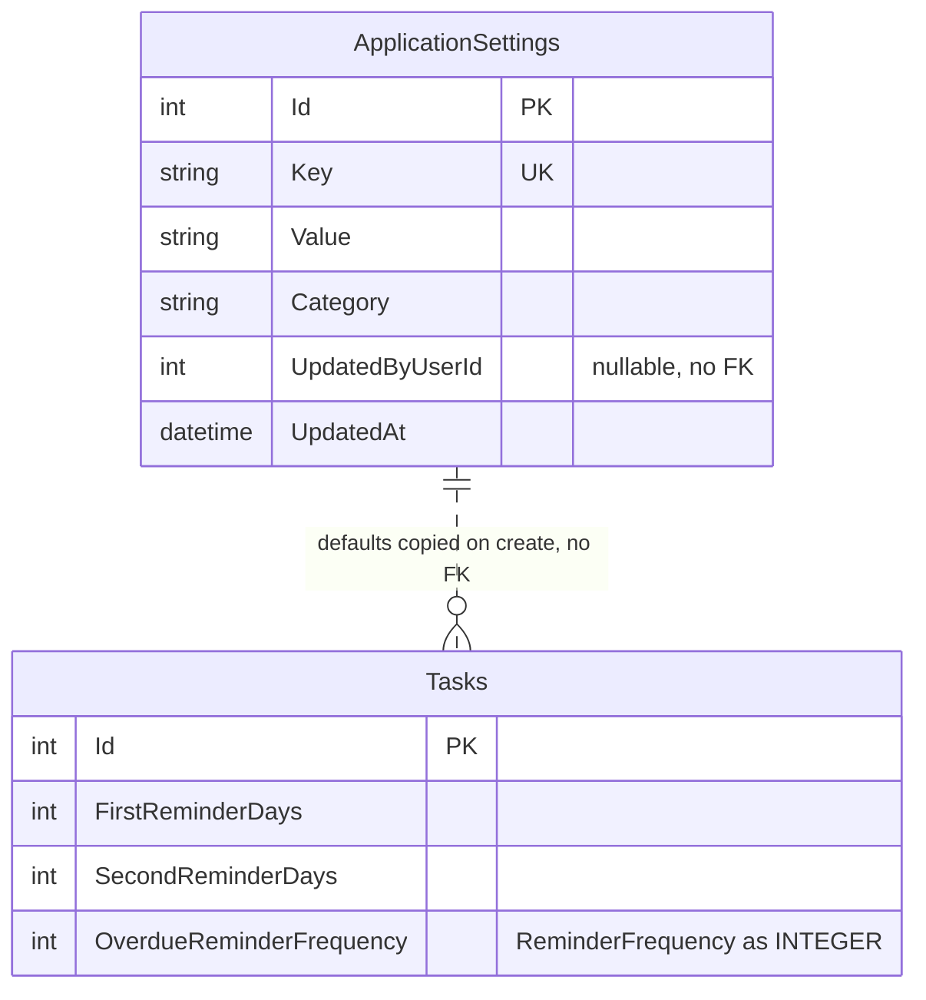

# Low-Level Design – Reminder Settings

## TaskFlow – Intelligent Task Allocation & Tracking System

> **Document:** Low-Level Design  ·  **Version:** 1.0  ·  **Status:** Draft
> **Project type:** Personal Project (Skill Development)  ·  **Date:** 31-Oct-2026
> **Author:** Jojo George (jojogeorge3344@gmail.com)
> **Based on:** HLD-Reminder-Settings v1.0, FRD-Reminder-Settings v1.0
> **Module:** Settings  ·  **Sub-module:** 06.1 Reminder Settings  ·  **Code:** REM
> © 2026 Jojo George. All rights reserved.

---

## Document Control

| Version | Date | Author | Summary of changes |
|---|---|---|---|
| 1.0 | 31-Oct-2026 | Jojo George | Initial version |

**Related documents:** BRD · FRD · HLD · TDD · Specs

| Document | Location |
|---|---|
| BRD – Reminder Settings | `../../../BRD/06-Settings/06.1-Reminder-Settings/BRD-Reminder-Settings.md` |
| FRD – Reminder Settings (FR-REM-01…23, UC-REM-01…03) | `../../../FRD/06-Settings/06.1-Reminder-Settings/FRD-Reminder-Settings.md` |
| HLD – Reminder Settings | `../../../HLD/06-Settings/06.1-Reminder-Settings/HLD-Reminder-Settings.md` |
| Overall LLD (stack, cross-cutting design, Auth) | `../../00-Overall/LLD-TaskFlow-Overall.md` |
| LLD – Application Settings (shares the `ApplicationSettings` table and repository) | `../06.2-Application-Settings/LLD-Application-Settings.md` |
| LLD – Notification (reminder engine that consumes these values) | `../../04-Communication/04.2-Notification/LLD-Notification.md` |
| LLD – Task Management (Create Task, which uses the defaults) | `../../02-TaskFlow-Monitoring/02.1-Task-Management/LLD-Task-Management.md` |
| TDD v2.0 | `TDD-TaskFlow.md` §7.2.6 (`ApplicationSetting`), §7.5 (timezone) |

---

## 1. Introduction

### 1.1 Purpose
Detailed design of the Reminder Settings sub-module (original BRD Screen 13 "Deadline Reminder Settings"): the controller
actions, service logic, DTOs, validator, repository methods, the rows of the `ApplicationSettings` table it owns, the
Angular screen, the tests and the traceability from FR-REM-nn to code. Everything below is taken from the code as built.

### 1.2 Scope & Conventions
- Covered: `ReminderSettingsController` (2 actions), `ReminderSettingsService`, `UpdateReminderSettingsRequestValidator`,
  the shared `ApplicationSettingsRepository`, the six reminder/notification setting rows, and the Angular
  `ReminderSettingsComponent` with its API service.
- Not covered here (only referenced): the reminder engine `ReminderService` / `ReminderSchedulerService`
  (Notification LLD), Create Task (Task Management LLD), the timezone and in-app switch (Application Settings LLD).
- Naming: `*Controller`, `I*Service`/`*Service`, `I*Repository`/`*Repository`, DTOs `*Dto` / `*Request`, validators
  `*RequestValidator`.
- API base path `/api/v1`; JSON camelCase; enums serialised as strings (`JsonStringEnumConverter`); errors as
  ProblemDetails (`application/problem+json`).

---

## 2. Code Structure

### 2.1 Backend Folder Layout

```
TaskFlow.Api/
  Controllers/Settings/ReminderSettingsController.cs
  Services/Settings/ReminderSettings/IReminderSettingsService.cs, ReminderSettingsService.cs
  Repositories/Settings/ApplicationSettings/IApplicationSettingsRepository.cs, ApplicationSettingsRepository.cs  (shared with APP)
  Dtos/Settings/ReminderSettings/ReminderSettingsDtos.cs
  Dtos/Settings/ReminderSettings/Validators/UpdateReminderSettingsRequestValidator.cs
  Models/Entities/ApplicationSetting.cs, Models/Enums/ReminderFrequency.cs
  Common/Constants/SettingKeys.cs, Common/Utils/SettingValues.cs
  Config/ApplicationOptions.cs
  Persistence/Seeders/SettingsInitializer.cs
```

### 2.2 Frontend Folder Layout

```
src/app/modules/settings/
  settings.routes.ts                                   (route settings/reminders)
  models/settings.model.ts                             (ReminderSettings, UpdateReminderSettings)
  reminder-settings/pages/reminder-settings.component.{ts,html,css}
  reminder-settings/pages/reminder-settings.model.ts   (SettingsField)
  reminder-settings/services/reminder-settings.service.ts
src/app/shared/utils/reminder-options.ts               (shared with Create Task)
src/app/layouts/nav-items.ts, src/app/shared/auth/auth.guard.ts
```

### 2.3 Layer Rules

| Rule | Enforced by |
|---|---|
| Controller → Service → Repository only, through interfaces | `ArchitectureTests` |
| Repositories never save; the service commits through `IUnitOfWork` | `ArchitectureTests` |
| Controllers do not validate; FluentValidation runs in `ValidationFilter` | `ArchitectureTests`, global filter |
| Page component in `pages/`, API service in the module whose endpoint it calls | `npm run check:structure` |

---

## 3. Cross-Cutting Design

Shared mechanisms are described once in the overall LLD (`../../00-Overall/LLD-TaskFlow-Overall.md`). What applies here:

| Concern | Design |
|---|---|
| Validation | `UpdateReminderSettingsRequestValidator` runs in the global `ValidationFilter` before the action; failure → 400 `ValidationProblemDetails` with an `errors` map keyed by property name |
| Error handling | `GlobalExceptionHandler` (see 3.1) |
| Transactions | One `IUnitOfWork.SaveChangesAsync` per save; all six rows are written in one SaveChanges (one SQLite transaction) |
| Authorization | Class-level `[RequirePermission(PermissionKeys.SettingsReminders)]` → policy `perm:settings.reminders.manage`; permission claims refreshed per request by `SessionValidation`; refusals logged by `DeniedActionAuditHandler` |
| Logging | No sub-module-specific logging; unhandled faults logged by `GlobalExceptionHandler` |
| Time & time zone | `UpdatedAt` stored in UTC from `TimeProvider`; the application timezone is read-only here (owned by APP) |

### 3.1 Exception → HTTP Status

| Exception | Status | When |
|---|---|---|
| Validation failure (`ValidationFilter`) | 400 | A field missing, out of range, or second reminder not less than first |
| Policy failure | 403 | Caller lacks `settings.reminders.manage` |
| – (`Unauthorized()` in the action) | 401 | PUT without a numeric `NameIdentifier` claim |
| `ConcurrencyConflictException` / `DbUpdateConcurrencyException` | 409 | Concurrent save race reported by EF Core |
| `UniqueConstraintException` | 409 | Two first-time inserts of the same key race (index `IX_ApplicationSettings_Key`) |
| `ArgumentException` ("Every reminder setting must be provided.") | 500 | Only reachable if the validator is bypassed; not an `AppException`, so it becomes the generic 500 |

---

## 4. Module Designs

### 4.1 Module: Settings

#### 4.1.1 Child module: Reminder Settings (REM)

**Class / file inventory**

| Layer | Type | File | Responsibility |
|---|---|---|---|
| Controller | `ReminderSettingsController` | `Controllers/Settings/ReminderSettingsController.cs` | Routes `GET`/`PUT /api/v1/settings/reminders`; class-level permission; resolves `userId` |
| Service | `IReminderSettingsService` / `ReminderSettingsService` | `Services/Settings/ReminderSettings/` | Typed view over the six setting rows; defaults; upsert |
| Repository | `IApplicationSettingsRepository` / `ApplicationSettingsRepository` | `Repositories/Settings/ApplicationSettings/` | Key/value reads and tracked rows (shared with APP) |
| Base | `BaseRepository<ApplicationSetting>`, `IUnitOfWork` / `UnitOfWork` | `Repositories/Base/` | `Add`, save and conflict mapping |
| DTOs | `ReminderSettingsDto`, `UpdateReminderSettingsRequest` | `Dtos/Settings/ReminderSettings/ReminderSettingsDtos.cs` | Contracts |
| Validator | `UpdateReminderSettingsRequestValidator` | `Dtos/Settings/ReminderSettings/Validators/` | Input rules (`MaxIntervalDays = 30`) |
| Entity | `ApplicationSetting` | `Models/Entities/ApplicationSetting.cs` | Key/value row |
| Enum | `ReminderFrequency` | `Models/Enums/ReminderFrequency.cs` | `Daily`, `Weekly` |
| Constants | `SettingKeys`, `SettingValues` | `Common/Constants/SettingKeys.cs`, `Common/Utils/SettingValues.cs` | Key names, categories, defaults; invariant formatting (`"true"`/`"false"`, ints) |
| Options | `ApplicationOptions` | `Config/ApplicationOptions.cs` | Timezone fallback (`Application:Timezone`, code default `UTC`) |
| Seeder | `SettingsInitializer` | `Persistence/Seeders/SettingsInitializer.cs` | Inserts missing rows at start-up |
| Frontend page | `ReminderSettingsComponent` | `modules/settings/reminder-settings/pages/reminder-settings.component.ts` | Screen, reactive form, `firstBeforeSecond` group validator |
| Frontend service | `ReminderSettingsService` (Angular) | `modules/settings/reminder-settings/services/reminder-settings.service.ts` | `get()`, `save()` |
| Frontend models | `ReminderSettings`, `UpdateReminderSettings`, `SettingsField` | `modules/settings/models/settings.model.ts`, `reminder-settings/pages/reminder-settings.model.ts` | Types |
| Frontend utils | `FIRST_REMINDER_OPTIONS`, `SECOND_REMINDER_OPTIONS`, `OVERDUE_FREQUENCY_OPTIONS`, `withReminderDay()` | `shared/utils/reminder-options.ts` | Fixed choices (shared with Create Task) |
| Route / guard / menu | `SETTINGS_ROUTES`, `permissionGuard`, `buildNavigation()` | `settings.routes.ts`, `shared/auth/auth.guard.ts`, `layouts/nav-items.ts` | Access to `/settings/reminders` |

**Class diagram**



**API contracts**

Controller `ReminderSettingsController`, `[Route("api/v1/settings")]`, class-level
`[RequirePermission(PermissionKeys.SettingsReminders)]`. Endpoints of this sub-module (facts.md §3): **2**.

| # | Method | Route | Permission / policy | Request | Response | Status codes |
|---|---|---|---|---|---|---|
| 1 | GET | `/api/v1/settings/reminders` | `settings.reminders.manage` (class) | – | `ReminderSettingsDto` | 200, 401, 403 |
| 2 | PUT | `/api/v1/settings/reminders` | `settings.reminders.manage` (class) | `UpdateReminderSettingsRequest` | `ReminderSettingsDto` | 200, 400, 401, 403, 409 |

`GET /api/v1/settings/reminders` is also called by Create Task (`task-create.component.ts`, `loadReminderDefaults()`) to
pre-fill the reminder fields; for a caller without `settings.reminders.manage` it returns 403, the form shows a hint and
sends the fields as `null`, and `TaskService` applies the stored defaults on the server (FR-REM-16).

**DTOs**

| DTO | Field | Type | Notes |
|---|---|---|---|
| `ReminderSettingsDto` | `Enabled` | `bool` | `Reminder.Enabled` |
| | `DeadlineDayEnabled` | `bool` | `Reminder.DeadlineDayEnabled` |
| | `DefaultFirstDays` | `int` | `Reminder.DefaultFirstDays` |
| | `DefaultSecondDays` | `int` | `Reminder.DefaultSecondDays` (0 = deadline day) |
| | `DefaultOverdueFrequency` | `ReminderFrequency` | `Reminder.DefaultOverdueFrequency` |
| | `MailEnabled` | `bool` | `Notification.MailEnabled` |
| | `Timezone` | `string` | `Application.Timezone`, read-only here |
| `UpdateReminderSettingsRequest` | `Enabled`, `DeadlineDayEnabled`, `MailEnabled` | `bool?` | Nullable only so that an omitted field is a validation error |
| | `DefaultFirstDays`, `DefaultSecondDays` | `int?` | |
| | `DefaultOverdueFrequency` | `ReminderFrequency?` | |
| | (no timezone field) | – | The timezone can never be changed here (FR-REM-11) |

**Request / response example**

```json
// PUT /api/v1/settings/reminders
{ "enabled": true, "deadlineDayEnabled": true, "defaultFirstDays": 3, "defaultSecondDays": 1, "defaultOverdueFrequency": "Weekly", "mailEnabled": true }
```

```json
// 200 OK
{ "enabled": true, "deadlineDayEnabled": true, "defaultFirstDays": 3, "defaultSecondDays": 1, "defaultOverdueFrequency": "Weekly", "mailEnabled": true, "timezone": "Asia/Kolkata" }
```

```json
// 400 Bad Request (first not earlier than second)
{ "title": "One or more validation errors occurred.", "status": 400, "errors": { "DefaultSecondDays": ["The first reminder must come earlier than the second reminder."] } }
```

**Service logic – `ReminderSettingsService.GetAsync`**
1. `GetValuesAsync(ReminderKeys)` reads the seven keys `Application.Timezone`, `Reminder.Enabled`,
   `Reminder.DeadlineDayEnabled`, `Reminder.DefaultFirstDays`, `Reminder.DefaultSecondDays`,
   `Reminder.DefaultOverdueFrequency`, `Notification.MailEnabled` (no tracking).
2. Each value is parsed; a missing or unparsable value falls back to its `SettingKeys` default:
   `ReadBool` → `DefaultReminderEnabled` (true), `DefaultDeadlineDayEnabled` (true), `DefaultMailEnabled` (true);
   `ReadInt` (invariant culture) → `DefaultFirstDays` (2), `DefaultSecondDays` (1);
   `ReadFrequency` (`Enum.TryParse`, ignore case, `Enum.IsDefined`) → `DefaultOverdueFrequency` ("Daily").
3. Timezone: the stored value when not blank, otherwise `ApplicationOptions.Timezone`.
4. Returns `ReminderSettingsDto`.

**Service logic – `ReminderSettingsService.UpdateAsync(userId, request)`**
1. The validator has already run in `ValidationFilter` (400 on failure).
2. Defensive check: any null field → `ArgumentException("Every reminder setting must be provided.")` (FR-REM-14).
3. `GetForUpdateAsync(ReminderKeys)` loads the tracked rows; `now = TimeProvider.GetUtcNow().UtcDateTime`.
4. Local `Set(key, value, category)`: creates a missing row (`new ApplicationSetting { Key, Category }` + `Add`), then sets
   `Value`, `UpdatedByUserId = userId`, `UpdatedAt = now` (FR-REM-19).
5. Writes five keys in category `Reminder` (`SettingValues.Format` for bool/int, `ToString()` for the enum) and
   `Notification.MailEnabled` in category `Notification`. `Application.Timezone` is never written.
6. `IUnitOfWork.SaveChangesAsync` (one transaction), then returns `GetAsync()`.

**Sequence diagram – save**



**Sequence diagram – consumers (read path)**



**Repository methods** (`ApplicationSettingsRepository : BaseRepository<ApplicationSetting>`)

| Method | Query / purpose | Notes |
|---|---|---|
| `GetValuesAsync(keys)` | `Set.AsNoTracking().Where(keys.Contains(Key)).ToDictionaryAsync(Key, Value)` | Keys without a row are absent; uses `IX_ApplicationSettings_Key` |
| `GetValueAsync(key)` | One value or null, projection | Used by `AppClock` / `NotificationPublisher` (APP), not by this service |
| `GetForUpdateAsync(keys)` | Tracked rows, `ToDictionaryAsync(Key)` | For the upsert |
| `Add(entity)` (base) | Stages a new row | From `BaseRepository` |

**Validation rules** (`UpdateReminderSettingsRequestValidator`)

| Field | Rule | Message |
|---|---|---|
| `Enabled` | `NotNull()` | FluentValidation default (`'Enabled' must not be empty.`) |
| `DeadlineDayEnabled` | `NotNull()` | FluentValidation default |
| `MailEnabled` | `NotNull()` | FluentValidation default |
| `DefaultFirstDays` | `NotNull()`, `InclusiveBetween(1, 30)` | FluentValidation default |
| `DefaultSecondDays` | `NotNull()`, `InclusiveBetween(0, 30)` | FluentValidation default |
| `DefaultSecondDays` | `LessThan(DefaultFirstDays)` when first is 1–30 and second is not null | "The first reminder must come earlier than the second reminder." |
| `DefaultOverdueFrequency` | `NotNull()`, `IsInEnum()` | FluentValidation default |

Client mirror: `firstBeforeSecond` group validator (`Number(first) > Number(second)`) shows the same text under
**Second reminder**; server `errors` keys (PascalCase) are mapped onto the camelCase controls by `applyServerErrors()`.

> ⚠️ To be confirmed: the exact wording of the FluentValidation default messages as returned at run time (not
> overridden in code).

**Error cases**

| Case | Exception / result | Status |
|---|---|---|
| Caller lacks `settings.reminders.manage` | Policy refusal (logged by `DeniedActionAuditHandler`) | 403 |
| No numeric user id claim on PUT | `Unauthorized()` | 401 |
| Field missing / out of range / ordering | `ValidationFilter` | 400 |
| Validator bypassed with a null field | `ArgumentException` | 500 |
| Concurrent first insert of a key | `UniqueConstraintException` | 409 |
| Concurrency race | `ConcurrencyConflictException` | 409 |

**Frontend design – `ReminderSettingsComponent`**

| Member | Behaviour |
|---|---|
| `form` | `FormGroup` with `enabled`, `deadlineDayEnabled`, `defaultFirstDays` (2), `defaultSecondDays` (1), `defaultOverdueFrequency` ('Daily'), `mailEnabled`; group validator `firstBeforeSecond` |
| `load()` | `loading` → `ReminderSettingsService.get()`; on error `loadError` = `apiErrorMessage(err, 'Could not load the reminder settings.')` (error card with **Retry**) |
| `apply(settings)` | Sets `firstReminderOptions` / `secondReminderOptions` through `withReminderDay()` (adds a stored value outside the fixed list, FR-REM-23), sets `timezone`, `form.reset(...)` |
| `fieldError(name)` | Server message first, else the client ordering message for `defaultSecondDays` |
| `save()` | Refuses when invalid or saving; sends the six values; on success `apply`, `savedAt`, toast "Reminder settings saved"; on error `applyServerErrors` and `saveError` = "Could not save the reminder settings." |
| constructor | `valueChanges` clears `savedAt` (the **Saved** tick goes stale on edit) |

**State machine:** _Not applicable for this sub-module._ (Settings rows have no lifecycle states.)

---

## 5. Database Design

### 5.1 ER Diagram



### 5.2 Tables

#### `ApplicationSettings` (ApplicationSetting) – shared with Application Settings

| Column | Type | Null | Key / index | Default | Description |
|---|---|:---:|---|---|---|
| Id | int (INTEGER) | No | PK | identity | Row id |
| Key | string(128) (TEXT) | No | Unique `IX_ApplicationSettings_Key` | – | Setting key (`SettingKeys`) |
| Value | string(1024) (TEXT) | No | – | – | Invariant-culture string (`"true"`/`"false"`, integer, enum name) |
| Category | string(64) (TEXT) | No | – | – | `Reminder` or `Notification` for this sub-module |
| UpdatedByUserId | int? (INTEGER) | Yes | – (no FK) | null | Last editor |
| UpdatedAt | DateTime (TEXT) | No | – | – | UTC time of the last write |

Rows owned by this sub-module:

| Key | Category | Seed default | Read by |
|---|---|---|---|
| `Reminder.Enabled` | Reminder | `true` | `ReminderService` (skip run when false) |
| `Reminder.DeadlineDayEnabled` | Reminder | `true` | `ReminderService` → `ReminderCalculator.DueReminders` |
| `Reminder.DefaultFirstDays` | Reminder | `2` | `TaskService` (create), Create Task screen |
| `Reminder.DefaultSecondDays` | Reminder | `1` | `TaskService` (create), Create Task screen |
| `Reminder.DefaultOverdueFrequency` | Reminder | `Daily` | `TaskService` (create), Create Task screen |
| `Notification.MailEnabled` | Notification | `true` | `ReminderService` (Mail copy of each reminder) |
| `Application.Timezone` (read only) | Application | owned by APP | Shown read-only |

The per-task columns `Tasks.FirstReminderDays`, `SecondReminderDays`, `OverdueReminderFrequency` belong to Task
Management (migration `20261013104629_AddTaskReminderSettings`); this sub-module only supplies their defaults.

### 5.3 Indexes, Constraints & Triggers

| Object | Definition | Purpose |
|---|---|---|
| `IX_ApplicationSettings_Key` | Unique (`Key`) | One row per key; key lookups |
| PK `Id` | Identity | Row id |
| – | No FK on `UpdatedByUserId`, no triggers, no concurrency token | Last writer wins |

### 5.4 Enumerations

| Enum | Values | Stored as |
|---|---|---|
| `ReminderFrequency` | `Daily`, `Weekly` | Enum name in `ApplicationSettings.Value`; JSON string |

### 5.5 Migrations

| Migration | Change |
|---|---|
| `20261013104629_AddTaskReminderSettings` | Per-task reminder columns on `Tasks` (Task Management) |
| `20261017062735_AddReminderEngine` | Creates the `ApplicationSettings` table and `IX_ApplicationSettings_Key` |
| `20261017090431_AddInternalMail` | Deletes the old `Email.%` keys and `Notification.EmailEnabled` (SMTP superseded by internal Mail) |

---

## 6. Algorithms & Background Jobs

| Job / algorithm | Trigger / schedule | Steps | Idempotency |
|---|---|---|---|
| `SettingsInitializer.InitializeAsync` | Every start-up, after `MigrateAsync` (`Program.cs`) | Reads existing keys; inserts each missing default row (`UpdatedAt = now`, `UpdatedByUserId` null) | Never overwrites an existing row (FR-REM-15) |
| Default fallback (`ReadBool`/`ReadInt`/`ReadFrequency`) | Every `GetAsync` | Missing or unparsable value → `SettingKeys` default | Pure function |
| Consumer: `ReminderSchedulerService` → `ReminderService.GenerateDueAsync` | Every `Reminders:TickSeconds` (60 s) when `Reminders:SchedulerEnabled` | Reads `GetAsync()` each run, so a save applies from the next run without restart (FR-REM-18); detailed in the Notification LLD | De-duplication in the Notification sub-module |

---

## 7. Security Design (detailed)

| Item | Implementation |
|---|---|
| Permission checks | Class-level `[RequirePermission(PermissionKeys.SettingsReminders)]`, policy `perm:settings.reminders.manage` = `RequireClaim("permission", key)`; both GET and PUT need it (FR-REM-22) |
| Claims freshness | `SessionValidation` replaces permission claims from the database on every request |
| Frontend | `permissionGuard` with `Permissions.SettingsReminders` on `settings/reminders` (redirect to the user's dashboard); menu item only when held (FR-REM-21) |
| Defaults | `settings.reminders.manage`: Administrator granted (re-granted on every start), Manager granted on first seed, Employee denied, custom roles configurable |
| Secrets | None; all values are non-secret |
| Audit | Denied requests logged; saves keep only `UpdatedByUserId` / `UpdatedAt` |

---

## 8. Configuration

| Key | Default | Purpose |
|---|---|---|
| `Application:Timezone` | `Asia/Kolkata` (code default `UTC`) | Fallback for the read-only timezone while `Application.Timezone` is missing |
| `Reminders:SchedulerEnabled` | `true` | Reminder engine that consumes these settings (Notification) |
| `Reminders:TickSeconds` | `60` | Interval of the reminder run |
| `ConnectionStrings:Default` | `Data Source=taskflow.db` | SQLite database |

Runtime-editable keys: see 5.2.

---

## 9. Testing Design

"Covers" was checked against the test sources. Backend paths are relative to `backend/tests`; frontend paths to
`frontend/src/app/modules/settings/reminder-settings`.

| Area | Test class / file | Type | Covers |
|---|---|---|---|
| Service | `TaskFlow.UnitTests/Settings/ReminderSettings/ReminderSettingsServiceTests.cs` | Unit | Fresh-database defaults, missing / unreadable rows fall back to defaults and configured timezone, save round trip, who / when recorded, timezone unchanged |
| Validator | `TaskFlow.UnitTests/Settings/ReminderSettings/ReminderSettingsValidatorTests.cs` | Unit | Defaults valid, second interval 0 valid, first / second out of range, second not before first, unknown overdue frequency, missing fields and intervals invalid |
| Endpoints | `TaskFlow.IntegrationTests/Settings/ReminderSettings/SettingsEndpointsTests.cs` | Integration | GET for Manager and Administrator, PUT saves and ignores the timezone, invalid values and missing fields 400 with nothing changed, Employee 403, 401 |
| Seeder | `TaskFlow.UnitTests/Persistence/SettingsInitializerTests.cs` | Unit | Every default key inserted once, only missing keys added, existing values never overwritten, timezone seeded from configuration |
| Policies | `TaskFlow.IntegrationTests/Common/PermissionAuthorizationTests.cs`, `ModuleBasedPermissionEndpointsTests.cs` | Integration | Policy per key |
| Consumers | `TaskFlow.UnitTests/Communication/Notification/Reminders/ReminderServiceTests.cs`, `ReminderCalculatorTests.cs`, `TaskFlow.UnitTests/Monitoring/TaskManagement/Tasks/TaskServiceTests.cs` | Unit | Reminder switches (disabled, mail on / off, deadline-day toggle), schedule from the intervals and overdue frequency, configured defaults applied on task create |
| Support | `TaskFlow.UnitTests/TestSupport/SettingsTestDatabase.cs`, `FakeTimeProvider.cs` | Support | Test database, clock |
| Structure | `TaskFlow.UnitTests/Architecture/ArchitectureTests.cs` | Unit | Layer rules |

| Frontend page | `pages/reminder-settings.component.spec.ts` | Frontend unit | Loads values with read-only timezone, shows a stored non-preset interval, saves without the timezone, hides Saved after an edit, field error linked to its select, blocks a second interval not shorter than the first, server 400 field errors, retryable load error, Mail delivery option |
| Frontend service | `services/reminder-settings.service.spec.ts` | Frontend unit | GET read; PUT of the editable fields |

---

## 10. Known Limitations & Open Issues

- The screen offers fixed choices (3/2/1 and 1/0 days) while the API accepts 1–30 and 0–30; other values are only
  displayed (`withReminderDay`).
- The settings rule is strict (`second < first`), while the per-task rule `ReminderIntervals.AreOrdered` allows equal
  values ("The second reminder cannot come before the first reminder."); the two rules differ.
- Create Task reads the defaults through an endpoint that needs `settings.reminders.manage`; users without it get a hint
  and the server applies the defaults.
- No history of earlier values and no "reset to defaults"; no concurrency token (last writer wins).
- `ReminderService` adds reminder bell notifications through `INotificationRepository` directly, not through
  `NotificationPublisher`, so the Application Settings switch `Notification.InAppEnabled` does not stop reminder bell
  notifications (consistent with FR-REM-10, but see the Application Settings LLD §10 for FR-APP-13).
- `ArgumentException` in `UpdateAsync` would surface as a generic 500 (only if the validator is bypassed).
- > ⚠️ To be confirmed: whether an outbound SMTP channel should be tied to **Also deliver reminders to Mail**; today it
  > controls internal Mail copies only (original Screen 13 "Email notification setting").

---

## 11. Traceability (FRD → code)

| FRD requirement | Endpoint / class | Test |
|---|---|---|
| FR-REM-01 | `GET /api/v1/settings/reminders` · `ReminderSettingsService.GetAsync` · `ReminderSettingsComponent.load` | `SettingsEndpointsTests`, `ReminderSettingsServiceTests` |
| FR-REM-02 | `ReminderSettingsComponent.load` (`loading`, `loadError`, Retry) | `reminder-settings.component.spec.ts` |
| FR-REM-03 | `PUT /api/v1/settings/reminders` · `UpdateAsync` (`Reminder.Enabled`) | `ReminderSettingsServiceTests` |
| FR-REM-04 | `ReminderService.GenerateDueAsync` (returns 0 when `Enabled` false) | `ReminderServiceTests` |
| FR-REM-05 | `UpdateAsync` (`Reminder.DeadlineDayEnabled`) · `ReminderCalculator.DueReminders` | `ReminderCalculatorTests` |
| FR-REM-06 | `FIRST_REMINDER_OPTIONS` · `UpdateAsync` (`Reminder.DefaultFirstDays`) | `ReminderSettingsServiceTests` |
| FR-REM-07 | `SECOND_REMINDER_OPTIONS` · `UpdateAsync` (`Reminder.DefaultSecondDays`) | `ReminderSettingsServiceTests` |
| FR-REM-08 | `OVERDUE_FREQUENCY_OPTIONS` · `ReminderFrequency` · `Reminder.DefaultOverdueFrequency` | `ReminderSettingsServiceTests` |
| FR-REM-09 | `UpdateAsync` (`Notification.MailEnabled`) · `ReminderService` `BuildMail` when `MailEnabled` | `ReminderServiceTests` |
| FR-REM-10 | `ReminderService.TryDeliverAsync` (adds the `Notification` row for every recipient; Mail copy only when `mail` is set) | `ReminderServiceTests` |
| FR-REM-11 | `ReminderSettingsDto.Timezone`; no timezone in `UpdateReminderSettingsRequest` | `ReminderSettingsServiceTests` |
| FR-REM-12 | `firstBeforeSecond` · `fieldError` · validator `LessThan` rule | `ReminderSettingsValidatorTests` |
| FR-REM-13 | `UpdateReminderSettingsRequestValidator` (ranges, enum) | `ReminderSettingsValidatorTests`, `SettingsEndpointsTests` |
| FR-REM-14 | Validator `NotNull` rules · `ArgumentException` guard | `ReminderSettingsValidatorTests` |
| FR-REM-15 | `SettingsInitializer` · `ReadBool`/`ReadInt`/`ReadFrequency` defaults | `SettingsInitializerTests`, `ReminderSettingsServiceTests` |
| FR-REM-16 | `TaskService` create (defaults when null) · `task-create.component.ts` `loadReminderDefaults` | `TaskServiceTests` |
| FR-REM-17 | Defaults copied once into `Tasks` columns; never rewritten | `TaskServiceTests` |
| FR-REM-18 | `ReminderService` reads `GetAsync()` on every run | `ReminderServiceTests` |
| FR-REM-19 | `Set()` writes `UpdatedByUserId`, `UpdatedAt` | `ReminderSettingsServiceTests` |
| FR-REM-20 | `ReminderSettingsComponent.save` (toast, `savedAt`, `saveError`) | `reminder-settings.component.spec.ts` |
| FR-REM-21 | `permissionGuard` (`settings/reminders`) · `buildNavigation()` | `app.routes.spec.ts`, `nav-items.spec.ts` |
| FR-REM-22 | `[RequirePermission(PermissionKeys.SettingsReminders)]` on the controller | `SettingsEndpointsTests`, `PermissionAuthorizationTests` |
| FR-REM-23 | `withReminderDay()` in `ReminderSettingsComponent.apply` | `reminder-settings.component.spec.ts` |

---
<sub>© 2026 Jojo George. All rights reserved. Unauthorized copying or distribution of this document is prohibited.</sub>
