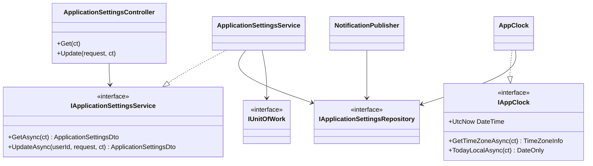
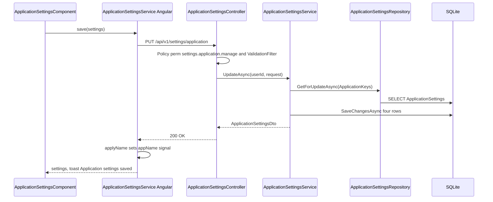
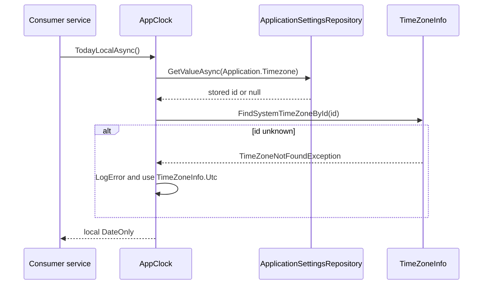
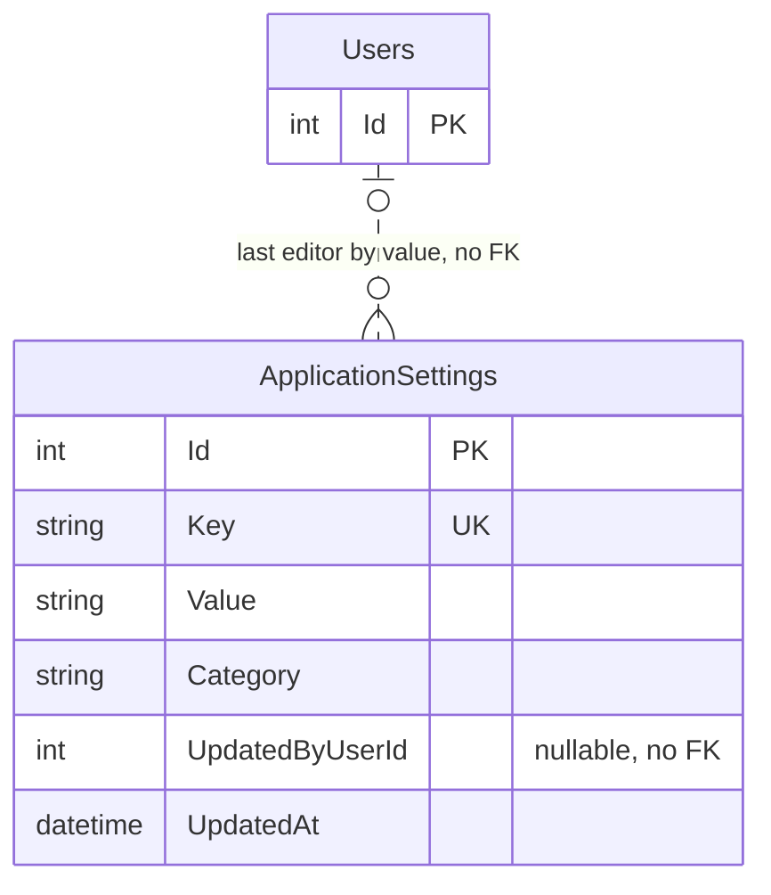

# Low-Level Design – Application Settings

## TaskFlow – Intelligent Task Allocation & Tracking System

> **Document:** Low-Level Design  ·  **Version:** 1.0  ·  **Status:** Draft
> **Project type:** Personal Project (Skill Development)  ·  **Date:** 31-Oct-2026
> **Author:** Jojo George (jojogeorge3344@gmail.com)
> **Based on:** HLD-Application-Settings v1.0, FRD-Application-Settings v1.0
> **Module:** Settings  ·  **Sub-module:** 06.2 Application Settings  ·  **Code:** APP
> © 2026 Jojo George. All rights reserved.

---

## Document Control

| Version | Date | Author | Summary of changes |
|---|---|---|---|
| 1.0 | 31-Oct-2026 | Jojo George | Initial version |

**Related documents:** BRD · FRD · HLD · TDD · Specs

| Document | Location |
|---|---|
| BRD – Application Settings | `../../../BRD/06-Settings/06.2-Application-Settings/BRD-Application-Settings.md` |
| FRD – Application Settings (FR-APP-01…23, UC-APP-01…03) | `../../../FRD/06-Settings/06.2-Application-Settings/FRD-Application-Settings.md` |
| HLD – Application Settings | `../../../HLD/06-Settings/06.2-Application-Settings/HLD-Application-Settings.md` |
| Overall LLD (stack, cross-cutting design, Auth) | `../../00-Overall/LLD-TaskFlow-Overall.md` |
| LLD – Reminder Settings (shares the `ApplicationSettings` table and repository) | `../06.1-Reminder-Settings/LLD-Reminder-Settings.md` |
| LLD – Notification (`NotificationPublisher`, in-app switch consumer) | `../../04-Communication/04.2-Notification/LLD-Notification.md` |
| TDD v2.0 | `TDD-TaskFlow.md` §7.2.6 (`ApplicationSetting`), §7.5 (date, time, timezone) |

---

## 1. Introduction

### 1.1 Purpose
Detailed design of the Application Settings sub-module (original BRD Screen 20 "System Settings"): the two controller
actions, `ApplicationSettingsService`, the application clock `AppClock`, the validator, the shared repository, the four
setting rows it owns, the Angular screen and shell brand name, tests and FR-APP-nn traceability. Everything is taken
from the code as built.

### 1.2 Scope & Conventions
- Covered: `ApplicationSettingsController` (2 actions), `ApplicationSettingsService`, `AppClock` / `IAppClock`,
  `UpdateApplicationSettingsRequestValidator`, `ApplicationSettingsRepository` (shared with REM), the keys
  `Application.Name`, `Application.Timezone`, `Application.DefaultPriority`, `Notification.InAppEnabled`, and the Angular
  `ApplicationSettingsComponent` plus `ApplicationSettingsService` (Angular, `appName` signal).
- Referenced only: consumers of `IAppClock` (Reminder, Dashboard, Workload, Report, Task, Mail, Assistant services) and
  `NotificationPublisher` (Notification LLD).
- Naming: `*Controller`, `I*Service`/`*Service`, `I*Repository`/`*Repository`, DTOs `*Dto` / `*Request`.
- API base path `/api/v1`; JSON camelCase; enums as strings (`JsonStringEnumConverter`); errors as ProblemDetails.

---

## 2. Code Structure

### 2.1 Backend Folder Layout

```
TaskFlow.Api/
  Controllers/Settings/ApplicationSettingsController.cs
  Services/Settings/ApplicationSettings/General/IApplicationSettingsService.cs, ApplicationSettingsService.cs
  Services/Settings/ApplicationSettings/Clock/IAppClock.cs, AppClock.cs
  Repositories/Settings/ApplicationSettings/IApplicationSettingsRepository.cs, ApplicationSettingsRepository.cs  (shared with REM)
  Dtos/Settings/ApplicationSettings/ApplicationSettingsDtos.cs
  Dtos/Settings/ApplicationSettings/Validators/UpdateApplicationSettingsRequestValidator.cs
  Models/Entities/ApplicationSetting.cs, Models/Enums/TaskPriority.cs
  Common/Constants/SettingKeys.cs, Common/Utils/SettingValues.cs
  Config/ApplicationOptions.cs
  Persistence/Seeders/SettingsInitializer.cs
```

### 2.2 Frontend Folder Layout

```
src/app/modules/settings/
  settings.routes.ts                                          (route settings/application)
  models/settings.model.ts                                    (ApplicationSettings, UpdateApplicationSettings)
  application-settings/pages/application-settings.component.{ts,html,css}
  application-settings/pages/application-settings.model.ts    (SettingsField)
  application-settings/services/application-settings.service.ts
src/app/layouts/shell.component.ts, layouts/nav-items.ts, shared/auth/auth.guard.ts
```

### 2.3 Layer Rules

| Rule | Enforced by |
|---|---|
| Controller → Service → Repository only, through interfaces | `ArchitectureTests` |
| Only repositories (and startup/seeders) touch `AppDbContext`; services commit through `IUnitOfWork` | `ArchitectureTests` |
| Controllers do not validate; FluentValidation runs in `ValidationFilter` | `ArchitectureTests`, global filter |
| API service in the module whose endpoints it calls (`modules/settings/...`), page in `pages/` | `npm run check:structure` |

---

## 3. Cross-Cutting Design

Shared mechanisms are in the overall LLD (`../../00-Overall/LLD-TaskFlow-Overall.md`). Applied here:

| Concern | Design |
|---|---|
| Validation | `UpdateApplicationSettingsRequestValidator` in the global `ValidationFilter`; 400 `ValidationProblemDetails` with `errors` |
| Error handling | `GlobalExceptionHandler` (3.1) |
| Transactions | One `IUnitOfWork.SaveChangesAsync` writes all four rows |
| Authorization | GET: `[Authorize]` (any signed-in user). PUT: `[RequirePermission(PermissionKeys.SettingsApplication)]` → `perm:settings.application.manage` |
| Logging | `AppClock` logs an error "Unknown application timezone '…'; using UTC." when the stored id cannot be resolved |
| Time & time zone | Timestamps UTC (`TimeProvider`); `IAppClock` answers "which calendar day is it" in the application timezone for all deadline comparisons (BR-17 in code comments) |

### 3.1 Exception → HTTP Status

| Exception | Status | When |
|---|---|---|
| Validation failure (`ValidationFilter`) | 400 | Name blank or too long, timezone blank or unknown, priority or switch missing/invalid |
| Policy failure | 403 | PUT without `settings.application.manage` |
| – (JWT bearer) / `Unauthorized()` in the action | 401 | Not signed in; PUT without a numeric user id claim |
| `ConcurrencyConflictException` / `UniqueConstraintException` | 409 | Save race / first-insert race on `IX_ApplicationSettings_Key` |
| `ArgumentException` ("Every application setting must be provided.") | 500 | Only if the validator is bypassed (not an `AppException`) |
| `TimeZoneNotFoundException` / `InvalidTimeZoneException` in `AppClock` | – | Caught: logged, `TimeZoneInfo.Utc` used (FR-APP-09) |

---

## 4. Module Designs

### 4.1 Module: Settings

#### 4.1.1 Child module: Application Settings (APP)

**Class / file inventory**

| Layer | Type | File | Responsibility |
|---|---|---|---|
| Controller | `ApplicationSettingsController` | `Controllers/Settings/ApplicationSettingsController.cs` | `GET`/`PUT /api/v1/settings/application`; resolves `userId` |
| Service | `IApplicationSettingsService` / `ApplicationSettingsService` | `Services/Settings/ApplicationSettings/General/` | Typed view over four rows; defaults; upsert |
| Service | `IAppClock` / `AppClock` | `Services/Settings/ApplicationSettings/Clock/` | `UtcNow`, `GetTimeZoneAsync()`, `TodayLocalAsync()` |
| Repository | `IApplicationSettingsRepository` / `ApplicationSettingsRepository` | `Repositories/Settings/ApplicationSettings/` | Key/value reads and tracked rows (shared with REM) |
| Base | `BaseRepository<ApplicationSetting>`, `IUnitOfWork` / `UnitOfWork` | `Repositories/Base/` | `Add`, save, conflict mapping |
| DTOs | `ApplicationSettingsDto`, `UpdateApplicationSettingsRequest` | `Dtos/Settings/ApplicationSettings/ApplicationSettingsDtos.cs` | Contracts |
| Validator | `UpdateApplicationSettingsRequestValidator` | `Dtos/Settings/ApplicationSettings/Validators/` | Name, timezone, priority, switch rules |
| Entity | `ApplicationSetting` | `Models/Entities/ApplicationSetting.cs` | Key/value row |
| Enum | `TaskPriority` | `Models/Enums/TaskPriority.cs` | `Low`, `Medium`, `High`, `Critical` |
| Constants | `SettingKeys`, `SettingValues` | `Common/Constants/`, `Common/Utils/` | Keys, categories, defaults, formatting |
| Options | `ApplicationOptions` | `Config/ApplicationOptions.cs` | `Application:Timezone` (code default `UTC`) |
| Seeder | `SettingsInitializer` | `Persistence/Seeders/SettingsInitializer.cs` | Missing rows at start-up |
| Frontend page | `ApplicationSettingsComponent` | `modules/settings/application-settings/pages/application-settings.component.ts` | Screen, form, `requiredText` validator, `timezoneSuggestions` |
| Frontend service | `ApplicationSettingsService` (Angular) | `modules/settings/application-settings/services/application-settings.service.ts` | `get()`, `save()`, cached `appName` signal |
| Frontend shell | `ShellComponent` | `layouts/shell.component.ts` | Reads `appName`; calls `get()` at start |
| Frontend models | `ApplicationSettings`, `UpdateApplicationSettings`, `SettingsField` | `modules/settings/models/settings.model.ts`, `pages/application-settings.model.ts` | Types |
| Route / guard / menu | `SETTINGS_ROUTES`, `permissionGuard`, `buildNavigation()` | `settings.routes.ts`, `shared/auth/auth.guard.ts`, `layouts/nav-items.ts` | Access to `/settings/application` |

**Class diagram**



**API contracts**

Controller `ApplicationSettingsController`, `[Route("api/v1/settings/application")]`, no class-level policy.
Endpoints of this sub-module (facts.md §3): **2**.

| # | Method | Route | Permission / policy | Request | Response | Status codes |
|---|---|---|---|---|---|---|
| 1 | GET | `/api/v1/settings/application` | `[Authorize]` (signed in) | – | `ApplicationSettingsDto` | 200, 401 |
| 2 | PUT | `/api/v1/settings/application` | `settings.application.manage` | `UpdateApplicationSettingsRequest` | `ApplicationSettingsDto` | 200, 400, 401, 403, 409 |

**DTOs**

| DTO | Field | Type | Notes |
|---|---|---|---|
| `ApplicationSettingsDto` | `Name` | `string` | `Application.Name` |
| | `Timezone` | `string` | `Application.Timezone` |
| | `DefaultPriority` | `TaskPriority` | `Application.DefaultPriority` |
| | `InAppNotificationsEnabled` | `bool` | `Notification.InAppEnabled` |
| `UpdateApplicationSettingsRequest` | `Name`, `Timezone` | `string?` | Nullable so an omitted field fails validation |
| | `DefaultPriority` | `TaskPriority?` | |
| | `InAppNotificationsEnabled` | `bool?` | |

The DTO carries nothing secret, which is why GET is open to every signed-in user (FR-APP-18, FR-APP-19).

**Request / response example**

```json
// PUT /api/v1/settings/application
{ "name": "TaskFlow", "timezone": "Asia/Kolkata", "defaultPriority": "High", "inAppNotificationsEnabled": true }
```

```json
// 200 OK
{ "name": "TaskFlow", "timezone": "Asia/Kolkata", "defaultPriority": "High", "inAppNotificationsEnabled": true }
```

```json
// 400 Bad Request (unknown timezone)
{ "title": "One or more validation errors occurred.", "status": 400, "errors": { "Timezone": ["Unknown timezone."] } }
```

**Service logic – `ApplicationSettingsService.GetAsync`**
1. `GetValuesAsync(ApplicationKeys)` for `Application.Name`, `Application.Timezone`, `Application.DefaultPriority`,
   `Notification.InAppEnabled`.
2. `ReadString` (blank → fallback): name → `DefaultApplicationName` ("TaskFlow"); timezone → `ApplicationOptions.Timezone`,
   or `FallbackTimezone` ("UTC") when that is blank.
3. `ReadPriority`: `Enum.TryParse` (ignore case) + `Enum.IsDefined`, else `DefaultDefaultPriority` ("Medium").
4. `ReadBool`: `bool.TryParse`, else `DefaultInAppEnabled` (true). Returns `ApplicationSettingsDto` (FR-APP-17).

**Service logic – `ApplicationSettingsService.UpdateAsync(userId, request)`**
1. Validator already ran (400 on failure). Null field → `ArgumentException("Every application setting must be provided.")`
   (FR-APP-16).
2. `GetForUpdateAsync(ApplicationKeys)`; `now = TimeProvider.GetUtcNow().UtcDateTime`.
3. `Set(key, value, category)` creates a missing row and sets `Value`, `UpdatedByUserId`, `UpdatedAt` (FR-APP-20).
4. Values: `name.Trim()`; `timezone` as received; `defaultPriority.ToString()`; `SettingValues.Format(inAppEnabled)`.
   Categories: `Application` for the first three, `Notification` for the switch.
5. `IUnitOfWork.SaveChangesAsync`, then `GetAsync()`.

**Service logic – `AppClock`**
1. `UtcNow` = `TimeProvider.GetUtcNow().UtcDateTime`.
2. `GetTimeZoneAsync`: `GetValueAsync(Application.Timezone)`; blank → `ApplicationOptions.Timezone`;
   `TimeZoneInfo.FindSystemTimeZoneById(id)`; on `TimeZoneNotFoundException` / `InvalidTimeZoneException` → log error and
   return `TimeZoneInfo.Utc` (FR-APP-09).
3. `TodayLocalAsync`: `DateOnly.FromDateTime(TimeZoneInfo.ConvertTimeFromUtc(UtcNow, zone))`.
4. Read on every call (no cache), so a saved timezone applies to the next calculation without restart (FR-APP-08).
   Consumers: `ReminderService`, `DashboardService`, the analytics services and scopes, `WorkloadService`,
   `ReportService`, `TaskService`, `MailService`, `AssistantService`, `AssistantReadTools`.

**Sequence diagram – save**



**Sequence diagram – timezone resolution**



**Repository methods** (`ApplicationSettingsRepository`)

| Method | Query / purpose | Notes |
|---|---|---|
| `GetValuesAsync(keys)` | `AsNoTracking`, `Where(keys.Contains(Key))`, `ToDictionaryAsync(Key, Value)` | Used by `GetAsync` |
| `GetValueAsync(key)` | `AsNoTracking`, `Select(Value)`, `FirstOrDefaultAsync` | Used by `AppClock`, `NotificationPublisher`, `TaskCommentService` |
| `GetForUpdateAsync(keys)` | Tracked, `ToDictionaryAsync(Key)` | Used by `UpdateAsync` |
| `Add(entity)` (base) | Stage a new row | `BaseRepository` |

**Validation rules** (`UpdateApplicationSettingsRequestValidator`)

| Field | Rule | Message |
|---|---|---|
| `Name` | `NotEmpty()` | "Application name cannot be blank." |
| `Name` | `MaximumLength(100)` (checked before trimming) | FluentValidation default |
| `Timezone` | `NotEmpty()` | "Timezone cannot be blank." |
| `Timezone` | `Must(BeKnownTimezone)` (`TimeZoneInfo.FindSystemTimeZoneById`; Windows or IANA ids, as the host OS recognises) | "Unknown timezone." |
| `DefaultPriority` | `NotNull()`, `IsInEnum()` | FluentValidation default |
| `InAppNotificationsEnabled` | `NotNull()` | FluentValidation default |

Rule-level cascade is not set, so a blank timezone reports both "Timezone cannot be blank." and "Unknown timezone.";
the screen shows the first message of a field. Client mirror: `requiredText` (trimmed) and `Validators.maxLength(100)` on
`name` → "Application name is required and must be 100 characters or fewer."; `requiredText` on `timezone` →
"Timezone is required." The screen trims `name` and `timezone` before sending.

**Error cases**

| Case | Exception / result | Status |
|---|---|---|
| Not signed in | JWT bearer challenge | 401 |
| PUT without `settings.application.manage` | Policy refusal (logged) | 403 |
| Invalid / missing field | `ValidationFilter` | 400 |
| Save race | `ConcurrencyConflictException` / `UniqueConstraintException` | 409 |
| Stored timezone unknown at run time | Logged; UTC used | – |

**Frontend design**

| Member | Behaviour |
|---|---|
| `ApplicationSettingsComponent.form` | `name` (`requiredText`, max 100), `timezone` (`requiredText`), `defaultPriority` (required, `TASK_PRIORITIES`), `inAppNotificationsEnabled` |
| `timezoneSuggestions` | UTC, Asia/Kolkata, Asia/Dubai, Europe/London, Europe/Berlin, America/New_York, America/Chicago, America/Los_Angeles, Australia/Sydney (datalist; free text allowed) |
| `load()` | Loading placeholder; error card "Could not load the application settings." (or server `detail`) with **Retry** |
| `save()` | Trims; `saving` ("Saving…"); success → `apply`, `savedAt`, toast "Application settings saved"; error → `applyServerErrors` + "Could not save the application settings." |
| Reminder defaults link | `RouterLink` to Reminder Settings; no reminder fields here (FR-APP-14) |
| `ApplicationSettingsService.appName` | Signal updated by `get()` and `save()` (`applyName`, fallback "TaskFlow"); the shell binds to it, so the new name shows without reload (FR-APP-05) |
| Create Task `loadDefaultPriority()` | Pre-selects `defaultPriority` while the field is untouched (FR-APP-11); the server does not apply this default |

**State machine:** _Not applicable for this sub-module._

---

## 5. Database Design

### 5.1 ER Diagram



### 5.2 Tables

#### `ApplicationSettings` (ApplicationSetting) – shared with Reminder Settings

| Column | Type | Null | Key / index | Default | Description |
|---|---|:---:|---|---|---|
| Id | int (INTEGER) | No | PK | identity | Row id |
| Key | string(128) (TEXT) | No | Unique `IX_ApplicationSettings_Key` | – | Setting key |
| Value | string(1024) (TEXT) | No | – | – | Invariant-culture string |
| Category | string(64) (TEXT) | No | – | – | `Application` or `Notification` for this sub-module |
| UpdatedByUserId | int? (INTEGER) | Yes | – (no FK) | null | Last editor |
| UpdatedAt | DateTime (TEXT) | No | – | – | UTC |

Rows owned by this sub-module:

| Key | Category | Seed default | Read by |
|---|---|---|---|
| `Application.Name` | Application | `TaskFlow` | Shell, `AssistantService` (brand name) |
| `Application.Timezone` | Application | config `Application:Timezone`, or `UTC` when empty | `AppClock`; shown read-only on Reminder Settings |
| `Application.DefaultPriority` | Application | `Medium` | Create Task screen |
| `Notification.InAppEnabled` | Notification | `true` | `NotificationPublisher.InAppEnabledAsync` (missing/unreadable = enabled) |

### 5.3 Indexes, Constraints & Triggers

| Object | Definition | Purpose |
|---|---|---|
| `IX_ApplicationSettings_Key` | Unique (`Key`) | One row per key |
| – | No FK, no trigger, no concurrency token | Last writer wins |

### 5.4 Enumerations

| Enum | Values | Stored as |
|---|---|---|
| `TaskPriority` | `Low`, `Medium`, `High`, `Critical` | Enum name in `ApplicationSettings.Value`; JSON string |

### 5.5 Migrations

| Migration | Change |
|---|---|
| `20261017062735_AddReminderEngine` | Creates `ApplicationSettings` and `IX_ApplicationSettings_Key` |
| `20261017090431_AddInternalMail` | Removes the superseded `Email.%` and `Notification.EmailEnabled` rows |

---

## 6. Algorithms & Background Jobs

| Job / algorithm | Trigger / schedule | Steps | Idempotency |
|---|---|---|---|
| `SettingsInitializer.InitializeAsync` | Every start-up after `MigrateAsync` | Inserts each missing default row; `Application.Timezone` from `ApplicationOptions.Timezone` (or `UTC`) | Existing rows never overwritten |
| `AppClock.GetTimeZoneAsync` | Each call by a consumer | Read row → resolve id → UTC fallback with error log | Stateless |
| In-app switch | `NotificationPublisher` before each bell notification | `GetValueAsync(Notification.InAppEnabled)`; returns without writing when false | Stateless |

No background job belongs to this sub-module.

---

## 7. Security Design (detailed)

| Item | Implementation |
|---|---|
| Read access | `[Authorize]` only: brand name and default priority are needed by every screen; DTO has no secret (FR-APP-18/19). AI keys live in `AiProviderConfigs`, not here |
| Write access | `[RequirePermission(PermissionKeys.SettingsApplication)]` → `perm:settings.application.manage` (FR-APP-23) |
| Defaults | `settings.application.manage`: Administrator granted; Manager and Employee not granted on first seed; custom roles configurable |
| Frontend | `permissionGuard` with `Permissions.SettingsApplication` on `settings/application`; menu item only when held (FR-APP-22) |
| Timezone input | Validated against the host timezone database before save; never executed |
| Audit | Denied PUTs logged by `DeniedActionAuditHandler`; saves store `UpdatedByUserId` / `UpdatedAt` only |

---

## 8. Configuration

| Key | Default | Purpose |
|---|---|---|
| `Application:Timezone` | `Asia/Kolkata` (code default `UTC`) | Seeds `Application.Timezone`; fallback while the row is missing or blank |
| `ConnectionStrings:Default` | `Data Source=taskflow.db` | SQLite database |
| `Storage:Root` | `""` | Root folder for the database |

---

## 9. Testing Design

"Covers" was checked against the test sources. Backend paths are relative to `backend/tests`; frontend paths to
`frontend/src/app/modules/settings/application-settings`.

| Area | Test class / file | Type | Covers |
|---|---|---|---|
| Service | `TaskFlow.UnitTests/Settings/ApplicationSettings/General/ApplicationSettingsServiceTests.cs` | Unit | Fresh-database defaults, missing / unreadable rows fall back to defaults and configured timezone, save round trip, who / when recorded, incomplete request saves nothing |
| Validator | `TaskFlow.UnitTests/Settings/ApplicationSettings/General/ApplicationSettingsValidatorTests.cs` | Unit | Defaults valid, blank name, unknown timezone, missing fields, priority outside the enum |
| Clock | `TaskFlow.UnitTests/Settings/ApplicationSettings/Clock/AppClockTests.cs` | Unit | Timezone resolution, UTC fallback |
| Endpoints | `TaskFlow.IntegrationTests/Settings/ApplicationSettings/ApplicationSettingsEndpointsTests.cs` | Integration | GET for every signed-in role, PUT saves, Manager 403 on PUT, unknown timezone 400 with nothing saved, blank name 400, 401 |
| Seeder | `TaskFlow.UnitTests/Persistence/SettingsInitializerTests.cs` | Unit | Default keys inserted once, new application keys seeded, saved name not overwritten, timezone seeded from configuration |
| Policies | `TaskFlow.IntegrationTests/Common/PermissionAuthorizationTests.cs` | Integration | Policy per key |
| Support | `TaskFlow.UnitTests/TestSupport/SettingsTestDatabase.cs`, `FakeTimeProvider.cs` | Support | Test DB, clock |
| Structure | `TaskFlow.UnitTests/Architecture/ArchitectureTests.cs` | Unit | Layer rules |

| Frontend page | `pages/application-settings.component.spec.ts` | Frontend unit | Loads values, saves and confirms, blocks a blank name, server 400 field errors, hides Saved after an edit, timezone datalist allows custom ids, link to Reminder Settings, retryable load error |
| Frontend service | `services/application-settings.service.spec.ts` | Frontend unit | GET / PUT, cached brand name defaults to TaskFlow, updated on read and after save, blank name falls back to TaskFlow |

---

## 10. Known Limitations & Open Issues

- **In-app switch vs reminders:** `ReminderService` writes deadline/overdue bell notifications through
  `INotificationRepository` directly, not through `NotificationPublisher`, so they are still created while
  `Notification.InAppEnabled` is false. FR-APP-13 ("no new bell notification for any event") is therefore not met for
  reminder notifications.
  > ⚠️ To be confirmed: whether reminder bell notifications should also follow the in-app switch.
- Default task priority is applied only by the Create Task screen, not by `TaskService`.
- Name length (100) is checked before trimming, the stored value is trimmed; the server does not trim the timezone (the
  screen does).
- A blank timezone returns two messages ("Timezone cannot be blank." and "Unknown timezone.").
- Accepted timezone ids depend on the host OS timezone database (Windows or IANA ids).
- Stale comments: `ApplicationSettingsController` and `ApplicationSettingsService` (Angular) say "Administrator only";
  the code checks `settings.application.manage`.
- No history of earlier values, no reset to defaults, no concurrency token.
- Original BRD Screen 20 "default task reminder intervals" are kept on Reminder Settings (link only, FR-APP-14).

---

## 11. Traceability (FRD → code)

| FRD requirement | Endpoint / class | Test |
|---|---|---|
| FR-APP-01 | `GET /api/v1/settings/application` · `ApplicationSettingsService.GetAsync` · `ApplicationSettingsComponent.load` | `ApplicationSettingsEndpointsTests`, `ApplicationSettingsServiceTests` |
| FR-APP-02 | `ApplicationSettingsComponent.load` (`loadError`, Retry) | `application-settings.component.spec.ts` |
| FR-APP-03 | `PUT /api/v1/settings/application` · `UpdateAsync` (`Application.Name`) | `ApplicationSettingsServiceTests` |
| FR-APP-04 | Validator `Name` rules · `name.Trim()` · `requiredText` | `ApplicationSettingsValidatorTests` |
| FR-APP-05 | Angular `ApplicationSettingsService.appName` · shell | `application-settings.service.spec.ts`, `shell.component.spec.ts` |
| FR-APP-06 | `timezoneSuggestions` · validator `BeKnownTimezone` | `ApplicationSettingsValidatorTests` |
| FR-APP-07 | Validator `Timezone` rules · `fieldError('timezone')` | `ApplicationSettingsValidatorTests` |
| FR-APP-08 | `AppClock.GetTimeZoneAsync` / `TodayLocalAsync` (read per call) | `AppClockTests` |
| FR-APP-09 | `AppClock` catch → `TimeZoneInfo.Utc` + `LogError` | `AppClockTests` |
| FR-APP-10 | `TaskPriority` · validator `IsInEnum` | `ApplicationSettingsValidatorTests` |
| FR-APP-11 | Create Task `loadDefaultPriority()` | `task-create.component.spec.ts` |
| FR-APP-12 | `UpdateAsync` (`Notification.InAppEnabled`) | `ApplicationSettingsServiceTests` |
| FR-APP-13 | `NotificationPublisher.InAppEnabledAsync` (gap for reminders, see §10) | – (Notification tests by name not identified) |
| FR-APP-14 | Reminder defaults `RouterLink` in the page | `application-settings.component.spec.ts` |
| FR-APP-15 | `UpdateApplicationSettingsRequestValidator` via `ValidationFilter` | `ApplicationSettingsValidatorTests`, `ApplicationSettingsEndpointsTests` |
| FR-APP-16 | Validator `NotEmpty`/`NotNull` · `ArgumentException` guard | `ApplicationSettingsValidatorTests` |
| FR-APP-17 | `SettingsInitializer` · `ReadString`/`ReadPriority`/`ReadBool` | `SettingsInitializerTests`, `ApplicationSettingsServiceTests` |
| FR-APP-18 | `[Authorize]` on `Get` | `ApplicationSettingsEndpointsTests` |
| FR-APP-19 | `ApplicationSettingsDto` (four fields only) | `ApplicationSettingsEndpointsTests` |
| FR-APP-20 | `Set()` writes `UpdatedByUserId`, `UpdatedAt` | `ApplicationSettingsServiceTests` |
| FR-APP-21 | `ApplicationSettingsComponent.save` (`saving`, toast, `saveError`) | `application-settings.component.spec.ts` |
| FR-APP-22 | `permissionGuard` (`settings/application`) · `buildNavigation()` | `app.routes.spec.ts`, `nav-items.spec.ts` |
| FR-APP-23 | `[RequirePermission(PermissionKeys.SettingsApplication)]` on `Update` | `ApplicationSettingsEndpointsTests`, `PermissionAuthorizationTests` |

---
<sub>© 2026 Jojo George. All rights reserved. Unauthorized copying or distribution of this document is prohibited.</sub>
