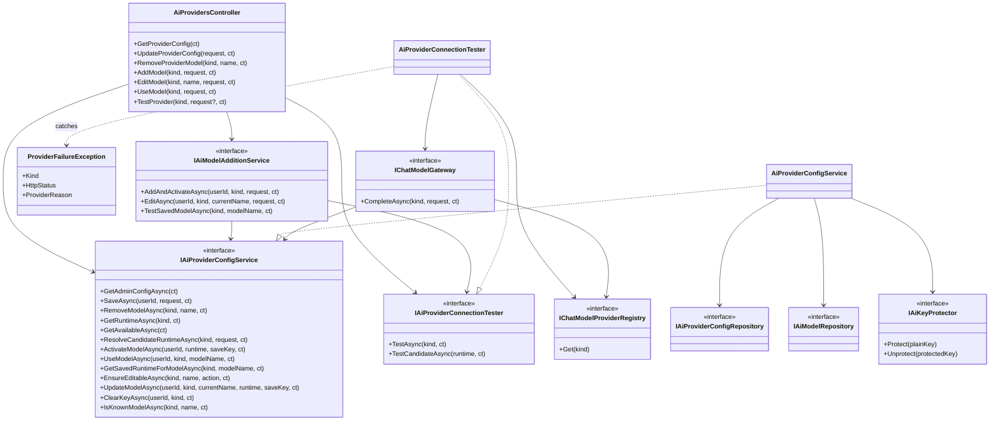
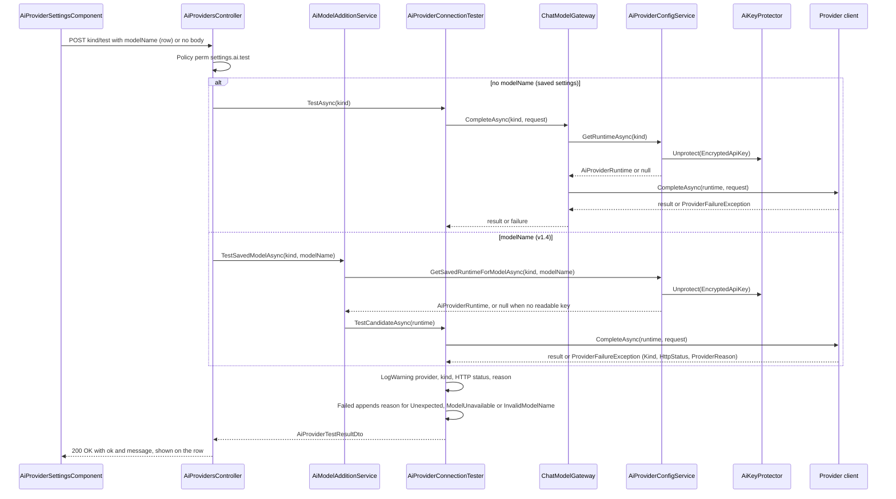
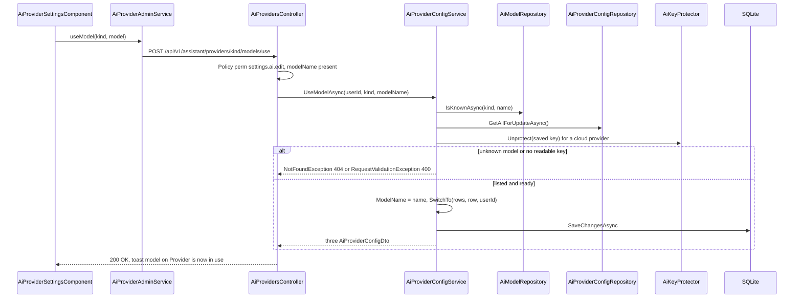
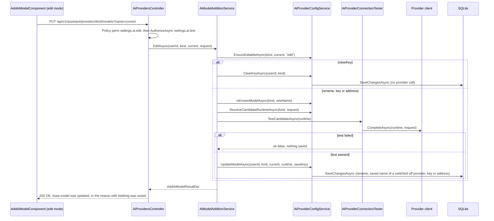
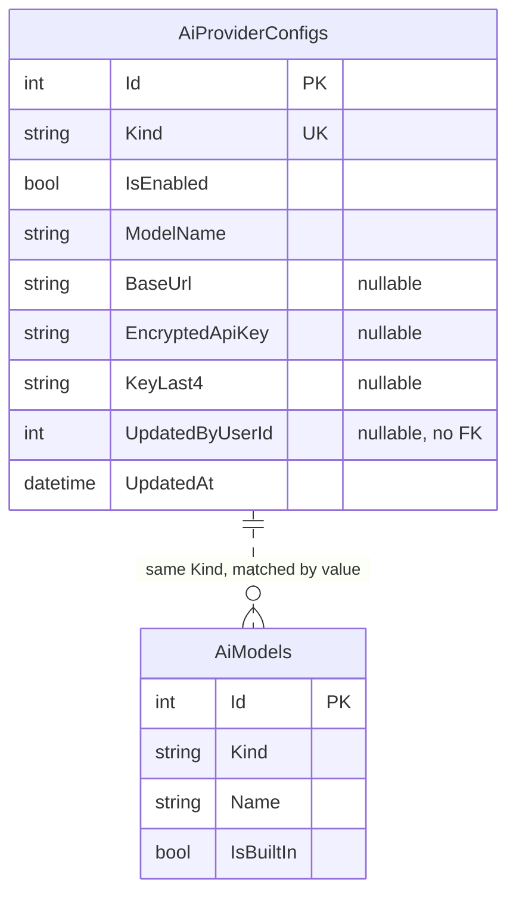

# Low-Level Design – TFA Settings

## TaskFlow – Intelligent Task Allocation & Tracking System

> **Document:** Low-Level Design  ·  **Version:** 1.4  ·  **Status:** Draft
> **Project type:** Personal Project (Skill Development)  ·  **Date:** 01-Nov-2026
> **Author:** Jojo George (jojogeorge3344@gmail.com)
> **Based on:** HLD-TFA-Settings v1.3, FRD-TFA-Settings v1.4
> **Module:** Settings  ·  **Sub-module:** 06.3 TFA Settings  ·  **Code:** TFAS
> © 2026 Jojo George. All rights reserved.

---

## Document Control

| Version | Date | Author | Summary of changes |
|---|---|---|---|
| 1.0 | 31-Oct-2026 | Jojo George | Initial version |
| 1.1 | 31-Oct-2026 | Jojo George | TFA answers TaskFlow questions from the documents folder (OpenSpec change `tfa-document-rag`): `DocumentIndexController` (2 actions, `/api/v1/assistant/documents`), `IDocumentIndexService` / `DocumentIndexService`, `DocumentIndexStatusDto`, `DocumentIndexCardComponent`, `AiProviderAdminService.getDocumentStatus()` / `reindexDocuments()`; `AiProviders:OllamaContextTokens`; cloud text; tests and FR-TFAS-29 – FR-TFAS-36 traceability. |
| 1.2 | 01-Nov-2026 | Jojo George | OpenSpec change `tfa-document-rag` revised (design D13, D14). Removed: `DocumentIndexController` (`GET /api/v1/assistant/documents/status`, `POST /api/v1/assistant/documents/reindex`, both now 404), `IDocumentIndexService` / `DocumentIndexService`, `DocumentIndexStatusDto` (`DocumentIndexDtos.cs`) and its DI registration, `DocumentIndexCardComponent`, `ai-provider-admin.model.ts`, `getDocumentStatus()` / `reindexDocuments()`, `DocumentIndexerService.RequestReindex()`; tests `DocumentIndexEndpointsTests` and `document-index-card.component.spec.ts` replaced by `DocumentIndexEndpointsRemovedTests`. Added: model-ID rule (`BeAModelId`, `ModelIdMessage`) in both model-name validators and the Add AI model form (`modelId`, `MODEL_ID_EXAMPLES`, Gemini key hint); `GeminiProvider` maps a 400 model-name error to `ModelUnavailable`; `ProviderFailureException.ProviderReason` (`ProviderHttp.Reason`); `AiProviderConnectionTester` appends the provider reason and logs a warning on both test paths. Built-in Gemini models `gemini-3.8-flash` (default), `gemini-3.5-flash`, `gemini-3.5-flash-lite`. Add-model endpoint and `AddAiModelComponent` listed in the inventory and API table. FR-TFAS-29 – FR-TFAS-36 withdrawn in traceability. |
| 1.3 | 01-Nov-2026 | Jojo George | OpenSpec change `tfa-gemini-model-id-validation`. `AiProviderCatalog.NormalizeModelName` / `IsValidModelId` / `ModelIdMessage` (Gemini format, `models/` removed); enforced in `AiProviderConfigService.SaveAsync` and `ResolveCandidateRuntimeAsync`; new `ProviderFailureKind.InvalidModelName`, mapped by `GeminiProvider.Classify` from a 400 model-name error, with its own `ProviderFailureMessages` text and the provider reason on Test connection; Add AI model form `MODEL_ID_RULES` / `MODEL_ID_MESSAGES` / `normalizeModelName`, re-checked when the provider changes. |
| 1.4 | 01-Nov-2026 | Jojo George | OpenSpec change `tfa-model-list-and-edit`. Controller actions `UseModel` (`POST {kind}/models/use`), `EditModel` (`PUT {kind}/models?name=`) and `TestProvider(kind, body?)` (optional `{ modelName }`); `AiProviderConfigService.UseModelAsync`, `GetSavedRuntimeForModelAsync`, `EnsureEditableAsync`, `UpdateModelAsync`, `ClearKeyAsync`, `IsKnownModelAsync`, private `SwitchTo` / `IsInUseAsync`; `RemoveModelAsync` uses the new in-use and built-in rules and resets a switched-off provider's saved model; `AiModelAdditionService.EditAsync`, `TestSavedModelAsync`; DTO `AiModelChoiceRequest`; `AddAiModelRequest.ClearKey` with the validator rule "Provide a new key or clear the key, not both."; `IAiProviderConfigRepository.UsesModelAsync` removed. Frontend: `AiProviderSettingsComponent` rewritten as a read-only model list (`groups`, `inUse`, `busy`, `testing`, `results`; `use`, `test`, `edit`, `remove`; `ModelRow` / `ProviderGroup` replace `ProviderForm`), `AiProviderAdminService.useModel` / `editModel` / `test(kind, modelName?)`, `AddAiModelComponent` edit mode (`editing`, `startEditing`, `removeKey`), route `settings/tfa/models/:kind/:name/edit`, `ConfirmOptions.notice`. `PUT config` kept but no longer called by the screen. API table, class diagram, service logic, sequence diagrams, validation, errors, frontend design, tests, limitations and traceability (FR-TFAS-40 – FR-TFAS-48) updated. No migration. |

**Related documents:** BRD · FRD · HLD · TDD · Specs

| Document | Location |
|---|---|
| BRD – TFA Settings | `../../../BRD/06-Settings/06.3-TFA-Settings/BRD-TFA-Settings.md` |
| FRD – TFA Settings (FR-TFAS-01…48, UC-TFAS-01…05; FR-TFAS-29…36 withdrawn in v1.2; FR-TFAS-04, FR-TFAS-19 withdrawn in FRD v1.4) | `../../../FRD/06-Settings/06.3-TFA-Settings/FRD-TFA-Settings.md` |
| HLD – TFA Settings | `../../../HLD/06-Settings/06.3-TFA-Settings/HLD-TFA-Settings.md` |
| Overall LLD (stack, cross-cutting design, Auth) | `../../00-Overall/LLD-TaskFlow-Overall.md` |
| LLD – Assistant (chat, `ChatModelGateway` callers, provider selector; document index, indexer and search in 4.1.3) | `../../08-TFA-Assistant/08.1-Assistant/LLD-Assistant.md` |
| LLD – Role Configuration (the four `settings.ai.*` keys and their prerequisite) | `../06.4-Role-Configuration/LLD-Role-Configuration.md` |
| TDD v2.3 | `TDD-TaskFlow.md` §6.5 (integrations), §7.2.6 (`AiProviderConfig`, `AiModel`, `DocumentSource`, `DocumentChunk`), §8.9 (Settings endpoints), §16.8 (document knowledge) |

---

## 1. Introduction

### 1.1 Purpose
Detailed design of TFA Settings – the organization-wide configuration of the AI providers behind TFA, the TaskFlow
assistant: controller actions, configuration and connection-test services, repositories, key protection, provider
clients, the `AiProviderConfigs` and `AiModels` tables, seeding, the Angular screens (since v1.4 a read-only model list
and an edit mode of the Add AI model page), tests and FR-TFAS-nn traceability.
(The v1.1 Document search card and its endpoints were removed in v1.2.)
Everything is taken from the code as built.

### 1.2 Scope & Conventions
- Covered: `AiProvidersController` (7 actions, v1.4), `AiProviderConfigService`, `AiModelAdditionService`,
  `AiProviderConnectionTester`, `AiProviderConfigRepository`, `AiModelRepository`, `AiKeyProtector`,
  `KeyRingProtectionCheck`, `AiProviderSeeder`, `AiProviderCatalog`, the provider clients used by the test,
  `AiProviderSettingsComponent`, `AddAiModelComponent` (add and edit mode) and the notice mode of `ConfirmDialogComponent`
  (`tf-confirm-dialog`, v1.4).
- Removed in v1.2: `DocumentIndexController` (2 actions), `DocumentIndexService` and `DocumentIndexCardComponent`
  (v1.1). TFA Settings has no view of the document index.
- Referenced only (v1.1): the document indexer, search and tables (`DocumentIndexerService`, `DocumentIndexStatus`,
  `DocumentIndexer`, `DocumentSources`, `DocumentChunks`), designed in the Assistant LLD 4.1.3; since v1.2 their
  problems are reported only as log warnings.
- Referenced only: `GET /api/v1/assistant/providers` (Assistant sub-module, `assistant.chat`), which returns the
  configured providers through `AiProviderConfigService.GetAvailableAsync`; chat calls through `IChatModelGateway`.
- Naming: `*Controller`, `I*Service`/`*Service`, `I*Repository`/`*Repository`, DTOs `*Dto` / `*Request`.
- API base path `/api/v1`; JSON camelCase; enums as strings; errors as ProblemDetails.

---

## 2. Code Structure

### 2.1 Backend Folder Layout

```
TaskFlow.Api/
  Controllers/Settings/AiProvidersController.cs
  Services/Settings/TfaSettings/ProviderConfig/IAiProviderConfigService.cs, AiProviderConfigService.cs
  Services/Settings/TfaSettings/ModelAddition/IAiModelAdditionService.cs, AiModelAdditionService.cs
  Services/Settings/TfaSettings/ConnectionTest/IAiProviderConnectionTester.cs, AiProviderConnectionTester.cs
  (removed in v1.2: Controllers/Settings/DocumentIndexController.cs, Services/Settings/TfaSettings/DocumentIndex/,
   Dtos/Settings/TfaSettings/DocumentIndexDtos.cs)
  Repositories/Settings/TfaSettings/ProviderConfig/IAiProviderConfigRepository.cs, AiProviderConfigRepository.cs
  Repositories/Settings/TfaSettings/AiModels/IAiModelRepository.cs, AiModelRepository.cs
  Dtos/Settings/TfaSettings/AiProviderDtos.cs
  Dtos/Settings/TfaSettings/Validators/UpdateAiProvidersRequestValidator.cs   (+ UpdateAiProviderRequestValidator)
  Dtos/Settings/TfaSettings/Validators/AddAiModelRequestValidator.cs
  Models/Entities/AiProviderConfig.cs, AiModel.cs
  Models/Enums/AiProviderKind.cs, ProviderFailureKind.cs
  Common/Constants/AiProviderCatalog.cs
  Integrations/Ai/KeyProtection/IAiKeyProtector.cs, AiKeyProtector.cs, KeyRingProtectionCheck.cs
  Integrations/Ai/Providers/OllamaProvider.cs, GeminiProvider.cs, OpenAiProvider.cs, ProviderHttp.cs,
                            ProviderFailure.cs, AiProviderRuntime.cs, ChatModelTypes.cs, IChatModelProvider.cs
  Integrations/Ai/Registry/IChatModelProviderRegistry.cs, ChatModelProviderRegistry.cs
  Services/Assistant/ModelGateway/IChatModelGateway.cs, ChatModelGateway.cs     (Assistant module)
  Services/Assistant/Chat/ProviderFailureMessages.cs                           (Assistant module)
  Config/AiProviderOptions.cs, Config/IntegrationRegistration.cs
  Persistence/Seeders/AiProviderSeeder.cs
```

### 2.2 Frontend Folder Layout

```
src/app/modules/settings/
  settings.routes.ts                                               (routes settings/tfa, settings/tfa/models/new,
                                                                   settings/tfa/models/:kind/:name/edit (v1.4))
  tfa-settings/pages/tfa-settings.component.ts                     (TfaSettingsComponent, page wrapper)
  tfa-settings/pages/add-ai-model.component.{ts,html,css}          (AddAiModelComponent, add and edit mode, MODEL_ID_EXAMPLES)
  tfa-settings/components/ai-provider-settings.component.{ts,html,css}
  tfa-settings/components/ai-provider-settings.model.ts            (ModelRow, ProviderGroup; v1.4, replaces ProviderForm)
  tfa-settings/services/ai-provider-admin.service.ts               (AiProviderAdminService)
  (removed in v1.2: services/ai-provider-admin.model.ts with DocumentIndexStatus; components/document-index-card.component.*)
src/app/modules/assistant/models/assistant.model.ts                (AiProviderConfig, UpdateAiProvider, AiProviderTestResult,
                                                                   AddAiModelRequest (clearKey, v1.4), AddAiModelResult)
src/app/shared/components/confirm-dialog/confirm-dialog.{component,model}.ts   (ConfirmOptions.notice, v1.4)
```

### 2.3 Layer Rules

| Rule | Enforced by |
|---|---|
| Controller → Service → Repository only, through interfaces | `ArchitectureTests` |
| Services commit through `IUnitOfWork`; repositories never save | `ArchitectureTests` |
| Provider HTTP clients live in `Integrations/`, called only through `IChatModelProviderRegistry` / `IChatModelGateway` | Code structure (`ArchitectureTests` namespace rules) |
| Child component in `components/`, `loadComponent` target in `pages/` | `npm run check:structure` |

---

## 3. Cross-Cutting Design

Shared mechanisms are in the overall LLD. Applied here:

| Concern | Design |
|---|---|
| Validation | `UpdateAiProvidersRequestValidator` (+ per-item `UpdateAiProviderRequestValidator`) and `AddAiModelRequestValidator` in `ValidationFilter`; extra rules in the service throw `RequestValidationException` (400 with `errors`) |
| Error handling | `GlobalExceptionHandler`; the connection test never fails with an error status |
| Transactions | One `SaveChangesAsync` per save, use, edit, clear key or delete; on `UniqueConstraintException` during a save duplicate models are detached and saved again; during a rename (v1.4) it becomes "That model is already in the list." (400) |
| Authorization | Class `[Authorize]` + one `[RequirePermission]` per action (`settings.ai.view`, `settings.ai.edit`, `settings.ai.model.remove`, `settings.ai.test`); the add-model and (v1.4) edit-model actions also check `settings.ai.test` in code. (v1.2: `DocumentIndexController` removed) |
| Logging | `ChatModelGateway` logs provider, failure kind and HTTP status only; `AiProviderConnectionTester` (`TestAsync` and `TestCandidateAsync`) logs a warning with provider, failure kind, HTTP status and `ProviderReason` (v1.2); `GetRuntimeAsync` warns when an enabled key cannot be decrypted; provider HTTP clients have all loggers removed |
| Secrets | API keys encrypted with ASP.NET Core Data Protection (`AiKeyProtector`), never returned or logged |

### 3.1 Exception → HTTP Status

| Exception | Status | When |
|---|---|---|
| Validation failure (`ValidationFilter`) | 400 | Request rules (3 below) |
| `RequestValidationException` | 400 | Missing provider field, model length, key for Ollama; (v1.4) edit or delete a built-in model or the model in use, use a model of a cloud provider without a readable key, rename to a listed name, `clearKey` with other changes |
| `BusinessRuleException` | – | _Removed in v1.2_ (was: `POST /api/v1/assistant/documents/reindex` while `DocumentKnowledge:Enabled` is false; the route now answers 404) |
| `ValidationProblem` in the action | 400 | `DELETE …/models` or `PUT …/models` without `name`; `POST …/models/use` without `modelName` (v1.4) |
| Model binding (`[ApiController]`) | 400 | `{kind}` not an `AiProviderKind` value |
| `NotFoundException` | 404 | Model to remove, use, edit or test (v1.4) not in the list |
| Policy failure | 403 | Missing the action's permission |
| `UniqueConstraintException` (not recovered) | 409 | Unique index broken by something other than a duplicate model |
| `ProviderNotConfiguredException`, `ProviderFailureException` | 200 | Caught by `AiProviderConnectionTester` and returned as `ok: false` |

---

## 4. Module Designs

### 4.1 Module: Settings

#### 4.1.1 Child module: TFA Settings (TFAS)

**Class / file inventory**

| Layer | Type | File | Responsibility |
|---|---|---|---|
| Controller | `AiProvidersController` | `Controllers/Settings/AiProvidersController.cs` | 7 actions under `/api/v1/assistant/providers` (v1.4: `UseModel`, `EditModel` added; `TestProvider` takes an optional body) |
| Controller (v1.1, removed in v1.2) | `DocumentIndexController` (`GetStatus`, `Reindex`) | _deleted_ | Was 2 actions under `/api/v1/assistant/documents` |
| Service (v1.1, removed in v1.2) | `IDocumentIndexService` / `DocumentIndexService` (`GetStatus`, `RequestReindex`) | _deleted_ (`Services/Settings/TfaSettings/DocumentIndex/`) | Was the status mapping and re-index request |
| DTO (v1.1, removed in v1.2) | `DocumentIndexStatusDto` | _deleted_ (`Dtos/Settings/TfaSettings/DocumentIndexDtos.cs`) | Was the status contract |
| Service | `IAiModelAdditionService` / `AiModelAdditionService` | `Services/Settings/TfaSettings/ModelAddition/` | Add AI model: test the typed values, save and activate only on success (`AddAndActivateAsync`); (v1.4) edit an added model after a passing test or clear its provider's key (`EditAsync`), test a listed model with the saved key or address (`TestSavedModelAsync`) |
| Service | `IAiProviderConfigService` / `AiProviderConfigService` | `Services/Settings/TfaSettings/ProviderConfig/` | Admin view, save, remove model, runtime for calls, available providers; (v1.4) `UseModelAsync`, `GetSavedRuntimeForModelAsync`, `EnsureEditableAsync`, `UpdateModelAsync`, `ClearKeyAsync`, `IsKnownModelAsync`, private `SwitchTo` / `IsInUseAsync` |
| Service | `IAiProviderConnectionTester` / `AiProviderConnectionTester` | `Services/Settings/TfaSettings/ConnectionTest/` | One "Reply with OK." call (`TestAsync` saved settings, `TestCandidateAsync` typed values); result DTO with the provider reason for `Unexpected` / `ModelUnavailable`; warning log |
| Repository | `IAiProviderConfigRepository` / `AiProviderConfigRepository` | `Repositories/Settings/TfaSettings/ProviderConfig/` | Provider rows (v1.4: `UsesModelAsync` removed) |
| Repository | `IAiModelRepository` / `AiModelRepository` | `Repositories/Settings/TfaSettings/AiModels/` | Model list, duplicate-race recovery |
| DTOs | `AiProviderConfigDto`, `AiProviderOptionDto`, `UpdateAiProviderRequest`, `UpdateAiProvidersRequest`, `AiProviderTestResultDto`, `AddAiModelRequest` (v1.4: `ClearKey`), `AddAiModelResultDto`, `AiModelChoiceRequest` (v1.4) | `Dtos/Settings/TfaSettings/AiProviderDtos.cs` | Contracts |
| Validators | `UpdateAiProvidersRequestValidator`, `UpdateAiProviderRequestValidator` (`BeHttpUrl`, `BeAModelId`, `ModelIdMessage`), `AddAiModelRequestValidator` (v1.4: not a new key and `ClearKey` together) | `Dtos/Settings/TfaSettings/Validators/` | Request rules, SSRF guard `IsMetadataHost`, model-ID rule (v1.2) |
| Entities | `AiProviderConfig`, `AiModel` | `Models/Entities/` | Tables |
| Enums | `AiProviderKind`, `ProviderFailureKind` | `Models/Enums/` | Values in 5.4 |
| Catalogue | `AiProviderCatalog` | `Common/Constants/AiProviderCatalog.cs` | Display names, locality, key need, default and built-in models, `DefaultOllamaBaseUrl` |
| Key protection | `IAiKeyProtector` / `AiKeyProtector`, `KeyRingProtectionCheck` | `Integrations/Ai/KeyProtection/` | `Protect`/`Unprotect` (purpose `TaskFlow.AiProviderKeys`); start-up key-ring check |
| Gateway | `IChatModelGateway` / `ChatModelGateway` | `Services/Assistant/ModelGateway/` | Runtime lookup, provider call, failure logging |
| Registry / clients | `ChatModelProviderRegistry`, `OllamaProvider`, `GeminiProvider`, `OpenAiProvider`, `ProviderHttp` (`Reason`, `MaxReasonLength` 200, v1.2) | `Integrations/Ai/Registry/`, `Integrations/Ai/Providers/` | HTTP calls, failure classification, cleaned provider reason |
| Failure types | `ProviderFailureException` (`Provider`, `Kind`, `RetryAfter`, `HttpStatus`, `ProviderReason` v1.2), `ProviderNotConfiguredException` | `Integrations/Ai/Providers/ProviderFailure.cs` | Classified provider failure |
| Messages | `ProviderFailureMessages` | `Services/Assistant/Chat/ProviderFailureMessages.cs` | Fixed user messages per failure kind |
| Options | `AiProviderOptions` | `Config/AiProviderOptions.cs` | `KeyRingPath`, `TimeoutSeconds`, `OllamaContextTokens` (v1.1) |
| Seeder | `AiProviderSeeder` | `Persistence/Seeders/AiProviderSeeder.cs` | Built-in models and one row per provider |
| Frontend page | `TfaSettingsComponent` | `tfa-settings/pages/tfa-settings.component.ts` | Page header + child component (no Document search card since v1.2) |
| Frontend page | `AddAiModelComponent` | `tfa-settings/pages/add-ai-model.component.ts` | Add AI model form; `MODEL_ID_EXAMPLES` placeholder per provider; `modelId` validator; Gemini key hint (v1.2); (v1.4) edit mode `editing`, `startEditing`, `removeKey` |
| Frontend component | `AiProviderSettingsComponent` | `tfa-settings/components/ai-provider-settings.component.ts` | (v1.4) Read-only model list grouped by provider; `use`, `test`, `edit`, `remove` per row; in-use notice and delete confirmation through one `tf-confirm-dialog` (v1.0 – v1.3: forms per provider, linked Model/Server selects, save, remove) |
| Frontend model | `ModelRow`, `ProviderGroup` | `tfa-settings/components/ai-provider-settings.model.ts` | One row (`provider`, `model`, `added`, `inUse`, `ready`) and the rows of one provider (v1.4; replaces `ProviderForm`) |
| Shared component | `ConfirmDialogComponent` (`tf-confirm-dialog`), `ConfirmOptions` | `shared/components/confirm-dialog/` | (v1.4) `notice?: boolean`: only the confirm button (for example "OK") is shown |
| Frontend service | `AiProviderAdminService` | `tfa-settings/services/ai-provider-admin.service.ts` | `getConfig()`, `save()` (no longer called by the screen, v1.4), `removeModel()`, `test(kind, modelName?)` (v1.4), `addModel()`, `useModel()` (v1.4), `editModel()` (v1.4); (v1.1 `getDocumentStatus()`, `reindexDocuments()` removed in v1.2) |
| Frontend component (v1.1, removed in v1.2) | `DocumentIndexCardComponent` (`app-document-index-card`) | _deleted_ | Was the Document search card with `DOCUMENT_STATUS_POLL_MS` 3000 polling |

**Class diagram**



(v1.2: `DocumentIndexController`, `IDocumentIndexService` / `DocumentIndexService` and their links to
`DocumentIndexStatus` and `DocumentIndexerService.RequestReindex()` were removed from this diagram and from the code.)

**API contracts**

Controller `AiProvidersController`, `[Route("api/v1/assistant/providers")]`, class `[Authorize]`.
Endpoints of this sub-module (`AiProvidersController`): **7** (v1.4: `POST {kind}/models/use` and `PUT {kind}/models` added; v1.2: the two `DocumentIndexController` endpoints were removed).

| # | Method | Route | Permission / policy | Request | Response | Status codes |
|---|---|---|---|---|---|---|
| 1 | GET | `/api/v1/assistant/providers/config` | `settings.ai.view` | – | `IReadOnlyList<AiProviderConfigDto>` (3 items, catalogue order) | 200, 401, 403 |
| 2 | PUT | `/api/v1/assistant/providers/config` | `settings.ai.edit` | `UpdateAiProvidersRequest` | `IReadOnlyList<AiProviderConfigDto>` (kept for compatibility; not called by the screen since v1.4) | 200, 400, 401, 403, 409 |
| 3 | DELETE | `/api/v1/assistant/providers/{kind}/models` | `settings.ai.model.remove` | route `kind`, query `name` | `IReadOnlyList<AiProviderConfigDto>`; 400 for a built-in model ("A built-in model cannot be changed or removed.") or the model in use ("`name` is in use by TFA. Switch TFA to another model first, then delete it.") (v1.4) | 200, 400, 401, 403, 404 |
| 4 | POST | `/api/v1/assistant/providers/{kind}/test` | `settings.ai.test` | route `kind`, empty body or (v1.4) `AiModelChoiceRequest` `{ modelName }` | `AiProviderTestResultDto`: without a body the saved settings (`TestAsync`); with `modelName` that listed model with the saved key or address, even when the provider is switched off (`TestSavedModelAsync`) | 200, 400, 401, 403, 404 (unknown model, v1.4) |
| 7 | POST | `/api/v1/assistant/providers/{kind}/models` | `settings.ai.edit` (+ `settings.ai.test` checked in the action) | route `kind`, `AddAiModelRequest` | `AddAiModelResultDto` (`ok: false` and `providers: null` when the test fails) | 200, 400, 401, 403 |
| 8 | POST | `/api/v1/assistant/providers/{kind}/models/use` (v1.4) | `settings.ai.edit` | route `kind`, `AiModelChoiceRequest` `{ modelName }` | `IReadOnlyList<AiProviderConfigDto>`; 404 "That model is not in the list."; 400 "No key saved for `DisplayName` yet. Add it on the Add AI model screen." | 200, 400, 401, 403, 404 |
| 9 | PUT | `/api/v1/assistant/providers/{kind}/models?name={current}` (v1.4) | `settings.ai.edit` (+ `settings.ai.test` checked in the action) | route `kind`, query `name`, `AddAiModelRequest` `{ modelName, apiKey?, baseUrl?, clearKey? }` | `AddAiModelResultDto` (`ok: false`, `providers: null` when the test fails); 400 for a built-in model, the model in use ("… then edit it."), a duplicate name ("That model is already in the list."), `clearKey` with other changes ("Remove the key on its own, without other changes.") or a key and `clearKey` together ("Provide a new key or clear the key, not both.") | 200, 400, 401, 403, 404 |

`{kind}` binds to `AiProviderKind` (`Ollama`, `Gemini`, `OpenAI`).

Controller `DocumentIndexController`, `[Route("api/v1/assistant/documents")]` (v1.1): **removed in v1.2**. Both routes now
answer 404 (`DocumentIndexEndpointsRemovedTests`).

| # | Method | Route | Permission / policy | Request | Response | Status codes |
|---|---|---|---|---|---|---|
| 5 | GET | `/api/v1/assistant/documents/status` | _Removed in v1.2_ (was `settings.ai.view`) | – | (was `DocumentIndexStatusDto`) | 404 |
| 6 | POST | `/api/v1/assistant/documents/reindex` | _Removed in v1.2_ (was `settings.ai.edit`) | – | (was `DocumentIndexStatusDto`, 202) | 404 |

**DTOs**

| DTO | Fields |
|---|---|
| `AiProviderConfigDto` | `Kind`, `DisplayName`, `Locality` (`Local`/`Cloud`), `RequiresKey`, `IsEnabled`, `ModelName`, `BaseUrl` (Ollama only), `KeySet`, `KeyLast4`, `IsConfigured`, `KeyReadable`, `Models` (all names, chosen one added if missing), `CustomModels` (non-built-in) |
| `UpdateAiProvidersRequest` | `Providers` (`IReadOnlyList<UpdateAiProviderRequest>?`) |
| `UpdateAiProviderRequest` | `Kind` (`AiProviderKind?`), `IsEnabled` (`bool?`), `ModelName` (`string?`), `BaseUrl` (`string?`), `ApiKey` (`string?`, empty keeps the stored key), `ClearKey` (`bool?`) |
| `AiProviderTestResultDto` | `Ok`, `Message` (fixed text; for `Unexpected`, `ModelUnavailable` and `InvalidModelName` (v1.3) followed by "`DisplayName` said: HTTP `status` - `ProviderReason`" when the provider gave a reason, v1.2; never the raw body or a key), `FailureKind` (`ProviderFailureKind?`) |
| `AddAiModelRequest` | `ModelName`, `ApiKey` (empty uses the saved key), `BaseUrl` (Ollama only), `ClearKey` (`bool?`, v1.4: edit only, removes the provider's key without a test) |
| `AiModelChoiceRequest` (v1.4) | `ModelName` – the listed model to use (`POST {kind}/models/use`) or to test (`POST {kind}/test`) |
| `AddAiModelResultDto` | `Ok`, `Message`, `FailureKind`, `Providers` (null when nothing was saved) |
| `AiProviderOptionDto` (Assistant selector) | `Kind`, `DisplayName`, `ModelName`, `Locality` |
| `DocumentIndexStatusDto` (v1.1, removed in v1.2) | _Withdrawn._ Was `Enabled`, `SourcePath`, `FolderFound`, `EmbeddingModel`, `FileCount`, `ChunkCount`, `LastIndexedAt`, `IsRunning`, `LastError`, `LastErrorFile` |

**Request / response example**

```json
// PUT /api/v1/assistant/providers/config  (kept for compatibility; the screen no longer sends it since v1.4)
{ "providers": [
  { "kind": "Ollama", "isEnabled": false, "modelName": "llama3.2:3b", "baseUrl": "http://localhost:11434" },
  { "kind": "Gemini", "isEnabled": true, "modelName": "gemini-3.8-flash", "apiKey": "<secret>" },
  { "kind": "OpenAI", "isEnabled": false, "modelName": "gpt-4o-mini", "clearKey": true }
] }
```

```json
// 200 OK (one of three items)
{ "kind": "Gemini", "displayName": "Google Gemini", "locality": "Cloud", "requiresKey": true, "isEnabled": true,
  "modelName": "gemini-3.8-flash", "baseUrl": null, "keySet": true, "keyLast4": "x9Qa", "isConfigured": true,
  "keyReadable": true, "models": ["gemini-3.8-flash", "gemini-3.5-flash", "gemini-3.5-flash-lite"], "customModels": [] }
```

```json
// POST /api/v1/assistant/providers/Ollama/test  ->  200 OK
{ "ok": false, "message": "Ollama is not running or cannot be reached. Ask an administrator to start it, or choose another model.", "failureKind": "Unreachable" }
```

```json
// POST /api/v1/assistant/providers/Gemini/test  ->  200 OK   (v1.2; retired model, reason shortened here)
{ "ok": false, "message": "The configured model is not available on Google Gemini. Ask an administrator to check the model name, or choose another model. Google Gemini said: HTTP 404 - NOT_FOUND: models/gemini-2.0-flash is no longer available ... use models/gemini-3.8-flash ...", "failureKind": "ModelUnavailable" }
```

**Service logic – `DocumentIndexService` (v1.1) – removed in v1.2**
_Withdrawn._ `GetStatus()` and `RequestReindex()` (with the switched-off `BusinessRuleException`) were deleted together
with the controller and DTO. The background run (start delay, rescan every `RescanMinutes`, single-run guard, warning
logs) is in the Assistant LLD 4.1.3.

```json
// DELETE /api/v1/assistant/providers/Ollama/models?name=llama3.2:3b  ->  400
{ "status": 400, "errors": { "name": ["A built-in model cannot be changed or removed."] } }
```

```json
// POST /api/v1/assistant/providers/OpenAI/models/use  (v1.4)
{ "modelName": "gpt-4o" }
// 400 when no OpenAI key is saved
{ "status": 400, "errors": { "modelName": ["No key saved for OpenAI GPT yet. Add it on the Add AI model screen."] } }
```

```json
// POST /api/v1/assistant/providers/Gemini/test  (v1.4, from a row)
{ "modelName": "gemini-3.5-flash" }
// 200 OK
{ "ok": true, "message": "The connection works.", "failureKind": null }
```

```json
// PUT /api/v1/assistant/providers/Gemini/models?name=gemini-2.5-pro  (v1.4, edit)
{ "modelName": "gemini-2.5-flash", "apiKey": "" }
// PUT /api/v1/assistant/providers/Gemini/models?name=gemini-2.5-flash  (v1.4, Remove the key)
{ "modelName": "gemini-2.5-flash", "clearKey": true }
// 400 when TFA uses the model
{ "status": 400, "errors": { "name": ["gemini-2.5-pro is in use by TFA. Switch TFA to another model first, then edit it."] } }
```

**Service logic – `AiProviderConfigService.GetAdminConfigAsync`**
1. `_configs.GetAllAsync()` (no tracking) and `LoadModelsAsync()` → `ModelLists(All, Custom)` lookups by `Kind`
   (built-in first, then by `Id`).
2. For each `AiProviderCatalog.All` kind (`Ollama`, `Gemini`, `OpenAI`) `ToDto(kind, row, models)`:
   chosen model = row's `ModelName` or `AiProviderCatalog.DefaultModel(kind)`, added to `Models` if missing;
   `BaseUrl` = row value or `DefaultOllamaBaseUrl` for Ollama, null for cloud; `KeySet` = encrypted key present;
   `KeyReadable` = no key, or `Unprotect` succeeds; `IsConfigured` = `IsConfigured(row)`.
3. `IsConfigured(row)`: enabled and model not blank, and either (no key needed and `BaseUrl` not blank) or (encrypted
   key present and decryptable) (FR-TFAS-16, FR-TFAS-22).

**Service logic – `AiProviderConfigService.SaveAsync(userId, request)`**
1. `now`; `rows = _configs.GetAllForUpdateAsync()` (tracked list).
2. For each update: null `Kind`, `IsEnabled` or `ModelName` → `RequestValidationException("providers", "Every provider setting must be provided.")`.
3. `modelName = ModelName.Trim()`; length 0 or over 100 → "The `DisplayName` model name must be 1 to 100 characters."
4. Find or create the row (`new AiProviderConfig { Kind }`, `Add`). Set `IsEnabled`, `ModelName`.
5. When enabled, `RememberModelAsync`: if `IsKnownAsync(kind, name)` is false (checks `Set.Local` and the database),
   add `AiModel { IsBuiltIn = false }` (FR-TFAS-05).
6. `BaseUrl`: Ollama → `NormalizeBaseUrl` (trim, trailing `/` removed) or `DefaultOllamaBaseUrl`; cloud → null.
7. Key: non-empty `ApiKey` on a provider that needs no key → "Ollama does not use an API key." (FR-TFAS-09); otherwise
   `EncryptedApiKey = _keyProtector.Protect(key.Trim())`, `KeyLast4` = last 4 characters. Else `ClearKey == true` → both
   null (FR-TFAS-13). Empty key and no clear → unchanged (FR-TFAS-12).
8. `UpdatedByUserId`, `UpdatedAt`. `SaveKeepingAnyDuplicateModelAsync`: on `UniqueConstraintException`,
   `DropAddedModelsStoredElsewhereAsync()` detaches staged duplicates and saves again; otherwise rethrows.
9. Reload models and return the three DTOs. The backend accepts several enabled providers. (v1.4) No screen calls
   `SaveAsync` any more; the endpoint is kept for compatibility. One active provider is applied by `UseModelAsync` and
   `ActivateModelAsync` through `SwitchTo` (FR-TFAS-14).

**Service logic – `AiProviderConfigService.RemoveModelAsync(kind, name)`** (v1.4 rules)
1. `GetForUpdateAsync(kind, name)` → null → `NotFoundException("That model is not in the list.")`.
2. `IsBuiltIn` → `RequestValidationException("name", BuiltInMessage)` = "A built-in model cannot be changed or removed."
3. `IsInUseAsync(kind, name)` (row enabled and `ModelName == name`) → `RequestValidationException("name",
   InUseMessage(name, "delete"))` = "`name` is in use by TFA. Switch TFA to another model first, then delete it." (v1.4;
   replaces `UsesModelAsync` and "That model is the one saved for its server. …", which also blocked a switched-off
   provider).
4. A switched-off provider row of that kind whose `ModelName == name` gets `AiProviderCatalog.DefaultModel(kind)`
   (`llama3.2:3b`, `gemini-3.8-flash`, `gpt-4o-mini`) and stays switched off.
5. `Remove`, save, return `GetAdminConfigAsync()` (FR-TFAS-20, FR-TFAS-21, FR-TFAS-48).

**Service logic – `AiProviderConfigService.UseModelAsync(userId, kind, modelName)`** (v1.4, "Use this model")
1. `name = AiProviderCatalog.NormalizeModelName(kind, modelName)`; `_models.IsKnownAsync(kind, name)` false →
   `NotFoundException("That model is not in the list.")`.
2. `rows = GetAllForUpdateAsync()`; for a provider that needs a key, `ReadableKey(row)` null →
   `RequestValidationException("modelName", NoKeyMessage(kind))` = "No key saved for `DisplayName` yet. Add it on the Add
   AI model screen." Nothing changes.
3. Missing row → created. `row.ModelName = name`; Ollama `BaseUrl ??= DefaultOllamaBaseUrl`.
4. `SwitchTo(rows, row, userId)`: this row enabled, every other row disabled (keys, models, addresses kept), each stamped
   `UpdatedByUserId` / `UpdatedAt` – the same switching part `ActivateModelAsync` uses.
5. Save, return `GetAdminConfigAsync()` (FR-TFAS-41, FR-TFAS-14).

**Service logic – `AiModelAdditionService.TestSavedModelAsync(kind, modelName)`** (v1.4, row **Test connection**)
1. `AiProviderConfigService.GetSavedRuntimeForModelAsync(kind, modelName)`: normalise; unknown → `NotFoundException`;
   Ollama → `AiProviderRuntime(kind, name, saved or default BaseUrl, null)`; cloud → runtime with the decrypted saved
   key, or null when there is no readable key. Whether the provider is switched on is ignored.
2. Null runtime → `AiProviderTestResultDto(false, NoKeyMessage(kind), null)`.
3. Otherwise `AiProviderConnectionTester.TestCandidateAsync(runtime)` (straight to the provider; the gateway serves only
   the provider TFA uses). Nothing is written (FR-TFAS-42).

**Service logic – `AiModelAdditionService.EditAsync(userId, kind, currentName, request)`** (v1.4, Edit AI model)
1. `EnsureEditableAsync(kind, currentName, "edit")`: unknown → 404 "That model is not in the list."; built-in → 400
   `BuiltInMessage`; in use → 400 `InUseMessage(currentName, "edit")`.
2. `newName = NormalizeModelName(kind, request.ModelName)`.
3. `ClearKey == true`: a changed name or a `BaseUrl` → `RequestValidationException("clearKey", "Remove the key on its own,
   without other changes.")`; otherwise `ClearKeyAsync(userId, kind)` (Ollama → "Ollama does not use an API key.";
   `EncryptedApiKey` and `KeyLast4` set to null, row stamped) and return `(true, "The key was removed.", null,
   providers)`. No test is sent.
4. `newName != currentName` and `IsKnownModelAsync(kind, newName)` → `RequestValidationException("modelName",
   DuplicateMessage)` = "That model is already in the list."; nothing is tested.
5. `ResolveCandidateRuntimeAsync(kind, request)` (model ID format, typed or saved key, typed / saved / default Ollama
   address) → `TestCandidateAsync(runtime)`. Failed → `(false, message, failureKind, null)`; nothing saved.
6. Passed → `UpdateModelAsync(userId, kind, currentName, runtime, saveKey: ApiKey not blank)`: re-checks
   `EnsureEditableAsync`; renames the `AiModel` row; a provider row whose `ModelName == currentName` (switched off, since
   the model in use is refused) follows the new name; Ollama `BaseUrl` = runtime address; a typed key is protected and
   `KeyLast4` set; row stamped; `UniqueConstraintException` → 400 `DuplicateMessage`. `IsEnabled` is not touched, so
   which model TFA uses does not change. Returns `(true, "The connection works.", null, providers)` (FR-TFAS-44 –
   FR-TFAS-47).

**Service logic – `GetRuntimeAsync(kind)` and `AiProviderConnectionTester.TestAsync(kind)`**
1. `GetRuntimeAsync`: row missing or not configured → null (warning logged when the row is enabled and its key cannot be
   decrypted); else `AiProviderRuntime(kind, ModelName, BaseUrl, decryptedKey)` – the key lives only in memory.
2. `TestAsync` builds `ChatModelRequest` with system text "This is a connection test. Reply with the single word OK.",
   one user message "Reply with OK.", no tools.
3. `IChatModelGateway.CompleteAsync(kind, request)`: runtime null → `ProviderNotConfiguredException`; else
   `IChatModelProviderRegistry.Get(kind).CompleteAsync(runtime, request)`.
4. Success → `(true, "The connection works.", null)`; `ProviderNotConfiguredException` →
   `ProviderFailureMessages.NotConfigured(kind)`; `ProviderFailureException` → warning log "AI provider {Provider}
   connection test failed: {FailureKind} (HTTP status {HttpStatus}) {ProviderReason}", then `Failed(kind, failure)`
   (FR-TFAS-17, FR-TFAS-18).
5. `Failed` (v1.2): message = `ProviderFailureMessages.For(kind, failure.Kind, failure.RetryAfter)`; when the kind is
   `Unexpected`, `ModelUnavailable` or `InvalidModelName` (v1.3) and `ProviderReason` is not null, appends
   " `AiProviderCatalog.DisplayName(kind)` said: HTTP `status` - `reason`" (the "HTTP … - " part only when `HttpStatus`
   is known). Other kinds (for example `InvalidKey`, `RateLimited`) keep the fixed message. Returns `(false, message,
   failure.Kind)`.
6. `TestCandidateAsync(runtime)` (Add AI model): the same request with `ModelName = runtime.ModelName`, sent straight
   to `IChatModelProviderRegistry.Get(runtime.Kind)` (no database read); failures log "AI provider {Provider} test of a
   new model failed: …" with the same fields and go through `Failed`.
7. Chat (`AssistantService`) uses only `ProviderFailureMessages.For`, so the provider reason never reaches a chat reply.

**Provider clients (used by the test)**

| Client | Call | Key |
|---|---|---|
| `OllamaProvider` | `POST {BaseUrl}/api/chat` | none |
| `GeminiProvider` | `POST https://generativelanguage.googleapis.com/v1beta/models/{model}:generateContent` | header `x-goog-api-key` |
| `OpenAiProvider` | `POST https://api.openai.com/v1/chat/completions` | `Authorization: Bearer` |

`ProviderHttp.SendAsync` maps a client timeout to `Timeout` and `HttpRequestException` to `Unreachable`; unparsable
bodies to `Unexpected`; status and provider error codes map to `RateLimited`, `InvalidKey`, `ModelUnavailable`, `InvalidModelName`.
`GeminiProvider.Classify` order: 429 / `RESOURCE_EXHAUSTED` → `RateLimited`; 401, 403, `UNAUTHENTICATED`,
`PERMISSION_DENIED` or a message containing "API key" → `InvalidKey`; 404 / `NOT_FOUND` → `ModelUnavailable`; (v1.2) 400
or `INVALID_ARGUMENT` whose message contains "model name" → `InvalidModelName` (v1.3; was `ModelUnavailable`); otherwise `Unexpected`.
`ProviderHttp.Reason(status, message, apiKey)` (v1.2), used by all three clients: joins the provider's status and
message with ": ", replaces the sent key and key-shaped tokens (`AIza…`, `sk-…`, `AQ.…`) with `[key]`, collapses
whitespace and cuts to `MaxReasonLength` (200, ending with "…"); null when the provider gave neither. The result is
`ProviderFailureException.ProviderReason`.
HTTP clients: `AllowAutoRedirect = false`, `RemoveAllLoggers()`, timeout `AiProviders:TimeoutSeconds`.

**Sequence diagram – connection test**



**Sequence diagram – use a model (v1.4)**



`PUT /api/v1/assistant/providers/config` (`SaveAsync`) is unchanged and kept for compatibility, but no screen calls it
since v1.4 (the v1.0 – v1.3 "Sequence diagram – save" from `AiProviderSettingsComponent` was withdrawn).

**Sequence diagram – edit a model (v1.4)**



**Repository methods**

| Method | Query / purpose | Notes |
|---|---|---|
| `AiProviderConfigRepository.GetAllAsync()` | All rows | `AsNoTracking` |
| `AiProviderConfigRepository.GetAllForUpdateAsync()` | All rows, tracked `List` | Save |
| `AiProviderConfigRepository.GetAsync(kind)` | One row | `AsNoTracking`; `IX_AiProviderConfigs_Kind` |
| `AiModelRepository.GetAllAsync()` | All models | `AsNoTracking`, `OrderByDescending(IsBuiltIn).ThenBy(Id)` |
| `AiModelRepository.IsKnownAsync(kind, name)` | Stored or staged in this request; (v1.4) also the "listed" check for use, test and rename | `Set.Local` then `AnyAsync` |
| `AiModelRepository.GetForUpdateAsync(kind, name)` | Tracked model (delete, edit checks, rename) | `FirstOrDefaultAsync`; `IX_AiModels_Kind_Name` |
| `AiProviderConfigRepository.UsesModelAsync(kind, modelName)` | _Removed in v1.4_ – replaced by `AiProviderConfigService.IsInUseAsync` (enabled row with that model) | – |
| `AiModelRepository.DropAddedModelsStoredElsewhereAsync()` | Race recovery | Detaches `Added` entries already stored; returns whether any was dropped |
| `Add` / `Remove` (base) | Stage | `BaseRepository` |

**Validation rules**

| Field | Rule | Message |
|---|---|---|
| `Providers` | `NotNull()` | "Providers are required." |
| `Providers` | Distinct `Kind` | "Each provider can only appear once." |
| `Kind` | `NotNull()`, `IsInEnum()` | FluentValidation default |
| `IsEnabled` | `NotNull()` | FluentValidation default |
| `ModelName` | `NotEmpty()`, `MaximumLength(100)` | "Model name cannot be blank." |
| `ModelName` | `Must(BeAModelId)`: no whitespace inside the trimmed name (v1.2) | `ModelIdMessage` "A model name is the provider's model ID, without spaces, for example gemini-3.8-flash." |
| `BaseUrl` | blank, or absolute `http`/`https` URI not matching `IsMetadataHost` (`metadata.google.internal`, `metadata`, `instance-data`, 0.0.0.0, `::`, IPv6 link-local, 169.254.x.x) | "The server address must be a valid http or https URL, and not a link-local or cloud metadata address." |
| `BaseUrl` | `MaximumLength(300)` | FluentValidation default |
| `ApiKey` | `MaximumLength(500)`, no whitespace | "The API key cannot contain spaces." |
| item | not (`ClearKey == true` and non-empty `ApiKey`) | "Provide a new key or clear the key, not both." |
| Service | missing field / model length / key for Ollama | see service logic |
| Service (v1.3) | `AiProviderCatalog.NormalizeModelName` then `IsValidModelId(kind, name)`, for a switched-on provider or a name that differs from the saved one | "`DisplayName`: `ModelIdMessage(kind)`" (Gemini: "A Google Gemini model name is its model ID: lowercase letters, digits, dots and hyphens, for example gemini-3.8-flash. The name you gave your key in Google AI Studio is not a model ID.") |
| Controller | `name` blank on DELETE or (v1.4) PUT `…/models` | "The model name is required." |
| Controller (v1.4) | `modelName` blank on `POST …/models/use` | "The model name is required." |
| `AddAiModelRequestValidator` (v1.4) | not (`ClearKey == true` and non-empty `ApiKey`) | "Provide a new key or clear the key, not both." |
| Service – edit (v1.4) | `ClearKey` with a changed name or a `BaseUrl` | "Remove the key on its own, without other changes." |
| Service – edit (v1.4) | new name already listed for the provider | "That model is already in the list." |
| Service – edit / delete (v1.4) | built-in model; model in use | "A built-in model cannot be changed or removed." / "`name` is in use by TFA. Switch TFA to another model first, then edit it." (or "delete it.") |
| Service – use (v1.4) | cloud provider without a readable key | "No key saved for `DisplayName` yet. Add it on the Add AI model screen." |

`AddAiModelRequestValidator` (Add AI model): `ModelName` required ("Enter the model name."), at most 100 characters
("The model name can be at most 100 characters."), `BeAModelId` with `ModelIdMessage` (v1.2); `ApiKey` max 500, no
spaces; `BaseUrl` `BeHttpUrl`, max 300. (v1.3) The provider comes from the route, so the per-provider format is checked
in `AiProviderConfigService.ResolveCandidateRuntimeAsync` before any key lookup or provider call: the name is
normalised (`models/` removed for Gemini), and a name failing `AiProviderCatalog.IsValidModelId` throws
`RequestValidationException("modelName", AiProviderCatalog.ModelIdMessage(kind))`. Gemini rule: lowercase letters, digits,
dots and hyphens, starting with a letter or digit; OpenAI and Ollama: no whitespace.

Client mirror: `modelName` required, max 100; `baseUrl` pattern `^(https?:\/\/\S+)?$`; `apiKey` pattern `^\S*$`, max 500.
Add AI model form (v1.3): `modelName` validators `required`, `maxLength(100)`, `notBlank`, `modelId` (`MODEL_ID_RULES[kind]`
applied to `normalizeModelName(kind, value)`, re-run when `kind` changes → error `MODEL_ID_MESSAGES[kind]` under the
field; the request sends the normalised name); placeholder "For example `MODEL_ID_EXAMPLES[kind]`" (`gemini-3.8-flash`, `gpt-4o-mini`, `llama3.2:3b`); for
Gemini a hint `data-hint="key-source"` linking to https://aistudio.google.com/apikey.

The inline "Add new model…" entry and its `newModelRequired` validator were removed: new models are added on the Add AI model page (`AddAiModelComponent`, route `settings/tfa/models/new`), which calls `POST /api/v1/assistant/providers/{kind}/models` (`AddAiModelRequest` → `AddAiModelResultDto`). That endpoint needs `settings.ai.edit` plus `settings.ai.test` (checked in the action), validates with `AddAiModelRequestValidator`, and runs `AiModelAdditionService.AddAndActivateAsync`: `ResolveCandidateRuntimeAsync` (typed or saved key; Ollama address typed, saved or default) → `AiProviderConnectionTester.TestCandidateAsync` (straight to the provider, nothing read from or written to the database) → on success only, `ActivateModelAsync` (adds the model, stores the key or address, enables this provider and disables the others in one save). A failed test returns `ok: false` with `providers: null` and saves nothing.

(v1.4) Edit mode of the same page (route `settings/tfa/models/:kind/:name/edit`) calls `PUT /api/v1/assistant/providers/{kind}/models?name={current}` with the same `AddAiModelRequest`, validated by `AddAiModelRequestValidator`, and runs `AiModelAdditionService.EditAsync` (service logic above). It reuses `ResolveCandidateRuntimeAsync` and `TestCandidateAsync`, but saves with `UpdateModelAsync`, which does not change which provider is enabled.

**Error cases**

| Case | Exception / result | Status |
|---|---|---|
| Missing the action's `settings.ai.*` permission | Policy refusal (logged) | 403 |
| Invalid request | `ValidationFilter` / `RequestValidationException` | 400 |
| Unknown `kind` in the route | Model binding | 400 |
| Model not in the list (remove, use, edit, test, v1.4) | `NotFoundException` | 404 |
| Built-in model or the model in use (remove, edit, v1.4) | `RequestValidationException` | 400 |
| Use or row test of a cloud provider without a readable key (v1.4) | Use: `RequestValidationException`; test: result `ok: false` with the no-key message | 400 / 200 |
| Rename to a listed name; `clearKey` with other changes or with a key (v1.4) | `RequestValidationException` / `ValidationFilter` | 400 |
| Edit without `settings.ai.test` (v1.4) | `Forbid()` in the action | 403 |
| Provider not configured / unreachable / key refused | Test result `ok: false` | 200 |
| Unexpected provider error or model unavailable | Test result `ok: false`, message with the provider reason (v1.2) | 200 |
| Old document index routes (`GET …/documents/status`, `POST …/documents/reindex`) | No route (removed in v1.2) | 404 |

**Frontend design – `AiProviderSettingsComponent`** (rewritten in v1.4 as a read-only model list)

| Member | Behaviour |
|---|---|
| `visible`, `canEdit`, `canTest`, `mayRemoveModel`, `canAddModel` | `AuthService.hasPermission` for `SettingsAiView`, `SettingsAiEdit`, `SettingsAiTest`, `SettingsAiRemoveModel`; `canAddModel` = edit and test. **Use this model** needs `canEdit`, **Test connection** `canTest`, **Add AI model** and **Edit** `canAddModel`, **Delete** `mayRemoveModel` |
| `load()` | `getConfig()` into the `providers` signal; error "Could not load the TFA settings." with **Retry** |
| `groups` (computed) | One `ProviderGroup` per provider; a `ModelRow` per name in `models`: `added` = in `customModels`, `inUse` = `provider.isEnabled && provider.modelName === model`, `ready` = `!requiresKey` or (`keySet` and `keyReadable`) (FR-TFAS-40) |
| `inUse` (computed) | The row in use, for "TFA uses `model` on `Provider`." (or "TFA has no model in use yet. …") |
| `keyText(provider)` | Ollama: `baseUrl` or `http://localhost:11434`; cloud: "No key saved", "The saved key can no longer be read", "Key saved, ends …`last4`" – never the key |
| `noKeyHint(provider)` | "No key saved for `DisplayName` yet. Add it on the Add AI model screen." (shown on a row that is not ready; tooltip of the disabled button) |
| `use(row)` | Ignored for the row in use, a row not ready, or while `busy`; `useModel(kind, model)`; replaces `providers`; toast "`model` on `Provider` is now in use"; error "Could not switch TFA to that model." (FR-TFAS-41) |
| `test(row)` | Cancels a running test, sets `testing`; `test(kind, model)`; stores the result in `results[kind\|model]` shown on that row; HTTP error → "The test could not be run." (FR-TFAS-42) |
| `edit(row)` | Row in use → notice; otherwise navigates to `/settings/tfa/models/{kind}/{model}/edit` (FR-TFAS-44, FR-TFAS-47) |
| `remove(row)` | Row in use → notice; otherwise `dialog.open({ title: "Delete model?", message: "model is removed from the Provider models. The Provider key stays saved.", confirmLabel: "Delete", variant: "danger" })`; on confirm `removeModel(kind, model)`, replaces `providers`, toast "Deleted `model`"; error "Could not delete the model." (FR-TFAS-48) |
| `notifyInUse(row, action)` | `dialog.open({ title: "This model is in use", message: "model is in use by TFA. Switch TFA to another model first, then {edit\|delete} it.", confirmLabel: "OK", notice: true })` |
| `busy`, `testing`, `results`, `actionError` | Row key `kind\|model` of the running use/delete and test; last result per row; action error alert |

The v1.0 – v1.3 members (`apply()`, `ProviderForm`, `chooseModel()`, `selectKind()`, `statusText()`, `keyStatus()`,
`clearKey()` / `keepKey()`, `save()`, save-before-test, `removeModel()` with reload) were removed. At phone width the
CSS stacks each row as a card.

**Frontend design – `DocumentIndexCardComponent` (v1.1) – removed in v1.2**

_Withdrawn._ The card (status load with Retry, **Re-index now**, 3-second polling via `DOCUMENT_STATUS_POLL_MS`,
Switched off / Indexing… / Up to date pill, last error with file) was deleted with its spec, the `DocumentIndexStatus`
TS interface (`ai-provider-admin.model.ts`) and `AiProviderAdminService.getDocumentStatus()` / `reindexDocuments()`.
`TfaSettingsComponent` renders only `app-ai-provider-settings`.

**Frontend design – `AddAiModelComponent` (model-name parts, v1.2)**

| Member | Behaviour |
|---|---|
| `MODEL_ID_EXAMPLES` | `Record<AiProviderKind, string>`: Gemini `gemini-3.8-flash`, OpenAI `gpt-4o-mini`, Ollama `llama3.2:3b`; used for the placeholder and the error text |
| `modelId` validator | Error `modelId` when the trimmed value contains whitespace; shown under the field (`data-error="modelName"`) |
| Gemini key hint | `data-hint="key-source"`: "Create a Gemini key in Google AI Studio: aistudio.google.com/apikey" (link opens in a new tab); no judgement of the key prefix |

**Frontend design – `AddAiModelComponent` edit mode (v1.4)**

| Member | Behaviour |
|---|---|
| Route | `settings/tfa/models/:kind/:name/edit`, same `permissionGuard` (`SettingsAiEdit`) as `models/new`; `ngOnInit` sends a user without `SettingsAiTest` back to `/settings/tfa` |
| `editing` | `{ kind, name }` from the route parameters, or null on `models/new`; switches the title to **Edit AI model** and the button to **Test and save** |
| `startEditing(config, target)` | After `getConfig()`: unknown model → "That model is not in the list.", built-in → "A built-in model cannot be changed or removed.", in use → "`name` is in use by TFA. Switch TFA to another model first, then edit it." as an error toast and back to TFA Settings; otherwise sets and disables `kind`, fills `modelName` |
| `keyHint(provider)` | "A key is saved (ends …`last4`). Leave the box empty to keep it. A new key replaces it for every `Provider` model."; unreadable → "The saved key can no longer be read. Enter it again."; none → "Paste the `Provider` API key. It is saved for every `Provider` model." |
| submit | `editModel(kind, editing.name, body)` instead of `addModel`; pass → toast "`modelName` was updated" and back to TFA Settings; fail → reason + "Nothing was saved.", key box emptied |
| `removeKey()` | Shown when `editing` and `provider.keySet`; `dialog.open({ title: "Remove the Provider key?", message: "The key is removed for every Provider model." + (provider.isEnabled ? " TFA uses Provider, so TFA is unavailable until a key is added again." : ""), confirmLabel: "Remove the key", variant: "danger" })`; on confirm `editModel(kind, name, { modelName: name, clearKey: true })`, toast "The `Provider` key was removed", back to TFA Settings; error "Could not remove the key." |

**Frontend design – `ConfirmDialogComponent` notice mode (v1.4)**

`ConfirmOptions` gains `notice?: boolean`. With `notice: true` only the confirm button (`confirmLabel`, for example "OK")
is shown and clicking it resolves `true`; otherwise Cancel and the confirm button are shown as before. Each screen hosts
one `<tf-confirm-dialog>`.

**State machine:** _Not applicable for this sub-module._ (A provider is only enabled or disabled; the screen status is
computed, not stored.)

---

## 5. Database Design

### 5.1 ER Diagram



### 5.2 Tables

#### `AiProviderConfigs` (AiProviderConfig)

| Column | Type | Null | Key / index | Default | Description |
|---|---|:---:|---|---|---|
| Id | int (INTEGER) | No | PK | identity | Row id |
| Kind | `AiProviderKind` as string(16) (TEXT) | No | Unique `IX_AiProviderConfigs_Kind` | – | `Ollama`, `Gemini`, `OpenAI` |
| IsEnabled | bool (INTEGER) | No | – | seeded (Ollama on for a fresh install) | Provider switched on |
| ModelName | string(100) (TEXT) | No | – | `AiProviderCatalog.DefaultModel` | Chosen model |
| BaseUrl | string(300) (TEXT) | Yes | – | `http://localhost:11434` for Ollama | Ollama only; null for cloud |
| EncryptedApiKey | string (TEXT) | Yes | – | null | Data Protection ciphertext; never returned |
| KeyLast4 | string(4) (TEXT) | Yes | – | null | Display hint |
| UpdatedByUserId | int? (INTEGER) | Yes | – (no FK) | null | Last editor |
| UpdatedAt | DateTime (TEXT) | No | – | – | UTC |

#### `AiModels` (AiModel)

| Column | Type | Null | Key / index | Default | Description |
|---|---|:---:|---|---|---|
| Id | int (INTEGER) | No | PK | identity | Row id; orders added models |
| Kind | `AiProviderKind` as string(16) (TEXT) | No | Unique `IX_AiModels_Kind_Name` (with `Name`) | – | Provider |
| Name | string(100) (TEXT) | No | Unique with `Kind` | – | Model name |
| IsBuiltIn | bool (INTEGER) | No | – | – | True = from `AiProviderCatalog.BuiltInModels`; false = added by an administrator |

Built-in models (seeded): Ollama `llama3.2:3b`, `llama3.2:1b`, `llama3.1:8b`, `qwen2.5:7b`, `mistral:7b`; Gemini
`gemini-3.8-flash`, `gemini-3.5-flash`, `gemini-3.5-flash-lite` (v1.2; v1.1 listed the retired `gemini-2.0-flash`,
`gemini-2.5-flash`, `gemini-2.5-pro`); OpenAI `gpt-4o-mini`, `gpt-4o`, `gpt-4.1-mini` (first = default). At every start the seeder
also retires built-in rows that are no longer in the list: they become administrator-added (`IsBuiltIn = false`), so
they can be removed in Settings, and a provider row that is switched off with no key and still names one moves to the
current default. A provider an administrator set up keeps its model; Test connection reports a retired one.

### 5.3 Indexes, Constraints & Triggers

| Object | Definition | Purpose |
|---|---|---|
| `IX_AiProviderConfigs_Kind` | Unique (`Kind`) | One row per provider |
| `IX_AiModels_Kind_Name` | Unique (`Kind`, `Name`) | No duplicate model; the save recovers from a duplicate race |
| – | No FK between the tables; no triggers | Matched by `Kind` value |

### 5.4 Enumerations

| Enum | Values | Stored as |
|---|---|---|
| `AiProviderKind` | `Ollama`, `Gemini`, `OpenAI` | Text (`HasConversion<string>()`, max 16); JSON string; route value |
| `ProviderFailureKind` | `RateLimited`, `InvalidKey`, `Timeout`, `Unreachable`, `ModelUnavailable`, `Unexpected`, `InvalidModelName` (v1.3) | Not stored; JSON string in `AiProviderTestResultDto.FailureKind` |

### 5.5 Migrations

| Migration | Change |
|---|---|
| `20261018183210_AddAssistant` | Creates `AiProviderConfigs` and `IX_AiProviderConfigs_Kind` (with the assistant tables) |
| `20261019163241_AddAiModels` | Creates `AiModels` and `IX_AiModels_Kind_Name` |
| – (v1.4) | No migration: the model list and edit change (`tfa-model-list-and-edit`) uses the existing columns; the key stays one per provider |

---

## 6. Algorithms & Background Jobs

| Job / algorithm | Trigger / schedule | Steps | Idempotency |
|---|---|---|---|
| `AiProviderSeeder.SeedAsync` | Every start-up, after `AccessControlSeeder`, before `DatabaseSeeder` | 0. Retires built-in models no longer in `BuiltInModels` (`IsBuiltIn = false`) and moves a switched-off provider row with no key that names one to `DefaultModel` (v1.2). 1. Adds missing built-in models. 2. Adds each saved `ModelName` not yet listed as a non-built-in model. 3. Adds a missing provider row: model = default, Ollama `BaseUrl` = default, `IsEnabled` = Ollama and no user exists yet (fresh install) (FR-TFAS-24) | Only inserts what is missing |
| `KeyRingProtectionCheck.Check` | Start-up on Windows (`Program.cs`) | Counts `key-*.xml` files with a plain `masterKey`; logs a warning with the fix, or an information line when it could not check | Read-only, never throws |
| Duplicate-model recovery | On `UniqueConstraintException` during save | Detach staged duplicates, save again | Keeps the other request's row |

---

## 7. Security Design (detailed)

| Item | Implementation |
|---|---|
| Permission checks | `settings.ai.view` (GET config), `settings.ai.edit` (PUT config; `POST {kind}/models/use`, v1.4), `settings.ai.edit` + `settings.ai.test` in the action (`POST {kind}/models`; `PUT {kind}/models`, v1.4), `settings.ai.model.remove` (DELETE), `settings.ai.test` (`POST {kind}/test`); catalogue `Requires: settings.ai.view` for the other three; no new keys in v1.4 (FR-TFAS-25, FR-TFAS-26) |
| Defaults | Administrator only on first seed (Manager and Employee not granted); legacy `settings.ai.manage` expands to the four keys in `EffectivePermissions.LegacyChildren` |
| Key storage | `AiKeyProtector` (Data Protection purpose `TaskFlow.AiProviderKeys`, application name `TaskFlow`); key ring at `Storage:Root` + `AiProviders:KeyRingPath`; `ProtectKeysWithDpapi()` on Windows |
| Key exposure | Never returned (only `KeySet`, `KeyLast4`, `KeyReadable`); decrypted only in `AiProviderRuntime` for one call; not logged (FR-TFAS-10, FR-TFAS-11) |
| SSRF | Validator refuses link-local and cloud-metadata hosts; HTTP clients do not follow redirects; cloud addresses are fixed in code |
| Logging | Provider clients log nothing; gateway logs provider, failure kind and HTTP status only; the connection tester also logs `ProviderReason` (keys replaced by `[key]`, max 200 characters, v1.2) |
| Provider reason exposure | Only in the Test connection result (`settings.ai.test`) and the warning log; never in chat replies (v1.2) |
| Frontend | `permissionGuard` with `SettingsAiView` on `settings/tfa`, with `SettingsAiEdit` on `settings/tfa/models/new` and (v1.4) `settings/tfa/models/:kind/:name/edit` (the page also checks `SettingsAiTest`); menu item "TFA Settings"; in-component `canEdit`, `canTest`, `canAddModel`, `mayRemoveModel` (FR-TFAS-27) |
| Cloud notice | Screen text explains that Gemini and OpenAI are cloud services that receive a user's question, related task details and matching TaskFlow document text (FR-TFAS-23) |
| Document search (v1.1, removed in v1.2) | _Withdrawn._ No endpoint or screen exposes the index status; folder paths and indexing errors appear only in the server log |

---

## 8. Configuration

| Key | Default | Purpose |
|---|---|---|
| `AiProviders:KeyRingPath` | `dp-keys` | Data Protection key-ring folder, relative to `Storage:Root` |
| `AiProviders:TimeoutSeconds` | `60` | Timeout of one provider HTTP call |
| `AiProviders:OllamaContextTokens` | `8192` | `options.num_ctx` sent with Ollama chat requests (v1.1) |
| `DocumentKnowledge:*` | see Assistant LLD §8 | Documents folder, embedding model, `OllamaBaseUrl` (empty → the saved Ollama `BaseUrl` of this screen), search and rescan settings; not shown on any screen since v1.2 |
| `Storage:Root` | `""` | Root folder for the key ring and database |
| API keys | `<secret>` | Entered on the screen, stored encrypted in `AiProviderConfigs.EncryptedApiKey`; never in `appsettings.json` |

---

## 9. Testing Design

"Covers" was checked against the test sources. Backend paths are relative to `backend/tests`; frontend paths to
`frontend/src/app/modules/settings/tfa-settings`.

| Area | Test class / file | Type | Covers |
|---|---|---|---|
| Service | `TaskFlow.UnitTests/Settings/TfaSettings/ProviderConfig/AiProviderConfigServiceTests.cs` | Unit | Not-configured states, model lists and custom models, model name rules, concurrent model add, key last four / encrypted / kept / replaced / cleared, unreadable key reported and logged without key material, validator (`ValidatorRejectsBadInput` includes a name with spaces, v1.2); (v1.4) `UsingAModelSwitchesTfaToItAndKeepsTheOtherProviders`, `UsingAModelOfAProviderWithoutAKeyIsRefusedAndNothingChanges`, `TheModelInUseCannotBeDeletedButOneSavedOnlyForASwitchedOffProviderCan`, `ABuiltInModelCannotBeRemovedAndAnUnknownOneIsNotFound` |
| Add / edit model service (v1.4 rows) | `TaskFlow.UnitTests/Settings/TfaSettings/ModelAddition/AiModelAdditionServiceTests.cs` | Unit | Add: pass adds and activates, failed test saves nothing, saved key reused; (v1.4) `EditingWithAPassingTestRenamesTheModelAndKeepsTheModelInUse`, `EditingWithANewKeyReplacesTheProviderKey`, `AFailedEditTestSavesNothing`, `ABuiltInTheModelInUseOrADuplicateNameIsRefusedWithoutCallingTheProvider`, `ClearingTheKeyRemovesItWithoutCallingTheProvider`, `TestingAListedModelUsesThatModelWithTheSavedKeyAndChangesNothing` |
| Add-model validator | `TaskFlow.UnitTests/Settings/TfaSettings/ProviderConfig/AddAiModelRequestValidatorTests.cs` | Unit | Blank and over-long names, `Model_name_with_spaces_fails` (`ModelIdMessage`), `Model_id_passes`, key and address rules; (v1.4) `A_new_key_and_clear_key_together_fail`, `Clear_key_alone_passes` |
| Model list endpoints (v1.4) | `TaskFlow.IntegrationTests/Settings/TfaSettings/AiModelListEndpointsTests.cs` | Integration | `UsingAListedModelSwitchesTfaAndAProviderWithoutAKeyIsRefused`, `UsingAModelNeedsEditPermission`, `TestingAListedModelSendsThatModelAndChangesNothing`, `EditingAnAddedModelRenamesItAndBuiltInOrInUseModelsAreRefused`, `EditingNeedsTestPermission` |
| Connection tester | `TaskFlow.UnitTests/Settings/TfaSettings/ConnectionTest/AiProviderConnectionTesterTests.cs` | Unit | Candidate test; fixed message per refusal; key never logged; `AnUnclassifiedRefusalShowsTheProvidersStatusAndReason`, `ARetiredModelShowsWhichModelToUseInstead`, `TheSentKeyIsReplacedInTheShownReason`, `AKeyProblemKeepsTheFixedMessage` (v1.2) |
| Seeder | `TaskFlow.UnitTests/Settings/TfaSettings/ProviderConfig/AiProviderSeederTests.cs` | Unit | Built-in models (Gemini default read from `AiProviderCatalog.DefaultModel`), Ollama on and cloud providers off on a fresh database, all off on an upgrade, idempotent, saved values never overwritten; retired built-ins become removable, a never-set-up Gemini row moves to the new default, a set-up one keeps its model, and a second run changes nothing (v1.2) |
| Key protection | `TaskFlow.UnitTests/Integrations/Ai/KeyProtection/AiKeyProtectorTests.cs`, `KeyRingProtectionCheckTests.cs` | Unit | Protect / unprotect round trip, purpose isolation, replaced key ring gives null; counting of unprotected key-ring files |
| Provider clients | `TaskFlow.UnitTests/Integrations/Ai/Providers/ChatProviderTests.cs` | Unit | Ollama, Gemini and OpenAI requests, tool calls and failure classification; messages never contain the key; (v1.2) `GeminiMalformedModelNameIsModelUnavailableWithItsReason`, `GeminiOtherInvalidArgumentStaysUnexpected`, `TheProviderReasonHidesKeysAndTidiesSpaces`, `TheProviderReasonIsCutTo200Characters` |
| Gateway | `TaskFlow.UnitTests/Assistant/ModelGateway/ProviderFailureHandlingTests.cs` | Unit | Failure messages and retry time, no cross-provider fallback, per-user rate limit |
| Endpoints | `TaskFlow.IntegrationTests/Settings/TfaSettings/AssistantProviderEndpointsTests.cs` | Integration | Non-administrators 403, 401, save without the key in any response or log, DPAPI key ring on Windows, invalid input 400, test-connection results, remove an added model only |
| First run | `TaskFlow.IntegrationTests/Settings/TfaSettings/AiDefaultsOnFirstRunTests.cs` | Integration | Fresh database has the model list and Ollama ready; every signed-in user can use TFA on the first run |
| SSRF | `TaskFlow.IntegrationTests/Integrations/Ai/ProviderRedirectTests.cs` | Integration | Redirects not followed |
| Start-up warning | `TaskFlow.IntegrationTests/Common/KeyRingStartupWarningTests.cs` | Integration | Key-ring warning at start-up |
| Support | `TaskFlow.IntegrationTests/TestSupport/ScriptedChatProvider.cs`, `CapturingLoggerProvider.cs` | Support | Fake provider, captured logs |

| Frontend panel | `components/ai-provider-settings.component.spec.ts` | Frontend unit | (rewritten in v1.4) Hidden without `settings.ai.view`; every model listed read-only, grouped by provider, with no dropdown, field or Save button; the shared Gemini key on every Gemini row and only the model in use marked; Use this model; disabled with a hint without a key; a row test with its own model; Edit and Delete only on added models; opening the edit screen; the in-use notice instead of edit or delete; delete after confirmation and cancel; each action hidden without its permission; the server error when switching fails |
| Admin service (v1.4) | `services/ai-provider-admin.service.spec.ts` | Frontend unit | Posts a new model; `useModel`; `editModel` by the current name; `test` with a listed model or the saved settings |
| Confirm dialog (v1.4) | `src/app/shared/components/confirm-dialog/confirm-dialog.component.spec.ts` | Frontend unit | A notice shows only the confirm button and resolves true; confirm, cancel and Escape as before |
| Frontend page | `pages/tfa-settings.component.spec.ts` | Frontend unit | Own screen and title, with the model and server settings and no document search card (v1.2); nothing shown or requested without `settings.ai.manage` |
| Add AI model page | `pages/add-ai-model.component.spec.ts` | Frontend unit | (v1.2) refuses a model name with spaces before sending anything; shows an example model ID per provider and where to get a Gemini key; (v1.3) refuses a Gemini key label such as `Gemini_TF_AI`, sends `models/gemini-3.8-flash` as `gemini-3.8-flash`, re-checks on provider change, shows an `InvalidModelName` result; (v1.4, "AddAiModelComponent in edit mode") fixes the provider, fills in the name and says the key is shared, saves a rename through the edit endpoint with a toast, stays with the reason and an empty key box when the test fails, sends a built-in model and the model in use back with the reason, removes the key after a confirmation that warns when TFA uses the provider |
| Old document endpoints (v1.2) | `TaskFlow.IntegrationTests/Settings/TfaSettings/DocumentIndexEndpointsRemovedTests.cs` | Integration | `TheOldIndexEndpointsAreGone`: `GET …/documents/status` and `POST …/documents/reindex` answer 404 for an Administrator |
| Document search endpoints (v1.1, removed in v1.2) | _deleted_ `DocumentIndexEndpointsTests.cs` | – | Replaced by `DocumentIndexEndpointsRemovedTests` |
| Document search card (v1.1, removed in v1.2) | _deleted_ `components/document-index-card.component.spec.ts` | – | Card removed |

---

## 10. Known Limitations & Open Issues

- `PUT config` still accepts several enabled providers; `UseModelAsync` and `ActivateModelAsync` switch the others off,
  but the screen no longer calls `PUT config` (v1.4).
- (Resolved in v1.4) The screen has no inputs, so view-only users cannot change anything; a test-only user tests the
  saved key or address of any row without a save.
- The key is one per provider: a new key typed while editing one model replaces it for every model of that provider.
- Removing the key of the provider TFA uses makes TFA unavailable until a key is added (the confirmation warns); it can
  only be done from another added model of that provider, since the model in use cannot be edited.
- `GetAdminConfigAsync` calls `Unprotect` up to twice per provider per request (`KeyReadable`, `IsConfigured`).
- A lost or replaced key ring makes saved keys unreadable; they must be entered again (shown on the screen).
- Document search (v1.2): no screen shows the index; an administrator learns about a missing folder, a missing
  embedding model or a file that could not be indexed only from the API log warnings. Changes to documents reach TFA
  within `RescanMinutes` (5); there is no way to force a run from the UI.
- A saved model name from before v1.2 that contains spaces is not re-validated until the provider is saved again.
- An existing database keeps the retired Gemini models (`gemini-2.0-flash` and others, historical) as administrator-added
  models: the seeder does not delete them, but an administrator can delete each one that is not the model in use (v1.4).
- > ⚠️ To be confirmed (FRD open issues): whether view-only users should get a fully read-only screen, whether a
  > test-only user should test the saved configuration, whether the server should refuse more than one active provider,
  > and the exact rule for **Ready to use** versus **In use**. (v1.4: the first two and the last are settled by the
  > read-only list; whether `PUT config` should refuse several active providers remains open.)

---

## 11. Traceability (FRD → code)

| FRD requirement | Endpoint / class | Test |
|---|---|---|
| FR-TFAS-01 | `AiProviderKind`, `AiProviderCatalog` (`RequiresKey`, `Locality`) | `AiProviderConfigServiceTests` |
| FR-TFAS-02 | `AiProviderConfigDto` · `groups` / `inUse` (v1.4; was `statusText()` / `activeKind`) | `AssistantProviderEndpointsTests`, `ai-provider-settings.component.spec.ts` |
| FR-TFAS-03 | `AiProviderCatalog.BuiltInModels` (Gemini `gemini-3.8-flash` default, v1.2) · `AiProviderSeeder` · `AiModelRepository.GetAllAsync` | `AiProviderSeederTests`, `AiDefaultsOnFirstRunTests` |
| FR-TFAS-04 | _Withdrawn in FRD v1.4_ (`chooseModel()`, `selectKind()` removed) | – |
| FR-TFAS-05 | `AddAiModelComponent` · `POST {kind}/models` · `AiModelAdditionService` · `ResolveCandidateRuntimeAsync` / `ActivateModelAsync` · `TestCandidateAsync` | `AiModelAdditionServiceTests`, `AiProviderConnectionTesterTests`, `AddAiModelEndpointsTests`, `add-ai-model.component.spec.ts` |
| FR-TFAS-06 | `POST` / `PUT {kind}/models` (`ResolveCandidateRuntimeAsync`, `UpdateModelAsync`) · `NormalizeBaseUrl` · `keyText()` | `AiProviderConfigServiceTests`, `AiModelAdditionServiceTests` |
| FR-TFAS-07 | `UpdateAiProviderRequestValidator.BeHttpUrl` / `IsMetadataHost` · `AllowAutoRedirect = false` | `AssistantProviderEndpointsTests`, `ProviderRedirectTests` |
| FR-TFAS-08 | Validator `ApiKey` rules | `AssistantProviderEndpointsTests` |
| FR-TFAS-09 | `SaveAsync` "Ollama does not use an API key." | `AiProviderConfigServiceTests` |
| FR-TFAS-10 | `AiKeyProtector.Protect` · DTO without key | `AiKeyProtectorTests`, `AssistantProviderEndpointsTests` |
| FR-TFAS-11 | `KeySet`, `KeyLast4` · `keyText()` · `AddAiModelComponent.keyHint()` (v1.4) | `AiProviderConfigServiceTests`, `ai-provider-settings.component.spec.ts` |
| FR-TFAS-12 | `SaveAsync`, `ResolveCandidateRuntimeAsync` (empty key keeps stored key) | `AiProviderConfigServiceTests`, `AiModelAdditionServiceTests` |
| FR-TFAS-13 | `AddAiModelRequest.ClearKey` · `ClearKeyAsync` · `AddAiModelRequestValidator` "Provide a new key or clear the key, not both." · `removeKey()` (v1.4) | `AddAiModelRequestValidatorTests`, `AiModelAdditionServiceTests`, `add-ai-model.component.spec.ts` |
| FR-TFAS-14 | `UseModelAsync` / `ActivateModelAsync` · `SwitchTo` (v1.4) | `AiProviderConfigServiceTests`, `AiModelListEndpointsTests` |
| FR-TFAS-15 | Validator "Each provider can only appear once." | `AssistantProviderEndpointsTests` |
| FR-TFAS-16 | `IsConfigured` · `GetAvailableAsync` (Assistant `GET /api/v1/assistant/providers`) | `AiProviderConfigServiceTests` |
| FR-TFAS-17 | `POST /api/v1/assistant/providers/{kind}/test` · `AiProviderConnectionTester.TestAsync` · `ProviderFailureMessages` | `AssistantProviderEndpointsTests`, `ProviderFailureHandlingTests` |
| FR-TFAS-18 | Tester catches `ProviderNotConfiguredException` / `ProviderFailureException` → 200 | `AssistantProviderEndpointsTests` |
| FR-TFAS-19 | _Withdrawn in FRD v1.4_ (save-before-test removed) | – |
| FR-TFAS-20 | `DELETE /api/v1/assistant/providers/{kind}/models` · `RemoveModelAsync` · `remove(row)` | `AssistantProviderEndpointsTests`, `ai-provider-settings.component.spec.ts` |
| FR-TFAS-21 | `RemoveModelAsync` (404, built-in, in use via `IsInUseAsync`) | `AiProviderConfigServiceTests` |
| FR-TFAS-22 | `KeyReadable` · `IsConfigured` · `GetRuntimeAsync` warning | `AiProviderConfigServiceTests`, `AiKeyProtectorTests` |
| FR-TFAS-23 | Cloud notice in `ai-provider-settings.component.html` | `ai-provider-settings.component.spec.ts` |
| FR-TFAS-24 | `AiProviderSeeder.SeedProvidersAsync` (`freshInstall`) | `AiProviderSeederTests`, `AiDefaultsOnFirstRunTests` |
| FR-TFAS-25 | `[RequirePermission]` per action, `settings.ai.test` checked in `AddModel` / `EditModel` · `canEdit`/`canTest`/`canAddModel`/`mayRemoveModel` | `AssistantProviderEndpointsTests`, `AiModelListEndpointsTests`, `PermissionAuthorizationTests`, `ai-provider-settings.component.spec.ts` |
| FR-TFAS-26 | `PermissionCatalog` `Requires: settings.ai.view` · `RoleService.ResolvePermissionsAsync` | `PermissionCatalogTests` |
| FR-TFAS-27 | `GET /api/v1/assistant/providers/config` · `permissionGuard` (`settings/tfa`) · `buildNavigation()` | `AssistantProviderEndpointsTests` |
| FR-TFAS-28 | Toasts and error texts in `AiProviderSettingsComponent` and `AddAiModelComponent` | `ai-provider-settings.component.spec.ts`, `add-ai-model.component.spec.ts` |
| FR-TFAS-29 – FR-TFAS-36 | _Withdrawn in v1.2_ (Document search card, status, re-index, polling, switched off). Code removed; the old routes answer 404 | `DocumentIndexEndpointsRemovedTests` |
| REQ-TFAS-33 (BRD v1.2, model ID) | `UpdateAiProviderRequestValidator.BeAModelId` / `ModelIdMessage` · `AddAiModelRequestValidator` · `modelId`, `MODEL_ID_EXAMPLES`, Gemini key hint | `AddAiModelRequestValidatorTests`, `AiProviderConfigServiceTests`, `AiProviderCatalogTests`, `AiModelAdditionServiceTests`, `add-ai-model.component.spec.ts` |
| REQ-TFAS-34 (BRD v1.2, Gemini model-name error) | `GeminiProvider.Classify` | `ChatProviderTests` |
| REQ-TFAS-35 (BRD v1.2, provider reason) | `ProviderHttp.Reason` · `ProviderFailureException.ProviderReason` · `AiProviderConnectionTester.Failed` | `ChatProviderTests`, `AiProviderConnectionTesterTests` |
| FR-TFAS-40 | `GET …/config` · `groups`, `inUse`, `keyText()`, `ModelRow` / `ProviderGroup` | `ai-provider-settings.component.spec.ts` |
| FR-TFAS-41 | `POST {kind}/models/use` · `UseModel` · `UseModelAsync` · `use(row)` · `useModel()` | `AiProviderConfigServiceTests`, `AiModelListEndpointsTests`, `ai-provider-settings.component.spec.ts`, `ai-provider-admin.service.spec.ts` |
| FR-TFAS-42 | `POST {kind}/test` with `AiModelChoiceRequest` · `TestSavedModelAsync` · `GetSavedRuntimeForModelAsync` · `TestCandidateAsync` · `test(row)` | `AiModelAdditionServiceTests`, `AiModelListEndpointsTests`, `ai-provider-settings.component.spec.ts`, `ai-provider-admin.service.spec.ts` |
| FR-TFAS-43 | `BuiltInMessage` in `RemoveModelAsync` / `EnsureEditableAsync` · `row.added` | `AiProviderConfigServiceTests`, `AiModelAdditionServiceTests`, `ai-provider-settings.component.spec.ts` |
| FR-TFAS-44 | Route `settings/tfa/models/:kind/:name/edit` · `editing`, `startEditing` · `keyHint()` | `add-ai-model.component.spec.ts` |
| FR-TFAS-45 | `PUT {kind}/models?name=` · `EditModel` · `EditAsync` · `UpdateModelAsync` · `DuplicateMessage` · `editModel()` | `AiModelAdditionServiceTests`, `AiModelListEndpointsTests`, `add-ai-model.component.spec.ts`, `ai-provider-admin.service.spec.ts` |
| FR-TFAS-46 | `ClearKey` · `ClearKeyAsync` · `removeKey()` | `AiModelAdditionServiceTests`, `AddAiModelRequestValidatorTests`, `add-ai-model.component.spec.ts` |
| FR-TFAS-47 | `IsInUseAsync` · `InUseMessage` · `EnsureEditableAsync` · `notifyInUse()` · `ConfirmOptions.notice` | `AiProviderConfigServiceTests`, `AiModelAdditionServiceTests`, `AiModelListEndpointsTests`, `ai-provider-settings.component.spec.ts`, `confirm-dialog.component.spec.ts` |
| FR-TFAS-48 | `RemoveModelAsync` (default-model reset) · `remove(row)` confirmation | `AiProviderConfigServiceTests`, `ai-provider-settings.component.spec.ts` |

---
<sub>© 2026 Jojo George. All rights reserved. Unauthorized copying or distribution of this document is prohibited.</sub>
