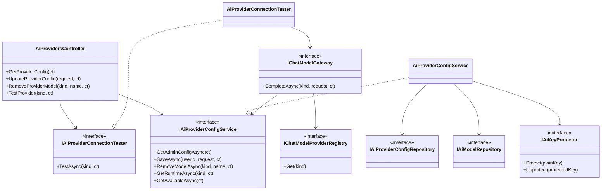
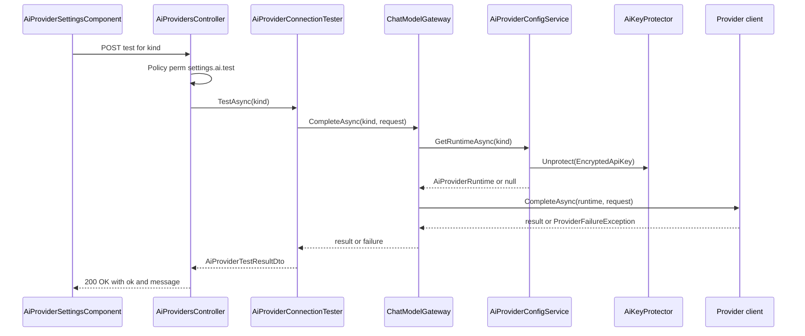
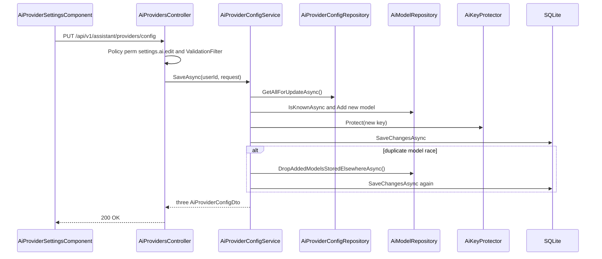
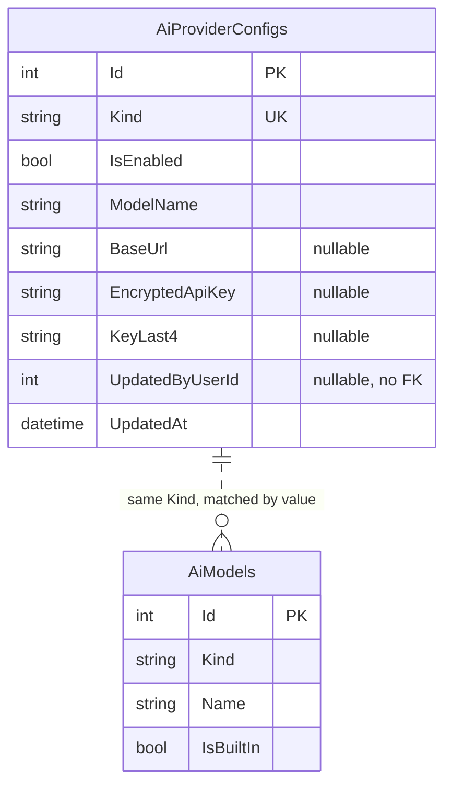

# Low-Level Design – TFA Settings

## TaskFlow – Intelligent Task Allocation & Tracking System

> **Document:** Low-Level Design  ·  **Version:** 1.0  ·  **Status:** Draft
> **Project type:** Personal Project (Skill Development)  ·  **Date:** 31-Oct-2026
> **Author:** Jojo George (jojogeorge3344@gmail.com)
> **Based on:** HLD-TFA-Settings v1.0, FRD-TFA-Settings v1.0
> **Module:** Settings  ·  **Sub-module:** 06.3 TFA Settings  ·  **Code:** TFAS
> © 2026 Jojo George. All rights reserved.

---

## Document Control

| Version | Date | Author | Summary of changes |
|---|---|---|---|
| 1.0 | 31-Oct-2026 | Jojo George | Initial version |

**Related documents:** BRD · FRD · HLD · TDD · Specs

| Document | Location |
|---|---|
| BRD – TFA Settings | `../../../BRD/06-Settings/06.3-TFA-Settings/BRD-TFA-Settings.md` |
| FRD – TFA Settings (FR-TFAS-01…28, UC-TFAS-01…03) | `../../../FRD/06-Settings/06.3-TFA-Settings/FRD-TFA-Settings.md` |
| HLD – TFA Settings | `../../../HLD/06-Settings/06.3-TFA-Settings/HLD-TFA-Settings.md` |
| Overall LLD (stack, cross-cutting design, Auth) | `../../00-Overall/LLD-TaskFlow-Overall.md` |
| LLD – Assistant (chat, `ChatModelGateway` callers, provider selector) | `../../08-TFA-Assistant/08.1-Assistant/LLD-Assistant.md` |
| LLD – Role Configuration (the four `settings.ai.*` keys and their prerequisite) | `../06.4-Role-Configuration/LLD-Role-Configuration.md` |
| TDD v2.0 | `TDD-TaskFlow.md` §6.5 (integrations), §7.2.6 (`AiProviderConfig`, `AiModel`) |

---

## 1. Introduction

### 1.1 Purpose
Detailed design of TFA Settings – the organization-wide configuration of the AI providers behind TFA, the TaskFlow
assistant: controller actions, configuration and connection-test services, repositories, key protection, provider
clients, the `AiProviderConfigs` and `AiModels` tables, seeding, the Angular screen, tests and FR-TFAS-nn traceability.
Everything is taken from the code as built.

### 1.2 Scope & Conventions
- Covered: `AiProvidersController` (4 actions), `AiProviderConfigService`, `AiProviderConnectionTester`,
  `AiProviderConfigRepository`, `AiModelRepository`, `AiKeyProtector`, `KeyRingProtectionCheck`, `AiProviderSeeder`,
  `AiProviderCatalog`, the provider clients used by the test, and `AiProviderSettingsComponent`.
- Referenced only: `GET /api/v1/assistant/providers` (Assistant sub-module, `assistant.chat`), which returns the
  configured providers through `AiProviderConfigService.GetAvailableAsync`; chat calls through `IChatModelGateway`.
- Naming: `*Controller`, `I*Service`/`*Service`, `I*Repository`/`*Repository`, DTOs `*Dto` / `*Request`.
- API base path `/api/v1`; JSON camelCase; enums as strings; errors as ProblemDetails.

---

## 2. Code Structure

### 2.1 Backend Folder Layout

```
TaskFlow.Api/
  Controllers/Settings/AiProvidersController.cs
  Services/Settings/TfaSettings/ProviderConfig/IAiProviderConfigService.cs, AiProviderConfigService.cs
  Services/Settings/TfaSettings/ConnectionTest/IAiProviderConnectionTester.cs, AiProviderConnectionTester.cs
  Repositories/Settings/TfaSettings/ProviderConfig/IAiProviderConfigRepository.cs, AiProviderConfigRepository.cs
  Repositories/Settings/TfaSettings/AiModels/IAiModelRepository.cs, AiModelRepository.cs
  Dtos/Settings/TfaSettings/AiProviderDtos.cs
  Dtos/Settings/TfaSettings/Validators/UpdateAiProvidersRequestValidator.cs   (+ UpdateAiProviderRequestValidator)
  Models/Entities/AiProviderConfig.cs, AiModel.cs
  Models/Enums/AiProviderKind.cs, ProviderFailureKind.cs
  Common/Constants/AiProviderCatalog.cs
  Integrations/Ai/KeyProtection/IAiKeyProtector.cs, AiKeyProtector.cs, KeyRingProtectionCheck.cs
  Integrations/Ai/Providers/OllamaProvider.cs, GeminiProvider.cs, OpenAiProvider.cs, ProviderHttp.cs,
                            ProviderFailure.cs, AiProviderRuntime.cs, ChatModelTypes.cs, IChatModelProvider.cs
  Integrations/Ai/Registry/IChatModelProviderRegistry.cs, ChatModelProviderRegistry.cs
  Services/Assistant/ModelGateway/IChatModelGateway.cs, ChatModelGateway.cs     (Assistant module)
  Services/Assistant/Chat/ProviderFailureMessages.cs                           (Assistant module)
  Config/AiProviderOptions.cs, Config/IntegrationRegistration.cs
  Persistence/Seeders/AiProviderSeeder.cs
```

### 2.2 Frontend Folder Layout

```
src/app/modules/settings/
  settings.routes.ts                                               (route settings/tfa)
  tfa-settings/pages/tfa-settings.component.ts                     (TfaSettingsComponent, page wrapper)
  tfa-settings/components/ai-provider-settings.component.{ts,html,css}
  tfa-settings/components/ai-provider-settings.model.ts            (ProviderForm)
  tfa-settings/services/ai-provider-admin.service.ts               (AiProviderAdminService)
src/app/modules/assistant/models/assistant.model.ts                (AiProviderConfig, UpdateAiProvider, AiProviderTestResult)
```

### 2.3 Layer Rules

| Rule | Enforced by |
|---|---|
| Controller → Service → Repository only, through interfaces | `ArchitectureTests` |
| Services commit through `IUnitOfWork`; repositories never save | `ArchitectureTests` |
| Provider HTTP clients live in `Integrations/`, called only through `IChatModelProviderRegistry` / `IChatModelGateway` | Code structure (`ArchitectureTests` namespace rules) |
| Child component in `components/`, `loadComponent` target in `pages/` | `npm run check:structure` |

---

## 3. Cross-Cutting Design

Shared mechanisms are in the overall LLD. Applied here:

| Concern | Design |
|---|---|
| Validation | `UpdateAiProvidersRequestValidator` (+ per-item `UpdateAiProviderRequestValidator`) in `ValidationFilter`; extra rules in the service throw `RequestValidationException` (400 with `errors`) |
| Error handling | `GlobalExceptionHandler`; the connection test never fails with an error status |
| Transactions | One `SaveChangesAsync` per save; on `UniqueConstraintException` duplicate models are detached and saved again |
| Authorization | Class `[Authorize]` + one `[RequirePermission]` per action (`settings.ai.view`, `settings.ai.edit`, `settings.ai.model.remove`, `settings.ai.test`) |
| Logging | `ChatModelGateway` logs provider, failure kind and HTTP status only; `GetRuntimeAsync` warns when an enabled key cannot be decrypted; provider HTTP clients have all loggers removed |
| Secrets | API keys encrypted with ASP.NET Core Data Protection (`AiKeyProtector`), never returned or logged |

### 3.1 Exception → HTTP Status

| Exception | Status | When |
|---|---|---|
| Validation failure (`ValidationFilter`) | 400 | Request rules (3 below) |
| `RequestValidationException` | 400 | Missing provider field, model length, key for Ollama, remove built-in / in-use model |
| `ValidationProblem` in the action | 400 | `DELETE …/models` without `name` |
| Model binding (`[ApiController]`) | 400 | `{kind}` not an `AiProviderKind` value |
| `NotFoundException` | 404 | Model to remove not in the list |
| Policy failure | 403 | Missing the action's permission |
| `UniqueConstraintException` (not recovered) | 409 | Unique index broken by something other than a duplicate model |
| `ProviderNotConfiguredException`, `ProviderFailureException` | 200 | Caught by `AiProviderConnectionTester` and returned as `ok: false` |

---

## 4. Module Designs

### 4.1 Module: Settings

#### 4.1.1 Child module: TFA Settings (TFAS)

**Class / file inventory**

| Layer | Type | File | Responsibility |
|---|---|---|---|
| Controller | `AiProvidersController` | `Controllers/Settings/AiProvidersController.cs` | 4 actions under `/api/v1/assistant/providers` |
| Service | `IAiProviderConfigService` / `AiProviderConfigService` | `Services/Settings/TfaSettings/ProviderConfig/` | Admin view, save, remove model, runtime for calls, available providers |
| Service | `IAiProviderConnectionTester` / `AiProviderConnectionTester` | `Services/Settings/TfaSettings/ConnectionTest/` | One "Reply with OK." call, result DTO |
| Repository | `IAiProviderConfigRepository` / `AiProviderConfigRepository` | `Repositories/Settings/TfaSettings/ProviderConfig/` | Provider rows |
| Repository | `IAiModelRepository` / `AiModelRepository` | `Repositories/Settings/TfaSettings/AiModels/` | Model list, duplicate-race recovery |
| DTOs | `AiProviderConfigDto`, `AiProviderOptionDto`, `UpdateAiProviderRequest`, `UpdateAiProvidersRequest`, `AiProviderTestResultDto` | `Dtos/Settings/TfaSettings/AiProviderDtos.cs` | Contracts |
| Validators | `UpdateAiProvidersRequestValidator`, `UpdateAiProviderRequestValidator` | `Dtos/Settings/TfaSettings/Validators/UpdateAiProvidersRequestValidator.cs` | Request rules, SSRF guard `IsMetadataHost` |
| Entities | `AiProviderConfig`, `AiModel` | `Models/Entities/` | Tables |
| Enums | `AiProviderKind`, `ProviderFailureKind` | `Models/Enums/` | Values in 5.4 |
| Catalogue | `AiProviderCatalog` | `Common/Constants/AiProviderCatalog.cs` | Display names, locality, key need, default and built-in models, `DefaultOllamaBaseUrl` |
| Key protection | `IAiKeyProtector` / `AiKeyProtector`, `KeyRingProtectionCheck` | `Integrations/Ai/KeyProtection/` | `Protect`/`Unprotect` (purpose `TaskFlow.AiProviderKeys`); start-up key-ring check |
| Gateway | `IChatModelGateway` / `ChatModelGateway` | `Services/Assistant/ModelGateway/` | Runtime lookup, provider call, failure logging |
| Registry / clients | `ChatModelProviderRegistry`, `OllamaProvider`, `GeminiProvider`, `OpenAiProvider`, `ProviderHttp` | `Integrations/Ai/Registry/`, `Integrations/Ai/Providers/` | HTTP calls and failure classification |
| Messages | `ProviderFailureMessages` | `Services/Assistant/Chat/ProviderFailureMessages.cs` | Fixed user messages per failure kind |
| Options | `AiProviderOptions` | `Config/AiProviderOptions.cs` | `KeyRingPath`, `TimeoutSeconds` |
| Seeder | `AiProviderSeeder` | `Persistence/Seeders/AiProviderSeeder.cs` | Built-in models and one row per provider |
| Frontend page | `TfaSettingsComponent` | `tfa-settings/pages/tfa-settings.component.ts` | Page header + child component |
| Frontend component | `AiProviderSettingsComponent` | `tfa-settings/components/ai-provider-settings.component.ts` | Forms per provider, linked Model/Server selects, save, test, remove, key status |
| Frontend service | `AiProviderAdminService` | `tfa-settings/services/ai-provider-admin.service.ts` | `getConfig()`, `save()`, `removeModel()`, `test()` |

**Class diagram**



**API contracts**

Controller `AiProvidersController`, `[Route("api/v1/assistant/providers")]`, class `[Authorize]`.
Endpoints of this sub-module (facts.md §3, `AiProvidersController`): **4**.

| # | Method | Route | Permission / policy | Request | Response | Status codes |
|---|---|---|---|---|---|---|
| 1 | GET | `/api/v1/assistant/providers/config` | `settings.ai.view` | – | `IReadOnlyList<AiProviderConfigDto>` (3 items, catalogue order) | 200, 401, 403 |
| 2 | PUT | `/api/v1/assistant/providers/config` | `settings.ai.edit` | `UpdateAiProvidersRequest` | `IReadOnlyList<AiProviderConfigDto>` | 200, 400, 401, 403, 409 |
| 3 | DELETE | `/api/v1/assistant/providers/{kind}/models` | `settings.ai.model.remove` | route `kind`, query `name` | `IReadOnlyList<AiProviderConfigDto>` | 200, 400, 401, 403, 404 |
| 4 | POST | `/api/v1/assistant/providers/{kind}/test` | `settings.ai.test` | route `kind`, empty body | `AiProviderTestResultDto` | 200, 400, 401, 403 |

`{kind}` binds to `AiProviderKind` (`Ollama`, `Gemini`, `OpenAI`).

**DTOs**

| DTO | Fields |
|---|---|
| `AiProviderConfigDto` | `Kind`, `DisplayName`, `Locality` (`Local`/`Cloud`), `RequiresKey`, `IsEnabled`, `ModelName`, `BaseUrl` (Ollama only), `KeySet`, `KeyLast4`, `IsConfigured`, `KeyReadable`, `Models` (all names, chosen one added if missing), `CustomModels` (non-built-in) |
| `UpdateAiProvidersRequest` | `Providers` (`IReadOnlyList<UpdateAiProviderRequest>?`) |
| `UpdateAiProviderRequest` | `Kind` (`AiProviderKind?`), `IsEnabled` (`bool?`), `ModelName` (`string?`), `BaseUrl` (`string?`), `ApiKey` (`string?`, empty keeps the stored key), `ClearKey` (`bool?`) |
| `AiProviderTestResultDto` | `Ok`, `Message` (fixed text, never the provider's own error), `FailureKind` (`ProviderFailureKind?`) |
| `AiProviderOptionDto` (Assistant selector) | `Kind`, `DisplayName`, `ModelName`, `Locality` |

**Request / response example**

```json
// PUT /api/v1/assistant/providers/config  (as sent by the screen: only the chosen server enabled)
{ "providers": [
  { "kind": "Ollama", "isEnabled": false, "modelName": "llama3.2:3b", "baseUrl": "http://localhost:11434" },
  { "kind": "Gemini", "isEnabled": true, "modelName": "gemini-2.0-flash", "apiKey": "<secret>" },
  { "kind": "OpenAI", "isEnabled": false, "modelName": "gpt-4o-mini", "clearKey": true }
] }
```

```json
// 200 OK (one of three items)
{ "kind": "Gemini", "displayName": "Google Gemini", "locality": "Cloud", "requiresKey": true, "isEnabled": true,
  "modelName": "gemini-2.0-flash", "baseUrl": null, "keySet": true, "keyLast4": "x9Qa", "isConfigured": true,
  "keyReadable": true, "models": ["gemini-2.0-flash", "gemini-2.5-flash", "gemini-2.5-pro"], "customModels": [] }
```

```json
// POST /api/v1/assistant/providers/Ollama/test  ->  200 OK
{ "ok": false, "message": "Ollama is not running or cannot be reached. Ask an administrator to start it, or choose another model.", "failureKind": "Unreachable" }
```

```json
// DELETE /api/v1/assistant/providers/Ollama/models?name=llama3.2:3b  ->  400
{ "status": 400, "errors": { "name": ["A built-in model cannot be removed."] } }
```

**Service logic – `AiProviderConfigService.GetAdminConfigAsync`**
1. `_configs.GetAllAsync()` (no tracking) and `LoadModelsAsync()` → `ModelLists(All, Custom)` lookups by `Kind`
   (built-in first, then by `Id`).
2. For each `AiProviderCatalog.All` kind (`Ollama`, `Gemini`, `OpenAI`) `ToDto(kind, row, models)`:
   chosen model = row's `ModelName` or `AiProviderCatalog.DefaultModel(kind)`, added to `Models` if missing;
   `BaseUrl` = row value or `DefaultOllamaBaseUrl` for Ollama, null for cloud; `KeySet` = encrypted key present;
   `KeyReadable` = no key, or `Unprotect` succeeds; `IsConfigured` = `IsConfigured(row)`.
3. `IsConfigured(row)`: enabled and model not blank, and either (no key needed and `BaseUrl` not blank) or (encrypted
   key present and decryptable) (FR-TFAS-16, FR-TFAS-22).

**Service logic – `AiProviderConfigService.SaveAsync(userId, request)`**
1. `now`; `rows = _configs.GetAllForUpdateAsync()` (tracked list).
2. For each update: null `Kind`, `IsEnabled` or `ModelName` → `RequestValidationException("providers", "Every provider setting must be provided.")`.
3. `modelName = ModelName.Trim()`; length 0 or over 100 → "The `DisplayName` model name must be 1 to 100 characters."
4. Find or create the row (`new AiProviderConfig { Kind }`, `Add`). Set `IsEnabled`, `ModelName`.
5. When enabled, `RememberModelAsync`: if `IsKnownAsync(kind, name)` is false (checks `Set.Local` and the database),
   add `AiModel { IsBuiltIn = false }` (FR-TFAS-05).
6. `BaseUrl`: Ollama → `NormalizeBaseUrl` (trim, trailing `/` removed) or `DefaultOllamaBaseUrl`; cloud → null.
7. Key: non-empty `ApiKey` on a provider that needs no key → "Ollama does not use an API key." (FR-TFAS-09); otherwise
   `EncryptedApiKey = _keyProtector.Protect(key.Trim())`, `KeyLast4` = last 4 characters. Else `ClearKey == true` → both
   null (FR-TFAS-13). Empty key and no clear → unchanged (FR-TFAS-12).
8. `UpdatedByUserId`, `UpdatedAt`. `SaveKeepingAnyDuplicateModelAsync`: on `UniqueConstraintException`,
   `DropAddedModelsStoredElsewhereAsync()` detaches staged duplicates and saves again; otherwise rethrows.
9. Reload models and return the three DTOs. The backend accepts several enabled providers; the screen enables only the
   selected one (FR-TFAS-14).

**Service logic – `AiProviderConfigService.RemoveModelAsync(kind, name)`**
1. `GetForUpdateAsync(kind, name)` → null → `NotFoundException("That model is not in the list.")`.
2. `IsBuiltIn` → `RequestValidationException("name", "A built-in model cannot be removed.")`.
3. `UsesModelAsync(kind, name)` → "That model is the one saved for its server. Choose another model and save before removing it."
4. `Remove`, save, return `GetAdminConfigAsync()` (FR-TFAS-20, FR-TFAS-21).

**Service logic – `GetRuntimeAsync(kind)` and `AiProviderConnectionTester.TestAsync(kind)`**
1. `GetRuntimeAsync`: row missing or not configured → null (warning logged when the row is enabled and its key cannot be
   decrypted); else `AiProviderRuntime(kind, ModelName, BaseUrl, decryptedKey)` – the key lives only in memory.
2. `TestAsync` builds `ChatModelRequest` with system text "This is a connection test. Reply with the single word OK.",
   one user message "Reply with OK.", no tools.
3. `IChatModelGateway.CompleteAsync(kind, request)`: runtime null → `ProviderNotConfiguredException`; else
   `IChatModelProviderRegistry.Get(kind).CompleteAsync(runtime, request)`.
4. Success → `(true, "The connection works.", null)`; `ProviderNotConfiguredException` →
   `ProviderFailureMessages.NotConfigured(kind)`; `ProviderFailureException` → `ProviderFailureMessages.For(kind,
   failure.Kind, failure.RetryAfter)` and `failure.Kind` (FR-TFAS-17, FR-TFAS-18).

**Provider clients (used by the test)**

| Client | Call | Key |
|---|---|---|
| `OllamaProvider` | `POST {BaseUrl}/api/chat` | none |
| `GeminiProvider` | `POST https://generativelanguage.googleapis.com/v1beta/models/{model}:generateContent` | header `x-goog-api-key` |
| `OpenAiProvider` | `POST https://api.openai.com/v1/chat/completions` | `Authorization: Bearer` |

`ProviderHttp.SendAsync` maps a client timeout to `Timeout` and `HttpRequestException` to `Unreachable`; unparsable
bodies to `Unexpected`; status and provider error codes map to `RateLimited`, `InvalidKey`, `ModelUnavailable`.
HTTP clients: `AllowAutoRedirect = false`, `RemoveAllLoggers()`, timeout `AiProviders:TimeoutSeconds`.

**Sequence diagram – connection test**



**Sequence diagram – save**



**Repository methods**

| Method | Query / purpose | Notes |
|---|---|---|
| `AiProviderConfigRepository.GetAllAsync()` | All rows | `AsNoTracking` |
| `AiProviderConfigRepository.GetAllForUpdateAsync()` | All rows, tracked `List` | Save |
| `AiProviderConfigRepository.GetAsync(kind)` | One row | `AsNoTracking`; `IX_AiProviderConfigs_Kind` |
| `AiProviderConfigRepository.UsesModelAsync(kind, modelName)` | Is it the saved model | `AnyAsync` |
| `AiModelRepository.GetAllAsync()` | All models | `AsNoTracking`, `OrderByDescending(IsBuiltIn).ThenBy(Id)` |
| `AiModelRepository.IsKnownAsync(kind, name)` | Stored or staged in this request | `Set.Local` then `AnyAsync` |
| `AiModelRepository.GetForUpdateAsync(kind, name)` | Tracked model | `FirstOrDefaultAsync`; `IX_AiModels_Kind_Name` |
| `AiModelRepository.DropAddedModelsStoredElsewhereAsync()` | Race recovery | Detaches `Added` entries already stored; returns whether any was dropped |
| `Add` / `Remove` (base) | Stage | `BaseRepository` |

**Validation rules**

| Field | Rule | Message |
|---|---|---|
| `Providers` | `NotNull()` | "Providers are required." |
| `Providers` | Distinct `Kind` | "Each provider can only appear once." |
| `Kind` | `NotNull()`, `IsInEnum()` | FluentValidation default |
| `IsEnabled` | `NotNull()` | FluentValidation default |
| `ModelName` | `NotEmpty()`, `MaximumLength(100)` | "Model name cannot be blank." |
| `BaseUrl` | blank, or absolute `http`/`https` URI not matching `IsMetadataHost` (`metadata.google.internal`, `metadata`, `instance-data`, 0.0.0.0, `::`, IPv6 link-local, 169.254.x.x) | "The server address must be a valid http or https URL, and not a link-local or cloud metadata address." |
| `BaseUrl` | `MaximumLength(300)` | FluentValidation default |
| `ApiKey` | `MaximumLength(500)`, no whitespace | "The API key cannot contain spaces." |
| item | not (`ClearKey == true` and non-empty `ApiKey`) | "Provide a new key or clear the key, not both." |
| Service | missing field / model length / key for Ollama | see service logic |
| Controller | `name` blank on DELETE | "The model name is required." |

Client mirror: `modelName` required, max 100; `baseUrl` pattern `^(https?:\/\/\S+)?$`; `apiKey` pattern `^\S*$`, max 500;
group validator `newModelRequired` (1–100 characters when **Add new model…** (`ADD_MODEL`) is chosen).

**Error cases**

| Case | Exception / result | Status |
|---|---|---|
| Missing the action's `settings.ai.*` permission | Policy refusal (logged) | 403 |
| Invalid request | `ValidationFilter` / `RequestValidationException` | 400 |
| Unknown `kind` in the route | Model binding | 400 |
| Model not in the list | `NotFoundException` | 404 |
| Built-in or saved model | `RequestValidationException` | 400 |
| Provider not configured / unreachable / key refused | Test result `ok: false` | 200 |

**Frontend design – `AiProviderSettingsComponent`**

| Member | Behaviour |
|---|---|
| `visible`, `canEdit`, `canTest`, `mayRemoveModel` | `AuthService.hasPermission` for `SettingsAiView`, `SettingsAiEdit`, `SettingsAiTest`, `SettingsAiRemoveModel`; Save, Test and Remove buttons rendered only when allowed |
| `load()` / `apply()` | `getConfig()`; active kind = first enabled and configured (else first enabled); one `ProviderForm` per provider; key boxes start empty |
| `chooseModel()` / `selectKind()` | Linked Model and Server selects (value `kind|name`) (FR-TFAS-04) |
| `statusText()` | "In use" / "Not configured" for the active kind; otherwise "Needs an API key" or "Ready to use" (FR-TFAS-02) |
| `keyStatus()` | "No key saved yet.", "The saved key can no longer be read. Enter it again.", "A key is saved (ends …`last4`). Leave the box empty to keep it.", "The stored key will be removed when you save." |
| `clearKey()` / `keepKey()` | Marks a key for removal / undoes it |
| `save()` | Validates all forms (shows the first invalid provider); sends all three providers with `isEnabled` true only for the selected one; toast "TFA settings saved"; error "Could not save the TFA settings." |
| `test()` | If `needsSave()`, saves first then runs the test; result per kind shown next to the button; HTTP error → "The test could not be run." |
| `removeModel()` | Only for a custom, not-saved model; reloads from the response; toast "Removed `name` from the list"; error "Could not remove the model." |

**State machine:** _Not applicable for this sub-module._ (A provider is only enabled or disabled; the screen status is
computed, not stored.)

---

## 5. Database Design

### 5.1 ER Diagram



### 5.2 Tables

#### `AiProviderConfigs` (AiProviderConfig)

| Column | Type | Null | Key / index | Default | Description |
|---|---|:---:|---|---|---|
| Id | int (INTEGER) | No | PK | identity | Row id |
| Kind | `AiProviderKind` as string(16) (TEXT) | No | Unique `IX_AiProviderConfigs_Kind` | – | `Ollama`, `Gemini`, `OpenAI` |
| IsEnabled | bool (INTEGER) | No | – | seeded (Ollama on for a fresh install) | Provider switched on |
| ModelName | string(100) (TEXT) | No | – | `AiProviderCatalog.DefaultModel` | Chosen model |
| BaseUrl | string(300) (TEXT) | Yes | – | `http://localhost:11434` for Ollama | Ollama only; null for cloud |
| EncryptedApiKey | string (TEXT) | Yes | – | null | Data Protection ciphertext; never returned |
| KeyLast4 | string(4) (TEXT) | Yes | – | null | Display hint |
| UpdatedByUserId | int? (INTEGER) | Yes | – (no FK) | null | Last editor |
| UpdatedAt | DateTime (TEXT) | No | – | – | UTC |

#### `AiModels` (AiModel)

| Column | Type | Null | Key / index | Default | Description |
|---|---|:---:|---|---|---|
| Id | int (INTEGER) | No | PK | identity | Row id; orders added models |
| Kind | `AiProviderKind` as string(16) (TEXT) | No | Unique `IX_AiModels_Kind_Name` (with `Name`) | – | Provider |
| Name | string(100) (TEXT) | No | Unique with `Kind` | – | Model name |
| IsBuiltIn | bool (INTEGER) | No | – | – | True = from `AiProviderCatalog.BuiltInModels`; false = added by an administrator |

Built-in models (seeded): Ollama `llama3.2:3b`, `llama3.2:1b`, `llama3.1:8b`, `qwen2.5:7b`, `mistral:7b`; Gemini
`gemini-2.0-flash`, `gemini-2.5-flash`, `gemini-2.5-pro`; OpenAI `gpt-4o-mini`, `gpt-4o`, `gpt-4.1-mini` (first = default).

### 5.3 Indexes, Constraints & Triggers

| Object | Definition | Purpose |
|---|---|---|
| `IX_AiProviderConfigs_Kind` | Unique (`Kind`) | One row per provider |
| `IX_AiModels_Kind_Name` | Unique (`Kind`, `Name`) | No duplicate model; the save recovers from a duplicate race |
| – | No FK between the tables; no triggers | Matched by `Kind` value |

### 5.4 Enumerations

| Enum | Values | Stored as |
|---|---|---|
| `AiProviderKind` | `Ollama`, `Gemini`, `OpenAI` | Text (`HasConversion<string>()`, max 16); JSON string; route value |
| `ProviderFailureKind` | `RateLimited`, `InvalidKey`, `Timeout`, `Unreachable`, `ModelUnavailable`, `Unexpected` | Not stored; JSON string in `AiProviderTestResultDto.FailureKind` |

### 5.5 Migrations

| Migration | Change |
|---|---|
| `20261018183210_AddAssistant` | Creates `AiProviderConfigs` and `IX_AiProviderConfigs_Kind` (with the assistant tables) |
| `20261019163241_AddAiModels` | Creates `AiModels` and `IX_AiModels_Kind_Name` |

---

## 6. Algorithms & Background Jobs

| Job / algorithm | Trigger / schedule | Steps | Idempotency |
|---|---|---|---|
| `AiProviderSeeder.SeedAsync` | Every start-up, after `AccessControlSeeder`, before `DatabaseSeeder` | 1. Adds missing built-in models. 2. Adds each saved `ModelName` not yet listed as a non-built-in model. 3. Adds a missing provider row: model = default, Ollama `BaseUrl` = default, `IsEnabled` = Ollama and no user exists yet (fresh install) (FR-TFAS-24) | Only inserts what is missing |
| `KeyRingProtectionCheck.Check` | Start-up on Windows (`Program.cs`) | Counts `key-*.xml` files with a plain `masterKey`; logs a warning with the fix, or an information line when it could not check | Read-only, never throws |
| Duplicate-model recovery | On `UniqueConstraintException` during save | Detach staged duplicates, save again | Keeps the other request's row |

---

## 7. Security Design (detailed)

| Item | Implementation |
|---|---|
| Permission checks | `settings.ai.view` (GET), `settings.ai.edit` (PUT), `settings.ai.model.remove` (DELETE), `settings.ai.test` (POST); catalogue `Requires: settings.ai.view` for the other three (FR-TFAS-25, FR-TFAS-26) |
| Defaults | Administrator only on first seed (Manager and Employee not granted); legacy `settings.ai.manage` expands to the four keys in `EffectivePermissions.LegacyChildren` |
| Key storage | `AiKeyProtector` (Data Protection purpose `TaskFlow.AiProviderKeys`, application name `TaskFlow`); key ring at `Storage:Root` + `AiProviders:KeyRingPath`; `ProtectKeysWithDpapi()` on Windows |
| Key exposure | Never returned (only `KeySet`, `KeyLast4`, `KeyReadable`); decrypted only in `AiProviderRuntime` for one call; not logged (FR-TFAS-10, FR-TFAS-11) |
| SSRF | Validator refuses link-local and cloud-metadata hosts; HTTP clients do not follow redirects; cloud addresses are fixed in code |
| Logging | Provider clients log nothing; gateway logs provider, failure kind and HTTP status only |
| Frontend | `permissionGuard` with `SettingsAiView` on `settings/tfa`; menu item "TFA Settings"; in-component `canEdit`, `canTest`, `mayRemoveModel` (FR-TFAS-27) |
| Cloud notice | Screen text explains that Gemini and OpenAI are cloud services (FR-TFAS-23) |

---

## 8. Configuration

| Key | Default | Purpose |
|---|---|---|
| `AiProviders:KeyRingPath` | `dp-keys` | Data Protection key-ring folder, relative to `Storage:Root` |
| `AiProviders:TimeoutSeconds` | `60` | Timeout of one provider HTTP call |
| `Storage:Root` | `""` | Root folder for the key ring and database |
| API keys | `<secret>` | Entered on the screen, stored encrypted in `AiProviderConfigs.EncryptedApiKey`; never in `appsettings.json` |

---

## 9. Testing Design

Test file names from `tests-filelist.json`; contents were not available, coverage inferred from names.

| Area | Test class / file | Type | Covers |
|---|---|---|---|
| Service | `TaskFlow.UnitTests/Settings/TfaSettings/ProviderConfig/AiProviderConfigServiceTests.cs` | Unit | Save, keys, models, remove |
| Seeder | `TaskFlow.UnitTests/Settings/TfaSettings/ProviderConfig/AiProviderSeederTests.cs` | Unit | First-run defaults |
| Key protection | `TaskFlow.UnitTests/Integrations/Ai/KeyProtection/AiKeyProtectorTests.cs`, `KeyRingProtectionCheckTests.cs` | Unit | Encryption, key-ring check |
| Provider clients | `TaskFlow.UnitTests/Integrations/Ai/Providers/ChatProviderTests.cs` | Unit | Requests and failure mapping |
| Gateway | `TaskFlow.UnitTests/Assistant/ModelGateway/ProviderFailureHandlingTests.cs` | Unit | Failure classification and messages |
| Endpoints | `TaskFlow.IntegrationTests/Settings/TfaSettings/AssistantProviderEndpointsTests.cs` | Integration | Config, test, remove endpoints and permissions |
| First run | `TaskFlow.IntegrationTests/Settings/TfaSettings/AiDefaultsOnFirstRunTests.cs` | Integration | Seeded defaults |
| SSRF | `TaskFlow.IntegrationTests/Integrations/Ai/ProviderRedirectTests.cs` | Integration | Redirects not followed |
| Start-up warning | `TaskFlow.IntegrationTests/Common/KeyRingStartupWarningTests.cs` | Integration | Key-ring warning at start-up |
| Support | `TaskFlow.IntegrationTests/TestSupport/ScriptedChatProvider.cs`, `CapturingLoggerProvider.cs` | Support | Fake provider, captured logs |

Frontend spec files: 0.

---

## 10. Known Limitations & Open Issues

- The backend accepts several enabled providers; only the screen enforces one active server.
- Without `settings.ai.edit` the inputs stay editable; only **Save** is hidden.
- `test()` saves unsaved changes first; a user with `settings.ai.test` but not `settings.ai.edit` gets 403 from that save
  and the test does not run.
- `GetAdminConfigAsync` calls `Unprotect` up to twice per provider per request (`KeyReadable`, `IsConfigured`).
- A lost or replaced key ring makes saved keys unreadable; they must be entered again (shown on the screen).
- > ⚠️ To be confirmed (FRD open issues): whether view-only users should get a fully read-only screen, whether a
  > test-only user should test the saved configuration, whether the server should refuse more than one active provider,
  > and the exact rule for **Ready to use** versus **In use**.

---

## 11. Traceability (FRD → code)

| FRD requirement | Endpoint / class | Test |
|---|---|---|
| FR-TFAS-01 | `AiProviderKind`, `AiProviderCatalog` (`RequiresKey`, `Locality`) | `AiProviderConfigServiceTests` |
| FR-TFAS-02 | `AiProviderConfigDto` · `statusText()` · `activeKind` | `AssistantProviderEndpointsTests` |
| FR-TFAS-03 | `AiProviderCatalog.BuiltInModels` · `AiProviderSeeder` · `AiModelRepository.GetAllAsync` | `AiProviderSeederTests`, `AiDefaultsOnFirstRunTests` |
| FR-TFAS-04 | `chooseModel()`, `selectKind()` | – (no frontend specs) |
| FR-TFAS-05 | `ADD_MODEL`, `newModelRequired` · `RememberModelAsync` | `AiProviderConfigServiceTests` |
| FR-TFAS-06 | `PUT /api/v1/assistant/providers/config` · `NormalizeBaseUrl` | `AiProviderConfigServiceTests` |
| FR-TFAS-07 | `UpdateAiProviderRequestValidator.BeHttpUrl` / `IsMetadataHost` · `AllowAutoRedirect = false` | `AssistantProviderEndpointsTests`, `ProviderRedirectTests` |
| FR-TFAS-08 | Validator `ApiKey` rules | `AssistantProviderEndpointsTests` |
| FR-TFAS-09 | `SaveAsync` "Ollama does not use an API key." | `AiProviderConfigServiceTests` |
| FR-TFAS-10 | `AiKeyProtector.Protect` · DTO without key | `AiKeyProtectorTests`, `AssistantProviderEndpointsTests` |
| FR-TFAS-11 | `KeySet`, `KeyLast4` · `keyStatus()` | `AiProviderConfigServiceTests` |
| FR-TFAS-12 | `SaveAsync` (empty key keeps stored key) | `AiProviderConfigServiceTests` |
| FR-TFAS-13 | `ClearKey` · validator "Provide a new key or clear the key, not both." · `clearKey()`/`keepKey()` | `AiProviderConfigServiceTests` |
| FR-TFAS-14 | `save()` sends `isEnabled` only for the selected kind · toast | – (no frontend specs) |
| FR-TFAS-15 | Validator "Each provider can only appear once." | `AssistantProviderEndpointsTests` |
| FR-TFAS-16 | `IsConfigured` · `GetAvailableAsync` (Assistant `GET /api/v1/assistant/providers`) | `AiProviderConfigServiceTests` |
| FR-TFAS-17 | `POST /api/v1/assistant/providers/{kind}/test` · `AiProviderConnectionTester.TestAsync` · `ProviderFailureMessages` | `AssistantProviderEndpointsTests`, `ProviderFailureHandlingTests` |
| FR-TFAS-18 | Tester catches `ProviderNotConfiguredException` / `ProviderFailureException` → 200 | `AssistantProviderEndpointsTests` |
| FR-TFAS-19 | `test()` → `save(() => runTest(kind))` when `needsSave()` | – (no frontend specs) |
| FR-TFAS-20 | `DELETE /api/v1/assistant/providers/{kind}/models` · `RemoveModelAsync` · `removeModel()` | `AssistantProviderEndpointsTests` |
| FR-TFAS-21 | `RemoveModelAsync` (404, built-in, in use) | `AiProviderConfigServiceTests` |
| FR-TFAS-22 | `KeyReadable` · `IsConfigured` · `GetRuntimeAsync` warning | `AiProviderConfigServiceTests`, `AiKeyProtectorTests` |
| FR-TFAS-23 | Cloud notice in `ai-provider-settings.component.html` | – (no frontend specs) |
| FR-TFAS-24 | `AiProviderSeeder.SeedProvidersAsync` (`freshInstall`) | `AiProviderSeederTests`, `AiDefaultsOnFirstRunTests` |
| FR-TFAS-25 | `[RequirePermission]` per action · `canEdit`/`canTest`/`mayRemoveModel` | `AssistantProviderEndpointsTests`, `PermissionAuthorizationTests` |
| FR-TFAS-26 | `PermissionCatalog` `Requires: settings.ai.view` · `RoleService.ResolvePermissionsAsync` | `PermissionCatalogTests` |
| FR-TFAS-27 | `GET /api/v1/assistant/providers/config` · `permissionGuard` (`settings/tfa`) · `buildNavigation()` | `AssistantProviderEndpointsTests` |
| FR-TFAS-28 | Toasts and error texts in `AiProviderSettingsComponent` | – (no frontend specs) |

---
<sub>© 2026 Jojo George. All rights reserved. Unauthorized copying or distribution of this document is prohibited.</sub>
