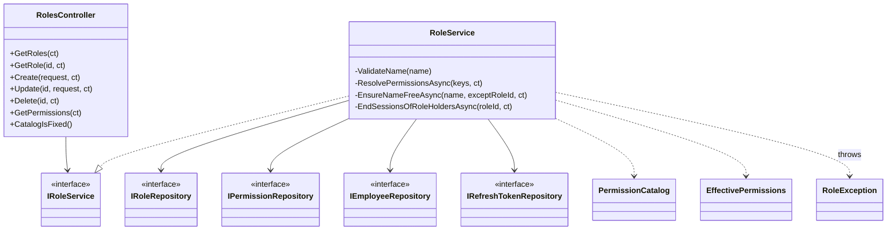
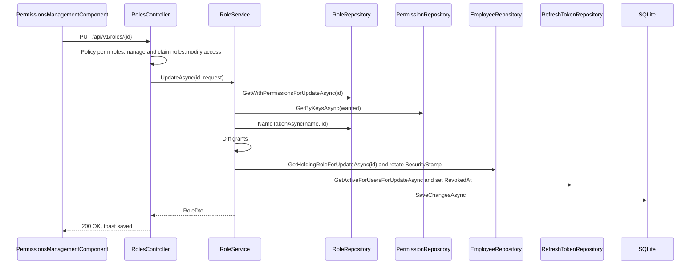
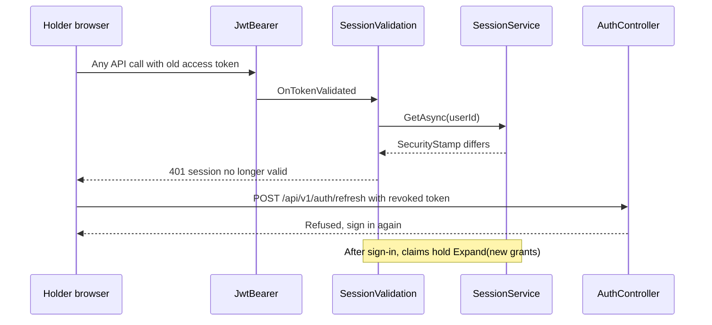
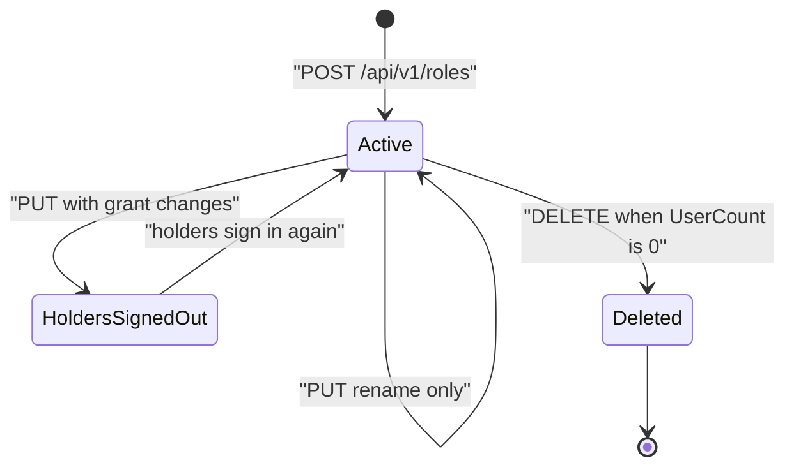
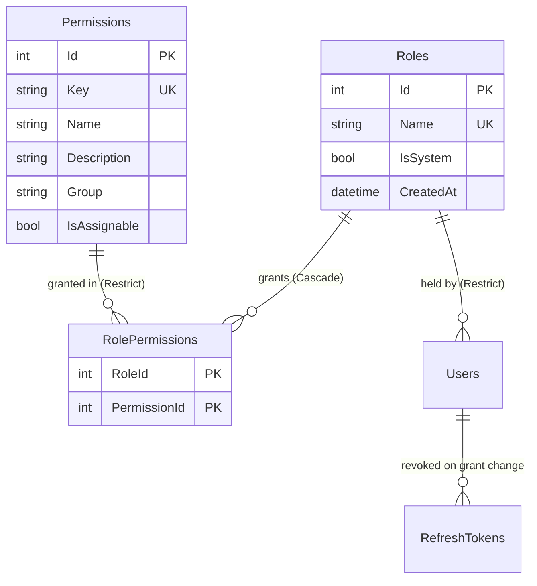

# Low-Level Design – Role Configuration

## TaskFlow – Intelligent Task Allocation & Tracking System

> **Document:** Low-Level Design  ·  **Version:** 1.0  ·  **Status:** Draft
> **Project type:** Personal Project (Skill Development)  ·  **Date:** 31-Oct-2026
> **Author:** Jojo George (jojogeorge3344@gmail.com)
> **Based on:** HLD-Role-Configuration v1.0, FRD-Role-Configuration v1.0
> **Module:** Settings  ·  **Sub-module:** 06.4 Role Configuration  ·  **Code:** ROLE
> © 2026 Jojo George. All rights reserved.

---

## Document Control

| Version | Date | Author | Summary of changes |
|---|---|---|---|
| 1.0 | 31-Oct-2026 | Jojo George | Initial version |

**Related documents:** BRD · FRD · HLD · TDD · Specs

| Document | Location |
|---|---|
| BRD – Role Configuration | `../../../BRD/06-Settings/06.4-Role-Configuration/BRD-Role-Configuration.md` |
| FRD – Role Configuration (FR-ROLE-01…26, UC-ROLE-01…04) | `../../../FRD/06-Settings/06.4-Role-Configuration/FRD-Role-Configuration.md` |
| HLD – Role Configuration | `../../../HLD/06-Settings/06.4-Role-Configuration/HLD-Role-Configuration.md` |
| Overall LLD (authentication, sessions, permission policies) | `../../00-Overall/LLD-TaskFlow-Overall.md` |
| LLD – Employee Management (role assignment, `GET /api/v1/users/roles`) | `../../03-TaskFlow-Management/03.1-Employee-Management/LLD-Employee-Management.md` |
| TDD v2.0 | `TDD-TaskFlow.md` §6.6 (authorization model), §7.2.1 (`Role`, `Permission`, `RolePermission`), §7.4 (triggers) |

---

## 1. Introduction

### 1.1 Purpose
Detailed design of Role Configuration (Permissions Management): the controller actions for roles and the fixed
permission catalogue, `RoleService` rules, the code catalogue `PermissionCatalog` and `EffectivePermissions`, the
`Roles`, `Permissions` and `RolePermissions` tables with their triggers, start-up seeding, session revocation on a
permission change, the Angular tree/matrix screen, tests and FR-ROLE-nn traceability. Everything is taken from the code.

### 1.2 Scope & Conventions
- Covered: `RolesController` (9 HTTP actions), `RoleService`, `RoleRepository`, `PermissionRepository`,
  `PermissionCatalog`, `EffectivePermissions`, `SystemRoles`, `RoleException`, `AccessControlSeeder`, and
  `PermissionsManagementComponent` with `permission-tree.ts`.
- Referenced only: `SessionValidation` / `SessionService` (claims refresh), `EmployeesController` (role assignment and
  `roles.administrator.assign` check), `IEmployeeRepository`, `IRefreshTokenRepository`.
- Naming: `*Controller`, `I*Service`/`*Service`, `I*Repository`/`*Repository`, DTOs `*Dto` / `*Request`.
- API base path `/api/v1`; JSON camelCase; errors as ProblemDetails. There is no FluentValidation validator for this
  sub-module: rules live in `RoleService` and raise `RoleException`.

---

## 2. Code Structure

### 2.1 Backend Folder Layout

```
TaskFlow.Api/
  Controllers/Settings/RolesController.cs
  Services/Settings/RoleConfiguration/IRoleService.cs, RoleService.cs
  Repositories/Settings/RoleConfiguration/Roles/IRoleRepository.cs, RoleRepository.cs, RoleSummary.cs
  Repositories/Settings/RoleConfiguration/Permissions/IPermissionRepository.cs, PermissionRepository.cs
  Dtos/Settings/RoleConfiguration/RoleDtos.cs
  Models/Entities/Role.cs, Permission.cs, RolePermission.cs
  Common/Security/PermissionKeys.cs, PermissionCatalog.cs, EffectivePermissions.cs, SystemRoles.cs, PermissionPolicy.cs
  Common/Exceptions/RoleException.cs
  Authorization/Policies/RequirePermissionAttribute.cs
  Persistence/Seeders/AccessControlSeeder.cs
  Persistence/Migrations/20261019133820_AddRolesAndPermissions.cs   (tables, system roles, triggers)
```

### 2.2 Frontend Folder Layout

```
src/app/modules/settings/
  settings.routes.ts                                                (route settings/permissions)
  role-configuration/pages/permissions-management.component.{ts,html,css}
  role-configuration/pages/permissions-management.model.ts         (Selection, EnabledFilter, PermissionView, ModuleView, ScreenView, FeatureView)
  role-configuration/models/role.model.ts                          (AccessRole, PermissionInfo, SaveRoleRequest, SYSTEM_ROLE_IDS)
  role-configuration/services/role.service.ts                      (RoleService, Angular)
  role-configuration/utils/permission-tree.ts                      (buildTree, toggleKey, setMany, setScope, restrictForCaller, ...)
src/app/shared/auth/permissions.ts, auth.guard.ts; src/app/layouts/nav-items.ts
```

### 2.3 Layer Rules

| Rule | Enforced by |
|---|---|
| Controller → Service → Repository only, through interfaces | `ArchitectureTests` |
| Services commit through `IUnitOfWork`; repositories never return `IQueryable` | `ArchitectureTests` |
| Catalogue integrity (unique keys, valid `Requires`, scope groups) | `PermissionCatalogTests` |
| Utilities in `utils/`, API service in `services/` of the module | `npm run check:structure` |

---

## 3. Cross-Cutting Design

Shared mechanisms are in the overall LLD. Applied here:

| Concern | Design |
|---|---|
| Validation | No validator; `RoleService.ValidateName` and `ResolvePermissionsAsync` throw `RoleException(RoleFailure, message)` |
| Error handling | `GlobalExceptionHandler` maps `RoleException.StatusCode` (3.1); `Forbid()` in the controller gives an empty 403 |
| Transactions | One `SaveChangesAsync` per create/update/delete; grant changes, security-stamp rotation and token revocation commit together |
| Authorization | Class-level `[RequirePermission(PermissionKeys.RolesManage)]`; in-action claim checks for `roles.view.all` and `roles.modify.access` |
| Session effect | `SessionValidation` rebuilds role and permission claims per request from the database (`SessionService` → `EffectivePermissions.Expand`) |
| Database guard | SQLite triggers refuse changes to system roles, their grants and the catalogue |

### 3.1 Exception → HTTP Status

| Exception | Status | When |
|---|---|---|
| `RoleException` `RoleFailure.Invalid` | 400 | Name blank or over 100; unknown key; missing prerequisite; Administrator-only key |
| `RoleException` `RoleFailure.ReadOnly` | 403 | Update or delete of a system role |
| `RoleException` `RoleFailure.NotFound` | 404 | Role id does not exist |
| `RoleException` `RoleFailure.Duplicate` | 409 | Name already used (check or unique index) |
| `RoleException` `RoleFailure.InUse` | 409 | Delete while users hold the role |
| `Forbid()` | 403 (empty body) | Create/update/delete without `roles.modify.access` |
| `Problem(...)` in `CatalogIsFixed` | 403 | Any POST/PUT/DELETE on `/api/v1/permissions` |
| Policy failure | 403 | Caller lacks `roles.manage` |
| `DbUpdateException` from a trigger (`RAISE(ABORT, ...)`) | 500 | Only if the service checks are bypassed |

---

## 4. Module Designs

### 4.1 Module: Settings

#### 4.1.1 Child module: Role Configuration (ROLE)

**Class / file inventory**

| Layer | Type | File | Responsibility |
|---|---|---|---|
| Controller | `RolesController` | `Controllers/Settings/RolesController.cs` | 9 HTTP actions under `/api/v1`; claim checks; `CatalogIsFixed` |
| Service | `IRoleService` / `RoleService` | `Services/Settings/RoleConfiguration/` | List, get, create, update, delete roles; catalogue view; rules |
| Repository | `IRoleRepository` / `RoleRepository`, `RoleSummary` | `Repositories/Settings/RoleConfiguration/Roles/` | Role summaries, tracked role, name check, keys by role name |
| Repository | `IPermissionRepository` / `PermissionRepository` | `Repositories/Settings/RoleConfiguration/Permissions/` | Key → id map, tracked rows by keys |
| Other repositories | `IEmployeeRepository`, `IRefreshTokenRepository` | `Repositories/Management/...`, `Repositories/Auth/RefreshTokens/` | Holders of a role; their active refresh tokens |
| DTOs | `RoleDto`, `PermissionDto`, `RoleOptionDto`, `SaveRoleRequest` | `Dtos/Settings/RoleConfiguration/RoleDtos.cs` | Contracts |
| Entities | `Role`, `Permission`, `RolePermission` | `Models/Entities/` | Tables |
| Catalogue | `PermissionDefinition`, `PermissionCatalog` | `Common/Security/PermissionCatalog.cs` | 64 entries: module/screen/section/action, defaults, `IsAssignable`, `AlwaysGranted`, `Requires`, scope |
| Keys | `PermissionKeys` | `Common/Security/PermissionKeys.cs` | Key constants (incl. legacy keys) |
| Effective rights | `EffectivePermissions` | `Common/Security/EffectivePermissions.cs` | `LegacyChildren`, `Expand`, `Visible`, `IsLegacy` |
| System roles | `SystemRoles` | `Common/Security/SystemRoles.cs` | Names and ids 1, 2, 3 |
| Exception | `RoleException`, `RoleFailure` | `Common/Exceptions/RoleException.cs` | Failure → status |
| Seeder | `AccessControlSeeder` | `Persistence/Seeders/AccessControlSeeder.cs` | System roles, catalogue rows, default grants |
| Frontend page | `PermissionsManagementComponent` | `role-configuration/pages/permissions-management.component.ts` | Role list, tree and matrix views, draft, save bar |
| Frontend service | `RoleService` (Angular) | `role-configuration/services/role.service.ts` | `list()`, `permissions()`, `create()`, `update()`, `delete()`, `assignable()` |
| Frontend utils | `buildTree`, `effectiveKeys`, `toggleKey`, `setMany`, `setScope`, `restrictForCaller`, `RESTRICTED_KEYS`, `isSelectable`, `changeCount`, `matches` | `role-configuration/utils/permission-tree.ts` | Tree building and tick logic |

**Class diagram**



**API contracts**

Controller `RolesController`, `[Route("api/v1")]`, class-level `[RequirePermission(PermissionKeys.RolesManage)]`.
HTTP actions of this sub-module (facts.md §3, `RolesController`): **9** (8 C# methods; `CatalogIsFixed` serves three
routes).

| # | Method | Route | Permission / policy | Request | Response | Status codes |
|---|---|---|---|---|---|---|
| 1 | GET | `/api/v1/roles` | `roles.manage`; without claim `roles.view.all` only the caller's own role | – | `IReadOnlyList<RoleDto>` | 200, 401, 403 |
| 2 | GET | `/api/v1/roles/{id}` | `roles.manage` | route `id` (int) | `RoleDto` | 200, 401, 403, 404 |
| 3 | POST | `/api/v1/roles` | `roles.manage` + claim `roles.modify.access` | `SaveRoleRequest` | `RoleDto` (`CreatedAtAction(GetRole)`) | 201, 400, 401, 403, 409 |
| 4 | PUT | `/api/v1/roles/{id}` | `roles.manage` + claim `roles.modify.access` | `SaveRoleRequest` | `RoleDto` | 200, 400, 401, 403, 404, 409 |
| 5 | DELETE | `/api/v1/roles/{id}` | `roles.manage` + claim `roles.modify.access` | – | – | 204, 401, 403, 404, 409 |
| 6 | GET | `/api/v1/permissions` | `roles.manage` | – | `IReadOnlyList<PermissionDto>` (catalogue order) | 200, 401, 403 |
| 7 | POST | `/api/v1/permissions` | `roles.manage` | – | ProblemDetails "The permission list is fixed and cannot be changed." | 403 |
| 8 | PUT | `/api/v1/permissions/{id}` | `roles.manage` | – | ProblemDetails (same) | 403 |
| 9 | DELETE | `/api/v1/permissions/{id}` | `roles.manage` | – | ProblemDetails (same) | 403 |

Related, owned by Employee Management: GET `/api/v1/users/roles` returns `RoleOptionDto` (no permissions) for the employee
form, used by Angular `RoleService.assignable()`.

**DTOs**

| DTO | Fields |
|---|---|
| `RoleDto` | `Id`, `Name`, `IsSystem`, `UserCount` (every account holding it, deleted ones included), `PermissionKeys` (`EffectivePermissions.Visible(Expand(stored))`, sorted) |
| `PermissionDto` | `Id` (0 for always-on entries), `Key`, `Name`, `Description`, `Group`, `IsAssignable`, `Module`, `Screen`, `Section`, `Action`, `Requires`, `ScopeGroup`, `ScopeRank`, `AlwaysGranted` |
| `SaveRoleRequest` | `Name` (`string?`), `PermissionKeys` (`IReadOnlyList<string>?`) |
| `RoleOptionDto` | `Id`, `Name`, `IsSystem` (Employee Management) |

**Request / response example**

```json
// POST /api/v1/roles
{ "name": "Team Lead", "permissionKeys": ["tasks.view.all", "tasks.create", "workload.view", "workload.filters.use"] }
```

```json
// 201 Created (Location: /api/v1/roles/4; id illustrative)
{ "id": 4, "name": "Team Lead", "isSystem": false, "userCount": 0,
  "permissionKeys": ["tasks.create", "tasks.view.all", "workload.filters.use", "workload.view"] }
```

```json
// 400 Bad Request (prerequisite missing)
{ "status": 400, "detail": "\"Use workload filters\" also needs \"View workload\"." }
```

```json
// 409 Conflict (role in use)
{ "status": 409, "detail": "2 users still hold this role. Move them to another role first." }
```

**Service logic – `GetRolesAsync` / `GetRoleAsync` / `GetPermissionsAsync`**
1. `GetRolesAsync`: `RoleRepository.GetSummariesAsync()` → `RoleDto` with keys
   `EffectivePermissions.Visible(EffectivePermissions.Expand(stored))` (legacy keys expanded and hidden, lower scope
   levels added, unknown keys dropped).
2. Controller filter: without the `roles.view.all` claim, only the role whose name equals the caller's role claim
   (case-insensitive); empty list when there is no role claim (FR-ROLE-02).
3. `GetRoleAsync(id)`: from the full list; missing → `RoleException(NotFound, "That role does not exist.")`.
4. `GetPermissionsAsync`: `PermissionCatalog.All` in code order mapped to `PermissionDto`, `Id` from
   `PermissionRepository.GetIdsByKeyAsync()` (0 when not stored, i.e. always-on).

**Service logic – `CreateAsync(request)`**
1. `ValidateName`: trim; empty → "Enter a name for the role."; over 100 → "The role name can be at most 100 characters."
2. `ResolvePermissionsAsync(keys)`:
   1. trim, drop blanks, distinct;
   2. replace legacy keys by `EffectivePermissions.LegacyChildren`; drop `AlwaysGranted` keys (never stored, FR-ROLE-14);
   3. `GetByKeysAsync(wanted)`; any key not found → "Unknown permission: `keys`." (FR-ROLE-12);
   4. for each found key whose catalogue `Requires` is not in `Expand(wanted)` → "\"`name`\" also needs \"`needed`\"."
      (FR-ROLE-11);
   5. any key with catalogue `IsAssignable = false` (`roles.administrator.assign`, and the always-on ones) →
      "`names` can only be held by the Administrator role and cannot be given to another role." (FR-ROLE-13).
3. `EnsureNameFreeAsync(name, null)`: `NameTakenAsync` (column collation `NOCASE`) → `RoleFailure.Duplicate`
   "A role named \"`name`\" already exists." (FR-ROLE-10).
4. New `Role { IsSystem = false, CreatedAt = now }` with one `RolePermission` per permission; `Add`.
5. `SaveAsync`: `UniqueConstraintException` → "A role with that name already exists." (409). Return `GetRoleAsync(id)`.

**Service logic – `UpdateAsync(id, request)`**
1. `LoadCustomRoleAsync(id)`: tracked role with grants; missing → 404; `IsSystem` → `RoleFailure.ReadOnly`
   "`name` is a system role and is read-only: it cannot be changed or deleted." (FR-ROLE-06).
2. `ValidateName`, `ResolvePermissionsAsync`, `EnsureNameFreeAsync(name, id)` as for create.
3. Set `Name`; remove grants not wanted; add missing grants; `permissionsChanged` when either happened.
4. If `permissionsChanged`: `EndSessionsOfRoleHoldersAsync(id)` – every holder (`GetHoldingRoleForUpdateAsync`, deleted
   accounts included) gets `SecurityStamp = Guid.NewGuid().ToString("N")`; their active refresh tokens
   (`GetActiveForUsersForUpdateAsync`) get `RevokedAt = now` (FR-ROLE-18). A rename alone signs nobody out.
5. `SaveAsync`; return `GetRoleAsync(id)`.

**Service logic – `DeleteAsync(id)`**
1. `LoadCustomRoleAsync(id)` (404 / 403 as above).
2. `IEmployeeRepository.CountHoldingRoleAsync(id)` (ignores the soft-delete filter) > 0 → `RoleFailure.InUse`
   "1 user still holds this role. Move them to another role first." / "`n` users still hold this role. Move them to
   another role first." (FR-ROLE-20).
3. `Remove(role)`; `RolePermissions` rows deleted by cascade; `SaveAsync` (FR-ROLE-19).

**Sequence diagram – update a custom role**



**Sequence diagram – effect on the next request of a holder**



**Repository methods**

| Method | Query / purpose | Notes |
|---|---|---|
| `RoleRepository.GetSummariesAsync()` | Roles with `UserCount` and stored keys | `AsNoTracking`, `OrderByDescending(IsSystem).ThenBy(Id)`; count via `Db.Users.IgnoreQueryFilters()` |
| `RoleRepository.GetWithPermissionsForUpdateAsync(id)` | Tracked role + grants | `Include(Permissions)` |
| `RoleRepository.NameTakenAsync(name, exceptRoleId)` | Name collision | `AnyAsync`; `NOCASE` collation on `Name`; `IX_Roles_Name` |
| `RoleRepository.GetPermissionKeysByRoleNameAsync(roleName)` | Stored keys of a role name | Used by `TaskService` (Task Management) |
| `PermissionRepository.GetIdsByKeyAsync()` | Key → Id | `AsNoTracking`, `ToDictionaryAsync` |
| `PermissionRepository.GetByKeysAsync(keys)` | Tracked rows to grant | `Where(keys.Contains(Key))`; `IX_Permissions_Key` |
| `EmployeeRepository.CountHoldingRoleAsync(roleId)` / `GetHoldingRoleForUpdateAsync(roleId)` | Holders | `IgnoreQueryFilters()` |
| `RefreshTokenRepository.GetActiveForUsersForUpdateAsync(userIds)` | Active tokens | `RevokedAt == null` |

**Validation rules** (in `RoleService`)

| Field | Rule | Message |
|---|---|---|
| `Name` | Required after trim | "Enter a name for the role." |
| `Name` | At most 100 characters after trim (`MaxNameLength`) | "The role name can be at most 100 characters." |
| `Name` | Unique, case-insensitive | "A role named \"`name`\" already exists." / "A role with that name already exists." |
| `PermissionKeys` | Every key in the stored catalogue (after legacy expansion; always-on keys ignored) | "Unknown permission: `keys`." |
| `PermissionKeys` | `Requires` held (scope expansion counts) | "\"`name`\" also needs \"`needed`\"." |
| `PermissionKeys` | No `IsAssignable = false` key | "`names` can only be held by the Administrator role and cannot be given to another role." |

Client mirror: `nameError` "Enter a name for the role." when the trimmed draft name is empty; `toggleKey` ticks the
`requires` chain when a key is ticked and clears dependants when it is unticked; `restrictForCaller` marks
`roles.administrator.assign` as not assignable for callers who do not hold it; `isSelectable` excludes always-on and
non-assignable entries.

**Error cases**

| Case | Exception / result | Status |
|---|---|---|
| No `roles.manage` | Policy refusal (logged) | 403 |
| No `roles.modify.access` on POST/PUT/DELETE | `Forbid()` (empty body; screen shows "Could not save the role." / "Could not delete the role.") | 403 |
| System role update/delete | `RoleException(ReadOnly)` | 403 |
| Unknown role | `RoleException(NotFound)` | 404 |
| Invalid name or keys | `RoleException(Invalid)` | 400 |
| Duplicate name | `RoleException(Duplicate)` | 409 |
| Role in use | `RoleException(InUse)` | 409 |
| Catalogue mutation | `CatalogIsFixed` | 403 |

**Frontend design – `PermissionsManagementComponent`**

| Member | Behaviour |
|---|---|
| `load()` | `forkJoin(list(), permissions())`; catalogue passed through `restrictForCaller(catalog, hasPermission(RolesAdministratorAssign))`; error "Could not load roles and permissions." |
| `filteredRoles` | Own role only without `canViewAllRoles`; filtered by **Find a role** text (FR-ROLE-01, FR-ROLE-02) |
| `view` (`'tree'`/`'matrix'`) | Tree by module → screen → section → feature, or role-by-permission matrix (**Compare roles**, FR-ROLE-04) |
| `search`, `filter` (`'all'`/`'enabled'`/`'disabled'`) | Permission search and filter (FR-ROLE-05) |
| `editable` | `canModifyAccess` and (new draft or non-system role); otherwise read-only (FR-ROLE-23) |
| `toggle`, `chooseScope`, `toggleScreen`, `toggleModule`, `setAll` | `toggleKey` / `setScope` / `setMany` on `draftKeys` (FR-ROLE-03, FR-ROLE-11, FR-ROLE-15) |
| `startNew`, `duplicate`, `copyFrom` | New draft; "`name` copy" draft from a role; copies only selectable keys (FR-ROLE-07…09) |
| `dirty`, `changes`, `discard`, `confirmDiscard` | Change count via `changeCount`; "Discard unsaved changes?" dialog; `beforeunload` warning (FR-ROLE-17) |
| `heldCount`, `totalCount`, `heldPercent` | "N of M permissions", "x% enabled" (FR-ROLE-24) |
| `save()` | `create` or `update`; toast "`name` created" / "`name` saved"; error kept in the form (`formError`) |
| `remove()` | Confirm "Delete `name`?" ("The role and its permissions are removed. This cannot be undone."); toast "`name` deleted"; error "Could not delete the role." |

**State machine – custom role (as handled by the service)**



System roles (`IsSystem = true`, ids 1–3) have no transitions: every update or delete is refused by the service and the
triggers.

---

## 5. Database Design

### 5.1 ER Diagram



### 5.2 Tables

#### `Roles` (Role)

| Column | Type | Null | Key / index | Default | Description |
|---|---|:---:|---|---|---|
| Id | int (INTEGER) | No | PK | identity; system ids 1, 2, 3 | 1 Administrator, 2 Manager, 3 Employee |
| Name | string(100) (TEXT, collation `NOCASE`) | No | Unique `IX_Roles_Name` | – | Case-insensitive unique |
| IsSystem | bool (INTEGER) | No | – | false | System roles read-only |
| CreatedAt | DateTime (TEXT) | No | – | – | UTC |

#### `Permissions` (Permission) – read-only catalogue

| Column | Type | Null | Key / index | Default | Description |
|---|---|:---:|---|---|---|
| Id | int (INTEGER) | No | PK | identity | Referenced by grants |
| Key | string(100) (TEXT) | No | Unique `IX_Permissions_Key` | – | e.g. `roles.modify.access` |
| Name | string(200) (TEXT) | No | – | – | Display name |
| Description | string(500) (TEXT) | No | – | – | Description |
| Group | string(100) (TEXT) | No | – | – | Catalogue module |
| IsAssignable | bool (INTEGER) | No | – | true | False = Administrator only (informational; the code catalogue decides) |

#### `RolePermissions` (RolePermission)

| Column | Type | Null | Key / index | Default | Description |
|---|---|:---:|---|---|---|
| RoleId | int (INTEGER) | No | PK (`RoleId`, `PermissionId`), FK → `Roles.Id` Cascade | – | Role |
| PermissionId | int (INTEGER) | No | PK, FK → `Permissions.Id` Restrict, `IX_RolePermissions_PermissionId` | – | Permission |

Also used, owned elsewhere: `Users.RoleId` (FK Restrict, `IX_Users_RoleId`) and `Users.SecurityStamp` (Employee
Management / Auth), `RefreshTokens.RevokedAt` (Auth).

### 5.3 Indexes, Constraints & Triggers

| Object | Definition | Purpose |
|---|---|---|
| `IX_Roles_Name` | Unique (`Name`), collation `NOCASE` | "team lead" collides with "Team Lead" |
| `IX_Permissions_Key` | Unique (`Key`) | One row per key |
| `IX_RolePermissions_PermissionId` | (`PermissionId`) | FK lookup |
| `IX_Users_RoleId` | (`RoleId`) | Holder count |
| `TR_Roles_SystemNoUpdate` | BEFORE UPDATE ON `Roles` WHEN `OLD.IsSystem = 1` → "System roles are read-only." | Protect system roles |
| `TR_Roles_SystemNoDelete` | BEFORE DELETE ON `Roles` WHEN `OLD.IsSystem = 1` → "System roles cannot be deleted." | Protect system roles |
| `TR_Permissions_NoUpdate` / `TR_Permissions_NoDelete` | BEFORE UPDATE / DELETE ON `Permissions` → "The permission catalog is read-only." | Fixed catalogue |
| `TR_RolePermissions_SystemNoUpdate` / `TR_RolePermissions_SystemNoDelete` | BEFORE UPDATE / DELETE ON `RolePermissions` when the role is a system role → "System roles are read-only." | Inserts stay allowed so the seeder can add grants |

### 5.4 Enumerations

| Enum | Values | Stored as |
|---|---|---|
| `RoleFailure` | `NotFound`, `Invalid`, `ReadOnly`, `Duplicate`, `InUse` | Not stored; selects the HTTP status |

Permission keys handled by this sub-module: `roles.manage`, `roles.view.all`, `roles.modify.access`,
`roles.administrator.assign` (catalogue `IsAssignable: false`). Always-on keys (never stored as grants):
`dashboard.view.own`, `tasks.view.own`, `profile.view`, `profile.edit`, `profile.password.change`, `profile.mfa.manage`.
Legacy keys expanded by `EffectivePermissions.LegacyChildren`: `dashboard.admin`, `dashboard.manager`,
`projects.manage`, `departments.manage`, `employees.manage`, `settings.ai.manage`.

### 5.5 Migrations

| Migration | Change |
|---|---|
| `20261019133820_AddRolesAndPermissions` | Creates `Roles`, `Permissions`, `RolePermissions`, indexes; inserts the three system roles; moves `Users.Role` to `Users.RoleId`; rotates security stamps; creates the six triggers |
| `20261021070943_FixDepartmentFollowUps` | Inserts `projects.view` / `projects.manage` rows and copies grants from the department keys |

---

## 6. Algorithms & Background Jobs

| Job / algorithm | Trigger / schedule | Steps | Idempotency |
|---|---|---|---|
| `AccessControlSeeder.SeedAsync` | Every start-up, after `SettingsInitializer` | 1. `EnsureSystemRolesAsync` (ids 1–3). 2. Insert each missing `PermissionCatalog.Stored` row. 3. Grant every permission to Administrator (FR-ROLE-22). 4. For newly created permissions only: grant to Manager/Employee per `GrantedToManager`/`GrantedToEmployee`, to all existing roles when `GrantToAllExistingRoles`, to holders of `GrantFrom` | Inserts only; later edits are never overwritten |
| `EffectivePermissions.Expand` | Each session check, each role read | Add legacy children; add lower scope levels of the same `ScopeGroup` | Pure |
| `EndSessionsOfRoleHoldersAsync` | Role update with grant changes | New security stamp per holder; revoke active refresh tokens | Saved with the grant change |
| Tree logic (`toggleKey`, `setScope`, `setMany`) | User ticks on the screen | Prerequisite chain on tick; dependants cleared on untick | Pure |

---

## 7. Security Design (detailed)

| Item | Implementation |
|---|---|
| Permission checks | `perm:roles.manage` on the controller; `User.HasClaim("permission", roles.view.all)` and `roles.modify.access` inside actions |
| Privilege raise | `roles.administrator.assign` is `IsAssignable: false`; refused by `ResolvePermissionsAsync`; checked by `EmployeesController.CanAssignAdministrator()` when an Administrator role is assigned |
| Defaults | `roles.manage`, `roles.view.all`, `roles.modify.access` granted to Administrator only on first seed; custom roles configurable |
| Session revocation | Grant change → security stamp rotation (access tokens fail in `SessionValidation`) and refresh-token revocation |
| Claims freshness | Permission claims are rebuilt from the database on every request; in addition, any grant change signs the holders out (FR-ROLE-18) |
| Database defence | Six triggers protect system roles and the catalogue |
| Frontend | `permissionGuard` with `Permissions.RolesManage` on `settings/permissions`; menu "Role Configuration"; `canViewAllRoles`, `canModifyAccess`, `editable` (FR-ROLE-25) |
| Audit | Denied requests logged by `DeniedActionAuditHandler`; no activity row for role changes |

---

## 8. Configuration

_Not applicable for this sub-module._ The catalogue is code (`PermissionCatalog.cs`); no `appsettings.json` key is read.
Session behaviour depends on the Auth configuration (`Jwt:AccessTokenMinutes`, `Jwt:RefreshTokenDays`, values
30 and 7), described in the overall LLD.

---

## 9. Testing Design

"Covers" was checked against the test sources. Backend paths are relative to `backend/tests`; frontend paths to
`frontend/src/app/modules/settings/role-configuration`.

| Area | Test class / file | Type | Covers |
|---|---|---|---|
| Catalogue | `TaskFlow.UnitTests/Settings/RoleConfiguration/PermissionCatalogTests.cs` | Unit | Unique keys and hierarchy, module layout, Administrator-only key, always-on entries never stored, frontend mirrors the keys, old broad keys map to finer keys, existing access kept |
| Migration | `TaskFlow.UnitTests/Persistence/RolesMigrationTests.cs` | Unit | Old roles moved to system roles, triggers block changes to system roles / grants / catalogue, unique names ignoring case, seeder grants and idempotence |
| Endpoints | `TaskFlow.IntegrationTests/Settings/RoleConfiguration/RolesEndpointsTests.cs` | Integration | System roles and catalogue, custom role CRUD, 403 / 401, system roles and catalogue unchanged, delegated role managers, `roles.modify.access`, Administrator-only key, duplicate / blank names, unknown permission, role in use not deleted, permission change ends sessions (rename does not), assign custom role |
| Safeguards | `TaskFlow.IntegrationTests/Settings/RoleConfiguration/RoleAssignmentSafeguardTests.cs` | Integration | Administrator role needs `roles.administrator.assign`; role list for the employee form needs `employees.role.assign` |
| Custom roles elsewhere | `TaskFlow.UnitTests/Monitoring/TaskManagement/Tasks/CustomRolePermissionTests.cs`, `TaskFlow.UnitTests/Monitoring/EmployeeWorkload/CustomRoleWorkloadTests.cs` | Unit | Custom role grants applied in other modules |
| Policies | `TaskFlow.IntegrationTests/Common/PermissionAuthorizationTests.cs`, `ModuleBasedPermissionEndpointsTests.cs` | Integration | Policy per key |
| Sessions | `TaskFlow.UnitTests/Auth/Login/AuthServiceRefreshAndLogoutTests.cs`, `TaskFlow.IntegrationTests/Common/AuthenticationWiringTests.cs` | Unit / Integration | General refresh and token checks only; the role-change sign-out is tested in `RolesEndpointsTests` |
| Structure | `TaskFlow.UnitTests/Architecture/ArchitectureTests.cs` | Unit | Layer rules |

| Frontend page | `pages/permissions-management.component.spec.ts` | Frontend unit | Role list and system roles, search, ticks and counts, system roles read-only, custom role from a system role, Save enabled on change, save and rejection, View prerequisites, dashboard scopes, module / screen toggles, select all, permission search and filters, compare and copy roles, create, discard and unsaved-edit guard, delete and in-use refusal |
| Permission tree | `utils/permission-tree.spec.ts` | Frontend unit | Modules once in catalogue order, scope levels, View prerequisites, Administrator-only key never ticked, search, change count, `restrictForCaller` |

---

## 10. Known Limitations & Open Issues

- `roles.manage` is assignable to custom roles; a custom role holding `roles.manage` and `roles.modify.access` can create
  a role with `employees.role.assign`.
- `GET /api/v1/roles/{id}` ignores `roles.view.all`; a caller limited to their own role in the list can still read any
  role by id.
- `Forbid()` returns an empty 403 body, so the screen shows only the fallback message.
- **Duplicate as custom role** is shown without `roles.modify.access`; the draft cannot be saved.
- Holder counts (list and delete check) include soft-deleted accounts (`IgnoreQueryFilters`), so such accounts block a
  delete.
- A rename alone does not sign holders out; only grant changes do.
- No activity or history row for role changes.
- Stale comments: Angular `RoleService` and `PermissionsManagementComponent` say "Administrator only".
- > ⚠️ To be confirmed (FRD open issues): whether `roles.manage` should be Administrator-only, whether a direct read of
  > another role should be refused, whether **Duplicate as custom role** should be hidden, whether a specific message is
  > wanted for a missing `roles.modify.access`, and whether soft-deleted accounts should block role deletion.

---

## 11. Traceability (FRD → code)

| FRD requirement | Endpoint / class | Test |
|---|---|---|
| FR-ROLE-01 | `GET /api/v1/roles` · `GetSummariesAsync` (order, `UserCount`) · `filteredRoles` | `RolesEndpointsTests` |
| FR-ROLE-02 | `RolesController.GetRoles` claim check `roles.view.all` · `filteredRoles` | `RolesEndpointsTests` |
| FR-ROLE-03 | `GET /api/v1/permissions` · `buildTree` · `toggleModule`/`toggleScreen`/`setAll` | `RolesEndpointsTests` |
| FR-ROLE-04 | `view = 'matrix'` (Compare roles) | `permissions-management.component.spec.ts` |
| FR-ROLE-05 | `search`, `filter`, `matches` | `permissions-management.component.spec.ts`, `permission-tree.spec.ts` |
| FR-ROLE-06 | `LoadCustomRoleAsync` (`ReadOnly`) · triggers `TR_Roles_*`, `TR_RolePermissions_*` | `RolesEndpointsTests`, `RolesMigrationTests` |
| FR-ROLE-07 | `POST /api/v1/roles` · `CreateAsync` · `startNew` | `RolesEndpointsTests` |
| FR-ROLE-08 | `duplicate()` → `copyFrom` | `permissions-management.component.spec.ts` |
| FR-ROLE-09 | `copyFrom(roleId)` | `permissions-management.component.spec.ts` |
| FR-ROLE-10 | `ValidateName` · `EnsureNameFreeAsync` · `IX_Roles_Name` (`NOCASE`) | `RolesEndpointsTests` |
| FR-ROLE-11 | `ResolvePermissionsAsync` (`Requires`) · `toggleKey` | `RolesEndpointsTests`, `PermissionCatalogTests` |
| FR-ROLE-12 | `ResolvePermissionsAsync` ("Unknown permission") | `RolesEndpointsTests` |
| FR-ROLE-13 | `IsAssignable: false` · `ResolvePermissionsAsync` · `restrictForCaller` | `RoleAssignmentSafeguardTests` |
| FR-ROLE-14 | `AlwaysGranted` entries dropped · `PermissionCatalog.Stored` · `PermissionDto.Id = 0` | `PermissionCatalogTests` |
| FR-ROLE-15 | `ScopeGroup`/`ScopeRank` · `EffectivePermissions.Expand` · `setScope` | `PermissionCatalogTests` |
| FR-ROLE-16 | `PUT /api/v1/roles/{id}` · `UpdateAsync` | `RolesEndpointsTests` |
| FR-ROLE-17 | `dirty`, `changes`, `discard`, `confirmDiscard`, `beforeunload` | `permissions-management.component.spec.ts` |
| FR-ROLE-18 | `EndSessionsOfRoleHoldersAsync` · `SessionValidation` | `RolesEndpointsTests`, `AuthServiceRefreshAndLogoutTests` |
| FR-ROLE-19 | `DELETE /api/v1/roles/{id}` · `DeleteAsync` · cascade · `remove()` confirm | `RolesEndpointsTests` |
| FR-ROLE-20 | `CountHoldingRoleAsync` · `RoleFailure.InUse` | `RolesEndpointsTests` |
| FR-ROLE-21 | `POST /api/v1/permissions`, `PUT /api/v1/permissions/{id}`, `DELETE /api/v1/permissions/{id}` · `CatalogIsFixed` · `TR_Permissions_*` | `RolesEndpointsTests`, `RolesMigrationTests` |
| FR-ROLE-22 | `AccessControlSeeder` (Administrator grants on every start) | `PermissionCatalogTests` |
| FR-ROLE-23 | Claim check `roles.modify.access` (`Forbid()`) · `editable` | `RolesEndpointsTests` |
| FR-ROLE-24 | `heldCount`, `totalCount`, `heldPercent` | `permissions-management.component.spec.ts` |
| FR-ROLE-25 | `[RequirePermission(PermissionKeys.RolesManage)]` · `permissionGuard` (`settings/permissions`) · `buildNavigation()` | `RolesEndpointsTests`, `PermissionAuthorizationTests` |
| FR-ROLE-26 | Toasts and `formError` / `loadError` texts · `RoleFailure.NotFound` | `RolesEndpointsTests` |

---
<sub>© 2026 Jojo George. All rights reserved. Unauthorized copying or distribution of this document is prohibited.</sub>
