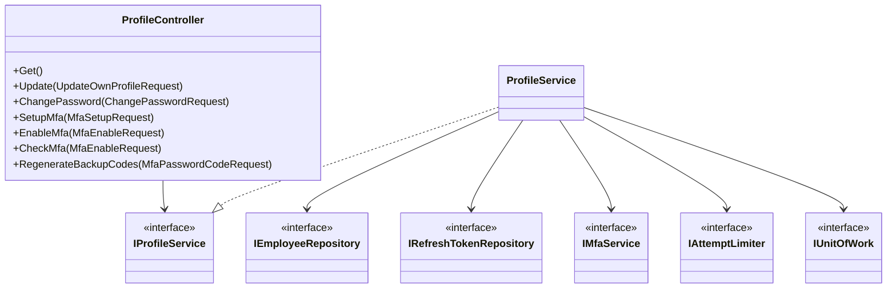
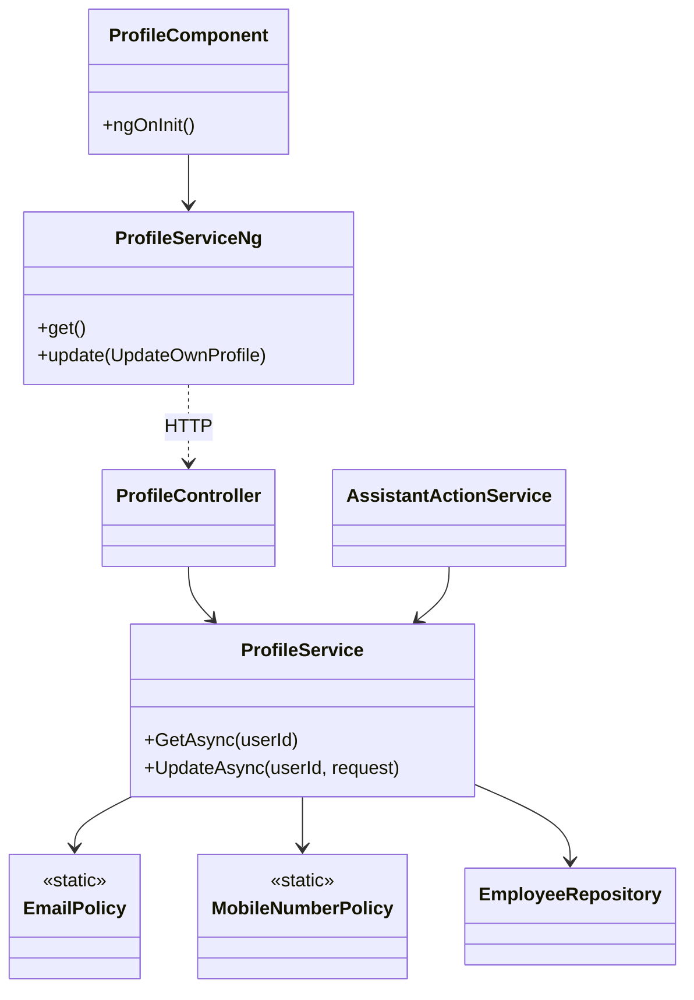
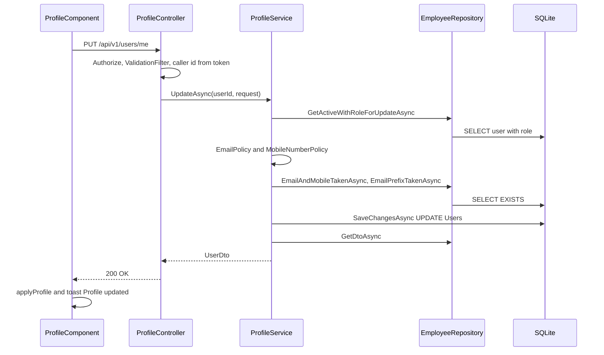
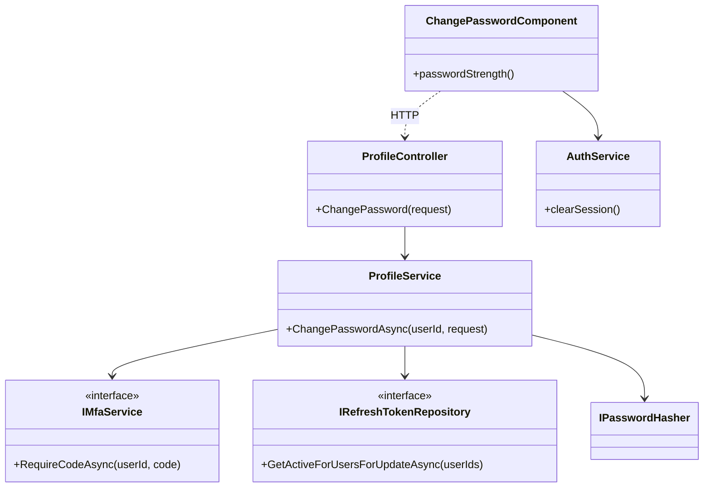
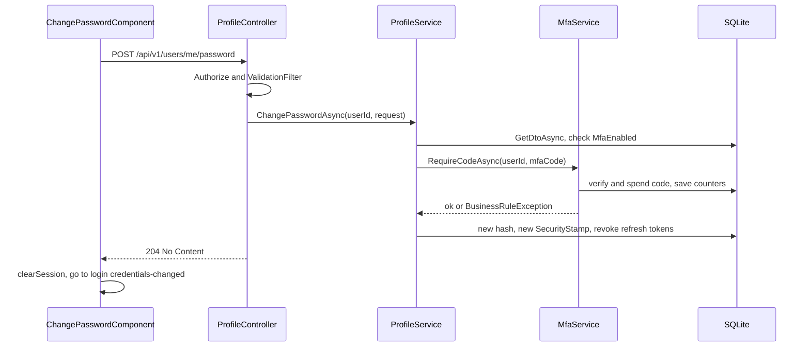
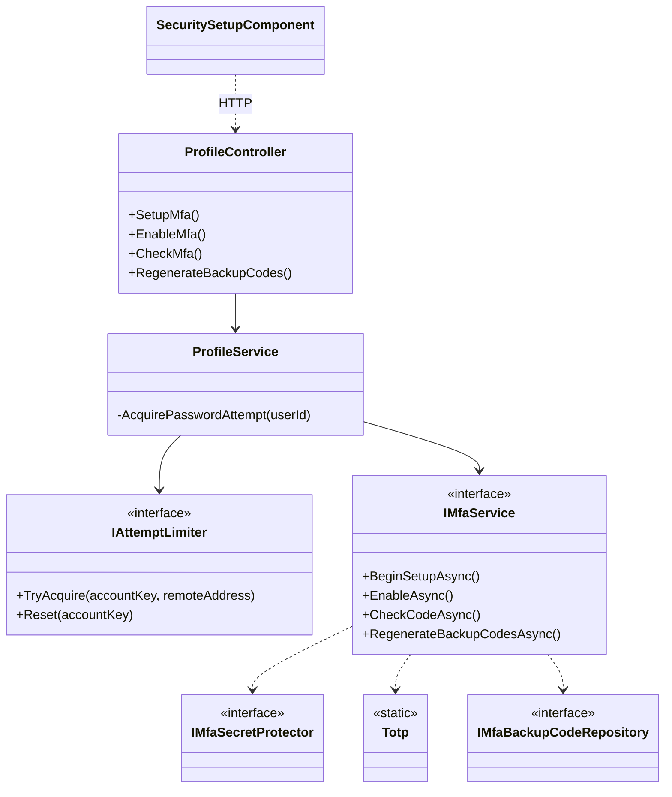
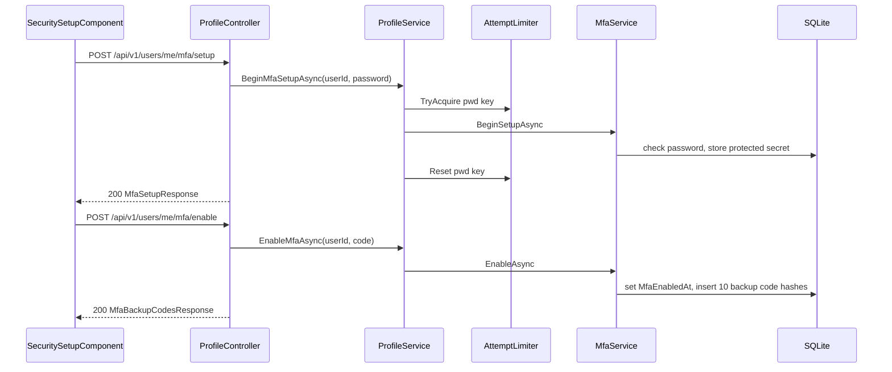
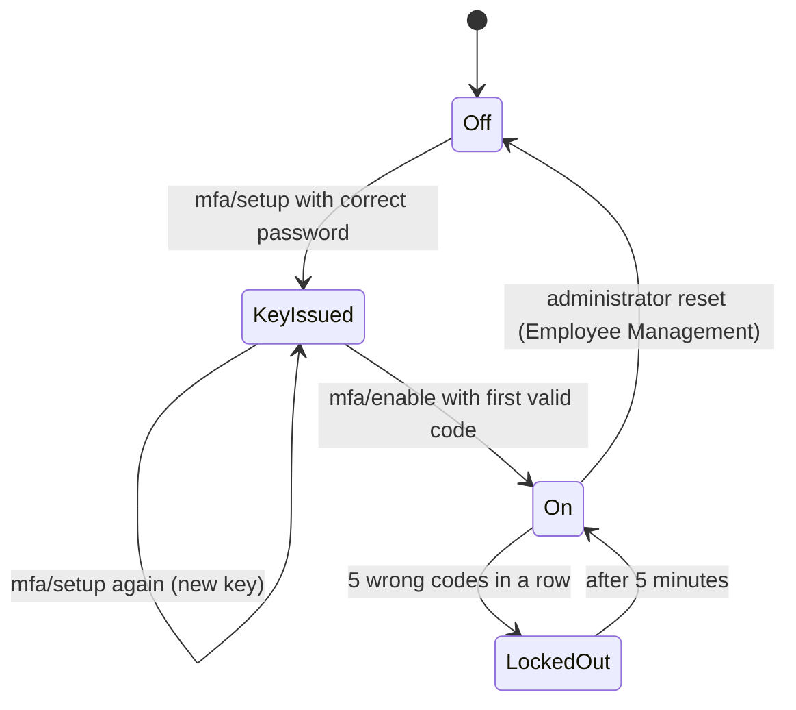
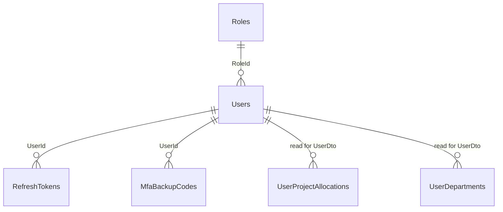

# Low-Level Design – My Profile

## TaskFlow – Intelligent Task Allocation & Tracking System

> **Document:** Low-Level Design (sub-module 07.1 My Profile, code `PROF`)  ·  **Version:** 1.0  ·  **Status:** Draft
> **Project type:** Personal Project (Skill Development)  ·  **Date:** 31-Oct-2026
> **Author:** Jojo George (jojogeorge3344@gmail.com)
> **Based on:** HLD-My-Profile v1.0, FRD-My-Profile v1.0, TDD v2.0
> © 2026 Jojo George. All rights reserved.

---

## Document Control

| Version | Date | Author | Summary of changes |
|---|---|---|---|
| 1.0 | 31-Oct-2026 | Jojo George | Initial version: `ProfileController` (7 actions), `ProfileService`, reused MFA/limiter classes, `Users` / `RefreshTokens` / `MfaBackupCodes` columns, tests and FR-PROF traceability |

**Related documents:** BRD (`../../../BRD/07-My-Profile/07.1-My-Profile/BRD-My-Profile.md`) · FRD (`../../../FRD/07-My-Profile/07.1-My-Profile/FRD-My-Profile.md`) · HLD (`../../../HLD/07-My-Profile/07.1-My-Profile/HLD-My-Profile.md`) · Overall LLD (`../../00-Overall/LLD-TaskFlow-Overall.md`) · TDD (`TF - Documents/TF - TDD/TDD-TaskFlow.md`)

---

## 1. Introduction

### 1.1 Purpose
Detailed design of the My Profile sub-module as built: the classes and files of the self-service account API
(`/api/v1/users/me`), the My Profile and Change Password screens, the self-service two-step verification endpoints used
by the Security Setup screen, the table columns they read and write, validation and error rules, security checks and
tests. Every `FR-PROF-nn` of the FRD is traced to an endpoint or class and a test in §11.

### 1.2 Scope & Conventions
- Child modules covered: **07.1.1 User Profile** (2 actions), **07.1.2 Change Password** (1 action), **07.1.3 Two-Step
  Verification** (4 actions). Total: **7 controller actions**, all on `ProfileController` (facts.md §3, rows
  `ProfileController`).
- Out of scope (other documents): sign-in, MFA challenge and account recovery (`AuthController`,
  `PasswordRecoveryController` – overall LLD); the Security Setup screen layout (Authentication, overall LLD);
  administrator MFA reset `POST /api/v1/users/{id}/mfa/reset` (Employee Management LLD).
- Naming: `*Controller`, `I*Service`/`*Service`, `I*Repository`/`*Repository`, DTOs `*Request`/`*Response`/`*Dto`,
  validators `*RequestValidator`.
- API base path `/api/v1`; JSON camelCase; errors as `application/problem+json` (`ProblemDetails`).
- Paths are relative to `backend/src/TaskFlow.Api/` (backend) and `frontend/src/app/` (frontend).

---

## 2. Code Structure

Shared layout and layer rules are described in the overall LLD (`../../00-Overall/LLD-TaskFlow-Overall.md`); only the
My Profile part is shown here.

### 2.1 Backend Folder Layout

```
TaskFlow.Api/
  Controllers/Profile/ProfileController.cs
  Services/Profile/IProfileService.cs, ProfileService.cs
  Dtos/Profile/ProfileRequests.cs
  Dtos/Profile/Validators/UpdateOwnProfileRequestValidator.cs   (also ChangePasswordRequestValidator)
  Common/Rules/EmailPolicy.cs, MobileNumberPolicy.cs
  -- reused from other modules --
  Repositories/Management/EmployeeManagement/Employees/IEmployeeRepository.cs, EmployeeRepository.cs
  Repositories/Auth/RefreshTokens/IRefreshTokenRepository.cs, RefreshTokenRepository.cs
  Repositories/Auth/Accounts/IAccountRepository.cs, Repositories/Auth/Mfa/IMfaBackupCodeRepository.cs
  Services/Auth/Mfa/IMfaService.cs, MfaService.cs
  Services/Auth/AttemptLimits/IAttemptLimiter.cs, AttemptLimiter.cs
  Integrations/Security/MfaSecrets/MfaSecretProtector.cs, Integrations/Security/OneTimeCodes/Totp.cs
  Dtos/Auth/Mfa/MfaRequests.cs, MfaResults.cs, Validators/MfaRequestValidators.cs
  Dtos/Management/EmployeeManagement/UserDto.cs
  Middleware/MfaSetupGateMiddleware.cs, SessionValidation.cs, GlobalExceptionHandler.cs
  Filters/ValidationFilter.cs
  Config/MfaOptions.cs, ServiceRegistration.cs
```

### 2.2 Frontend Folder Layout

```
src/app/modules/profile/
  profile.routes.ts                       (PROFILE_ROUTES)
  pages/profile.component.ts|html, profile.model.ts
  pages/change-password.component.ts|html, change-password.model.ts
  services/profile.service.ts
src/app/modules/auth/security-setup/pages/security-setup.component.ts   (consumer of the MFA endpoints)
src/app/modules/management/employee-management/models/user.model.ts     (User, UpdateOwnProfile, ChangePassword)
src/app/shared/auth/auth.guard.ts (authGuard, mfaSetupGuard), auth.service.ts (applyProfile, clearSession), login-reasons.ts
src/app/shared/utils/email-domain.ts, mobile-number.ts, api-error.ts
src/app/layouts/nav-items.ts, shell.component.html
```

### 2.3 Layer Rules

| Rule | Enforced by |
|---|---|
| Controller → Service → Repository only; `ProfileController` calls only `IProfileService` | `ArchitectureTests` (`TaskFlow.UnitTests/Architecture/ArchitectureTests.cs`) |
| Feature folders follow the module tree (`modules/profile/{pages,services}`) | `npm run check:structure` (`scripts/check-frontend-structure.mjs`) |
| The user id is never taken from route or body, only from the token claim | `ProfileController.TryGetCallerId` (code review) |

---

## 3. Cross-Cutting Design

| Concern | Design |
|---|---|
| Validation | FluentValidation run by the global `ValidationFilter` (400 `ValidationProblemDetails` with an `errors` map); business checks in `ProfileService` throw `BusinessRuleException` (400) |
| Error handling | `GlobalExceptionHandler` maps `AppException` subclasses to their status, title and `detail` (§3.1) |
| Transactions | `IUnitOfWork.SaveChangesAsync` once per write; `MfaService` saves its own counter changes |
| Authorization | Class-level `[Authorize]` only; the four `profile.*` keys are Always On and never checked (§7) |
| Logging | Request logging middleware (overall LLD); `ProfileService` writes no audit or activity entry |
| Time & time zone | `DateTime.UtcNow` for `UpdatedAt`, `RevokedAt`; display conversion in the Angular client |

### 3.1 Exception → HTTP Status

| Exception | Status | When (My Profile) |
|---|---|---|
| `RequestValidationException` / `ValidationFilter` | 400 | Validator failure (field `errors` map) |
| `BusinessRuleException` | 400 | Invalid email or mobile, email taken, email + mobile taken, MFA off for password change, wrong code, code lockout (password, enable, backup codes) |
| `RateLimitedException` | 429 | Current-password budget spent (`mfa/setup`, `mfa/backup-codes`) |
| `ConcurrencyConflictException` (: `ConflictException`) | 409 | Concurrency token on `Users` changed between read and save |
| – (`NotFound()` from controller) | 404 | Service returned `null` (user deleted) |
| – (`Unauthorized()` from controller) | 401 | `ClaimTypes.NameIdentifier` missing or not an integer |
| – (middleware) | 403 | `MfaSetupGateMiddleware` while setup is pending (code `mfa_setup_required`) |

---

## 4. Module Designs

### 4.1 Module: My Profile (`PROF`)

`ProfileController` (`[Route("api/v1/users/me")]`, `[Authorize]`) has **7 actions**: `Get`, `Update`, `ChangePassword`,
`SetupMfa`, `EnableMfa`, `CheckMfa`, `RegenerateBackupCodes`. DI: `IProfileService` → `ProfileService` (scoped),
`IAttemptLimiter` → `AttemptLimiter` (singleton), `IMfaService` → `MfaService` (scoped), `MfaOptions` bound from the
`Mfa` section (`Config/ServiceRegistration.cs`).

**Module class diagram**



#### 4.1.1 Child module: User Profile

**Class / file inventory**

| Layer | Type | File | Responsibility |
|---|---|---|---|
| Controller | `ProfileController.Get`, `ProfileController.Update` | `Controllers/Profile/ProfileController.cs` | HTTP routing; caller id from `ClaimTypes.NameIdentifier` (`TryGetCallerId`) |
| Service | `IProfileService` / `ProfileService` (`GetAsync`, `UpdateAsync`) | `Services/Profile/` | Email/mobile rules, uniqueness, save |
| Repository (reused) | `IEmployeeRepository` / `EmployeeRepository` | `Repositories/Management/EmployeeManagement/Employees/` | `GetDtoAsync`, `GetActiveWithRoleForUpdateAsync`, `EmailPrefixTakenAsync`, `EmailAndMobileTakenAsync` |
| DTOs | `UpdateOwnProfileRequest`; `UserDto`, `ProjectAllocationDto`, `UserDepartmentDto`, `UserManagerDto`, `ManagerProjectDto`, `ManagerReportDto` | `Dtos/Profile/ProfileRequests.cs`; `Dtos/Management/EmployeeManagement/UserDto.cs` | Contracts |
| Validator | `UpdateOwnProfileRequestValidator` | `Dtos/Profile/Validators/UpdateOwnProfileRequestValidator.cs` | Input rules |
| Rules | `EmailPolicy` (`Normalize`, `IsValid`, `LocalPart`, `Domain = "taskflow.com"`, `MaxLocalPartLength = 64`), `MobileNumberPolicy` (`Normalize`, `IsValid`) | `Common/Rules/` | Shared email/mobile policy |
| Frontend page | `ProfileComponent` | `modules/profile/pages/profile.component.ts/.html` | Header, chips, Account details, Personal information form, Password card |
| Frontend models | `ProfileField`, `ReadonlyField`; `User`, `UpdateOwnProfile` | `pages/profile.model.ts`; `management/employee-management/models/user.model.ts` | Form and API models |
| Frontend service | `ProfileService` (`get`, `update`) | `modules/profile/services/profile.service.ts` | HTTP calls |
| Frontend shared | `AuthService.applyProfile`; `email-domain.ts`, `mobile-number.ts`, `apiErrorMessage()` | `shared/auth/auth.service.ts`; `shared/utils/` | Top-bar re-sync, client rules, error text |
| Consumers | `SecuritySetupComponent` (step 1); `AssistantActionService` (TFA, confirmed `UpdateOwnProfile`) | `modules/auth/security-setup/pages/`; `Services/Assistant/Actions/` | Same `UpdateAsync` rules |

**Class diagram**



`ProfileServiceNg` stands for the Angular `ProfileService` (same class name as the .NET service).

**API contracts**

| # | Method | Route | Permission / policy | Request | Response | Status codes |
|---|---|---|---|---|---|---|
| 1 | GET | `/api/v1/users/me` | `[Authorize]`; catalog key `profile.view` (Always On, not checked); open while setup is pending | – | `UserDto` | 200, 401, 404 |
| 2 | PUT | `/api/v1/users/me` | `[Authorize]`; catalog key `profile.edit` (Always On, not checked); open while setup is pending | `UpdateOwnProfileRequest(FullName, Email, MobileNumber = null)` | `UserDto` | 200, 400, 401, 404, 409 |

**Request / response example**

```json
// PUT /api/v1/users/me
{ "fullName": "Anita Varghese", "email": "anita.v@taskflow.com", "mobileNumber": "+919876543210" }
```

```json
// 200 OK (UserDto, abridged)
{ "id": 12, "employeeCode": "EMP012", "fullName": "Anita Varghese", "username": "anita",
  "email": "anita.v@taskflow.com", "roleId": 3, "role": "Employee", "isActive": true,
  "updatedAt": "2026-10-31T10:00:00Z", "lastLoginAt": "2026-10-31T08:55:00Z",
  "projectAllocations": [ { "projectId": 2, "projectName": "Apollo", "positionId": 4, "positionName": "Developer", "percent": 60 } ],
  "departments": [ { "id": 1, "name": "Engineering" } ], "managers": [ { "id": 5, "fullName": "Rahul Menon" } ],
  "managerProjects": [], "reports": [], "mfaEnabled": true, "backupCodesRemaining": 9,
  "mobileNumber": "+919876543210", "totalAllocatedPercent": 60, "remainingPercent": 40 }
```

`mobileNumber`: omitted or `null` keeps the stored number; empty or blank clears it. The Angular form always sends a
string, so an empty field clears it. The TFA path passes `null`, so the number is kept (FR-PROF-16).

**Service logic – `GetAsync(userId)`**
1. Return `IEmployeeRepository.GetDtoAsync(userId)` – a no-tracking projection of the non-deleted user with allocations,
   departments, managers (department managers and project leads), and for managers `ManagerProjects` and `Reports`,
   plus `MfaEnabled` (`MfaEnabledAt != null`) and `BackupCodesRemaining` (unused `MfaBackupCodes`).
2. `null` → controller returns 404.

**Service logic – `UpdateAsync(userId, request)`**
1. `ValidationFilter` has already run `UpdateOwnProfileRequestValidator`; failures return 400 with the `errors` map.
2. `GetActiveWithRoleForUpdateAsync(userId)` loads the tracked user with `Role`; `null` → return `null` (404).
3. `EmailPolicy.Normalize(request.Email)` trims and lower-cases; `!EmailPolicy.IsValid` → `BusinessRuleException(EmailPolicy.InvalidMessage)`.
4. Mobile: `request.MobileNumber is null` → keep `user.MobileNumber`; otherwise `MobileNumberPolicy.Normalize` (removes
   whitespace, `-`, `.`, `(`, `)`; blank → `null`); a non-null value failing `IsValid` → `BusinessRuleException(MobileNumberPolicy.InvalidMessage)`.
5. Mobile not null and `EmailAndMobileTakenAsync(email, mobile, userId)` → `BusinessRuleException("A user with this email and mobile number already exists.")`.
6. `EmailPrefixTakenAsync(EmailPolicy.LocalPart(email) + "@", userId)` → `BusinessRuleException("Email already exists.")` (deleted users included).
7. Set `FullName` (trimmed), `Email`, `MobileNumber`, `UpdatedAt = DateTime.UtcNow`. Role, projects, username, employee
   code and status are not touched (absent from the contract).
8. `IUnitOfWork.SaveChangesAsync`; return a fresh `GetAsync`.
9. No notification, mail, activity or audit entry (FR-PROF-17).
10. Client: on 200 `ProfileComponent` calls `AuthService.applyProfile(...)` (top-bar name) and shows the toast "Profile
    updated"; 400 `errors` keys are mapped onto the form controls.

**Sequence diagram**



**Repository methods**

| Method | Query / purpose | Notes |
|---|---|---|
| `IEmployeeRepository.GetDtoAsync(id)` | Project one user to `UserDto` | `AsNoTracking`, global filter `!IsDeleted`; extra queries for `Managers` and `Reports` |
| `IEmployeeRepository.GetActiveWithRoleForUpdateAsync(id)` | Tracked user with `Role` | `Include(Role)`, `!IsDeleted`; does not filter `IsActive` (inactive users are stopped by `SessionValidation`) |
| `IEmployeeRepository.EmailPrefixTakenAsync(prefix, exceptUserId)` | Another user's email starts with `localpart@` | `IgnoreQueryFilters()` (deleted users count); `Email.ToLower().StartsWith(prefix)` |
| `IEmployeeRepository.EmailAndMobileTakenAsync(email, mobile, exceptUserId)` | Same email and mobile pair on another user | Global filter on (deleted users excluded) |

**Validation rules**

| Field | Rule | Message |
|---|---|---|
| `FullName` | `NotEmpty`, `MaximumLength(200)` (validator); trimmed on save | FluentValidation default (e.g. "'Full Name' must not be empty."); client: "Full name is required." / "This field is too long." |
| `Email` | `NotEmpty`, `Must(EmailPolicy.IsValid)`, `MaximumLength(256)` | "Email must be a name using letters, digits, dot, underscore or hyphen followed by @taskflow.com." (`EmailPolicy.InvalidMessage`); client: "Email is required." / "Use letters, digits, dot, underscore or hyphen before @taskflow.com." |
| `MobileNumber` | `Must(MobileNumberPolicy.IsValid)` when not blank: `+`, 8–15 digits, no leading zero after `+` | "Mobile number must be in international format, for example +919876543210." (`MobileNumberPolicy.InvalidMessage`); client: "Use international format, for example +919876543210." |
| `Email` (service) | Local part not used by another account, deleted included | "Email already exists." |
| `Email` + `MobileNumber` (service) | Pair not used by another user | "A user with this email and mobile number already exists." |

**Error cases**

| Case | Exception | Status |
|---|---|---|
| Token without a parsable `NameIdentifier` | – (`Unauthorized()`) | 401 |
| User deleted | – (`NotFound()`) | 404 |
| Validator failure | `ValidationFilter` | 400 |
| Invalid email / mobile, email taken, pair taken | `BusinessRuleException` | 400 |
| Concurrency token changed while saving | `ConcurrencyConflictException` → "Someone else changed this record while you were saving. Reload it and try again." | 409 |
| Load failed (client) | – | "Could not load your profile." with **Retry** |
| Save failed without reason (client) | – | "Could not update your profile." |

> ⚠️ To be confirmed: `Users` has concurrency tokens only on `MfaLastUsedStep` and `MfaFailedAttempts`. The 409 of
> FR-PROF-13 is raised when one of those changed between load and save; two plain profile saves of the same row are
> otherwise last-write-wins.

**State machine:** _Not applicable for this child module._

#### 4.1.2 Child module: Change Password

**Class / file inventory**

| Layer | Type | File | Responsibility |
|---|---|---|---|
| Controller | `ProfileController.ChangePassword` | `Controllers/Profile/ProfileController.cs` | `POST password`; 204 on success |
| Service | `ProfileService.ChangePasswordAsync` | `Services/Profile/ProfileService.cs` | MFA-on check, step-up, hash, stamp rotation, refresh-token revoke |
| Service (reused) | `IMfaService.RequireCodeAsync` → `VerifyAsync(allowBackupCode: true)` | `Services/Auth/Mfa/` | Code check, spend, lockout |
| Repository (reused) | `IEmployeeRepository`, `IRefreshTokenRepository.GetActiveForUsersForUpdateAsync`; inside `MfaService`: `IAccountRepository.FindLiveForUpdateAsync`, `IMfaBackupCodeRepository.FindUnusedForUpdateAsync` | `Repositories/…` | Reads and tracked updates |
| Hashing | `IPasswordHasher<User>` | ASP.NET Core Identity | `HashPassword` |
| DTO | `ChangePasswordRequest(NewPassword, MfaCode = null)` | `Dtos/Profile/ProfileRequests.cs` | No current-password field (by design) |
| Validator | `ChangePasswordRequestValidator` (`MinPasswordLength = 6`, `MaxPasswordLength = 128`) | `Dtos/Profile/Validators/UpdateOwnProfileRequestValidator.cs` | Input rules |
| Middleware | `SessionValidation` | `Middleware/SessionValidation.cs` | Rejects access tokens with an old `SecurityStamp` |
| Frontend page | `ChangePasswordComponent` (`passwordStrength()`, `<dialog>` "Confirm it is you") | `modules/profile/pages/change-password.component.ts/.html` | Form, strength meter, code popup |
| Frontend model | `PasswordField`; `ChangePassword` | `pages/change-password.model.ts`; `user.model.ts` | Form and API models |
| Frontend service | `ProfileService.changePassword` | `modules/profile/services/profile.service.ts` | HTTP call |
| Frontend shared | `AuthService.clearSession`; `login-reasons.ts` (`credentials-changed`) | `shared/auth/` | Sign-out and login message |

**Class diagram**



**API contracts**

| # | Method | Route | Permission / policy | Request | Response | Status codes |
|---|---|---|---|---|---|---|
| 3 | POST | `/api/v1/users/me/password` | `[Authorize]`; catalog key `profile.password.change` (Always On, not checked); blocked by `MfaSetupGateMiddleware` while setup is pending | `ChangePasswordRequest` | – | 204, 400, 401, 403 (`mfa_setup_required`), 404 |

**Request / response example**

```json
// POST /api/v1/users/me/password
{ "newPassword": "N3w-Secret!", "mfaCode": "123456" }
```

```json
// 400 Bad Request (BusinessRuleException)
{ "title": "Bad Request", "status": 400, "detail": "The code is incorrect or has expired." }
```

**Service logic – `ChangePasswordAsync(userId, request)`**
1. `ChangePasswordRequestValidator` (via `ValidationFilter`): `NewPassword` not empty, 6–128 characters; `MfaCode` max 32.
2. `GetAsync(userId)`; `null` → return `null` (404).
3. `!current.MfaEnabled` → `BusinessRuleException(MfaRequiredForPasswordMessage)` = "Set up two-step verification before
   changing your password." (defence in depth behind the setup gate).
4. `IMfaService.RequireCodeAsync(userId, request.MfaCode)`: blank → "Enter the code from your authenticator app.";
   `VerifyAsync(allowBackupCode: true)` spends the code (advances `MfaLastUsedStep` or sets `MfaBackupCode.UsedAt`);
   `Invalid` → "The code is incorrect or has expired."; `LockedOut` → "Too many wrong codes. Try again in a few minutes."
   (all `BusinessRuleException`, 400).
5. `GetActiveWithRoleForUpdateAsync(userId)`; set `PasswordHash = IPasswordHasher<User>.HashPassword(user, NewPassword)`, `UpdatedAt = now`.
6. `SecurityStamp = Guid.NewGuid().ToString("N")` – access tokens carrying the old stamp fail `SessionValidation`.
7. `GetActiveForUsersForUpdateAsync([userId])` → `RevokedAt = now` on every active refresh token.
8. `SaveChangesAsync`; controller returns 204.
9. Client: `AuthService.clearSession()` and navigate to `/login?reason=credentials-changed` ("Your username or password
   was changed. Sign in again with your new details.").
10. No notification or mail (FR-PROF-29).

**Sequence diagram**



**Repository methods**

| Method | Query / purpose | Notes |
|---|---|---|
| `IEmployeeRepository.GetDtoAsync(id)` | Read `MfaEnabled` before step-up | No tracking |
| `IEmployeeRepository.GetActiveWithRoleForUpdateAsync(id)` | Tracked user for hash and stamp | `Include(Role)` |
| `IRefreshTokenRepository.GetActiveForUsersForUpdateAsync(userIds)` | Active refresh tokens to revoke | Tracked; query filter hides tokens of deleted users |
| `IAccountRepository.FindLiveForUpdateAsync(userId)` (in `MfaService`) | Tracked user for code check | Auth module |
| `IMfaBackupCodeRepository.FindUnusedForUpdateAsync(userId, codeHash)` (in `MfaService`) | Unused backup code | Index `(UserId, CodeHash)`; `UsedAt` concurrency token |

**Validation rules**

| Field | Rule | Message |
|---|---|---|
| `NewPassword` | `NotEmpty`, `MinimumLength(6)`, `MaximumLength(128)` | FluentValidation default; client: "Required." / "Password must be at least 6 characters." / "Password must be at most 128 characters." |
| Confirm new password (client only) | Equal to New password | "Passwords do not match." |
| `MfaCode` | `MaximumLength(32)`; required by `RequireCodeAsync` | "Enter the code from your authenticator app." |
| `MfaCode` | 6-digit TOTP of the stored key or unused backup code, not used before | "The code is incorrect or has expired." |

**Error cases**

| Case | Exception | Status |
|---|---|---|
| Setup pending (token has `mfa_setup_required` claim) | `MfaSetupGateMiddleware` – "Set up two-step verification to continue." | 403 |
| MFA off | `BusinessRuleException(MfaRequiredForPasswordMessage)` | 400 |
| Code missing / wrong / expired / replayed | `BusinessRuleException` | 400 |
| 5 wrong codes in a row | `BusinessRuleException(MfaService.LockedMessage)` | 400 |
| Validator failure | `ValidationFilter` | 400 |
| User deleted | – (`NotFound()`) | 404 |
| Code rejected without detail (client) | – | "That code did not work. Try the new code from your app." |
| Password rejected without detail (client) | – | "Could not change your password." |

**State machine:** _Not applicable for this child module_ (the shared code lockout is shown in 4.1.3).

#### 4.1.3 Child module: Two-Step Verification (self-service MFA)

**Class / file inventory**

| Layer | Type | File | Responsibility |
|---|---|---|---|
| Controller | `ProfileController.SetupMfa`, `EnableMfa`, `CheckMfa`, `RegenerateBackupCodes` | `Controllers/Profile/ProfileController.cs` | HTTP routing; `CheckMfa` maps `MfaVerifyOutcome` to 204 / 400 / 429 |
| Service | `ProfileService.BeginMfaSetupAsync`, `EnableMfaAsync`, `CheckMfaCodeAsync`, `RegenerateBackupCodesAsync`, private `AcquirePasswordAttempt` | `Services/Profile/ProfileService.cs` | Password attempt budget, delegation |
| Service (reused) | `IMfaService` / `MfaService` (`BeginSetupAsync`, `EnableAsync`, `CheckCodeAsync`, `RegenerateBackupCodesAsync`, `VerifyAsync`) | `Services/Auth/Mfa/` | TOTP key, verification, backup codes, lockout |
| Service (reused) | `IAttemptLimiter` / `AttemptLimiter` (`PasswordKey(userId)` = `"pwd:" + userId`, `TryAcquire`, `Reset`) | `Services/Auth/AttemptLimits/` | 5 password attempts per account in a 5-minute sliding window (in memory) |
| Integrations | `IMfaSecretProtector` / `MfaSecretProtector`; `Totp` (`NewSecret`, `ProvisioningUri`, `TryValidate`, `Digits`) | `Integrations/Security/MfaSecrets/`, `Integrations/Security/OneTimeCodes/` | Key encryption, TOTP |
| Repository (reused) | `IAccountRepository`, `IMfaBackupCodeRepository` (`GetForUserForUpdateAsync`, `FindUnusedForUpdateAsync`, `Add`, `Remove`) | `Repositories/Auth/Accounts/`, `Repositories/Auth/Mfa/` | User and backup codes |
| DTOs | `MfaSetupRequest`, `MfaSetupResponse`, `MfaEnableRequest`, `MfaPasswordCodeRequest`, `MfaBackupCodesResponse`; `MfaSetupResult`, `MfaVerifyOutcome` | `Dtos/Auth/Mfa/MfaRequests.cs`, `MfaResults.cs` | Contracts |
| Validators | `MfaSetupRequestValidator`, `MfaEnableRequestValidator`, `MfaPasswordCodeRequestValidator` | `Dtos/Auth/Mfa/Validators/MfaRequestValidators.cs` | Input rules |
| Middleware | `MfaSetupGateMiddleware` (`ErrorCode = "mfa_setup_required"`) | `Middleware/MfaSetupGateMiddleware.cs` | Allow-list while setup is pending |
| Config | `MfaOptions` (`Issuer`, `Required`, `MaxFailedAttempts`, `LockoutMinutes`, `BackupCodeCount`) | `Config/MfaOptions.cs` | Settings |
| Frontend service | `ProfileService.startMfaSetup`, `enableMfa`, `checkMfaCode` (unused) | `modules/profile/services/profile.service.ts` | HTTP calls |
| Frontend consumer | `SecuritySetupComponent` | `modules/auth/security-setup/pages/security-setup.component.ts` | Password → QR code (`qrcode` package) → first code → backup codes, Copy all, Download `taskflow-backup-codes.txt` |
| Frontend guard | `mfaSetupGuard` | `shared/auth/auth.guard.ts` | Redirects to `/security-setup` while setup is pending |

**Class diagram**



**API contracts**

| # | Method | Route | Permission / policy | Request | Response | Status codes |
|---|---|---|---|---|---|---|
| 4 | POST | `/api/v1/users/me/mfa/setup` | `[Authorize]`; catalog key `profile.mfa.manage` (Always On, not checked); open while setup is pending | `MfaSetupRequest(CurrentPassword)` | `MfaSetupResponse(Key, ProvisioningUri)` | 200, 400, 401, 404, 429 |
| 5 | POST | `/api/v1/users/me/mfa/enable` | as above | `MfaEnableRequest(Code)` | `MfaBackupCodesResponse(Codes)` | 200, 400, 401, 404 |
| 6 | POST | `/api/v1/users/me/mfa/check` | as above | `MfaEnableRequest(Code)` | – | 204, 400, 401, 429 |
| 7 | POST | `/api/v1/users/me/mfa/backup-codes` | as above | `MfaPasswordCodeRequest(CurrentPassword, Code)` | `MfaBackupCodesResponse(Codes)` | 200, 400, 401, 404, 429 |

**Request / response example**

```json
// POST /api/v1/users/me/mfa/setup
{ "currentPassword": "my-current-password" }
```

```json
// 200 OK
{ "key": "JBSWY3DPEHPK3PXP", "provisioningUri": "otpauth://totp/..." }
```

```json
// POST /api/v1/users/me/mfa/enable  { "code": "123456" }  ->  200 OK
{ "codes": [ "ABCDE-FGHIJ", "KLMNO-PQRST" ] }
```

```json
// POST /api/v1/users/me/mfa/backup-codes
{ "currentPassword": "my-current-password", "code": "123456" }
```

> ⚠️ To be confirmed: the exact `provisioningUri` text is produced by `Totp.ProvisioningUri(issuer, email, secret)`; the
> sample is shortened. Backup codes are shown as `XXXXX-XXXXX` (10 per set).

**Service logic – `BeginMfaSetupAsync(userId, currentPassword)`**
1. `AcquirePasswordAttempt`: `IAttemptLimiter.TryAcquire(IAttemptLimiter.PasswordKey(userId), remoteAddress: null)`;
   false → `RateLimitedException(TooManyAttemptsMessage)` = "Too many attempts. Try again in a few minutes." (429).
2. `MfaService.BeginSetupAsync`: wrong password → "Current password is incorrect." (400); MFA already on → "Authenticator
   MFA is already on. Turn it off first to set it up again." (400); otherwise `Totp.NewSecret()`, stored encrypted in
   `MfaSecretProtected` via `IMfaSecretProtector`; step, failed attempts and lockout reset; returns `MfaSetupResult(Key, ProvisioningUri)`.
3. Success → `_limiter.Reset(passwordKey)`; a thrown error leaves the attempt counted.

**Service logic – `EnableMfaAsync(userId, code)`** → `MfaService.EnableAsync`
1. MFA already on → "Authenticator MFA is already on."; no stored key → "Start the setup first to get a key." (400).
2. `VerifyAsync(allowBackupCode: false)`; `Invalid` / `LockedOut` → `BusinessRuleException` (400).
3. Set `MfaEnabledAt`; delete existing codes and create `MfaOptions.BackupCodeCount` (10) new codes; store SHA-256 hex
   in `MfaBackupCodes.CodeHash`; return the plain codes once.

**Service logic – `CheckMfaCodeAsync(userId, code)`** → `MfaService.CheckCodeAsync`
1. MFA off → `Invalid`.
2. `VerifyCoreAsync(allowBackupCode: false, consumeCode: false, countFailure: true)` – the code is not spent; a wrong code
   counts toward the lockout.
3. Controller: `Success` → 204; `LockedOut` → 429 with `MfaService.LockedMessage`; else 400 with `MfaService.InvalidCodeMessage`.

**Service logic – `RegenerateBackupCodesAsync(userId, currentPassword, code)`**
1. Same password budget as setup (`AcquirePasswordAttempt`).
2. `MfaService.RegenerateBackupCodesAsync`: password check; MFA off → "Authenticator MFA is not on."; `VerifyAsync(allowBackupCode: true)`;
   replace every backup code; return the new set once. Then `_limiter.Reset`.

**Shared verification and lockout** (`MfaService.VerifyCoreAsync`): locked (`MfaLockedUntil > now`) → `LockedOut`; a
6-digit code is checked with `Totp.TryValidate` against `MfaLastUsedStep` (replay protection); otherwise, when allowed,
the normalised backup code hash is looked up unused; success resets `MfaFailedAttempts` and `MfaLockedUntil`; failure
increments it and at `MfaOptions.MaxFailedAttempts` (5) sets `MfaLockedUntil = now + LockoutMinutes` (5) and starts a fresh
count (`MfaFailedAttempts = 0`). The check endpoint validates against step 0, so it does not reject an already spent code. `MfaLastUsedStep`,
`MfaFailedAttempts` and `MfaBackupCode.UsedAt` are concurrency tokens; a lost race is treated as `Invalid`. The counter is
shared with sign-in (`POST /api/v1/auth/mfa/verify`) and the password change (4.1.2).

**Sequence diagram**



**Repository methods**

| Method | Query / purpose | Notes |
|---|---|---|
| `IAccountRepository.FindLiveForUpdateAsync(userId)` | Tracked live user | Auth module |
| `IMfaBackupCodeRepository.GetForUserForUpdateAsync(userId)` | All codes of the user, for replacement | Tracked |
| `IMfaBackupCodeRepository.FindUnusedForUpdateAsync(userId, codeHash)` | One unused code | Index `IX_MfaBackupCodes_UserId_CodeHash` |
| `IMfaBackupCodeRepository.Add` / `Remove` | Insert or delete codes | Saved through `IUnitOfWork` |

**Validation rules**

| Field | Rule | Message |
|---|---|---|
| `CurrentPassword` (`MfaSetupRequest`, `MfaPasswordCodeRequest`) | `NotEmpty`; must match `PasswordHash`; 5 attempts per 5 minutes per account | FluentValidation default / "Current password is incorrect." / "Too many attempts. Try again in a few minutes." |
| `Code` (`MfaEnableRequest`, `MfaPasswordCodeRequest`) | `NotEmpty`, `MaximumLength(32)`; valid TOTP (backup code accepted only for backup-codes) | "The code is incorrect or has expired." |
| Setup state | Setup must have started before enable | "Start the setup first to get a key." |
| MFA state | Off for setup; on for backup codes | "Authenticator MFA is already on. Turn it off first to set it up again." / "Authenticator MFA is not on." |
| Lockout | 5 wrong codes in a row → 5 minutes | "Too many wrong codes. Try again in a few minutes." |

**Error cases**

| Case | Exception | Status |
|---|---|---|
| Password budget spent | `RateLimitedException` | 429 |
| Wrong password, MFA state wrong, no key, wrong code | `BusinessRuleException` | 400 |
| Lockout on enable / backup-codes | `BusinessRuleException(LockedMessage)` | 400 |
| Lockout on check | `Problem(statusCode: 429)` | 429 |
| User deleted | – (`NotFound()`) | 404 |

**State machine – authenticator MFA of one account**



---

## 5. Database Design

My Profile owns no table. It reads and writes columns of `Users` (owned by Employee Management), revokes `RefreshTokens`
(Authentication) and replaces `MfaBackupCodes` (Authentication). Configuration: `Persistence/AppDbContext.cs`.

### 5.1 ER Diagram



### 5.2 Tables

#### `Users` (User)

| Column | Type | Null | Key / index | Default | Description |
|---|---|:---:|---|---|---|
| Id | int | No | PK | identity | Caller id (from the token) |
| EmployeeCode | string(32) | Yes | – | – | Read-only here |
| FullName | string(200) | No | – | – | Edited by `PUT /api/v1/users/me` |
| Username | string(100) | No | Unique `IX_Users_Username` | – | Read-only here |
| Email | string(256) | No | Unique `IX_Users_Email` | – | Edited; lower case, `@taskflow.com` |
| MobileNumber | string(20) | Yes | – (not unique) | – | Edited; international format |
| MfaSecretProtected | string(512) | Yes | – | – | Encrypted TOTP key (setup) |
| MfaEnabledAt | DateTime | Yes | – | – | MFA on when set (enable); drives `MfaEnabled` |
| MfaLastUsedStep | long | No | Concurrency token | 0 | Replay protection |
| MfaFailedAttempts | int | No | Concurrency token | 0 | Shared lockout counter |
| MfaLockedUntil | DateTime | Yes | – | – | Lockout end |
| PasswordHash | string | No | – | – | Replaced by password change; read by setup / backup codes |
| SecurityStamp | string(64) | No | – | – | Rotated by password change |
| RoleId | int | No | FK → `Roles.Id` (Restrict) | – | Read-only here |
| IsActive | bool | No | – | – | Read-only here |
| CreatedAt | DateTime | No | – | – | Read-only |
| UpdatedAt | DateTime | No | – | – | Set on every profile or password save |
| LastLoginAt | DateTime | Yes | – | – | "Last sign-in" chip |
| IsDeleted | bool | No | Global query filter `!IsDeleted` | false | Soft delete |

#### `RefreshTokens` (RefreshToken)

| Column | Type | Null | Key / index | Default | Description |
|---|---|:---:|---|---|---|
| Id | int | No | PK | identity | – |
| UserId | int | No | FK → `Users.Id` (Cascade) | – | Owner |
| TokenHash | string | No | Index `IX_RefreshTokens_TokenHash` | – | Hash of the cookie value |
| ExpiresAt | DateTime | No | – | – | – |
| CreatedAt | DateTime | No | – | – | – |
| RevokedAt | DateTime | Yes | – | – | Set for every active token on password change |

#### `MfaBackupCodes` (MfaBackupCode)

| Column | Type | Null | Key / index | Default | Description |
|---|---|:---:|---|---|---|
| Id | int | No | PK | identity | – |
| UserId | int | No | FK → `Users.Id` (Cascade); index `(UserId, CodeHash)` | – | Owner |
| CodeHash | string(64) | No | Index `(UserId, CodeHash)` | – | SHA-256 hex of the code |
| CreatedAt | DateTime | No | – | – | – |
| UsedAt | DateTime | Yes | Concurrency token | – | Set when spent |

Read-only joins for `UserDto`: `UserProjectAllocations` (+ `Projects`, `Positions`), `UserDepartments` (+ `Departments`),
`DepartmentManagers`, `ManagerProjects` – columns in the Employee, Project and Department Management LLDs.

### 5.3 Indexes, Constraints & Triggers

| Object | Definition | Purpose |
|---|---|---|
| `IX_Users_Email` | Unique (`Email`) | Exact email uniqueness (the local-part rule is enforced in code) |
| `IX_Users_Username` | Unique (`Username`) | Username uniqueness |
| `IX_RefreshTokens_TokenHash` | (`TokenHash`) | Refresh lookup |
| `IX_MfaBackupCodes_UserId_CodeHash` | (`UserId`, `CodeHash`) | Backup code lookup |
| Concurrency tokens | `Users.MfaLastUsedStep`, `Users.MfaFailedAttempts`, `MfaBackupCodes.UsedAt` | A code is spent at most once |
| Query filters | `Users`: `!IsDeleted`; `RefreshTokens`: `!User.IsDeleted` | Hide deleted users |

### 5.4 Enumerations

| Enum | Values | Stored as |
|---|---|---|
| `MfaVerifyOutcome` (`Dtos/Auth/Mfa/MfaResults.cs`) | Success, Invalid, LockedOut | Not stored (service result) |

### 5.5 Migrations

| Migration | Change |
|---|---|
| `20261011171611_InitialAuth` | Creates `Users` and `RefreshTokens` |
| `20261012173144_AddUserSecurityStamp` | Adds `Users.SecurityStamp` |
| `20261019173718_NormalizeEmailDomain` | Rewrites existing emails to the `@taskflow.com` domain |
| `20261023101938_AddMfaAndAccountRecovery` | Adds `MfaEnabledAt`, `MfaFailedAttempts`, `MfaLastUsedStep`, `MfaLockedUntil`, `MfaSecretProtected`, `MobileNumber` to `Users`; creates `MfaBackupCodes` (and `PasswordResetGrants`, Authentication) |

---

## 6. Algorithms & Background Jobs

| Job / algorithm | Trigger / schedule | Steps | Idempotency |
|---|---|---|---|
| Current-password attempt budget (`AttemptLimiter`) | `mfa/setup`, `mfa/backup-codes` | Sliding window of 5 minutes, `AttemptsPerAccount = 5` per key `pwd:{userId}`; reset on success; capped table (`MaxTrackedKeys = 10000`) | In memory, per process; reset on restart |
| TOTP verification (`Totp.TryValidate`) | Every code check | 6 digits; step must be greater than `MfaLastUsedStep` when the code is spent | Concurrency token on `MfaLastUsedStep` |
| Code lockout (`MfaService`) | Every failed code | `MfaFailedAttempts + 1`; at 5 → `MfaLockedUntil = now + 5 min`; success resets | Concurrency token on `MfaFailedAttempts` |
| Session end on password change | `POST /api/v1/users/me/password` | New `SecurityStamp`; revoke refresh tokens | Repeating revokes nothing new |

No background job belongs to this sub-module.

---

## 7. Security Design (detailed)

| Item | Implementation |
|---|---|
| Identity | `ClaimTypes.NameIdentifier` only (`TryGetCallerId`); no id in route or body; unparsable → 401 |
| Permission checks | Class-level `[Authorize]`; `profile.view`, `profile.edit`, `profile.password.change`, `profile.mfa.manage` are `AlwaysGranted: true, IsAssignable: false` in `PermissionCatalog.cs` and are not checked on any endpoint or UI element |
| MFA gate | `MfaSetupGateMiddleware` runs after authentication; while the token has claim `AuthClaims.MfaSetupRequired` (`mfa_setup_required`), only `/api/v1/auth/*`, `/api/v1/users/me/mfa/*` and exactly `/api/v1/users/me` pass; everything else (including `/api/v1/users/me/password`) → 403 `code = mfa_setup_required`. Frontend mirror: `mfaSetupGuard` |
| Password hashing | `IPasswordHasher<User>` (ASP.NET Core Identity, salted); never returned or logged |
| Tokens | Password change rotates `SecurityStamp` (access tokens rejected by `SessionValidation`) and revokes refresh tokens; access/refresh lifetimes from `Jwt:AccessTokenMinutes` / `Jwt:RefreshTokenDays` |
| Second factor | Step-up code for password change (no current password); TOTP key encrypted (`MfaSecretProtector`, Data Protection); backup codes SHA-256 hashed, shown once |
| Brute force | 5 password attempts / 5 minutes / account (`AttemptLimiter`); 5 wrong codes → 5-minute lock shared with sign-in (`MfaOptions`) |
| Privilege escalation | `UpdateOwnProfileRequest` has no role, project, username, code or status field |
| Secrets | `ConnectionStrings:Default`, Data Protection key ring – never logged; values `<secret>` in §8 |

---

## 8. Configuration

| Key | Default | Purpose |
|---|---|---|
| `Mfa:Required` | `true` | Enforce MFA setup before other API use (setup gate) |
| `Mfa:Issuer` | `TaskFlow` | Name in the authenticator app (provisioning URI) |
| `Mfa:MaxFailedAttempts` | `5` (code default, not in JSON) | Wrong codes before lockout |
| `Mfa:LockoutMinutes` | `5` (code default) | Lockout length |
| `Mfa:BackupCodeCount` | `10` (code default) | Codes per set |
| `Jwt:AccessTokenMinutes` / `Jwt:RefreshTokenDays` | `<secret>` (omitted from the fact sheet) | Lifetimes of the sessions a password change ends |
| `ConnectionStrings:Default` | `<secret>` | SQLite database |
| `AttemptLimiter.AttemptsPerAccount` / window | `5` / 5 minutes (constants) | Current-password budget |
| Frontend `PROFILE_ROUTES` | `profile`, `profile/change-password` | Lazy routes under the shell (`authGuard`, `mfaSetupGuard`) |

---

## 9. Testing Design

| Area | Test class / file | Type | Covers |
|---|---|---|---|
| User Profile | `TaskFlow.UnitTests/Profile/UpdateOwnProfileRequestValidatorTests.cs` | Unit | Validator rules (name, email, mobile) |
| User Profile | `TaskFlow.IntegrationTests/Profile/UserProfileEndpointsTests.cs` | Integration | `GET`/`PUT /api/v1/users/me` |
| Change Password | `TaskFlow.IntegrationTests/Auth/Mfa/MfaStepUpEndpointsTests.cs` | Integration | Step-up code on password change |
| Two-step | `TaskFlow.IntegrationTests/Auth/Mfa/MfaEnrolmentEndpointsTests.cs` | Integration | `mfa/setup`, `mfa/enable` |
| Gate | `TaskFlow.IntegrationTests/Auth/Mfa/MfaSetupGateEndpointsTests.cs` | Integration | Allow-list (`/users/me`, `/users/me/mfa/*`), password change blocked |
| MFA logic | `TaskFlow.UnitTests/Auth/Mfa/MfaServiceTests.cs` | Unit | Verification, replay, lockout, backup codes |
| Sign-in counter | `TaskFlow.IntegrationTests/Auth/Mfa/MfaSignInEndpointsTests.cs` | Integration | Lockout shared with sign-in |
| Limiter | `TaskFlow.UnitTests/Auth/AttemptLimits/AttemptLimiterTests.cs` | Unit | Password attempt budget |
| TOTP | `TaskFlow.UnitTests/Integrations/Security/OneTimeCodes/TotpTests.cs` | Unit | TOTP generation and validation |
| TFA path | `TaskFlow.UnitTests/Assistant/Actions/AssistantActionServiceTests.cs`, `Assistant/Tools/AssistantActionToolsTests.cs` | Unit | Confirmed `UpdateOwnProfile`, `ProposeProfileUpdateTool` |
| Architecture | `TaskFlow.UnitTests/Architecture/ArchitectureTests.cs` | Unit | Layer rules |
| Support | `TaskFlow.IntegrationTests/TestSupport/MfaTestSupport.cs`, `TaskFlow.UnitTests/TestSupport/AcceptingMfaService.cs` | Helper | MFA test helpers |

> ⚠️ To be confirmed: coverage is inferred from file names only. No Angular `*.spec.ts` exists for `modules/profile`, and no
> test file name refers to `mfa/check` or `mfa/backup-codes`.

---

## 10. Known Limitations & Open Issues

- No audit or activity entry is written for profile edits, password changes or MFA setup.
- Concurrency: see the ⚠️ note in 4.1.1 – two plain profile saves are last-write-wins (FR-PROF-13 partly met).
- Lockout status differs: 429 from `mfa/check`, 400 from password change, enable and backup-codes.
- `POST /api/v1/users/me/mfa/backup-codes` has no frontend caller; Angular `ProfileService.checkMfaCode()` is never used
  (FR-PROF-38, FR-PROF-39 server-only).
- `GetActiveWithRoleForUpdateAsync` does not filter `IsActive` (inactive users are stopped by `SessionValidation`).
- `ProfileComponent` shows Managed projects and Team when `user.role === 'Manager'` (role name, not permission).
- `passwordStrength()` tests `/d/` instead of `/\d/` (strength meter guidance only).
- Help topic `edit-profile.md` and `AssistantTexts.PasswordGuidance` describe an older flow (Account details editing, current
  password, "other sessions"); the TFA pre-check `EmailUsedByOtherAsync` differs from the local-part rule of `UpdateAsync`.
- `PUT /api/v1/users/{id}` (Employee Management) accepts a new password with `employees.edit`, outside the step-up flow.
- `profile-shared.css`, `profile.component.css`, `change-password.component.css` are referenced in `styleUrls` but not in
  the source snapshot. ⚠️ To be confirmed.

---

## 11. Traceability (FRD → code)

| FRD requirement | Endpoint / class | Test |
|---|---|---|
| FR-PROF-01 | `GET /api/v1/users/me` · `ProfileController.TryGetCallerId` · `ProfileService.GetAsync` | `UserProfileEndpointsTests` |
| FR-PROF-02 | `GET /api/v1/users/me` · `UserDto` (`MfaEnabled`, `LastLoginAt`, `ProjectAllocations`) · `ProfileComponent` | `UserProfileEndpointsTests` |
| FR-PROF-03 | `UserDto` (`TotalAllocatedPercent`, `Departments`, `Managers`) · `ProfileComponent` read-only card | `UserProfileEndpointsTests` |
| FR-PROF-04 | `UserDto.ManagerProjects`, `Reports` · `EmployeeRepository.GetDtoAsync` · `ProfileComponent` | `UserProfileEndpointsTests` |
| FR-PROF-05 | `PUT /api/v1/users/me` · `UpdateOwnProfileRequest` (3 fields) | `UpdateOwnProfileRequestValidatorTests` |
| FR-PROF-06 | `ProfileComponent` validators · `email-domain.ts`, `mobile-number.ts` | ⚠️ To be confirmed (no frontend spec) |
| FR-PROF-07 | `ValidationFilter` · `UpdateOwnProfileRequestValidator` · `ProfileService.UpdateAsync` | `UpdateOwnProfileRequestValidatorTests`, `UserProfileEndpointsTests` |
| FR-PROF-08 | `EmailPolicy.Normalize`, `IsValid` | `UpdateOwnProfileRequestValidatorTests` |
| FR-PROF-09 | `EmployeeRepository.EmailPrefixTakenAsync` | `UserProfileEndpointsTests` |
| FR-PROF-10 | `EmployeeRepository.EmailAndMobileTakenAsync` | `UserProfileEndpointsTests` |
| FR-PROF-11 | `MobileNumberPolicy.Normalize` · null/empty handling in `UpdateAsync` | `UpdateOwnProfileRequestValidatorTests` |
| FR-PROF-12 | `ProfileComponent` · `AuthService.applyProfile` | ⚠️ To be confirmed (no frontend spec) |
| FR-PROF-13 | `IUnitOfWork.SaveChangesAsync` → `ConcurrencyConflictException` → 409 | ⚠️ To be confirmed (see 4.1.1 note) |
| FR-PROF-14 | `ProfileComponent` error state and Retry | ⚠️ To be confirmed (no frontend spec) |
| FR-PROF-15 | `MfaSetupGateMiddleware` (exact `/api/v1/users/me`) · `SecuritySetupComponent` step 1 | `MfaSetupGateEndpointsTests` |
| FR-PROF-16 | `AssistantActionService` (`UpdateOwnProfile`) → `IProfileService.UpdateAsync` (mobile `null`) | `AssistantActionServiceTests` |
| FR-PROF-17 | `ProfileService.UpdateAsync` (no publisher) | ⚠️ To be confirmed |
| FR-PROF-18 | `profile.component.html` link → `/profile/change-password` · `PROFILE_ROUTES` | ⚠️ To be confirmed (no frontend spec) |
| FR-PROF-19 | `ChangePasswordRequestValidator` (`MinPasswordLength`, `MaxPasswordLength`) | `MfaStepUpEndpointsTests` |
| FR-PROF-20 | `ChangePasswordComponent` form | ⚠️ To be confirmed (no frontend spec) |
| FR-PROF-21 | `ChangePasswordComponent.passwordStrength()` | ⚠️ To be confirmed (no frontend spec) |
| FR-PROF-22 | `POST /api/v1/users/me/password` · `ChangePasswordRequest.MfaCode` · `MfaService.RequireCodeAsync` | `MfaStepUpEndpointsTests` |
| FR-PROF-23 | `ProfileService.MfaRequiredForPasswordMessage` · `MfaSetupGateMiddleware` | `MfaStepUpEndpointsTests`, `MfaSetupGateEndpointsTests` |
| FR-PROF-24 | `MfaService.VerifyAsync` (`MfaLastUsedStep`, `MfaBackupCode.UsedAt`) | `MfaServiceTests` |
| FR-PROF-25 | `MfaOptions.MaxFailedAttempts`, `LockoutMinutes` · `MfaService.LockedMessage` | `MfaServiceTests`, `MfaSignInEndpointsTests` |
| FR-PROF-26 | `SecurityStamp` rotation · `IRefreshTokenRepository.GetActiveForUsersForUpdateAsync` · `SessionValidation` · `AuthService.clearSession` | `MfaStepUpEndpointsTests` |
| FR-PROF-27 | `ChangePasswordComponent` error mapping (popup vs form) | ⚠️ To be confirmed (no frontend spec) |
| FR-PROF-28 | `ChangePasswordComponent` Cancel / Back to profile | ⚠️ To be confirmed (no frontend spec) |
| FR-PROF-29 | `ProfileService.ChangePasswordAsync` (no publisher) | ⚠️ To be confirmed |
| FR-PROF-30 | `POST /api/v1/users/me/mfa/setup` · `ProfileService.BeginMfaSetupAsync` · `AttemptLimiter` | `MfaEnrolmentEndpointsTests`, `AttemptLimiterTests` |
| FR-PROF-31 | `MfaService.BeginSetupAsync` · `Totp.NewSecret`, `ProvisioningUri` · `MfaSetupResponse` | `MfaEnrolmentEndpointsTests` |
| FR-PROF-32 | `MfaService.BeginSetupAsync` (already on) | `MfaEnrolmentEndpointsTests` |
| FR-PROF-33 | `POST /api/v1/users/me/mfa/enable` · `MfaService.EnableAsync` | `MfaEnrolmentEndpointsTests` |
| FR-PROF-34 | `MfaOptions.BackupCodeCount` · `MfaBackupCodesResponse` · `SecuritySetupComponent` download | `MfaEnrolmentEndpointsTests` |
| FR-PROF-35 | `MfaSecretProtector` · `MfaBackupCodes.CodeHash` (SHA-256) | `MfaServiceTests`, `TotpTests` |
| FR-PROF-36 | `MfaSetupGateMiddleware` · `mfaSetupGuard` | `MfaSetupGateEndpointsTests` |
| FR-PROF-37 | `UserDto.MfaEnabled` · `ProfileComponent` chip | `UserProfileEndpointsTests` |
| FR-PROF-38 | `POST /api/v1/users/me/mfa/backup-codes` · `ProfileService.RegenerateBackupCodesAsync` | `MfaServiceTests` (⚠️ no endpoint test file name) |
| FR-PROF-39 | `POST /api/v1/users/me/mfa/check` · `ProfileService.CheckMfaCodeAsync` · `MfaService.CheckCodeAsync` | `MfaServiceTests` (⚠️ no endpoint test file name) |

**Coverage:** 39 of 39 `FR-PROF-nn` traced; 7 of 7 `ProfileController` actions documented.

---
<sub>© 2026 Jojo George. All rights reserved. Unauthorized copying or distribution of this document is prohibited.</sub>
