# Low-Level Design – TFA Assistant

## TaskFlow – Intelligent Task Allocation & Tracking System

> **Document:** Low-Level Design (sub-module 08.1 Assistant, code `TFA`)  ·  **Version:** 1.0  ·  **Status:** Draft
> **Project type:** Personal Project (Skill Development)  ·  **Date:** 31-Oct-2026
> **Author:** Jojo George (jojogeorge3344@gmail.com)
> **Based on:** HLD-Assistant v1.0, FRD-Assistant v1.0, TDD v2.0 (§16)
> © 2026 Jojo George. All rights reserved.

---

## Document Control

| Version | Date | Author | Summary of changes |
|---|---|---|---|
| 1.0 | 31-Oct-2026 | Jojo George | Initial version: `AssistantController` (7 actions), chat engine, model gateway and providers, 9 tools, pending actions, help knowledge, audit and rate limit, voice input, 4 tables, tests and FR-TFA traceability |

**Related documents:** BRD (`../../../BRD/08-TFA-Assistant/08.1-Assistant/BRD-Assistant.md`) · FRD (`../../../FRD/08-TFA-Assistant/08.1-Assistant/FRD-Assistant.md`) · HLD (`../../../HLD/08-TFA-Assistant/08.1-Assistant/HLD-Assistant.md`) · Overall LLD (`../../00-Overall/LLD-TaskFlow-Overall.md`) · TFA Settings LLD (`../../06-Settings/06.3-TFA-Settings/LLD-TFA-Settings.md`) · TDD (`TF - Documents/TF - TDD/TDD-TaskFlow.md` §16)

---

## 1. Introduction

### 1.1 Purpose
Detailed design of TFA (TaskFlow Assistant) as built: the classes and files of the chat API (`/api/v1/assistant`), the
conversation engine with its bounded tool loop, the provider abstraction for Ollama, Gemini and OpenAI, the 9
model-callable tools, the pending-action lifecycle (prepare → confirm once), the embedded help knowledge, the audit log
and per-user rate limit, the Angular TFA Panel and its voice input, the four TFA tables, configuration and tests. Every
`FR-TFA-nn` of the FRD is traced to an endpoint or class and a test in §11.

### 1.2 Scope & Conventions
- Child modules: **08.1.1 Chat** (4 actions), **08.1.2 Actions and Tools** (3 actions + 9 tools), **08.1.3 Help
  Knowledge** (0 actions), **08.1.4 Audit Log and Rate Limits** (0 actions), **08.1.5 Voice Input** (frontend only).
  Total: **7 controller actions**, all on `AssistantController` (facts.md §3, rows `AssistantController`).
- Out of scope: provider, model and API key configuration – `AiProvidersController`
  (`/api/v1/assistant/providers/config`, `/api/v1/assistant/providers/{kind}/models`, `/api/v1/assistant/providers/{kind}/test`),
  `IAiProviderConfigService`, tables `AiProviderConfigs`, `AiModels` (TFA Settings LLD). TFA only reads them.
- Naming: `*Controller`, `I*Service`/`*Service`, `I*Repository`/`*Repository`, tools `*Tool` implementing `IAssistantTool`,
  DTOs `*Request`/`*Dto`/`*Payload`.
- API base path `/api/v1`; JSON camelCase, enums as strings; errors as `application/problem+json`.
- Paths are relative to `backend/src/TaskFlow.Api/` and `frontend/src/app/`.

---

## 2. Code Structure

Shared layout and layer rules: overall LLD (`../../00-Overall/LLD-TaskFlow-Overall.md`). TFA part only:

### 2.1 Backend Folder Layout

```
TaskFlow.Api/
  Controllers/Assistant/AssistantController.cs
  Services/Assistant/
    Access/AssistantCaller.cs              (AssistantCaller, AssistantPolicies)
    Chat/IAssistantService.cs, AssistantService.cs, AssistantPrompt.cs, AssistantTexts.cs, ProviderFailureMessages.cs
    ModelGateway/IChatModelGateway.cs, ChatModelGateway.cs
    Toolbox/IAssistantToolbox.cs, AssistantToolbox.cs (also AssistantToolGate), ToolOutcome.cs
    Tools/IAssistantTool.cs, AssistantReadTools.cs, AssistantActionTools.cs
    Actions/IAssistantActionService.cs, IAssistantActionCards.cs, AssistantActionService.cs
    HelpKnowledge/IHelpKnowledgeBase.cs, HelpKnowledgeBase.cs, HelpTopicDto.cs
    Knowledge/*.md                         (19 embedded topics)
    AuditLog/IAssistantAuditLog.cs, AssistantAuditLog.cs
    RateLimits/IAssistantRateLimiter.cs, AssistantRateLimiter.cs
    Rules/AssistantRules.cs, AssistantActionRules.cs, SecretScreen.cs, TaskPrioritiser.cs
  Repositories/Assistant/Conversations/, Messages/, PendingActions/, People/, Audits/
  Integrations/Ai/Providers/ (IChatModelProvider, ChatModelTypes, AiProviderRuntime, ProviderFailure, ProviderHttp,
                              OllamaProvider, GeminiProvider, OpenAiProvider)
  Integrations/Ai/Registry/ (IChatModelProviderRegistry, ChatModelProviderRegistry)
  Integrations/Ai/KeyProtection/ (IAiKeyProtector, AiKeyProtector, KeyRingProtectionCheck)
  Authorization/Assistant/IAssistantAuthorizer.cs, AssistantAuthorizer.cs
  Dtos/Assistant/AssistantDtos.cs, AssistantActionDtos.cs, AssistantFailureDto.cs
  Models/Entities/AssistantConversation.cs, AssistantMessage.cs, AssistantPendingAction.cs, AssistantAudit.cs
  Models/Enums/AssistantActionKind.cs, AssistantActionStatus.cs, AssistantMessageRole.cs, AiProviderKind.cs, ProviderFailureKind.cs
  Common/Exceptions/AssistantExceptions.cs, Common/Constants/AiProviderCatalog.cs
  Config/ServiceRegistration.cs, RepositoryRegistration.cs, IntegrationRegistration.cs, AiProviderOptions.cs
```

### 2.2 Frontend Folder Layout

```
src/app/modules/assistant/
  components/tfa-panel, tfa-header, tfa-composer, tfa-message, tfa-action-card (.component.ts|html)
  services/assistant.service.ts, assistant.model.ts, wake-phrase.service.ts, wake-phrase.model.ts,
           speak.service.ts, speak.model.ts
  models/assistant.model.ts
src/app/layouts/shell.component.ts|html     (@if (canUseAssistant()) renders app-tfa-panel)
src/app/shared/auth/permissions.ts          (AssistantChat, AssistantActions)
```

No route and no menu entry exist for TFA; the panel is part of the shell.

### 2.3 Layer Rules

| Rule | Enforced by |
|---|---|
| Controller → Service → Repository only; `AssistantController` calls `IAssistantService`, `IAssistantActionService`, `IAiProviderConfigService` | `ArchitectureTests` |
| Tools reach other modules only through their services (`ITaskService`, `IMailService`, `IProfileService`, `IEmployeeService`) | `ArchitectureTests` (layer rule); code review |
| HTTP to AI providers only from `Integrations/Ai/` | Folder rule (overall LLD) |
| Frontend feature folders | `npm run check:structure` |

---

## 3. Cross-Cutting Design

| Concern | Design |
|---|---|
| Validation | No FluentValidation class for chat; length and secret checks in `AssistantService`; action edits reuse `SendMailRequestValidator`; profile actions reuse `UpdateOwnProfileRequestValidator` |
| Error handling | `GlobalExceptionHandler` maps `AppException` to status, title and `detail`; `RetryAfter` sets `Retry-After`. Provider failures are not exceptions to the client: 200 with a `failure` object |
| Transactions | `IUnitOfWork.SaveChangesAsync` after a successful turn; pending-action claim and status changes use single `ExecuteUpdateAsync` statements |
| Authorization | Class `[Authorize]` + `perm:{key}` policies per action; tools and confirms re-check the same policies through `IAssistantAuthorizer` |
| Logging | Provider failures logged with provider, kind and HTTP status only; provider `HttpClient`s have logging handlers removed |
| Time & time zone | UTC storage; "today" and overdue from `IAppClock` (application time zone, fallback `Application:Timezone`) |

### 3.1 Exception → HTTP Status

| Exception | Status | When (TFA) |
|---|---|---|
| `AssistantRequestException` (: `AppException`, title "TFA could not handle that") | 400 | Message length, no or unknown provider, edit of a non-mail action, invalid mail edit |
| `AssistantRateLimitedException` (: `AssistantRequestException`, title "Too many requests") | 429 + `Retry-After` | More than 20 messages per minute |
| `AssistantActionConflictException` (: `ConflictException`, title "This action can no longer be done") | 409 | Expired, already done, no longer pending |
| – (`NotFound()` from `RunActionAsync`) | 404 | Action unknown or not the caller's |
| – (policy) | 403 | Missing `assistant.chat` / `assistant.actions.confirm`; recorded by `DeniedActionAuditHandler` |
| `ProviderNotConfiguredException` (not an `AppException`) | 500 | Provider disabled between availability check and call (see §10) |

---

## 4. Module Designs

### 4.1 Module: TFA Assistant (`TFA`)

`AssistantController` (`[Route("api/v1/assistant")]`, `[Authorize]`) has **7 actions**: `GetConversation`,
`SendMessage`, `NewConversation`, `GetProviders` (Chat) and `EditAction`, `ConfirmAction`, `CancelAction` (Actions).
Every action builds `new AssistantCaller(User)` – user id from `ClaimTypes.NameIdentifier`, role from `ClaimTypes.Role`.

DI (`Config/ServiceRegistration.cs`): singletons `IAssistantRateLimiter` → `AssistantRateLimiter`, `IHelpKnowledgeBase` →
`HelpKnowledgeBase`; scoped `IAssistantAuthorizer` → `AssistantAuthorizer`, `AssistantTaskReader`,
`AssistantUserResolver`, `AssistantManagerResolver`, `AssistantToolGate`, nine `IAssistantTool` registrations,
`IAssistantToolbox` → `AssistantToolbox`, `IAssistantAuditLog` → `AssistantAuditLog`, `IAssistantActionService` →
`AssistantActionService` (also resolved as `IAssistantActionCards`), `IAssistantService` → `AssistantService`.

**Module class diagram**

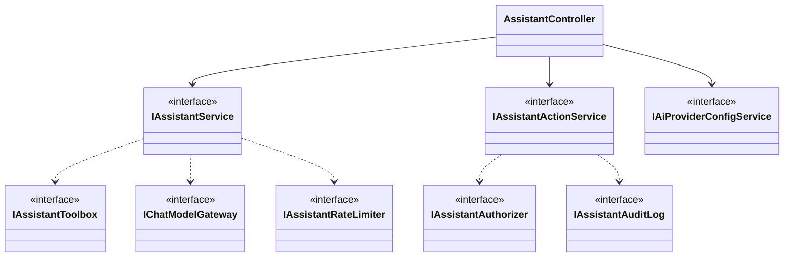

#### 4.1.1 Child module: Chat

**Class / file inventory**

| Layer | Type | File | Responsibility |
|---|---|---|---|
| Controller | `AssistantController.GetConversation`, `SendMessage`, `NewConversation`, `GetProviders` | `Controllers/Assistant/AssistantController.cs` | HTTP routing |
| Service | `IAssistantService` / `AssistantService` (`GetConversationAsync`, `SendAsync`, `NewConversationAsync`; private `LoadHistoryAsync`, `RunTurnAsync`, `ToDtosAsync`) | `Services/Assistant/Chat/` | Conversation engine and tool loop |
| Prompt / texts | `AssistantPrompt.Build`, `AssistantTexts` (`SecretBlocked`, `EmptyAnswer`, `ActionPrepared`, `PasswordGuidance`, `AdminGuidance`, `PermissionDenied`), `ProviderFailureMessages` (`For`, `NotConfigured`) | `Services/Assistant/Chat/` | Fixed texts |
| Gateway | `IChatModelGateway` / `ChatModelGateway.CompleteAsync(kind, request)` | `Services/Assistant/ModelGateway/` | Runtime config + provider dispatch |
| Providers | `IChatModelProvider`; `OllamaProvider`, `GeminiProvider`, `OpenAiProvider`; `ChatModelTypes` (`ChatModelRequest`, `ChatModelResult`, `ChatToolDefinition`, `ChatToolCall`), `AiProviderRuntime`, `ProviderFailure`, `ProviderHttp` | `Integrations/Ai/Providers/` | HTTP to the AI provider, failure classification |
| Registry | `IChatModelProviderRegistry` / `ChatModelProviderRegistry.Get(kind)` | `Integrations/Ai/Registry/` | Provider by `AiProviderKind` |
| Key protection | `IAiKeyProtector` / `AiKeyProtector`; `KeyRingProtectionCheck` | `Integrations/Ai/KeyProtection/` | Decrypt API key for one call; startup check |
| Rules | `AssistantRules` (`MaxMessageLength` 2000, `HistoryMessages` 12, `HistoryCharacters` 6000, `MaxToolRounds` 4, `ConversationMessages` 100); `SecretScreen` (`ContainsSecret`, `Redact`, `RedactedText = "[hidden]"`) | `Services/Assistant/Rules/` | Limits and secret screening |
| Repositories | `IAssistantConversationRepository` / `AssistantConversationRepository`; `IAssistantMessageRepository` / `AssistantMessageRepository`; `IAssistantDirectoryRepository.GetFullNameAsync` | `Repositories/Assistant/Conversations/`, `Messages/`, `People/` | Persistence |
| DTOs | `SendAssistantMessageRequest(Text, Provider)`, `AssistantConversationDto`, `AssistantReplyDto`, `AssistantMessageDto`, `AssistantLinkDto`, `AssistantMessageMeta`, `PrioritisedTask`, `AssistantFailureDto`; `AiProviderOptionDto` (Settings) | `Dtos/Assistant/`; `Dtos/Settings/TfaSettings/AiProviderDtos.cs` | Contracts |
| Entities | `AssistantConversation`, `AssistantMessage` | `Models/Entities/` | Tables |
| Frontend | `TfaPanelComponent`, `TfaHeaderComponent`, `TfaComposerComponent` (`TFA_SUGGESTIONS`), `TfaMessageComponent` | `modules/assistant/components/` | Panel, model selector, composer, messages |
| Frontend service | `AssistantService` (`open`, `close`, `toggle`, `loadProviders`, `loadConversation`, `selectProvider`, `isAcknowledged`, `send`, `acknowledgeCloud`, `retry`, `newChat`); `TFA_PROVIDER_KEY`, `TFA_CLOUD_ACK_KEY`, `PROVIDER_REFRESH_MS` | `modules/assistant/services/assistant.service.ts` | Signals, HTTP, browser settings |

**Class diagram**

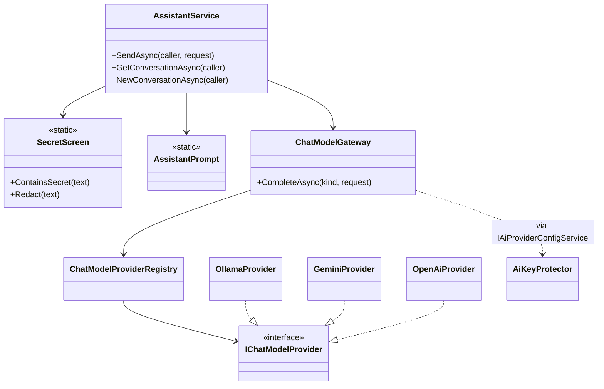

**API contracts**

| # | Method | Route | Permission / policy | Request | Response | Status codes |
|---|---|---|---|---|---|---|
| 1 | GET | `/api/v1/assistant/conversation` | `[Authorize]` + `perm:assistant.chat` | – | `AssistantConversationDto(ConversationId, Messages)` (newest 100) | 200, 401, 403 |
| 2 | POST | `/api/v1/assistant/conversation/messages` | `[Authorize]` + `perm:assistant.chat` | `SendAssistantMessageRequest(Text, Provider)` | `AssistantReplyDto(Messages, Failure)` | 200 (incl. provider failure), 400, 401, 403, 429 |
| 3 | POST | `/api/v1/assistant/conversation/new` | `[Authorize]` + `perm:assistant.chat` | – | – | 204, 401, 403 |
| 4 | GET | `/api/v1/assistant/providers` | `[Authorize]` + `perm:assistant.chat` | – | `IReadOnlyList<AiProviderOptionDto>` (kind, displayName, modelName, locality; no key data) | 200, 401, 403 |

**Request / response example**

```json
// POST /api/v1/assistant/conversation/messages
{ "text": "What should I prioritise?", "provider": "Gemini" }
```

```json
// 200 OK – answered
{ "messages": [
    { "id": 41, "role": "User", "content": "What should I prioritise?", "kind": "Text", "provider": null,
      "links": [], "rankedTasks": [], "action": null },
    { "id": 42, "role": "Assistant", "content": "Start with TSK-12, it is 2 days overdue.", "kind": "Text",
      "provider": "Gemini", "links": [ { "label": "TSK-12", "route": "/tasks/12" } ],
      "rankedTasks": [ { "rank": 1, "taskId": 12, "taskCode": "TSK-12", "title": "Fix login", "priority": "High",
        "status": "InProgress", "deadline": "2026-10-29T12:30:00Z", "dueDate": "2026-10-29", "daysUntilDue": -2,
        "stage": "Overdue", "isBlocked": false } ], "action": null } ],
  "failure": null }
```

```json
// 200 OK – provider failure (nothing stored)
{ "messages": [],
  "failure": { "kind": "RateLimited", "provider": "Gemini", "retryAfterSeconds": 30,
    "message": "Google Gemini's free limit or rate limit has been reached. Try again in about 30 seconds, or choose another model.",
    "alternatives": [ { "kind": "Ollama", "displayName": "Ollama", "modelName": "llama3.2:3b", "locality": "Local" } ] } }
```

**Service logic – `SendAsync(caller, request)`**
1. Trim `Text`; empty or longer than `AssistantRules.MaxMessageLength` (2000) → `AssistantRequestException("A message must be between 1 and 2000 characters.")` (400).
2. `SecretScreen.ContainsSecret(text)` (password phrase with a digit/symbol value, `sk-…`, `AIza…`, `Bearer …`, JWT,
   32+ character mixed token) → return one transient `Notice` message (`AssistantTexts.SecretBlocked`, id 0). Nothing is
   sent or stored.
3. `IAiProviderConfigService.GetAvailableAsync` → use `request.Provider` or the first available; none →
   `AssistantRequestException("TFA is not available yet. An administrator needs to configure an AI provider.")`; chosen
   one missing → `ProviderFailureMessages.NotConfigured(kind)` (400).
4. `IAssistantRateLimiter.TryAcquire(userId)`; a wait value → `AssistantRateLimitedException` (429, `Retry-After`) – 4.1.4.
5. `FindLatestForUpdateAsync(userId)` or create a new `AssistantConversation` (latest by `Id` is the active one).
6. `LoadHistoryAsync`: newest 24 (`HistoryMessages * 2`) messages, drop `Notice` metas, take 12, stop at 6000 characters,
   reverse to chronological.
7. `AssistantPrompt.Build(userName, caller.Role, IAppClock.TodayLocalAsync, application name)`; `userName` from
   `IAssistantDirectoryRepository.GetFullNameAsync`.
8. `RunTurnAsync`: up to `MaxToolRounds` (4) rounds; tools from `IAssistantToolbox.DefinitionsForAsync(caller)`, none in
   the last round. Each tool call → `IAssistantToolbox.ExecuteAsync` (4.1.2); collect `Links`, `RankedTasks`,
   `PendingActionId`. A `ToolOutcome.FixedReply` ends the turn with that exact text. Tool results pass
   `SecretScreen.Redact` before going back to the model. Empty model text → `AssistantTexts.EmptyAnswer`.
9. `ProviderFailureException` → `AssistantReplyDto([], AssistantFailureDto(kind, provider, message, retryAfterSeconds,
   alternatives))`; nothing stored.
10. Success → insert user and assistant `AssistantMessage` rows (assistant `CreatedAt` = now + 1 ms, `ProviderKind`,
    `MetaJson` = `AssistantMessageMeta`), set `conversation.UpdatedAt`, `SaveChangesAsync`, map with `ToDtosAsync`
    (cards from `IAssistantActionCards.GetCardsAsync`).

**Service logic – `GetConversationAsync(caller)`**: latest conversation of `UserId`; newest `ConversationMessages` (100)
messages reversed; none → `AssistantConversationDto(null, [])`.

**Service logic – `NewConversationAsync(caller)`**: insert a new `AssistantConversation`; it becomes the latest.

**Gateway and providers**: `ChatModelGateway.CompleteAsync(kind, request)` → `IAiProviderConfigService.GetRuntimeAsync(kind)`
(decrypts the key with `IAiKeyProtector`; `null` → `ProviderNotConfiguredException`) → `IChatModelProviderRegistry.Get(kind).CompleteAsync(runtime, request with ModelName)`.

| Provider | Endpoint | Auth | Locality |
|---|---|---|---|
| `OllamaProvider` | `{BaseUrl or http://localhost:11434}/api/chat` | none | Local |
| `GeminiProvider` | `https://generativelanguage.googleapis.com/v1beta/models/{model}:generateContent` | `x-goog-api-key` header | Cloud |
| `OpenAiProvider` | `https://api.openai.com/v1/chat/completions` | Bearer header | Cloud |

Failure classification (`ProviderFailureKind`): 429 / `insufficient_quota` / `rate_limit_exceeded` / `RESOURCE_EXHAUSTED`
→ `RateLimited`; 401, 403 / `invalid_api_key` / `UNAUTHENTICATED` / `PERMISSION_DENIED` → `InvalidKey`; 404 /
`model_not_found` / `NOT_FOUND` → `ModelUnavailable`; `HttpClient` timeout → `Timeout`; `HttpRequestException` →
`Unreachable`; unparsable or empty reply → `Unexpected`. Ollama retries once without tools when the model does not
support tools.

**Sequence diagram**

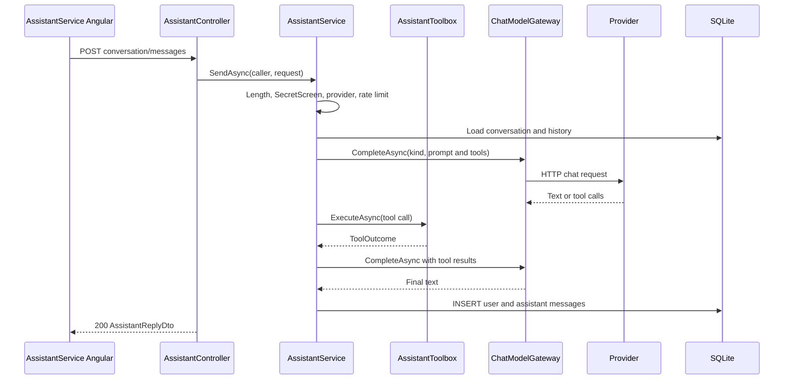

**Repository methods**

| Method | Query / purpose | Notes |
|---|---|---|
| `IAssistantConversationRepository.FindLatestForUpdateAsync(userId)` | Active conversation | Tracked; `Where UserId`, `OrderByDescending Id`, first |
| `IAssistantMessageRepository.GetNewestAsync(conversationId, take)` | Newest messages, newest first | `AsNoTracking`, `OrderByDescending Id`, `Take` |
| `IAssistantDirectoryRepository.GetFullNameAsync(userId)` | Name for the system prompt | `AsNoTracking`, projection |
| `Add(entity)` (`IBaseRepository`) | Insert conversation or message | `IUnitOfWork.SaveChangesAsync` |

**Validation rules**

| Field | Rule | Message |
|---|---|---|
| `Text` | 1–2000 characters after trim | "A message must be between 1 and 2000 characters." |
| `Text` | No password or API key/token (`SecretScreen.ContainsSecret`) | "For your safety I did not send or keep that message: it looks like it contains a password or an API key. Please never type passwords into chat. To change your password, open My Profile and use the Change password form." |
| `Provider` | Configured and enabled provider, or omitted | "TFA is not available yet. An administrator needs to configure an AI provider." / "`{Provider}` is not configured. Choose another model, or ask an administrator to set it up." |

**Error cases**

| Case | Exception | Status |
|---|---|---|
| Length outside 1–2000 | `AssistantRequestException` | 400 |
| No / unknown provider | `AssistantRequestException` | 400 |
| Secret detected | – (Notice message) | 200 |
| Provider failure | – (`failure` object, `ProviderFailureMessages.For`) | 200 |
| Over 20 per minute | `AssistantRateLimitedException` | 429 |
| Client fallbacks | `apiErrorMessage` | "TFA could not answer. Please try again." / "Could not start a new chat." |

**State machine:** _Not applicable for this child module._

#### 4.1.2 Child module: Actions and Tools

**Class / file inventory**

| Layer | Type | File | Responsibility |
|---|---|---|---|
| Controller | `AssistantController.EditAction`, `ConfirmAction`, `CancelAction`; `RunActionAsync` (null → 404) | `Controllers/Assistant/AssistantController.cs` | HTTP routing |
| Service | `IAssistantActionService` / `AssistantActionService` (`CreateAsync`, `EditMailAsync`, `ConfirmAsync`, `CancelAsync`, `GetCardsAsync`; private `ExecuteAsync`, `EnsurePending`, `ResolveRecipientsAsync`, `ToCard`) | `Services/Assistant/Actions/` | Pending-action lifecycle |
| Toolbox | `IAssistantToolbox` / `AssistantToolbox` (`DefinitionsForAsync`, `ExecuteAsync`), `AssistantToolGate`, `ToolOutcome` | `Services/Assistant/Toolbox/` | Advertise and gate tools |
| Tools (read) | `GetMyTasksTool`, `PrioritiseTasksTool`, `SearchHelpTool`, `FindUserTool`, `ExplainPasswordChangeTool`, `ContactAdminGuidanceTool`; helper `AssistantTaskReader` | `Services/Assistant/Tools/AssistantReadTools.cs` | Lookups and guidance |
| Tools (action) | `DraftMailTool`, `ProposeProfileUpdateTool`, `ProposeRoleChangeTool`; helpers `AssistantUserResolver`, `AssistantManagerResolver` | `Services/Assistant/Tools/AssistantActionTools.cs` | Prepare pending actions |
| Rules | `AssistantActionRules` (`Lifetime` 10 min, `Requirement(kind)`), `TaskPrioritiser.Rank` | `Services/Assistant/Rules/` | Expiry, confirm policy, ranking |
| Authorization | `IAssistantAuthorizer` / `AssistantAuthorizer.IsAllowedAsync(principal, policyName)` (`IAuthorizationService.AuthorizeAsync`) | `Authorization/Assistant/` | Same `perm:{key}` policies as REST |
| Repositories | `IAssistantPendingActionRepository` / `AssistantPendingActionRepository`; `IAssistantDirectoryRepository` / `AssistantDirectoryRepository` | `Repositories/Assistant/PendingActions/`, `People/` | Actions, people, roles |
| DTOs | `SendMailPayload`, `UpdateProfilePayload`, `ChangeRolePayload`, `MailRecipientRef`, `EditMailActionRequest`, `AssistantActionResultDto`, `ResolvedUser`; `AssistantPendingActionDto`, `AssistantActionFieldDto` | `Dtos/Assistant/AssistantActionDtos.cs`, `AssistantDtos.cs` | Contracts |
| Validators (reused) | `SendMailRequestValidator` (`MailRequestValidators.cs`), `UpdateOwnProfileRequestValidator` | `Dtos/Communication/Mail/Validators/`, `Dtos/Profile/Validators/` | Mail and profile rules |
| Other services | `ITaskService.ListAsync`, `GetDetailsAsync`; `IMailService.SendAsync`, `GetContactsAsync`; `IProfileService.UpdateAsync`; `IEmployeeService.GetByIdAsync`, `UpdateAsync` | Task, Mail, Profile, Employee modules | Reads and executions |
| Frontend | `TfaActionCardComponent` (Confirm / Edit / Cancel, edit form, status labels); `AssistantService.confirm`, `cancel`, `edit` | `modules/assistant/components/`, `services/` | Action Card |

**Class diagram**

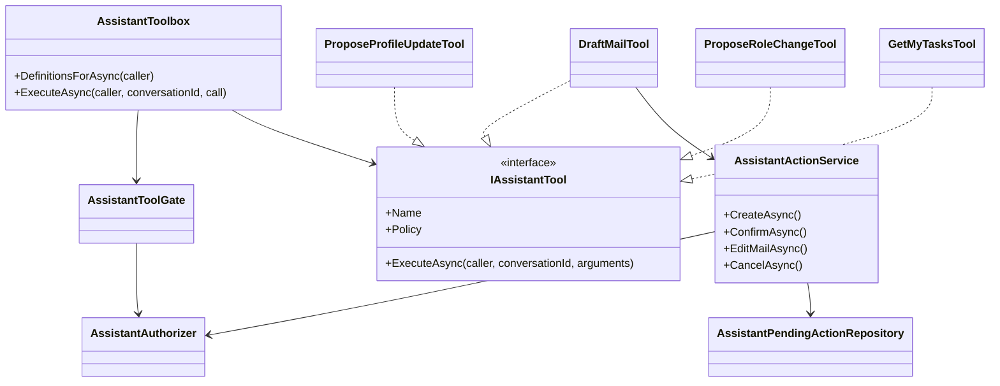

**API contracts**

| # | Method | Route | Permission / policy | Request | Response | Status codes |
|---|---|---|---|---|---|---|
| 5 | PUT | `/api/v1/assistant/actions/{id}` (`{id:guid}`) | `[Authorize]` + `perm:assistant.actions.confirm` | `EditMailActionRequest(To, Subject, Body)` | `AssistantPendingActionDto` | 200, 400, 401, 403, 404, 409 |
| 6 | POST | `/api/v1/assistant/actions/{id}/confirm` | `[Authorize]` + `perm:assistant.actions.confirm`; `perm:roles.manage` re-checked in the service for `ChangeUserRole` | – | `AssistantActionResultDto(Id, Status, Message, Reply)` | 200 (incl. `Refused`, `Failed`), 401, 403, 404, 409 |
| 7 | POST | `/api/v1/assistant/actions/{id}/cancel` | `[Authorize]` + `perm:assistant.actions.confirm` | – | `AssistantPendingActionDto` | 200, 401, 403, 404 |

**Model tools** (not HTTP; called by the model inside `POST /api/v1/assistant/conversation/messages`)

| Tool name | Class | Policy | Arguments | Effect |
|---|---|---|---|---|
| `get_my_tasks` | `GetMyTasksTool` | none | `filter` (upcoming, due_today, overdue, all_open), `scope` (mine, accessible), `limit` (default 10, max 20) | `AssistantTaskReader` → `ITaskService.ListAsync(…, userId, role)`; links `/tasks/{id}` |
| `prioritise_tasks` | `PrioritiseTasksTool` | none | `limit` (default 5, max 10) | `TaskPrioritiser.Rank` on own open tasks → `RankedTasks` |
| `search_help` | `SearchHelpTool` | none | `topic` | `IHelpKnowledgeBase.Search(topic, role)` (4.1.3) |
| `find_user` | `FindUserTool` | none | `name` | `IMailService.GetContactsAsync` (max 10, active users) |
| `explain_password_change` | `ExplainPasswordChangeTool` | none | – | Fixed `AssistantTexts.PasswordGuidance` + `/profile` link |
| `contact_admin_guidance` | `ContactAdminGuidanceTool` | none | – | Fixed `AssistantTexts.AdminGuidance` |
| `draft_mail` | `DraftMailTool` | none | `recipient` ("manager"), `to[]`, `taskId`, `subject`, `body` | `SendMail` pending action |
| `propose_profile_update` | `ProposeProfileUpdateTool` | none | `fullName`, `email` | `UpdateOwnProfile` pending action |
| `propose_role_change` | `ProposeRoleChangeTool` | `perm:roles.manage` (`AssistantPolicies.RolesManage`) | `user`, `role` | `ChangeUserRole` pending action |

No tool takes a user id, role or password; the caller is always `AssistantCaller`.

**Request / response example**

```json
// PUT /api/v1/assistant/actions/3f2b0c1e-9a7d-4c55-8f0e-1b2c3d4e5f60
{ "to": ["ravi.kumar@taskflow.com"], "subject": "TSK-12 update", "body": "Hi Ravi, ..." }
```

```json
// 200 OK (AssistantPendingActionDto)
{ "id": "3f2b0c1e-9a7d-4c55-8f0e-1b2c3d4e5f60", "kind": "SendMail", "status": "Pending",
  "expiresAt": "2026-10-31T10:10:00Z", "title": "Mail draft",
  "fields": [ { "label": "To", "value": "Ravi Kumar <ravi.kumar@taskflow.com>" }, { "label": "Subject", "value": "TSK-12 update" } ],
  "body": "Hi Ravi, ...", "canEdit": true }
```

```json
// POST /api/v1/assistant/actions/3f2b0c1e-9a7d-4c55-8f0e-1b2c3d4e5f60/confirm  ->  200 OK
{ "id": "3f2b0c1e-9a7d-4c55-8f0e-1b2c3d4e5f60", "status": "Confirmed",
  "message": "Done. Your mail \"TSK-12 update\" was sent to Ravi Kumar.",
  "reply": { "id": 57, "role": "Assistant", "content": "Done. Your mail \"TSK-12 update\" was sent to Ravi Kumar.", "kind": "Text" } }
```

```json
// 409 Conflict
{ "status": 409, "title": "This action can no longer be done", "detail": "This request has expired. Please ask TFA again." }
```

**Service logic – `CreateAsync(caller, conversationId, kind, payload)`**
1. New `AssistantPendingAction`: `Id = Guid`, `Status = Pending`, `CreatedAt = now`, `ExpiresAt = now + AssistantActionRules.Lifetime` (10 min),
   `PayloadJson` = serialised `SendMailPayload` / `UpdateProfilePayload` / `ChangeRolePayload`.
2. `SaveChangesAsync`; audit `prepared` (4.1.4); return `ToCard` (titles "Mail draft", "Update your profile", "Change role").
3. The tool returns `ToolOutcome` with `FixedReply = AssistantTexts.ActionPrepared` and `PendingActionId`.

**Service logic – `ConfirmAsync(caller, id)`**
1. `FindForUserAsync(id, userId)`; `null` → controller 404.
2. Pending and `ExpiresAt <= now` → `SetStatusAsync(Expired)`, audit `expired`, `AssistantActionConflictException("This request has expired. Please ask TFA again.")`.
3. Not pending → 409: `Confirmed` → "This action has already been done."; else "This action can no longer be confirmed (`{status}`). Please ask TFA again."
4. `AssistantActionRules.Requirement(kind)` → `IAssistantAuthorizer.IsAllowedAsync(caller.Principal, policy)`; refused →
   `Refused`, audit `refused`, store a `Refusal` message with `AssistantTexts.PermissionDenied(description, who)`, return 200 with `Status = Refused`.
5. `TryClaimAsync(id, now)` (single `ExecuteUpdateAsync` Pending → Confirmed); false → 409 "This action has already been done."
6. `ExecuteAsync`:
   - `SendMail`: re-validate with `SendMailRequestValidator`; `IMailService.SendAsync(userId, request)` (no Cc, no attachments).
   - `UpdateOwnProfile`: re-validate with `UpdateOwnProfileRequestValidator`; `IProfileService.UpdateAsync(userId, new UpdateOwnProfileRequest(FullName, Email))` – mobile `null`, kept.
   - `ChangeUserRole`: `IEmployeeService.GetByIdAsync`, then `IEmployeeService.UpdateAsync` with all existing fields and the new `RoleId` (the employee service rotates the target's `SecurityStamp` and revokes refresh tokens).
7. Exception (not cancellation) → `Failed`, audit `failed`, reply "I could not do that: `{reason}`. Nothing was sent." /
   "… Nothing was changed." (`reason` = message of `AppException` / `ValidationException`, except concurrency/unique
   errors; otherwise "something went wrong on the server", logged).
8. Success → audit `confirmed` (an audit failure is logged and never turns success into failure); store the reply
   message; return `AssistantActionResultDto`.

**Service logic – `EditMailAsync(caller, id, request)`**: `FindForUserForUpdateAsync`; `EnsurePending` (409 "This action
can no longer be changed. Please ask TFA again."); kind must be `SendMail` (else 400 "Only a mail can be edited.");
`SendMailRequestValidator`; `ResolveRecipientsAsync` (`GetActiveRecipientsAsync` on lower-case addresses; unknown → 400
"These are not active TaskFlow users: `{addresses}`."); replace `PayloadJson`.

**Service logic – `CancelAsync(caller, id)`**: tracked lookup; still pending and not expired → `Cancelled`, `ResolvedAt`,
audit `cancelled`; always returns the current card.

**Tool-level logic**
- `AssistantToolbox.DefinitionsForAsync`: only tools whose `Policy` passes `AssistantToolGate` are advertised.
- `AssistantToolbox.ExecuteAsync`: unknown tool → message to the model; gate refused → audit `refused` (when `ActionKind`
  is set) and fixed `Refusal` reply `AssistantTexts.PermissionDenied`; arguments must be a JSON object.
- `AssistantUserResolver.FindAsync`: `@` → exact active email; else exact full name/username (single match wins); else
  partial `LIKE` (max 5); ambiguity returns candidates.
- `AssistantManagerResolver.ResolveAsync`: with `taskId`, `ITaskService.GetDetailsAsync(id, userId, role)` (`null` → "That
  task was not found, or you do not have access to it."); task creator if another active user; else active users with
  `RoleId == SystemRoles.ManagerId` managing one of the caller's departments – exactly one required.
- `ProposeProfileUpdateTool`: merge with current name/email (`GetNameAndEmailAsync`), validate with
  `IValidator<UpdateOwnProfileRequest>`, refuse when `EmailUsedByOtherAsync`.
- `ProposeRoleChangeTool`: `FindRoleByNameAsync` (exact), `AssistantUserResolver.FindAsync`, refuse self ("For safety I do
  not change your own role. Please ask another administrator to do it."), no-op when the role is unchanged.
- `AssistantTaskReader.OpenTasksAsync`: one `ITaskService.ListAsync` query per open status (`ToDo`, `InProgress`,
  `InQA`, `Blocked`), page size 100, at most 5 pages each.
- `TaskPrioritiser.Rank`: exclude `Completed`, `Cancelled`; order by stage (Overdue 0, DueToday 1, other 2), local due
  date, priority descending, deadline, task code; `IsBlocked` flag for `Blocked`.

**Sequence diagram**

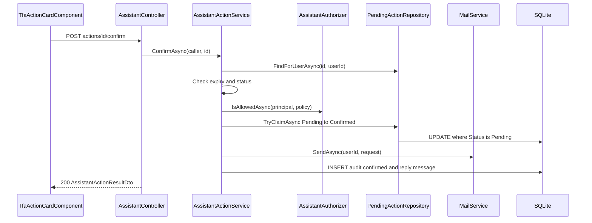

**Repository methods**

| Method | Query / purpose | Notes |
|---|---|---|
| `IAssistantPendingActionRepository.GetForUserAsync(userId, ids)` | Cards for messages | `AsNoTracking`, `UserId` + `ids.Contains` |
| `FindForUserAsync(id, userId)` | Confirm lookup | `AsNoTracking`, owner filter |
| `FindForUserForUpdateAsync(id, userId)` | Edit / cancel lookup | Tracked, owner filter |
| `TryClaimAsync(id, now)` | Atomic Pending → Confirmed | `ExecuteUpdateAsync` filtered on `Status == Pending`; true when a row changed |
| `SetStatusAsync(id, status, now)` | Status + `ResolvedAt` | `ExecuteUpdateAsync` |
| `IAssistantDirectoryRepository.FindActiveAsync`, `FindActiveByEmailAsync`, `FindActiveByExactNameAsync`, `SearchActiveByNameAsync` | Resolve people | Active users only; deleted hidden by the global filter; `LIKE` with `%`, `_`, `\` escaped |
| `GetNameAndEmailAsync`, `EmailUsedByOtherAsync` | Profile proposal | Case-insensitive email compare |
| `FindRoleByNameAsync(name)` | Role lookup | `Roles` exact `Name ==` |
| `GetDepartmentIdsAsync`, `GetActiveManagersOfDepartmentsAsync` | "My manager" | `UserDepartments`; `RoleId == SystemRoles.ManagerId` and `ManagedDepartments` |
| `GetActiveRecipientsAsync(lowerEmails)` | Mail edit recipients | Active users by lower-case email |

**Validation rules**

| Field | Rule | Message |
|---|---|---|
| `EditMailActionRequest.To` | 1–50 addresses; each an email of an active user | "Add between 1 and 50 recipients." / "'`{value}`' is not an email address." / "These are not active TaskFlow users: `{addresses}`." |
| `Subject`, `Body` | At least one; subject max 200, body max 20,000 (`SendMailRequestValidator`) | "Write a subject or a message before sending." |
| Action kind (edit) | `SendMail` only | "Only a mail can be edited." |
| Action state | Pending and not expired | "This action can no longer be changed. Please ask TFA again." |
| Profile payload | `UpdateOwnProfileRequestValidator` (name max 200, `@taskflow.com` email max 256) | Reason in "I could not do that: `{reason}`. Nothing was changed." |
| Role payload | Existing role (exact name), active target, not the requester | "For safety I do not change your own role. Please ask another administrator to do it." |

**Error cases**

| Case | Exception | Status |
|---|---|---|
| Action unknown / not the caller's | – (`NotFound()`) | 404 |
| Expired / already done / not pending | `AssistantActionConflictException` | 409 |
| Invalid edit | `AssistantRequestException` | 400 |
| Permission lost at confirm | – (`Status = Refused`) | 200 |
| Execution failure | – (`Status = Failed`) | 200 |
| Missing `assistant.actions.confirm` | policy | 403 |
| Client fallbacks | `apiErrorMessage` | "Could not confirm that action." / "Could not cancel that action." / "Could not save your changes." |

**State machine – `AssistantActionStatus`**

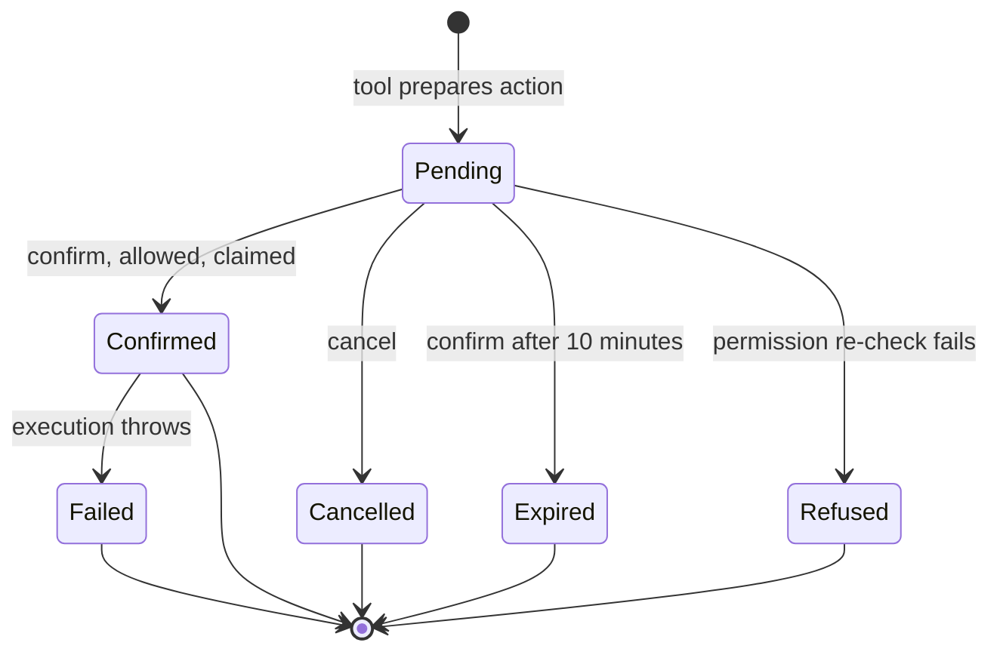

The claim moves the row to `Confirmed` before execution; a thrown execution then sets `Failed`. `ToCard` shows a pending
row past `ExpiresAt` as `Expired` without writing it.

#### 4.1.3 Child module: Help Knowledge

**Class / file inventory**

| Layer | Type | File | Responsibility |
|---|---|---|---|
| Service | `IHelpKnowledgeBase` / `HelpKnowledgeBase` (`Search(query, role, maxResults = 3)`, `MinimumScore` 3), `HelpTopicDto` | `Services/Assistant/HelpKnowledge/` | Topic search and role redaction |
| Content | 19 topics: `about-tfa.md`, `application-settings.md`, `board.md`, `change-password.md`, `change-role.md`, `change-task-status.md`, `compose-mail.md`, `create-task.md`, `department-management.md`, `edit-profile.md`, `employee-management.md`, `mail-folders.md`, `notifications.md`, `reassign-task.md`, `reminder-settings.md`, `reports-and-workload.md`, `task-comments-and-activity.md`, `task-list-and-filters.md`, `tfa-settings.md` | `Services/Assistant/Knowledge/` | Embedded resources (`<EmbeddedResource Include="Services\Assistant\Knowledge\*.md" />` in `TaskFlow.Api.csproj`) |
| Caller | `SearchHelpTool` | `Services/Assistant/Tools/AssistantReadTools.cs` | Tool `search_help` |
| Frontend | `TfaMessageComponent` (link buttons) | `modules/assistant/components/` | Shows answer and screen link |

**Class diagram**

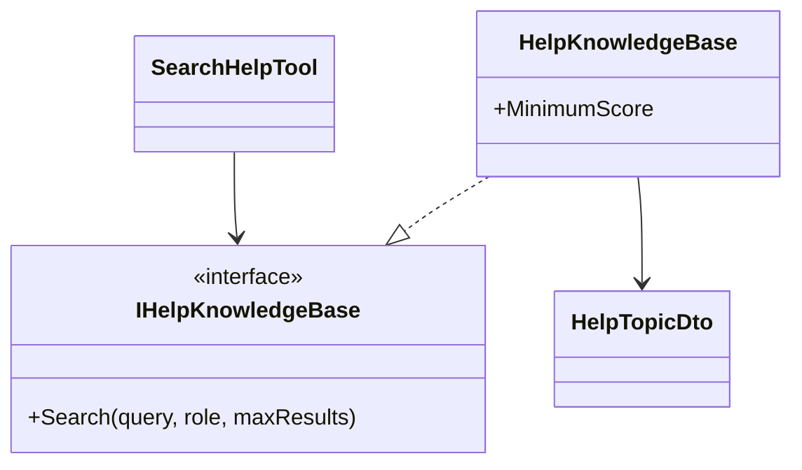

**API contracts:** no own endpoint – reached through `search_help` inside `POST /api/v1/assistant/conversation/messages`
(`perm:assistant.chat`).

**Request / response example** (tool result passed to the model, Employee asking how to create a task)

```json
{ "found": true, "topics": [ { "title": "Create a task",
  "content": "Tasks are created by Managers and Administrators. If you need a new task, ask your manager to create and assign it to you.",
  "notAvailableForThisUsersRole": true } ] }
```

**Service logic – `Search(query, role, maxResults = 3)`**
1. Topics loaded once (singleton) from embedded resources whose name contains `.Assistant.Knowledge.` and ends `.md`;
   `Topic.Parse` reads the front-matter (`title`, `roles` default `all`, `others`, `keywords`, `link`).
2. Lower-case and tokenise the query (separators, length ≥ 3, stop words removed).
3. Score: multi-word keyword contained in the query +6; single keyword whole-word (plural tolerant) +4; token in keyword
   words +3; token in title words +2.
4. Keep score ≥ `MinimumScore` (3); order by score, then id; take 3.
5. `ToDto`: `roles` contains `all` or the caller's role name → full body + link; else `others` note (default "`{Title}` is
   not available to your role."), no link, `IsRestricted = true`.

Role restriction in the shipped files: `Administrator` – `application-settings`, `change-role`, `department-management`,
`employee-management`, `tfa-settings`; `Manager, Administrator` – `create-task`, `reassign-task`, `reminder-settings`,
`reports-and-workload`; `all` – the other 10.

**Sequence diagram**

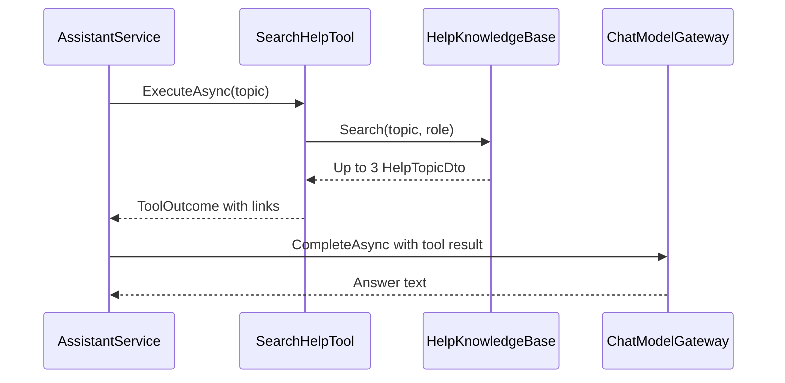

**Repository methods:** _Not applicable – in-memory list of embedded topics._

**Validation rules:** _Not applicable – the chat rules of 4.1.1 apply._

**Error cases**

| Case | Exception | Status |
|---|---|---|
| No topic scores ≥ 3 | – (empty result; the model says it does not have the information) | 200 |
| Topic not for the caller's role | – (`IsRestricted`, `others` note) | 200 |

**State machine:** _Not applicable for this child module._

#### 4.1.4 Child module: Audit Log and Rate Limits

**Class / file inventory**

| Layer | Type | File | Responsibility |
|---|---|---|---|
| Service | `IAssistantAuditLog` / `AssistantAuditLog.RecordAsync(userId, kind, outcome)` (scoped) | `Services/Assistant/AuditLog/` | Write `AssistantAudits` rows |
| Service | `IAssistantRateLimiter` / `AssistantRateLimiter.TryAcquire(userId)` (singleton), `RequestsPerMinute` 20 | `Services/Assistant/RateLimits/` | Sliding 1-minute window per user |
| Repository | `IAssistantAuditRepository` / `AssistantAuditRepository` (`Add` only) | `Repositories/Assistant/Audits/` | Insert |
| Entity | `AssistantAudit` | `Models/Entities/AssistantAudit.cs` | Table |
| Exception | `AssistantRateLimitedException` | `Common/Exceptions/AssistantExceptions.cs` | 429 + `Retry-After` |
| Middleware | `GlobalExceptionHandler` | `Middleware/GlobalExceptionHandler.cs` | Problem details and header |

**Class diagram**

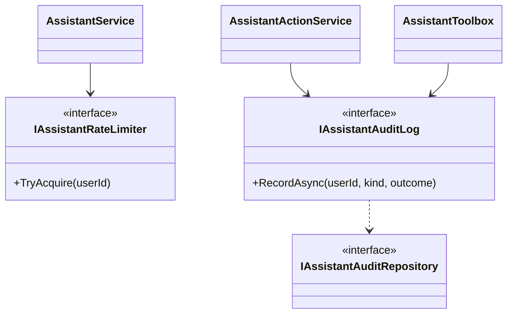

**API contracts:** no own endpoint – the limiter guards `POST /api/v1/assistant/conversation/messages`; audit rows are
written by 4.1.2 and never read by any endpoint.

**Request / response example**

```json
// 429 Too Many Requests (header Retry-After: 18)
{ "status": 429, "title": "Too many requests",
  "detail": "You are sending messages too quickly. Please wait about 18 seconds and try again." }
```

**Service logic**
- `AssistantRateLimiter.TryAcquire(userId)`: `ConcurrentDictionary<int, Queue<DateTimeOffset>>`; under a per-queue lock drop
  entries older than 1 minute; count ≥ 20 → return `Window - (now - oldest)`; else enqueue and return `null`. Runs after
  the length check, `SecretScreen` and provider selection, so only messages passing them are counted.
- `AssistantAuditLog.RecordAsync`: add `AssistantAudit` (`At` = UTC now) and save immediately. Outcomes: `prepared`,
  `confirmed`, `cancelled`, `expired`, `refused`, `failed`. No message body, password or key is stored.

**Sequence diagram**

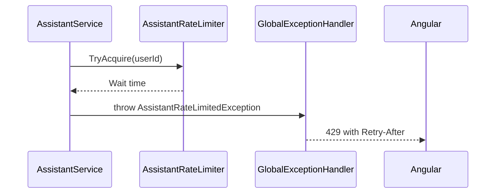

**Repository methods**

| Method | Query / purpose | Notes |
|---|---|---|
| `IAssistantAuditRepository.Add` | Insert audit row | Base repository only; no read methods |

**Validation rules**

| Field | Rule | Message |
|---|---|---|
| Messages per user | ≤ 20 in any 1-minute window | "You are sending messages too quickly. Please wait about `{n}` seconds and try again." |

**Error cases**

| Case | Exception | Status |
|---|---|---|
| Over the limit | `AssistantRateLimitedException` | 429 |
| Audit write fails after a confirmed action | – (logged only) | – |

**State machine:** _Not applicable for this child module._

#### 4.1.5 Child module: Voice Input

**Class / file inventory**

| Layer | Type | File | Responsibility |
|---|---|---|---|
| Frontend service | `WakePhraseService` (`SPEECH_RECOGNITION_FACTORY`, `TFA_VOICE_KEY = 'tfa.handsfree'`, `COMMAND_SILENCE_MS` 2000, `WAKE_CAPTURE_TIMEOUT_MS` 8000, `DICTATION_TIMEOUT_MS` 10000) | `modules/assistant/services/wake-phrase.service.ts` | Browser `SpeechRecognition`: wake phrase, dictation |
| Frontend service | `SpeakService` (`SPEECH_SYNTHESIS_FACTORY`, `UTTERANCE_FACTORY`, `MAX_SPOKEN_CHARS` 500) | `modules/assistant/services/speak.service.ts` | `speechSynthesis` |
| Models | speech factory interfaces | `services/wake-phrase.model.ts`, `services/speak.model.ts` | Types |
| Components | `TfaPanelComponent` (`answerAloud`, heard text, voice hint), `TfaComposerComponent` (mic, listening bar, hands-free toggle) | `modules/assistant/components/` | Voice wiring |
| Backend | – | – | Text goes through `POST /api/v1/assistant/conversation/messages` (4.1.1) |

**Class diagram**

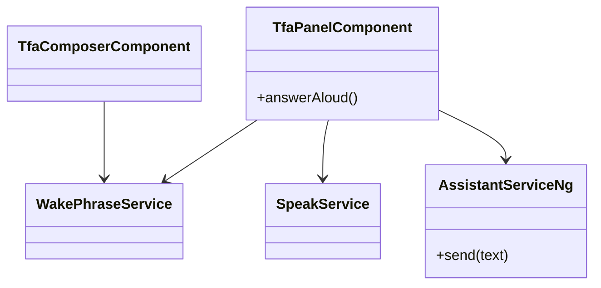

`AssistantServiceNg` stands for the Angular `AssistantService`.

**API contracts:** no own endpoint.

**Request / response example**

```json
// Spoken "Hey TF assistant, what are my upcoming tasks" is sent as
{ "text": "what are my upcoming tasks", "provider": "Ollama" }
```

**Service logic – `WakePhraseService`**
1. The factory creates `SpeechRecognition` / `webkitSpeechRecognition`, or `null` when unsupported.
2. Hands-free listens continuously for the wake phrase (regex tolerant of "Hey T F assistant", "Hay TFA assistant", "Hey Tifa assistant").
3. Emits `wake`, `greet` (phrase alone), `interim` (live text) and `question` (after 2000 ms of silence); capture timeout
   8000 ms; microphone dictation timeout 10000 ms.
4. Restarts ended sessions after 50 ms; quick failures back off from 300 ms and give up after 6 with a reason message.
5. Only a deliberate **Turn off** is stored (`tfa.handsfree`).

**Service logic – `SpeakService`**: speaks at most 500 characters; `TfaPanelComponent.answerAloud` speaks only replies to
spoken questions and pauses recognition while speaking.

**Sequence diagram**

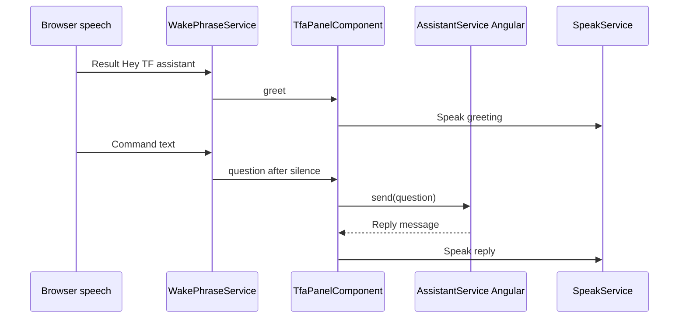

**Repository methods:** _Not applicable – browser `localStorage` only._

**Validation rules**

| Condition | Rule | Message |
|---|---|---|
| No speech recognition | Factory returns `null` | "Voice input is not supported in this browser. Try Chrome or Edge, or type your question." |
| `not-allowed` / `service-not-allowed` | Microphone blocked | "Microphone access was denied. Allow it in your browser to use voice, or type your question." |
| `audio-capture` | No microphone | "No microphone was found. You can type your question instead." |
| `network` | No connection for the speech service | "Voice needs an internet connection in this browser. You can type your question instead." |
| Auto start blocked | `waitForGesture` | "Click anywhere on the page to turn "Hey TF assistant" back on." |
| `no-speech` / `aborted` | Ignored | – |

**Error cases:** as the validation table; none reach the server.

**State machine – hands-free voice**

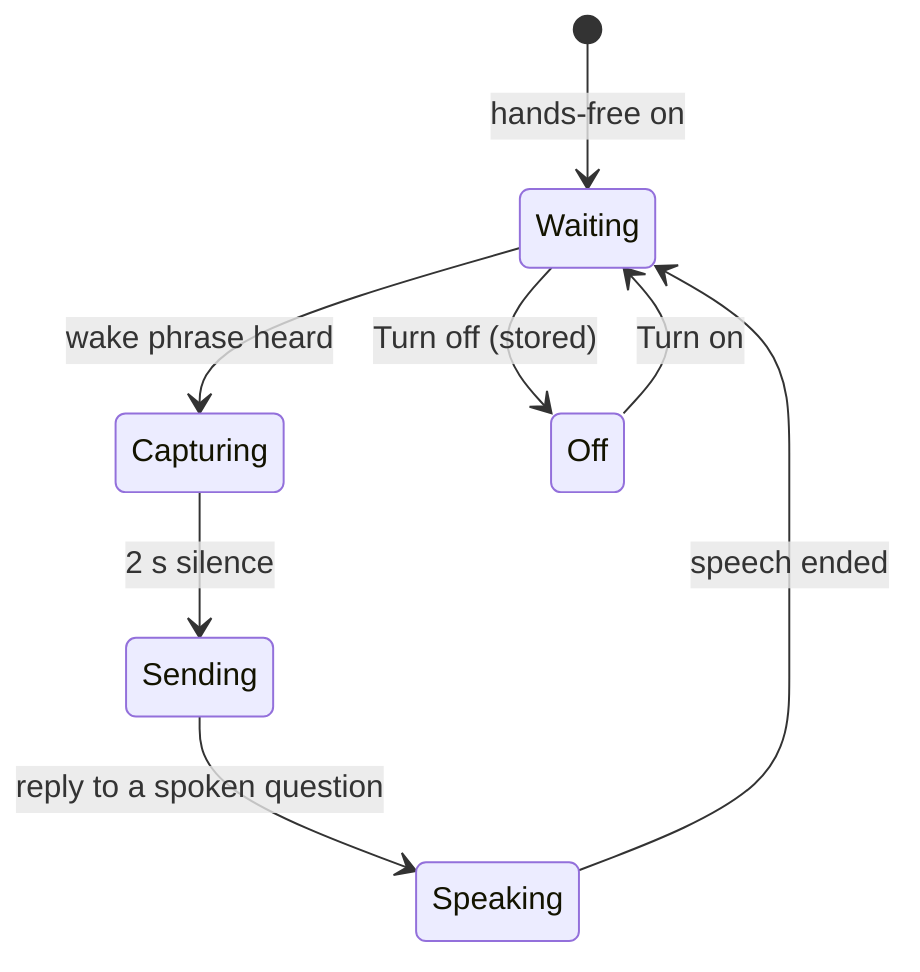

---

## 5. Database Design

TFA owns four tables, created by `20261018183210_AddAssistant` (which also creates `AiProviderConfigs`, owned by TFA
Settings). Configuration: `Persistence/AppDbContext.cs`.

### 5.1 ER Diagram

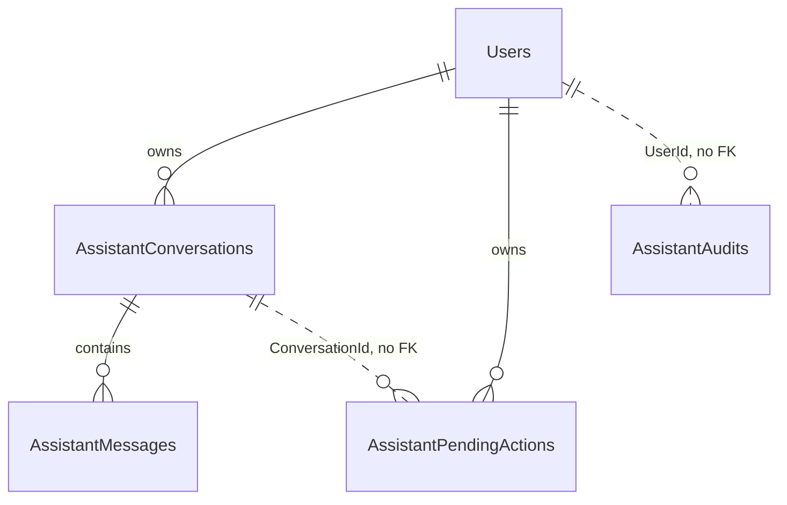

### 5.2 Tables

#### `AssistantConversations` (AssistantConversation)

| Column | Type | Null | Key / index | Default | Description |
|---|---|:---:|---|---|---|
| Id | int | No | PK | identity | Conversation id; latest per user is active |
| UserId | int | No | FK → `Users.Id` (Cascade); `IX_AssistantConversations_UserId` | – | Owner |
| CreatedAt | DateTime | No | – | – | UTC |
| UpdatedAt | DateTime | No | – | – | Last message (UTC) |

#### `AssistantMessages` (AssistantMessage)

| Column | Type | Null | Key / index | Default | Description |
|---|---|:---:|---|---|---|
| Id | int | No | PK | identity | Message id |
| ConversationId | int | No | FK → `AssistantConversations.Id` (Cascade); `IX_AssistantMessages_ConversationId` | – | Parent |
| Role | string(16) | No | – | – | `AssistantMessageRole` as text |
| Content | string | No | – | – | Message text |
| MetaJson | string | Yes | – | – | `AssistantMessageMeta` (kind, links, ranked tasks, action id) |
| ProviderKind | string(16) | Yes | – | – | `AiProviderKind` as text |
| CreatedAt | DateTime | No | – | – | UTC |

#### `AssistantPendingActions` (AssistantPendingAction)

| Column | Type | Null | Key / index | Default | Description |
|---|---|:---:|---|---|---|
| Id | Guid | No | PK | – (set in code) | Action id |
| UserId | int | No | FK → `Users.Id` (Cascade); `IX_AssistantPendingActions_UserId` | – | Owner |
| ConversationId | int | No | – (no FK) | – | Conversation it belongs to |
| Kind | string(32) | No | – | – | `AssistantActionKind` as text |
| PayloadJson | string | No | – | – | Exact payload shown and executed |
| Status | string(16) | No | – | – (code sets `Pending`) | `AssistantActionStatus` as text |
| CreatedAt | DateTime | No | – | – | UTC |
| ExpiresAt | DateTime | No | – | – | `CreatedAt` + 10 minutes |
| ResolvedAt | DateTime | Yes | – | – | Set on confirm, cancel, expire, refuse, fail |

#### `AssistantAudits` (AssistantAudit)

| Column | Type | Null | Key / index | Default | Description |
|---|---|:---:|---|---|---|
| Id | int | No | PK | identity | Audit id |
| UserId | int | No | `IX_AssistantAudits_UserId_At` (no FK) | – | Actor |
| Kind | string(32) | No | – | – | `AssistantActionKind` as text |
| Outcome | string(32) | No | – | – | prepared / confirmed / cancelled / expired / refused / failed |
| At | DateTime | No | `IX_AssistantAudits_UserId_At` | – | UTC |

Read by TFA, owned elsewhere: `AiProviderConfigs` (`AiProviderConfig`), `AiModels` (`AiModel`) (TFA Settings); `Users`, `Roles`, `UserDepartments`,
`DepartmentManagers` (directory lookups); `Tasks` through `ITaskService`.

### 5.3 Indexes, Constraints & Triggers

| Object | Definition | Purpose |
|---|---|---|
| `IX_AssistantConversations_UserId` | (`UserId`) | Latest conversation per user |
| `IX_AssistantMessages_ConversationId` | (`ConversationId`) | Newest messages |
| `IX_AssistantPendingActions_UserId` | (`UserId`) | Owner-filtered lookups |
| `IX_AssistantAudits_UserId_At` | (`UserId`, `At`) | Audit by user and time |
| `FK_AssistantConversations_Users_UserId` | Cascade | Delete with user |
| `FK_AssistantMessages_AssistantConversations_ConversationId` | Cascade | Delete with conversation |
| `FK_AssistantPendingActions_Users_UserId` | Cascade | Delete with user |
| Enum conversions | `HasConversion<string>()` on `Role`, `ProviderKind`, `Kind`, `Status` | Readable values |

### 5.4 Enumerations

| Enum | Values | Stored as |
|---|---|---|
| `AssistantActionKind` | SendMail, UpdateOwnProfile, ChangeUserRole | text (32) |
| `AssistantActionStatus` | Pending, Confirmed, Cancelled, Expired, Refused, Failed | text (16) |
| `AssistantMessageRole` | User, Assistant, Tool | text (16) |
| `AiProviderKind` | Ollama, Gemini, OpenAI | text (16) in `AssistantMessages.ProviderKind` |
| `ProviderFailureKind` | RateLimited, InvalidKey, Timeout, Unreachable, ModelUnavailable, Unexpected | Not stored (`AssistantFailureDto`) |
| `AssistantMessageKind` (`Dtos/Assistant/AssistantDtos.cs`) | Text, Refusal, Notice | Inside `MetaJson` |
| `TaskStage` (`Common/Rules/TaskStageCalculator.cs`) | Upcoming, DueToday, Overdue, Completed | Not stored (`PrioritisedTask`) |

### 5.5 Migrations

| Migration | Change |
|---|---|
| `20261018183210_AddAssistant` | Creates `AssistantConversations`, `AssistantMessages`, `AssistantPendingActions`, `AssistantAudits` (+ `AiProviderConfigs`, TFA Settings) and their indexes |

---

## 6. Algorithms & Background Jobs

| Job / algorithm | Trigger / schedule | Steps | Idempotency |
|---|---|---|---|
| Tool loop (`AssistantService.RunTurnAsync`) | Each message | ≤ 4 rounds; tools advertised per caller; fixed reply ends the turn; tool output redacted | Nothing stored until the provider answers |
| History window (`LoadHistoryAsync`) | Each message | 24 newest → drop notices → 12 → ≤ 6000 chars → chronological | Read only |
| Secret screen (`SecretScreen`) | Each message; each tool result | Regex patterns: password phrases, `sk-`, `AIza`, `Bearer`, JWT, long mixed token | Pure function |
| Ranking (`TaskPrioritiser.Rank`) | `prioritise_tasks` | Stage → local due date → priority desc → deadline → task code | Deterministic, provider-independent |
| Help search (`HelpKnowledgeBase.Search`) | `search_help` | Score ≥ 3, top 3, role redaction | Pure function over embedded topics |
| Confirm once (`TryClaimAsync`) | `POST …/confirm` | `UPDATE … SET Status = 'Confirmed' WHERE Id = @id AND Status = 'Pending'` | Only one concurrent confirm wins |
| Rate limit (`AssistantRateLimiter`) | Each counted message | Sliding 1-minute window, 20 per user | In memory, per process; reset on restart |
| Key-ring check (`KeyRingProtectionCheck.Check`) | Application start (`Program.cs`) | Warns when the key ring is unprotected or cannot be checked | Read only |

Pending-action expiry is lazy (on read or confirm); no background job belongs to this sub-module.

---

## 7. Security Design (detailed)

| Item | Implementation |
|---|---|
| Identity | `AssistantCaller` from validated claims only (`ClaimTypes.NameIdentifier`, `ClaimTypes.Role`); never from chat text or model output |
| Permission checks | `perm:assistant.chat` on the 4 chat endpoints; `perm:assistant.actions.confirm` on the 3 action endpoints; policies registered for every `PermissionCatalog.All` entry (`RequireClaim(AuthClaims.Permission, key)`); tools and confirms evaluated with the same policies via `AssistantAuthorizer`; `propose_role_change` and the `ChangeUserRole` confirm need `perm:roles.manage` |
| Defaults | `assistant.chat`, `assistant.actions.confirm`: `GrantedToManager: true, GrantedToEmployee: true, GrantToAllExistingRoles: true` (`PermissionCatalog.cs`); Administrator holds all assignable keys |
| Data scope | Conversations and actions filtered by `UserId` (another user's id → 404, also for Administrators); task reads through `ITaskService` with the caller's scope; people lookups active users only |
| Model containment | Only advertised tools callable; action tools only create pending actions; confirm only via the user's HTTP call; refusals and confirmations are fixed text (`AssistantTexts`); tool output marked as data and redacted |
| Secrets | `SecretScreen` blocks passwords/keys in user text; provider API keys encrypted with Data Protection purpose `TaskFlow.AiProviderKeys` (key ring `AiProviders:KeyRingPath`, DPAPI-protected on Windows), decrypted in memory for one call; provider `HttpClient`s without logging handlers, `AllowAutoRedirect = false` |
| Cloud notice | Client holds the first message to a Cloud provider until **I understand** (`tfa.cloudAck`) |
| Audit | `AssistantAudits` (no bodies, passwords or keys); endpoint 403s recorded by `DeniedActionAuditHandler` |
| Frontend | Panel rendered only when `canUseAssistant()` (`Permissions.AssistantChat`); action buttons not gated by `assistant.actions.confirm` (§10) |

---

## 8. Configuration

| Key | Default | Purpose |
|---|---|---|
| `AiProviders:KeyRingPath` | `dp-keys` (`appsettings.json`) | Data Protection key ring folder (relative to `Storage:Root`) |
| `AiProviders:TimeoutSeconds` | `60` | `HttpClient.Timeout` of every provider call |
| `Storage:Root` | `""` | Base folder for the key ring |
| `Application:Timezone` | `Asia/Kolkata` | Fallback time zone for "today" / overdue (`IAppClock`) |
| `ConnectionStrings:Default` | `Data Source=taskflow.db` | SQLite database |
| `AssistantRules.*` (constants) | 2000 / 12 / 6000 / 4 / 100 | Message length, history messages, history characters, tool rounds, loaded messages |
| `AssistantActionRules.Lifetime` (constant) | 10 minutes | Pending-action lifetime |
| `AssistantRateLimiter.RequestsPerMinute` (constant) | 20 | Messages per user per minute |
| `HelpKnowledgeBase.MinimumScore` (constant) | 3 | Help match threshold |
| Frontend `localStorage` | `tfa.provider`, `tfa.cloudAck`, `tfa.handsfree` | Chosen model, cloud acknowledgement, deliberate voice off |
| Frontend constants | `PROVIDER_REFRESH_MS` 60000, `COMMAND_SILENCE_MS` 2000, `WAKE_CAPTURE_TIMEOUT_MS` 8000, `DICTATION_TIMEOUT_MS` 10000, `MAX_SPOKEN_CHARS` 500 | Panel and voice timing |

Built-in default models (seeded by TFA Settings): `llama3.2:3b`, `gemini-2.0-flash`, `gpt-4o-mini`.

---

## 9. Testing Design

| Area | Test class / file | Type | Covers |
|---|---|---|---|
| Endpoints | `TaskFlow.IntegrationTests/Assistant/AssistantEndpointsTests.cs` | Integration | 7 endpoints, policies, owner filter |
| Providers list | `TaskFlow.IntegrationTests/Settings/TfaSettings/AssistantProviderEndpointsTests.cs`, `AiDefaultsOnFirstRunTests.cs` | Integration | Provider options, default models |
| Key ring | `TaskFlow.IntegrationTests/Common/KeyRingStartupWarningTests.cs` | Integration | Startup warning |
| Chat engine | `TaskFlow.UnitTests/Assistant/Chat/AssistantServiceTests.cs` (+ `AssistantServiceHarness.cs`) | Unit | Length, history, tool loop, persistence |
| Gateway | `TaskFlow.UnitTests/Assistant/ModelGateway/ChatModelGatewayTests.cs`, `ProviderFailureHandlingTests.cs` | Unit | Dispatch, failure classification |
| Secrets | `TaskFlow.UnitTests/Assistant/Rules/SecretScreenTests.cs` | Unit | Detection and redaction |
| Ranking | `TaskFlow.UnitTests/Assistant/Rules/TaskPrioritiserTests.cs` | Unit | Work order |
| Actions | `TaskFlow.UnitTests/Assistant/Actions/AssistantActionServiceTests.cs`, `AssistantActionConcurrencyTests.cs` (+ `AssistantActionHarness.cs`) | Unit | Lifecycle, confirm once |
| Tools | `TaskFlow.UnitTests/Assistant/Tools/AssistantReadToolsTests.cs`, `AssistantActionToolsTests.cs` | Unit | Read and action tools |
| Gate | `TaskFlow.UnitTests/Assistant/Toolbox/AssistantToolGateTests.cs` | Unit | Tool authorization |
| Help | `TaskFlow.UnitTests/Assistant/HelpKnowledge/HelpKnowledgeBaseTests.cs` | Unit | Search and redaction |
| Key protection | `TaskFlow.UnitTests/Integrations/Ai/KeyProtection/AiKeyProtectorTests.cs`, `KeyRingProtectionCheckTests.cs` | Unit | Encryption, key-ring check |
| Provider config | `TaskFlow.UnitTests/Settings/TfaSettings/ProviderConfig/AiProviderConfigServiceTests.cs`, `AiProviderSeederTests.cs` | Unit | Config used by TFA |
| Architecture | `TaskFlow.UnitTests/Architecture/ArchitectureTests.cs` | Unit | Layer rules |
| TFA panel | `frontend/src/app/modules/assistant/components/tfa-panel.component.spec.ts` | Frontend unit | Open / close and Escape, greeting and starter suggestions, single and missing provider, model selector, cloud notice, refusal and ranked-task messages, waiting indicator, Enter / Shift+Enter, action cards (confirm, edit, cancel, expired, labels), provider failures and retry, voice (wake phrase, mic button, answers aloud, turn off / on, unsupported or denied microphone), new chat |
| Assistant client | `frontend/src/app/modules/assistant/services/assistant.service.spec.ts` | Frontend unit | Load on sign-in, keep on token refresh, clear on user change, send with the selected provider, model switch and remembered choice, provider list refresh, cloud hold, failure retry, blocked message, 429 / 400 shown in the chat, new chat, confirm / cancel / edit actions |
| Speech output | `frontend/src/app/modules/assistant/services/speak.service.spec.ts` | Frontend unit | Read aloud and done callback, safety limit, no speech engine, cancel, `toSpeech` (markdown, links, `MAX_SPOKEN_CHARS`) |
| Wake phrase | `frontend/src/app/modules/assistant/services/wake-phrase.service.spec.ts` | Frontend unit | On by default, deliberate turn off remembered, pause / unpause, "Hey TF assistant" variants, question after `COMMAND_SILENCE_MS`, mic-button command and `DICTATION_TIMEOUT_MS`, hands-free, greeting request, restart and back-off, browser errors (unsupported, denied, missing microphone, network), silence |

> Coverage was checked against the test sources. `AssistantRateLimiter` is tested by `ProviderFailureHandlingTests`,
> `AssistantServiceTests` and `AssistantEndpointsTests`; `AssistantAuditLog` by `AssistantActionServiceTests` and
> `AssistantToolGateTests`.

---

## 10. Known Limitations & Open Issues

- **Role change bypasses Employee Management rules:** `propose_role_change` / `ConfirmAsync` check only `roles.manage` and
  call `IEmployeeService.UpdateAsync`; `PUT /api/v1/users/{id}` also requires `employees.role.assign` (and
  `roles.administrator.assign` for the Administrator role). ⚠️ To be confirmed.
- **Confirm buttons not gated:** `TfaActionCardComponent` shows Confirm / Edit / Cancel without checking
  `assistant.actions.confirm`; the click returns 403.
- **"My manager"** finds only users with `RoleId == SystemRoles.ManagerId`; department managers in custom roles are ignored;
  the `AssistantManagerResolver` doc comment still says "project".
- **Help redaction by role name:** a custom role always gets the `others` note for restricted topics.
- **Texts out of date:** `AssistantTexts.PasswordGuidance` and `change-password.md` mention the current password and
  "other sessions"; the real flow uses an authenticator code and ends every session (LLD-My-Profile 4.1.2).
- **Two "not available" texts:** server 400 "TFA is not available yet. An administrator needs to configure an AI
  provider."; panel empty state "An administrator needs to choose an AI model in TFA Settings."
- **Lazy expiry:** no job marks old actions `Expired`; the card shows a fixed "Expires in 10 minutes".
- **No retention:** conversations and messages are kept indefinitely; no "delete my history". ⚠️ To be confirmed.
- **`ProviderNotConfiguredException`** is not an `AppException`; a provider disabled between the availability check and
  the call surfaces as 500.
- **Rate limiter** is per process: each running instance counts messages on its own.
- ⚠️ To be confirmed: whether `IMailService.SendAsync` raises a mail notification for recipients (Mail module).

---

## 11. Traceability (FRD → code)

| FRD requirement | Endpoint / class | Test |
|---|---|---|
| FR-TFA-01 | `shell.component.html` `canUseAssistant()` · `perm:assistant.chat` on 4 endpoints | `AssistantEndpointsTests` |
| FR-TFA-02 | `TfaPanelComponent`, `AssistantService.open`/`close`/`toggle` (Angular) | `tfa-panel.component.spec.ts` |
| FR-TFA-03 | `GET /api/v1/assistant/conversation` (`ConversationMessages` 100) · `GET /api/v1/assistant/providers` | `AssistantEndpointsTests` |
| FR-TFA-04 | `TfaComposerComponent` `TFA_SUGGESTIONS` | `tfa-panel.component.spec.ts` |
| FR-TFA-05 | `TfaComposerComponent` (Enter / Shift+Enter) | `tfa-panel.component.spec.ts` |
| FR-TFA-06 | `FindLatestForUpdateAsync(userId)` · `FindForUserAsync(id, userId)` · `RunActionAsync` 404 | `AssistantEndpointsTests` |
| FR-TFA-07 | `POST /api/v1/assistant/conversation/messages` · `AssistantRules.MaxMessageLength` · `AssistantRequestException` | `AssistantServiceTests` |
| FR-TFA-08 | `SecretScreen.ContainsSecret` · `AssistantTexts.SecretBlocked` | `SecretScreenTests` |
| FR-TFA-09 | `GetMyTasksTool` · `AssistantTaskReader` · `ITaskService.ListAsync` | `AssistantReadToolsTests` |
| FR-TFA-10 | `TaskPrioritiser.Rank` | `TaskPrioritiserTests` |
| FR-TFA-11 | `PrioritiseTasksTool` · `PrioritisedTask` · `TfaMessageComponent` | `TaskPrioritiserTests`, `AssistantReadToolsTests`; `tfa-panel.component.spec.ts` |
| FR-TFA-12 | `GET /api/v1/assistant/providers` · `IAiProviderConfigService.GetAvailableAsync` · `TfaHeaderComponent` · `tfa.provider` | `ChatModelGatewayTests`, `AssistantProviderEndpointsTests`; `tfa-panel.component.spec.ts`, `assistant.service.spec.ts` |
| FR-TFA-13 | `AssistantService.SendAsync` (no provider) · `ProviderFailureMessages.NotConfigured` · panel empty state | `AssistantServiceTests`; `tfa-panel.component.spec.ts`, `assistant.service.spec.ts` |
| FR-TFA-14 | `AssistantMessage.ProviderKind` · `AssistantMessageDto.Provider` | `AssistantServiceTests` |
| FR-TFA-15 | `AssistantService.acknowledgeCloud` (Angular) · `tfa.cloudAck` | `tfa-panel.component.spec.ts`, `assistant.service.spec.ts` |
| FR-TFA-16 | `ChatModelGateway` · `ProviderFailureKind` · `AssistantFailureDto` · `ProviderFailureMessages.For` · `AssistantService.retry` | `ProviderFailureHandlingTests`, `ChatModelGatewayTests`; `tfa-panel.component.spec.ts`, `assistant.service.spec.ts` |
| FR-TFA-17 | `POST /api/v1/assistant/conversation/new` · `NewConversationAsync` | `AssistantEndpointsTests`; `tfa-panel.component.spec.ts`, `assistant.service.spec.ts` |
| FR-TFA-18 | `LoadHistoryAsync` · `HistoryMessages`, `HistoryCharacters` | `AssistantServiceTests` |
| FR-TFA-19 | `RunTurnAsync` · `MaxToolRounds` | `AssistantServiceTests` |
| FR-TFA-20 | `SecretScreen.Redact` on tool output · `AssistantPrompt` | `AssistantServiceTests` |
| FR-TFA-21 | `AssistantService.loadConversation` on user change (Angular) | `assistant.service.spec.ts` |
| FR-TFA-22 | `AssistantPrompt.Build` · `IAppClock.TodayLocalAsync` · `TaskPrioritiser` | `AssistantReadToolsTests` |
| FR-TFA-23 | `AssistantTexts.PermissionDenied` · `AssistantMessageKind.Refusal` | `AssistantToolGateTests`; `tfa-panel.component.spec.ts` |
| FR-TFA-24 | `tfa-panel.component.html` footer | No automated test found |
| FR-TFA-25 | `HelpKnowledgeBase.Search` (`MinimumScore` 3, `maxResults` 3) · 19 embedded topics | `HelpKnowledgeBaseTests` |
| FR-TFA-26 | Topic `link` → `AssistantLinkDto` · `TfaMessageComponent` | `HelpKnowledgeBaseTests` |
| FR-TFA-27 | `HelpKnowledgeBase.ToDto` (`IsRestricted`, `others`) | `HelpKnowledgeBaseTests` |
| FR-TFA-28 | Empty `search_help` result · `AssistantPrompt` rules | `HelpKnowledgeBaseTests` |
| FR-TFA-29 | `AssistantActionService.CreateAsync` · `AssistantTexts.ActionPrepared` · `ToolOutcome.FixedReply` | `AssistantActionServiceTests` |
| FR-TFA-30 | `AssistantToolGate` · `AssistantActionRules.Requirement` · `IAssistantAuthorizer.IsAllowedAsync` in `ConfirmAsync` | `AssistantToolGateTests`, `AssistantActionServiceTests` |
| FR-TFA-31 | `AssistantActionRules.Lifetime` · `ConfirmAsync` expiry · `SetStatusAsync(Expired)` | `AssistantActionServiceTests`; `tfa-panel.component.spec.ts` |
| FR-TFA-32 | `POST /api/v1/assistant/actions/{id}/confirm` · `TryClaimAsync` | `AssistantActionConcurrencyTests`; `tfa-panel.component.spec.ts`, `assistant.service.spec.ts` |
| FR-TFA-33 | `POST /api/v1/assistant/actions/{id}/cancel` · `CancelAsync` | `AssistantActionServiceTests`; `tfa-panel.component.spec.ts`, `assistant.service.spec.ts` |
| FR-TFA-34 | `DraftMailTool` · `SendMailRequestValidator` · `IMailService.SendAsync` | `AssistantActionToolsTests` |
| FR-TFA-35 | `AssistantManagerResolver.ResolveAsync` · `GetActiveManagersOfDepartmentsAsync` | `AssistantActionToolsTests` |
| FR-TFA-36 | `AssistantManagerResolver` (`ITaskService.GetDetailsAsync` null) | `AssistantActionToolsTests` |
| FR-TFA-37 | `PUT /api/v1/assistant/actions/{id}` · `EditMailAsync` · `ResolveRecipientsAsync` | `AssistantActionServiceTests`; `tfa-panel.component.spec.ts`, `assistant.service.spec.ts` |
| FR-TFA-38 | `EnsurePending` | `AssistantActionServiceTests` |
| FR-TFA-39 | `ProposeProfileUpdateTool` · `ExecuteAsync(UpdateOwnProfile)` → `IProfileService.UpdateAsync` | `AssistantActionToolsTests` |
| FR-TFA-40 | `ProposeRoleChangeTool` (`Policy` `perm:roles.manage`, self refusal, exact role) | `AssistantActionToolsTests`, `AssistantToolGateTests` |
| FR-TFA-41 | `ExecuteAsync(ChangeUserRole)` → `IEmployeeService.UpdateAsync` (stamp rotation, token revoke) | `AssistantActionServiceTests` |
| FR-TFA-42 | `FindUserTool` · `IMailService.GetContactsAsync` (max 10) | `AssistantReadToolsTests` |
| FR-TFA-43 | `ExplainPasswordChangeTool` · `AssistantTexts.PasswordGuidance` | `AssistantReadToolsTests` |
| FR-TFA-44 | `ContactAdminGuidanceTool` · `AssistantTexts.AdminGuidance` | `AssistantReadToolsTests` |
| FR-TFA-45 | `ConfirmAsync` failure branch (`Failed`, "I could not do that: …") | `AssistantActionServiceTests` |
| FR-TFA-46 | `AssistantService.confirm`/`cancel`/`edit` fallbacks (Angular) | No automated test found for the network-failure texts (`assistant.service.spec.ts` covers server errors only) |
| FR-TFA-47 | `WakePhraseService` (`greet`) · `TfaPanelComponent` · `SpeakService` | `wake-phrase.service.spec.ts`, `tfa-panel.component.spec.ts`, `speak.service.spec.ts` |
| FR-TFA-48 | `WakePhraseService` (`interim`, `question`, `COMMAND_SILENCE_MS`) | `wake-phrase.service.spec.ts`, `tfa-panel.component.spec.ts` |
| FR-TFA-49 | `TfaComposerComponent` mic · `DICTATION_TIMEOUT_MS` | `wake-phrase.service.spec.ts`, `tfa-panel.component.spec.ts` |
| FR-TFA-50 | `TfaPanelComponent.answerAloud` · `MAX_SPOKEN_CHARS` | `tfa-panel.component.spec.ts`, `speak.service.spec.ts` |
| FR-TFA-51 | `TFA_VOICE_KEY` (`tfa.handsfree`) · `WakePhraseService` retry/back-off | `wake-phrase.service.spec.ts`, `tfa-panel.component.spec.ts` |
| FR-TFA-52 | `SPEECH_RECOGNITION_FACTORY` · error messages | `wake-phrase.service.spec.ts`, `tfa-panel.component.spec.ts` |
| FR-TFA-53 | `AssistantRateLimiter.TryAcquire` · `AssistantRateLimitedException` | `ProviderFailureHandlingTests` (`TheTwentyFirstRequestInAMinuteIsRefusedWithARetryTime`, `TheLimitIsPerUserAndRecoversAfterAMinute`), `AssistantServiceTests`, `AssistantEndpointsTests` (`TooManyMessagesInAMinuteGetA429WithARetryTime`) |
| FR-TFA-54 | `AssistantAuditLog.RecordAsync` · `AssistantAudits` | `AssistantActionServiceTests` (prepared, confirmed, cancelled, expired, refused, failed outcomes) |
| FR-TFA-55 | `AssistantAudit` columns (`UserId`, `Kind`, `Outcome`, `At` only) | `AssistantActionServiceTests` (`AuditRecordsHoldNoMailBodyPasswordOrKey`) |
| FR-TFA-56 | `AssistantToolbox.ExecuteAsync` refusal audit · `ConfirmAsync` refusal audit | `AssistantToolGateTests` (`ARefusedActionToolIsRecordedInTheAuditLogButAReadToolIsNot`), `AssistantActionServiceTests` (`ThePermissionIsCheckedAgainAtConfirmation`) |

**Coverage:** 56 of 56 `FR-TFA-nn` traced; 7 of 7 `AssistantController` actions documented.

---
<sub>© 2026 Jojo George. All rights reserved. Unauthorized copying or distribution of this document is prohibited.</sub>
