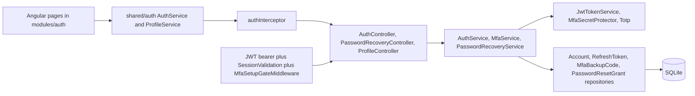
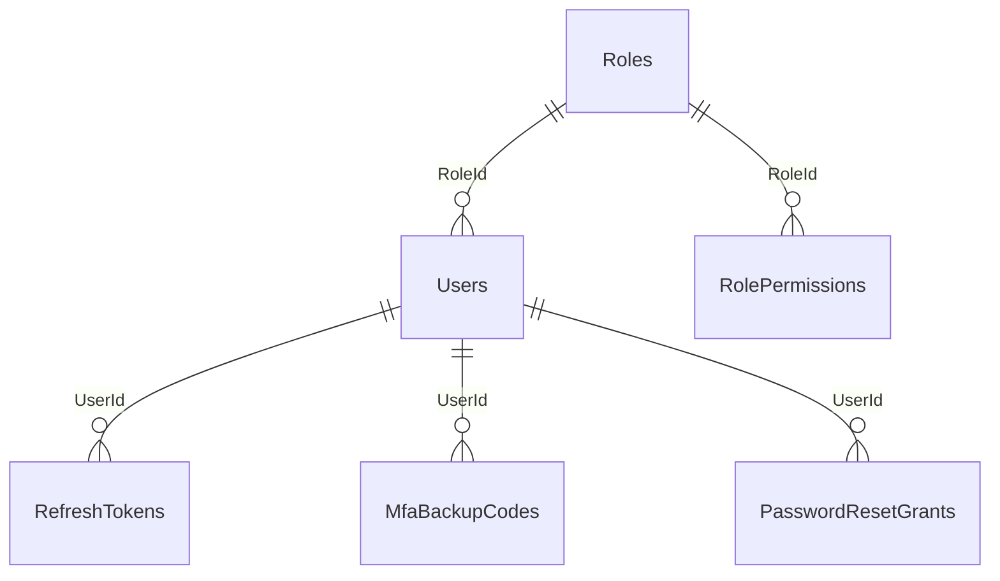

# Authentication Module – Technical Documentation

> **Project:** TaskFlow – Intelligent Task Allocation & Tracking System
> **Module:** Authentication  ·  **Child Modules:** Login, Account Recovery, MFA Security Setup, Sessions and Tokens
> **Version:** 1.0  ·  **Last Updated:** 31-Oct-2026
> **Backend:** ASP.NET Core Web API (.NET 10)  ·  **Frontend:** Angular  ·  **Database:** SQLite (EF Core)
> **Author:** Jojo George (jojogeorge3344@gmail.com)
> © 2026 Jojo George. All rights reserved.

> ✅ Target framework confirmed: `net10.0` (.NET 10), from `backend/src/TaskFlow.Api/TaskFlow.Api.csproj`.

---

## 1. Technical Overview
The Authentication module issues and validates sessions for the TaskFlow SPA. It is built from:

- **Password sign-in** (`AuthController` → `AuthService`) using ASP.NET Core Identity's `PasswordHasher<User>` (PBKDF2), returning a short-lived **JWT access token** (HMAC-SHA256) in the body and a **refresh token** in an HttpOnly cookie (`taskflow_refresh`, path `/api/v1/auth`). Detail: `01.1-Login.md`, `01.4-Sessions-and-Tokens.md`.
- **Authenticator-app MFA (TOTP, RFC 6238)** implemented in-house (`Integrations/Security/OneTimeCodes/Totp.cs`, `Base32.cs`). The shared key is encrypted with ASP.NET Core Data Protection (`MfaSecretProtector`); the second sign-in step uses a Data-Protection-signed **challenge token** bound to the user id and security stamp. Ten single-use backup codes are stored as SHA-256 hashes. Detail: `01.3-MFA-Security-Setup.md`.
- **Mandatory MFA enrolment**: `MfaSetupGateMiddleware` returns `403` with code `mfa_setup_required` for every API call except the setup allow-list while `Mfa:Required` is true and the user has no MFA.
- **Account recovery** (`PasswordRecoveryController` → `PasswordRecoveryService`): an authenticator code (no backup code) buys a single-use, 10-minute reset token (`PasswordResetGrants` table); an in-memory sliding-window `AttemptLimiter` throttles per account and per caller address. Detail: `01.2-Account-Recovery.md`.
- **Session validation** (`Middleware/SessionValidation.cs`, hooked to `JwtBearerEvents.OnTokenValidated`): on every request the user's security stamp, active flag, role and effective permissions are re-read through `SessionService`, so password changes, resets, MFA resets, deactivation and role edits take effect on the next request.
- **Angular**: `modules/auth` (login, account-recovery, security-setup pages) plus `shared/auth` (`AuthService`, `authInterceptor`, guards, `TokenStore`, `role-routes.ts`). The access token is kept in memory only (`TokenStore` signal); silent refresh happens on `401` and at app start (`provideAppInitializer` → `restoreSession()`).

## 2. Architecture Flow

## 3. Backend File Structure
All paths are under `TaskFlow Proj/backend/src/TaskFlow.Api/`. Each child document lists its own files; this table lists the folders and the files shared by several children.

| Layer | Path | Files / owner |
|-------|------|---------------|
| Controllers | `Controllers/Auth/`, `Controllers/Profile/`, `Controllers/Management/` | `AuthController.cs` (01.1, 01.4), `PasswordRecoveryController.cs` (01.2), `ProfileController.cs` MFA actions and `EmployeesController.cs` `ResetMfa` (01.3) |
| Services | `Services/Auth/{Login, Mfa, PasswordRecovery, Sessions, AttemptLimits}/`, `Services/Profile/` | `AuthService` (01.1, 01.4), `MfaService` (01.3), `PasswordRecoveryService` (01.2), `SessionService` (01.4), `ProfileService` MFA wrapper (01.3) |
| Service – Attempt limits (shared by 01.2 and 01.3) | `Services/Auth/AttemptLimits/` | `IAttemptLimiter.cs`, `AttemptLimiter.cs` |
| Repositories | `Repositories/Auth/{Accounts, RefreshTokens, Mfa, PasswordRecovery}/` | `AccountRepository` (all children), `RefreshTokenRepository` (01.4 owner; also 01.1, 01.2, 01.3), `MfaBackupCodeRepository` (01.3), `PasswordResetGrantRepository` (01.2) |
| DTOs (shared) | `Dtos/Auth/` | `UserDto.cs`, `AuthResponse.cs` (`AuthResponse`, `AuthenticatedUserResponse`), `AuthTokens.cs` (used by 01.1 and 01.4) |
| DTOs / validators per child | `Dtos/Auth/`, `Dtos/Auth/Mfa/`, `Dtos/Auth/PasswordRecovery/` and their `Validators/` folders | See each child's section 3 |
| Integrations | `Integrations/Security/{Tokens, MfaSecrets, OneTimeCodes}/` | Tokens (01.4, used by 01.1), MfaSecrets (01.3, challenge used by 01.1), OneTimeCodes (01.3) |
| Entities (shared) | `Models/Entities/` | `User.cs`, `Role.cs`; per child: `RefreshToken.cs` (01.4), `MfaBackupCode.cs` (01.3), `PasswordResetGrant.cs` (01.2) |
| Enums | `Models/Enums/` | `NotificationType` (System) is used for notices (01.2, 01.3); `MfaVerifyOutcome` (01.3, used by 01.1), `RecoveryVerifyStatus` (01.2) |
| Common / Security (shared) | `Common/Security/` | `PermissionCatalog.cs`, `PermissionKeys.cs`, `PermissionPolicy.cs`, `SystemRoles.cs`; `AuthClaims.cs`, `RefreshTokenCookie.cs`, `EffectivePermissions.cs` (01.4, also used by 01.1) |
| Middleware | `Middleware/` | `GlobalExceptionHandler.cs` (shared); `SessionValidation.cs` (01.4); `MfaSetupGateMiddleware.cs` (01.3) |
| Filters (shared) | `Filters/` | `ValidationFilter.cs` (runs FluentValidation validators) |
| Authorization (shared) | `Authorization/Policies/`, `Authorization/Auditing/` | `RequirePermissionAttribute.cs`, `DeniedActionAuditHandler.cs` |
| Config | `Config/` | Shared: `IntegrationRegistration.cs` (token service, password hasher, Data Protection), `ServiceRegistration.cs`, `RepositoryRegistration.cs`; `JwtOptions.cs`, `CrossCuttingRegistration.cs` (01.4); `MfaOptions.cs` (01.3) |
| Persistence (shared) | `Persistence/` | `AppDbContext.cs`; migrations `20261011171611_InitialAuth.cs` (creates `Users`, `RefreshTokens`), `20261012173144_AddUserSecurityStamp.cs` (adds `Users.SecurityStamp`), `20261023101938_AddMfaAndAccountRecovery.cs` (adds the `Users.Mfa*` columns and `MobileNumber`, creates `MfaBackupCodes`, `PasswordResetGrants`) |

## 4. Frontend File Structure
All paths are under `TaskFlow Proj/frontend/src/app/`. Child-specific files are listed in each child document.

| Type | Path | Purpose |
|------|------|---------|
| Routes | `modules/auth/auth.routes.ts` | `AUTH_ROUTES`: `login` (01.1), `account-recovery` (01.2), `security-setup` (01.3), all outside the shell |
| Page components | `modules/auth/login/`, `modules/auth/account-recovery/`, `modules/auth/security-setup/` | One folder per screen (01.1, 01.2, 01.3) |
| API service (shared) | `shared/auth/auth.service.ts` | `login`, `verifyMfa` (01.1); `verifyAuthenticatorRecovery`, `recoverPassword` (01.2); `refresh`, `restoreSession`, `logout`, `checkSession` (01.4) |
| Models (shared) | `shared/auth/auth.models.ts` | `AuthUser`, `LoginRequest`, `AuthResponse`, `MfaChallenge`, `RecoveryTokenResponse`, `RecoverPasswordRequest`, `MfaSetup`, `MfaBackupCodes`, `isMfaChallenge()` |
| Route / Guard (shared) | `shared/auth/auth.guard.ts` | `authGuard` (01.4), `mfaSetupGuard`, `securitySetupGuard` (01.3), `permissionGuard` (used by other modules) |
| Interceptor | `shared/auth/auth.interceptor.ts` | 01.4 (refresh on `401`) and 01.3 (`403 mfa_setup_required`) |
| Messages (shared) | `shared/auth/login-reasons.ts` | `reason` query values and login notices (01.1, 01.4) |
| Shell / bootstrap | `layouts/shell.component.ts`, `config/app.config.ts`, `routes/app.routes.ts` | 01.4 |

## 5. Child Modules

| # | Child Module | Main endpoints (count) | Key permissions | Document |
|---|--------------|------------------------|-----------------|----------|
| 01.1 | Login | `POST /api/v1/auth/login`, `POST /api/v1/auth/mfa/verify`, `GET /api/v1/auth/me` (3) | None (`[AllowAnonymous]`; `/auth/me` `[Authorize]`) | `01.1-Login.md` |
| 01.2 | Account Recovery | `POST /api/v1/auth/password-recovery/authenticator/verify`, `POST /api/v1/auth/password-recovery/reset` (2) | None (`[AllowAnonymous]`) | `01.2-Account-Recovery.md` |
| 01.3 | MFA Security Setup | `POST /api/v1/users/me/mfa/setup`, `/enable`, `/check`, `/backup-codes`, `POST /api/v1/users/{id}/mfa/reset` (5) | `profile.view`, `profile.edit`, `profile.mfa.manage` (Always On), `employees.mfa.reset` | `01.3-MFA-Security-Setup.md` |
| 01.4 | Sessions and Tokens | `POST /api/v1/auth/refresh`, `POST /api/v1/auth/logout` (2) | None (`[AllowAnonymous]`, cookie) | `01.4-Sessions-and-Tokens.md` |

Endpoint numbers 1–12 are kept across the child documents so they can be cross-referenced. The child documents are in the folder `01-Auth/` next to this file.

## 6. Database Design
SQLite types come from the migrations; table names are the `DbSet` names in `AppDbContext`. `Users` is shared by every child and is described in full here; the other tables are described in the child that owns them.

| Table | Owner child | Used by |
|-------|-------------|---------|
| `Users` | Shared (module) | 01.1 (sign-in, `LastLoginAt`), 01.2 (password, stamp), 01.3 (`Mfa*` columns, stamp), 01.4 (stamp, active flag) |
| `RefreshTokens` | 01.4 Sessions and Tokens | 01.1 (insert on sign-in), 01.2 and 01.3 (revoke all on reset) |
| `MfaBackupCodes` | 01.3 MFA Security Setup | 01.1 (backup code at sign-in) |
| `PasswordResetGrants` | 01.2 Account Recovery | – |
| `Roles`, `RolePermissions`, `Permissions` | Settings module | 01.1, 01.4 (role and permission keys read) |

| Table | Column | Type | Constraints | Description |
|-------|--------|------|-------------|-------------|
| `Users` | `Id` | INTEGER | PK, autoincrement | User id |
| `Users` | `EmployeeCode` | TEXT(32) | Nullable | Employee code |
| `Users` | `FullName` | TEXT(200) | Not Null | Display name |
| `Users` | `Username` | TEXT(100) | Not Null, Unique (`IX_Users_Username`) | Sign-in name |
| `Users` | `Email` | TEXT(256) | Not Null, Unique (`IX_Users_Email`) | Sign-in email (stored lower-case by `EmailPolicy.Normalize`) |
| `Users` | `MobileNumber` | TEXT(20) | Nullable | E.164 number (collected on Security Setup) |
| `Users` | `PasswordHash` | TEXT | Not Null | `PasswordHasher<User>` hash |
| `Users` | `SecurityStamp` | TEXT(64) | Not Null | Rotated on password change/reset and MFA reset; compared with JWT `sstamp` |
| `Users` | `MfaSecretProtected` | TEXT(512) | Nullable | Data-Protection-encrypted TOTP key |
| `Users` | `MfaEnabledAt` | TEXT (DateTime) | Nullable | When MFA was turned on |
| `Users` | `MfaLastUsedStep` | INTEGER (long) | Not Null, concurrency token | Last accepted TOTP step (replay protection) |
| `Users` | `MfaFailedAttempts` | INTEGER | Not Null, default 0, concurrency token | Consecutive wrong codes |
| `Users` | `MfaLockedUntil` | TEXT (DateTime) | Nullable | MFA lockout end |
| `Users` | `RoleId` | INTEGER | FK → `Roles.Id` | Role |
| `Users` | `IsActive` | INTEGER (bool) | Not Null | Inactive users cannot sign in or keep a session |
| `Users` | `LastLoginAt` | TEXT (DateTime) | Nullable | Set on successful sign-in |
| `Users` | `CreatedAt`, `UpdatedAt` | TEXT (DateTime) | Not Null | Audit times |
| `Users` | `IsDeleted` | INTEGER (bool) | Not Null; global query filter `!IsDeleted` | Soft delete |

**Relationships**
- `Users.RoleId → Roles.Id` (FK, Restrict)
- `RefreshTokens.UserId → Users.Id` (FK, Cascade); query filter hides tokens of deleted users
- `MfaBackupCodes.UserId → Users.Id` (FK, Cascade)
- `PasswordResetGrants.UserId → Users.Id` (FK, Cascade)
- Permissions are read through `RolePermissions.RoleId → Roles.Id` and `RolePermissions → Permissions.Key` (Settings module).

## 7. Security & Authorization
- **Authentication:** JWT bearer (`Microsoft.AspNetCore.Authentication.JwtBearer`), access token 30 min in memory on the client; refresh token 7 days in cookie `taskflow_refresh` (HttpOnly, Secure, SameSite=Strict, Path `/api/v1/auth`), rotated on every refresh and stored only as a SHA-256 hash (detail in 01.4).
- **Pipeline order (`Program.cs`):** `UseCors` → `UseAuthentication` → `MfaSetupGateMiddleware` → `UseAuthorization`.
- **Session revocation:** security stamp check on every request (`SessionValidation`); role and permission claims re-read from the database every request.
- **Anti-enumeration:** login returns a bare `401` for any failure; recovery returns one message for every failure.
- **Authorization:** permission policies `perm:{key}` are generated for every `PermissionCatalog.All` entry (`RequireClaim("permission", key)`); denied authorizations are logged by `DeniedActionAuditHandler` ("Denied action: user … attempted …").
- **Data scope:** Own – every `/users/me` MFA endpoint takes the user id from the token (`ClaimTypes.NameIdentifier`), never from the request. Organization – `employees.mfa.reset` applies to any user id.
- **Shared attempt limiter:** `AttemptLimiter` (singleton, in memory) – sliding 5-minute window, `AttemptsPerAccount = 5`, `AttemptsPerAddress = 20`, `MaxTrackedKeys = 10 000` (oldest evicted), idle keys swept every window; IPv6 addresses pooled by /64, IPv4-mapped addresses normalised. Used by recovery (per account + address, 01.2) and by password re-entry for MFA setup/backup-code regeneration (key `pwd:{id}`, no address, 01.3).
- **Frontend:** `authGuard` (redirects to `/login?returnUrl=`), `mfaSetupGuard` on the shell, `securitySetupGuard` on `/security-setup`; the **Reset MFA** button in Employee Management is shown only with `employees.mfa.reset` and when the employee has MFA on.

| Permission Key | Endpoint(s) | UI Element Controlled |
|----------------|-------------|-----------------------|
| (none – `[AllowAnonymous]`) | `POST /api/v1/auth/login`, `/auth/mfa/verify`, `/auth/refresh`, `/auth/logout`, `/auth/password-recovery/authenticator/verify`, `/auth/password-recovery/reset` | Login screen, Account Recovery screen, Sign out button |
| (none – `[Authorize]`) | `GET /api/v1/auth/me` | Session check, permission sync |
| `profile.view` (Always On, not attribute-checked) | `GET /api/v1/users/me` | Security Setup step 1 facts |
| `profile.edit` (Always On, not attribute-checked) | `PUT /api/v1/users/me` | Security Setup step 1 form |
| `profile.mfa.manage` (Always On, not attribute-checked) | `POST /api/v1/users/me/mfa/setup`, `/enable`, `/check`, `/backup-codes` | Security Setup steps 2–3 |
| `employees.mfa.reset` (Administrator Granted; Manager/Employee Denied; Custom Configurable) | `POST /api/v1/users/{id}/mfa/reset` | **Reset MFA** button in the employee details panel |

## 8. Validations & Error Handling
Shared rules only; child-specific rules are in each child document.

| Rule | Layer | HTTP Code | Error Message |
|------|-------|-----------|---------------|
| MFA locked | `AuthController` / `ProfileController.CheckMfa` / `MfaService` | 429 / 400 | Too many wrong codes. Try again in a few minutes. (429 from controllers; 400 when thrown as `BusinessRuleException` from setup/enable/backup-codes) |
| Parallel save conflict | `GlobalExceptionHandler` (`DbUpdateConcurrencyException`, `ConcurrencyConflictException`) | 409 | Someone else changed this record while you were saving. Reload it and try again. |
| Unhandled exception | `GlobalExceptionHandler` | 500 | Something went wrong. Please try again. |

Request DTOs are validated by FluentValidation through `ValidationFilter` (validation ProblemDetails `errors` map). Errors are returned by the global exception middleware (`GlobalExceptionHandler`) and by controller `Problem(...)` calls as `application/problem+json`. `RateLimitedException` can add a `Retry-After` header when a delay is supplied (none is supplied in this module).

## 9. Integrations / Side Effects
- **Notifications:** `INotificationPublisher.PublishAsync(..., NotificationType.System, ...)` after a password recovery reset (01.2) and after an administrator MFA reset (01.3); texts are in the child documents.
- **Email:** none. No password, code or link is sent by email or SMS in this module.
- **Activity Log:** no task activity entries. Denied authorizations are written to the application log by `DeniedActionAuditHandler`; recovery notification failures are logged as warnings (01.2).
- **Session effects:** password reset and admin MFA reset rotate `SecurityStamp` and revoke all refresh tokens (all sessions end).
- **AI Assistant:** > ⚠️ To be confirmed: no assistant tool for this module was found in `Controllers/Auth` or `Services/Auth`; the assistant's help knowledge has `change-password.md` (Profile) but no sign-in or MFA topic.

## 10. Configuration
Shared keys only; `Jwt:*` keys are in 01.4, `Mfa:Issuer`, `Mfa:BackupCodeCount` in 01.3, `Mfa:ChallengeMinutes` in 01.1.

| Key (`appsettings.json`) | Purpose | Default |
|--------------------------|---------|---------|
| `Mfa:Required` | Force MFA enrolment for everyone (break-glass: `Mfa__Required=false`); used by sign-in (`mfaSetupRequired`), session validation and the setup gate | `true` |
| `Mfa:MaxFailedAttempts` | Wrong codes before lockout (code default, not in appsettings); shared by sign-in, code check and backup-code regeneration | `5` |
| `Mfa:LockoutMinutes` | Lockout length (code default) | `5` |
| `AiProviders:KeyRingPath` | Data Protection key ring folder (also protects MFA keys and sign-in challenges) | `dp-keys` |
| `Storage:Root` | Base folder for the key ring and database | `""` |
| `ConnectionStrings:Default` | SQLite database | `<secret>` |

Hard-coded shared values: `AttemptLimiter` 5 per account, 20 per address, 5-minute window, 10 000 keys.

## 11. Testing
Paths are relative to `backend/tests`. Child-specific tests are listed in each child document; the files below cover several children.

| Test Type | File / Location | Covers |
|-----------|-----------------|--------|
| Unit (support) | `TaskFlow.UnitTests/Auth/Login/AuthServiceHarness.cs` | Test harness for `AuthService` (01.1, 01.4) |
| Unit (support) | `TaskFlow.UnitTests/TestSupport/AcceptingMfaService.cs` | MFA stub |
| Unit | `TaskFlow.UnitTests/Auth/AttemptLimits/AttemptLimiterTests.cs` | Sliding window limiter (01.2, 01.3) |
| Integration | `TaskFlow.IntegrationTests/Auth/Login/AuthEndpointsTests.cs` | Login, refresh, logout, me endpoints (01.1, 01.4) |
| Integration | `TaskFlow.IntegrationTests/Common/PermissionAuthorizationTests.cs` | Permission policies |
| Integration (support) | `TaskFlow.IntegrationTests/TestSupport/MfaTestSupport.cs` | MFA helpers |

No frontend spec files were found under `modules/auth`.

## 12. Known Limitations / Future Enhancements
- `AttemptLimiter` is in memory: a restart resets it and it is not shared between multiple API instances.
- **Password on update is ignored:** `UpdateUserRequest.Password` is marked "Ignored" and `EmployeeService` hashes a password only in `CreateAsync`, so an employee edit cannot set a password and bypass the authenticator-gated Profile flow.

Child-specific gaps are listed in each child document.

---
© 2026 Jojo George. All rights reserved. Unauthorized copying or distribution of this document is prohibited.
