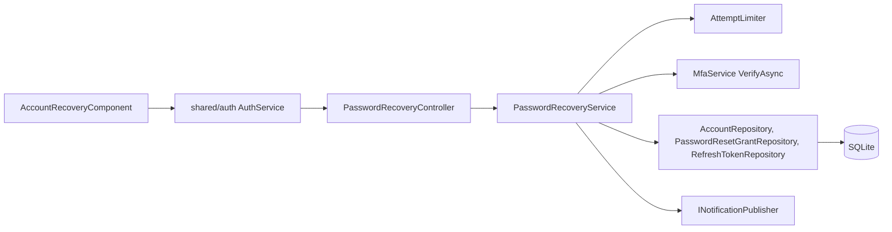
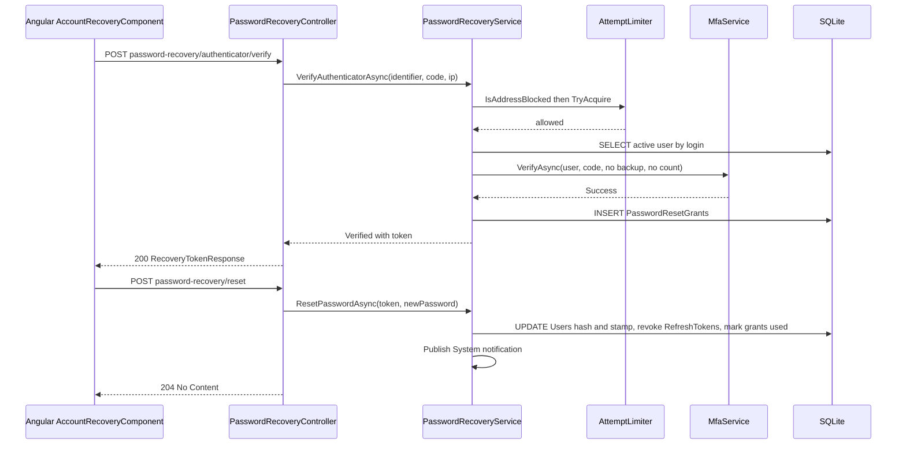

# Account Recovery – Technical Documentation

> **Project:** TaskFlow – Intelligent Task Allocation & Tracking System
> **Parent Module:** Authentication  ·  **Child Module:** 01.2 Account Recovery
> **Version:** 1.0  ·  **Last Updated:** 31-Oct-2026
> **Backend:** ASP.NET Core Web API (.NET 10)  ·  **Frontend:** Angular  ·  **Database:** SQLite (EF Core)
> **Author:** Jojo George (jojogeorge3344@gmail.com)
> © 2026 Jojo George. All rights reserved.

---

## 1. Technical Overview
Account Recovery (password reset) is a two-call anonymous flow. `PasswordRecoveryController` → `PasswordRecoveryService.VerifyAuthenticatorAsync` accepts an account identifier and a current authenticator code (no backup code) and, after the in-memory `AttemptLimiter` allows it, returns a single-use, 10-minute reset token whose SHA-256 hash is stored in `PasswordResetGrants`. `ResetPasswordAsync` then sets the new password, rotates the security stamp, revokes all refresh tokens, cancels the user's other grants and publishes a System notification. On the client, `AccountRecoveryComponent` runs the two steps (`RecoveryStep` = `verify` / `password`).

## 2. Architecture Flow


## 3. Backend File Structure
All paths are under `TaskFlow Proj/backend/src/TaskFlow.Api/`.

| Layer | Path | Files |
|-------|------|-------|
| Controller | `Controllers/Auth/` | `PasswordRecoveryController.cs` |
| Service | `Services/Auth/PasswordRecovery/` | `IPasswordRecoveryService.cs`, `PasswordRecoveryService.cs` |
| Service (used) | `Services/Auth/AttemptLimits/` | `IAttemptLimiter.cs`, `AttemptLimiter.cs` (shared, see parent section 7) |
| Service (used) | `Services/Auth/Mfa/` | `IMfaService.cs`, `MfaService.cs` (`VerifyAsync`, see 01.3) |
| Repository | `Repositories/Auth/PasswordRecovery/` | `IPasswordResetGrantRepository.cs`, `PasswordResetGrantRepository.cs` |
| Repository (used) | `Repositories/Auth/Accounts/`, `Repositories/Auth/RefreshTokens/` | `AccountRepository.cs`, `RefreshTokenRepository.cs` |
| DTOs | `Dtos/Auth/PasswordRecovery/` | `PasswordRecoveryRequests.cs` (`AuthenticatorRecoveryRequest`, `RecoverPasswordRequest`, `RecoveryTokenResponse`, `RecoveryVerifyStatus`, `RecoveryVerifyResult`) |
| Validators | `Dtos/Auth/PasswordRecovery/Validators/` | `PasswordRecoveryValidators.cs` (`AuthenticatorRecoveryRequestValidator`, `RecoverPasswordRequestValidator`) |
| Entities | `Models/Entities/` | `PasswordResetGrant.cs`, `User.cs`, `RefreshToken.cs` |
| Enums | `Dtos/Auth/PasswordRecovery/PasswordRecoveryRequests.cs`, `Models/Enums/` | `RecoveryVerifyStatus` (Verified, Failed, Throttled); `NotificationType` (System) |

## 4. Frontend File Structure
All paths are under `TaskFlow Proj/frontend/src/app/`.

| Type | Path | Purpose |
|------|------|---------|
| Routes | `modules/auth/auth.routes.ts` | `account-recovery` route (outside the shell) |
| Page component | `modules/auth/account-recovery/pages/account-recovery.component.ts` | Two-step recovery (`RecoveryStep` = `verify` / `password`) |
| Model | `modules/auth/account-recovery/pages/account-recovery.model.ts` | `RecoveryStep` |
| API service | `shared/auth/auth.service.ts` | `verifyAuthenticatorRecovery`, `recoverPassword` |
| Models | `shared/auth/auth.models.ts` | `RecoveryTokenResponse`, `RecoverPasswordRequest` |
| Messages | `shared/auth/login-reasons.ts` | Login notice after a successful reset |

---

## 5. API & Logic

### 5.1 API Endpoints

| # | Method | Endpoint | Description | Permission (Policy) | Request DTO | Response DTO |
|---|--------|----------|-------------|---------------------|-------------|--------------|
| 4 | POST | `/api/v1/auth/password-recovery/authenticator/verify` | Step 1: account identifier + current authenticator code → single-use reset token | `[AllowAnonymous]` | `AuthenticatorRecoveryRequest` | `RecoveryTokenResponse` / `400` / `429` (ProblemDetails) |
| 5 | POST | `/api/v1/auth/password-recovery/reset` | Step 2: reset token + new password | `[AllowAnonymous]` | `RecoverPasswordRequest` | `204 No Content` / `400` (ProblemDetails or validation problem) |

### 5.2 Request / Response Samples
```json
// POST /api/v1/auth/password-recovery/authenticator/verify
{ "identifier": "jane", "code": "654321" }
```
```json
// 200 OK
{ "resetToken": "q3V0b2tlbl9leGFtcGxlX2Jhc2U2NHVybA" }
```
```json
// POST /api/v1/auth/password-recovery/reset
{ "resetToken": "q3V0b2tlbl9leGFtcGxlX2Jhc2U2NHVybA", "newPassword": "NewPass1", "confirmPassword": "NewPass1" }
```
```json
// 400 Bad Request – token unknown, used or expired
{ "status": 400, "detail": "This reset link is no longer valid. Start again from the login page." }
```

### 5.3 Service Layer Logic
**Method:** `PasswordRecoveryService.VerifyAuthenticatorAsync(string identifier, string? code, string? remoteAddress, CancellationToken)`
1. Trims the identifier. `IAttemptLimiter.IsAddressBlocked(remoteAddress)` → `Throttled` before any database work.
2. `IAccountRepository.FindActiveByLoginForUpdateAsync(identifier)` (active and not deleted).
3. Budget key: `IAttemptLimiter.AccountKey(user.Id)` (`user:{id}`) or `UnknownKey(identifier)` (`name:{UPPER}`) for unknown names. `TryAcquire(accountKey, remoteAddress)` reserves an attempt **before** checking the code; refused → `Throttled`.
4. User null or `MfaEnabledAt` null → `Failed`.
5. `IMfaService.VerifyAsync(user, code, allowBackupCode: false, countFailure: false)` – a wrong code does not touch the account's MFA failure counter; an existing MFA lock still refuses.
6. On success: `_limiter.Reset(accountKey)` and `IssueResetTokenAsync(user.Id)` → `Verified` with the token.
7. Controller maps `Verified` → `200`, `Throttled` → `429` ("Too many attempts. Try again in a few minutes."), otherwise `400` ("The details are incorrect, or the code has expired. Check them and try again."). The caller address comes from `HttpContext.Connection.RemoteIpAddress`.

**Method:** `PasswordRecoveryService.IssueResetTokenAsync(int userId)` – 32 random bytes, Base64Url without padding; stores a `PasswordResetGrant` with `TokenHash` = SHA-256 hex, `ExpiresAt = now + 10 minutes` (`TokenLifetime`).

**Method:** `PasswordRecoveryService.ResetPasswordAsync(string resetToken, string newPassword)`
1. `FindUnusedByHashWithUserForUpdateAsync(hash)`; false if no grant, no user, expired, user deleted or inactive.
2. Hashes the new password, rotates `SecurityStamp` (`Guid.NewGuid().ToString("N")`), sets `UpdatedAt` and `grant.UsedAt`.
3. Revokes all active refresh tokens (`GetActiveForUsersForUpdateAsync`) and marks all other unused grants used (`GetOtherUnusedForUpdateAsync`).
4. `SaveChangesAsync`; a `ConcurrencyConflictException` (token spent in parallel; `UsedAt` is a concurrency token) → false.
5. Publishes a `NotificationType.System` notification: "Your password was reset with your authenticator app. If this was not you, contact an administrator now." Failures are logged as warnings and not returned to the caller.

### 5.4 Repository Layer

| Method | Description | Query Notes |
|--------|-------------|-------------|
| `AccountRepository.FindActiveByLoginForUpdateAsync(identifier)` | Active, not deleted user by username or email | Tracked, no role include |
| `PasswordResetGrantRepository.FindUnusedByHashWithUserForUpdateAsync(tokenHash)` | Unused grant by hash, with user | Tracked; `Include(User)`; `UsedAt == null` |
| `PasswordResetGrantRepository.GetOtherUnusedForUpdateAsync(userId, exceptGrantId)` | User's other unused grants | Tracked |
| `RefreshTokenRepository.GetActiveForUsersForUpdateAsync(userIds)` | Unrevoked tokens of the users | Tracked; `RevokedAt == null` |

### 5.5 Sequence Diagram


---

## 6. Database Design
This child owns `PasswordResetGrants`. Full `Users` column list and relationships: parent document section 6; `RefreshTokens` columns: 01.4.

| Table | Column | Type | Constraints | Description |
|-------|--------|------|-------------|-------------|
| `PasswordResetGrants` | `Id` | INTEGER | PK | – |
| `PasswordResetGrants` | `UserId` | INTEGER | FK → `Users.Id`; index `IX_PasswordResetGrants_UserId_UsedAt` | Owner |
| `PasswordResetGrants` | `TokenHash` | TEXT(64) | Not Null; index `IX_PasswordResetGrants_TokenHash` | SHA-256 hex of the reset token |
| `PasswordResetGrants` | `CreatedAt`, `ExpiresAt` | TEXT (DateTime) | Not Null | Lifetime 10 minutes |
| `PasswordResetGrants` | `UsedAt` | TEXT (DateTime) | Nullable, concurrency token | Spent or cancelled |
| `Users` | `Username`, `Email`, `IsActive`, `IsDeleted` | TEXT / INTEGER (bool) | See parent | Identify the active account |
| `Users` | `MfaEnabledAt`, `MfaSecretProtected`, `MfaLastUsedStep`, `MfaLockedUntil` | TEXT / INTEGER | See parent | Recovery needs MFA on; code verified against the key; existing lock refuses |
| `Users` | `PasswordHash`, `SecurityStamp`, `UpdatedAt` | TEXT | Not Null | New hash, rotated stamp on reset |
| `RefreshTokens` | `RevokedAt` | TEXT (DateTime) | Nullable | Set for every active token of the user on reset |

**Relationships**
- `PasswordResetGrants.UserId → Users.Id` (FK, Cascade)

## 7. Security & Authorization
- Both endpoints are `[AllowAnonymous]`; possession of the authenticator (TOTP code) is the only recovery factor; backup codes are refused.
- **Anti-enumeration:** one message for every failure (unknown account, inactive, MFA off, wrong code).
- **Throttling:** `AttemptLimiter` – 5 attempts per account key and 20 per caller address in a sliding 5-minute window; the attempt is reserved before the code is checked (limiter details in the parent document).
- **Lockout isolation:** `countFailure: false`, so a stranger cannot lock the owner's sign-in codes; an existing MFA lock still refuses.
- **Reset token:** 32 random bytes, stored only as SHA-256 hex, 10 minutes, single use (`UsedAt` concurrency token); all other unused grants are cancelled when one is used.
- **Session effects:** reset rotates `SecurityStamp` and revokes all refresh tokens, so every session ends (validated in 01.4).

| Permission Key | Endpoint(s) | UI Element Controlled |
|----------------|-------------|-----------------------|
| (none – `[AllowAnonymous]`) | `POST /api/v1/auth/password-recovery/authenticator/verify`, `POST /api/v1/auth/password-recovery/reset` | Account Recovery screen (both steps) |

## 8. Validations & Error Handling

| Rule | Layer | HTTP Code | Error Message |
|------|-------|-----------|---------------|
| `Identifier` required, max 256; `Code` required, max 32 | `AuthenticatorRecoveryRequestValidator` | 400 | FluentValidation defaults |
| Recovery failure (any reason) | `PasswordRecoveryController` | 400 | The details are incorrect, or the code has expired. Check them and try again. |
| Recovery throttled | `PasswordRecoveryController` | 429 | Too many attempts. Try again in a few minutes. |
| `ResetToken` required; `NewPassword` 6–128; `ConfirmPassword` equal | `RecoverPasswordRequestValidator` | 400 | Passwords do not match. (others FluentValidation defaults) |
| Reset token unknown, used, expired, user inactive | `PasswordRecoveryController.Reset` | 400 | This reset link is no longer valid. Start again from the login page. |

## 9. Integrations / Side Effects
- **Notifications:** `INotificationPublisher.PublishAsync(..., NotificationType.System, ...)` – password recovery reset → "Your password was reset with your authenticator app. If this was not you, contact an administrator now."
- **Email:** none. No password, code or link is sent by email or SMS.
- **Activity Log:** none; recovery notification failures are logged as warnings.
- **Session effects:** `SecurityStamp` rotated and all refresh tokens revoked (all sessions end).

## 10. Configuration
_Not applicable: this child has no `appsettings.json` keys of its own._

Hard-coded values: `PasswordRecoveryService.TokenLifetime` = 10 min. The `AttemptLimiter` limits are listed in the parent document.

## 11. Testing
Paths are relative to `backend/tests`.

| Test Type | File / Location | Covers |
|-----------|-----------------|--------|
| Unit | `TaskFlow.UnitTests/Auth/PasswordRecovery/PasswordRecoveryServiceTests.cs` | Recovery verify and reset |
| Integration | `TaskFlow.IntegrationTests/Auth/Mfa/MfaRecoveryEndpointsTests.cs` | Recovery with authenticator |
| Integration | `TaskFlow.IntegrationTests/Auth/PasswordRecovery/PasswordRecoveryEndpointsTests.cs` | Recovery endpoints |

Shared: `AttemptLimiterTests.cs` is listed in the parent document. No frontend spec files were found under `modules/auth/account-recovery`.

## 12. Known Limitations / Gaps found
- Users without MFA (possible only when `Mfa:Required` is false) cannot use self-service recovery.
- **Recovery note text:** the Account Recovery screen says "turned on two-step verification from your Profile", but setup happens on `/security-setup`. Profile has no two-step verification card, only a "Two-step on/off" chip.
- **Stale frontend comments:** `auth.models.ts` describes `RecoveryTokenResponse`/`RecoverPasswordRequest` as the "SMS" reset, but recovery uses the authenticator code only.

---
<sub>© 2026 Jojo George. All rights reserved. Unauthorized copying or distribution of this document is prohibited.</sub>
