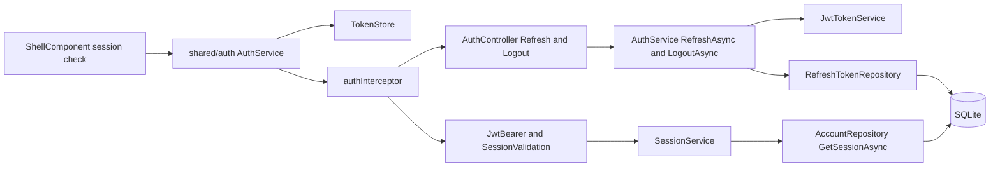
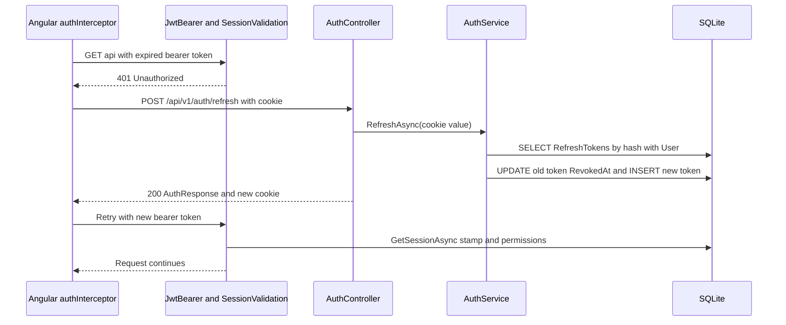

# Sessions and Tokens – Technical Documentation

> **Project:** TaskFlow – Intelligent Task Allocation & Tracking System
> **Parent Module:** Authentication  ·  **Child Module:** 01.4 Sessions and Tokens
> **Version:** 1.0  ·  **Last Updated:** 31-Oct-2026
> **Backend:** ASP.NET Core Web API (.NET 10)  ·  **Frontend:** Angular  ·  **Database:** SQLite (EF Core)
> **Author:** Jojo George (jojogeorge3344@gmail.com)
> © 2026 Jojo George. All rights reserved.

---

## 1. Technical Overview
Sessions and Tokens owns the token lifecycle after sign-in. `JwtTokenService` creates a short-lived **JWT access token** (HMAC-SHA256, 30 min) and a **refresh token** (64 random bytes, 7 days) that is sent in the HttpOnly cookie `taskflow_refresh` (path `/api/v1/auth`) and stored only as a SHA-256 hash in `RefreshTokens`. `POST /auth/refresh` rotates the pair; `POST /auth/logout` revokes it. **Session validation** (`Middleware/SessionValidation.cs`, hooked to `JwtBearerEvents.OnTokenValidated`) re-reads the user's security stamp, active flag, role and effective permissions through `SessionService` on every request, so password changes, resets, MFA resets, deactivation and role edits take effect on the next request. On the client the access token lives in memory only (`TokenStore` signal); `authInterceptor` refreshes silently on `401`, `restoreSession()` runs at app start, and the shell checks the session every 15 seconds.

## 2. Architecture Flow


## 3. Backend File Structure
All paths are under `TaskFlow Proj/backend/src/TaskFlow.Api/`.

| Layer | Path | Files |
|-------|------|-------|
| Controller | `Controllers/Auth/` | `AuthController.cs` (actions `Refresh`, `Logout`; `Me` is documented in 01.1 and used here as the session check) |
| Service | `Services/Auth/Login/` | `IAuthService.cs`, `AuthService.cs` (`RefreshAsync`, `LogoutAsync`, `IssueTokens`) |
| Service – Sessions | `Services/Auth/Sessions/` | `ISessionService.cs`, `SessionService.cs` |
| Repository | `Repositories/Auth/RefreshTokens/` | `IRefreshTokenRepository.cs`, `RefreshTokenRepository.cs` |
| Repository | `Repositories/Auth/Accounts/` | `IAccountRepository.cs`, `AccountRepository.cs` (`GetSessionAsync`), `SessionUser.cs` |
| DTOs | `Dtos/Auth/` | `AuthTokens.cs`, `AuthResponse.cs`, `UserDto.cs`, `SessionState.cs` (stamp, active flag, `MfaSetupRequired`, role name, permissions) |
| Integrations | `Integrations/Security/Tokens/` | `ITokenService.cs`, `JwtTokenService.cs`, `AccessToken.cs`, `RefreshTokenValue.cs` |
| Entities | `Models/Entities/` | `RefreshToken.cs`, `User.cs` |
| Common / Security | `Common/Security/` | `AuthClaims.cs`, `RefreshTokenCookie.cs`, `EffectivePermissions.cs` |
| Middleware | `Middleware/` | `SessionValidation.cs` |
| Config | `Config/` | `JwtOptions.cs`, `CrossCuttingRegistration.cs` (JWT bearer setup) |

## 4. Frontend File Structure
All paths are under `TaskFlow Proj/frontend/src/app/`.

| Type | Path | Purpose |
|------|------|---------|
| API service | `shared/auth/auth.service.ts` | `refresh`, `restoreSession`, `logout`, `checkSession` |
| Interceptor | `shared/auth/auth.interceptor.ts` | Adds `Authorization: Bearer`, refreshes on `401` |
| Route / Guard | `shared/auth/auth.guard.ts` | `authGuard` (redirects to `/login?returnUrl=`) |
| Token store | `shared/auth/token.store.ts` | In-memory access token |
| Messages | `shared/auth/login-reasons.ts` | `session-ended`, `credentials-changed` notices |
| App bootstrap | `config/app.config.ts`, `routes/app.routes.ts` | `provideAppInitializer(restoreSession)`, interceptors, shell guarded by `authGuard` + `mfaSetupGuard` |
| Shell | `layouts/shell.component.ts` / `.html` | Sign out; session check every `SESSION_CHECK_INTERVAL_MS` = 15 000 ms and on `visibilitychange` |

---

## 5. API & Logic

### 5.1 API Endpoints

| # | Method | Endpoint | Description | Permission (Policy) | Request DTO | Response DTO |
|---|--------|----------|-------------|---------------------|-------------|--------------|
| 11 | POST | `/api/v1/auth/refresh` | Rotate the refresh cookie and issue a new access token | `[AllowAnonymous]` (cookie `taskflow_refresh`) | – (cookie) | `AuthResponse` + new cookie / `401` (cookie cleared) |
| 12 | POST | `/api/v1/auth/logout` | Revoke the refresh token and clear the cookie | `[AllowAnonymous]` (cookie) | – (cookie) | `204 No Content` |

`GET /api/v1/auth/me` (endpoint 3, documented in 01.1 Login) is also used by the shell every 15 seconds as the session check.

### 5.2 Request / Response Samples
```json
// POST /api/v1/auth/refresh   (body {} ; Cookie: taskflow_refresh=...)
```
```json
// 200 OK (Set-Cookie: taskflow_refresh=new value)
{ "accessToken": "eyJhbGciOiJIUzI1NiIs...", "expiresAt": "2026-10-31T11:00:00Z", "user": { "id": 7, "role": "Employee", "permissions": ["..."], "mfaSetupRequired": false } }
```

JWT claims written by `JwtTokenService.CreateAccessToken`: `sub`, `ClaimTypes.NameIdentifier` (user id), `ClaimTypes.Name` (full name, or username), `ClaimTypes.Role`, `sstamp` (security stamp), `jti`; issuer `Jwt:Issuer`; no audience; HMAC-SHA256 with `Jwt:Key`.

### 5.3 Service Layer Logic
**Method:** `AuthService.RefreshAsync(string? refreshToken)`
1. Empty → failure. `FindByHashWithUserForUpdateAsync(ITokenService.HashRefreshToken(token))` (SHA-256 hex; includes user and role).
2. Failure if not found, revoked, expired, user missing or inactive (deleted users are filtered out by the `RefreshToken` query filter).
3. Revokes the presented token (`RevokedAt = now`) and issues a new pair via `IssueTokens` (rotation). Save, map to `UserDto`.
4. Controller: failure → clears cookie, `401`; success → new cookie and `AuthResponse`.

**Method:** `AuthService.LogoutAsync(string? refreshToken)` – no token, unknown or already revoked → no-op; otherwise sets `RevokedAt`. The controller always deletes the cookie and returns `204`.

**Method:** `JwtTokenService.CreateRefreshToken()` – 64 random bytes Base64, hash SHA-256 hex, `ExpiresAt = now + Jwt:RefreshTokenDays`.

**Session validation:** `SessionValidation.ValidateAsync(TokenValidatedContext)` (registered as `JwtBearerEvents.OnTokenValidated` in `CrossCuttingRegistration.cs`, with `MapInboundClaims = false`, `ValidateIssuer`, `ValidateLifetime`, `ValidateIssuerSigningKey`, `ValidateAudience = false`)
1. Fails when the `NameIdentifier` claim is not an int.
2. `ISessionService.GetAsync(userId)` → `AccountRepository.GetSessionAsync` (no tracking projection to `SessionUser`).
3. Fails ("The session is no longer valid. Sign in again.") when the user is missing, inactive or the `sstamp` claim differs from the stored stamp.
4. Replaces the role claim, removes stale `permission` and `mfa_setup_required` claims, adds one `permission` claim per key from `EffectivePermissions.Expand(...)`, and adds `mfa_setup_required` when `Mfa:Required` and MFA is not on (read by `MfaSetupGateMiddleware`, 01.3).

**Frontend session handling (`shared/auth`)**
- `authInterceptor`: adds the bearer token except for `/auth/login` and `/auth/refresh`; on `403` with `code` = `mfa_setup_required` calls `markMfaRequired()` and navigates to `/security-setup`; on `401` (non-credential endpoints) calls `refresh()` once (shared in-flight observable via `shareReplay`) and retries; refresh failure → `clearSession()` and `/login?reason=session-ended`.
- `restoreSession()` runs at startup through `provideAppInitializer`.
- `checkSession()` (`GET /auth/me`) syncs role and permissions into the `currentUser` signal.

### 5.4 Repository Layer

| Method | Description | Query Notes |
|--------|-------------|-------------|
| `RefreshTokenRepository.FindByHashWithUserForUpdateAsync(tokenHash)` | Token with user and role | Tracked; `Include(User).ThenInclude(Role)`; index `IX_RefreshTokens_TokenHash` |
| `RefreshTokenRepository.FindByHashForUpdateAsync(tokenHash)` | Token only (logout) | Tracked |
| `AccountRepository.GetSessionAsync(userId)` | Stamp, active flag, `MfaEnabledAt`, role name, role permission keys | `AsNoTracking`, projection to `SessionUser`; runs on every authenticated request |

### 5.5 Sequence Diagram


---

## 6. Database Design
This child owns `RefreshTokens`. Full `Users` column list and relationships: parent document section 6.

| Table | Column | Type | Constraints | Description |
|-------|--------|------|-------------|-------------|
| `RefreshTokens` | `Id` | INTEGER | PK | – |
| `RefreshTokens` | `UserId` | INTEGER | FK → `Users.Id`, index `IX_RefreshTokens_UserId` | Owner |
| `RefreshTokens` | `TokenHash` | TEXT | Not Null, index `IX_RefreshTokens_TokenHash` | SHA-256 hex of the cookie value |
| `RefreshTokens` | `ExpiresAt` | TEXT (DateTime) | Not Null | Expiry (UTC) |
| `RefreshTokens` | `CreatedAt` | TEXT (DateTime) | Not Null | Issued |
| `RefreshTokens` | `RevokedAt` | TEXT (DateTime) | Nullable | Set on rotation, logout, password change/reset, MFA reset |
| `Users` | `SecurityStamp` | TEXT(64) | Not Null | Compared with JWT `sstamp` on every request |
| `Users` | `IsActive`, `IsDeleted` | INTEGER (bool) | Not Null; global query filter `!IsDeleted` | Inactive or deleted users lose their session |
| `Users` | `MfaEnabledAt`, `RoleId` | TEXT / INTEGER | Nullable / FK → `Roles.Id` | `mfa_setup_required` claim and role claim |
| `RolePermissions`, `Permissions` | `RoleId`, `Key` | – | Settings module | Permission claims re-read every request |

**Relationships**
- `RefreshTokens.UserId → Users.Id` (FK, Cascade); query filter hides tokens of deleted users

## 7. Security & Authorization
- **Authentication:** JWT bearer (`Microsoft.AspNetCore.Authentication.JwtBearer`), access token 30 min in memory on the client; refresh token 7 days in cookie `taskflow_refresh` (HttpOnly, Secure, SameSite=Strict, Path `/api/v1/auth`), rotated on every refresh and stored only as a SHA-256 hash.
- **Token validation:** `ValidateIssuer`, `ValidateLifetime`, `ValidateIssuerSigningKey`; `ValidateAudience = false`; `MapInboundClaims = false`.
- **Session revocation:** security stamp check on every request (`SessionValidation`); role and permission claims re-read from the database every request.
- **Frontend:** `authGuard` (redirects to `/login?returnUrl=`) on the shell; the access token is never written to storage.

| Permission Key | Endpoint(s) | UI Element Controlled |
|----------------|-------------|-----------------------|
| (none – `[AllowAnonymous]`, cookie) | `POST /api/v1/auth/refresh`, `POST /api/v1/auth/logout` | Silent renewal, Sign out button |
| (none – `[Authorize]`) | `GET /api/v1/auth/me` | Session check, permission sync |

## 8. Validations & Error Handling

| Rule | Layer | HTTP Code | Error Message |
|------|-------|-----------|---------------|
| Refresh cookie missing, unknown, revoked, expired, or user inactive | `AuthController.Refresh` | 401 | (empty body; cookie cleared); UI shows the `session-ended` notice |
| Stale token stamp / inactive user | `SessionValidation` | 401 | The session is no longer valid. Sign in again. (authentication failure reason) |
| Logout without cookie or with a revoked one | `AuthService.LogoutAsync` | 204 | (no error) |

The `409` concurrency and `500` unhandled-error rows are shared and listed in the parent document.

## 9. Integrations / Side Effects
- **Session effects:** password change (Profile), password reset (01.2) and admin MFA reset (01.3) rotate `SecurityStamp` and revoke all refresh tokens; this child's validation then refuses the old access tokens.
- **Settings (Role Configuration):** role and permission edits reach signed-in users on their next request.
- **Notifications / Email / Activity Log / AI Assistant:** none for this child.

## 10. Configuration

| Key (`appsettings.json`) | Purpose | Default |
|--------------------------|---------|---------|
| `Jwt:Issuer` | Token issuer, validated on every request | `TaskFlow` |
| `Jwt:Key` | HMAC-SHA256 signing key (not in `appsettings.json`; supplied by environment / `appsettings.Environment.json`) | `<secret>` |
| `Jwt:AccessTokenMinutes` | Access token lifetime | `30` |
| `Jwt:RefreshTokenDays` | Refresh token / cookie lifetime | `7` |

Hard-coded values: `RefreshTokenCookie.Name` = `taskflow_refresh`; frontend `SESSION_CHECK_INTERVAL_MS` = 15 000.

## 11. Testing
Paths are relative to `backend/tests`.

| Test Type | File / Location | Covers |
|-----------|-----------------|--------|
| Unit | `TaskFlow.UnitTests/Auth/Login/AuthServiceRefreshAndLogoutTests.cs` | `RefreshAsync`, `LogoutAsync` |
| Unit | `TaskFlow.UnitTests/Integrations/Security/Tokens/JwtTokenServiceTests.cs` | JWT and refresh token creation |
| Integration | `TaskFlow.IntegrationTests/Common/AuthenticationWiringTests.cs` | JWT / session validation wiring |

Shared: `AuthServiceHarness.cs` and `AuthEndpointsTests.cs` (login, refresh, logout, me endpoints) are listed in the parent document. No frontend spec files were found under `shared/auth`.

## 12. Known Limitations / Gaps found
- Refresh-token rotation does not detect reuse of an already-rotated token (no token-family revocation); a reused token is simply refused.

---
<sub>© 2026 Jojo George. All rights reserved. Unauthorized copying or distribution of this document is prohibited.</sub>
