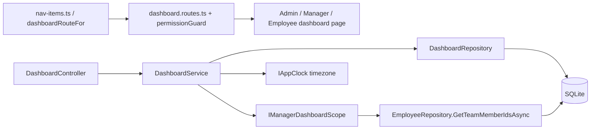
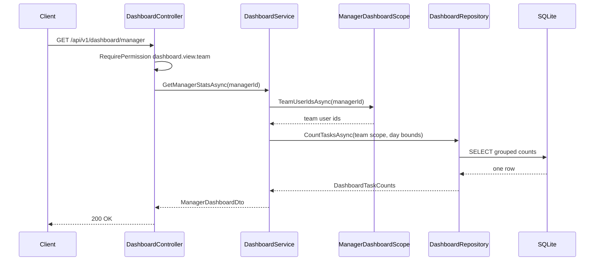

# Overview – Technical Documentation

> **Project:** TaskFlow – Intelligent Task Allocation & Tracking System
> **Parent Module:** Dashboard  ·  **Child Module:** 02.1 Overview
> **Version:** 1.0  ·  **Last Updated:** 31-Oct-2026
> **Backend:** ASP.NET Core Web API (.NET 10)  ·  **Frontend:** Angular  ·  **Database:** SQLite (EF Core)
> **Author:** Jojo George (jojogeorge3344@gmail.com)
> © 2026 Jojo George. All rights reserved.

---

## 1. Technical Overview
Overview covers the dashboard landing (route selection, guards, menu item, the three page components) and the backend counter endpoints. `DashboardController` + `DashboardService` + `DashboardRepository` expose single-query counter endpoints for the Administrator, Manager and Employee (`AdminDashboardDto`, `ManagerDashboardDto`, `EmployeeDashboardDto`). These endpoints exist but no Angular screen calls them today: the summary cards on the three pages are loaded from the Analytics endpoints (see `02.2-Analytics.md`).

Day boundaries ("today", "due today", "next 7 days") are computed in the application timezone from `IAppClock.GetTimeZoneAsync` and converted to UTC instants before querying. The manager's team is resolved through `IManagerDashboardScope` (owned by 02.2 Analytics).

## 2. Architecture Flow


## 3. Backend File Structure

| Layer | Path | Files |
|-------|------|-------|
| Controller | `TaskFlow.Api/Controllers/Dashboard/` | `DashboardController.cs` |
| Service | `TaskFlow.Api/Services/Dashboard/Overview/` | `IDashboardService.cs`, `DashboardService.cs` |
| Repository | `TaskFlow.Api/Repositories/Dashboard/Overview/` | `IDashboardRepository.cs`, `DashboardRepository.cs`, `DashboardTaskCounts.cs`, `DashboardDayBounds.cs`, `DashboardTaskScope.cs` |
| DTOs | `TaskFlow.Api/Dtos/Dashboard/` | `DashboardDto.cs` (`AdminDashboardDto`, `ManagerDashboardDto`, `EmployeeDashboardDto`) |
| Validators | – | None (no input) |
| Dependencies (other child / module) | `TaskFlow.Api/Services/Dashboard/Analytics/Scopes/`, `TaskFlow.Api/Repositories/Management/EmployeeManagement/Employees/`, `TaskFlow.Api/Common/Rules/` | `IManagerDashboardScope.cs` / `ManagerDashboardScope.cs` (team ids), `EmployeeRepository.cs` (`GetTeamMemberIdsAsync`), `ReminderCalculator` (local midnight) |
| Entities (read only) | `TaskFlow.Api/Models/Entities/` | `Task.cs`, `TaskRecipient.cs`, `User.cs`, `Project.cs` (team resolution also reads `UserDepartment.cs`, `DepartmentManager.cs`, `UserProjectAllocation.cs`) |
| Authorization | `TaskFlow.Api/Authorization/Policies/`, `TaskFlow.Api/Common/Security/` | `RequirePermissionAttribute.cs`, `PermissionKeys.cs` |
| DI registration | `TaskFlow.Api/Config/` | `ServiceRegistration.cs` (`IDashboardService`), `RepositoryRegistration.cs` (`IDashboardRepository`) – scoped |

## 4. Frontend File Structure

| Type | Path | Purpose |
|------|------|---------|
| Page component | `src/app/modules/dashboard/pages/admin-dashboard.component.ts/.html` | Administrator Dashboard (`/admin`); injects `DashboardAnalyticsService` (02.2) |
| Page component | `src/app/modules/dashboard/pages/manager-dashboard.component.ts/.html` | Manager Dashboard (`/manager`); injects `ManagerAnalyticsService` (02.2) |
| Page component | `src/app/modules/dashboard/pages/employee-dashboard.component.ts/.html` | Employee Dashboard (`/me`); injects `EmployeeAnalyticsService` (02.2) |
| Route / Guard | `src/app/modules/dashboard/dashboard.routes.ts` | `admin` – `permissionGuard` with `dashboard.view.organization`; `manager` – `permissionGuard` with `dashboard.view.team`; `me` – no guard (shell `authGuard` + `mfaSetupGuard` only) |
| Landing route | `src/app/shared/auth/role-routes.ts` | `dashboardRouteFor(role, permissions)` – Administrator → `/admin`, Manager → `/manager`, else by permission, else `/me` |
| Menu | `src/app/layouts/nav-items.ts` | Single "Dashboard" item whose route is `dashboardRouteFor(...)` |
| API service (unused) | `src/app/modules/dashboard/services/dashboard.service.ts` | `getEmployeeStats()` → `GET /api/v1/dashboard/employee`; not injected anywhere |
| Models | `src/app/modules/dashboard/models/dashboard.model.ts` | `EmployeeDashboardStats` interface |
| Permission constants | `src/app/shared/auth/permissions.ts` | `DashboardViewTeam`, `DashboardViewOrganization` |

## 5. API & Logic

### 5.1 API Endpoints
Route prefix: `[Route("api/v1/dashboard")]` on `DashboardController`.

| # | Method | Endpoint | Description | Permission (Policy) | Request DTO | Response DTO |
|---|--------|----------|-------------|---------------------|-------------|--------------|
| 1 | GET | `/api/v1/dashboard/admin` | Organisation counters (users, active users, projects, tasks) | `[RequirePermission(dashboard.view.organization)]` | – | `AdminDashboardDto` |
| 2 | GET | `/api/v1/dashboard/manager` | Team counters for the caller | `[RequirePermission(dashboard.view.team)]` | – (caller id from `NameIdentifier` claim) | `ManagerDashboardDto` |
| 3 | GET | `/api/v1/dashboard/employee` | Own counters for the caller | `[Authorize]` only | – (caller id from claim) | `EmployeeDashboardDto` |

Endpoints 2 and 3 return `401 Unauthorized` if the `NameIdentifier` claim is not an integer.

### 5.2 Request / Response Samples
```json
// GET /api/v1/dashboard/admin  -> 200 OK
{ "totalEmployees": 42, "activeEmployees": 39, "totalProjects": 6, "totalTasks": 310,
  "pendingTasks": 120, "completedTasks": 175, "overdueTasks": 18 }
```
```json
// GET /api/v1/dashboard/manager  -> 200 OK
{ "totalTasks": 64, "pendingTasks": 22, "tasksDueToday": 3, "upcomingDeadlines": 9,
  "overdueTasks": 4, "completedTasks": 40 }
```
```json
// GET /api/v1/dashboard/employee  -> 200 OK
{ "assignedTasks": 12, "pendingTasks": 5, "tasksDueToday": 1, "overdueTasks": 1,
  "inProgressTasks": 3, "completedTasks": 7 }
```

### 5.3 Service Layer Logic
**Class:** `DashboardService` (`IDashboardRepository`, `IAppClock`, `IManagerDashboardScope`)

**Method:** `GetAdminStatsAsync(CancellationToken)`
1. `CountUsersAsync(activeOnly: false)` and `CountUsersAsync(activeOnly: true)`.
2. `CountProjectsAsync()`.
3. `CountTasksAsync(new DashboardTaskScope(), bounds)` over all live tasks.
4. Returns `AdminDashboardDto(total, active, projects, tasks.Total, tasks.Open, tasks.Completed, tasks.Overdue)` – "pending" is the **open** count.

**Method:** `GetManagerStatsAsync(int managerId, CancellationToken)`
1. `IManagerDashboardScope.TeamUserIdsAsync(managerId)` – the active team.
2. `CountTasksAsync(new DashboardTaskScope(TeamUserIds: team), bounds)`.
3. Returns `ManagerDashboardDto(Total, Open, DueToday, Upcoming, Overdue, Completed)`.

**Method:** `GetEmployeeStatsAsync(int userId, CancellationToken)`
1. `CountTasksAsync(new DashboardTaskScope(OwnUserId: userId), bounds)`.
2. Returns `EmployeeDashboardDto(Total, Open, DueToday, Overdue, InProgress, Completed)`.

**Helper:** `BoundsAsync` – builds `DashboardDayBounds(now, todayStartUtc, tomorrowStartUtc, upcomingHorizonUtc)` with `ReminderCalculator.LocalMidnightUtc` in the application timezone; the upcoming window is 7 days (`UpcomingDeadlineWindowDays`), i.e. tomorrow up to the start of day 8.

### 5.4 Repository Layer

| Method | Description | Query Notes |
|--------|-------------|-------------|
| `CountUsersAsync(bool activeOnly)` | Number of users | `Users` query filter hides soft-deleted users |
| `CountProjectsAsync()` | Number of projects | `Projects` query filter hides soft-deleted projects |
| `CountTasksAsync(DashboardTaskScope, DashboardDayBounds)` | All seven counters in one grouped query | `AsNoTracking`, `!IsDeleted`; team / own filter = assignee **or** a `TaskRecipients` row; `Open` = status not Completed and not Cancelled; DueToday / Upcoming / Overdue count open tasks only; `InProgress` = InProgress or InQA; returns zeros when no rows |

Team resolution (`EmployeeRepository.GetTeamMemberIdsAsync`, called through `ManagerDashboardScope.TeamUserIdsAsync`): active users other than the manager who belong to a department the manager manages (`DepartmentManagers`) or to a project where the manager's allocation has `IsProjectManager = true`.

### 5.5 Sequence Diagram


## 6. Database Design
Overview owns no table and runs no migration; it reads the columns below.

| Table | Column | Type | Constraints | Description |
|-------|--------|------|-------------|-------------|
| `Tasks` | `Id` | int | PK | Task id (recipient join) |
| `Tasks` | `AssignedToUserId` | int | FK → `Users.Id`, Restrict, Indexed | Assignee (team / own scope) |
| `Tasks` | `Status` | int (enum) | – | ToDo, InProgress, Blocked, Completed, Cancelled, InQA |
| `Tasks` | `Deadline` | datetime (UTC) | Indexed | Due today / upcoming / overdue |
| `Tasks` | `IsDeleted` | bool | – | Deleted tasks are never counted |
| `TaskRecipients` | `TaskId`, `UserId` | int | FKs (Cascade), Unique (`TaskId`,`UserId`) | A recipient counts as an owner of the task |
| `Users` | `Id`, `IsActive`, `IsDeleted` | – | Soft-delete query filter | Total / active user counts; active team members |
| `Projects` | `Id`, `IsDeleted` | – | Soft-delete query filter | Project count |
| `DepartmentManagers` | `ManagerUserId`, `DepartmentId` | int | Composite PK; FKs Cascade | Departments a manager runs (team resolution) |
| `UserDepartments` | `UserId`, `DepartmentId` | int | Composite PK; FKs Cascade | Department membership (team resolution) |
| `UserProjectAllocations` | `UserId`, `ProjectId`, `IsProjectManager` | – | Composite PK; FKs Cascade | Project-manager flag widens a manager's team |

**Relationships:** `Tasks.AssignedToUserId → Users.Id` (Restrict); `TaskRecipients.TaskId → Tasks.Id`, `TaskRecipients.UserId → Users.Id` (Cascade); `DepartmentManagers`, `UserDepartments` and `UserProjectAllocations` link `Users` to `Departments` / `Projects` (Cascade).

## 7. Security & Authorization
- **Authentication:** JWT bearer token; the caller id is read from `ClaimTypes.NameIdentifier` (`TryGetCallerId`).
- **Authorization:** `[RequirePermission]` on the Admin and Manager endpoints; `EffectivePermissions.Expand` makes `dashboard.view.organization` imply `dashboard.view.team`, so an Administrator can call `/dashboard/manager`.
- **Data scope:** Organization – no filter; Team – `IManagerDashboardScope.TeamUserIdsAsync`; Own – the session user only.
- **Frontend:** `permissionGuard` on `/admin` and `/manager` redirects to `dashboardRouteFor(...)` when the key is missing; `/me` has no guard.

| Permission Key | Endpoint(s) | UI Element Controlled |
|----------------|-------------|-----------------------|
| `dashboard.view.own` | – (Always On, not stored); `GET /api/v1/dashboard/employee` needs only `[Authorize]` | `/me` route has no guard; default landing page |
| `dashboard.view.team` | `GET /api/v1/dashboard/manager` | `/manager` route guard; landing for custom roles |
| `dashboard.view.organization` | `GET /api/v1/dashboard/admin` | `/admin` route guard; landing for custom roles; "Administrator" note on Manager Dashboard |

## 8. Validations & Error Handling

| Rule | Layer | HTTP Code | Error Message |
|------|-------|-----------|---------------|
| Caller id claim missing or not numeric (`/manager`, `/employee`) | Controller | 401 | – |
| No permission | Policy | 403 | Forbidden |

Unhandled errors follow the module-level rule (`GlobalExceptionHandler`, 500) in the parent document.

## 9. Integrations / Side Effects
- **Notifications / Email / Activity Log:** None – read only.
- **Timezone:** `IAppClock` (Settings module) for the local day bounds.
- **Management module:** `EmployeeRepository.GetTeamMemberIdsAsync` defines the manager's team.
- **Analytics child (02.2):** `IManagerDashboardScope` is shared; the page components load their data from the Analytics services.

## 10. Configuration
Uses the module-level keys (`Application:Timezone`, `ConnectionStrings:Default`, `Jwt:*`) listed in the parent document. Code constant: `UpcomingDeadlineWindowDays = 7` in `DashboardService`.

## 11. Testing
Paths are relative to `backend/tests`.

| Test Type | File / Location | Covers |
|-----------|-----------------|--------|
| Unit | `TaskFlow.UnitTests/Dashboard/Overview/DashboardServiceTests.cs`, `DashboardServiceHarness.cs` | Overview counters |
| Integration | `TaskFlow.IntegrationTests/Dashboard/Overview/DashboardEndpointsTests.cs` | Overview endpoints + authorization |

## 12. Known Limitations / Gaps found
- The Overview counter endpoints (`/dashboard/admin`, `/dashboard/manager`, `/dashboard/employee`) and the Angular `DashboardService.getEmployeeStats()` are not used by any screen.
- **BRD vs code – Admin (screen 02):** "Active employees" card is only in the unused `GET /dashboard/admin`; "Recent system activity" / recent employee and task activity is not implemented; there are no direct links to Employee or Department Management from the dashboard (only the side menu).
- **BRD vs code – Manager (screen 03):** "Tasks due today" and "Upcoming deadlines" cards, "Recent task activity", the "Quick task creation" button and filtering by priority and status are not on the Manager Dashboard (filters are date range, basis, project, employee). Upcoming deadlines are not listed; only overdue tasks are.
- **BRD vs code – Employee (screen 04):** "My tasks due today" card, "Recent notifications" and "Recently updated tasks" are not on the Employee Dashboard; there is no shortcut to update progress.
- Counting and team-definition differences between Overview and Analytics are listed in the parent document.

---
<sub>© 2026 Jojo George. All rights reserved. Unauthorized copying or distribution of this document is prohibited.</sub>
