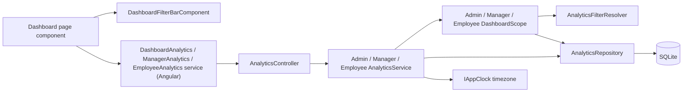
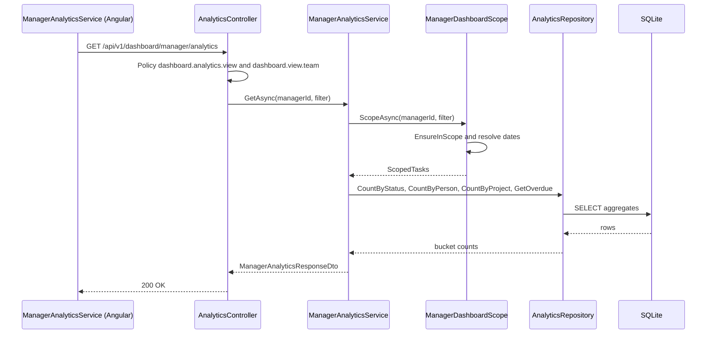

# Analytics – Technical Documentation

> **Project:** TaskFlow – Intelligent Task Allocation & Tracking System
> **Parent Module:** Dashboard  ·  **Child Module:** 02.2 Analytics
> **Version:** 1.0  ·  **Last Updated:** 31-Oct-2026
> **Backend:** ASP.NET Core Web API (.NET 10)  ·  **Frontend:** Angular  ·  **Database:** SQLite (EF Core)
> **Author:** Jojo George (jojogeorge3344@gmail.com)
> © 2026 Jojo George. All rights reserved.

---

## 1. Technical Overview
Analytics supplies every figure the three dashboard pages show. `AnalyticsController` + `AdminAnalyticsService` / `ManagerAnalyticsService` / `EmployeeAnalyticsService` + `AnalyticsRepository` expose the endpoints the Angular pages actually use. A **scope** service (`AdminDashboardScope`, `ManagerDashboardScope`, `EmployeeDashboardScope`) turns the caller and filter into an `AnalyticsTaskSet`, and every count runs through one bucket definition (`TaskBucketRules`, `DeadlineBucketRules`) so the dashboards and the Task List drill-down agree. The module is read-only.

Date ranges and day boundaries are computed in the application timezone from `IAppClock.GetTimeZoneAsync` and converted to UTC instants before querying.

## 2. Architecture Flow


## 3. Backend File Structure

| Layer | Path | Files |
|-------|------|-------|
| Controller | `TaskFlow.Api/Controllers/Dashboard/` | `AnalyticsController.cs` |
| Service | `TaskFlow.Api/Services/Dashboard/Analytics/Admin/` | `IAdminAnalyticsService.cs`, `AdminAnalyticsService.cs`, `AnalyticsBuckets.cs` |
| Service | `TaskFlow.Api/Services/Dashboard/Analytics/Manager/` | `IManagerAnalyticsService.cs`, `ManagerAnalyticsService.cs` |
| Service | `TaskFlow.Api/Services/Dashboard/Analytics/Employee/` | `IEmployeeAnalyticsService.cs`, `EmployeeAnalyticsService.cs` |
| Scopes | `TaskFlow.Api/Services/Dashboard/Analytics/Scopes/` | `IDashboardScope.cs`, `AdminDashboardScope.cs`, `IManagerDashboardScope.cs`, `ManagerDashboardScope.cs`, `IEmployeeDashboardScope.cs`, `EmployeeDashboardScope.cs`, `AnalyticsFilterResolver.cs`, `ResolvedAnalyticsFilter.cs`, `ScopedTasks.cs` |
| Repository | `TaskFlow.Api/Repositories/Dashboard/Analytics/` | `IAnalyticsRepository.cs`, `AnalyticsRepository.cs`, `AnalyticsCounting.cs`, `AnalyticsTaskSet.cs`, `AnalyticsDateRange.cs`, `DashboardTaskFilters.cs`, `OverdueTaskRow.cs`, `DeadlineTaskRow.cs`, `ProjectProgressRow.cs`, `QuarterHourCount.cs` |
| DTOs | `TaskFlow.Api/Dtos/Dashboard/Analytics/` | `AnalyticsFilter.cs`, `AnalyticsDtos.cs`, `ManagerAnalyticsDtos.cs`, `EmployeeAnalyticsDtos.cs` |
| Validators | – | No FluentValidation validator; filters are validated in `AnalyticsFilterResolver` and `EmployeeAnalyticsService.ParsePeriod` |
| Shared rules | `TaskFlow.Api/Common/Rules/` | `TaskBucketRules.cs`, `DeadlineBucketRules.cs`, `ManagerTeamThresholds.cs` (and `ReminderCalculator` for local-day maths) |
| Exceptions | `TaskFlow.Api/Common/Exceptions/` | `AnalyticsExceptions.cs` (`AnalyticsFilterException`, `AnalyticsEntityNotFoundException`, `AnalyticsForbiddenException`) |
| Entities (read only) | `TaskFlow.Api/Models/Entities/` | `Task.cs`, `TaskRecipient.cs`, `User.cs`, `Department.cs`, `UserDepartment.cs`, `DepartmentManager.cs`, `Project.cs`, `ManagerProject.cs`, `UserProjectAllocation.cs` |
| Enums | `TaskFlow.Api/Models/Enums/` | `TaskStatus.cs`, `TaskPriority.cs`; `AnalyticsDateBasis` and `EmployeeAnalyticsPeriod` are declared in the DTO files |
| Authorization | `TaskFlow.Api/Authorization/Policies/`, `TaskFlow.Api/Common/Security/` | `RequirePermissionAttribute.cs`, `PermissionPolicy.cs`, `PermissionKeys.cs`, `PermissionCatalog.cs`, `EffectivePermissions.cs` |
| DI registration | `TaskFlow.Api/Config/` | `ServiceRegistration.cs` (scopes and the three analytics services), `RepositoryRegistration.cs` (`IAnalyticsRepository`) – scoped |

## 4. Frontend File Structure

| Type | Path | Purpose |
|------|------|---------|
| Child components | `src/app/modules/dashboard/analytics/components/` | `task-analytics` (+ `task-analytics.model.ts`), `department-analytics`, `employee-analytics`, `manager-analytics`, `project-analytics` (Admin); `team-attention`, `team-task-analytics`, `team-employee-analytics` (Manager) |
| Shared components | `src/app/modules/dashboard/components/` | `dashboard-filter-bar.component.ts/.html`; `charts/` – `kpi-card`, `donut-chart`, `stacked-bar-chart`, `line-chart`, `progress-list` (each with a `.model.ts`) |
| API service | `src/app/modules/dashboard/analytics/services/` | `dashboard-analytics.service.ts` (Admin), `manager-analytics.service.ts`, `employee-analytics.service.ts` (each with a `.model.ts`) – signal-based state, `switchMap` to drop stale responses, cleared on sign-out |
| Models | `src/app/modules/dashboard/analytics/models/analytics.model.ts` | TypeScript interfaces, `EMPLOYEE_PERIODS` |
| Utilities | `src/app/shared/utils/analytics-filter.ts`, `src/app/shared/utils/drill-down.ts`, `src/app/modules/dashboard/utils/` (`chart-colors.ts`, `chart-providers.ts`) | Range presets, client-side range validation, query params, drill-down query builder, chart colours / providers |
| Host pages | `src/app/modules/dashboard/pages/` | The three dashboard pages (documented in `02.1-Overview.md`) inject the services above |
| Permission constants | `src/app/shared/auth/permissions.ts` | `DashboardAnalytics`, `DashboardFilters` |

## 5. API & Logic

### 5.1 API Endpoints
Route prefix: `[Route("api/v1/dashboard")]` on `AnalyticsController`. Both the `[Authorize(Policy = "perm:...")]` and the `[RequirePermission(...)]` attribute must pass.

| # | Method | Endpoint | Description | Permission (Policy) | Request DTO | Response DTO |
|---|--------|----------|-------------|---------------------|-------------|--------------|
| 1 | GET | `/api/v1/dashboard/admin/analytics` | Organisation analytics | `perm:dashboard.analytics.view` **and** `dashboard.view.organization` | `AnalyticsFilter` (query) | `AdminAnalyticsDto` |
| 2 | GET | `/api/v1/dashboard/admin/analytics/filters` | Filter options (all departments, projects, users, managers) + today + timezone | `perm:dashboard.filters.use` **and** `dashboard.view.organization` | – | `AnalyticsFilterOptionsDto` |
| 3 | GET | `/api/v1/dashboard/manager/analytics` | Team analytics for the caller | `perm:dashboard.analytics.view` **and** `dashboard.view.team` | `AnalyticsFilter` (query; `departmentId` and `managerId` ignored) | `ManagerAnalyticsResponseDto` |
| 4 | GET | `/api/v1/dashboard/manager/analytics/filters` | Team-scoped options (team employees, in-scope projects) | `perm:dashboard.filters.use` **and** `dashboard.view.team` | – | `ManagerFilterOptionsDto` |
| 5 | GET | `/api/v1/dashboard/employee/analytics` | The caller's own analytics | `perm:dashboard.analytics.view` (plus a plain `[Authorize]`) | `period` query: `7d`, `30d` (default), `month` | `EmployeeAnalyticsResponseDto` |

`AnalyticsFilter` query parameters: `from`, `to` (`yyyy-MM-dd`), `basis` (`Created` default, `Deadline`, `Completed`), `departmentId`, `projectId`, `employeeId`, `managerId`, `allEmployees` (bool, Admin only – return every employee instead of the top 10).

### 5.2 Request / Response Samples
```json
// GET /api/v1/dashboard/admin/analytics?from=2026-10-01&to=2026-10-31&basis=Deadline&departmentId=2
```
```json
// 200 OK (AdminAnalyticsDto, abbreviated)
{
  "filter": { "from": "2026-10-01", "to": "2026-10-31", "basis": "Deadline", "departmentId": 2,
              "projectId": null, "employeeId": null, "managerId": null },
  "summary": { "totalEmployees": 12, "totalManagers": 3, "totalDepartments": 1, "totalProjects": 6,
               "tasks": { "pending": 10, "inProgress": 6, "completed": 20, "overdue": 4,
                          "total": 40, "open": 20, "completionPercent": 50 },
               "totalTasks": 40, "completionPercent": 50 },
  "tasksByStatus": { "pending": 10, "inProgress": 6, "completed": 20, "overdue": 4, "total": 40, "open": 20, "completionPercent": 50 },
  "tasksByPriority": [ { "priority": "Low", "count": 8 }, { "priority": "Medium", "count": 20 },
                       { "priority": "High", "count": 10 }, { "priority": "Critical", "count": 2 } ],
  "deadlineBuckets": { "overdue": 4, "dueToday": 1, "next7Days": 7, "later": 8 },
  "trend": { "granularity": "day", "points": [ { "date": "2026-10-01", "created": 2, "completed": 1 } ] },
  "byDepartment": [ { "departmentId": 2, "name": "Engineering", "tasks": { "pending": 10, "inProgress": 6, "completed": 20, "overdue": 4, "total": 40, "open": 20, "completionPercent": 50 } } ],
  "byEmployee": { "items": [ { "userId": 7, "name": "Asha Nair", "tasks": { "pending": 3, "inProgress": 1, "completed": 4, "overdue": 1, "total": 9, "open": 5, "completionPercent": 44 } } ], "totalEmployees": 12 },
  "byManager": [ { "managerId": 2, "name": "Ravi Kumar", "departments": 1, "employees": 8, "projects": 2, "tasks": { "pending": 10, "inProgress": 6, "completed": 20, "overdue": 4, "total": 40, "open": 20, "completionPercent": 50 } } ],
  "byProject": [ { "projectId": 3, "name": "Portal", "tasks": { "pending": 4, "inProgress": 2, "completed": 9, "overdue": 1, "total": 16, "open": 7, "completionPercent": 56 }, "projectedEnd": "2026-12-15T12:30:00Z", "outstanding": 7 } ]
}
```
```json
// GET /api/v1/dashboard/manager/analytics  -> 200 OK (ManagerAnalyticsResponseDto, abbreviated)
{
  "filter": { "from": "2026-10-02", "to": "2026-10-31", "basis": "Created", "departmentId": null, "projectId": null, "employeeId": null, "managerId": null },
  "summary": { "teamSize": 8, "totalProjects": 2, "tasks": { "pending": 5, "inProgress": 3, "completed": 12, "overdue": 2, "total": 22, "open": 10, "completionPercent": 55 }, "totalTasks": 22, "completionPercent": 55 },
  "byEmployee": [ { "userId": 7, "name": "Asha Nair", "tasks": { "pending": 3, "inProgress": 2, "completed": 1, "overdue": 1, "total": 7, "open": 6, "completionPercent": 14 }, "highWorkload": true, "hasOverdue": true } ],
  "attention": {
    "delayedTasks": [ { "taskId": 91, "taskCode": "TSK-0091", "title": "Fix login", "assigneeName": "Asha Nair", "projectName": "Portal", "daysOverdue": 3 } ],
    "projectsNeedingAttention": [ { "projectId": 3, "name": "Portal", "overdueTasks": 2 } ]
  }
}
```
```json
// GET /api/v1/dashboard/employee/analytics?period=7d  -> 200 OK (EmployeeAnalyticsResponseDto, abbreviated)
{
  "period": "Last7Days", "from": "2026-10-25", "to": "2026-10-31",
  "department": { "name": "Engineering", "limited": false, "totalTasks": 40,
                  "tasks": { "pending": 10, "inProgress": 6, "completed": 20, "overdue": 4, "total": 40, "open": 20, "completionPercent": 50 } },
  "summary": { "totalTasks": 9, "completionPercent": 44, "completed": 4, "outstanding": 5 },
  "upcomingDeadlines": [ { "taskId": 91, "taskCode": "TSK-0091", "title": "Fix login", "priority": "High",
                           "deadline": "2026-10-28T12:30:00Z", "daysRemaining": -3, "isOverdue": true, "daysOverdue": 3 } ],
  "projects": [ { "projectId": 3, "name": "Portal", "totalTasks": 5, "completedTasks": 2, "progressPercent": 40, "latestDeadline": "2026-11-20T12:30:00Z" } ],
  "trend": [ { "date": "2026-10-25", "created": 1, "completed": 0 } ],
  "completedInPeriod": 2
}
```
```json
// 400 Bad Request (ProblemDetails from GlobalExceptionHandler)
{ "status": 400, "detail": "The end date cannot be before the start date." }
```

### 5.3 Service Layer Logic

**Filter resolution – `AnalyticsFilterResolver.ResolveAsync(filter, checkEntitiesExist)`** (shared by Admin and Manager scopes)
1. Reads the timezone and now from `IAppClock`; `today` = local date.
2. `to` defaults to today; `from` defaults to `to - 29 days` (`DefaultRangeDays = 30`).
3. Throws `AnalyticsFilterException` if `from > to` ("The end date cannot be before the start date."), if the span is 3660 days or more ("The date range is too long."), or if `basis` is not a defined enum value ("The date basis is not valid.").
4. With `checkEntitiesExist` (Admin), each given department / project / employee / manager id must exist, else `AnalyticsEntityNotFoundException` ("The department does not exist.", "The project does not exist.", "The employee does not exist.", "The manager does not exist.").
5. Returns `ResolvedAnalyticsFilter` with UTC bounds `FromUtc` (local midnight of `from`) and `ToUtcExclusive` (local midnight of `to + 1`).

**Scopes**
- `AdminDashboardScope.ScopeAsync` – resolves with entity checks and builds an `AnalyticsTaskSet` with the department, project, employee and manager filters, plus a copy without dates (used by the trend).
- `ManagerDashboardScope.ScopeAsync(managerId, filter)` – drops `DepartmentId` and `ManagerId`; `EnsureInScopeAsync` throws `AnalyticsForbiddenException` ("The employee is outside your team." / "The project is outside your scope.") or `AnalyticsEntityNotFoundException` when the id does not exist; resolves without entity checks; builds the set with `TeamUserIds`. Team and project ids are cached per request.
  - `TeamUserIdsAsync` → `IEmployeeRepository.GetTeamMemberIdsAsync`: active users other than the manager who belong to a department the manager manages (`DepartmentManagers`) or to a project where the manager's allocation has `IsProjectManager = true`.
  - `ProjectIdsAsync` → `IAnalyticsRepository.GetManagerProjectIdsAsync`: projects linked in `ManagerProjects` plus projects of the team's counted tasks.
- `EmployeeDashboardScope.OwnTasks(userId)` – `AnalyticsTaskSet(OwnUserId: userId)`; the id always comes from the session claim.

**Method:** `AdminAnalyticsService.GetAsync(AnalyticsFilter, CancellationToken)`
1. Scope the filter; `CountByStatusAsync` on the scoped set.
2. Summary: `CountEmployeesAsync` (active users whose role does **not** hold `tasks.view.all`, narrowed by employee / department / manager), `CountManagersAsync` (users with `RoleId == SystemRoles.ManagerId`), `CountDepartmentsAsync`, `CountProjectsAsync`.
3. `CountByPriorityAsync` (every `TaskPriority`, zero-filled) and `CountByDeadlineAsync` with `DeadlineBucketRules.BoundsFor(now, tz)`.
4. Trend: created and completed instants per quarter hour over the range (ignoring the date-basis filter), grouped into local days; weekly buckets starting Monday when the range exceeds 31 days (`DailyTrendMaxDays`). Admin trend counts any task with `CompletedAt` in range (`completedStatusOnly: false`).
5. By department (a person in several departments counts in each; unmatched tasks go to a "No department" row), by employee (top 10 by open, then total, then id unless `allEmployees`; names include deleted users, else "Unknown"), by manager (department-manager teams, managed department / project counts), by project (plus a "No project" row; `ProjectedEnd` = latest task deadline).

**Method:** `AdminAnalyticsService.GetFilterOptionsAsync` – today, timezone id, all departments, projects, users and Manager-role users, ordered by name.

**Method:** `ManagerAnalyticsService.GetAsync(managerId, filter)`
1. Scope (team), team names (`GetUserNamesAsync`), `CountByStatusAsync`, `ByProjectAsync` (only in-scope projects plus "No project").
2. `TeamSummaryDto`: team size (1 if an employee filter is set) and project count (1 if a project filter is set).
3. `ByEmployeeAsync`: per-member buckets over the whole team (an employee filter narrows the rows, not the baseline – the scope is re-run without the employee using the same dates and "now"); flags from `ManagerTeamThresholds.IsHighWorkload(open, mean)` (open ≥ 5 and ≥ 1.5 × team mean) and `HasOverdue(overdue > 0)`.
4. `AttentionAsync`: `GetOverdueAsync(take: 5)` ordered by deadline then id, with assignee and project names (including deleted) and whole local days overdue; top 5 projects by overdue count.

**Method:** `ManagerAnalyticsService.GetFilterOptionsAsync(managerId)` – team employees (ordinal name order) and in-scope projects; no departments or managers.

**Method:** `EmployeeAnalyticsService.GetAsync(userId, period)`
1. `ParsePeriod`: `null`/`""`/`30d` → Last30Days, `7d` → Last7Days, `month` → ThisMonth; anything else → `AnalyticsFilterException("The period is not valid.")`.
2. `from` = today − 6, today − 29, or the 1st of the month; `to` = today.
3. Status, priority, upcoming deadlines and projects use **all** own tasks (no date filter); only the trend and `CompletedInPeriod` use the period. Employee trend counts only tasks whose status is Completed (`completedStatusOnly: true`).
4. `DepartmentAsync`: first department by name; `null` if none; if active members `< MinDepartmentMembersForBreakdown (3)` returns `Limited = true` with null figures; otherwise counts tasks assigned to active members of the department.
5. `UpcomingAsync`: up to 10 open (not Completed) own tasks with deadline before the 7-day horizon, soonest first, with `DaysRemaining`, `IsOverdue`, `DaysOverdue`.
6. `ProjectsAsync`: projects with own tasks plus allocated projects (`UserProjectAllocations`), ordered by name, with own totals, completed and latest open deadline.

**Bucket rules (`TaskBucketRules`)** – counted = `!IsDeleted && Status != Cancelled`; Completed if status Completed; else Overdue if `Deadline < now`; else InProgress if InProgress or InQA; else Pending. `CompletionPercent` rounds half away from zero.

### 5.4 Repository Layer
`AnalyticsRepository` (`IAnalyticsRepository`, 38 methods). All task queries start from `Build(AnalyticsTaskSet)`: `AsNoTracking`, `TaskBucketRules.IsCounted()`, then team / own / active-department-member / entity filters (`DashboardTaskFilters.ApplyEntityFilters`) and the date range (`ApplyDateRange` on `CreatedAt`, `Deadline` or `CompletedAt`).

| Method | Description | Query Notes |
|--------|-------------|-------------|
| `CountByStatusAsync(set, now)` | Pending / InProgress / Completed / Overdue totals | One `COUNT` per bucket (`AnalyticsCounting.TotalsAsync`) |
| `CountByPriorityAsync(set)` | Count per priority | `GROUP BY Priority`, zero-filled for every enum value |
| `CountByDeadlineAsync(set, bounds)` | Overdue / DueToday / Next7Days / Later | Open tasks only (`DeadlineBucketRules.InBucket`) |
| `CountCreatedPerQuarterHourAsync` / `CountCompletedPerQuarterHourAsync` | Instants per 15-minute UTC slot | Grouped by year/month/day/hour/quarter so the service can bucket into local days |
| `CountByDepartmentAsync(set, now)` | Buckets per department | `SelectMany` over `UserDepartments` (ignoring query filters), key 0 = no department |
| `CountByPersonAsync(set, now)` | Buckets per person | `UNION` of assignee pairs and `TaskRecipients` pairs |
| `CountByDepartmentManagerAsync(set, now)` | Buckets per department manager | Join to `DepartmentManagers` × `UserDepartments` |
| `CountByProjectAsync(set, now)` / `GetLatestDeadlineByProjectAsync(set)` | Buckets / max deadline per project | Key 0 = no project |
| `GetOverdueAsync(set, now, take)` | Most overdue tasks | `ORDER BY Deadline, Id`, `TAKE` |
| `GetOpenDueBeforeAsync(set, before, take)` | Open tasks due before a horizon | Status not Completed |
| `GetProjectProgressAsync(set)` | Own totals / completed / latest open deadline per project | Tasks with a project only |
| `GetDepartmentsAsync`, `GetProjectsAsync`, `GetUsersAsync`, `GetManagersAsync` | Option lists | Ordered by name |
| `CountEmployeesAsync`, `CountManagersAsync`, `CountDepartmentsAsync`, `CountProjectsAsync` | Summary counts | See 5.3 |
| `GetDepartmentTeamSizesAsync`, `GetManagedDepartmentCountsAsync`, `GetManagedProjectCountsAsync` | Per-manager sizes | `DepartmentManagers`, `ManagerProjects` |
| `GetUserNamesAsync`, `GetUserNamesIncludingDeletedAsync`, `GetProjectNamesIncludingDeletedAsync` | Name lookups | `IgnoreQueryFilters` for the "including deleted" variants |
| `DepartmentExistsAsync`, `ProjectExistsAsync`, `UserExistsAsync` | Existence checks | Respect soft-delete filters |
| `GetManagerProjectIdsAsync(managerId, team)` | Manager's project scope | `ManagerProjects` ∪ projects of team tasks |
| `GetFirstDepartmentIdAsync`, `GetDepartmentNameAsync`, `CountActiveDepartmentMembersAsync`, `GetAllocatedProjectIdsAsync`, `GetProjectsByIdsAsync` | Employee dashboard helpers | – |
| `GetTaskIdsAsync`, `CountTasksAsync` | Ids / count of a set | Declared on the interface; no caller outside the repository was found |

### 5.5 Sequence Diagram

## 6. Database Design
Analytics owns no table and runs no migration; it reads the tables below (SQLite, configured in `Persistence/AppDbContext.cs`).

| Table | Column | Type | Constraints | Description |
|-------|--------|------|-------------|-------------|
| `Tasks` | `Id` | int | PK | Task id |
| `Tasks` | `TaskCode` | text(32) | Required, Unique | Shown in deadline / overdue lists |
| `Tasks` | `Title` | text(200) | Required | Task title |
| `Tasks` | `AssignedToUserId` | int | FK → `Users.Id`, Restrict, Indexed | Assignee (person / team / department scope) |
| `Tasks` | `ProjectId` | int? | FK → `Projects.Id`, Restrict | Project grouping ("No project" when null) |
| `Tasks` | `Priority` | int (enum) | – | Low, Medium, High, Critical |
| `Tasks` | `Status` | int (enum) | – | ToDo, InProgress, Blocked, Completed, Cancelled, InQA |
| `Tasks` | `Deadline` | datetime (UTC) | Indexed | Overdue / due-today / deadline basis |
| `Tasks` | `CreatedAt` | datetime (UTC) | – | Created basis and trend |
| `Tasks` | `CompletedAt` | datetime? (UTC) | – | Completed basis and trend |
| `Tasks` | `IsDeleted` | bool | – | Deleted tasks are never counted |
| `TaskRecipients` | `TaskId`, `UserId` | int | FKs (Cascade), Unique (`TaskId`,`UserId`) | A recipient counts as an owner of the task |
| `Users` | `Id`, `FullName`, `RoleId`, `IsActive`, `IsDeleted` | – | `FullName` required (200); FK `RoleId` → `Roles` (Restrict); soft-delete query filter | People, names, managers (`RoleId = 2`) |
| `Departments` | `Id`, `Name`, `IsDeleted` | – | `Name` unique among live rows; soft-delete filter | Department rows and names |
| `UserDepartments` | `UserId`, `DepartmentId` | int | Composite PK; FKs Cascade | Department membership |
| `DepartmentManagers` | `ManagerUserId`, `DepartmentId` | int | Composite PK; FKs Cascade | Departments a manager runs |
| `Projects` | `Id`, `Name`, `IsDeleted` | – | `Name` unique among live rows; soft-delete filter | Project rows and names |
| `ManagerProjects` | `ManagerUserId`, `ProjectId` | int | Composite PK; FKs Cascade | Projects assigned to a manager |
| `UserProjectAllocations` | `UserId`, `ProjectId`, `IsProjectManager` | – | Composite PK; FKs Cascade; `AllocationPercent` 1–100 | Project membership; project-manager flag widens a manager's team |
| `RolePermissions` / `Permissions` | `Key` | – | – | Used to exclude roles holding `tasks.view.all` from the "Employees" count |

Relationships are listed in the parent document (section 6).

## 7. Security & Authorization
- **Authorization:** each endpoint carries `[Authorize(Policy = "perm:<key>")]` (`PermissionPolicy.Prefix`) for `dashboard.analytics.view` or `dashboard.filters.use`, plus `[RequirePermission(...)]` for the dashboard's view key; both must pass. `EffectivePermissions.Expand` makes `dashboard.view.organization` imply `dashboard.view.team`.
- **Caller id:** the manager and employee endpoints read the id from `ClaimTypes.NameIdentifier` and return 401 if it is not an integer.
- **Data scope:** Organization – `AdminDashboardScope`; Team – `ManagerDashboardScope` (team + project scope checks, 403 outside scope); Own – `EmployeeDashboardScope` (session user only, no subject parameter accepted).
- **Frontend:** `canFilter()` hides the filter bar without `dashboard.filters.use`. There is no permission directive on the dashboard cards.

| Permission Key | Endpoint(s) | UI Element Controlled |
|----------------|-------------|-----------------------|
| `dashboard.analytics.view` | `GET .../admin/analytics`, `GET .../manager/analytics`, `GET .../employee/analytics` | None in the UI (missing key shows the load-error banner) |
| `dashboard.filters.use` | `GET .../admin/analytics/filters`, `GET .../manager/analytics/filters` | Filter bar on Administrator and Manager dashboards |
| `dashboard.view.organization` (with the keys above) | `GET .../admin/analytics`, `GET .../admin/analytics/filters` | – (route guard in `02.1-Overview.md`) |
| `dashboard.view.team` (with the keys above) | `GET .../manager/analytics`, `GET .../manager/analytics/filters` | – (route guard in `02.1-Overview.md`) |

## 8. Validations & Error Handling

| Rule | Layer | HTTP Code | Error Message |
|------|-------|-----------|---------------|
| Start or end date missing (client) | Angular `validateRange` | – (no request sent) | Choose both a start and an end date. |
| End date before start date | Angular `validateRange` / `AnalyticsFilterResolver` | 400 | The end date cannot be before the start date. |
| Range 3660 days or longer | `AnalyticsFilterResolver` | 400 | The date range is too long. |
| Undefined date basis value | `AnalyticsFilterResolver` | 400 | The date basis is not valid. |
| Unknown period (Employee) | `EmployeeAnalyticsService.ParsePeriod` | 400 | The period is not valid. |
| Department / project / employee / manager id does not exist | `AnalyticsFilterResolver` / `ManagerDashboardScope` | 404 | The department does not exist. / The project does not exist. / The employee does not exist. / The manager does not exist. |
| Employee outside the manager's team | `ManagerDashboardScope` | 403 | The employee is outside your team. |
| Project outside the manager's scope | `ManagerDashboardScope` | 403 | The project is outside your scope. |
| Caller id claim missing or not numeric (manager / employee endpoints) | Controller | 401 | – |

Errors are returned by `Middleware/GlobalExceptionHandler.cs` as `application/problem+json` (`ProblemDetails`, message in `detail`). The Angular services do not show the server message: any failure shows "Could not load analytics. Check your connection and try again." (Admin / Manager) or "Could not load your dashboard. Check your connection and try again." (Employee).

## 9. Integrations / Side Effects
- **Notifications / Email / Activity Log:** None – read only.
- **Task List drill-down:** chart clicks call `drillDownQuery` / `employeeDrillQuery` (`shared/utils/drill-down.ts`) and navigate to `/tasks` with `bucket`, `deadlineBucket`, `priority`, `departmentId`, `projectId`, `employeeId`, `managerId`, `from`, `to`, `basis`. `TaskService` / `TaskRepository` (Monitoring) reuse `TaskBucketRules` / `DeadlineBucketRules` and limits a manager's drill-down to the team.
- **Timezone:** `IAppClock` (Settings module) for ranges, "today" and deadline buckets.
- **Management module:** `IEmployeeRepository.GetTeamMemberIdsAsync` defines the manager's team.

## 10. Configuration
Uses the module-level keys (`Application:Timezone`, `ConnectionStrings:Default`, `Jwt:*`) listed in the parent document.

Code constants (not configurable): default range 30 days (`DefaultRangeDays`), maximum range 3660 days, daily trend up to 31 days (`DailyTrendMaxDays`), top 10 employees, attention list 5, upcoming list 10, deadline window 7 days, high-workload factor 1.5 and minimum 5 open tasks (`ManagerTeamThresholds`), department breakdown minimum 3 active members (`MinDepartmentMembersForBreakdown`).

## 11. Testing
Paths are relative to `backend/tests`.

| Test Type | File / Location | Covers |
|-----------|-----------------|--------|
| Unit | `TaskFlow.UnitTests/Dashboard/Analytics/Admin/AdminAnalyticsServiceTests.cs`, `AdminAnalyticsQueryShapeTests.cs` | Admin analytics and query shape |
| Unit | `TaskFlow.UnitTests/Dashboard/Analytics/Manager/ManagerAnalyticsServiceTests.cs` | Manager analytics, flags, attention |
| Unit | `TaskFlow.UnitTests/Dashboard/Analytics/Employee/EmployeeAnalyticsServiceTests.cs` | Employee analytics, periods, department privacy |
| Unit | `TaskFlow.UnitTests/Dashboard/Analytics/Scopes/AnalyticsScopeTests.cs`, `ManagerScopeTests.cs` | Filter resolution and scopes |
| Unit | `TaskFlow.UnitTests/Dashboard/Analytics/Scopes/AnalyticsDrillDownTests.cs`, `ManagerDrillDownScopeTests.cs` | Dashboard and Task List drill-down agree |
| Unit (support) | `TaskFlow.UnitTests/TestSupport/AnalyticsHarness.cs` | Shared harness |
| Integration | `TaskFlow.IntegrationTests/Dashboard/Analytics/AdminAnalyticsEndpointsTests.cs` | Admin analytics endpoints |
| Integration | `TaskFlow.IntegrationTests/Dashboard/Analytics/ManagerAnalyticsEndpointsTests.cs`, `ManagerAnalyticsIsolationTests.cs` | Manager endpoints and team isolation |
| Integration | `TaskFlow.IntegrationTests/Dashboard/Analytics/EmployeeAnalyticsEndpointsTests.cs`, `EmployeeAnalyticsIsolationTests.cs` | Employee endpoint and own-data isolation |

The shared `TaskBucketRulesTests.cs` is listed in the parent document.

## 12. Known Limitations / Gaps found
- The UI never checks `dashboard.analytics.view`; a role without it opens the dashboard and only sees the generic load-error banner.
- The Angular services ignore the server's error message, so 400 / 403 / 404 filter errors look like a connection problem.
- **Trend inconsistency:** Admin trend counts tasks with `CompletedAt` in range even if reopened (`completedStatusOnly: false`); the Employee trend counts only tasks still Completed.
- **"Managers" KPI** counts only users with the Manager system role (`RoleId == 2`); custom roles holding `dashboard.view.team` are not counted. The "Employees" KPI excludes every role holding `tasks.view.all`.
- **Employee endpoint:** `GET /dashboard/employee/analytics` stacks a redundant `[Authorize]` on its policy; the period chips are not gated by `dashboard.filters.use` (the endpoint does not require it).
- Counting and team-definition differences between Overview and Analytics are listed in the parent document.

---
<sub>© 2026 Jojo George. All rights reserved. Unauthorized copying or distribution of this document is prohibited.</sub>
