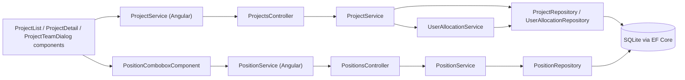
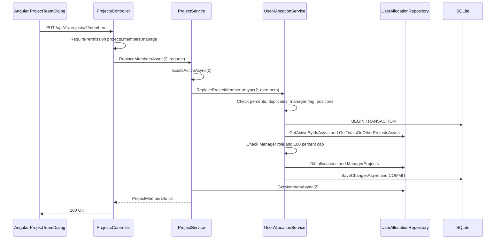

# Project Management (incl. Positions) – Technical Documentation

> **Project:** TaskFlow – Intelligent Task Allocation & Tracking System
> **Parent Module:** Management  ·  **Child Module:** 03.3 Project Management (incl. Positions)
> **Version:** 1.0  ·  **Last Updated:** 31-Oct-2026
> **Backend:** ASP.NET Core Web API (.NET 10)  ·  **Frontend:** Angular  ·  **Database:** SQLite (EF Core)
> **Author:** Jojo George (jojogeorge3344@gmail.com)
> © 2026 Jojo George. All rights reserved.

---

## 1. Technical Overview
Project Management owns the `Projects`, `Positions`, `UserProjectAllocations` and `ManagerProjects` tables. It is served by `ProjectsController` on `api/v1/projects` and `PositionsController` on `api/v1/positions`, and implemented by `ProjectService`, `PositionService` and `UserAllocationService.ReplaceProjectMembersAsync` (the team replacement).

- Every endpoint is protected by `[RequirePermission(PermissionKeys.X)]`.
- A project-team replacement is all-or-nothing and runs inside `ExecuteInTransactionAsync`, so two assigners cannot both pass the 100% cap.
- Projects are soft-deleted (`IsDeleted`). Deleting a project removes its allocation and manager-link rows. Tasks are not touched.
- Positions are get-or-create by name (NOCASE). They cannot be renamed or deleted.
- The frontend is the lazy routes `/projects` and `/projects/:id` with `ProjectListComponent`, `ProjectDetailComponent`, `ProjectFormDialogComponent`, `ProjectTeamDialogComponent`, `EmployeePickerComponent` and the shared `PositionComboboxComponent`.

## 2. Architecture Flow


## 3. Backend File Structure

| Layer | Path | Files |
|-------|------|-------|
| Controller | `TaskFlow.Api/Controllers/Management/` | `ProjectsController.cs`, `PositionsController.cs` |
| Service | `TaskFlow.Api/Services/Management/ProjectManagement/Projects/` | `IProjectService.cs`, `ProjectService.cs` |
| Service | `TaskFlow.Api/Services/Management/ProjectManagement/Positions/` | `IPositionService.cs`, `PositionService.cs` |
| Service | `TaskFlow.Api/Services/Management/EmployeeManagement/Allocations/` | `IUserAllocationService.cs`, `UserAllocationService.cs` (shared with 03.1) |
| Repository | `TaskFlow.Api/Repositories/Management/ProjectManagement/Projects/` | `IProjectRepository.cs`, `ProjectRepository.cs` |
| Repository | `TaskFlow.Api/Repositories/Management/ProjectManagement/Positions/` | `IPositionRepository.cs`, `PositionRepository.cs` |
| Repository | `TaskFlow.Api/Repositories/Management/EmployeeManagement/Allocations/` | `IUserAllocationRepository.cs`, `UserAllocationRepository.cs` (shared with 03.1) |
| DTOs | `TaskFlow.Api/Dtos/Management/ProjectManagement/` | `ProjectDto.cs` (`ProjectDto`, `ProjectWithCountDto`, `ProjectEmployeeDto`, `CreateProjectRequest`, `UpdateProjectRequest`, `ProjectTaskDto`, `ProjectTaskFilter`), `ProjectMemberDtos.cs` (`ProjectMemberDto`, `ReplaceProjectMembersRequest`), `ProjectMemberInput.cs` |
| DTOs | `TaskFlow.Api/Dtos/Management/ProjectManagement/Positions/` | `PositionDtos.cs` (`PositionDto`, `CreatePositionRequest`) |
| Validators | `TaskFlow.Api/Dtos/Management/ProjectManagement/Validators/` | `CreateProjectRequestValidator.cs`, `UpdateProjectRequestValidator.cs` |
| Entities | `TaskFlow.Api/Models/Entities/` | `Project.cs`, `ManagerProject.cs`, `UserProjectAllocation.cs`, `Position.cs` |
| Migrations | `TaskFlow.Api/Persistence/` | `20261020173455_RenameDepartmentsToProjectsAndAddDepartments`, `20261023160825_UserProjectAllocationsAndDepartments`, `20261023173211_AddProjectManagerFlag` (full list in the parent document) |

## 4. Frontend File Structure

| Type | Path | Purpose |
|------|------|---------|
| Route / Guard | `src/app/modules/management/management.routes.ts`, `src/app/shared/auth/auth.guard.ts` | `/projects` and `/projects/:id` with `permissionGuard` on `projects.view` |
| Menu | `src/app/layouts/nav-items.ts` | Project Management item, shown with `projects.view` |
| Page component | `src/app/modules/management/project-management/pages/` | `project-list.component.ts/.html`, `project-detail.component.ts/.html`, `project-detail.model.ts` (`Filters`) |
| Child components | `src/app/modules/management/project-management/components/` | `project-form-dialog.component.ts`, `project-team-dialog.component.ts`, `project-team-dialog.model.ts` (`TeamRow`), `employee-picker.component.ts` |
| Shared component | `src/app/modules/management/components/position-combobox.component.ts` | Pick or type a position, calling `PositionService.getOrCreate` (also used by the 03.1 employee form) |
| API service | `src/app/modules/management/project-management/services/project.service.ts` | `/api/v1/projects` calls |
| API service | `src/app/modules/management/project-management/positions/services/position.service.ts` | `getAll`, `getOrCreate` on `/api/v1/positions`. Used by the position combobox, the project form panel and the team dialog |
| API service (used) | `src/app/modules/management/employee-management/services/user.service.ts` | People list for `EmployeePickerComponent` (03.1) |

---

## 5. API & Logic

### 5.1 API Endpoints

| # | Method | Endpoint | Description | Permission (Policy) | Request DTO | Response DTO |
|---|--------|----------|-------------|---------------------|-------------|--------------|
| 1 | GET | `/api/v1/projects` | All live projects with team size and manager names | `projects.view` | – | `IReadOnlyCollection<ProjectWithCountDto>` |
| 2 | GET | `/api/v1/projects/{id}` | One project | `projects.view` | – | `ProjectDto` |
| 3 | GET | `/api/v1/projects/{id}/employees` | Live users allocated to the project | `projects.view` | – | `IReadOnlyCollection<ProjectEmployeeDto>` |
| 4 | GET | `/api/v1/projects/{id}/members` | Team with position, percent and manager flag | `projects.view` | – | `IReadOnlyCollection<ProjectMemberDto>` |
| 5 | GET | `/api/v1/projects/{id}/tasks` | Project tasks, soonest deadline first. Query: `status`, `priority`, `deadlineFrom`, `deadlineTo`, `assignedToUserId`, `positionId` | `projects.view` | Query params (`ProjectTaskFilter`) | `IReadOnlyCollection<ProjectTaskDto>` |
| 6 | PUT | `/api/v1/projects/{id}/members` | Replace the team (all-or-nothing) | `projects.members.manage` | `ReplaceProjectMembersRequest` | `IReadOnlyCollection<ProjectMemberDto>` |
| 7 | POST | `/api/v1/projects` | Create (201 + Location) | `projects.create` | `CreateProjectRequest` | `ProjectDto` |
| 8 | PUT | `/api/v1/projects/{id}` | Rename / change description | `projects.edit` | `UpdateProjectRequest` | `ProjectDto` |
| 9 | DELETE | `/api/v1/projects/{id}` | Soft delete and remove the team | `projects.delete` | – | `204 No Content` |
| 10 | GET | `/api/v1/positions` | All positions, by name | `projects.view` | – | `IReadOnlyCollection<PositionDto>` |
| 11 | POST | `/api/v1/positions` | Get or create a position by name (200 OK in both cases) | `positions.create` | `CreatePositionRequest` | `PositionDto` |

### 5.2 Request / Response Samples
```json
// PUT /api/v1/projects/2/members
{
  "members": [
    { "userId": 5,  "positionId": 2, "percent": 30, "isManager": true },
    { "userId": 14, "positionId": 4, "percent": 60, "isManager": false }
  ]
}
```
```json
// 200 OK (ProjectMemberDto[])
[
  { "userId": 14, "fullName": "Anu Thomas", "email": "anu.thomas@taskflow.com", "positionId": 4, "positionName": "Developer", "percent": 60, "isManager": false, "isManagerRole": false },
  { "userId": 5, "fullName": "Ravi Menon", "email": "ravi@taskflow.com", "positionId": 2, "positionName": "Manager", "percent": 30, "isManager": true, "isManagerRole": true }
]
```
```json
// 400 Bad Request
{ "status": 400, "detail": "Anu Thomas would be allocated 110% in total. They already have 50% on other projects, so 50% remains." }
```
```json
// POST /api/v1/positions
{ "name": "qa" }
// 200 OK (existing row matched NOCASE)
{ "id": 3, "name": "QA" }
```

### 5.3 Service Layer Logic
**Class:** `ProjectService` (`IProjectRepository`, `IUserAllocationService`, `IUnitOfWork`)
- `CreateAsync` and `UpdateAsync` follow the department pattern: trim, `NameTakenAsync` ("Project name already exists."), save, and `ToDto`.
- `GetMembersAsync`, `GetTasksAsync` and `ReplaceMembersAsync` return null (404) when `ExistsActiveAsync` is false.
- `DeleteAsync(id)`: `RemoveTeamAsync` removes all `UserProjectAllocations` (`IgnoreQueryFilters`) and the `ManagerProjects` links. It then sets `IsDeleted = true` and saves. **Tasks are not checked or changed.**

**Method:** `UserAllocationService.ReplaceProjectMembersAsync(int projectId, IReadOnlyList<ProjectMemberInput> members, ...)`
1. Checks each percent is from 1 to 100, else "Allocation percentage must be a whole number from 1 to 100.".
2. Checks for duplicate `UserId`, else "A person can only appear once on a project.".
3. If the list is not empty and nobody has `IsManager`, throws "Mark at least one person on the team as the project's manager.".
4. Checks the positions exist ("Position does not exist.").
5. **Inside `ExecuteInTransactionAsync`**, so two assigners cannot both pass the cap:
   - `GetActiveByIdsAsync`, and a count mismatch throws "One or more people do not exist or are not active.".
   - A flagged manager without `RoleId == ManagerId` throws "Only a person with the Manager role can manage a project: {names}.".
   - Runs `GetTotalsOnOtherProjectsAsync`. If `other + percent > 100` it throws "{name} would be allocated {total}% in total. They already have {other}% on other projects, so {100-other}% remains.".
   - Diffs the allocation rows (remove, update, add, including `IsProjectManager`). It then syncs `ManagerProjects` to the flagged managers and saves.

**Class:** `PositionService`
- `GetOrCreateAsync(name)` collapses repeated spaces. An empty name throws "Position name is required.", and one over 100 characters throws "Position name must be 100 characters or fewer.". `GetByNameAsync` (NOCASE collation) returns the existing row, otherwise the service adds a `Position` and saves.

### 5.4 Repository Layer

| Method | Description | Query Notes |
|--------|-------------|-------------|
| `ProjectRepository.GetAllWithCountsAsync()` | List with `EmployeeCount` and `Managers` | Counts `UserProjectAllocations` (filtered). Managers are allocation rows with `IsProjectManager`, ordered by user name |
| `GetAsync` / `GetActiveForUpdateAsync` / `ExistsActiveAsync` / `CountActiveAsync` / `NameTakenAsync` | Same pattern as departments | `!IsDeleted`, case-insensitive name |
| `GetEmployeesAsync(projectId)` | `ProjectEmployeeDto` list | Live users with an allocation on the project |
| `GetMembersAsync(projectId)` | `ProjectMemberDto` list | Ordered by user name. `IsManagerRole = User.RoleId == ManagerId` |
| `GetTasksAsync(projectId, filter)` | Filtered tasks | `Tasks` where `ProjectId` matches and `!IsDeleted`. Every filter is ANDed. The `PositionId` filter uses the assignee's allocation on this project. Ordered by `Deadline`, then `Id` |
| `RemoveTeamAsync(projectId)` | Removes allocations and manager links | `IgnoreQueryFilters()` on allocations |
| `PositionRepository.GetAllAsync()` / `GetByNameAsync(name)` / `CountAsync(ids)` | Positions | Ordered by Name. Name compared under the NOCASE collation |
| `UserAllocationRepository.GetForProjectForUpdateAsync` (shared with 03.1) | Tracked allocation rows of the project | – |
| `UserAllocationRepository.GetTotalsOnOtherProjectsAsync(userIds, projectId)` (shared with 03.1) | Sum of percents on other projects | `GroupBy(UserId)`, `Sum(AllocationPercent)` |
| `UserAllocationRepository.GetManagerLinksForProjectForUpdateAsync` / `AddManagerLink` / `RemoveManagerLinks` (shared with 03.1) | `ManagerProjects` sync | Tracked |
| `EmployeeRepository.GetActiveByIdsAsync(ids)` (03.1) | Check the team members are active | `AsNoTracking` |

### 5.5 Sequence Diagram


---

## 6. Database Design
This child owns `Projects`, `Positions`, `UserProjectAllocations` and `ManagerProjects`.

| Table | Column | Type | Constraints | Description |
|-------|--------|------|-------------|-------------|
| `Projects` | `Id` | int | PK, Identity | – |
| `Projects` | `Name` | string(200) | Not Null, Unique filtered index (`"IsDeleted" = 0`) | Project name |
| `Projects` | `Description` | string(500) | Nullable | – |
| `Projects` | `CreatedAt` | DateTime | – | – |
| `Projects` | `IsDeleted` | bool | Global query filter | Soft delete |
| `Positions` | `Id` | int | PK | Seeded 1 Member, 2 Manager, 3 QA, 4 Developer, 5 DevOps, 6 System Admin |
| `Positions` | `Name` | string(100) | Not Null, NOCASE collation, Unique index | Position label |
| `UserProjectAllocations` | `UserId`, `ProjectId` | int, int | Composite PK (one row per project per user). Index on `ProjectId` | Allocation |
| `UserProjectAllocations` | `AllocationPercent` | int | Check `CK_UserProjectAllocations_AllocationPercent`: BETWEEN 1 AND 100 | Percent of time |
| `UserProjectAllocations` | `PositionId` | int | FK → `Positions.Id` (Restrict). Index | Position on the project |
| `UserProjectAllocations` | `IsProjectManager` | bool | – | Project-manager flag |
| `ManagerProjects` | `ManagerUserId`, `ProjectId` | int, int | Composite PK. FKs Cascade. Index on `ProjectId` | Kept in step with `IsProjectManager` |

**Other tables this child reads**

| Table | Owner | How this child uses it |
|-------|-------|------------------------|
| `Users` | 03.1 | Team members must be active. `RoleId == ManagerId` is required for a project manager and shown as `IsManagerRole` |
| `Tasks` | Monitoring | Read by `GetTasksAsync` for Project Details. Not changed when a project is deleted |

**Relationships**
- `UserProjectAllocations.UserId → Users.Id` (FK, Cascade), `.ProjectId → Projects.Id` (FK, Cascade), `.PositionId → Positions.Id` (FK, Restrict)
- `ManagerProjects.ManagerUserId → Users.Id` (FK, Cascade) and `ManagerProjects.ProjectId → Projects.Id` (FK, Cascade)
- `Tasks.ProjectId → Projects.Id` (FK, Restrict; Monitoring module)
- Because projects are soft-deleted, the cascade rarely fires. `ProjectRepository.RemoveTeamAsync` removes the team and manager links itself.

## 7. Security & Authorization
- Every endpoint uses `[RequirePermission(PermissionKeys.X)]`. There are no inline checks.
- **Data scope:** none. Project lists, members and tasks are Organization-wide for anyone holding `projects.view`. The task list does not apply the task view scope.
- Authentication, the permission policy, the MFA setup gate and legacy key expansion (`projects.manage`) are described in the parent document, section 7.

| Permission Key | Endpoint(s) | UI Element Controlled |
|----------------|-------------|-----------------------|
| `projects.view` | `GET /api/v1/projects*`, `GET /api/v1/positions` | Project Management menu, `/projects` and `/projects/:id` routes, project filters in other screens |
| `projects.create` | `POST /api/v1/projects` | "Add project" button (`canManage`) |
| `projects.edit` | `PUT /api/v1/projects/{id}` | Card "Edit" |
| `projects.delete` | `DELETE /api/v1/projects/{id}` | Card "Delete" |
| `projects.members.manage` | `PUT /api/v1/projects/{id}/members` | Card "Team" |
| `positions.create` | `POST /api/v1/positions` | None (the combobox always offers creation) |

## 8. Validations & Error Handling

| Rule | Layer | HTTP Code | Error Message |
|------|-------|-----------|---------------|
| Project `Name` empty or over 200, `Description` over 500 | `CreateProjectRequestValidator`, `UpdateProjectRequestValidator` via `ValidationFilter` | 400 | FluentValidation default messages |
| Duplicate project name | `ProjectService` | 400 | Project name already exists. |
| Team rules | `UserAllocationService.ReplaceProjectMembersAsync` | 400 | A person can only appear once on a project. / Mark at least one person on the team as the project's manager. / One or more people do not exist or are not active. / Only a person with the Manager role can manage a project: {names}. / {name} would be allocated {t}% in total. They already have {o}% on other projects, so {r}% remains. |
| Bad percentage / unknown position | `UserAllocationService.ReplaceProjectMembersAsync` | 400 | Allocation percentage must be a whole number from 1 to 100. / Position does not exist. |
| Position name | `PositionService` | 400 | Position name is required. / Position name must be 100 characters or fewer. |
| Project not live | Controller (null from service) | 404 | Empty body |

Shared errors (409 unique race and concurrency, 403 policy and MFA gate, 500) are in the parent document, section 8.

## 9. Integrations / Side Effects
- **Notifications / Email:** none.
- **Activity Log:** none (see the parent document).
- **Manager oversight:** project deletion removes the `ManagerProjects` links. The project-manager flags feed `IEmployeeRepository.GetTeamMemberIdsAsync` (manager's team for task visibility and the manager dashboard).
- **Monitoring:** tasks belong to projects (`Tasks.ProjectId`), and workload uses the allocation rows.
- **AI Assistant:** no tools for projects or positions.

## 10. Configuration

| Key (`appsettings.json`) | Purpose | Default |
|--------------------------|---------|---------|
| Code constant `IUserAllocationService.MaxTotalPercent` | Allocation cap per person | 100 |

`ConnectionStrings:Default` is shared by the whole module (see the parent document).

## 11. Testing

| Test Type | File / Location | Covers |
|-----------|-----------------|--------|
| Integration | `tests/TaskFlow.IntegrationTests/Management/ProjectManagement/ProjectTeamEndpointsTests.cs` | `/api/v1/positions` (seeded list, create once ignoring case, blank name 400, 403 without project permissions) and `PUT`/`GET /api/v1/projects/{id}/members`: team saved with positions and percentages, 100% cap shared with the employee form (400 with the total, nothing saved), at least one manager and Manager role only for the flag, flagged managers listed and linked, view-only users refused, a position named Manager grants nothing, 404 for an unknown project; deleting a project frees allocations; `/employees` never exposes credentials or MFA state |
| Unit | `tests/TaskFlow.UnitTests/Management/EmployeeManagement/Allocations/UserAllocationServiceTests.cs` | Project team rules: positions and percentages, 100% cap including what the person has elsewhere, one bad row rejects the whole request, manager flags and links, derived managers and reports, deleting a project frees percentages, positions (shared with 03.1) |
| Unit | `tests/TaskFlow.UnitTests/Management/ProjectManagement/ProjectRequestValidatorsTests.cs` | `CreateProjectRequestValidator` and `UpdateProjectRequestValidator`: blank or whitespace name fails, name at 200 characters passes and at 201 fails, description at 500 characters passes and at 501 fails |
| Unit | `tests/TaskFlow.UnitTests/Persistence/UserProjectAllocationsMigrationTests.cs` | Allocation migration: single projects become 100% `Member` allocations, positions seeded, out-of-range percentages refused, downgrade restores the highest-percentage project |
| Unit | `tests/TaskFlow.UnitTests/Persistence/DepartmentFollowUpMigrationTests.cs` | Custom roles holding `departments.*` also get the `projects.*` keys, and a deleted project no longer reserves its name (shared with 03.2) |
| Frontend unit | `src/app/modules/management/project-management/pages/project-list.component.spec.ts` | Cards linking to the detail screen, managers listed by name, client-side search, View employees link, Team dialog, Assign team step after create (skippable), delete with confirmation (warns when the project has employees), empty and error states, no Add, Edit or Delete for view-only users |
| Frontend unit | `src/app/modules/management/project-management/pages/project-detail.component.spec.ts` | Project with its team, roles, allocation and tasks; task links with a return path; overdue flags; role and status filters sent to the server; no-match, empty and "Project not found" states |
| Frontend unit | `src/app/modules/management/project-management/components/project-form-dialog.component.spec.ts` | Add and edit dialog: "Name is required", server error kept for a duplicate name, emits created only for a new project, update closes, toasts and emits saved |
| Frontend unit | `src/app/modules/management/project-management/components/project-team-dialog.component.spec.ts` | Team dialog: skippable step after create, current members shown, server employee search with free percentage, typed new positions, whole percentages 1 to 100 and remaining-percentage warning, unfinished rows not saved, server 100% message, at least one manager for a non-empty team, several managers, flag disabled for non-Managers, load error |
| Frontend unit | `src/app/modules/management/project-management/components/employee-picker.component.spec.ts` | Employee picker: server search of active employees with remaining percentage, people on other rows left out, emits the chosen employee |
| Frontend unit | `src/app/modules/management/employee-management/services/allocation-services.spec.ts` | Position and project team service calls (shared with 03.1) |

Positions have no validator class; their name rules are tested on `PositionService`.

## 12. Known Limitations / Gaps found
- No positions can be renamed or deleted (there is only get-or-create).
- **BRD vs code – Project Management:** there is no BRD screen for Project Management, project teams, allocations or positions. These exist only in code.
- **Frontend gating gaps (confirmed in code):**
  - The project team dialog opens automatically after a project is created, without checking `projects.members.manage`.
  - The position combobox always creates positions, without checking `positions.create`. `positions.create` has no frontend reference.
- **Hard-coded roles:** only the Manager system role (`ManagerId = 2`) can be a project manager (see the parent document).
- **Extra permission needed silently:** the project team picker needs `employees.view`.
- **`GET /api/v1/projects/{id}/tasks`** needs only `projects.view` and ignores the task view scope (`tasks.view.all`). Anyone with `projects.view` sees every task in the project.
- **`GET /api/v1/projects/{id}/employees`** has no UI caller. The audit says it returned the raw `User` entity, but the code now returns `ProjectEmployeeDto`. It also returns 200 with an empty list, not 404, for an unknown project.
- **Project delete wording:** the confirm dialog says "will be permanently deleted", but it is a soft delete. Tasks linked to the project are not checked or changed. ⚠️ To be confirmed how tasks of a deleted project should be shown.

---
<sub>© 2026 Jojo George. All rights reserved. Unauthorized copying or distribution of this document is prohibited.</sub>
