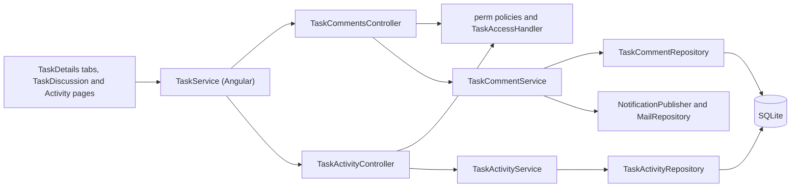
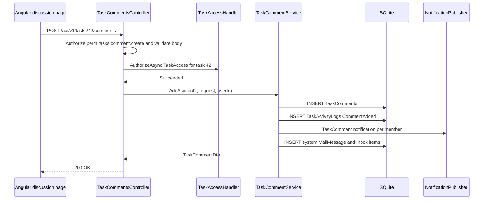

# Comments & Activity History – Technical Documentation

> **Project:** TaskFlow – Intelligent Task Allocation & Tracking System
> **Parent Module:** Monitoring  ·  **Child Module:** 04.2 Comments & Activity History
> **Version:** 1.0  ·  **Last Updated:** 31-Oct-2026
> **Backend:** ASP.NET Core Web API (.NET 10)  ·  **Frontend:** Angular  ·  **Database:** SQLite (EF Core)
> **Author:** Jojo George (jojogeorge3344@gmail.com)
> © 2026 Jojo George. All rights reserved.

---

## 1. Technical Overview
This child is served by two controllers under `[Route("api/v1/tasks")]` with class-level `[Authorize]`: `TaskCommentsController` (4 comment endpoints) and `TaskActivityController` (activity history plus 2 Administrator hours-correction endpoints), 7 endpoints in total.

- `TaskCommentService` adds, edits and soft-deletes comments, enforces the author rule, appends history entries and notifies the task's members (in-app and system mail).
- `TaskActivityService` is the single writer of the append-only history (`AppendAsync`, called by every task and comment action), reads it with filters, and implements the Administrator's worked-hours corrections, which replay the running totals.
- Endpoints are guarded by `perm:<key>` policies and the `TaskAccess` resource policy (`TaskAccessHandler`). The hours-correction endpoints use an inline `role == "Administrator"` check.
- Frontend: the Discussion and Activity history summary tabs in `TaskDetailsComponent`, plus the full pages `TaskDiscussionComponent` and `ActivityComponent` (`/tasks/:id/discussion`, `/tasks/:id/activity`).

## 2. Architecture Flow


## 3. Backend File Structure

| Layer | Path | Files |
|-------|------|-------|
| Controller | `TaskFlow.Api/Controllers/Monitoring/` | `TaskCommentsController.cs`, `TaskActivityController.cs` |
| Service | `TaskFlow.Api/Services/Monitoring/TaskManagement/Discussion/` | `ITaskCommentService.cs`, `TaskCommentService.cs` |
| Service | `TaskFlow.Api/Services/Monitoring/TaskManagement/Activity/` | `ITaskActivityService.cs`, `TaskActivityService.cs` |
| Repository | `TaskFlow.Api/Repositories/Monitoring/TaskManagement/Discussion/` | `ITaskCommentRepository.cs`, `TaskCommentRepository.cs` |
| Repository | `TaskFlow.Api/Repositories/Monitoring/TaskManagement/Activity/` | `ITaskActivityRepository.cs`, `TaskActivityRepository.cs` |
| DTOs | `TaskFlow.Api/Dtos/Monitoring/TaskManagement/Discussion/` | `TaskCommentDtos.cs` (`TaskCommentDto`, `AddCommentRequest`) |
| DTOs | `TaskFlow.Api/Dtos/Monitoring/TaskManagement/Activity/` | `TaskActivityDtos.cs` (`ActivityEntryDto`, `UpdateHoursEntryRequest`), `ActivityFilter.cs` |
| Validators | `TaskFlow.Api/Dtos/Monitoring/TaskManagement/Discussion/Validators/` | `AddCommentRequestValidator.cs` |
| Entities | `TaskFlow.Api/Models/Entities/` | `TaskComment.cs`, `TaskActivityLog.cs` |
| Enums | `TaskFlow.Api/Models/Enums/` | `TaskActivityEventType.cs`, `NotificationType.cs` |
| Authorization (shared) | `TaskFlow.Api/Authorization/TaskAccess/` | `TaskAccessRequirement.cs`, `TaskAccessHandler.cs` (uses `Services/Monitoring/TaskManagement/Access/TaskAccessService.cs`) |

## 4. Frontend File Structure

| Type | Path | Purpose |
|------|------|---------|
| Page component (summary tabs) | `src/app/modules/monitoring/task-management/pages/task-details.component.*` | Discussion tab (latest 3 comments, `getComments`) and Activity history tab (latest 4 entries, `getActivity`) |
| Page component | `src/app/modules/monitoring/task-management/discussion/pages/task-discussion.component.*` | Full discussion page: day-grouped thread, own-comment Edit/Delete (author + `tasks.comment.edit` / `tasks.comment.delete`), composer (`tasks.comment.create`, 1000 chars), "Who is notified" and task facts rail |
| Page component + util | `src/app/modules/monitoring/task-management/activity/pages/activity.component.*`, `.../activity/utils/activity-meta.ts` | Full activity page (event-type pills and "Other events" select, text search, From/To dates, newest first) and event metadata (`ActivityEventMeta`, `eventMeta`, also imported by `task-details.component.ts`) |
| API service | `src/app/modules/monitoring/task-management/services/task.service.ts` | `getComments`, `addComment`, `updateComment`, `deleteComment`, `getActivity`, `updateHoursEntry`, `deleteHoursEntry` |
| Models | `src/app/modules/monitoring/task-management/models/task.model.ts` | `TaskComment`, `ActivityEntry`, `AddCommentRequest` |
| Models | `src/app/modules/monitoring/task-management/services/task.model.ts` | `ActivityFilter` (`eventType`, `actorUserId`, `from`, `to`, `search`) |
| Route / Guard | `src/app/modules/monitoring/monitoring.routes.ts` + `permissionGuard` | See the table below |

| Route | Guard permission |
|-------|------------------|
| `/tasks/:id/discussion` | none (signed-in only) |
| `/tasks/:id/activity` | `tasks.activity.view` |

---

## 5. API & Logic

### 5.1 API Endpoints

| # | Method | Endpoint | Description | Permission (Policy) | Request DTO | Response DTO |
|---|--------|----------|-------------|---------------------|-------------|--------------|
| 1 | GET | `/api/v1/tasks/{id:int}/comments` | Comments, oldest first | `[Authorize]` + `TaskAccess` | – | `IReadOnlyCollection<TaskCommentDto>` |
| 2 | POST | `/api/v1/tasks/{id:int}/comments` | Add comment | `perm:tasks.comment.create` + `TaskAccess` | `AddCommentRequest` | `200 OK` + `TaskCommentDto` |
| 3 | PUT | `/api/v1/tasks/{id:int}/comments/{commentId:int}` | Edit own comment | `perm:tasks.comment.edit` + `TaskAccess` + author check | `AddCommentRequest` | `TaskCommentDto` |
| 4 | DELETE | `/api/v1/tasks/{id:int}/comments/{commentId:int}` | Soft-delete own comment | `perm:tasks.comment.delete` + `TaskAccess` + author check | – | `204 No Content` |
| 5 | GET | `/api/v1/tasks/{id:int}/activity` | Activity history, filtered | `perm:tasks.activity.view` + `TaskAccess` | Query: `eventType`, `actorUserId`, `from`, `to`, `search` | `IReadOnlyCollection<ActivityEntryDto>` |
| 6 | PUT | `/api/v1/tasks/{id:int}/activity/{entryId:int}/hours` | Correct one worked-hours entry | `[Authorize]` + inline `role == "Administrator"` | `UpdateHoursEntryRequest` | `204 No Content` |
| 7 | DELETE | `/api/v1/tasks/{id:int}/activity/{entryId:int}/hours` | Remove one worked-hours entry | `[Authorize]` + inline `role == "Administrator"` | – | `204 No Content` |

Controllers: rows 1–4 are in `TaskCommentsController`, and rows 5–7 are in `TaskActivityController` (both `[Route("api/v1/tasks")]`, `[Authorize]`).

For `GET /activity`, the controller converts `from` and `to` to UTC. A `to` value with no time of day is extended to the end of that day (`Date.AddDays(1).AddTicks(-1)`).

### 5.2 Request / Response Samples
```json
// POST /api/v1/tasks/42/comments
{ "body": "Draft is ready for review." }
```
```json
// 200 OK
{ "id": 310, "body": "Draft is ready for review.", "authorUserId": 12, "authorName": "Asha Nair",
  "createdAt": "2026-10-31T10:05:00Z", "editedAt": null }
```
```json
// GET /api/v1/tasks/42/activity?eventType=HoursLogged  -> 200 OK
[ { "id": 901, "eventType": "HoursLogged", "actorUserId": 12, "actorName": "Asha Nair",
    "oldValue": "0", "newValue": "2.5", "message": "Worked hours logged: 2.5h (total)",
    "createdAt": "2026-10-31T11:00:00Z" } ]
```
```json
// PUT /api/v1/tasks/42/activity/901/hours
{ "hours": 2 }
// 204 No Content
```

### 5.3 Service Layer Logic
**`TaskCommentService`** (`Services/Monitoring/TaskManagement/Discussion/TaskCommentService.cs`)
- `GetForTaskAsync(taskId)` returns the live comments, oldest first, with the author's name (soft-deleted authors are still shown).
- `AddAsync(taskId, AddCommentRequest request, authorUserId)`:
  1. A blank body → `BusinessRuleException("Comment must not be empty.")`.
  2. The task must be live (`ITaskRepository.GetLiveAsync`) → `"Task not found."` (400).
  3. Insert a `TaskComment` (body trimmed, `CreatedAt` = now) and save.
  4. Append `CommentAdded` "New comment added" (new value = an excerpt of up to 200 characters plus "…").
  5. `NotifyMembersAsync(..., "added", ...)`.
- `UpdateAsync(taskId, commentId, request, actorUserId)`:
  1. Same body and task checks.
  2. Load with `GetLiveForUpdateAsync`. Missing → `null` (404).
  3. A non-author → `ForbiddenException("Only the author can edit this comment.")`.
  4. Set Body and `EditedAt`, and save.
  5. Append `CommentEdited` "Comment edited" (old/new excerpts) and notify with "edited".
- `DeleteAsync(taskId, commentId, actorUserId)`:
  1. Task check, then the comment. Missing → `false` (404).
  2. A non-author → `"Only the author can delete this comment."`.
  3. Set `IsDeleted = true` and save.
  4. Append `CommentDeleted` "Comment deleted" (old value = excerpt) and notify with "deleted".
- `NotifyMembersAsync` (best effort; on failure it calls `_mail.DiscardStagedMail()` and logs a warning):
  1. Targets: recipient ids ∪ assignee ∪ actor, filtered to live users (`GetLiveIdsAsync`).
  2. Notification `TaskComment`: `{who} {verb} a comment on "{title}": {detail}`.
  3. If `SettingKeys.NotificationMailEnabled` is true, or missing or unreadable, it builds one system `MailMessage` (`IsSystem = true`, `TaskId` set, subject `Comment {verb}: {title}` cut to `MailRules.MaxSubjectLength`) with a `MailRecipient` (To) and an Inbox `MailboxItem` per target, and saves.

**`TaskActivityService`** (`Services/Monitoring/TaskManagement/Activity/TaskActivityService.cs`)
- `AppendAsync(taskId, eventType, actorUserId, message, oldValue, newValue)` adds a `TaskActivityLog` with `CreatedAt` = UTC now and calls `SaveChangesAsync`. The caller owns the transaction.
- `GetForTaskAsync(taskId, ActivityFilter)` maps the rows to `ActivityEntryDto`, with `EventType` as a string.
- `UpdateHoursEntryAsync(taskId, entryId, hours, actor)`: hours must be > 0 and ≤ 24, otherwise `"Hours must be greater than 0 and at most 24 per entry."`. Then it runs `ChangeHoursEntryAsync`.
- `DeleteHoursEntryAsync` runs `ChangeHoursEntryAsync` with no hours.
- `ChangeHoursEntryAsync`:
  1. Load the live task and all its `HoursLogged` entries (ordered by CreatedAt, then Id). A missing task or entry → `false` (404).
  2. Each entry's delta = NewValue − OldValue. Editing an entry whose delta ≤ 0 → `"This entry did not add hours, so it can only be deleted."`.
  3. Remove the target entry, or set its new delta.
  4. Replay all entries from the first entry's OldValue (baseline), clamping at 0, and rewrite OldValue, NewValue and Message ("Worked hours logged: Xh (total)").
  5. Set `Task.ActualHours` to the final total.
  6. Add an `Administrative` entry, "Administrator changed a worked-hours entry from Ah to Bh; worked total is now Ch" (or "Administrator deleted a worked-hours entry of Ah; …"), and save.

### 5.4 Repository Layer

| Method | Description | Query Notes |
|--------|-------------|-------------|
| `TaskCommentRepository.GetForTaskAsync(taskId)` | Live comments with author | `AsNoTracking`, `IgnoreQueryFilters`, `!IsDeleted`, ordered by CreatedAt then Id |
| `TaskCommentRepository.GetLiveForUpdateAsync(taskId, commentId)` | Tracked live comment of that task | Matches both Id and TaskId |
| `TaskActivityRepository.GetForTaskAsync(taskId, ActivityFilter)` | Filtered history | `AsNoTracking`; filters on EventType, ActorUserId, CreatedAt ≥ From, CreatedAt ≤ To, `Message.Contains(search)`; `IgnoreQueryFilters` + Include Actor; ordered by CreatedAt |
| `TaskActivityRepository.GetHoursEntriesForUpdateAsync(taskId)` | Tracked `HoursLogged` entries | Ordered by CreatedAt then Id |

### 5.5 Sequence Diagram


---

## 6. Database Design

SQLite storage types come from the migrations: int and bool are stored as INTEGER, and string, DateTime and decimal as TEXT.

| Table | Column | Type | Constraints | Description |
|-------|--------|------|-------------|-------------|
| `TaskComments` | `Id` | int | PK | – |
| `TaskComments` | `TaskId` | int | FK → Tasks.Id; index (`TaskId`, `CreatedAt`) | Task |
| `TaskComments` | `AuthorUserId` | int | FK → Users.Id | Author |
| `TaskComments` | `Body` | string | Not Null (validator max 4000) | Text |
| `TaskComments` | `CreatedAt` | datetime | Not Null | Posted time |
| `TaskComments` | `EditedAt` | datetime | Nullable | Last edit |
| `TaskComments` | `IsDeleted` | bool | Default false | Soft delete |
| `TaskActivityLogs` | `Id` | int | PK | – |
| `TaskActivityLogs` | `TaskId` | int | FK → Tasks.Id; index (`TaskId`, `CreatedAt`) | Task |
| `TaskActivityLogs` | `EventType` | enum `TaskActivityEventType`, stored as **string(32)** | Not Null | Created, Assigned, Reassigned, StatusChanged, DeadlineChanged, PriorityChanged, Completed, CommentAdded, Administrative, HoursLogged, TimeLogged, Deleted, CommentEdited, CommentDeleted |
| `TaskActivityLogs` | `ActorUserId` | int | FK → Users.Id | Who acted |
| `TaskActivityLogs` | `OldValue` / `NewValue` | string | Nullable | Before / after |
| `TaskActivityLogs` | `Message` | string | Not Null | Human-readable text |
| `TaskActivityLogs` | `CreatedAt` | datetime | Not Null | When |

Tables read or written but not owned: `Tasks` (live check, title, assignee; `ActualHours` rewritten by the hours correction), `TaskRecipients` (notification targets), `Users` (author and actor names, live check), and the Communication tables `MailMessages`, `MailRecipients` and `MailboxItems` (system comment mail, names from the `AppDbContext` `DbSet` properties) and `Notifications`.

**Relationships**
- `TaskComments.TaskId → Tasks.Id` (FK, Cascade); `TaskComments.AuthorUserId → Users.Id` (FK, Restrict)
- `TaskActivityLogs.TaskId → Tasks.Id` (FK, Cascade); `TaskActivityLogs.ActorUserId → Users.Id` (FK, Restrict)

## 7. Security & Authorization
- **Authorization:** `perm:<key>` policies on post, edit, delete and activity; the `TaskAccess` resource policy on every comment and activity read/write endpoint; the author check in `TaskCommentService`; an inline `role == "Administrator"` check in `TaskActivityController` for hours corrections.
- **Data scope:** `TaskAccessHandler` passes for view-all, assignee, creator or recipient. It does **not** apply the Manager team scope (see section 12).
- **Frontend:** `permissionGuard` on `/tasks/:id/activity`; the Activity history tab and the "View hours in activity history" link are gated by `canViewActivity`.

| Permission Key | Endpoint(s) | UI Element Controlled |
|----------------|-------------|-----------------------|
| `tasks.comment.create` | `POST /tasks/{id}/comments` | Discussion page: composer and **Post comment** |
| `tasks.comment.edit` | `PUT /tasks/{id}/comments/{commentId}` | Discussion page: **Edit** on own comments |
| `tasks.comment.delete` | `DELETE /tasks/{id}/comments/{commentId}` | Discussion page: **Delete** on own comments |
| `tasks.activity.view` | `GET /tasks/{id}/activity` | Activity history tab, "View hours in activity history" link, `/tasks/:id/activity` guard |
| *(role Administrator)* | `PUT` / `DELETE /tasks/{id}/activity/{entryId}/hours` | Activity page: **Edit hours** / **Delete** on hours entries (role check in the UI) |

## 8. Validations & Error Handling

| Rule | Layer | HTTP Code | Error Message |
|------|-------|-----------|---------------|
| Comment empty / over 4000 characters | `AddCommentRequestValidator` / `TaskCommentService` | 400 | Comment must not be empty. (service) |
| Comment on a missing task | `TaskCommentService` | 400 | Task not found. |
| Hours outside 0–24 (correction) | `TaskActivityService` | 400 | Hours must be greater than 0 and at most 24 per entry. |
| Correcting a non-adding hours entry | `TaskActivityService` | 400 | This entry did not add hours, so it can only be deleted. |
| Not the comment author | `TaskCommentService` | 403 | Only the author can edit this comment. / Only the author can delete this comment. |
| Not Administrator (hours correction) | `TaskActivityController` | 403 | Forbidden (empty body) |

Shared rows (policy 403, 404 not found, generic 409 and 500) and the error format are in the parent document, section 8.

## 9. Integrations / Side Effects
- **Notifications:** comment add, edit or delete → `TaskComment` to the assignee, recipients and actor (live users only), through `INotificationPublisher.PublishAsync` (skipped when in-app notifications are switched off).
- **Email / internal mail:** comments write a system `MailMessage` directly (`IMailRepository`) with Inbox items, subject "Comment {verb}: {title}". This is skipped when `SettingKeys.NotificationMailEnabled` is false. Best effort (logged, never rolled back).
- **Activity Log:** `TaskActivityService.AppendAsync` is the single writer for the whole module:

  | Action | Event type(s) |
  |--------|---------------|
  | Create | `Created`, `Assigned` |
  | Edit | `DeadlineChanged`, `PriorityChanged`, `HoursLogged` |
  | Log hours | `HoursLogged` |
  | Change status | `StatusChanged`, `Completed` |
  | Reassign | `Reassigned` |
  | Set recipients | `Assigned` ("Task recipients updated") |
  | Delete | `Deleted` |
  | Comments | `CommentAdded`, `CommentEdited`, `CommentDeleted` |
  | Hours correction | `Administrative` |

- **AI Assistant:** help topic `task-comments-and-activity.md` in `Services/Assistant/Knowledge/`.

## 10. Configuration
No `appsettings.json` keys are specific to this child. Setting stored in the database that it reads:
- Mail enabled (`SettingKeys.NotificationMailEnabled`) – controls the system comment mail.

The connection string, JWT lifetimes and the in-app notification switch are module-wide (parent document, section 10).

## 11. Testing

Paths are relative to `backend/tests`.

| Test Type | File / Location | Covers |
|-----------|-----------------|--------|
| Unit | `TaskFlow.UnitTests/Monitoring/TaskManagement/Discussion/TaskCommentActivityNotificationTests.cs` | Comment activity and notifications |

> ⚠️ To be confirmed: whether `TaskFlow.IntegrationTests/Monitoring/TaskManagement/TasksEndpointsTests.cs` (listed in 04.1) also covers the comment and activity endpoints. No dedicated test file for `TaskActivityService` or the hours correction is in the file list. Only the test file names are available.

## 12. Known Limitations / Gaps found
- Worked-hours corrections are limited to the role named "Administrator", not to a permission key, so a custom role cannot be given this ability.
- **Hours correction is role-based in the UI:** `ActivityComponent.canManageHours` shows Edit hours / Delete only when `currentUser().role === 'Administrator'`, so a custom role cannot correct hours from the UI.
- **`TaskAccessHandler` lacks the manager team scope (audit B6, still valid).** Endpoints guarded only by `TaskAccess` are reachable by a Manager for any task id, including other teams':
  - `GET /comments`, `POST /comments`, `PUT /comments/{commentId}`, `DELETE /comments/{commentId}`
  - `GET /activity`

  `GET /tasks/{id}`, status, update, hours and reassign do apply the team check in `TaskService` (04.1).
- **BRD vs code:** Screen 18 lists "Task ID" and "Prevent ordinary users from modifying history". This is met, except for the Administrator hours correction, which is recorded as an `Administrative` entry.
- **Unreachable service message:** `TaskCommentService`'s "Comment must not be empty." is normally pre-empted by FluentValidation (`ValidationFilter`), so users see the validator's message instead.

---
<sub>© 2026 Jojo George. All rights reserved. Unauthorized copying or distribution of this document is prohibited.</sub>
