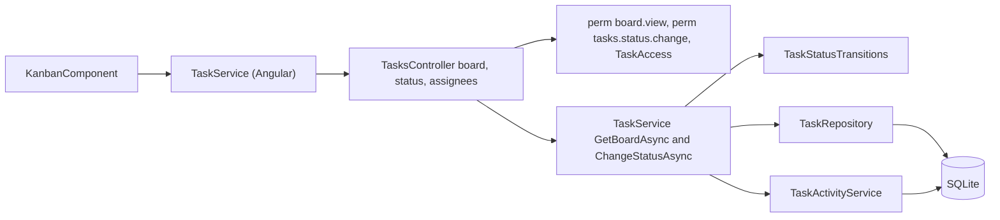
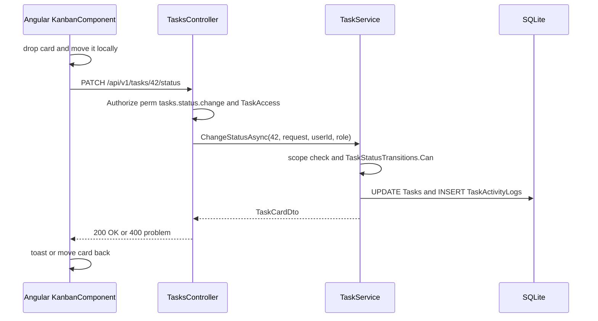

# Kanban Board – Technical Documentation

> **Project:** TaskFlow – Intelligent Task Allocation & Tracking System
> **Parent Module:** Monitoring  ·  **Child Module:** 04.3 Kanban Board
> **Version:** 1.0  ·  **Last Updated:** 31-Oct-2026
> **Backend:** ASP.NET Core Web API (.NET 10)  ·  **Frontend:** Angular  ·  **Database:** SQLite (EF Core)
> **Author:** Jojo George (jojogeorge3344@gmail.com)
> © 2026 Jojo George. All rights reserved.

---

## 1. Technical Overview
The board has no backend files of its own. It uses three `TasksController` endpoints that belong to 04.1 Task Management: `GET /api/v1/tasks/board` (all visible tasks, no paging), `PATCH /api/v1/tasks/{id}/status` (on drop) and `GET /api/v1/tasks/assignees` (assignee filter).

- `TaskService.GetBoardAsync` applies the caller's normal task scope (`VisibilityForCallerAsync`) and maps each task to `TaskCardDto`.
- `TaskService.ChangeStatusAsync` applies the same transition table (`TaskStatusTransitions`) as Task Details.
- The frontend `KanbanComponent` groups and filters the cards on the client and uses `@angular/cdk/drag-drop` for dragging, with an optimistic move that is rolled back on error.

## 2. Architecture Flow


## 3. Backend File Structure
All files are shared with 04.1 Task Management; only the parts the board uses are listed.

| Layer | Path | Files |
|-------|------|-------|
| Controller | `TaskFlow.Api/Controllers/Monitoring/` | `TasksController.cs` (`GetBoard`, status `PATCH`, `assignees`) |
| Service | `TaskFlow.Api/Services/Monitoring/TaskManagement/Tasks/` | `ITaskService.cs`, `TaskService.cs` (`GetBoardAsync`, `GetAssigneesAsync`, `ChangeStatusAsync`) |
| Service rules | `TaskFlow.Api/Services/Monitoring/TaskManagement/Rules/` | `TaskStatusTransitions.cs` |
| Repository | `TaskFlow.Api/Repositories/Monitoring/TaskManagement/Tasks/` | `ITaskRepository.cs`, `TaskRepository.cs` (`GetBoardAsync`, `GetAssigneesAsync`), `TaskVisibility.cs` |
| DTOs | `TaskFlow.Api/Dtos/Monitoring/TaskManagement/` | `TaskDtos.cs` (`TaskCardDto`, `TaskRecipientDto`), `TaskRequests.cs` (`UpdateTaskStatusRequest`) |
| Validators | `TaskFlow.Api/Dtos/Monitoring/TaskManagement/Validators/` | `UpdateTaskStatusRequestValidator.cs` |
| Enums | `TaskFlow.Api/Models/Enums/` | `TaskStatus.cs`, `TaskPriority.cs` |
| Authorization | `TaskFlow.Api/Authorization/TaskAccess/` | `TaskAccessRequirement.cs`, `TaskAccessHandler.cs` |

## 4. Frontend File Structure

| Type | Path | Purpose |
|------|------|---------|
| Page component | `src/app/modules/monitoring/board/pages/` | `kanban.component.ts`, `kanban.component.html` |
| Models | `src/app/modules/monitoring/board/pages/kanban.model.ts` | `BoardColumn` |
| Models | `src/app/modules/monitoring/task-management/models/task.model.ts` | `TaskCard`, `BOARD_STATUSES` (ToDo, InProgress, InQA, Blocked, Completed) |
| API service | `src/app/modules/monitoring/task-management/services/task.service.ts` | `getBoard`, `changeStatus`, `getAssignees` |
| Route / Guard | `src/app/modules/monitoring/monitoring.routes.ts` + `permissionGuard` | `/board` needs `board.view` |
| Menu | `src/app/layouts/nav-items.ts` | Board item needs `board.view` |

---

## 5. API & Logic

### 5.1 API Endpoints

| # | Method | Endpoint | Description | Permission (Policy) | Request DTO | Response DTO |
|---|--------|----------|-------------|---------------------|-------------|--------------|
| 1 | GET | `/api/v1/tasks/board` | Flat list of accessible tasks; grouped on the client | `perm:board.view` | – | `IReadOnlyCollection<TaskCardDto>` |
| 2 | PATCH | `/api/v1/tasks/{id:int}/status` | Status change on drop (same endpoint as 04.1, row 9) | `perm:tasks.status.change` + `TaskAccess` | `UpdateTaskStatusRequest` | `TaskCardDto` |
| 3 | GET | `/api/v1/tasks/assignees` | Assignee filter options (only called with `tasks.view.all`) | `[Authorize]` | – | `IReadOnlyCollection<TaskRecipientDto>` |

These are the same endpoints as in 04.1, listed again for the board. They are counted once in the module total.

### 5.2 Request / Response Samples
```json
// GET /api/v1/tasks/board -> 200 OK
[ { "id": 42, "taskCode": "TSK-000042", "title": "Prepare Q4 release notes", "assignedToUserId": 12,
    "assignedToName": "Asha Nair", "priority": "High", "deadline": "2026-11-03T12:30:00Z",
    "status": "InProgress", "isOverdue": false, "projectId": 3, "projectName": "Website Revamp" } ]
```
```json
// PATCH /api/v1/tasks/42/status   { "status": "Completed" }  -> 400 when not allowed
{ "status": 400, "detail": "Cannot move a task from Completed to InProgress." }
```

### 5.3 Service Layer Logic
- `TaskService.GetBoardAsync` uses `VisibilityForCallerAsync`, then `ITaskRepository.GetBoardAsync`, then `ToCard` (with `IsOverdue = Deadline < UtcNow` and status not Completed or Cancelled).
- `TaskService.GetAssigneesAsync` uses the same visibility.
- `TaskService.ChangeStatusAsync` (full steps in 04.1, section 5.3): scope check, `TaskStatusTransitions.Can(from, to)` or `"Cannot move a task from {from} to {to}."`, set Status / `CompletedAt` / `CancelledAt`, append `StatusChanged` (and `Completed`), return `TaskCardDto`.
- `KanbanComponent` (frontend):
  - `load()` calls `getBoard()`. `rebuild()` filters the tasks on the client (project, assignee, status, local-date deadline range, AND semantics) and groups them into `BOARD_STATUSES` = ToDo, InProgress, InQA, Blocked, Completed.
  - `drop()` ignores drops within the same column (sorting is disabled) and then calls `commitStatusChange`.
  - `commitStatusChange` updates the card at once, then calls `changeStatus`. On success it shows the toast `"{code} moved to {label}"`. On error it moves the card back and shows `apiErrorMessage(err, "Could not move {code}.")`.
  - Dragging is disabled without `tasks.status.change` (`[cdkDragDisabled]="!canMove()"`). The filter row needs `board.filters.use`. The assignee filter also needs `tasks.view.all`.
  - Clicking a card opens `/tasks/{id}?returnUrl=/board`.

### 5.4 Repository Layer

| Method | Description | Query Notes |
|--------|-------------|-------------|
| `TaskRepository.GetBoardAsync(TaskVisibility)` | All visible live tasks | `IgnoreQueryFilters`, Include AssignedTo and Project, ordered by Deadline, no paging |
| `TaskRepository.GetAssigneesAsync(TaskVisibility)` | Assignee options | Distinct projection |

### 5.5 Sequence Diagram


---

## 6. Database Design
The board owns no tables. It reads and updates `Tasks` (owned by 04.1) and appends to `TaskActivityLogs` (owned by 04.2).

| Table | Column | Type | Constraints | Description |
|-------|--------|------|-------------|-------------|
| `Tasks` | `Id`, `TaskCode`, `Title` | int / string(32) / string(200) | PK / Unique / Not Null | Card identity |
| `Tasks` | `AssignedToUserId`, `ProjectId` | int | FK → Users.Id / FK → Projects.Id | Card assignee and project (with names from `Users`, `Projects`) |
| `Tasks` | `Priority` | enum `TaskPriority` (int) | Not Null | Card priority chip |
| `Tasks` | `Deadline` | datetime (UTC) | Not Null, Index | Ordering, overdue highlight, deadline filter |
| `Tasks` | `Status` | enum `TaskStatus` (int) | Not Null | Column; updated on drop |
| `Tasks` | `CompletedAt` / `CancelledAt` | datetime | Nullable | Set by the status change |
| `Tasks` | `IsDeleted` | bool | Not Null | Deleted tasks are excluded |
| `TaskActivityLogs` | all columns | – | – | `StatusChanged` / `Completed` entries on each move |

**Relationships:** as in 04.1 (`Tasks.AssignedToUserId → Users.Id`, `Tasks.ProjectId → Projects.Id`, both Restrict).

## 7. Security & Authorization
- **Authorization:** `perm:board.view` on `GET /tasks/board`; `perm:tasks.status.change` + `TaskAccess` + the `TaskService` scope check on the status change.
- **Data scope:** the same Own / Team / Organization scope as the task list (`VisibilityForCallerAsync`).
- **Frontend:** `permissionGuard` on `/board`; `canMove` and `canFilter` signals in `KanbanComponent`.

| Permission Key | Endpoint(s) | UI Element Controlled |
|----------------|-------------|-----------------------|
| `board.view` | `GET /tasks/board` | Board menu item, `/board` guard |
| `board.filters.use` | none (filters run on the client) | Board filter row |
| `tasks.status.change` | `PATCH /tasks/{id}/status` | Board drag-and-drop (`canMove`) |
| `tasks.view.all` | Scope in `TaskService` | Assignee filter (board), `getAssignees()` call |

## 8. Validations & Error Handling

| Rule | Layer | HTTP Code | Error Message |
|------|-------|-----------|---------------|
| Status not in enum | `UpdateTaskStatusRequestValidator` | 400 | FluentValidation default |
| Status transition not allowed | `TaskService.ChangeStatusAsync` | 400 | Cannot move a task from {from} to {to}. |
| Any failed move (client) | `KanbanComponent.commitStatusChange` | – | Server `detail`, or `Could not move {code}.`; the card returns to its column |
| Board failed to load (client) | `KanbanComponent.load` | – | Could not load the board. Try again. |

Shared rows (policy 403, 404 not found, generic 409 and 500) and the error format are in the parent document, section 8.

## 9. Integrations / Side Effects
- **Activity Log:** each accepted move appends `StatusChanged` ("Status changed from X to Y"), plus `Completed` ("Task completed") when moved to Completed (through `TaskActivityService.AppendAsync`, 04.2).
- **Notifications / Email:** none for a status change.
- **AI Assistant:** help topic `change-task-status.md` in `Services/Assistant/Knowledge/`.

## 10. Configuration
_Not applicable – the board has no configuration of its own. The time zone and module-wide keys are described in 04.1 and the parent document._

## 11. Testing

Paths are relative to `backend/tests`.

| Test Type | File / Location | Covers |
|-----------|-----------------|--------|
| Unit | `TaskFlow.UnitTests/Monitoring/TaskManagement/Rules/TaskTrackingDomainTests.cs` | Status transitions used by the board (shared with 04.1) |

> ⚠️ To be confirmed: whether `TaskFlow.IntegrationTests/Monitoring/TaskManagement/TasksEndpointsTests.cs` (listed in 04.1) covers `GET /tasks/board`. No board-specific test file and no frontend spec file for `KanbanComponent` are in the file list. Only the test file names are available.

## 12. Known Limitations / Gaps found
- No pagination on `GET /tasks/board`. Every visible task is returned and filtered on the client.
- **`board.filters.use` is enforced only on the frontend.** The filters run on the client, so there is no API check.
- **BRD vs code:** Screen 10 specifies four board columns (To Do, In Progress, Blocked, Completed). The code has five (adds **In QA**) and no Cancelled column, so cancelled tasks are invisible on the board.
- The Task List "Board view" button is not gated by `board.view` (see 04.1, section 12).

---
<sub>© 2026 Jojo George. All rights reserved. Unauthorized copying or distribution of this document is prohibited.</sub>
