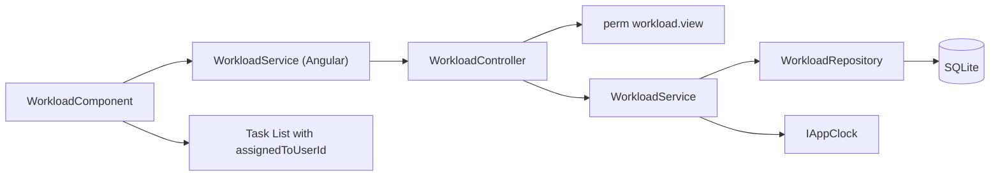
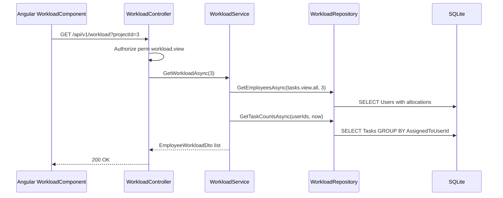

# Employee Workload – Technical Documentation

> **Project:** TaskFlow – Intelligent Task Allocation & Tracking System
> **Parent Module:** Monitoring  ·  **Child Module:** 04.4 Employee Workload
> **Version:** 1.0  ·  **Last Updated:** 31-Oct-2026
> **Backend:** ASP.NET Core Web API (.NET 10)  ·  **Frontend:** Angular  ·  **Database:** SQLite (EF Core)
> **Author:** Jojo George (jojogeorge3344@gmail.com)
> © 2026 Jojo George. All rights reserved.

---

## 1. Technical Overview
Employee Workload is served by `WorkloadController` (`[Route("api/v1/workload")]`, class-level `[RequirePermission]` for `workload.view`), which exposes one endpoint.

- `WorkloadService.GetWorkloadAsync` asks `WorkloadRepository` for the candidate employees (active users whose role has no stored `tasks.view.all` grant, optionally limited to one project) with their project allocations, then for four task counts per employee, and joins the two.
- The frontend `WorkloadComponent` computes the summary, the average and the "High load" flag on the client, filters by employee on the client, and links to the task list.

## 2. Architecture Flow


## 3. Backend File Structure

| Layer | Path | Files |
|-------|------|-------|
| Controller | `TaskFlow.Api/Controllers/Monitoring/` | `WorkloadController.cs` |
| Service | `TaskFlow.Api/Services/Monitoring/EmployeeWorkload/` | `IWorkloadService.cs`, `WorkloadService.cs` |
| Repository | `TaskFlow.Api/Repositories/Monitoring/EmployeeWorkload/` | `IWorkloadRepository.cs`, `WorkloadRepository.cs`, `WorkloadEmployee.cs`, `WorkloadCounts.cs` |
| DTOs | `TaskFlow.Api/Dtos/Monitoring/EmployeeWorkload/` | `WorkloadDto.cs` (`EmployeeWorkloadDto`) |
| DTOs (reused) | `TaskFlow.Api/Dtos/Management/EmployeeManagement/` | `ProjectAllocationDto` |
| Entities (read) | `TaskFlow.Api/Models/Entities/` | `User`, `UserProjectAllocation`, `Task` (owned by other modules / 04.1) |
| Authorization | `TaskFlow.Api/Authorization/Policies/` | `RequirePermissionAttribute.cs` |

## 4. Frontend File Structure

| Type | Path | Purpose |
|------|------|---------|
| Page component | `src/app/modules/monitoring/employee-workload/pages/` | `workload.component.ts`, `workload.component.html` |
| API service | `src/app/modules/monitoring/employee-workload/services/workload.service.ts` | `GET /api/v1/workload` |
| Models | `src/app/modules/monitoring/employee-workload/models/workload.model.ts` | `EmployeeWorkload`, `WorkloadSummary` |
| Route / Guard | `src/app/modules/monitoring/monitoring.routes.ts` + `permissionGuard` | `/workload` needs `workload.view` |
| Menu | `src/app/layouts/nav-items.ts` | "TaskFlow Monitoring → Employee Workload" needs `workload.view` |

---

## 5. API & Logic

### 5.1 API Endpoints

| # | Method | Endpoint | Description | Permission (Policy) | Request DTO | Response DTO |
|---|--------|----------|-------------|---------------------|-------------|--------------|
| 1 | GET | `/api/v1/workload` | Per-employee task load, optionally for one project | `perm:workload.view` (class-level `[RequirePermission]` on `WorkloadController`, `[Route("api/v1/workload")]`) | Query: `projectId` (optional int) | `IReadOnlyCollection<EmployeeWorkloadDto>` |

### 5.2 Request / Response Samples
```json
// GET /api/v1/workload?projectId=3 -> 200 OK
[ { "userId": 12, "fullName": "Asha Nair",
    "projects": [ { "projectId": 3, "projectName": "Website Revamp", "positionId": 2, "positionName": "Developer", "percent": 60 } ],
    "allocatedPercent": 60, "activeTasks": 4, "highPriorityTasks": 1, "overdueTasks": 1, "completedTasks": 9 } ]
```
> ⚠️ To be confirmed: the JSON property names of `ProjectAllocationDto` (in `Dtos/Management/EmployeeManagement`). They are inferred from the constructor call `new ProjectAllocationDto(a.ProjectId, a.Project.Name, a.PositionId, a.Position.Name, a.AllocationPercent)` and from the frontend use of `projectName` and `percent`.

### 5.3 Service Layer Logic
**`WorkloadService.GetWorkloadAsync(int? projectId)`**
1. `IWorkloadRepository.GetEmployeesAsync(PermissionKeys.TasksViewAll, projectId)` returns the active users whose role has **no stored grant** of `tasks.view.all`, optionally limited to those allocated to the project, ordered by name. Each comes with its project allocations. If there are none, it returns an empty array.
2. `GetTaskCountsAsync(userIds, IAppClock.UtcNow)` groups live tasks by assignee:
   - Active = not Completed or Cancelled
   - HighPriority = active and High or Critical
   - Overdue = active and `Deadline < now`
   - Completed
3. Join the two. Users with no tasks get zeros. `AllocatedPercent = Sum(project.Percent)`.

**Frontend `WorkloadComponent`**
- The Project filter reloads from the server. The Employee filter works on the client.
- Summary: headcount, total active and average. `isHighLoad` = active ≥ 2 × average (when the average > 0).
- The bar width is scaled to the busiest row.
- The **Tasks** link goes to `/tasks?assignedToUserId={id}` (needs `workload.tasks.open`). The task list then applies the caller's normal scope.

### 5.4 Repository Layer

| Method | Description | Query Notes |
|--------|-------------|-------------|
| `WorkloadRepository.GetEmployeesAsync(viewAllPermissionKey, projectId)` | Candidate employees with allocations | `Users` where `IsActive` and `!Role.Permissions.Any(Key == tasks.view.all)`; optional `ProjectAllocations.Any(ProjectId)`; projects to `WorkloadEmployee` with `ProjectAllocationDto` list ordered by project name |
| `WorkloadRepository.GetTaskCountsAsync(userIds, now)` | Counts per assignee | `Tasks` where `!IsDeleted` and the assignee is in `userIds`; `GroupBy(AssignedToUserId)` with four conditional counts |

### 5.5 Sequence Diagram


---

## 6. Database Design
Workload owns no tables and writes nothing. It reads the tables below (names from the `AppDbContext` `DbSet` properties; entity members from `WorkloadRepository`).

| Table | Column | Type | Constraints | Description |
|-------|--------|------|-------------|-------------|
| `Users` | `Id`, `FullName`, `IsActive`, role link | int / string / bool | PK | Candidate employees (active only) |
| `RolePermissions` / `Permissions` | `Permission.Key` | string | – | Excludes roles with a stored `tasks.view.all` grant |
| `UserProjectAllocations` | `UserId`, `ProjectId`, `PositionId`, `AllocationPercent` | int | FK → Users, Projects, Positions | Project filter, Projects column, Allocated % (whole percentage 1–100) |
| `Projects` | `Name` | string | – | Project name in the Projects column |
| `Positions` | `Name` | string | – | Position name per allocation |
| `Tasks` | `AssignedToUserId`, `Status`, `Priority`, `Deadline`, `IsDeleted` | int / enum / enum / datetime / bool | owned by 04.1 | The four counts |

**Relationships:** `UserProjectAllocations.UserId → Users.Id`, `UserProjectAllocations.ProjectId → Projects.Id`, `UserProjectAllocations.PositionId → Positions.Id` (owned by the Management module); `Tasks.AssignedToUserId → Users.Id` (04.1).

## 7. Security & Authorization
- **Authorization:** class-level `[RequirePermission]` (`perm:workload.view`) on `WorkloadController`.
- **Data scope:** Organization for every caller – the list is not narrowed to a Manager's team. The **Tasks →** link opens the task list, which applies the caller's normal scope.
- **Frontend:** `permissionGuard` on `/workload`; `canFilter` and `canOpenTasks` signals gate the filters and the **Tasks →** link.

| Permission Key | Endpoint(s) | UI Element Controlled |
|----------------|-------------|-----------------------|
| `workload.view` | `GET /workload` | Employee Workload menu item, `/workload` guard |
| `workload.filters.use` | none (`projectId` is accepted by `GET /workload` without it) | Workload Project and Employee filters |
| `workload.tasks.open` | none | Workload row **Tasks →** link |

## 8. Validations & Error Handling

| Rule | Layer | HTTP Code | Error Message |
|------|-------|-----------|---------------|
| Caller lacks `workload.view` | Policy | 403 | Forbidden (empty body) |
| No matching employees | `WorkloadService` | 200 | Empty array (screen: "No employees to show – There are no active employees in this project.") |
| Load failure (client) | `WorkloadComponent` | – | Could not load the workload. Check your connection and try again. |

Shared rows (generic 500) and the error format are in the parent document, section 8.

## 9. Integrations / Side Effects
- **Notifications / Email / Activity Log:** none – the endpoint is read-only.
- **Task List:** the **Tasks →** link navigates to `/tasks?assignedToUserId={id}` (04.1).
- **AI Assistant:** help topic `reports-and-workload.md` in `Services/Assistant/Knowledge/`.

## 10. Configuration
_Not applicable – Workload has no configuration keys of its own. "Overdue" uses `IAppClock.UtcNow`._

## 11. Testing

Paths are relative to `backend/tests`.

| Test Type | File / Location | Covers |
|-----------|-----------------|--------|
| Integration | `TaskFlow.IntegrationTests/Monitoring/EmployeeWorkload/WorkloadEndpointsTests.cs` | Workload endpoint |
| Unit | `TaskFlow.UnitTests/Monitoring/EmployeeWorkload/WorkloadServiceTests.cs`, `CustomRoleWorkloadTests.cs` | Workload counts and custom roles |
| Support | `TaskFlow.UnitTests/TestSupport/WorkloadReportHarness.cs` | Test harness |

Only the test file names are available. What each file covers is inferred from its name.

## 12. Known Limitations / Gaps found
- **`workload.filters.use` and `workload.tasks.open` are enforced only on the frontend.** `GET /workload?projectId=` accepts the filter without `workload.filters.use`.
- **Workload is organization-wide, not narrowed to the Manager's team** (audit D). The employee set is "users whose role has no stored `tasks.view.all` grant". A role that holds `tasks.view.all` only through a legacy key would still be listed.
- **BRD vs code:** Screen 16 asks for a Department column and filter. The code shows Projects and Allocated %, with Project and Employee filters only.

---
<sub>© 2026 Jojo George. All rights reserved. Unauthorized copying or distribution of this document is prohibited.</sub>
