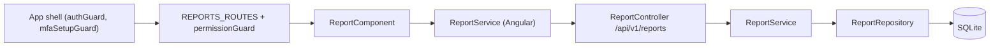

# Reports Module – Technical Documentation

> **Project:** TaskFlow – Intelligent Task Allocation & Tracking System
> **Module:** Reports  ·  **Child Modules:** Reports
> **Version:** 1.0  ·  **Last Updated:** 31-Oct-2026
> **Backend:** ASP.NET Core Web API (.NET 10)  ·  **Frontend:** Angular  ·  **Database:** SQLite (EF Core)
> **Author:** Jojo George (jojogeorge3344@gmail.com)
> © 2026 Jojo George. All rights reserved.

> ✅ Target framework confirmed: `net10.0` (.NET 10), from `backend/src/TaskFlow.Api/TaskFlow.Api.csproj`.

---

## 1. Technical Overview
The Reports module is a read-only reporting slice for BRD Screen 17. It has no tables of its own and reads the `Tasks`, `Users`, `UserProjectAllocations` and `Projects` tables. It has one child module, **06.1 Reports**, which exposes two GET endpoints under `api/v1/reports` (summary totals and CSV export).

Data is **organization-wide** for every caller who holds `reports.view`. No per-user scope is applied (design note D3 in `ReportService`). The Angular `ReportComponent` is a standalone page loaded under the authenticated shell.

## 2. Architecture Flow

## 3. Backend File Structure

| Layer | Path | Child |
|-------|------|-------|
| Controller | `TaskFlow.Api/Controllers/Reports/` | 06.1 |
| Service | `TaskFlow.Api/Services/Reports/` | 06.1 |
| Repository | `TaskFlow.Api/Repositories/Reports/` | 06.1 |
| DTOs / Validators | `TaskFlow.Api/Dtos/Reports/`, `TaskFlow.Api/Dtos/Reports/Validators/` | 06.1 |
| Entities / Enums (read only, shared) | `TaskFlow.Api/Models/Entities/`, `TaskFlow.Api/Models/Enums/` | Shared |
| Authorization (shared) | `TaskFlow.Api/Authorization/Policies/`, `TaskFlow.Api/Common/Security/` (`RequirePermissionAttribute.cs`, `PermissionPolicy.cs` prefix `perm:`, `PermissionKeys.cs`, `PermissionCatalog.cs`) | Shared |
| Cross-cutting (shared) | `TaskFlow.Api/Filters/ValidationFilter.cs`, `TaskFlow.Api/Middleware/GlobalExceptionHandler.cs`, `TaskFlow.Api/Authorization/Auditing/DeniedActionAuditHandler.cs` | Shared |
| DI registration | `TaskFlow.Api/Config/ServiceRegistration.cs`, `RepositoryRegistration.cs` | 06.1 |

File-level detail is in `06-Reports/06.1-Reports.md`.

## 4. Frontend File Structure

| Type | Path | Child |
|------|------|-------|
| Feature folder | `src/app/modules/reports/` (`pages/`, `services/`, `models/`, `reports.routes.ts`) | 06.1 |
| Shell route | `src/app/routes/app.routes.ts` (`authGuard`, `mfaSetupGuard`) | Shared |
| Menu | `src/app/layouts/nav-items.ts` ("Reports", icon `chart`, route `/reports`) | 06.1 |
| Permission constants | `src/app/shared/auth/permissions.ts` (`ReportsView`, `ReportsExport`) | 06.1 |
| Shared utilities | `src/app/shared/utils/`, `src/app/shared/services/toast.service.ts`, `shared/components/icon/` | Shared |

## 5. Child Modules

| # | Child Module | Main endpoints (count) | Key permissions | Document |
|---|--------------|------------------------|-----------------|----------|
| 6.1 | Reports | `GET /api/v1/reports`, `GET /api/v1/reports/export` (2) | `reports.view`, `reports.export` (plus `projects.view` for the Project dropdown) | `06.1-Reports.md` |

## 6. Database Design
The module owns no tables. All reads are made by child 06.1.

| Table | Owner | Read by | Use |
|-------|-------|---------|-----|
| `Tasks` | Monitoring (Task Management) | 06.1 Reports | Filters, totals, export rows |
| `Users` | Management (Employee Management) | 06.1 Reports | Assignee name (soft-delete filter bypassed) |
| `UserProjectAllocations` | Management (Project Management) | 06.1 Reports | Project filter, CSV `Project` column |
| `Projects` | Management (Project Management) | 06.1 Reports | Project names |

**Relationships**
- `Tasks.AssignedToUserId → Users.Id` (FK, Restrict)
- `Tasks.ProjectId → Projects.Id` (FK, Restrict). Not read by this module.
- `UserProjectAllocations.UserId → Users.Id` (FK, Cascade)
- `UserProjectAllocations.ProjectId → Projects.Id` (FK, Cascade)

Enum storage: `TaskStatus` = ToDo 0, InProgress 1, Blocked 2, Completed 3, Cancelled 4, InQA 5. `TaskPriority` = Low 0, Medium 1, High 2, Critical 3. They are stored as integers and sent over JSON as names (`JsonStringEnumConverter` in `CrossCuttingRegistration.cs`).

Column-level detail is in the child document.

## 7. Security & Authorization
- **Authentication:** JWT bearer access token (`Jwt:AccessTokenMinutes`) plus a refresh-token cookie (`Jwt:RefreshTokenDays`).
- **Authorization:** Permission policies named `perm:` + key (`PermissionPolicy.NameFor`). Permission claims are refreshed from the database on every request. Refusals are logged by `DeniedActionAuditHandler` (user id, method, path, policy) and return the default 403.
- **Catalog (`PermissionCatalog.cs`):** module `Report`, screen `Reports`. `reports.view` ("View reports", action `View`, `GrantedToManager: true`); `reports.export` ("Export reports", action `Export`, `GrantedToManager: true`, `GrantFrom: reports.view`, `Requires: reports.view`). Administrator is granted every key on every start (`AccessControlSeeder`). Employee has neither key by default.
- **Data scope:** **Organization** for every holder of `reports.view` (D3, "matching the dashboards' scoping").

| Role | `reports.view` | `reports.export` |
|------|:--------------:|:----------------:|
| Administrator | Granted | Granted |
| Manager | Granted | Granted |
| Employee | Denied | Denied |
| Custom Role | Configurable | Configurable |

Key → endpoint → UI mapping is in the child document.

## 8. Validations & Error Handling
Shared handling used by the child:

| Rule | Layer | HTTP Code | Error Message |
|------|-------|-----------|---------------|
| Not signed in / expired token | Authentication | 401 | – |
| Missing permission | Policy | 403 | Forbidden (default handler, audited) |
| Unhandled fault | `GlobalExceptionHandler` | 500 | Something went wrong. Please try again. |

Errors are returned as `application/problem+json` by `GlobalExceptionHandler`. Validation failures are returned as `ValidationProblemDetails` by `ValidationFilter`. Child-specific rules are in `06.1-Reports.md`.

## 9. Integrations / Side Effects
- **Notifications / Email / Activity Log:** None in this module. Only refused calls are logged, by `DeniedActionAuditHandler`.
- **AI Assistant:** No report tool is exposed. The help article `Services/Assistant/Knowledge/reports-and-workload.md` describes the screen to users.

## 10. Configuration

| Key (`appsettings.json`) | Purpose | Default |
|--------------------------|---------|---------|
| `ConnectionStrings:Default` | SQLite database used by `AppDbContext` | `<secret>` |
| `Jwt:AccessTokenMinutes` | Access-token lifetime for calling the report APIs | 30 |
| `Jwt:RefreshTokenDays` | Refresh-token cookie lifetime | 7 |

The module has no configuration section of its own. Child-specific settings and code constants are in the child document.

## 11. Testing

| Test Type | File / Location | Covers |
|-----------|-----------------|--------|
| Integration | `tests/TaskFlow.IntegrationTests/Common/PermissionAuthorizationTests.cs` | Every catalog key, `reports.view` included, has a policy that needs its claim. A custom role holding only `reports.view` gets 200 on `GET /api/v1/reports` and 403 on workload, admin dashboard and users. |
| Integration | `tests/TaskFlow.IntegrationTests/Common/ModuleBasedPermissionEndpointsTests.cs` | `GET /api/v1/reports/export` returns 403 without `reports.export` and is reached with `reports.export` plus `reports.view`. |
| Unit | `tests/TaskFlow.UnitTests/Settings/RoleConfiguration/PermissionCatalogTests.cs` | `reports.view` and `reports.export` sit in the "Report" module. A role that held old report access keeps `reports.export` after the upgrade. The Employee role does not hold `reports.view`. |
| Frontend unit | `src/app/routes/app.routes.spec.ts` | The `reports` route uses `permissionGuard` with `reports.view` and loads `ReportComponent`. |
| Frontend unit | `src/app/layouts/nav-items.spec.ts` | Reports is a top-level sidebar item for Administrator and Manager and is not shown to Employee. |

> Report-specific tests are listed in the child document.

## 12. Known Limitations / Future Enhancements

Child-specific gaps are listed in each child document.

---
© 2026 Jojo George. All rights reserved. Unauthorized copying or distribution of this document is prohibited.
