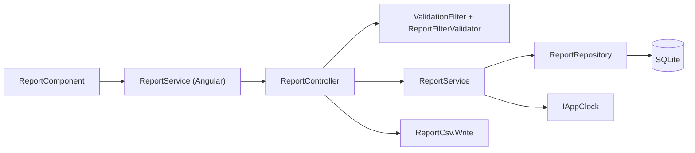
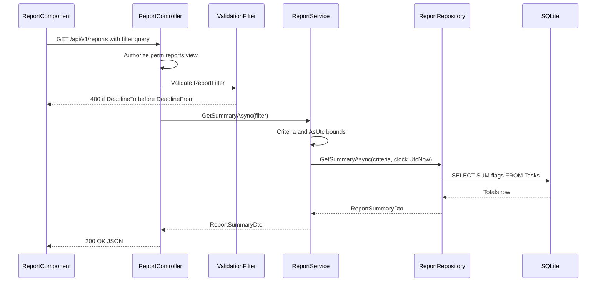
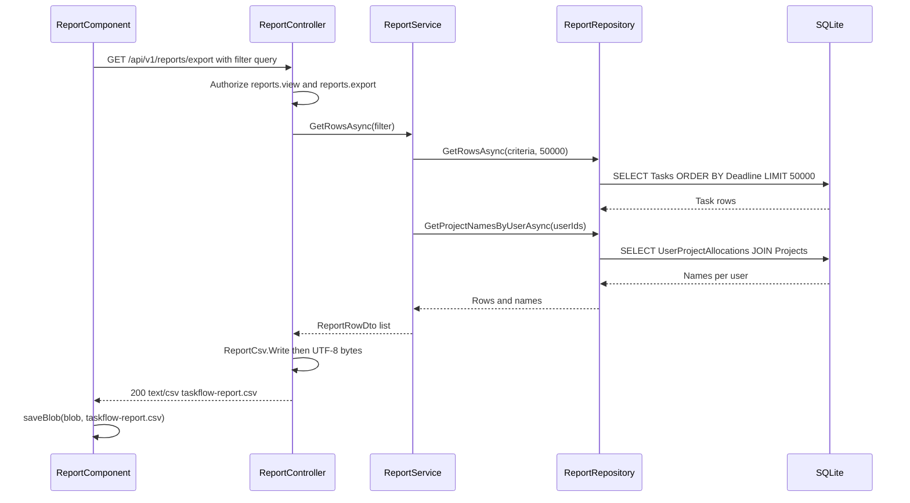

# Reports – Technical Documentation

> **Project:** TaskFlow – Intelligent Task Allocation & Tracking System
> **Parent Module:** Reports  ·  **Child Module:** 06.1 Reports
> **Version:** 1.0  ·  **Last Updated:** 31-Oct-2026
> **Backend:** ASP.NET Core Web API (.NET 10)  ·  **Frontend:** Angular  ·  **Database:** SQLite (EF Core)
> **Author:** Jojo George (jojogeorge3344@gmail.com)
> © 2026 Jojo George. All rights reserved.

---

## 1. Technical Overview
The Reports child module implements BRD Screen 17. It has no tables of its own and reads the `Tasks`, `Users`, `UserProjectAllocations` and `Projects` tables. It exposes two GET endpoints under `api/v1/reports`:
- **Summary** – one aggregate query returns `TotalTasks`, `PendingTasks`, `CompletedTasks` and `OverdueTasks` for an optional filter (deadline range, assignee, project, status, priority).
- **Export** – the same filter gives up to 50,000 task rows. `ReportCsv` serialises them to RFC 4180 CSV with formula-injection protection and returns them as `taskflow-report.csv`.

Data is **organization-wide** for every caller who holds `reports.view`. No per-user scope is applied (design note D3 in `ReportService`). Soft-deleted tasks are excluded. Tasks of soft-deleted users are kept (`IgnoreQueryFilters`). The Angular `ReportComponent` is a standalone page. It reloads the summary on every filter change and downloads the CSV as a blob.

## 2. Architecture Flow


## 3. Backend File Structure

| Layer | Path | Files |
|-------|------|-------|
| Controller | `TaskFlow.Api/Controllers/Reports/` | `ReportController.cs` |
| Service | `TaskFlow.Api/Services/Reports/` | `IReportService.cs`, `ReportService.cs`, `ReportCsv.cs` (static CSV writer) |
| Repository | `TaskFlow.Api/Repositories/Reports/` | `IReportRepository.cs`, `ReportRepository.cs`, `ReportCriteria.cs` (record), `ReportTaskRow.cs` (record) |
| DTOs | `TaskFlow.Api/Dtos/Reports/` | `ReportDto.cs` (`ReportFilter`, `ReportSummaryDto`, `ReportRowDto`) |
| Validators | `TaskFlow.Api/Dtos/Reports/Validators/` | `ReportFilterValidator.cs` |
| Entities | `TaskFlow.Api/Models/Entities/` | `Task.cs`, `User.cs`, `UserProjectAllocation.cs`, `Project.cs` (read only) |
| Enums | `TaskFlow.Api/Models/Enums/` | `TaskStatus.cs`, `TaskPriority.cs` |
| Authorization | `TaskFlow.Api/Authorization/Policies/`, `TaskFlow.Api/Common/Security/` | `RequirePermissionAttribute.cs`, `PermissionPolicy.cs` (prefix `perm:`), `PermissionKeys.cs`, `PermissionCatalog.cs` |
| Cross-cutting | `TaskFlow.Api/Filters/`, `TaskFlow.Api/Middleware/`, `TaskFlow.Api/Authorization/Auditing/` | `ValidationFilter.cs`, `GlobalExceptionHandler.cs`, `DeniedActionAuditHandler.cs` |
| DI registration | `TaskFlow.Api/Config/` | `ServiceRegistration.cs` (`IReportService` → `ReportService`, scoped), `RepositoryRegistration.cs` (`IReportRepository` → `ReportRepository`, scoped) |
| Clock | `TaskFlow.Api/Services/Settings/ApplicationSettings/Clock/` | `IAppClock.cs`, `AppClock.cs` (`UtcNow`) |
| Help knowledge | `TaskFlow.Api/Services/Assistant/Knowledge/` | `reports-and-workload.md` |

## 4. Frontend File Structure

| Type | Path | Purpose |
|------|------|---------|
| Page component | `src/app/modules/reports/pages/report.component.ts`, `report.component.html` | `ReportComponent` (selector `app-report`, standalone): filters, count cards, completion bar, Export CSV |
| Child components | – | None. Uses the shared `IconComponent` (`shared/components/icon/`) |
| API service | `src/app/modules/reports/services/report.service.ts` | `ReportService.getSummary(filter)`, `ReportService.exportCsv(filter)` (blob), `toParams()` drops empty values |
| Models | `src/app/modules/reports/models/report.model.ts` | `ReportFilter`, `ReportSummary` interfaces |
| Route / Guard | `src/app/modules/reports/reports.routes.ts` | `REPORTS_ROUTES`: path `reports`, `canActivate: [permissionGuard]`, `data.permissions: [Permissions.ReportsView]`. Loaded under the shell route in `src/app/routes/app.routes.ts` (`authGuard`, `mfaSetupGuard`) |
| Menu | `src/app/layouts/nav-items.ts` | "Reports" item (icon `chart`, route `/reports`) when `has(Permissions.ReportsView)` |
| Permission constants | `src/app/shared/auth/permissions.ts` | `ReportsView: 'reports.view'`, `ReportsExport: 'reports.export'` |
| Utilities used | `src/app/shared/utils/local-day.ts`, `src/app/shared/utils/save-blob.ts`, `src/app/shared/services/toast.service.ts` | Local-day to UTC bounds, blob download, error toast |
| Cross-module services | `modules/management/project-management/services/project.service.ts` (`getAll`), `modules/monitoring/task-management/services/task.service.ts` (`getAssignees`) | Project and Employee dropdown options |

---

## 5. API & Logic

### 5.1 API Endpoints

| # | Method | Endpoint | Description | Permission (Policy) | Request DTO | Response DTO |
|---|--------|----------|-------------|---------------------|-------------|--------------|
| 1 | GET | `/api/v1/reports` | Totals and completion summary for the filtered scope | `reports.view` (class-level `[RequirePermission]`, policy `perm:reports.view`) | `ReportFilter` (query string) | `ReportSummaryDto` (200) |
| 2 | GET | `/api/v1/reports/export` | Filtered task rows as a CSV attachment | `reports.view` (class) **and** `reports.export` (`[Authorize(Policy = "perm:reports.export")]`) | `ReportFilter` (query string) | `text/csv` file `taskflow-report.csv` (200) |

Query parameters of `ReportFilter` (all optional): `deadlineFrom` (DateTime), `deadlineTo` (DateTime), `assignedToUserId` (int), `projectId` (int), `status` (`TaskStatus` name: `ToDo`, `InProgress`, `Blocked`, `Completed`, `Cancelled`, `InQA`), `priority` (`TaskPriority` name: `Low`, `Medium`, `High`, `Critical`).

Dependency endpoints the screen calls (owned by other modules):

| Method | Endpoint | Used for | Authorization |
|--------|----------|----------|---------------|
| GET | `/api/v1/projects` | Project dropdown | `projects.view` |
| GET | `/api/v1/tasks/assignees` | Employee dropdown | `[Authorize]` only. The result is scoped to the caller's task access (`TaskService.GetAssigneesAsync`) |

### 5.2 Request / Response Samples
```json
// GET /api/v1/reports?deadlineFrom=2026-10-01T00:00:00.000Z&deadlineTo=2026-10-31T23:59:59.999Z&status=InProgress
// 200 OK
{ "totalTasks": 40, "pendingTasks": 28, "completedTasks": 12, "overdueTasks": 5 }
```
```json
// 400 Bad Request (ValidationFilter)
{
  "type": "https://tools.ietf.org/html/rfc9110#section-15.5.1",
  "title": "One or more validation errors occurred.",
  "status": 400,
  "errors": { "DeadlineTo": ["The report 'to' deadline must be on or after the 'from' deadline."] }
}
```
```text
// GET /api/v1/reports/export?priority=High
// 200 OK  Content-Type: text/csv  Content-Disposition: attachment; filename=taskflow-report.csv
TaskCode,Title,Assignee,Project,Priority,Status,StartDate,Deadline,EstimatedHours,CompletedAt
TF-0012,Prepare Monthly Report,Asha Nair,"Apollo, Orion",High,Completed,2026-10-01,2026-10-05,6.5,2026-10-04
```
Lines end with CRLF. The values shown are illustrative. The task code format depends on the Task Management module.

### 5.3 Service Layer Logic
**Class:** `TaskFlow.Api.Services.Reports.ReportService : IReportService` (depends on `IReportRepository`, `IAppClock`). Constant `MaxExportRows = 50_000`.

**Method:** `GetSummaryAsync(ReportFilter filter, CancellationToken)`
1. Input is already validated by `ValidationFilter` with `ReportFilterValidator`.
2. Map `ReportFilter` → `ReportCriteria` through `Criteria(filter)`. Each deadline bound is normalised with `AsUtc`: a `Local` kind is converted with `ToUniversalTime()`, an `Unspecified` kind is treated as UTC (`SpecifyKind`), and a `Utc` kind is left unchanged.
3. Call `_reports.GetSummaryAsync(criteria, _clock.UtcNow, ct)`. "Overdue" is measured at the application clock's current UTC time.
4. Return the `ReportSummaryDto`. A filter that matches no tasks returns `(0, 0, 0, 0)`.

**Method:** `GetRowsAsync(ReportFilter filter, CancellationToken)`
1. Build `ReportCriteria` as above.
2. `_reports.GetRowsAsync(criteria, MaxExportRows, ct)` returns `ReportTaskRow` records ordered by `Deadline`, then `Id`, with at most 50,000 rows.
3. Collect the distinct `AssignedToUserId` values and call `_reports.GetProjectNamesByUserAsync(userIds, ct)`. Report filters are not applied here, so a deleted person's work keeps its projects.
4. Project each row to `ReportRowDto`. `Project` = `string.Join(", ", names)` of the assignee's allocated projects (sorted by name), or empty.
5. Return the list.

**Static helper:** `ReportCsv.Write(IEnumerable<ReportRowDto> rows)` (`ContentType = "text/csv"`, `FileName = "taskflow-report.csv"`)
1. Header row: `TaskCode,Title,Assignee,Project,Priority,Status,StartDate,Deadline,EstimatedHours,CompletedAt`, terminated by `\r\n`.
2. Each cell goes through `Escape`:
   - `null` becomes an empty string.
   - A value starting with `=`, `+`, `-` or `@` gets a leading `'` (formula-injection guard, D8).
   - A value containing `,`, `"`, CR or LF is wrapped in quotes, with inner quotes doubled.
3. Dates use `yyyy-MM-dd` (invariant culture). `EstimatedHours` uses invariant culture. `CompletedAt` is empty when null. `Priority` and `Status` are written as enum names.
4. The controller encodes the result as UTF-8 bytes (no BOM is added explicitly) and returns `File(bytes, "text/csv", "taskflow-report.csv")`.

No activity log, notification or mail is written by this module.

### 5.4 Repository Layer
**Class:** `TaskFlow.Api.Repositories.Reports.ReportRepository : BaseRepository<Task>, IReportRepository`

| Method | Description | Query Notes |
|--------|-------------|-------------|
| `Covered(ReportCriteria)` (private) | Base query of covered tasks | `Set.AsNoTracking().IgnoreQueryFilters().Where(!task.IsDeleted)`. Optional filters: `Deadline >= DeadlineFromUtc`, `Deadline <= DeadlineToUtc` (both inclusive), `AssignedToUserId == x`, `AssignedTo.ProjectAllocations.Any(a => a.ProjectId == x)` (the **assignee's** allocation, not `Task.ProjectId`), `Status == x`, `Priority == x` |
| `GetSummaryAsync(criteria, now, ct)` | Totals in one aggregate query | Projects each task to 0/1 flags, `GroupBy(_ => 1)`, `Sum` per flag. Pending = status not `Completed` and not `Cancelled`. Completed = `Completed`. Overdue = pending and `Deadline < now`. `SingleOrDefaultAsync`. Returns zeros when there are no rows |
| `GetRowsAsync(criteria, take, ct)` | Export rows | `OrderBy(Deadline).ThenBy(Id).Take(take)`. Projects to `ReportTaskRow`. `Assignee` = `AssignedTo.FullName` or empty |
| `GetProjectNamesByUserAsync(userIds, ct)` | Project names per user | `Db.UserProjectAllocations.IgnoreQueryFilters().Where(userIds.Contains(UserId)).OrderBy(Project.Name)`. Groups in memory into `IReadOnlyDictionary<int, IReadOnlyList<string>>` |

`IgnoreQueryFilters()` is used because `Users` has the soft-delete filter `!IsDeleted`, and reports must keep a deleted person's name and finished work.

### 5.5 Sequence Diagrams

Summary:


Export:


---

## 6. Database Design
This child owns no tables. It reads the following tables, named by their `AppDbContext` DbSets. Only the columns it uses are listed.

| Table | Column | Type | Constraints | Description |
|-------|--------|------|-------------|-------------|
| `Tasks` | `Id` | int | PK | Tie-break sort for export |
| `Tasks` | `TaskCode` | string | Required, max 32, Unique index | CSV `TaskCode` |
| `Tasks` | `Title` | string | Required, max 200 | CSV `Title` |
| `Tasks` | `AssignedToUserId` | int | FK → `Users.Id` (Restrict), indexed | Assignee filter, assignee name, project lookup |
| `Tasks` | `Priority` | `TaskPriority` (int) | – | Priority filter, CSV column |
| `Tasks` | `Status` | `TaskStatus` (int) | – | Status filter, Pending/Completed/Overdue rules |
| `Tasks` | `StartDate` | DateTime | – | CSV `StartDate` |
| `Tasks` | `Deadline` | DateTime | Indexed | Date-range filter, overdue rule, export sort |
| `Tasks` | `EstimatedHours` | decimal | – | CSV `EstimatedHours` |
| `Tasks` | `CompletedAt` | DateTime? | Nullable | CSV `CompletedAt` |
| `Tasks` | `IsDeleted` | bool | – | Deleted tasks are excluded |
| `Tasks` | `ProjectId` | int? | FK → `Projects.Id` (Restrict) | **Not used** by reports |
| `Users` | `FullName` | string | Required, max 200 | CSV `Assignee` |
| `Users` | `IsDeleted` | bool | Query filter `!IsDeleted` (bypassed by reports) | Soft delete |
| `UserProjectAllocations` | `UserId`, `ProjectId` | int, int | Composite PK. FKs to `Users`/`Projects` (Cascade). Query filter: user and project not deleted (bypassed) | Project filter, CSV `Project` |
| `Projects` | `Name` | string | Required, max 200, unique among non-deleted | CSV `Project` names |

**Relationships**
- `Tasks.AssignedToUserId → Users.Id` (FK, Restrict)
- `Tasks.ProjectId → Projects.Id` (FK, Restrict). Not read by this child.
- `UserProjectAllocations.UserId → Users.Id` (FK, Cascade)
- `UserProjectAllocations.ProjectId → Projects.Id` (FK, Cascade)

Enum storage: `TaskStatus` = ToDo 0, InProgress 1, Blocked 2, Completed 3, Cancelled 4, InQA 5. `TaskPriority` = Low 0, Medium 1, High 2, Critical 3. They are stored as integers and sent over JSON as names (`JsonStringEnumConverter` in `CrossCuttingRegistration.cs`).

## 7. Security & Authorization
- **Authentication:** JWT bearer access token (`Jwt:AccessTokenMinutes`) plus a refresh-token cookie (`Jwt:RefreshTokenDays`).
- **Authorization:** Permission policies named `perm:` + key (`PermissionPolicy.NameFor`). `[RequirePermission(PermissionKeys.ReportsView)]` on the controller class covers both actions. `Export` adds `[Authorize(Policy = PermissionPolicy.Prefix + PermissionKeys.ReportsExport)]`, so both keys are required. Permission claims are refreshed from the database on every request. Refusals are logged by `DeniedActionAuditHandler` (user id, method, path, policy) and return the default 403.
- **Catalog (`PermissionCatalog.cs`):**
  - `reports.view`: "View reports", module `Report`, screen `Reports`, action `View`, `GrantedToManager: true`.
  - `reports.export`: "Export reports", action `Export`, `GrantedToManager: true`, `GrantFrom: reports.view`, `Requires: reports.view`.
  - Administrator is granted every key on every start (`AccessControlSeeder`). Employee has neither key by default.
- **Data scope:** **Organization** for every holder of `reports.view`. `ReportService` applies no Own/Team scope selector (D3, "matching the dashboards' scoping").
- **Frontend:**
  - `permissionGuard` on `/reports` (`reports.view`). A user without it is redirected to `dashboardRouteFor(role, permissions)`.
  - The nav item is shown via `has(Permissions.ReportsView)`.
  - The Export button is rendered only when `canExport()` (`authService.hasPermission(Permissions.ReportsExport)`).

| Permission Key | Endpoint(s) | UI Element Controlled |
|----------------|-------------|-----------------------|
| `reports.view` | `GET /api/v1/reports`, `GET /api/v1/reports/export` | "Reports" menu item, `/reports` route, filters, count cards, completion bar |
| `reports.export` | `GET /api/v1/reports/export` | "Export CSV" button |
| `projects.view` (Management) | `GET /api/v1/projects` | Project filter options. Without it the call returns 403 and the dropdown stays empty, with no error shown |

| Role | `reports.view` | `reports.export` |
|------|:--------------:|:----------------:|
| Administrator | Granted | Granted |
| Manager | Granted | Granted |
| Employee | Denied | Denied |
| Custom Role | Configurable | Configurable |

## 8. Validations & Error Handling

| Rule | Layer | HTTP Code | Error Message |
|------|-------|-----------|---------------|
| `DeadlineTo` earlier than `DeadlineFrom` (both supplied) | `ReportFilterValidator` via `ValidationFilter` | 400 | The report 'to' deadline must be on or after the 'from' deadline. |
| `Status` not a defined `TaskStatus` | `ReportFilterValidator` (`IsInEnum`) | 400 | FluentValidation default enum message |
| `Priority` not a defined `TaskPriority` | `ReportFilterValidator` (`IsInEnum`) | 400 | FluentValidation default enum message |
| Unparseable query value (e.g. bad date or unknown enum name) | MVC model binding (`[ApiController]`) | 400 | Default model-state validation problem |
| Not signed in / expired token | Authentication | 401 | – |
| Missing `reports.view` or `reports.export` | Policy | 403 | Forbidden (default handler, audited) |
| Unhandled fault | `GlobalExceptionHandler` | 500 | Something went wrong. Please try again. |
| Summary load fails (any error) | Frontend `ReportComponent.load` | – | Could not load the report. Check your connection and try again. |
| Export fails (any error) | Frontend `ReportComponent.exportCsv` (toast) | – | Could not export the report. Please try again. |

Errors are returned as `application/problem+json` by `GlobalExceptionHandler`. Validation failures are returned as `ValidationProblemDetails` by `ValidationFilter`. No `AppException` (404/409) is thrown by this child. The frontend date inputs set `min`/`max` so the invalid range cannot normally be picked.

## 9. Integrations / Side Effects
- **Notifications:** None.
- **Email:** None.
- **Activity Log:** None. Only refused calls are logged, by `DeniedActionAuditHandler`.
- **Clock:** `IAppClock.UtcNow` (backed by `TimeProvider`) decides "overdue". The configured application timezone is **not** used for the deadline bounds. The browser converts local calendar days to UTC instants (`startOfLocalDay` / `endOfLocalDay`).
- **AI Assistant:** No report tool is exposed. The help article `Services/Assistant/Knowledge/reports-and-workload.md` (roles: Manager, Administrator, link `/reports`) describes the screen to users.

## 10. Configuration

| Key (`appsettings.json`) | Purpose | Default |
|--------------------------|---------|---------|
| `ConnectionStrings:Default` | SQLite database used by `AppDbContext` | `<secret>` |
| `Jwt:AccessTokenMinutes` | Access-token lifetime for calling the report APIs | 30 |
| `Jwt:RefreshTokenDays` | Refresh-token cookie lifetime | 7 |
| `Application:Timezone` | Application timezone read by `AppClock.GetTimeZoneAsync`. Not used by the report calculations | Asia/Kolkata |
| (code constant) `ReportService.MaxExportRows` | Export row cap | 50000 |
| (code constant) `ReportCsv.FileName` / `ContentType` | Export file name and media type | `taskflow-report.csv` / `text/csv` |

The child has no configuration section of its own.

## 11. Testing

| Test Type | File / Location | Covers |
|-----------|-----------------|--------|
| Unit | `tests/TaskFlow.UnitTests/Reports/ReportServiceTests.cs` | `GetSummaryAsync` totals (total, pending, completed, overdue) with no filter, combined filters and an empty scope; inclusive deadline bounds; a local-kind bound matches the same UTC instant; overdue uses the dashboard rule; priority and project (assignee's project) filters. `GetRowsAsync` uses the same filter as the totals and fills assignee, project, priority and status. |
| Unit | `tests/TaskFlow.UnitTests/Reports/ReportCsvTests.cs` | `ReportCsv.Write` puts the header row first, prefixes cells starting with `=`, `+`, `-` or `@` with `'`, quotes cells with commas, quotes or newlines, and writes dates (`yyyy-MM-dd`) and numbers in invariant format. |
| Integration | `tests/TaskFlow.IntegrationTests/Reports/ReportEndpointsTests.cs` | `GET /api/v1/reports`: Manager gets filtered totals, Administrator gets 200, Employee gets 403, combined filters narrow the totals, and `deadlineFrom` after `deadlineTo` returns 400. `GET /api/v1/reports/export`: Manager gets a `text/csv` attachment named `taskflow-report.csv` with the header row, rows match the summary filter, a title starting with `=` is exported with a leading `'` (formula-injection guard), and Employee gets 403. |
| Integration | `tests/TaskFlow.IntegrationTests/Common/PermissionAuthorizationTests.cs` | A custom role holding only `reports.view` gets 200 on `GET /api/v1/reports` and 403 on other gated areas. |
| Integration | `tests/TaskFlow.IntegrationTests/Common/ModuleBasedPermissionEndpointsTests.cs` | `GET /api/v1/reports/export` returns 403 without `reports.export` and is reached with `reports.export` plus `reports.view`. |
| Unit | `tests/TaskFlow.UnitTests/Settings/RoleConfiguration/PermissionCatalogTests.cs` | `reports.view` and `reports.export` sit in the "Report" module; old report access gains `reports.export` on upgrade; the Employee role does not hold `reports.view`. |
| Frontend unit | `src/app/modules/reports/pages/report.component.spec.ts` | `ReportComponent` shows the four totals and the completion summary, sends the selected filters (including `InQA`), downloads the CSV for the current filter, shows a toast when export fails, shows zeros for an empty scope, shows the error state with retry, and builds deadline bounds from local calendar days. |
| Frontend unit | `src/app/modules/reports/services/report.service.spec.ts` | `ReportService` sends `GET /api/v1/reports` with the supplied filters, leaves out empty filters, and downloads `GET /api/v1/reports/export` as a blob with the same filters. |
| Frontend unit | `src/app/shared/testing/permission-gating.spec.ts` | The Export CSV button is hidden for `reports.view` alone and shown with `reports.view` plus `reports.export`. |
| Frontend unit | `src/app/routes/app.routes.spec.ts` | The `reports` route uses `permissionGuard` with `reports.view` and loads `ReportComponent`. |
| Support | `tests/TaskFlow.UnitTests/TestSupport/WorkloadReportHarness.cs` | In-memory SQLite harness that builds `WorkloadService` and `ReportService` with a fake clock. |

> `WorkloadReportHarness.cs` is shared. `ReportServiceTests.cs` uses it, and so do the workload tests `WorkloadServiceTests.cs` and `CustomRoleWorkloadTests.cs`.

## 12. Known Limitations / Gaps found
- The summary returns only four totals. There is no breakdown by status, priority or employee, and no chart library is used: the completion summary is a CSS progress bar.
- The export is capped at 50,000 rows. Larger results are cut off without warning, and the UI does not show that the cap was hit.
- The export is built fully in memory, as a string and then bytes, not streamed.
- The Employee and Project dropdown loads have no error handler. If those calls fail (e.g. 403 without `projects.view`), the dropdown stays empty with no message.
- The deadline-day conversion uses the browser's timezone, not `Application:Timezone`.
- Future: department filter, a per-user data scope, per-status breakdown and chart, and streamed or paged export.

**Gaps found**
- **BRD vs code – data scope:** BRD Screen 17 FR6 says "reports contain only records the user is permitted to access", but the code is **organization-wide** for any `reports.view` holder. The TDD (§22) records this as a known gap ("Reports (organization-wide, 50,000-row cap)").
- **BRD vs code – filter:** The BRD lists a **Department** filter. The code has a **Project** filter, and no department filter exists.
- **BRD vs code – chart:** The BRD lists a "Completion summary chart". The code renders four totals with a progress bar (recorded in the TDD as a simplified report summary).
- **BRD vs code – counts by status:** BRD FR2 "Display task counts by status" is only partly met (Total/Completed/Pending/Overdue).
- **Project semantics:** The project filter and CSV `Project` column use the **assignee's** project allocations, not `Tasks.ProjectId`. A task on project A, assigned to someone allocated to A and B, appears under both filters. A task whose assignee has no allocation is never matched by any project filter.
- **Deleted projects:** `GetProjectNamesByUserAsync` and the project filter use `IgnoreQueryFilters()`, so allocations to soft-deleted projects may still appear in the CSV `Project` column. ⚠️ To be confirmed: whether removing a project deletes its allocation rows or leaves them soft-filtered.
- **Hidden dependency:** The project filter needs `projects.view`, which is not declared in the catalog `Requires`. The Employee filter options come from `GET /api/v1/tasks/assignees`, which is scoped to the caller's task access. A custom role with `reports.view` but limited task access sees a partial employee list, yet reports over the whole organization.
- **Assistant knowledge vs code:** `reports-and-workload.md` says reports give "summaries of tasks by status, priority and employee". The code gives filtered totals only.

---
<sub>© 2026 Jojo George. All rights reserved. Unauthorized copying or distribution of this document is prohibited.</sub>
