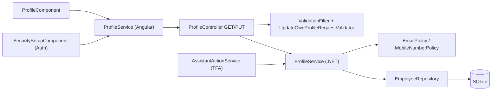
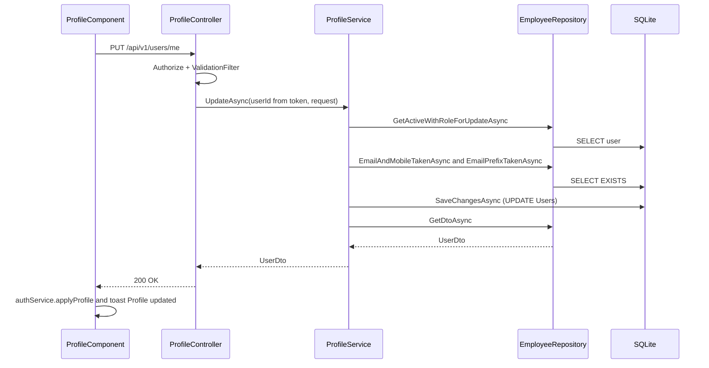
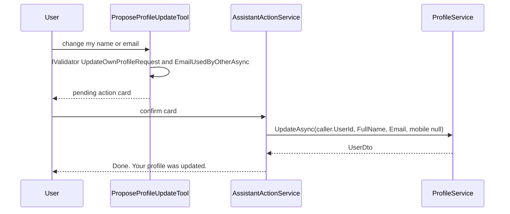

# User Profile – Technical Documentation

> **Project:** TaskFlow – Intelligent Task Allocation & Tracking System
> **Parent Module:** Profile  ·  **Child Module:** 07.1 User Profile
> **Version:** 1.0  ·  **Last Updated:** 31-Oct-2026
> **Backend:** ASP.NET Core Web API (.NET 10)  ·  **Frontend:** Angular  ·  **Database:** SQLite (EF Core)
> **Author:** Jojo George (jojogeorge3344@gmail.com)
> © 2026 Jojo George. All rights reserved.

---

## 1. Technical Overview
User Profile is the read and update API for the caller's own account, plus the Angular **My Profile** page. `ProfileController` (`api/v1/users/me`) exposes `GET` and `PUT`. The user id is always taken from the JWT `ClaimTypes.NameIdentifier` claim. The controller has only `[Authorize]`; the catalog keys `profile.view` and `profile.edit` are always on and not enforced. `ProfileService` reuses `IEmployeeRepository` (Management) and `IUnitOfWork`, and applies `EmailPolicy` and `MobileNumberPolicy`. The same `PUT` is also called by step 1 of the Auth module's Security Setup screen and, after confirmation, by the TaskFlow Assistant (TFA).

## 2. Architecture Flow


## 3. Backend File Structure

| Layer | Path | Files |
|-------|------|-------|
| Controller | `TaskFlow.Api/Controllers/Profile/` | `ProfileController.cs` (`Get`, `Update`) |
| Service | `TaskFlow.Api/Services/Profile/` | `IProfileService.cs`, `ProfileService.cs` (`GetAsync`, `UpdateAsync`) |
| Repository (reused) | `TaskFlow.Api/Repositories/Management/EmployeeManagement/Employees/` | `IEmployeeRepository.cs`, `EmployeeRepository.cs` |
| DTOs | `TaskFlow.Api/Dtos/Profile/` | `ProfileRequests.cs` (`UpdateOwnProfileRequest`) |
| DTOs (reused) | `TaskFlow.Api/Dtos/Management/EmployeeManagement/` | `UserDto.cs` (`UserDto`, `ProjectAllocationDto`, `UserDepartmentDto`, `UserManagerDto`) |
| Validators | `TaskFlow.Api/Dtos/Profile/Validators/` | `UpdateOwnProfileRequestValidator.cs` |
| Rules | `TaskFlow.Api/Common/Rules/` | `EmailPolicy.cs`, `MobileNumberPolicy.cs` |
| Entities | `TaskFlow.Api/Models/Entities/` | `User.cs` |
| Security | `TaskFlow.Api/Common/Security/` | `PermissionKeys.cs`, `PermissionCatalog.cs` (`profile.view`, `profile.edit`) |
| Middleware / Filters | `TaskFlow.Api/Middleware/`, `TaskFlow.Api/Filters/` | `SessionValidation.cs`, `MfaSetupGateMiddleware.cs`, `GlobalExceptionHandler.cs`, `ValidationFilter.cs` |
| Assistant (TFA) | `TaskFlow.Api/Services/Assistant/Tools/` | `AssistantActionTools.cs` (`ProposeProfileUpdateTool`) |
| Assistant (TFA) | `TaskFlow.Api/Services/Assistant/Actions/` | `AssistantActionService.cs` (applies the confirmed card) |
| Assistant (TFA) | `TaskFlow.Api/Repositories/Assistant/People/` | `IAssistantDirectoryRepository.cs`, `AssistantDirectoryRepository.cs` (`EmailUsedByOtherAsync`) |
| Assistant knowledge | `TaskFlow.Api/Services/Assistant/Knowledge/` | `edit-profile.md` |
| DI | `TaskFlow.Api/Config/` | `ServiceRegistration.cs` (`IProfileService` → `ProfileService`, scoped; `ProposeProfileUpdateTool` as `IAssistantTool`) |

## 4. Frontend File Structure

| Type | Path | Purpose |
|------|------|---------|
| Routes | `src/app/modules/profile/profile.routes.ts` | `PROFILE_ROUTES`: `profile` → `ProfileComponent` (lazy `loadComponent`) |
| Page component | `src/app/modules/profile/pages/profile.component.ts` / `.html` | My Profile: header and chips, read-only Account details, Personal information form, Password card |
| Models | `src/app/modules/profile/pages/profile.model.ts` | `ProfileField`, `ReadonlyField` |
| Models (shared) | `src/app/modules/management/employee-management/models/user.model.ts` | `User`, `UpdateOwnProfile` |
| API service | `src/app/modules/profile/services/profile.service.ts` | `get`, `update` |
| Route / Guard | `src/app/routes/app.routes.ts` | Child of the shell route guarded by `authGuard` and `mfaSetupGuard`. There is no `permissionGuard`. |
| Menu | `src/app/layouts/nav-items.ts` | `{ label: 'My Profile', icon: 'user', route: '/profile' }` is always added, with no permission check. Also `layouts/shell.component.html` account link → `/profile`. |
| Shared utils | `src/app/shared/utils/email-domain.ts`, `mobile-number.ts`, `api-error.ts`; `shared/auth/auth.service.ts` (`applyProfile`) | Client-side copies of the server rules, error text extraction, session re-sync |
| Consumer | `src/app/modules/auth/security-setup/pages/security-setup.component.ts` | Step 1 ("details") calls `ProfileService.get` and `update` with full name, email and mobile number |

---

## 5. API & Logic

### 5.1 API Endpoints

| # | Method | Endpoint | Description | Permission (Policy) | Request DTO | Response DTO |
|---|--------|----------|-------------|---------------------|-------------|--------------|
| 1 | GET | `/api/v1/users/me` | Read the caller's own profile | `[Authorize]` only. Catalog key `profile.view` (always on, not enforced). | – | `UserDto` (200), 401, 404 |
| 2 | PUT | `/api/v1/users/me` | Update the caller's own full name, email and mobile number | `[Authorize]` only. Catalog key `profile.edit` (always on, not enforced). | `UpdateOwnProfileRequest` | `UserDto` (200), 400, 401, 404 |

Both endpoints stay open while MFA setup is pending (`MfaSetupGateMiddleware` allows the exact path `/api/v1/users/me`).

### 5.2 Request / Response Samples
```json
// PUT /api/v1/users/me
{ "fullName": "Anita Varghese", "email": "anita.v@taskflow.com", "mobileNumber": "+919876543210" }
```
```json
// 200 OK  (UserDto, abridged)
{
  "id": 12, "employeeCode": "EMP012", "fullName": "Anita Varghese", "username": "anita",
  "email": "anita.v@taskflow.com", "roleId": 3, "role": "Employee", "isActive": true,
  "createdAt": "2026-10-11T09:00:00Z", "updatedAt": "2026-10-31T10:00:00Z", "lastLoginAt": "2026-10-31T08:55:00Z",
  "projectAllocations": [ { "projectId": 2, "projectName": "Apollo", "positionId": 4, "positionName": "Developer", "percent": 60 } ],
  "departments": [ { "id": 1, "name": "Engineering" } ],
  "managers": [ { "id": 5, "fullName": "Rahul Menon" } ],
  "managerProjects": [], "reports": [],
  "mfaEnabled": true, "backupCodesRemaining": 9, "mobileNumber": "+919876543210",
  "totalAllocatedPercent": 60, "remainingPercent": 40
}
```

`mobileNumber` semantics: omitted or `null` keeps the current number. An empty or blank string clears it. The Angular form always sends a string, so an empty field clears the number.

### 5.3 Service Layer Logic
**Method:** `GetAsync(int userId, CancellationToken)`
1. Returns `IEmployeeRepository.GetDtoAsync(userId)`: a no-tracking projection of the non-deleted user, with allocations, departments, managers (from department managers and project leads), and for managers their managed projects and reports, MFA status and remaining backup codes.

**Method:** `UpdateAsync(int userId, UpdateOwnProfileRequest request, CancellationToken)`
1. `ValidationFilter` has already run `UpdateOwnProfileRequestValidator`. Failures return a 400 `ValidationProblemDetails`.
2. Loads a tracked user with `GetActiveWithRoleForUpdateAsync(userId)`. Returns `null` (→ 404) if there is no such user.
3. `EmailPolicy.Normalize` trims and lower-cases the email. If `!EmailPolicy.IsValid`, it throws `BusinessRuleException(EmailPolicy.InvalidMessage)`.
4. Mobile number: if `request.MobileNumber` is `null`, the current value is kept. Otherwise `MobileNumberPolicy.Normalize` strips whitespace, `-`, `.`, `(` and `)`, and blank input becomes `null`. A non-null value that fails `IsValid` throws `BusinessRuleException(MobileNumberPolicy.InvalidMessage)`.
5. If the mobile number is not null and `EmailAndMobileTakenAsync(email, mobile, userId)` returns true, it throws `"A user with this email and mobile number already exists."`
6. If `EmailPrefixTakenAsync(LocalPart(email) + "@", userId)` returns true, it throws `"Email already exists."` This check ignores query filters, so deleted users still reserve their address.
7. Sets `FullName` (trimmed), `Email`, `MobileNumber` and `UpdatedAt = DateTime.UtcNow`. Role, project, username, employee code and status are not touched.
8. `IUnitOfWork.SaveChangesAsync`, then returns a fresh `GetAsync`.
9. No notification, mail or activity log is written.

**Client:** on success `ProfileComponent` calls `authService.applyProfile(...)` and shows the toast *Profile updated*. `profile.component.ts` shows the "Managed projects" and "Team" rows only when `user.role === 'Manager'`.

### 5.4 Repository Layer

| Method | Description | Query Notes |
|--------|-------------|-------------|
| `IEmployeeRepository.GetDtoAsync(id)` | Projects one user to `UserDto` | `AsNoTracking`, `!IsDeleted`. Extra queries for the `Managers` and `Reports` lists (department managers and project leads with `IsProjectManager`). |
| `IEmployeeRepository.GetActiveWithRoleForUpdateAsync(id)` | Tracked user with `Role` | `Include(u => u.Role)`, `!IsDeleted`. Does **not** filter on `IsActive`. Inactive users are already stopped by `SessionValidation`. |
| `IEmployeeRepository.EmailPrefixTakenAsync(prefix, exceptUserId)` | Is another user's email starting with `localpart@`? | `IgnoreQueryFilters()` (includes deleted users), `Email.ToLower().StartsWith(prefix)` |
| `IEmployeeRepository.EmailAndMobileTakenAsync(email, mobile, exceptUserId)` | Exact email and mobile pair on another user | Query filter on (deleted users excluded) |
| `IAssistantDirectoryRepository.EmailUsedByOtherAsync` | Assistant pre-check before the action card | Used only by `ProposeProfileUpdateTool` |

### 5.5 Sequence Diagram


**Assistant (TFA) path**


---

## 6. Database Design

| Table | Column | Type | Constraints | Description |
|-------|--------|------|-------------|-------------|
| `Users` | `Id` | int | PK | User id (taken from the JWT) |
| `Users` | `EmployeeCode` | text | Max 32, nullable | Read-only on Profile |
| `Users` | `FullName` | text | Not Null, Max 200 | Editable |
| `Users` | `Username` | text | Not Null, Max 100, Unique index | Read-only on Profile |
| `Users` | `Email` | text | Not Null, Max 256, Unique index | Editable. Lower-case, `@taskflow.com`. |
| `Users` | `MobileNumber` | text | Max 20, nullable, **not unique** | Editable, E.164 |
| `Users` | `RoleId` | int | FK → `Roles.Id`, Restrict | Read-only on Profile |
| `Users` | `IsActive` | bool | – | Read-only on Profile |
| `Users` | `MfaEnabledAt` | datetime | nullable | Read only here: drives `mfaEnabled` and the "Two-step on/off" chip |
| `Users` | `CreatedAt`, `UpdatedAt`, `LastLoginAt` | datetime | – | `UpdatedAt` set on every save |
| `Users` | `IsDeleted` | bool | Global query filter `!IsDeleted` | Soft delete |

Read-only joins used by `UserDto`: `UserProjectAllocations` (with `Projects` and `Positions`), `UserDepartments` (with `Departments`), `DepartmentManagers`, `ManagerProjects`. `backupCodesRemaining` is read from `MfaBackupCodes` (see 07.3).

**Relationships**
- `Users.RoleId → Roles.Id` (FK, Restrict)

## 7. Security & Authorization
- `[Authorize]` only; the id comes from `ClaimTypes.NameIdentifier` (unparseable → 401). Data scope is Own, fixed by the token.
- `profile.view` and `profile.edit` have `AlwaysGranted: true, IsAssignable: false` in `PermissionCatalog.cs` and are never checked.
- Both endpoints are on the `MfaSetupGateMiddleware` allow-list, so a user with setup pending can still read and save their profile.
- The TFA tool `ProposeProfileUpdateTool` has `Policy => null` (no extra permission check).

| Permission Key | Endpoint(s) | UI Element Controlled |
|----------------|-------------|-----------------------|
| `profile.view` | `GET /api/v1/users/me` | My Profile menu item and page (always shown) |
| `profile.edit` | `PUT /api/v1/users/me` | Personal information form and Save changes |

## 8. Validations & Error Handling

| Rule | Layer | HTTP Code | Error Message |
|------|-------|-----------|---------------|
| `FullName` empty or longer than 200 | `UpdateOwnProfileRequestValidator` | 400 (validation `errors` map) | FluentValidation default (e.g. `'Full Name' must not be empty.`) |
| `Email` empty or longer than 256 | Validator | 400 | FluentValidation default |
| `Email` not a valid `@taskflow.com` address | Validator and Service | 400 | Email must be a name using letters, digits, dot, underscore or hyphen followed by @taskflow.com. |
| `MobileNumber` not E.164 | Validator and Service | 400 | Mobile number must be in international format, for example +919876543210. |
| Email and mobile pair already used | Service | 400 | A user with this email and mobile number already exists. |
| Email local part already used (including deleted users) | Service | 400 | Email already exists. |
| User not found or deleted | Controller | 404 | – (empty `NotFound()`) |
| Concurrent edit of the same row | `GlobalExceptionHandler` | 409 | Someone else changed this record while you were saving. Reload it and try again. |

Client-side messages: `Full name is required.`, `Email is required.`, `Use letters, digits, dot, underscore or hyphen before @taskflow.com.`, `This field is too long.`, `Use international format, for example +919876543210.`, `Could not load your profile.`, `Could not update your profile.`. Toast: `Profile updated`. `ProfileComponent` maps 400 `errors` keys onto its form controls. Shared error handling (401, 500, problem details) is described in the parent document.

## 9. Integrations / Side Effects
- **Notifications / Email / Activity Log:** none.
- **Shell:** after a profile save, `AuthService.applyProfile()` re-syncs the cached user (name, email) and keeps the permissions it already has.
- **AI Assistant (TFA):** `ProposeProfileUpdateTool` (`propose_profile_update`, `AssistantActionKind.UpdateOwnProfile`, `Policy => null`) checks a name or email change with `IValidator<UpdateOwnProfileRequest>` and checks `IAssistantDirectoryRepository.EmailUsedByOtherAsync`. It then creates a pending action card. On confirmation, `AssistantActionService` calls `IProfileService.UpdateAsync(caller.UserId, new UpdateOwnProfileRequest(FullName, Email))`. The mobile number is passed as `null` and therefore kept. The reply is "Done. Your profile was updated."
- **Help knowledge:** `Services/Assistant/Knowledge/edit-profile.md`.
- **Auth (Security Setup):** step 1 of onboarding saves details through `PUT /api/v1/users/me`.

## 10. Configuration
_Not applicable – this child has no configuration of its own. Module-wide keys (`ConnectionStrings:Default`, `Mfa:Required`) are in the parent document._

## 11. Testing

| Test Type | File / Location | Covers |
|-----------|-----------------|--------|
| Unit | `tests/TaskFlow.UnitTests/Profile/UpdateOwnProfileRequestValidatorTests.cs` | `UpdateOwnProfileRequestValidator` accepts a valid request and rejects a blank name, a malformed email and missing fields. (The same file also holds `ChangePasswordRequestValidatorTests`, see 07.2.) |
| Unit | `tests/TaskFlow.UnitTests/Management/EmployeeManagement/Employees/UserServiceSelfServiceTests.cs` | `ProfileService.UpdateAsync` changes name and email, rejects a duplicate email, leaves username, role, project allocations and active flag untouched, and returns null for an unknown user. |
| Unit | `tests/TaskFlow.UnitTests/Common/EmailDomainTests.cs` | `UpdateOwnProfileRequestValidator` rejects an email outside the fixed domain; saving the own profile with an unchanged email is not a duplicate. |
| Integration | `tests/TaskFlow.IntegrationTests/Profile/UserProfileEndpointsTests.cs` | `GET /api/v1/users/me` returns the caller's own profile. `PUT /api/v1/users/me` updates name and email but not username or role, returns 400 for a duplicate email and 400 with an `Email` field error for a malformed one, and cannot escalate the role. Both return 401 without a token. |
| Integration | `tests/TaskFlow.IntegrationTests/Auth/Mfa/MfaSetupGateEndpointsTests.cs` (class `ProfileMobileNumberEndpointsTests`) | `PUT /api/v1/users/me` saves a valid mobile number in cleaned-up form, refuses a badly formatted one, lets colleagues share a number, keeps email unique, keeps the number when it is left out and clears it when empty. The main class shows that `GET` and `PUT /api/v1/users/me` still work while MFA setup is pending. |
| Frontend unit | `src/app/modules/profile/pages/profile.component.spec.ts` | `ProfileComponent` shows read-only account fields, projects with percentages, departments, managers and team as bullets (a dash when empty), saves the self-edit and refreshes the cached session user, shows a server duplicate-email error, blocks a malformed email, keeps only the part before `@` when a full address is typed, and shows a retryable load error. |
| Frontend unit | `src/app/modules/profile/pages/profile.component.layout.spec.ts` | Header with initials and chips, two-column card layout, a Change password button with no inline form, no two-step card or turn-off option, no administrator reset request, and mobile number edit that is cleaned up or refused without an API call. |
| Frontend unit | `src/app/modules/profile/services/profile.service.spec.ts` | `ProfileService` reads the profile with `GET /users/me` and updates it with `PUT /users/me`. |
| Frontend unit | `src/app/modules/auth/security-setup/pages/security-setup.component.spec.ts` | Security Setup step 1 loads the employee details, needs a mobile number in international format, saves the cleaned-up details and shows the API message when the save is refused. |

## 12. Known Limitations / Gaps found
- No audit or activity entry is written for profile edits.
- **Help knowledge vs UI:** `Knowledge/edit-profile.md` says to edit name and email "Under **Account details**". In the UI, editing is in the **Personal information** card, and Account details is read-only. The article also leaves out the mobile number.
- **Hardcoded role check:** `profile.component.ts` shows "Managed projects" and "Team" when `user.role === 'Manager'`. This is a role-name check, not a permission check, so a custom manager-like role does not see these rows.
- **Email uniqueness check differs:** the Assistant's pre-check uses `EmailUsedByOtherAsync`, while `ProfileService` uses the local-part prefix rule, which includes deleted users. A proposal can pass the Assistant check and still fail with "Email already exists." on confirmation.
- **Method naming:** `GetActiveWithRoleForUpdateAsync` does not filter on `IsActive` (shared with 07.2, see parent).

---
<sub>© 2026 Jojo George. All rights reserved. Unauthorized copying or distribution of this document is prohibited.</sub>
