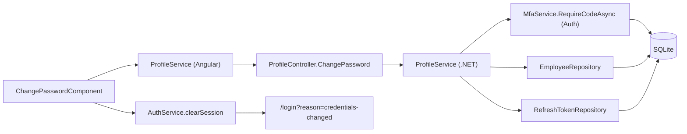
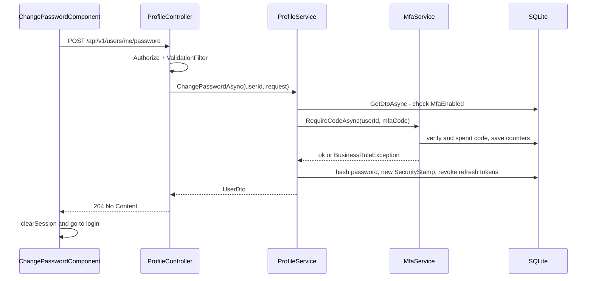

# Change Password – Technical Documentation

> **Project:** TaskFlow – Intelligent Task Allocation & Tracking System
> **Parent Module:** Profile  ·  **Child Module:** 07.2 Change Password
> **Version:** 1.0  ·  **Last Updated:** 31-Oct-2026
> **Backend:** ASP.NET Core Web API (.NET 10)  ·  **Frontend:** Angular  ·  **Database:** SQLite (EF Core)
> **Author:** Jojo George (jojogeorge3344@gmail.com)
> © 2026 Jojo George. All rights reserved.

---

## 1. Technical Overview
Change Password is a single endpoint, `POST /api/v1/users/me/password` on `ProfileController`, plus the Angular `ChangePasswordComponent`. The caller's identity is proved by an MFA step-up (authenticator or backup code) through the Auth module's `IMfaService`, not by the current password. On success the password hash is replaced, `Users.SecurityStamp` is rotated and every active refresh token is revoked, so the user is signed out everywhere. The controller has only `[Authorize]`; the catalog key `profile.password.change` is always on and not enforced. The TFA tool `ExplainPasswordChangeTool` gives fixed guidance only.

## 2. Architecture Flow


## 3. Backend File Structure

| Layer | Path | Files |
|-------|------|-------|
| Controller | `TaskFlow.Api/Controllers/Profile/` | `ProfileController.cs` (`ChangePassword`) |
| Service | `TaskFlow.Api/Services/Profile/` | `IProfileService.cs`, `ProfileService.cs` (`ChangePasswordAsync`) |
| Service (reused) | `TaskFlow.Api/Services/Auth/Mfa/` | `IMfaService.cs`, `MfaService.cs` (`RequireCodeAsync`, `VerifyAsync`) |
| Repository (reused) | `TaskFlow.Api/Repositories/Management/EmployeeManagement/Employees/` | `IEmployeeRepository.cs`, `EmployeeRepository.cs` |
| Repository (reused) | `TaskFlow.Api/Repositories/Auth/RefreshTokens/` | `IRefreshTokenRepository.cs`, `RefreshTokenRepository.cs` |
| Repository (reused, via `MfaService`) | `TaskFlow.Api/Repositories/Auth/Accounts/`, `TaskFlow.Api/Repositories/Auth/Mfa/` | `IAccountRepository.cs`, `AccountRepository.cs`, `IMfaBackupCodeRepository.cs`, `MfaBackupCodeRepository.cs` |
| DTOs | `TaskFlow.Api/Dtos/Profile/` | `ProfileRequests.cs` (`ChangePasswordRequest`) |
| Validators | `TaskFlow.Api/Dtos/Profile/Validators/` | `UpdateOwnProfileRequestValidator.cs` (holds `ChangePasswordRequestValidator`) |
| Entities | `TaskFlow.Api/Models/Entities/` | `User.cs`, `RefreshToken.cs`, `MfaBackupCode.cs` |
| Security | `TaskFlow.Api/Common/Security/` | `PermissionKeys.cs`, `PermissionCatalog.cs` (`profile.password.change`) |
| Middleware / Filters | `TaskFlow.Api/Middleware/`, `TaskFlow.Api/Filters/` | `MfaSetupGateMiddleware.cs`, `SessionValidation.cs`, `GlobalExceptionHandler.cs`, `ValidationFilter.cs` |
| Config | `TaskFlow.Api/Config/` | `MfaOptions.cs` |
| Assistant (TFA) | `TaskFlow.Api/Services/Assistant/Tools/`, `Services/Assistant/Chat/` | `AssistantReadTools.cs` (`ExplainPasswordChangeTool`), `AssistantTexts.cs` (`PasswordGuidance`) |

## 4. Frontend File Structure

| Type | Path | Purpose |
|------|------|---------|
| Routes | `src/app/modules/profile/profile.routes.ts` | `profile/change-password` → `ChangePasswordComponent` (lazy `loadComponent`) |
| Page component | `src/app/modules/profile/pages/change-password.component.ts` / `.html` | New and confirm password, strength meter (`passwordStrength()`), `<dialog>` that asks for the code |
| Models | `src/app/modules/profile/pages/change-password.model.ts` | `PasswordField` |
| Models (shared) | `src/app/modules/management/employee-management/models/user.model.ts` | `ChangePassword` |
| API service | `src/app/modules/profile/services/profile.service.ts` | `changePassword` |
| Route / Guard | `src/app/routes/app.routes.ts` | Child of the shell route guarded by `authGuard` and `mfaSetupGuard`. No `permissionGuard`. |
| Shared utils | `src/app/shared/utils/api-error.ts`; `shared/auth/login-reasons.ts`; `shared/auth/auth.service.ts` (`clearSession`) | Error text extraction, the `credentials-changed` login message, session clearing |
| Entry point | `src/app/modules/profile/pages/profile.component.html` | Password card → **Change password** link (see 07.1) |

---

## 5. API & Logic

### 5.1 API Endpoints

| # | Method | Endpoint | Description | Permission (Policy) | Request DTO | Response DTO |
|---|--------|----------|-------------|---------------------|-------------|--------------|
| 1 | POST | `/api/v1/users/me/password` | Change the caller's own password after an MFA step-up, then revoke all sessions | `[Authorize]` only. Catalog key `profile.password.change` (always on, not enforced). Blocked by `MfaSetupGateMiddleware` while MFA setup is pending. | `ChangePasswordRequest` | `204 No Content`, 400, 401, 404 |

### 5.2 Request / Response Samples
```json
// POST /api/v1/users/me/password
{ "newPassword": "N3w-Secret!", "mfaCode": "123456" }
```
```json
// 204 No Content (empty body). Every refresh token is revoked and the security stamp changes.
```
```json
// 400 Bad Request (BusinessRuleException)
{ "type": "https://tools.ietf.org/html/rfc9110#section-15.5.1", "title": "Bad Request", "status": 400,
  "detail": "The code is incorrect or has expired." }
```

### 5.3 Service Layer Logic
**Method:** `ChangePasswordAsync(int userId, ChangePasswordRequest request, CancellationToken)`
1. `ChangePasswordRequestValidator` (through `ValidationFilter`): `NewPassword` must not be empty and must be 6–128 characters (`MinPasswordLength`, `MaxPasswordLength`). `MfaCode` may be at most 32 characters.
2. `GetAsync(userId)`. A null result returns `null` (→ 404).
3. If `!current.MfaEnabled`, it throws `BusinessRuleException(MfaRequiredForPasswordMessage)` = *"Set up two-step verification before changing your password."* This is a defence in depth in case the setup gate fails.
4. `IMfaService.RequireCodeAsync(userId, request.MfaCode)`. A blank code throws `"Enter the code from your authenticator app."` The code is then checked with `VerifyAsync(allowBackupCode: true)`, which uses up the code: it advances `MfaLastUsedStep` or sets `MfaBackupCode.UsedAt`. `Invalid` throws `"The code is incorrect or has expired."` and `LockedOut` throws `"Too many wrong codes. Try again in a few minutes."` (both `BusinessRuleException` → 400).
5. Reloads the tracked user, sets `PasswordHash = IPasswordHasher<User>.HashPassword(user, NewPassword)` and `UpdatedAt = now`.
6. Sets `SecurityStamp = Guid.NewGuid().ToString("N")`. Access tokens with the old stamp now fail `SessionValidation`.
7. `IRefreshTokenRepository.GetActiveForUsersForUpdateAsync([userId])` → sets `RevokedAt = now` on each token.
8. `SaveChangesAsync`. Returns the DTO. The controller answers `204`.
9. Client: `authService.clearSession()`, then navigates to `/login?reason=credentials-changed`.

Shared lockout: `MfaOptions.MaxFailedAttempts` (5) wrong codes in a row set `MfaLockedUntil = now + LockoutMinutes` (5). The counter is shared with sign-in and the 07.3 endpoints.

### 5.4 Repository Layer

| Method | Description | Query Notes |
|--------|-------------|-------------|
| `IEmployeeRepository.GetDtoAsync(id)` | Reads `MfaEnabled` before the step-up | No tracking |
| `IEmployeeRepository.GetActiveWithRoleForUpdateAsync(id)` | Tracked user to update the hash and stamp | `Include(Role)` |
| `IRefreshTokenRepository.GetActiveForUsersForUpdateAsync(userIds)` | Active refresh tokens to revoke | Tracked. Query filter excludes tokens of deleted users. |
| `IAccountRepository.FindLiveForUpdateAsync(id)` (inside `MfaService`) | Tracked user for code verification | Defined in the Auth module |
| `IMfaBackupCodeRepository.FindUnusedForUpdateAsync(userId, hash)` (inside `MfaService`) | Backup code lookup | `UsedAt` is a concurrency token |

### 5.5 Sequence Diagram


---

## 6. Database Design

| Table | Column | Type | Constraints | Description |
|-------|--------|------|-------------|-------------|
| `Users` | `Id` | int | PK | User id (taken from the JWT) |
| `Users` | `PasswordHash` | text | Not Null | Set by password change (`IPasswordHasher<User>`) |
| `Users` | `SecurityStamp` | text | Not Null, Max 64 | Rotated on password change, ending access tokens |
| `Users` | `MfaEnabledAt` | datetime | nullable | Must be set (MFA on) before a change is allowed |
| `Users` | `MfaLastUsedStep` | bigint | Concurrency token | Replay protection; advanced when the TOTP code is spent |
| `Users` | `MfaFailedAttempts` | int | Concurrency token | Shared lockout counter |
| `Users` | `MfaLockedUntil` | datetime | nullable | Lockout end |
| `Users` | `UpdatedAt` | datetime | – | Set on save |
| `RefreshTokens` | `Id`, `UserId`, `TokenHash`, `ExpiresAt`, `CreatedAt`, `RevokedAt` | int / text / datetime | PK `Id`; index `TokenHash`; FK `UserId` | `RevokedAt` set for every active token on password change |
| `MfaBackupCodes` | `UsedAt` | datetime | Concurrency token | Set when a backup code is used as the step-up code |

**Relationships**
- `RefreshTokens.UserId → Users.Id` (FK, Cascade)
- `MfaBackupCodes.UserId → Users.Id` (FK, Cascade)

## 7. Security & Authorization
- `[Authorize]` only; the id comes from `ClaimTypes.NameIdentifier` (unparseable → 401). Only the caller's own password can be changed.
- `profile.password.change` has `AlwaysGranted: true, IsAssignable: false` in `PermissionCatalog.cs` and is never checked.
- **Step-up:** an authenticator or unused backup code is required; the current password is not.
- **MFA gate:** `POST /users/me/password` is not on the `MfaSetupGateMiddleware` allow-list, so it returns 403 `mfa_setup_required` while setup is pending. The service also refuses when MFA is off.
- **Session revocation:** `SecurityStamp` rotation invalidates access tokens in `SessionValidation`; refresh tokens are revoked.
- **Code lockout:** 5 wrong codes → 5 minutes (`MfaOptions`), shared with sign-in.

| Permission Key | Endpoint(s) | UI Element Controlled |
|----------------|-------------|-----------------------|
| `profile.password.change` | `POST /api/v1/users/me/password` | Password card, Change password screen |

## 8. Validations & Error Handling

| Rule | Layer | HTTP Code | Error Message |
|------|-------|-----------|---------------|
| `NewPassword` empty, shorter than 6 or longer than 128 | `ChangePasswordRequestValidator` | 400 | FluentValidation default |
| `MfaCode` longer than 32 | Validator | 400 | FluentValidation default |
| MFA off on password change | Service | 400 | Set up two-step verification before changing your password. |
| Code missing | `MfaService.RequireCodeAsync` | 400 | Enter the code from your authenticator app. |
| Code wrong or expired | `MfaService` | 400 | The code is incorrect or has expired. |
| Code lockout | `MfaService` | 400 | Too many wrong codes. Try again in a few minutes. |
| MFA setup pending | `MfaSetupGateMiddleware` | 403 (`code: mfa_setup_required`) | Set up two-step verification to continue. |
| User not found or deleted | Controller | 404 | – (empty `NotFound()`) |

Client-side messages: `Required.`, `Password must be at least 6 characters.`, `Password must be at most 128 characters.`, `Passwords do not match.`, `Enter the code from your authenticator app.`, `That code did not work. Try the new code from your app.`, `Could not change your password.`. Login reason `credentials-changed`: `Your username or password was changed. Sign in again with your new details.` `ChangePasswordComponent` maps 400 `errors` keys onto its form controls. Shared error handling is described in the parent document.

## 9. Integrations / Side Effects
- **Notifications / Email / Activity Log:** none.
- **Sessions:** a password change rotates `Users.SecurityStamp` and revokes all `RefreshTokens` rows for the user. The client clears its session.
- **AI Assistant (TFA):** `ExplainPasswordChangeTool` (`explain_password_change`) returns the fixed `AssistantTexts.PasswordGuidance` with a link to `/profile`. It never handles passwords.

## 10. Configuration

| Key (`appsettings.json`) | Purpose | Default |
|--------------------------|---------|---------|
| `Mfa:Required` | Enforce MFA setup before any other API use. This makes the password change possible. | `true` |
| `Mfa:MaxFailedAttempts` | Wrong codes before lockout (code default, not in the JSON) | `5` |
| `Mfa:LockoutMinutes` | Lockout length (code default) | `5` |
| `Jwt:AccessTokenMinutes` / `Jwt:RefreshTokenDays` | Lifetimes of the sessions a password change ends | `30` / `7` |

## 11. Testing

| Test Type | File / Location | Covers |
|-----------|-----------------|--------|
| Integration | `tests/TaskFlow.IntegrationTests/Auth/Mfa/MfaStepUpEndpointsTests.cs` | `POST /api/v1/users/me/password` without a code returns 400 and changes nothing; a wrong code returns 400; a valid code returns 204 and the old token gets 401; a code used for the change is refused at the next sign-in. |
| Integration | `tests/TaskFlow.IntegrationTests/Profile/UserProfileEndpointsTests.cs` | `POST /api/v1/users/me/password` returns 400 for a short or overlong new password, 400 for a user without two-step verification (the old password still works), and 401 without a token. |
| Integration | `tests/TaskFlow.IntegrationTests/Auth/Mfa/MfaSetupGateEndpointsTests.cs` | `POST /api/v1/users/me/password` returns 403 while MFA setup is pending. |
| Unit | `tests/TaskFlow.UnitTests/Profile/UpdateOwnProfileRequestValidatorTests.cs` (class `ChangePasswordRequestValidatorTests`) | The new password is refused when null, empty, under the minimum length or longer than `MaxPasswordLength`, and accepted at exactly `MaxPasswordLength`. |
| Unit | `tests/TaskFlow.UnitTests/Management/EmployeeManagement/Employees/UserServiceSelfServiceTests.cs` | `ProfileService.ChangePasswordAsync` updates the hash, rotates `SecurityStamp` and revokes refresh tokens; it is refused with `MfaRequiredForPasswordMessage` when MFA is off and returns null for an unknown user. |
| Unit | `tests/TaskFlow.UnitTests/Auth/Mfa/MfaServiceTests.cs` | `RequireCodeAsync` needs a valid code and spends it (a replay is refused), accepts a backup code once, locks after five wrong codes, and asks no code from a user without MFA. |
| Frontend unit | `src/app/modules/profile/pages/change-password.component.spec.ts` | `passwordStrength` scoring. `ChangePasswordComponent` shows only new and confirm fields with show/hide, a strength meter, all form errors and a mismatch error; a popup asks for the code and sends nothing until confirmed or for an empty code; a valid save signs out and goes to login; a wrong code keeps the popup open; cancel keeps the form; a server rejection of the password returns to the form. |
| Frontend unit | `src/app/modules/profile/services/profile.service.spec.ts` | `changePassword` sends `POST /users/me/password` with the request body. |
| Support | `tests/TaskFlow.IntegrationTests/TestSupport/MfaTestSupport.cs` | `MfaTestHarness` (seed, sign in, enrol, next code) and `SteppingClock` for the MFA endpoint tests. |
| Support | `tests/TaskFlow.UnitTests/TestSupport/AcceptingMfaService.cs` | `IMfaService` stub that accepts every code; `TestServices.Profile` uses it to build `ProfileService` for `UserServiceSelfServiceTests.cs`. |

## 12. Known Limitations / Gaps found
- No audit or activity entry is written for password changes.
- The password policy is length-only (6–128). The strength meter is a client-side hint.
- Possible enhancement: notifying the user (in-app or by email) after a password change.
- **BRD vs code – current password:** BRD 19 FR5 says "Require the current password when appropriate". The code deliberately does not ask for it. `ChangePasswordRequest` has no current-password field, and the authenticator code is the proof. The route is `POST /api/v1/users/me/password`.
- **Assistant text vs code:** `AssistantTexts.PasswordGuidance` tells users the Change password form asks for the "current password, new password, confirm". The form has no current-password field and asks for an authenticator code instead.
- **BRD vs UI layout:** the BRD lists a "Change password form" on the profile screen. The code puts it on a separate route, `/profile/change-password`.
- **No bypass through employee edit:** `UpdateUserRequest.Password` is ignored and `EmployeeService.UpdateAsync` never sets a password, so the authenticator-gated Profile flow is the only self-service way to change a password.
- **Strength meter bug:** `passwordStrength()` tests `/d/` (the letter "d") instead of `/\d/` (a digit), so the digit-plus-symbol point is awarded wrongly.
- Lockout returns 400 here but 429 from `mfa/check` (see parent).

---
<sub>© 2026 Jojo George. All rights reserved. Unauthorized copying or distribution of this document is prohibited.</sub>
