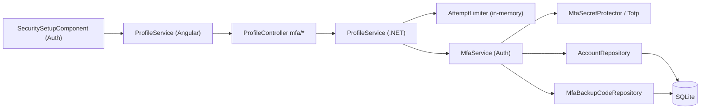
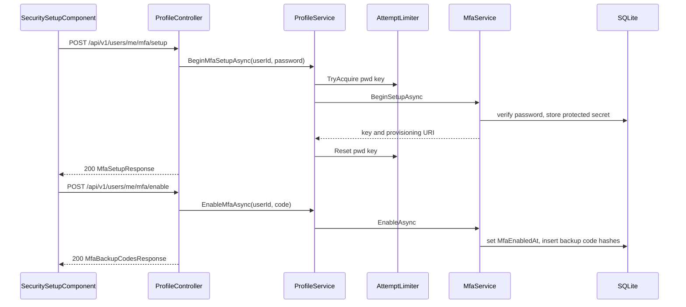

# Two-Step Verification – Technical Documentation

> **Project:** TaskFlow – Intelligent Task Allocation & Tracking System
> **Parent Module:** Profile  ·  **Child Module:** 07.3 Two-Step Verification (self-service MFA endpoints)
> **Version:** 1.0  ·  **Last Updated:** 31-Oct-2026
> **Backend:** ASP.NET Core Web API (.NET 10)  ·  **Frontend:** Angular  ·  **Database:** SQLite (EF Core)
> **Author:** Jojo George (jojogeorge3344@gmail.com)
> © 2026 Jojo George. All rights reserved.

---

## 1. Technical Overview
These four self-service authenticator-MFA endpoints are hosted in `ProfileController` under `api/v1/users/me/mfa`. Their logic is in the Auth module's `MfaService` (see 01-Auth, MFA / Security Setup); `ProfileService` adds the current-password attempt budget through `IAttemptLimiter`. The Auth module's `SecuritySetupComponent` is the only UI caller. `MfaSetupGateMiddleware` allows `/api/v1/users/me` (exact path) and `/api/v1/users/me/mfa/*` while the token carries the `MfaSetupRequired` claim. Every other API path returns 403 with `code = "mfa_setup_required"`. The controller has only `[Authorize]`; the catalog key `profile.mfa.manage` is always on and not enforced.

## 2. Architecture Flow


## 3. Backend File Structure

| Layer | Path | Files |
|-------|------|-------|
| Controller | `TaskFlow.Api/Controllers/Profile/` | `ProfileController.cs` (`SetupMfa`, `EnableMfa`, `CheckMfa`, `RegenerateBackupCodes`) |
| Service | `TaskFlow.Api/Services/Profile/` | `IProfileService.cs`, `ProfileService.cs` (`BeginMfaSetupAsync`, `EnableMfaAsync`, `CheckMfaCodeAsync`, `RegenerateBackupCodesAsync`) |
| Service (reused) | `TaskFlow.Api/Services/Auth/Mfa/` | `IMfaService.cs`, `MfaService.cs` |
| Service (reused) | `TaskFlow.Api/Services/Auth/AttemptLimits/` | `IAttemptLimiter.cs`, `AttemptLimiter.cs` |
| Integrations (reused) | `TaskFlow.Api/Integrations/Security/` | `MfaSecrets/IMfaSecretProtector.cs`, `MfaSecrets/MfaSecretProtector.cs`, `OneTimeCodes/Totp.cs` |
| Repository (reused) | `TaskFlow.Api/Repositories/Auth/Accounts/` | `IAccountRepository.cs`, `AccountRepository.cs` |
| Repository (reused) | `TaskFlow.Api/Repositories/Auth/Mfa/` | `IMfaBackupCodeRepository.cs`, `MfaBackupCodeRepository.cs` |
| DTOs (reused) | `TaskFlow.Api/Dtos/Auth/Mfa/` | `MfaRequests.cs` (`MfaSetupRequest`, `MfaSetupResponse`, `MfaEnableRequest`, `MfaPasswordCodeRequest`, `MfaBackupCodesResponse`), `MfaResults.cs` (`MfaVerifyOutcome`, `MfaSetupResult`) |
| Validators (reused) | `TaskFlow.Api/Dtos/Auth/Mfa/Validators/` | `MfaRequestValidators.cs` |
| Entities | `TaskFlow.Api/Models/Entities/` | `User.cs`, `MfaBackupCode.cs` |
| Security | `TaskFlow.Api/Common/Security/` | `PermissionKeys.cs`, `PermissionCatalog.cs` (`profile.mfa.manage`) |
| Middleware | `TaskFlow.Api/Middleware/` | `MfaSetupGateMiddleware.cs`, `GlobalExceptionHandler.cs` |
| Config / DI | `TaskFlow.Api/Config/` | `MfaOptions.cs`, `ServiceRegistration.cs` (`IMfaService` → `MfaService`, scoped; `MfaOptions` bound from the `Mfa` section) |
| Migration | `TaskFlow.Api/Persistence/Migrations/` | `20261023101938_AddMfaAndAccountRecovery.cs` |

## 4. Frontend File Structure

| Type | Path | Purpose |
|------|------|---------|
| API service | `src/app/modules/profile/services/profile.service.ts` | `startMfaSetup`, `enableMfa`, `checkMfaCode` (unused) |
| Consumer page | `src/app/modules/auth/security-setup/pages/security-setup.component.ts` | Step 2: current password → `startMfaSetup`, QR code and key, first code → `enableMfa`; shows backup codes once with copy and download (`taskflow-backup-codes.txt`) |
| Models | `src/app/modules/auth/security-setup/pages/security-setup.model.ts` | Security Setup form models |
| Status display | `src/app/modules/profile/pages/profile.component.html` | "Two-step on/off" chip (see 07.1) |

---

## 5. API & Logic

### 5.1 API Endpoints

| # | Method | Endpoint | Description | Permission (Policy) | Request DTO | Response DTO |
|---|--------|----------|-------------|---------------------|-------------|--------------|
| 1 | POST | `/api/v1/users/me/mfa/setup` | Check the current password, issue a new TOTP key (MFA stays off) | `[Authorize]`. Catalog key `profile.mfa.manage` (always on, not enforced). | `MfaSetupRequest` | `MfaSetupResponse` (200), 400, 404, 429 |
| 2 | POST | `/api/v1/users/me/mfa/enable` | Confirm with the first code, turn MFA on, return backup codes once | `[Authorize]`, `profile.mfa.manage` (not enforced) | `MfaEnableRequest` | `MfaBackupCodesResponse` (200), 400, 404 |
| 3 | POST | `/api/v1/users/me/mfa/check` | Check a TOTP code without using it up (backup codes not accepted) | `[Authorize]`, `profile.mfa.manage` (not enforced) | `MfaEnableRequest` | `204`, 400 (`InvalidCodeMessage`), 429 (`LockedMessage`) |
| 4 | POST | `/api/v1/users/me/mfa/backup-codes` | Replace backup codes after the password and a valid code | `[Authorize]`, `profile.mfa.manage` (not enforced) | `MfaPasswordCodeRequest` | `MfaBackupCodesResponse` (200), 400, 404, 429 |

### 5.2 Request / Response Samples
```json
// POST /api/v1/users/me/mfa/setup
{ "currentPassword": "my-current-password" }
```
```json
// 200 OK
{ "key": "JBSWY3DPEHPK3PXP", "provisioningUri": "otpauth://totp/TaskFlow:anita.v%40taskflow.com?secret=JBSWY3DPEHPK3PXP&issuer=TaskFlow" }
```
```json
// POST /api/v1/users/me/mfa/enable  ->  200 OK
{ "codes": [ "ABCDE-FGHIJ", "KLMNO-PQRST" ] }
```
> The `provisioningUri` comes from `Totp.ProvisioningUri(issuer, email, secret)` and starts with `otpauth://totp/TaskFlow:<url-encoded email>?` (asserted in `MfaServiceTests` and `TotpTests`). The secret in the sample is illustrative.

### 5.3 Service Layer Logic
**Method:** `BeginMfaSetupAsync(userId, currentPassword)`
1. `AcquirePasswordAttempt`: `IAttemptLimiter.TryAcquire("pwd:" + userId, remoteAddress: null)`. If the budget is spent (5 attempts in a 5-minute sliding window, in memory), it throws `RateLimitedException("Too many attempts. Try again in a few minutes.")` → 429.
2. `MfaService.BeginSetupAsync`: checks the password (`"Current password is incorrect."`) and refuses if MFA is already on. Otherwise it creates a new secret, stores it encrypted in `MfaSecretProtected`, and resets the step, failed attempts and lockout.
3. On success, `_limiter.Reset(passwordKey)`. A wrong password throws before the reset, so the attempt stays counted.

**Method:** `EnableMfaAsync(userId, code)` → `MfaService.EnableAsync`. It refuses if MFA is already on or no key exists. It verifies the TOTP (no backup codes), sets `MfaEnabledAt`, deletes and recreates `BackupCodeCount` (10) codes in the form `XXXXX-XXXXX`, and stores SHA-256 hashes.

**Method:** `CheckMfaCodeAsync(userId, code)` → `MfaService.CheckCodeAsync`. `VerifyCoreAsync` runs with `consumeCode: false` and `countFailure: true`. It returns `Invalid` when MFA is off. The controller maps `LockedOut` to 429 and other failures to 400.

**Method:** `RegenerateBackupCodesAsync(userId, currentPassword, code)` uses the same password budget as setup. `MfaService.RegenerateBackupCodesAsync` checks the password, requires MFA on, verifies the code (backup codes allowed) and replaces every backup code.

Shared lockout: `MfaOptions.MaxFailedAttempts` (5) wrong codes in a row set `MfaLockedUntil = now + LockoutMinutes` (5). `MfaLastUsedStep`, `MfaFailedAttempts` and `MfaBackupCode.UsedAt` are EF concurrency tokens. If a parallel save loses, the code is treated as `Invalid`.

### 5.4 Repository Layer

| Method | Description | Query Notes |
|--------|-------------|-------------|
| `IAccountRepository.FindLiveForUpdateAsync(id)` | Tracked live user | Auth module |
| `IMfaBackupCodeRepository.GetForUserForUpdateAsync(userId)` | All backup codes, for replacement | Tracked |
| `IMfaBackupCodeRepository.FindUnusedForUpdateAsync(userId, hash)` | One unused code | Index `(UserId, CodeHash)` |
| `IMfaBackupCodeRepository.Add / Remove` | Insert or delete codes | Saved through `IUnitOfWork` |

### 5.5 Sequence Diagram


---

## 6. Database Design

| Table | Column | Type | Constraints | Description |
|-------|--------|------|-------------|-------------|
| `Users` | `Id` | int | PK | User id (taken from the JWT) |
| `Users` | `PasswordHash` | text | Not Null | Read to check the current password (setup, backup codes) |
| `Users` | `MfaSecretProtected` | text | Max 512, nullable | Encrypted TOTP key |
| `Users` | `MfaEnabledAt` | datetime | nullable | MFA on when not null |
| `Users` | `MfaLastUsedStep` | bigint | Concurrency token | Replay protection |
| `Users` | `MfaFailedAttempts` | int | Concurrency token | Shared lockout counter |
| `Users` | `MfaLockedUntil` | datetime | nullable | Lockout end |
| `MfaBackupCodes` | `Id`, `UserId`, `CodeHash`, `CreatedAt`, `UsedAt` | int / text / datetime | PK; `CodeHash` Not Null, Max 64; index `(UserId, CodeHash)`; `UsedAt` concurrency token | SHA-256 hex of backup codes |

**Relationships**
- `MfaBackupCodes.UserId → Users.Id` (FK, Cascade)

## 7. Security & Authorization
- `[Authorize]` only; the id comes from `ClaimTypes.NameIdentifier` (unparseable → 401). Own account only.
- `profile.mfa.manage` has `AlwaysGranted: true, IsAssignable: false` in `PermissionCatalog.cs` and is never checked.
- **MFA gate:** `/api/v1/users/me/mfa/*` is on the `MfaSetupGateMiddleware` allow-list (with `Mfa:Required = true`), so these endpoints work while setup is pending.
- **Brute-force limits:** the current-password budget is 5 per 5 minutes per account (`AttemptLimiter`, in memory). The TOTP lockout is 5 wrong codes → 5 minutes (`MfaOptions`), shared with sign-in and 07.2.
- **Secret storage:** the TOTP key is stored encrypted (`IMfaSecretProtector`); backup codes are stored as SHA-256 hashes and shown once.

| Permission Key | Endpoint(s) | UI Element Controlled |
|----------------|-------------|-----------------------|
| `profile.mfa.manage` | `POST /api/v1/users/me/mfa/setup`, `/enable`, `/check`, `/backup-codes` | Security Setup screen (Auth module), "Two-step on/off" chip |

## 8. Validations & Error Handling

| Rule | Layer | HTTP Code | Error Message |
|------|-------|-----------|---------------|
| Wrong current password (setup, backup codes) | `MfaService` | 400 | Current password is incorrect. |
| Password attempt budget spent | `ProfileService` | 429 (`Too many requests`) | Too many attempts. Try again in a few minutes. |
| MFA already on (setup) | `MfaService` | 400 | Authenticator MFA is already on. Turn it off first to set it up again. |
| MFA already on (enable) | `MfaService` | 400 | Authenticator MFA is already on. |
| Enable without setup | `MfaService` | 400 | Start the setup first to get a key. |
| Backup codes with MFA off | `MfaService` | 400 | Authenticator MFA is not on. |
| Code wrong or expired | `MfaService` / Controller (`mfa/check`) | 400 | The code is incorrect or has expired. |
| Code lockout (enable, backup codes) | `MfaService` | 400 | Too many wrong codes. Try again in a few minutes. |
| Code lockout (`mfa/check`) | Controller | 429 | Too many wrong codes. Try again in a few minutes. |
| User not found or deleted | Controller | 404 | – (empty `NotFound()`) |

Request DTO validation is done by `MfaRequestValidators.cs` (Auth module). Shared error handling is described in the parent document.

## 9. Integrations / Side Effects
- **Notifications / Email / Activity Log:** none raised by these endpoints. (The admin MFA reset in the Auth module notifies the user and points them to Profile.)
- **Auth module:** `SecuritySetupComponent` drives setup and enable; once `MfaEnabledAt` is set, the setup gate no longer applies and sign-in asks for a code.

## 10. Configuration

| Key (`appsettings.json`) | Purpose | Default |
|--------------------------|---------|---------|
| `Mfa:Issuer` | Name shown in the authenticator app (provisioning URI) | `TaskFlow` |
| `Mfa:Required` | Enforce MFA setup before any other API use | `true` |
| `Mfa:MaxFailedAttempts` | Wrong codes before lockout (code default, not in the JSON) | `5` |
| `Mfa:LockoutMinutes` | Lockout length (code default) | `5` |
| `Mfa:BackupCodeCount` | Backup codes issued on enable or regenerate (code default) | `10` |
| `AttemptLimiter.AttemptsPerAccount` / `Window` | Current-password budget (constants, not configurable) | `5` per `5` minutes |

## 11. Testing

| Test Type | File / Location | Covers |
|-----------|-----------------|--------|
| Integration | `tests/TaskFlow.IntegrationTests/Auth/Mfa/MfaEnrolmentEndpointsTests.cs` | `setup`, `enable`, `check` and `backup-codes` return 401 without a token. `setup` with a wrong password returns 400 and no key; with the right password it returns the key and an `otpauth://totp/TaskFlow:` URI and MFA stays off; it returns 400 when MFA is already on. `enable` returns 400 for a wrong code and 10 backup codes for the right one; the profile then shows `mfaEnabled` and `backupCodesRemaining` but never the key or codes. `backup-codes` returns 400 for a wrong code and 10 new codes for a valid one. No endpoint turns MFA off. |
| Integration | `tests/TaskFlow.IntegrationTests/Auth/Mfa/MfaStepUpEndpointsTests.cs` | `mfa/check` accepts a good code more than once (204), refuses a bad one (400), returns 429 after five wrong codes and 401 without a token; a checked code still works for the password change. `mfa/backup-codes` returns 429 after five wrong current passwords. |
| Integration | `tests/TaskFlow.IntegrationTests/Auth/Mfa/MfaSetupGateEndpointsTests.cs` | Sign-in reports that setup is required. While it is pending, `GET`/`PUT /api/v1/users/me`, `POST /api/v1/users/me/mfa/setup` and `GET /api/v1/auth/me` work, while `/users`, `/tasks`, `/notifications`, `/dashboard/employee` and `POST /users/me/password` return 403. Finishing setup opens the app with the same session, an administrator reset puts the gate back, and login and recovery endpoints are never gated. |
| Unit | `tests/TaskFlow.UnitTests/Auth/Mfa/MfaServiceTests.cs` | `BeginSetupAsync` needs the right password, stores the key protected and leaves MFA off, replaces an unconfirmed key and is refused when MFA is on. `EnableAsync` keeps MFA off for a wrong code and returns ten hashed backup codes for a valid one. Codes cannot be replayed, the previous time step is accepted, five wrong codes lock verification, and backup codes work once. `CheckCodeAsync` does not spend a code, refuses backup codes and counts wrong codes toward the lockout. `RegenerateBackupCodesAsync` needs the password and a valid code and replaces the set. `IMfaService` has no disable method. |
| Unit | `tests/TaskFlow.UnitTests/Auth/AttemptLimits/AttemptLimiterTests.cs` | `AttemptLimiter` allows five attempts per key and refuses the sixth, keeps the password budget (`PasswordKey`, used by `ProfileService` for the current-password check) apart from the recovery budget, lifts the block after the window, pools callers by address, and clears the account budget on success. |
| Unit | `tests/TaskFlow.UnitTests/Integrations/Security/OneTimeCodes/TotpTests.cs` | `Base32` encode/decode, `Totp` RFC 6238 vectors, a ±1 step window, refusal of used or earlier steps and malformed codes, and the provisioning URI; `MfaSecretProtector` round trips and rejects tampered secrets and forged or expired challenges; documented `Mfa` settings match `MfaOptions`. |
| Frontend unit | `src/app/modules/profile/services/mfa-services.spec.ts` | `ProfileService.startMfaSetup` posts the current password to `mfa/setup`, `enableMfa` posts the code to `mfa/enable`, `checkMfaCode` posts to `mfa/check`, and there is no `disableMfa` call. It also checks `UserService.resetMfa` (Management). |
| Frontend unit | `src/app/modules/auth/security-setup/pages/security-setup.component.spec.ts` | Security Setup step 2 asks for the password, then shows the QR code and grouped key; shows the API message for a wrong password; rejects a malformed or wrong code; can start over; shows the backup codes after a correct code and drops the key; keeps Open TaskFlow disabled until the codes are marked as saved; copies the codes. |
| Support | `tests/TaskFlow.IntegrationTests/TestSupport/MfaTestSupport.cs` | `MfaTestHarness` (seed, sign in, enrol, next code, optional setup gate) and `SteppingClock` for the MFA endpoint tests. |

> `mfa/check` and `mfa/backup-codes` are tested in `MfaEnrolmentEndpointsTests.cs`, `MfaStepUpEndpointsTests.cs` and `MfaServiceTests.cs`. No frontend code calls `mfa/backup-codes`, so it has no frontend test.

## 12. Known Limitations / Gaps found
- `AttemptLimiter` is in memory, so a restart resets the password budget, and the budget is not shared across instances.
- Possible enhancement: a Profile security card to view remaining backup codes and regenerate them.
- **Endpoints without UI:** `POST /users/me/mfa/backup-codes` has no frontend caller. `ProfileService.checkMfaCode()` in Angular is defined but never used. The catalog description of `profile.mfa.manage` mentions "regenerate backup codes", which users cannot do from any screen.
- Lockout returns 429 from `mfa/check` but 400 from enable and backup-codes (see parent).

---
<sub>© 2026 Jojo George. All rights reserved. Unauthorized copying or distribution of this document is prohibited.</sub>
