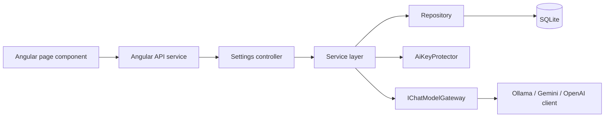
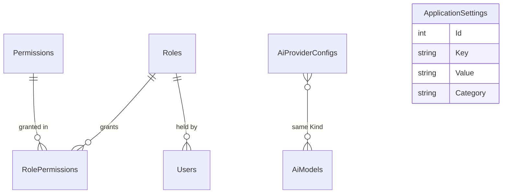

# Settings Module – Technical Documentation

> **Project:** TaskFlow – Intelligent Task Allocation & Tracking System
> **Module:** Settings  ·  **Child Modules:** Application Settings, Reminder Settings, Role Configuration, TFA Settings
> **Version:** 1.0  ·  **Last Updated:** 31-Oct-2026
> **Backend:** ASP.NET Core Web API (.NET 10)  ·  **Frontend:** Angular  ·  **Database:** SQLite (EF Core)
> **Author:** Jojo George (jojogeorge3344@gmail.com)
> © 2026 Jojo George. All rights reserved.

> ✅ Target framework confirmed: `net10.0` (.NET 10), from `backend/src/TaskFlow.Api/TaskFlow.Api.csproj`.

---

## 1. Technical Overview
The Settings module is four REST controllers under `Controllers/Settings/`. Each one has a service and a repository behind it:

- **Application Settings** and **Reminder Settings** read and write typed views over one key/value table, `ApplicationSettings`. The keys are defined in `Common/Constants/SettingKeys.cs`. `SettingsInitializer` inserts any missing row at startup. `AppClock` resolves the single application timezone for all deadline-day calculations.
- **Role Configuration** manages custom `Roles` and their `RolePermissions` grants against the fixed permission catalogue in `Common/Security/PermissionCatalog.cs`. System roles and the `Permissions` table are protected by SQLite triggers. A permission change on a role signs out its holders: their security stamp is rotated and their refresh tokens are revoked.
- **TFA Settings** stores one `AiProviderConfigs` row per AI provider (Ollama, Gemini, OpenAI) and the list of selectable `AiModels`. API keys are encrypted with ASP.NET Core Data Protection (`AiKeyProtector`). The connection test goes through the Assistant's `IChatModelGateway` to the provider clients in `Integrations/Ai/Providers/`.

Every write endpoint needs a permission policy (`[RequirePermission]`). Validation uses FluentValidation through the global `ValidationFilter`. Errors are mapped to ProblemDetails by `GlobalExceptionHandler`.

## 2. Architecture Flow

## 3. Backend File Structure
Module-level summary. Each child document lists its own files in full.

| Layer | Path | Files / Owner |
|-------|------|---------------|
| Controllers | `TaskFlow.Api/Controllers/Settings/` | `ApplicationSettingsController.cs` (08.1), `ReminderSettingsController.cs` (08.2), `RolesController.cs` (08.3), `AiProvidersController.cs` (08.4) |
| Services | `TaskFlow.Api/Services/Settings/` | `ApplicationSettings/General/`, `ApplicationSettings/Clock/` (08.1), `ReminderSettings/` (08.2), `RoleConfiguration/` (08.3), `TfaSettings/ProviderConfig/`, `TfaSettings/ConnectionTest/` (08.4) |
| Repositories | `TaskFlow.Api/Repositories/Settings/` | `ApplicationSettings/` (shared by 08.1 and 08.2), `RoleConfiguration/Roles/`, `RoleConfiguration/Permissions/` (08.3), `TfaSettings/ProviderConfig/`, `TfaSettings/AiModels/` (08.4) |
| DTOs + Validators | `TaskFlow.Api/Dtos/Settings/<Child>/` and `<Child>/Validators/` | One DTO file and (except Role Configuration) one validator file per child |
| Shared entity | `TaskFlow.Api/Models/Entities/` | `ApplicationSetting.cs` (08.1 and 08.2) |
| Shared constants | `TaskFlow.Api/Common/Constants/` | `SettingKeys.cs` (08.1 and 08.2) |
| Shared security | `TaskFlow.Api/Common/Security/` | `PermissionKeys.cs`, `PermissionPolicy.cs` (all children) |
| Authorization | `TaskFlow.Api/Authorization/Policies/` | `RequirePermissionAttribute.cs`, `AuthPolicies.cs` (all children) |
| Shared exceptions | `TaskFlow.Api/Common/Exceptions/` | `AppException.cs`, `PersistenceExceptions.cs` |
| Shared seeder | `TaskFlow.Api/Persistence/Seeders/` | `SettingsInitializer.cs` (08.1 and 08.2) |
| Shared config | `TaskFlow.Api/Config/` | `ApplicationOptions.cs` (08.1 and 08.2) |
| Cross-cutting | `TaskFlow.Api/Filters/`, `TaskFlow.Api/Middleware/` | `ValidationFilter.cs`, `GlobalExceptionHandler.cs`, `SessionValidation.cs` |
| Migration (shared table) | `TaskFlow.Api/Persistence/Migrations/` | `20261017062735_AddReminderEngine.cs` creates the `ApplicationSettings` table |

## 4. Frontend File Structure
Module-level summary. Each child document lists its own page, service and model files.

| Type | Path | Purpose |
|------|------|---------|
| Routes | `src/app/modules/settings/settings.routes.ts` | `SETTINGS_ROUTES`: `settings/reminders`, `settings/application`, `settings/tfa`, `settings/permissions`, each with `permissionGuard` |
| Shell route | `src/app/routes/app.routes.ts` | Lazy-loads `SETTINGS_ROUTES` under the authenticated shell |
| Menu | `src/app/layouts/nav-items.ts` | `buildNavigation()` adds the Settings group with Reminder Settings / Application Settings / TFA Settings / Role Configuration by permission |
| Permission constants | `src/app/shared/auth/permissions.ts` | `SettingsReminders`, `SettingsApplication`, `SettingsAiView`, `SettingsAiEdit`, `SettingsAiTest`, `SettingsAiRemoveModel`, `RolesManage`, `RolesViewAll`, `RolesModifyAccess`, `RolesAdministratorAssign` |
| Guard | `src/app/shared/auth/auth.guard.ts` | `permissionGuard`: redirects to the user's dashboard when none of `data.permissions` is held |
| Shared model | `src/app/modules/settings/models/settings.model.ts` | `ApplicationSettings`, `ReminderSettings` interfaces (08.1 and 08.2) |
| Error helper | `src/app/shared/utils/api-error.ts` | `apiErrorMessage()` reads ProblemDetails `detail` / `errors` |
| Child folders | `src/app/modules/settings/application-settings/`, `reminder-settings/`, `role-configuration/`, `tfa-settings/` | One folder per child module |

---

## 5. Child Modules

| # | Child Module | Main endpoints (count) | Key permissions | Document |
|---|--------------|------------------------|-----------------|----------|
| 08.1 | Application Settings | `GET`, `PUT /api/v1/settings/application` (2) | `settings.application.manage` (GET: signed in only) | `08.1-Application-Settings.md` |
| 08.2 | Reminder Settings | `GET`, `PUT /api/v1/settings/reminders` (2) | `settings.reminders.manage` | `08.2-Reminder-Settings.md` |
| 08.3 | Role Configuration | `/api/v1/roles` (5) and `/api/v1/permissions` (4) (9) | `roles.manage`, `roles.view.all`, `roles.modify.access`, `roles.administrator.assign` | `08.3-Role-Configuration.md` |
| 08.4 | TFA Settings | `/api/v1/assistant/providers/config` (2), `/{kind}/models` (1), `/{kind}/test` (1) (4) | `settings.ai.view`, `settings.ai.edit`, `settings.ai.test`, `settings.ai.model.remove` | `08.4-TFA-Settings.md` |

The child documents are in the `08-Settings/` folder next to this file. Total: 17 endpoints.

---

## 6. Database Design

| Table | Owner child | Shared with | Notes |
|-------|-------------|-------------|-------|
| `ApplicationSettings` | 08.1 Application Settings (`Application.*`, `Notification.InAppEnabled`) | 08.2 Reminder Settings (`Reminder.*`, `Notification.MailEnabled`) | Key/value table. No FK. Full column list below |
| `Roles` | 08.3 Role Configuration | Management (`Users.RoleId`) | System roles protected by triggers |
| `Permissions` | 08.3 Role Configuration | – | Fixed catalogue, protected by triggers |
| `RolePermissions` | 08.3 Role Configuration | – | Composite PK |
| `AiProviderConfigs` | 08.4 TFA Settings | Assistant (runtime) | One row per provider |
| `AiModels` | 08.4 TFA Settings | – | Unique (`Kind`, `Name`) |

**`ApplicationSettings` columns** (shared by 08.1 and 08.2)

| Table | Column | Type | Constraints | Description |
|-------|--------|------|-------------|-------------|
| `ApplicationSettings` | `Id` | int | PK, Identity | Row id |
| `ApplicationSettings` | `Key` | string(128) | Not Null, Unique | e.g. `Application.Timezone`, `Reminder.Enabled` |
| `ApplicationSettings` | `Value` | string(1024) | Not Null | Invariant-culture string value |
| `ApplicationSettings` | `Category` | string(64) | Not Null | `Application`, `Reminder` or `Notification` |
| `ApplicationSettings` | `UpdatedByUserId` | int? | – (no FK) | Last editor |
| `ApplicationSettings` | `UpdatedAt` | DateTime | Not Null | UTC |

**Seed data (shared):** `SettingsInitializer` inserts missing setting rows at every start and never overwrites existing ones. The role and AI seeders are described in 08.3 and 08.4.

Columns of the other tables, relationships and triggers are in the owning child document.

## 7. Security & Authorization
- **Authentication:** JWT bearer token + refresh token cookie.
- **Authorization:** `[RequirePermission(key)]` maps to the policy `perm:{key}` (`PermissionPolicy`). Permission claims are refreshed from the database on each request by `SessionValidation`, so role changes apply to the next call. Refused policies are logged by `DeniedActionAuditHandler`.
- **Data scope:** None. Every setting is organization-wide. Role listing is narrowed to the caller's own role without `roles.view.all` (see 08.3).
- **Frontend:** `permissionGuard` on each route and `buildNavigation()` for the menu. In-component checks are described in each child document.

| Permission Key(s) | Child | Endpoint group |
|-------------------|-------|----------------|
| (signed in), `settings.application.manage` | 08.1 | `/api/v1/settings/application` |
| `settings.reminders.manage` | 08.2 | `/api/v1/settings/reminders` |
| `roles.manage`, `roles.view.all`, `roles.modify.access`, `roles.administrator.assign` | 08.3 | `/api/v1/roles*`, `/api/v1/permissions*` |
| `settings.ai.view`, `settings.ai.edit`, `settings.ai.test`, `settings.ai.model.remove`, `settings.ai.manage` (legacy) | 08.4 | `/api/v1/assistant/providers/*` |

## 8. Validations & Error Handling
Shared rules that apply to every child. Child-specific rules are in each child document.

| Rule | Layer | HTTP Code | Error Message |
|------|-------|-----------|---------------|
| No permission | Policy | 403 | Forbidden |
| User id claim missing on PUT | Controllers | 401 | – |
| Concurrent update | `GlobalExceptionHandler` | 409 | Someone else changed this record while you were saving. Reload it and try again. |
| Unhandled | `GlobalExceptionHandler` | 500 | Something went wrong. Please try again. |

Errors are returned by `GlobalExceptionHandler` as `application/problem+json`. `AppException` subclasses (`RoleException`, `RequestValidationException`, `NotFoundException`, `ConflictException`) keep their status and message. `RequestValidationException` becomes a `ValidationProblemDetails` with an `errors` map. The Angular screens show `apiErrorMessage()`, and the Application and Reminder screens map `errors` keys onto form controls.

## 9. Integrations / Side Effects
- **Activity Log:** No activity or audit row is written for settings or role changes. Only `UpdatedByUserId` and `UpdatedAt` are stored on each setting and provider row. Denied requests are logged by `DeniedActionAuditHandler`.
- **Notifications / Reminders / Mail:** see 08.1 (in-app switch) and 08.2 (reminder engine, Mail copies).
- **Sessions:** see 08.3 (role permission change signs holders out).
- **AI Assistant:** see 08.4 (provider runtime, model selector); the brand name comes from 08.1.
- **Assistant knowledge pages:** `Services/Assistant/Knowledge/application-settings.md` (08.1), `reminder-settings.md` (08.2), `change-role.md` (08.3), `tfa-settings.md` (08.4).

## 10. Configuration

| Key (`appsettings.json`) | Purpose | Default |
|--------------------------|---------|---------|
| `Storage:Root` | Root folder for the database, key ring and attachments | `""` |
| `ConnectionStrings:Default` | SQLite database | `<secret>` |

Child-specific keys: `Application:Timezone` (08.1, also the 08.2 fallback), `Reminders:SchedulerEnabled` / `Reminders:TickSeconds` (08.2), `AiProviders:KeyRingPath` / `AiProviders:TimeoutSeconds` (08.4). The runtime-editable keys of the `ApplicationSettings` table are listed in 08.1 and 08.2.

## 11. Testing
Shared tests. Child-specific tests are listed in each child document.

| Test Type | File / Location | Covers |
|-----------|-----------------|--------|
| Unit | `tests/TaskFlow.UnitTests/Persistence/SettingsInitializerTests.cs` | The initializer inserts the 10 default setting rows (08.1 and 08.2) once, seeds `TaskFlow` / `Medium` / in-app `true` and the configured timezone, never overwrites saved values and adds only missing keys |
| Unit (support) | `tests/TaskFlow.UnitTests/TestSupport/SettingsTestDatabase.cs` | Not a test. In-memory SQLite database with a `SetValue` helper, factories for `AppClock`, `ApplicationSettingsService` and `ReminderSettingsService`, and a `FixedTimeProvider` |
| Integration | `tests/TaskFlow.IntegrationTests/Common/PermissionAuthorizationTests.cs` | Every catalogue permission has a policy that needs its claim; every controller action uses a permission policy, the task-access rule or no role check; Administrator permissions come from the database, not the token; profile and login return the role name and its permission keys; a custom role opens only its ticked permissions, and a removed one is refused on the next request |
| Integration | `tests/TaskFlow.IntegrationTests/Common/ModuleBasedPermissionEndpointsTests.cs` | Each gated action is refused without its key and reached with it; single-task actions also keep the task-access rule; every gated key is in the catalogue; a higher dashboard scope includes the lower one; old broad keys keep their access; only known areas are open to every signed-in user. Its role-saving cases are listed in 08.3 |

## 12. Known Limitations / Future Enhancements
- Settings and role changes are not written to an audit or activity log. Only the last editor and time are kept per setting row.
- There is no "Reset to defaults" action for Application or Reminder Settings. Defaults only apply when a row is missing.

**Gaps found (module-wide)**
- **BRD Screen 20 FR-6 "Record significant configuration changes"** is not implemented beyond `UpdatedByUserId`/`UpdatedAt`. No history table or activity entry exists.
- **Stale file names:** the permission inventory still refers to the old file names `SettingsController.cs`, `AssistantController.cs` and `features/settings/*`.
- **.NET version:** confirmed as `net10.0` in `TaskFlow.Api.csproj`.

Child-specific gaps are listed in each child document.

---
© 2026 Jojo George. All rights reserved. Unauthorized copying or distribution of this document is prohibited.
