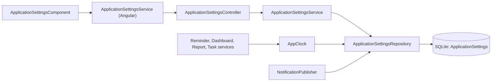
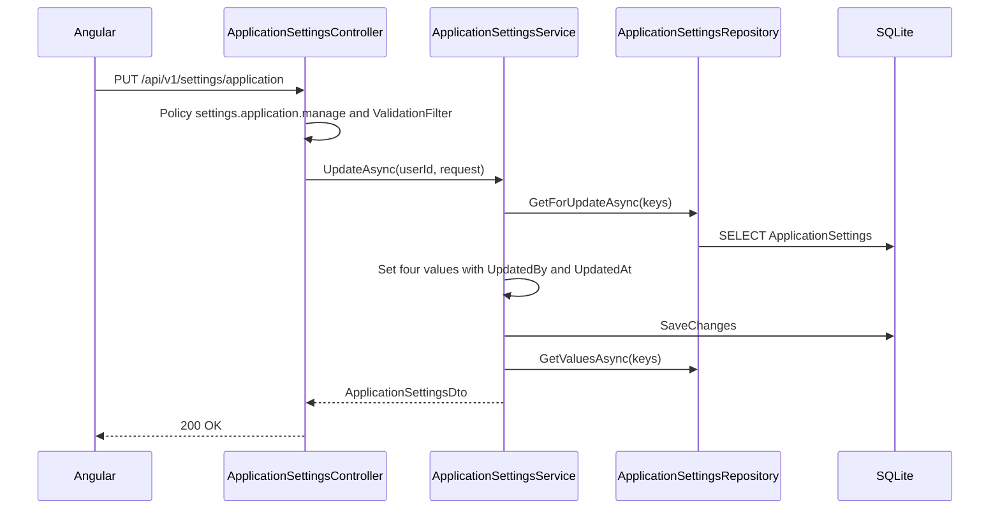

# Application Settings – Technical Documentation

> **Project:** TaskFlow – Intelligent Task Allocation & Tracking System
> **Parent Module:** Settings  ·  **Child Module:** 08.1 Application Settings
> **Version:** 1.0  ·  **Last Updated:** 31-Oct-2026
> **Backend:** ASP.NET Core Web API (.NET 10)  ·  **Frontend:** Angular  ·  **Database:** SQLite (EF Core)
> **Author:** Jojo George (jojogeorge3344@gmail.com)
> © 2026 Jojo George. All rights reserved.

---

## 1. Technical Overview
Application Settings is `ApplicationSettingsController` over `ApplicationSettingsService` and the shared `ApplicationSettingsRepository`. It reads and writes four keys of the key/value table `ApplicationSettings` (`Application.Name`, `Application.Timezone`, `Application.DefaultPriority`, `Notification.InAppEnabled`). The GET endpoint is open to every signed-in user (brand name, default priority); the PUT endpoint needs `settings.application.manage`. `AppClock` (`IAppClock`) resolves the single application timezone used by all deadline-day calculations.

## 2. Architecture Flow


## 3. Backend File Structure

| Layer | Path | Files |
|-------|------|-------|
| Controller | `TaskFlow.Api/Controllers/Settings/` | `ApplicationSettingsController.cs` |
| Service | `TaskFlow.Api/Services/Settings/ApplicationSettings/General/` | `IApplicationSettingsService.cs`, `ApplicationSettingsService.cs` |
| Service (Clock) | `TaskFlow.Api/Services/Settings/ApplicationSettings/Clock/` | `IAppClock.cs`, `AppClock.cs` |
| Repository (shared with 08.2) | `TaskFlow.Api/Repositories/Settings/ApplicationSettings/` | `IApplicationSettingsRepository.cs`, `ApplicationSettingsRepository.cs` |
| DTOs | `TaskFlow.Api/Dtos/Settings/ApplicationSettings/` | `ApplicationSettingsDtos.cs` (`ApplicationSettingsDto`, `UpdateApplicationSettingsRequest`) |
| Validators | `TaskFlow.Api/Dtos/Settings/ApplicationSettings/Validators/` | `UpdateApplicationSettingsRequestValidator.cs` |
| Entities | `TaskFlow.Api/Models/Entities/` | `ApplicationSetting.cs` |
| Enums | `TaskFlow.Api/Models/Enums/` | `TaskPriority.cs` |
| Constants | `TaskFlow.Api/Common/Constants/` | `SettingKeys.cs` |
| Seeders | `TaskFlow.Api/Persistence/Seeders/` | `SettingsInitializer.cs` |
| Config | `TaskFlow.Api/Config/` | `ApplicationOptions.cs` |

## 4. Frontend File Structure

| Type | Path | Purpose |
|------|------|---------|
| Page component | `src/app/modules/settings/application-settings/pages/application-settings.component.{ts,html}` | `ApplicationSettingsComponent` (Screen 20) |
| Models | `src/app/modules/settings/application-settings/pages/application-settings.model.ts`, `src/app/modules/settings/models/settings.model.ts` | `SettingsField`, `ApplicationSettings` interfaces |
| API service | `src/app/modules/settings/application-settings/services/application-settings.service.ts` | `ApplicationSettingsService.get()/save()` and the cached `appName` signal used by the shell |
| Route / Guard | `src/app/modules/settings/settings.routes.ts` (`settings/application`), `src/app/shared/auth/auth.guard.ts` | `permissionGuard` with `SettingsApplication` |
| Menu | `src/app/layouts/nav-items.ts` | "Application Settings" item when `SettingsApplication` is held |

---

## 5. API & Logic

### 5.1 API Endpoints

| # | Method | Endpoint | Description | Permission (Policy) | Request DTO | Response DTO |
|---|--------|----------|-------------|---------------------|-------------|--------------|
| 1 | GET | `/api/v1/settings/application` | Current application settings (non-secret) | `[Authorize]` only (any signed-in user) | – | `ApplicationSettingsDto` |
| 2 | PUT | `/api/v1/settings/application` | Save all application settings | `settings.application.manage` | `UpdateApplicationSettingsRequest` | `ApplicationSettingsDto` |

### 5.2 Request / Response Samples
```json
// PUT /api/v1/settings/application
{ "name": "TaskFlow", "timezone": "Asia/Kolkata", "defaultPriority": "Medium", "inAppNotificationsEnabled": true }
```
```json
// 200 OK
{ "name": "TaskFlow", "timezone": "Asia/Kolkata", "defaultPriority": "Medium", "inAppNotificationsEnabled": true }
```
> Enums are serialised as strings (`JsonStringEnumConverter` in `Config/CrossCuttingRegistration.cs`).

### 5.3 Service Layer Logic
**Method:** `ApplicationSettingsService.GetAsync(CancellationToken)`
1. `GetValuesAsync` for keys `Application.Name`, `Application.Timezone`, `Application.DefaultPriority`, `Notification.InAppEnabled`.
2. Each value falls back to a default when missing or unparseable: `"TaskFlow"`, `ApplicationOptions.Timezone` (or `"UTC"`), `TaskPriority.Medium`, `true`.

**Method:** `ApplicationSettingsService.UpdateAsync(int userId, UpdateApplicationSettingsRequest request, CancellationToken)`
1. The controller resolves `userId` from `ClaimTypes.NameIdentifier`, or returns `401`.
2. If any field is null, throws `ArgumentException("Every application setting must be provided.")`. The validator normally prevents this.
3. `GetForUpdateAsync` loads the tracked rows. A missing key is created with its category (`Application` or `Notification`).
4. Sets `Value`, `UpdatedByUserId = userId` and `UpdatedAt = now` for all four keys. The name is trimmed, and the bool is written with `SettingValues.Format` (`"true"`/`"false"`).
5. `IUnitOfWork.SaveChangesAsync`, then returns `GetAsync()`.

**Method:** `AppClock.GetTimeZoneAsync()` / `TodayLocalAsync()` (`IAppClock`)
- Reads `Application.Timezone` (falls back to `ApplicationOptions.Timezone`), then calls `TimeZoneInfo.FindSystemTimeZoneById`. An unknown id is logged as an error and `TimeZoneInfo.Utc` is returned. `TodayLocalAsync` converts `UtcNow` to that zone. It is used by the reminder, dashboard, workload, report, task and assistant services (BR-17).

### 5.4 Repository Layer

| Method | Description | Query Notes |
|--------|-------------|-------------|
| `GetValuesAsync(keys)` | Values of the given keys | `AsNoTracking`, `ToDictionaryAsync(Key, Value)` |
| `GetValueAsync(key)` | One value or null | `AsNoTracking`, projection |
| `GetForUpdateAsync(keys)` | Tracked rows for update | Tracked, `ToDictionaryAsync(Key)` |
| `Add(entity)` (base) | Stage a new row | From `BaseRepository` |

### 5.5 Sequence Diagram


---

## 6. Database Design

| Table | Column | Type | Constraints | Description |
|-------|--------|------|-------------|-------------|
| `ApplicationSettings` | `Id` | int | PK, Identity | Row id |
| `ApplicationSettings` | `Key` | string(128) | Not Null, Unique | This child uses `Application.Name`, `Application.Timezone`, `Application.DefaultPriority`, `Notification.InAppEnabled` |
| `ApplicationSettings` | `Value` | string(1024) | Not Null | Invariant-culture string value |
| `ApplicationSettings` | `Category` | string(64) | Not Null | `Application` or `Notification` for this child |
| `ApplicationSettings` | `UpdatedByUserId` | int? | – (no FK) | Last editor |
| `ApplicationSettings` | `UpdatedAt` | DateTime | Not Null | UTC |

**Relationships:** none (key/value table, no FK). The table is shared with 08.2 Reminder Settings.

**Seed data:** `SettingsInitializer` inserts missing setting rows at every start and never overwrites existing ones. `Application.Timezone` is seeded from `Application:Timezone`.

## 7. Security & Authorization
- **Authorization:** `PUT` needs `[RequirePermission(settings.application.manage)]`. `GET` is `[Authorize]` only, because the shell brand name and the Create Task default priority are needed by every user. The response contains nothing secret.
- **Data scope:** None. The settings are organization-wide.
- **Frontend:** `permissionGuard` on `settings/application` and the menu item in `buildNavigation()`.

| Permission Key | Endpoint(s) | UI Element Controlled |
|----------------|-------------|-----------------------|
| `settings.application.manage` | `PUT /api/v1/settings/application` | Menu "Application Settings", route `/settings/application` |
| (signed in) | `GET /api/v1/settings/application` | Shell brand name, Create Task default priority |

## 8. Validations & Error Handling

| Rule | Layer | HTTP Code | Error Message |
|------|-------|-----------|---------------|
| Application name blank / > 100 | `UpdateApplicationSettingsRequestValidator` | 400 | Application name cannot be blank. (length: FluentValidation default) |
| Timezone blank | Validator | 400 | Timezone cannot be blank. |
| Timezone not found by `TimeZoneInfo.FindSystemTimeZoneById` | Validator | 400 | Unknown timezone. |
| DefaultPriority / InAppNotificationsEnabled missing or invalid | Validator | 400 | FluentValidation default |

Shared rules (403, 401, 409 concurrency, 500) are in the parent document. The screen maps the `errors` keys onto the form controls.

## 9. Integrations / Side Effects
- **Notifications:** `NotificationPublisher` checks `Notification.InAppEnabled` before it creates any bell notification. A missing or unreadable value counts as enabled.
- **Timezone:** `IAppClock` gives the local calendar day to the reminder, dashboard, workload, report, task and assistant services.
- **AI Assistant:** `AssistantService` and `AssistantController` use `IApplicationSettingsService` for the brand name. Assistant knowledge page: `Services/Assistant/Knowledge/application-settings.md`.
- **Activity Log:** none (only `UpdatedByUserId` / `UpdatedAt`).

## 10. Configuration

| Key (`appsettings.json`) | Purpose | Default |
|--------------------------|---------|---------|
| `Application:Timezone` | Seeds `Application.Timezone`. Fallback while the row is missing | `Asia/Kolkata` (code default `UTC`) |

Runtime-editable keys in the `ApplicationSettings` table (`SettingKeys`):
- `Application.Name` (`TaskFlow`), `Application.Timezone`, `Application.DefaultPriority` (`Medium`)
- `Notification.InAppEnabled` (`true`)

## 11. Testing

| Test Type | File / Location | Covers |
|-----------|-----------------|--------|
| Unit | `tests/TaskFlow.UnitTests/Settings/ApplicationSettings/General/ApplicationSettingsServiceTests.cs` | Defaults on a fresh database; missing or unreadable rows fall back to the defaults and the configured timezone; saved values round-trip with who and when; an incomplete request throws and saves nothing |
| Unit | `tests/TaskFlow.UnitTests/Settings/ApplicationSettings/General/ApplicationSettingsValidatorTests.cs` | Defaults are valid; a blank name, an unknown timezone, missing fields and a priority outside the enum are invalid |
| Unit | `tests/TaskFlow.UnitTests/Settings/ApplicationSettings/Clock/AppClockTests.cs` | Uses the stored IANA timezone, or the configured one while none is stored; an unknown timezone falls back to UTC; "today" is the local date in the application timezone |
| Integration | `tests/TaskFlow.IntegrationTests/Settings/ApplicationSettings/ApplicationSettingsEndpointsTests.cs` | `GET` works for Employee, Manager and Administrator; the Administrator's `PUT` saves and returns the values; a Manager's `PUT` gets 403; an unknown timezone gets 400 with a `Timezone` field error and saves nothing; a blank name gets 400; no token gets 401 |
| Frontend unit | `src/app/modules/settings/application-settings/pages/application-settings.component.spec.ts` | Loads and shows the stored values; saves and confirms; blocks a blank name; shows server field errors from a 400; hides "Saved" after an edit; timezone suggestions via a datalist that still allows custom ids; links to Reminder Settings; retryable load error |
| Frontend unit | `src/app/modules/settings/application-settings/services/application-settings.service.spec.ts` | `GET` and `PUT` on `/api/v1/settings/application`; the cached brand name defaults to `TaskFlow`, updates after a read or save, and falls back to `TaskFlow` when the name is blank |

> Shared tests (`SettingsInitializerTests.cs`) are in the parent document.

## 12. Known Limitations / Gaps found
- **BRD Screen 20 "Default task reminder intervals"** are not on Application Settings. The screen links to Reminder Settings instead (by design, see the component comment).
- **Stale comments:** `ApplicationSettingsService` (Angular) and `ApplicationSettingsController` say "only an Administrator", but the code checks `settings.application.manage`.
- Module-wide limitations (no audit log, no reset to defaults) are in the parent document.

---
<sub>© 2026 Jojo George. All rights reserved. Unauthorized copying or distribution of this document is prohibited.</sub>
