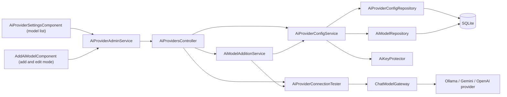
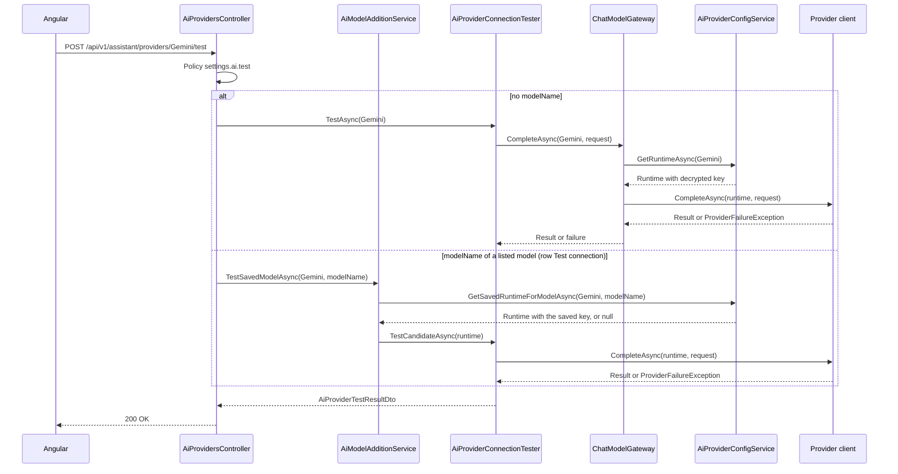
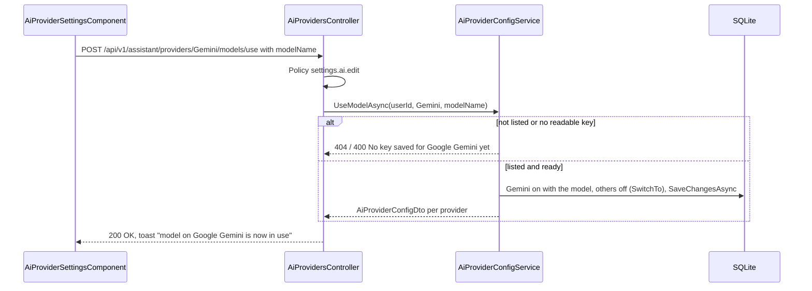
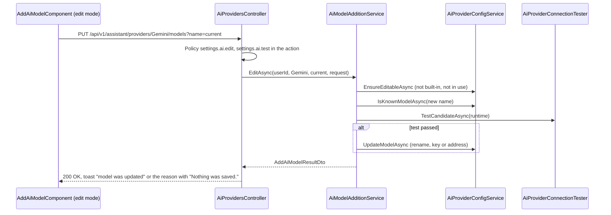

# TFA Settings – Technical Documentation

> **Project:** TaskFlow – Intelligent Task Allocation & Tracking System
> **Parent Module:** Settings  ·  **Child Module:** 08.4 TFA Settings
> **Version:** 1.2  ·  **Last Updated:** 01-Nov-2026
> **Backend:** ASP.NET Core Web API (.NET 10)  ·  **Frontend:** Angular  ·  **Database:** SQLite (EF Core)
> **Author:** Jojo George (jojogeorge3344@gmail.com)
> © 2026 Jojo George. All rights reserved.

---

## 1. Technical Overview
TFA Settings is `AiProvidersController` (7 actions) over `AiProviderConfigService`, `AiModelAdditionService`, `AiProviderConnectionTester`, `AiProviderConfigRepository` and `AiModelRepository`. The screen is a read-only model list (`AiProviderSettingsComponent`) built from `GET config`, with **Use this model**, **Test connection**, **Edit** and **Delete** per row; adding and editing happen on `AddAiModelComponent` (add and edit mode). It stores one `AiProviderConfigs` row per AI provider (Ollama, Gemini, OpenAI) and the list of selectable `AiModels`. API keys are encrypted with ASP.NET Core Data Protection (`AiKeyProtector`) and never returned. The connection test goes through the Assistant's `IChatModelGateway` (`ChatModelGateway`) to the provider clients in `Integrations/Ai/Providers/`.

## 2. Architecture Flow


## 3. Backend File Structure

| Layer | Path | Files |
|-------|------|-------|
| Controller | `TaskFlow.Api/Controllers/Settings/` | `AiProvidersController.cs` |
| Service | `TaskFlow.Api/Services/Settings/TfaSettings/ProviderConfig/` | `IAiProviderConfigService.cs`, `AiProviderConfigService.cs` |
| Service (add model) | `TaskFlow.Api/Services/Settings/TfaSettings/ModelAddition/` | `IAiModelAdditionService.cs`, `AiModelAdditionService.cs` |
| Service (test) | `TaskFlow.Api/Services/Settings/TfaSettings/ConnectionTest/` | `IAiProviderConnectionTester.cs`, `AiProviderConnectionTester.cs` |
| Repository | `TaskFlow.Api/Repositories/Settings/TfaSettings/ProviderConfig/` | `IAiProviderConfigRepository.cs`, `AiProviderConfigRepository.cs` (`UsesModelAsync` removed) |
| Repository | `TaskFlow.Api/Repositories/Settings/TfaSettings/AiModels/` | `IAiModelRepository.cs`, `AiModelRepository.cs` |
| DTOs | `TaskFlow.Api/Dtos/Settings/TfaSettings/` | `AiProviderDtos.cs` (`AiProviderOptionDto`, `AiProviderConfigDto`, `UpdateAiProviderRequest`, `UpdateAiProvidersRequest`, `AiProviderTestResultDto`, `AddAiModelRequest` (with optional `ClearKey`), `AddAiModelResultDto`, `AiModelChoiceRequest`) |
| Validators | `TaskFlow.Api/Dtos/Settings/TfaSettings/Validators/` | `UpdateAiProvidersRequestValidator.cs` (also `UpdateAiProviderRequestValidator`), `AddAiModelRequestValidator.cs` |
| Entities | `TaskFlow.Api/Models/Entities/` | `AiProviderConfig.cs`, `AiModel.cs` |
| Enums | `TaskFlow.Api/Models/Enums/` | `AiProviderKind.cs`, `ProviderFailureKind.cs` |
| Constants | `TaskFlow.Api/Common/Constants/` | `AiProviderCatalog.cs` |
| AI integration | `TaskFlow.Api/Integrations/Ai/` | `KeyProtection/AiKeyProtector.cs`, `KeyProtection/KeyRingProtectionCheck.cs`, `Registry/ChatModelProviderRegistry.cs`, `Providers/OllamaProvider.cs`, `Providers/GeminiProvider.cs`, `Providers/OpenAiProvider.cs`, `Providers/ProviderHttp.cs`, `Providers/ProviderFailure.cs`, `Providers/AiProviderRuntime.cs`, `Providers/ChatModelTypes.cs` |
| Gateway (Assistant module) | `TaskFlow.Api/Services/Assistant/ModelGateway/`, `Services/Assistant/Chat/` | `ChatModelGateway.cs`, `ProviderFailureMessages.cs` |
| Seeders | `TaskFlow.Api/Persistence/Seeders/` | `AiProviderSeeder.cs` |
| Config | `TaskFlow.Api/Config/` | `AiProviderOptions.cs`, `IntegrationRegistration.cs` |
| Migrations | `TaskFlow.Api/Persistence/Migrations/` | `20261018183210_AddAssistant.cs` (`AiProviderConfigs`), `20261019163241_AddAiModels.cs` (`AiModels`) |

## 4. Frontend File Structure

| Type | Path | Purpose |
|------|------|---------|
| Page component | `src/app/modules/settings/tfa-settings/pages/tfa-settings.component.ts` | `TfaSettingsComponent` wrapper |
| Page component | `src/app/modules/settings/tfa-settings/pages/add-ai-model.component.{ts,html,css}` | `AddAiModelComponent`: the Add AI model page (provider, model name, API key or Ollama address, Test connection, Back), and its edit mode (`editing`, `startEditing`, `removeKey`; title **Edit AI model**, provider fixed, **Test and save**, **Remove the key**). `MODEL_ID_EXAMPLES` gives the model-name placeholder per provider (`gemini-3.8-flash`, `gpt-4o-mini`, `llama3.2:3b`); the `modelId` validator refuses whitespace; for Gemini a key hint links to Google AI Studio (`https://aistudio.google.com/apikey`) without checking the key's prefix |
| Child component | `src/app/modules/settings/tfa-settings/components/ai-provider-settings.component.{ts,html,css}`, `ai-provider-settings.model.ts` | `AiProviderSettingsComponent`: read-only model list with the **Add AI model** button; signals `groups`, `inUse`, `busy`, `testing`, `results`; methods `use`, `test`, `edit`, `remove`; `ModelRow`, `ProviderGroup` |
| Shared component | `src/app/shared/components/confirm-dialog/confirm-dialog.{component,model}.ts` | `tf-confirm-dialog`; `ConfirmOptions.notice` shows only the confirm button (the in-use "OK" notice) |
| API service | `src/app/modules/settings/tfa-settings/services/ai-provider-admin.service.ts` | `AiProviderAdminService.getConfig()/save()/removeModel()/test(kind, modelName?)/addModel()/useModel()/editModel()` (`save()` is no longer called by the screen) |
| Route / Guard | `src/app/modules/settings/settings.routes.ts` (`settings/tfa`, `settings/tfa/models/new`, `settings/tfa/models/:kind/:name/edit`), `src/app/shared/auth/auth.guard.ts` | `permissionGuard` with `SettingsAiView` (TFA Settings) and `SettingsAiEdit` (Add AI model and its edit mode; the page also checks `SettingsAiTest`) |
| Menu | `src/app/layouts/nav-items.ts` | "TFA Settings" item when `SettingsAiView` is held |

---

## 5. API & Logic

### 5.1 API Endpoints
Controller `AiProvidersController`, `[Route("api/v1/assistant/providers")]`, class `[Authorize]`.

| # | Method | Endpoint | Description | Permission (Policy) | Request DTO | Response DTO |
|---|--------|----------|-------------|---------------------|-------------|--------------|
| 1 | GET | `/api/v1/assistant/providers/config` | Every provider with status. Key never returned | `settings.ai.view` | – | `IReadOnlyList<AiProviderConfigDto>` |
| 2 | PUT | `/api/v1/assistant/providers/config` | Save provider settings. Kept for compatibility; the screen no longer calls it | `settings.ai.edit` | `UpdateAiProvidersRequest` | `IReadOnlyList<AiProviderConfigDto>` |
| 3 | DELETE | `/api/v1/assistant/providers/{kind}/models?name=` | Delete an administrator-added model. 400 for a built-in model or the model in use | `settings.ai.model.remove` | Query `name` | `IReadOnlyList<AiProviderConfigDto>` |
| 4 | POST | `/api/v1/assistant/providers/{kind}/test` | One tiny request to the provider. With `{ modelName }`: that listed model with the saved key or address, even when the provider is switched off; without a body: the saved settings | `settings.ai.test` | optional `AiModelChoiceRequest` | `AiProviderTestResultDto` |
| 5 | POST | `/api/v1/assistant/providers/{kind}/models` | Add AI model: test the typed values without saving; only if the test passes, save the model and key/address and make it the one in use | `settings.ai.edit` (attribute) + `settings.ai.test` (checked in the action) | `AddAiModelRequest` | `AddAiModelResultDto` |
| 6 | POST | `/api/v1/assistant/providers/{kind}/models/use` | **Use this model**: make a listed model the one TFA uses and switch the other providers off. 404 unknown model; 400 "No key saved for {Provider} yet. Add it on the Add AI model screen." | `settings.ai.edit` | `AiModelChoiceRequest` `{ modelName }` | `IReadOnlyList<AiProviderConfigDto>` |
| 7 | PUT | `/api/v1/assistant/providers/{kind}/models?name={current}` | Edit an added model: test the typed values, and only if the test passes rename it and save the key or address (the model in use does not change); `clearKey: true` removes the key without a test. 400 for a built-in model, the model in use, a duplicate name, `clearKey` with other changes, or a key and `clearKey` together | `settings.ai.edit` (attribute) + `settings.ai.test` (checked in the action) | Query `name`, `AddAiModelRequest` `{ modelName, apiKey?, baseUrl?, clearKey? }` | `AddAiModelResultDto` |

`{kind}` binds to `AiProviderKind` (`Ollama`, `Gemini`, `OpenAI`). Related (Assistant module): `GET /api/v1/assistant/providers` (`assistant.chat`) returns `AiProviderOptionDto` for configured providers only, through `GetAvailableAsync`.

### 5.2 Request / Response Samples
```json
// PUT /api/v1/assistant/providers/config  (kept for compatibility; not sent by the screen)
{ "providers": [
  { "kind": "Ollama", "isEnabled": false, "modelName": "llama3.2:3b", "baseUrl": "http://localhost:11434" },
  { "kind": "Gemini", "isEnabled": true, "modelName": "gemini-3.8-flash", "apiKey": "<secret>" },
  { "kind": "OpenAI", "isEnabled": false, "modelName": "gpt-4o-mini", "clearKey": true }
] }
```
```json
// 200 OK (one element)
{ "kind": "Gemini", "displayName": "Google Gemini", "locality": "Cloud", "requiresKey": true, "isEnabled": true, "modelName": "gemini-3.8-flash", "baseUrl": null, "keySet": true, "keyLast4": "x9Qa", "isConfigured": true, "keyReadable": true, "models": ["gemini-3.8-flash", "gemini-3.5-flash", "gemini-3.5-flash-lite"], "customModels": [] }
```
```json
// POST /api/v1/assistant/providers/Ollama/test -> 200 OK
{ "ok": false, "message": "Ollama is not running or cannot be reached. Ask an administrator to start it, or choose another model.", "failureKind": "Unreachable" }
```
```json
// POST /api/v1/assistant/providers/Gemini/test -> 200 OK (saved model with a malformed name; provider reason appended)
{ "ok": false, "message": "The configured model is not available on Google Gemini. Ask an administrator to check the model name, or choose another model. Google Gemini said: HTTP 400 - INVALID_ARGUMENT: ...", "failureKind": "ModelUnavailable" }
```
```json
// POST /api/v1/assistant/providers/Gemini/models
{ "modelName": "gemini-3.1-pro-preview", "apiKey": "<secret, optional when a readable key is saved>" }
// 200 OK, test passed: saved and in use
{ "ok": true, "message": "The connection works.", "failureKind": null, "providers": [ /* AiProviderConfigDto per provider */ ] }
// 200 OK, test failed: nothing saved
{ "ok": false, "message": "Google Gemini did not accept the API key. ...", "failureKind": "InvalidKey", "providers": null }
```
```json
// POST /api/v1/assistant/providers/Gemini/models/use
{ "modelName": "gemini-3.5-flash" }
// 200 OK: AiProviderConfigDto per provider, Gemini enabled with gemini-3.5-flash, the others disabled
```
```json
// POST /api/v1/assistant/providers/Gemini/test  (row Test connection)
{ "modelName": "gemini-3.5-flash" }
// 200 OK
{ "ok": true, "message": "The connection works.", "failureKind": null }
```
```json
// PUT /api/v1/assistant/providers/Gemini/models?name=gemini-2.5-pro
{ "modelName": "gemini-2.5-flash" }
// 400 when TFA uses gemini-2.5-pro
{ "status": 400, "errors": { "name": ["gemini-2.5-pro is in use by TFA. Switch TFA to another model first, then edit it."] } }
// PUT /api/v1/assistant/providers/Gemini/models?name=gemini-2.5-flash  (Remove the key)
{ "modelName": "gemini-2.5-flash", "clearKey": true }
```

### 5.3 Service Layer Logic
**Method:** `AiProviderConfigService.GetAdminConfigAsync()`
- For each `AiProviderCatalog.All` kind, `ToDto` builds the response:
  - `Models` = all `AiModels` of that kind, plus the chosen model if it is missing
  - `CustomModels` = the non-built-in ones
  - `BaseUrl` only for Ollama (default `http://localhost:11434`)
  - `KeySet` and `KeyLast4`
  - `KeyReadable` = the stored key can still be `Unprotect`-ed
  - `IsConfigured` = enabled, has a model, and has either a URL (Ollama) or a decryptable key

**Method:** `AiProviderConfigService.SaveAsync(int userId, UpdateAiProvidersRequest)`
1. Loads all tracked config rows. For each update:
   - a null `Kind`, `IsEnabled` or `ModelName` gives `RequestValidationException("providers", "Every provider setting must be provided.")`
   - a trimmed model name that is empty or over 100 characters gives "The {Provider} model name must be 1 to 100 characters."
2. Creates the row if it is missing. Sets `IsEnabled` and `ModelName`. When the provider is enabled, `RememberModelAsync` adds a non-built-in `AiModel` if the name is new.
3. `BaseUrl`: for Ollama, the normalised value (trimmed, trailing `/` removed) or the default. For cloud providers, `null`.
4. A non-empty `ApiKey` on Ollama gives "Ollama does not use an API key.". Otherwise `EncryptedApiKey = _keyProtector.Protect(key)` and `KeyLast4` = the last 4 characters. `ClearKey == true` nulls both.
5. Sets `UpdatedByUserId` and `UpdatedAt`. `SaveKeepingAnyDuplicateModelAsync` handles a duplicate model race: on `UniqueConstraintException` it detaches the duplicate added models and saves again.
6. The screen no longer calls `SaveAsync`; the endpoint is kept for compatibility and itself allows several enabled providers. One active server is applied by `UseModelAsync` and `ActivateModelAsync` (`SwitchTo`).

**Method:** `AiProviderConfigService.RemoveModelAsync(kind, name)`
- Not found gives `NotFoundException("That model is not in the list.")`. `IsBuiltIn` gives a 400 "A built-in model cannot be changed or removed.". The model in use (`IsInUseAsync`: the provider row is enabled and its `ModelName` is this name) gives a 400 "{name} is in use by TFA. Switch TFA to another model first, then delete it.". A switched-off provider row that still has this model saved is reset to `AiProviderCatalog.DefaultModel(kind)` (`llama3.2:3b`, `gemini-3.8-flash`, `gpt-4o-mini`) and stays off. Then the model is removed and the config is returned. (The earlier `UsesModelAsync` rule, which also blocked a switched-off provider, was removed.)

**Method:** `AiProviderConfigService.UseModelAsync(userId, kind, modelName)` ("Use this model")
1. Normalises the name; a name not in the provider's list gives `NotFoundException("That model is not in the list.")` (404).
2. A cloud provider whose saved key cannot be read (or is missing) gives `RequestValidationException("modelName", "No key saved for {Provider} yet. Add it on the Add AI model screen.")` (400). Nothing changes.
3. Creates the row if missing, sets `ModelName` (Ollama `BaseUrl` defaults to `http://localhost:11434`), and `SwitchTo` enables this row and disables the others (keys, models and addresses kept), stamping `UpdatedByUserId` / `UpdatedAt`. Saves and returns the config.

**Method:** `AiModelAdditionService.TestSavedModelAsync(kind, modelName)` (row **Test connection**)
- `AiProviderConfigService.GetSavedRuntimeForModelAsync` builds the runtime from the saved key or address with that listed model, whether or not the provider is switched on (unknown model → 404). With no readable key it returns `ok: false` with "No key saved for {Provider} yet. Add it on the Add AI model screen.". Otherwise `AiProviderConnectionTester.TestCandidateAsync(runtime)` sends the tiny prompt straight to the provider. Nothing is saved.

**Method:** `AiModelAdditionService.EditAsync(userId, kind, currentName, AddAiModelRequest)` (Edit AI model)
1. `AiProviderConfigService.EnsureEditableAsync(kind, currentName, "edit")`: not listed → 404; built-in → 400 "A built-in model cannot be changed or removed."; in use → 400 "{name} is in use by TFA. Switch TFA to another model first, then edit it.".
2. `clearKey: true`: with a changed name or an address → 400 "Remove the key on its own, without other changes."; otherwise `ClearKeyAsync` removes the encrypted key and `KeyLast4` (Ollama → "Ollama does not use an API key.") without any provider call.
3. A new name already listed → 400 "That model is already in the list."; nothing is tested.
4. `ResolveCandidateRuntimeAsync` + `TestCandidateAsync` as in Add AI model. A failed test returns `ok: false`, `providers: null`; nothing saved.
5. A passed test calls `UpdateModelAsync` in one save: renames the `AiModel` row, a switched-off provider row that had the old name saved follows the new name, the typed key (`Protect`, `KeyLast4`) or the Ollama address is stored. `IsEnabled` is not touched, so the model TFA uses does not change. A unique-index clash gives 400 "That model is already in the list.".

**Method:** `AiProviderConfigService.GetRuntimeAsync(kind)`
- Returns `AiProviderRuntime(kind, model, baseUrl, decryptedKey)` or `null` when the provider is not configured. It logs a warning when an enabled provider's key cannot be decrypted.

**Method:** `AiProviderConnectionTester.TestAsync(kind)`
1. Builds a `ChatModelRequest` with the system text "This is a connection test. Reply with the single word OK." and the user message "Reply with OK.".
2. Calls `IChatModelGateway.CompleteAsync(kind, request)`. The gateway gets the runtime, throws `ProviderNotConfiguredException` when it is null, and calls the provider through `IChatModelProviderRegistry`.
3. On success, `Ok = true` with "The connection works.". `ProviderNotConfiguredException` gives `ProviderFailureMessages.NotConfigured(kind)`. `ProviderFailureException` gives `ProviderFailureMessages.For(kind, failure.Kind, failure.RetryAfter)` and its `FailureKind`. The test always returns `200`, never an error status.
4. For `Unexpected` and `ModelUnavailable` failures that carry a `ProviderReason`, `Failed(...)` appends "{Provider} said: HTTP {status} - {reason}" to the message (the `HTTP {status} - ` part only when a status is known). The failure is logged as a warning with provider, failure kind, HTTP status and the reason. Only Test connection (here and in Add AI model) shows the reason; chat replies from `AssistantService` keep the fixed `ProviderFailureMessages` text.

**Method:** `AiModelAdditionService.AddAndActivateAsync(userId, kind, AddAiModelRequest)` (the Add AI model page)
1. `AiProviderConfigService.ResolveCandidateRuntimeAsync` builds an in-memory `AiProviderRuntime` without writing anything:
   - cloud provider: the typed key, else the saved key decrypted, else `RequestValidationException("apiKey", "Enter the API key.")`
   - Ollama: a typed key gives "Ollama does not use an API key."; the address is the typed one, then the saved one, then `http://localhost:11434`
2. `AiProviderConnectionTester.TestCandidateAsync(runtime)` sends the same tiny prompt straight to the provider through `IChatModelProviderRegistry` (not the gateway, which reads saved settings). A failure is logged with provider, failure kind, HTTP status and the cleaned provider reason (never the key).
3. Failed test: returns `ok: false` with the `ProviderFailureMessages` text (plus the provider reason, as in `TestAsync` step 4) and `providers: null`. Nothing is saved.
4. Passed test: `AiProviderConfigService.ActivateModelAsync` in one save adds the `AiModel` if new (`RememberModelAsync`), stores the typed key (`Protect`, `KeyLast4`) or Ollama's address, enables this provider with the model, disables the other enabled rows (keys and models kept), and stamps `UpdatedByUserId` / `UpdatedAt`. Duplicate-model races use `SaveKeepingAnyDuplicateModelAsync`.
5. The orchestration lives in `AiModelAdditionService` because the tester depends on the gateway, which depends on `AiProviderConfigService`; putting it in the config service would create a DI cycle.

**Provider clients:**
- `OllamaProvider` calls `{BaseUrl}/api/chat` with no key.
- `GeminiProvider` calls `v1beta/models/{model}:generateContent`, with the key in the `x-goog-api-key` header.
- `OpenAiProvider` calls `https://api.openai.com/v1/chat/completions`.

`ProviderHttp` maps a timeout to `Timeout` and an `HttpRequestException` to `Unreachable`. Status codes and provider error codes map to `RateLimited` (429), `InvalidKey` (401/403) and `ModelUnavailable` (404). `GeminiProvider.Classify` also maps a `400` / `INVALID_ARGUMENT` whose message mentions the model name (for example "unexpected model name format") to `ModelUnavailable`, after the API-key rule; any other `INVALID_ARGUMENT` stays `Unexpected`. Redirects are not followed.

`ProviderFailureException.ProviderReason` holds the provider's own error status and message, built by `ProviderHttp.Reason(status, message, apiKey)`: the sent key and anything shaped like a key (`AIza…`, `sk-…`, `AQ.…`) are replaced by `[key]`, whitespace is collapsed, and the text is cut to 200 characters (`MaxReasonLength`).

Built-in models come from `AiProviderCatalog.BuiltInModels`: Gemini `gemini-3.8-flash` (default), `gemini-3.5-flash`, `gemini-3.5-flash-lite`. Google no longer serves the earlier built-ins (`gemini-2.0-flash`, `gemini-2.5-flash`, `gemini-2.5-pro`) to new keys; a saved setting that still names one keeps it, and Test connection reports it as model not available with Google's reason.

### 5.4 Repository Layer

| Method | Description | Query Notes |
|--------|-------------|-------------|
| `AiProviderConfigRepository.GetAllAsync()` | All provider rows | `AsNoTracking` |
| `AiProviderConfigRepository.GetAllForUpdateAsync()` | Tracked rows for save | Tracked `List` |
| `AiProviderConfigRepository.GetAsync(kind)` | One row | `AsNoTracking` |
| `AiModelRepository.GetAllAsync()` | All models | `AsNoTracking`, built-in first, then by `Id` |
| `AiModelRepository.IsKnownAsync(kind, name)` | Stored or staged in this request | Checks `Set.Local` then the database |
| `AiModelRepository.GetForUpdateAsync(kind, name)` | Tracked model to delete, check or rename | `FirstOrDefaultAsync` |
| `AiModelRepository.DropAddedModelsStoredElsewhereAsync()` | Race recovery | Detaches `Added` entries that now exist |

### 5.5 Sequence Diagram


**Use this model**


**Edit an added model**


---

## 6. Database Design

| Table | Column | Type | Constraints | Description |
|-------|--------|------|-------------|-------------|
| `AiProviderConfigs` | `Id` | int | PK | Row id |
| `AiProviderConfigs` | `Kind` | string(16) | Unique (enum as string) | `Ollama`, `Gemini`, `OpenAI` |
| `AiProviderConfigs` | `IsEnabled` | bool | Not Null | Provider switched on |
| `AiProviderConfigs` | `ModelName` | string(100) | Not Null | Chosen model |
| `AiProviderConfigs` | `BaseUrl` | string(300) | Nullable | Ollama only |
| `AiProviderConfigs` | `EncryptedApiKey` | string | Nullable | Data Protection ciphertext, never returned |
| `AiProviderConfigs` | `KeyLast4` | string(4) | Nullable | Display hint |
| `AiProviderConfigs` | `UpdatedByUserId` | int? | – (no FK) | Last editor |
| `AiProviderConfigs` | `UpdatedAt` | DateTime | Not Null | UTC |
| `AiModels` | `Id` | int | PK | Row id |
| `AiModels` | `Kind` | string(16) | Unique with `Name` | Provider |
| `AiModels` | `Name` | string(100) | Not Null, Unique with `Kind` | Model name |
| `AiModels` | `IsBuiltIn` | bool | Not Null | From `AiProviderCatalog.BuiltInModels` |

**Relationships:** no FK. `AiModels.Kind` and `AiProviderConfigs.Kind` are matched by value.

**Seed data:** `AiProviderSeeder` inserts the built-in models and one config row per provider. Ollama is enabled only on a fresh install (no users yet).

## 7. Security & Authorization
- **Authorization:** class `[Authorize]` plus one `[RequirePermission]` per action (`settings.ai.view`, `settings.ai.edit`, `settings.ai.model.remove`, `settings.ai.test`). `RequirePermissionAttribute` allows one per action, so `POST {kind}/models` and `PUT {kind}/models` check their second permission (`settings.ai.test`) with `IAuthorizationService` and return `403` when it is missing. No new permission keys.
- **Secrets:**
  - API keys are encrypted with Data Protection (purpose `TaskFlow.AiProviderKeys`). The key ring lives at `Storage:Root`/`AiProviders:KeyRingPath` and is DPAPI-protected on Windows.
  - At startup, `KeyRingProtectionCheck` warns about unprotected master keys.
  - Keys are never returned. Provider failure logs contain provider, failure kind, HTTP status and the cleaned provider reason (keys replaced by `[key]`, at most 200 characters).
  - The provider reason is returned only by the two test endpoints, which need `settings.ai.test`.
  - The Ollama URL validator blocks link-local and cloud-metadata hosts (SSRF guard).
- **Frontend:** `permissionGuard` on `settings/tfa`, `settings/tfa/models/new` and `settings/tfa/models/:kind/:name/edit`, the menu item in `buildNavigation()`, in-component checks `canEdit`, `canTest`, `mayRemoveModel` and `canAddModel` (edit and test), and an `ngOnInit` check on the Add AI model page that sends a user without `settings.ai.test` back to `/settings/tfa`.

| Permission Key | Endpoint(s) | UI Element Controlled |
|----------------|-------------|-----------------------|
| `settings.ai.view` | `GET /api/v1/assistant/providers/config` | Menu "TFA Settings", route `/settings/tfa`, section visibility |
| `settings.ai.edit` | `PUT /api/v1/assistant/providers/config` (compatibility), `POST /api/v1/assistant/providers/{kind}/models/use`, `POST /api/v1/assistant/providers/{kind}/models` and `PUT /api/v1/assistant/providers/{kind}/models` (both with `settings.ai.test`) | "Use this model" button; "Add AI model" button and page, "Edit" button and edit page (with `settings.ai.test`) |
| `settings.ai.test` | `POST /api/v1/assistant/providers/{kind}/test` | "Test connection" button on each row |
| `settings.ai.model.remove` | `DELETE /api/v1/assistant/providers/{kind}/models` | "Delete" button on added models |
| `settings.ai.manage` (legacy) | – | Not shown. Expands to the four `settings.ai.*` keys for roles that still hold it |

## 8. Validations & Error Handling

| Rule | Layer | HTTP Code | Error Message |
|------|-------|-----------|---------------|
| Providers null / duplicate kind | `UpdateAiProvidersRequestValidator` | 400 | Providers are required. / Each provider can only appear once. |
| Model name blank | `UpdateAiProviderRequestValidator` | 400 | Model name cannot be blank. |
| Model name contains whitespace (save and Add AI model) | `UpdateAiProviderRequestValidator`, `AddAiModelRequestValidator` (`BeAModelId`) | 400 | A model name is the provider's model ID, without spaces, for example gemini-3.8-flash. |
| Bad / metadata URL, > 300 | Validator | 400 | The server address must be a valid http or https URL, and not a link-local or cloud metadata address. |
| Key with whitespace, > 500 | Validator | 400 | The API key cannot contain spaces. |
| New key and clearKey together | Validator | 400 | Provide a new key or clear the key, not both. |
| Missing provider field | `AiProviderConfigService` | 400 | Every provider setting must be provided. |
| Model name length | `AiProviderConfigService` | 400 | The {Provider} model name must be 1 to 100 characters. |
| Key sent for Ollama | `AiProviderConfigService` | 400 | Ollama does not use an API key. |
| Add AI model: model name blank / > 100 | `AddAiModelRequestValidator` | 400 | Enter the model name. / The model name can be at most 100 characters. |
| Add AI model: key / address rules | `AddAiModelRequestValidator` | 400 | The API key cannot contain spaces. / The server address must be a valid http or https URL, and not a link-local or cloud metadata address. |
| Add AI model: cloud provider, no typed or readable saved key | `AiProviderConfigService` | 400 | Enter the API key. |
| Add AI model: key sent for Ollama | `AiProviderConfigService` | 400 | Ollama does not use an API key. |
| Add AI model: missing `settings.ai.test` | `AiProvidersController` | 403 | – |
| Delete / edit / use: name missing | `AiProvidersController` | 400 | The model name is required. |
| Delete / edit / use / test: not in list | `AiProviderConfigService` | 404 | That model is not in the list. |
| Delete / edit: built-in | `AiProviderConfigService` | 400 | A built-in model cannot be changed or removed. |
| Delete / edit: model in use | `AiProviderConfigService` | 400 | {name} is in use by TFA. Switch TFA to another model first, then delete it. / … then edit it. |
| Use: cloud provider without a readable key | `AiProviderConfigService` | 400 | No key saved for {Provider} yet. Add it on the Add AI model screen. |
| Edit: new name already listed | `AiModelAdditionService`, `AiProviderConfigService` | 400 | That model is already in the list. |
| Edit: `clearKey` with a changed name or an address | `AiModelAdditionService` | 400 | Remove the key on its own, without other changes. |
| Edit: new key and `clearKey` together | `AddAiModelRequestValidator` | 400 | Provide a new key or clear the key, not both. |
| Edit: missing `settings.ai.test` | `AiProvidersController` | 403 | – |

The connection test, and the test inside Add AI model, never return an error status for a provider failure; failures come back in `AiProviderTestResultDto` (`ok: false`, `message`, `failureKind`). For `Unexpected` and `ModelUnavailable` the message ends with "{Provider} said: HTTP {status} - {reason}" (see 5.3). The Add AI model page also refuses a model name with whitespace before sending, with the chosen provider's example in the message. Shared rules are in the parent document.

## 9. Integrations / Side Effects
- **AI Assistant:** `AssistantService` and `AssistantController` use `GetAvailableAsync` for the model selector and `IChatModelGateway` for calls. TFA answers questions about this screen from the documents folder (OpenSpec change `tfa-document-rag`; the old `Services/Assistant/Knowledge` help topics were removed). The document index has no endpoint or UI here: the hosted `DocumentIndexerService` indexes at startup and every `DocumentKnowledge:RescanMinutes`, and logs problems as warnings (see TDD §16.8).
- **External providers:** the test and all TFA calls go to Ollama (`{BaseUrl}/api/chat`), Gemini or OpenAI as described in 5.3.
- **Activity Log:** none (only `UpdatedByUserId` / `UpdatedAt` on each provider row).

## 10. Configuration

| Key (`appsettings.json`) | Purpose | Default |
|--------------------------|---------|---------|
| `AiProviders:KeyRingPath` | Data Protection key-ring folder, relative to `Storage:Root` | `dp-keys` |
| `AiProviders:TimeoutSeconds` | Timeout of one provider HTTP call | `60` |
| `Storage:Root` | Root folder for the key ring (shared, see parent) | `""` |

## 11. Testing

| Test Type | File / Location | Covers |
|-----------|-----------------|--------|
| Unit | `tests/TaskFlow.UnitTests/Settings/TfaSettings/ProviderConfig/AiProviderConfigServiceTests.cs` | Configured state per provider; model lists and adding, removing and racing custom models; only configured providers are listed for users; keys are encrypted, shown as the last four characters, kept when empty, replaced or cleared; an unreadable key is reported and logged without key material; validator rules |
| Unit | `tests/TaskFlow.UnitTests/Settings/TfaSettings/ProviderConfig/AiProviderSeederTests.cs` | A fresh database gets every built-in model and Ollama on with cloud providers off; an upgraded install gets every provider off; re-running adds nothing and never overwrites saved values |
| Unit | `tests/TaskFlow.UnitTests/Integrations/Ai/KeyProtection/AiKeyProtectorTests.cs`, `KeyRingProtectionCheckTests.cs` | Keys round-trip and are not stored as plain text; another purpose cannot read them; a replaced key ring gives null; the key-ring check counts unprotected keys and handles missing, empty and unreadable folders and files |
| Unit | `tests/TaskFlow.UnitTests/Integrations/Ai/Providers/ChatProviderTests.cs` | Ollama, Gemini and OpenAI clients: text and tool-call round trips, key headers, failure classification (unreachable, model unavailable, rate limited, timeout), a malformed Gemini model name as model unavailable with its reason while other `INVALID_ARGUMENT` errors stay unexpected, the provider reason hiding keys, tidying spaces and cut to 200 characters, no key or request text in failure messages, and the provider registry |
| Unit | `tests/TaskFlow.UnitTests/Assistant/ModelGateway/ProviderFailureHandlingTests.cs` | Failure messages suggest another model, use the retry time and never include raw provider text; a failure never falls over to another provider; the per-user limit of 20 requests a minute |
| Unit | `tests/TaskFlow.UnitTests/Assistant/Chat/AssistantServiceTests.cs` (`AChatFailureNeverShowsTheProvidersOwnReason`) | A chat reply after a provider failure keeps the fixed message and never shows the provider reason |
| Integration | `tests/TaskFlow.IntegrationTests/Settings/TfaSettings/AssistantProviderEndpointsTests.cs` | Non-administrators get 403 and no token gets 401; a saved key never appears in a response or log; on Windows the key ring is protected with DPAPI; invalid input gets 400; test connection reports success and classified failures; only an added, unused model can be removed |
| Unit | `tests/TaskFlow.UnitTests/Settings/TfaSettings/ModelAddition/AiModelAdditionServiceTests.cs`, `ProviderConfig/AddAiModelRequestValidatorTests.cs`, `tests/TaskFlow.UnitTests/Settings/TfaSettings/ConnectionTest/AiProviderConnectionTesterTests.cs` | Add AI model: a passing test adds and activates the model and keeps other providers' keys; a failed test saves nothing; no duplicate model; an empty key uses and keeps the saved key; a missing key and a key for Ollama are refused before anything is sent; Ollama defaults to localhost; candidate tests map failures and never log the key; an unclassified refusal or a retired model shows the provider's status and reason (with the sent key replaced), a key problem keeps the fixed message; request validation, including a model name with spaces |
| Integration | `tests/TaskFlow.IntegrationTests/Settings/TfaSettings/AiModelListEndpointsTests.cs` | Using a listed model switches TFA and a provider without a key is refused; using needs edit permission; testing a listed model sends that model and changes nothing; editing an added model renames it and built-in or in-use models are refused; editing needs test permission |
| Unit | `tests/TaskFlow.UnitTests/Settings/TfaSettings/ProviderConfig/AiProviderConfigServiceTests.cs`, `ModelAddition/AiModelAdditionServiceTests.cs`, `ProviderConfig/AddAiModelRequestValidatorTests.cs` (model list and edit) | Use switches TFA and keeps the other providers; use without a key is refused; the model in use cannot be deleted but one saved only for a switched-off provider can; edit renames and keeps the model in use, a new key replaces the provider key, a failed edit saves nothing, built-in / in-use / duplicate refused without calling the provider, clearing the key calls no provider; testing a listed model uses the saved key and changes nothing; a new key and clear key together fail, clear key alone passes |
| Integration | `tests/TaskFlow.IntegrationTests/Settings/TfaSettings/AddAiModelEndpointsTests.cs` | `POST {kind}/models`: a pass saves and activates and never returns or logs the key; a fail returns the reason with nothing saved; 400 for a missing name, missing key or unsafe address; 403 for edit-without-test and for employees |
| Integration | `tests/TaskFlow.IntegrationTests/Settings/TfaSettings/AiDefaultsOnFirstRunTests.cs` | A new database has the model list and Ollama ready, so every signed-in user can use TFA on first run |
| Integration | `tests/TaskFlow.IntegrationTests/Integrations/Ai/ProviderRedirectTests.cs` | A provider response that redirects is not followed |
| Integration | `tests/TaskFlow.IntegrationTests/Common/KeyRingStartupWarningTests.cs` | At startup a plain key in the key ring logs a warning with the fix and no key material; empty or protected rings give no warning; an unreadable key file does not stop startup |
| Integration (support) | `tests/TaskFlow.IntegrationTests/TestSupport/ScriptedChatProvider.cs` | Not a test. In-process fake provider for each `AiProviderKind`, registered by `TaskFlowApiFactory`; records the calls it receives |
| Frontend unit | `src/app/modules/settings/tfa-settings/pages/add-ai-model.component.spec.ts`, `services/ai-provider-admin.service.spec.ts` | Provider asked first; fields per provider; required-field errors send nothing; a saved key may be left empty; success shows the toast and returns to TFA Settings; failure stays with the reason and an empty key box; Ollama sends no key; Back link; a user without `settings.ai.test` is sent back; the `addModel` call. Edit mode: provider fixed, name filled in, shared-key hint; a rename through the edit endpoint with a toast; a failed test stays with the reason and an empty key box; a built-in model or the model in use is sent back with the reason; Remove the key after a confirmation that warns when TFA uses the provider. Service: `useModel`, `editModel` by the current name, `test` with a listed model or the saved settings |
| Frontend unit | `src/app/modules/settings/tfa-settings/components/ai-provider-settings.component.spec.ts` | (rewritten) Every model listed read-only, grouped by provider, with no dropdown, field or Save button; the shared Gemini key on every Gemini row and only the model in use marked; Use this model, disabled with a hint without a key; a row test with its own model; Edit and Delete only on added models; opening the edit screen; the in-use notice instead of edit or delete; delete after confirmation and cancel; each action hidden without its permission; the server error when switching fails |
| Frontend unit | `src/app/shared/components/confirm-dialog/confirm-dialog.component.spec.ts` | A notice shows only the confirm button and resolves true when it is clicked |
| Frontend unit | `src/app/modules/settings/tfa-settings/pages/tfa-settings.component.spec.ts` | The "TFA settings" screen holds the model settings; without `settings.ai.manage` nothing is shown or requested |

> The DPAPI test in `AssistantProviderEndpointsTests.cs`, all of `KeyRingStartupWarningTests.cs` and four tests in `KeyRingProtectionCheckTests.cs` use `[WindowsOnlyFact]` and run only on Windows.

## 12. Known Limitations / Gaps found
- `PUT config` still allows several providers to be enabled at once. `UseModelAsync` and `ActivateModelAsync` switch the others off, and the screen no longer calls `PUT config`.
- The key is one per provider: a new key typed while editing one model replaces it for every model of that provider (the edit screen says so).
- Removing the key of the provider TFA uses makes TFA unavailable until a key is added; the confirmation warns. It can only be done from another added model of that provider, because the model in use cannot be edited.
- (Resolved) The earlier view-only inputs and save-before-test gaps are gone: TFA Settings has no inputs, and **Test connection** uses the saved key or address.

## Revision History

| Version | Date | Author | Summary of changes |
|---|---|---|---|
| 1.2 | 01-Nov-2026 | Jojo George | OpenSpec change `tfa-model-list-and-edit`. New endpoints `POST {kind}/models/use` (`UseModel`, `settings.ai.edit`) and `PUT {kind}/models?name=` (`EditModel`, `settings.ai.edit` + `settings.ai.test`); `POST {kind}/test` takes an optional `{ modelName }` (`TestSavedModelAsync`, `GetSavedRuntimeForModelAsync`, `TestCandidateAsync`); `DELETE {kind}/models` uses the new in-use and built-in rules; `AiProviderConfigService.UseModelAsync`, `EnsureEditableAsync`, `UpdateModelAsync`, `ClearKeyAsync`, `IsKnownModelAsync`; `AiModelAdditionService.EditAsync`; `AiModelChoiceRequest`, `AddAiModelRequest.ClearKey`; `UsesModelAsync` removed. Frontend: read-only model list, `AddAiModelComponent` edit mode and route, `AiProviderAdminService.useModel` / `editModel` / `test(kind, modelName?)`, confirm-dialog notice mode. Updated sections 1, 2, 3, 4, 5.1 – 5.5, 7, 8, 11 and 12. `PUT config` kept for compatibility. (Earlier versions were not recorded in this table.) |

---
<sub>© 2026 Jojo George. All rights reserved. Unauthorized copying or distribution of this document is prohibited.</sub>
