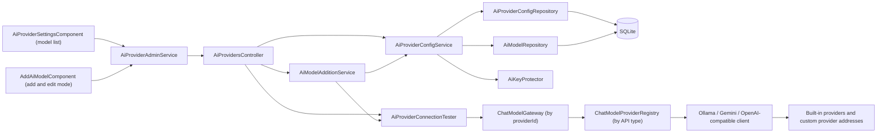
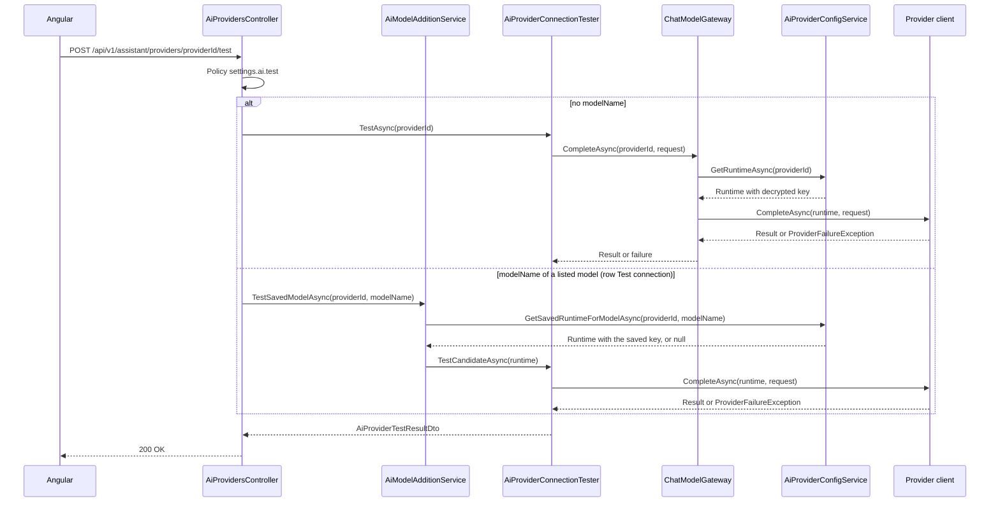
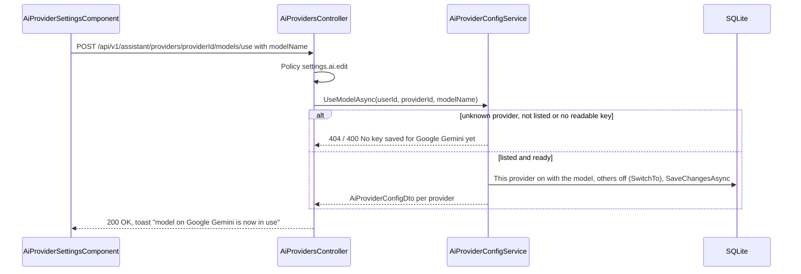
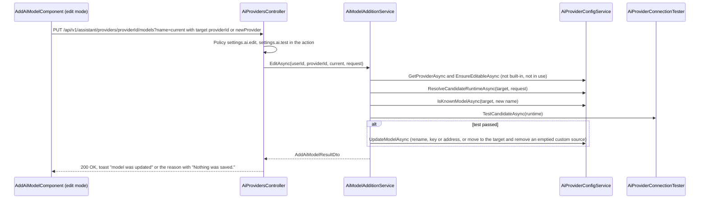
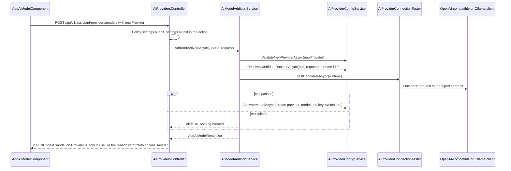

# TFA Settings – Technical Documentation

> **Project:** TaskFlow – Intelligent Task Allocation & Tracking System
> **Parent Module:** Settings  ·  **Child Module:** 08.4 TFA Settings
> **Version:** 1.3  ·  **Last Updated:** 01-Nov-2026
> **Backend:** ASP.NET Core Web API (.NET 10)  ·  **Frontend:** Angular  ·  **Database:** SQLite (EF Core)
> **Author:** Jojo George (jojogeorge3344@gmail.com)
> © 2026 Jojo George. All rights reserved.

---

## 1. Technical Overview
TFA Settings is `AiProvidersController` (7 actions) over `AiProviderConfigService`, `AiModelAdditionService`, `AiProviderConnectionTester`, `AiProviderConfigRepository` and `AiModelRepository`. The screen is a read-only model list (`AiProviderSettingsComponent`) built from `GET config`, with **Use this model**, **Test connection**, **Edit** and **Delete** per row; adding and editing happen on `AddAiModelComponent` (add and edit mode). It stores one `AiProviderConfigs` row per AI provider – the three built-in providers (Google Gemini, OpenAI GPT, Ollama) and any **custom provider** an administrator added (API type OpenAI-compatible or Ollama, its own server address) – and the list of selectable `AiModels`, each keyed by the provider's id (`providerId`). Routes, DTOs, the gateway and stored chat messages identify a provider by `providerId`; `AiApiType` (`Ollama`, `Gemini`, `OpenAI` = OpenAI-compatible) only picks the client. API keys are encrypted with ASP.NET Core Data Protection (`AiKeyProtector`) and never returned. The connection test goes through the Assistant's `IChatModelGateway` (`ChatModelGateway`) to the provider clients in `Integrations/Ai/Providers/`; `OpenAiProvider` serves every OpenAI-compatible provider at its own address.

## 2. Architecture Flow


## 3. Backend File Structure

| Layer | Path | Files |
|-------|------|-------|
| Controller | `TaskFlow.Api/Controllers/Settings/` | `AiProvidersController.cs` |
| Service | `TaskFlow.Api/Services/Settings/TfaSettings/ProviderConfig/` | `IAiProviderConfigService.cs`, `AiProviderConfigService.cs` |
| Service (add model) | `TaskFlow.Api/Services/Settings/TfaSettings/ModelAddition/` | `IAiModelAdditionService.cs`, `AiModelAdditionService.cs` |
| Service (test) | `TaskFlow.Api/Services/Settings/TfaSettings/ConnectionTest/` | `IAiProviderConnectionTester.cs`, `AiProviderConnectionTester.cs` |
| Repository | `TaskFlow.Api/Repositories/Settings/TfaSettings/ProviderConfig/` | `IAiProviderConfigRepository.cs`, `AiProviderConfigRepository.cs` (`UsesModelAsync` removed; `GetAsync(id)`, `GetBuiltInAsync(apiType)`, `GetByNameAsync(name)`) |
| Repository | `TaskFlow.Api/Repositories/Settings/TfaSettings/AiModels/` | `IAiModelRepository.cs`, `AiModelRepository.cs` (by `providerId`) |
| DTOs | `TaskFlow.Api/Dtos/Settings/TfaSettings/` | `AiProviderDtos.cs` (`AiProviderOptionDto`, `AiProviderConfigDto`, `UpdateAiProviderRequest`, `UpdateAiProvidersRequest`, `AiProviderTestResultDto`, `AddAiModelRequest` (with optional `ClearKey`, `ProviderId`, `NewProvider`), `NewAiProviderRequest`, `AddAiModelResultDto`, `AiModelChoiceRequest`) |
| Validators | `TaskFlow.Api/Dtos/Settings/TfaSettings/Validators/` | `UpdateAiProvidersRequestValidator.cs` (also `UpdateAiProviderRequestValidator`), `AddAiModelRequestValidator.cs` |
| Entities | `TaskFlow.Api/Models/Entities/` | `AiProviderConfig.cs` (the provider record: `Name`, `ApiType`, `Locality`, `IsBuiltIn`), `AiModel.cs` (`ProviderId`); `AssistantMessage.cs` (`ProviderId`) |
| Enums | `TaskFlow.Api/Models/Enums/` | `AiApiType.cs` (renamed from `AiProviderKind.cs`, same values), `ProviderFailureKind.cs` |
| Constants | `TaskFlow.Api/Common/Constants/` | `AiProviderCatalog.cs` |
| AI integration | `TaskFlow.Api/Integrations/Ai/` | `KeyProtection/AiKeyProtector.cs`, `KeyProtection/KeyRingProtectionCheck.cs`, `Registry/ChatModelProviderRegistry.cs`, `Providers/OllamaProvider.cs`, `Providers/GeminiProvider.cs`, `Providers/OpenAiProvider.cs`, `Providers/ProviderHttp.cs`, `Providers/ProviderFailure.cs`, `Providers/AiProviderRuntime.cs`, `Providers/ChatModelTypes.cs` |
| Gateway (Assistant module) | `TaskFlow.Api/Services/Assistant/ModelGateway/`, `Services/Assistant/Chat/` | `ChatModelGateway.cs`, `ProviderFailureMessages.cs` |
| Seeders | `TaskFlow.Api/Persistence/Seeders/` | `AiProviderSeeder.cs` |
| Config | `TaskFlow.Api/Config/` | `AiProviderOptions.cs`, `IntegrationRegistration.cs` |
| Migrations | `TaskFlow.Api/Persistence/Migrations/` | `20261018183210_AddAssistant.cs` (`AiProviderConfigs`), `20261019163241_AddAiModels.cs` (`AiModels`), `20261101050239_AddCustomAiProviders.cs` (provider columns, `ProviderId` on models and messages, data mapped onto the built-in providers) |

## 4. Frontend File Structure

| Type | Path | Purpose |
|------|------|---------|
| Page component | `src/app/modules/settings/tfa-settings/pages/tfa-settings.component.ts` | `TfaSettingsComponent` wrapper |
| Page component | `src/app/modules/settings/tfa-settings/pages/add-ai-model.component.{ts,html,css}` | `AddAiModelComponent`: the Add AI model page (AI provider text input with a `<datalist>` of provider names – no dropdown –, model name, API key or server address, Test connection, Back), and its edit mode (`editing`, `startEditing`, `removeKey`; title **Edit AI model**, provider prefilled and editable, **Test and save**, **Remove the key**). `matchProvider` matches a typed name to an existing provider ignoring case; `selected`, `isNew` (shows the **New provider** tag and **API type** from `CUSTOM_API_TYPES`, **Runs**, **Server address**, optional **API key**), `apiType`, `source` and `moveTarget` ("The model moves to {target} when the test works."); `newProviderChecks` gives "The provider name must be 2 to 40 characters." and "Enter the server address."; a blank provider gives "Enter the AI provider.". `MODEL_ID_EXAMPLES` gives the model-name placeholder per API type (`gemini-3.8-flash`, `gpt-4o-mini`, `llama3.2:3b`); the `modelId` validator refuses whitespace (and, for Gemini, a malformed ID); for Gemini a key hint links to Google AI Studio (`https://aistudio.google.com/apikey`) without checking the key's prefix |
| Child component | `src/app/modules/settings/tfa-settings/components/ai-provider-settings.component.{ts,html,css}`, `ai-provider-settings.model.ts` | `AiProviderSettingsComponent`: read-only model list with the **Add AI model** button, one group per provider id (built-ins first, then custom providers by name); signals `groups`, `inUse`, `busy`, `testing`, `results` (row key `providerId\|model`); methods `use`, `test`, `edit`, `remove`; `keyText` shows a custom provider's address and " · key ends …1234" when a key is saved; `ModelRow`, `ProviderGroup` |
| Shared component | `src/app/shared/components/confirm-dialog/confirm-dialog.{component,model}.ts` | `tf-confirm-dialog`; `ConfirmOptions.notice` shows only the confirm button (the in-use "OK" notice) |
| API service | `src/app/modules/settings/tfa-settings/services/ai-provider-admin.service.ts` | `AiProviderAdminService.getConfig()/save()/removeModel(providerId, name)/test(providerId, modelName?)/addModel(body)/useModel(providerId, modelName)/editModel(providerId, name, body)` (`save()` is no longer called by the screen; `addModel` posts to `models` without an id) |
| Route / Guard | `src/app/modules/settings/settings.routes.ts` (`settings/tfa`, `settings/tfa/models/new`, `settings/tfa/models/:providerId/:name/edit`), `src/app/shared/auth/auth.guard.ts` | `permissionGuard` with `SettingsAiView` (TFA Settings) and `SettingsAiEdit` (Add AI model and its edit mode; the page also checks `SettingsAiTest`) |
| Menu | `src/app/layouts/nav-items.ts` | "TFA Settings" item when `SettingsAiView` is held |

---

## 5. API & Logic

### 5.1 API Endpoints
Controller `AiProvidersController`, `[Route("api/v1/assistant/providers")]`, class `[Authorize]`. **Breaking change in v1.3:** every provider route uses `{providerId:int}` (the `AiProviderConfigs.Id` of a built-in or custom provider) instead of `{kind}`, and adding a model moved to `POST models` (no id in the route, because a new provider has none yet). An unknown id answers 404 "That AI provider does not exist.".

| # | Method | Endpoint | Description | Permission (Policy) | Request DTO | Response DTO |
|---|--------|----------|-------------|---------------------|-------------|--------------|
| 1 | GET | `/api/v1/assistant/providers/config` | Every provider with status – built-ins first (Gemini, OpenAI, Ollama), then custom providers by name. Key never returned | `settings.ai.view` | – | `IReadOnlyList<AiProviderConfigDto>` |
| 2 | PUT | `/api/v1/assistant/providers/config` | Save provider settings. Kept for compatibility; the screen no longer calls it. Items carry `providerId` (replacing `kind`) | `settings.ai.edit` | `UpdateAiProvidersRequest` | `IReadOnlyList<AiProviderConfigDto>` |
| 3 | DELETE | `/api/v1/assistant/providers/{providerId}/models?name=` | Delete an administrator-added model. 400 for a built-in model or the model in use. A custom provider left with no models is removed with its key | `settings.ai.model.remove` | Query `name` | `IReadOnlyList<AiProviderConfigDto>` |
| 4 | POST | `/api/v1/assistant/providers/{providerId}/test` | One tiny request to the provider. With `{ modelName }`: that listed model with the saved key or address, even when the provider is switched off; without a body: the saved settings | `settings.ai.test` | optional `AiModelChoiceRequest` | `AiProviderTestResultDto` |
| 5 | POST | `/api/v1/assistant/providers/models` | Add AI model: test the typed values without saving; only if the test passes, save the model and key/address – creating a new custom provider first – and make it the one in use. Exactly one of `providerId` and `newProvider` | `settings.ai.edit` (attribute) + `settings.ai.test` (checked in the action) | `AddAiModelRequest` `{ modelName, apiKey?, baseUrl?, providerId? \| newProvider?: { name, apiType, baseUrl, locality } }` | `AddAiModelResultDto` |
| 6 | POST | `/api/v1/assistant/providers/{providerId}/models/use` | **Use this model**: make a listed model the one TFA uses and switch the other providers off. 404 unknown provider or model; 400 "No key saved for {Provider} yet. Add it on the Add AI model screen." | `settings.ai.edit` | `AiModelChoiceRequest` `{ modelName }` | `IReadOnlyList<AiProviderConfigDto>` |
| 7 | PUT | `/api/v1/assistant/providers/{providerId}/models?name={current}` | Edit an added model: test the typed values, and only if the test passes rename it and save the key or address (the model in use does not change); the body's `providerId` / `newProvider` is the target – when it is another provider the model **moves** there; `clearKey: true` removes the key without a test. 400 for a built-in model, the model in use, a duplicate name on the target, `clearKey` with other changes or a move, or a key and `clearKey` together | `settings.ai.edit` (attribute) + `settings.ai.test` (checked in the action) | Query `name`, `AddAiModelRequest` `{ modelName, apiKey?, baseUrl?, clearKey?, providerId? \| newProvider? }` | `AddAiModelResultDto` |

_Withdrawn in v1.3: `{kind}` routes bound to `AiProviderKind`._ Related (Assistant module): `GET /api/v1/assistant/providers` (`assistant.chat`) returns `AiProviderOptionDto(ProviderId, DisplayName, ModelName, Locality)` for configured providers only, through `GetAvailableAsync`; the chat request sends `providerId`.

**DTO changes (v1.3):** `AiProviderConfigDto` has `ProviderId`, `DisplayName` (the provider's name), `ApiType`, `IsBuiltIn`, `Locality`, `RequiresKey` (true only for built-in Gemini and OpenAI), `IsEnabled`, `ModelName`, `BaseUrl` (Ollama and custom providers), `KeySet`, `KeyLast4`, `IsConfigured`, `KeyReadable`, `Models`, `CustomModels`. `NewAiProviderRequest(Name, ApiType, BaseUrl, Locality)` describes a provider created on a pass. `UpdateAiProviderRequest.ProviderId` replaces `Kind`.

### 5.2 Request / Response Samples
```json
Ids in these samples are examples (Google Gemini 1, OpenAI GPT 2, Ollama 3, a custom "Groq" 4); the real ids come from `GET config`.
```json
// PUT /api/v1/assistant/providers/config  (kept for compatibility; not sent by the screen)
{ "providers": [
  { "providerId": 1, "isEnabled": false, "modelName": "llama3.2:3b", "baseUrl": "http://localhost:11434" },
  { "providerId": 2, "isEnabled": true, "modelName": "gemini-3.8-flash", "apiKey": "<secret>" },
  { "providerId": 3, "isEnabled": false, "modelName": "gpt-4o-mini", "clearKey": true }
] }
```
```json
// 200 OK (one element)
{ "providerId": 2, "displayName": "Google Gemini", "apiType": "Gemini", "isBuiltIn": true, "locality": "Cloud", "requiresKey": true, "isEnabled": true, "modelName": "gemini-3.8-flash", "baseUrl": null, "keySet": true, "keyLast4": "x9Qa", "isConfigured": true, "keyReadable": true, "models": ["gemini-3.8-flash", "gemini-3.5-flash", "gemini-3.5-flash-lite"], "customModels": [] }
```
```json
// POST /api/v1/assistant/providers/models  (a new custom provider)
{ "modelName": "llama-3.3-70b-versatile", "apiKey": "<secret>", "newProvider": { "name": "Groq", "apiType": "OpenAI", "baseUrl": "https://api.groq.com/openai/v1", "locality": "Cloud" } }
// 200 OK, test passed: Groq created (id 4) and its model in use
{ "ok": true, "message": "The connection works.", "failureKind": null, "providers": [ /* built-ins, then { "providerId": 4, "displayName": "Groq", "apiType": "OpenAI", "isBuiltIn": false, "locality": "Cloud", "requiresKey": false, "isEnabled": true, "baseUrl": "https://api.groq.com/openai/v1", ... } */ ] }
// 400 for a Gemini-type custom provider
{ "status": 400, "errors": { "newProvider.apiType": ["A custom provider can use the OpenAI-compatible or Ollama API."] } }
```
```json
// PUT /api/v1/assistant/providers/2/models?name=gemini-2.0-flash  (move to the existing custom "OpenRouter", id 5)
{ "modelName": "google/gemini-2.0-flash-001", "providerId": 5 }
```
```json
// POST /api/v1/assistant/providers/1/test -> 200 OK
{ "ok": false, "message": "Ollama is not running or cannot be reached. Ask an administrator to start it, or choose another model.", "failureKind": "Unreachable" }
```
```json
// POST /api/v1/assistant/providers/2/test -> 200 OK (saved model with a malformed name; provider reason appended)
{ "ok": false, "message": "The configured model is not available on Google Gemini. Ask an administrator to check the model name, or choose another model. Google Gemini said: HTTP 400 - INVALID_ARGUMENT: ...", "failureKind": "ModelUnavailable" }
```
```json
// POST /api/v1/assistant/providers/models  (an existing provider)
{ "modelName": "gemini-3.1-pro-preview", "providerId": 2, "apiKey": "<secret, optional when a readable key is saved>" }
// 200 OK, test passed: saved and in use
{ "ok": true, "message": "The connection works.", "failureKind": null, "providers": [ /* AiProviderConfigDto per provider */ ] }
// 200 OK, test failed: nothing saved
{ "ok": false, "message": "Google Gemini did not accept the API key. ...", "failureKind": "InvalidKey", "providers": null }
```
```json
// POST /api/v1/assistant/providers/2/models/use
{ "modelName": "gemini-3.5-flash" }
// 200 OK: AiProviderConfigDto per provider, Gemini enabled with gemini-3.5-flash, the others disabled
```
```json
// POST /api/v1/assistant/providers/2/test  (row Test connection)
{ "modelName": "gemini-3.5-flash" }
// 200 OK
{ "ok": true, "message": "The connection works.", "failureKind": null }
```
```json
// PUT /api/v1/assistant/providers/2/models?name=gemini-2.5-pro
{ "modelName": "gemini-2.5-flash" }
// 400 when TFA uses gemini-2.5-pro
{ "status": 400, "errors": { "name": ["gemini-2.5-pro is in use by TFA. Switch TFA to another model first, then edit it."] } }
// PUT /api/v1/assistant/providers/2/models?name=gemini-2.5-flash  (Remove the key)
{ "modelName": "gemini-2.5-flash", "clearKey": true }
```

### 5.3 Service Layer Logic
**Method:** `AiProviderConfigService.GetAdminConfigAsync()`
- For every provider row – built-ins first in `AiProviderCatalog.All` order, then custom providers by name – `ToDto` builds the response:
  - `ProviderId`, `DisplayName` (the row's `Name`), `ApiType`, `IsBuiltIn`, `Locality` from the row
  - `RequiresKey` = built-in and not Ollama (a custom OpenAI-compatible provider's key is optional)
  - `Models` = all `AiModels` with that `ProviderId`, plus the chosen model if it is missing
  - `CustomModels` = the non-built-in ones (every model of a custom provider)
  - `BaseUrl` for Ollama and custom providers (default `http://localhost:11434`); null for built-in Gemini and OpenAI
  - `KeySet` and `KeyLast4`
  - `KeyReadable` = the stored key can still be `Unprotect`-ed
  - `IsConfigured` = enabled, has a model, and has either a URL (Ollama, custom provider) or a decryptable key (built-in Gemini, OpenAI)

**Method:** `AiProviderConfigService.SaveAsync(int userId, UpdateAiProvidersRequest)`
1. Loads all tracked config rows. For each update:
   - a null `ProviderId`, `IsEnabled` or `ModelName` gives `RequestValidationException("providers", "Every provider setting must be provided.")`; an unknown id gives `NotFoundException("That AI provider does not exist.")`
   - a trimmed model name that is empty or over 100 characters gives "The {Provider} model name must be 1 to 100 characters."
2. Uses the existing row (rows are not created here). Sets `IsEnabled` and `ModelName`. When the provider is enabled, `RememberModelAsync` adds a non-built-in `AiModel` if the name is new.
3. `BaseUrl`: for Ollama and custom providers, the normalised value (trimmed, trailing `/` removed), else the saved one, else the default. For built-in Gemini and OpenAI, unchanged (`null`).
4. A non-empty `ApiKey` on an Ollama-type provider gives "{Provider} does not use an API key.". Otherwise `EncryptedApiKey = _keyProtector.Protect(key)` and `KeyLast4` = the last 4 characters. `ClearKey == true` nulls both.
5. Sets `UpdatedByUserId` and `UpdatedAt`. `SaveKeepingAnyDuplicateModelAsync` handles a duplicate model race: on `UniqueConstraintException` it detaches the duplicate added models and saves again.
6. The screen no longer calls `SaveAsync`; the endpoint is kept for compatibility and itself allows several enabled providers. One active server is applied by `UseModelAsync` and `ActivateModelAsync` (`SwitchTo`).

**Method:** `AiProviderConfigService.RemoveModelAsync(providerId, name)`
- `EnsureEditableAsync`: not found gives `NotFoundException("That model is not in the list.")`. `IsBuiltIn` gives a 400 "A built-in model cannot be changed or removed.". The model in use (the provider row is enabled and its `ModelName` is this name) gives a 400 "{name} is in use by TFA. Switch TFA to another model first, then delete it.". Then the model is removed and `ReleaseModelAsync` runs: a **custom provider with no other model left is removed with its key**; otherwise a switched-off provider row that still has this model saved is reset – a built-in one to `AiProviderCatalog.DefaultModel(apiType)` (`llama3.2:3b`, `gemini-3.8-flash`, `gpt-4o-mini`), a custom one to its first remaining model – and stays off. A built-in provider is never removed. One save, then the config is returned. (The earlier `UsesModelAsync` rule, which also blocked a switched-off provider, was removed.)

**Method:** `AiProviderConfigService.UseModelAsync(userId, providerId, modelName)` ("Use this model")
1. An unknown `providerId` gives `NotFoundException("That AI provider does not exist.")` (404). Normalises the name by the provider's API type; a name not in the provider's list gives `NotFoundException("That model is not in the list.")` (404).
2. A built-in Gemini or OpenAI provider whose saved key cannot be read (or is missing) gives `RequestValidationException("modelName", "No key saved for {Provider} yet. Add it on the Add AI model screen.")` (400). Nothing changes. A custom provider needs no key.
3. Sets `ModelName` (Ollama and custom `BaseUrl` default to `http://localhost:11434` when empty), and `SwitchTo` enables this row and disables the others (keys, models and addresses kept), stamping `UpdatedByUserId` / `UpdatedAt`. Saves and returns the config.

**Method:** `AiModelAdditionService.TestSavedModelAsync(providerId, modelName)` (row **Test connection**)
- `GetProviderAsync(providerId)` (unknown → 404), then `AiProviderConfigService.GetSavedRuntimeForModelAsync` builds the runtime from the saved key or address with that listed model, whether or not the provider is switched on (unknown model → 404). With no readable key for built-in Gemini or OpenAI it returns `ok: false` with "No key saved for {Provider} yet. Add it on the Add AI model screen.". Otherwise `AiProviderConnectionTester.TestCandidateAsync(runtime)` sends the tiny prompt straight to the provider. Nothing is saved.

**Method:** `AiModelAdditionService.EditAsync(userId, providerId, currentName, AddAiModelRequest)` (Edit AI model, rename or move)
1. `GetProviderAsync(providerId)` (the source), then `AiProviderConfigService.EnsureEditableAsync(providerId, currentName, "edit")`: not listed → 404; built-in → 400 "A built-in model cannot be changed or removed."; in use → 400 "{name} is in use by TFA. Switch TFA to another model first, then edit it.".
2. The target is the body's `providerId` (existing) or `newProvider` (validated by `ValidateNewProviderAsync`, not created yet); neither keeps the source. `moving` is true when the target is not the source.
3. `clearKey: true`: with a move, a changed name or an address → 400 "Remove the key on its own, without other changes."; otherwise `ClearKeyAsync` removes the encrypted key and `KeyLast4` ("{Provider} does not use an API key." for an Ollama-type provider) without any provider call.
4. `ResolveCandidateRuntimeAsync(target, request)` builds the runtime on the target. When moving (or renaming in place) to an existing provider that already lists the name → 400 "That model is already in the list."; nothing is tested.
5. `TestCandidateAsync(runtime)`. A failed test returns `ok: false`, `providers: null`; nothing saved, the model stays where it was.
6. A passed test calls `UpdateModelAsync(userId, providerId, currentName, runtime, saveKey)` in one save. Same provider: renames the `AiModel` row, a switched-off provider row that had the old name saved follows the new name, the typed key (`Protect`, `KeyLast4`) or address is stored. Move: creates the target first when it is new (`CreateProvider`), removes the source `AiModel`, adds one on the target, stores the typed key or address on the target, and `ReleaseModelAsync` resets or removes the source (an emptied custom provider is removed). `IsEnabled` is not touched, so the model TFA uses does not change. A unique-index clash gives 400 "That model is already in the list.".

**Method:** `AiProviderConfigService.GetRuntimeAsync(providerId)`
- Returns `AiProviderRuntime(ProviderId, ApiType, Name, IsLocal, ModelName, BaseUrl, ApiKey)` with the decrypted key, or `null` when the provider is not configured. It logs a warning when an enabled provider's key cannot be decrypted.

**Method:** `AiProviderConnectionTester.TestAsync(providerId)`
1. Builds a `ChatModelRequest` with the system text "This is a connection test. Reply with the single word OK." and the user message "Reply with OK.".
2. Calls `IChatModelGateway.CompleteAsync(providerId, request)`. The gateway gets the runtime, throws `ProviderNotConfiguredException(providerId, name)` when it is null, calls the client from `IChatModelProviderRegistry.Get(runtime.ApiType)`, and attaches a failure to the provider with `ProviderFailureException.For(runtime)` (sets `ProviderId`, `ProviderName`, `IsLocal`).
3. On success, `Ok = true` with "The connection works.". `ProviderNotConfiguredException` gives `ProviderFailureMessages.NotConfigured(name)`. `ProviderFailureException` gives `ProviderFailureMessages.For(failure)` – the message names the provider, so a custom one reads for example "Groq did not accept the API key. …", and a Local custom provider that cannot be reached gets "{Provider} is not running or cannot be reached. …" – and its `FailureKind`. The test always returns `200`, never an error status.
4. For `Unexpected` and `ModelUnavailable` failures that carry a `ProviderReason`, `Failed(...)` appends "{Provider} said: HTTP {status} - {reason}" to the message (the `HTTP {status} - ` part only when a status is known). The failure is logged as a warning with provider, failure kind, HTTP status and the reason. Only Test connection (here and in Add AI model) shows the reason; chat replies from `AssistantService` keep the fixed `ProviderFailureMessages` text.

**Method:** `AiModelAdditionService.AddAndActivateAsync(userId, AddAiModelRequest)` (the Add AI model page)
0. The provider comes from the body: `providerId` (an existing provider; unknown → 404) or `newProvider`. Neither → 400 "Enter the AI provider."; both → 400 "Choose an existing provider or a new one, not both.". A `newProvider` is checked by `AiProviderConfigService.ValidateNewProviderAsync`: name 2 to 40 characters ("The provider name must be 2 to 40 characters."), API type `OpenAI` or `Ollama` ("A custom provider can use the OpenAI-compatible or Ollama API."), address present ("Enter the server address.") and safe – http/https, at most 300 characters, not link-local or metadata (the shared `BeHttpUrl` / `IsMetadataHost` rule) – locality `Local` or `Cloud` ("Choose Local or Cloud."), and the name not taken ignoring case (`GetByNameAsync`; "A provider with that name already exists.").
1. `AiProviderConfigService.ResolveCandidateRuntimeAsync(provider?, request)` builds an in-memory `AiProviderRuntime` without writing anything:
   - new provider: id `0`, the typed name, API type, locality, address and key
   - built-in Gemini / OpenAI: the typed key, else the saved key decrypted, else `RequestValidationException("apiKey", "Enter the API key.")`
   - Ollama or a custom provider: a typed key on an Ollama-type provider gives "{Provider} does not use an API key."; the address is the typed one, then the saved one, then `http://localhost:11434`; a custom OpenAI-compatible provider's key is optional
   - the model name is normalised and checked by API type: Gemini's strict lowercase format, otherwise only "no spaces" (so `meta-llama/Llama-3.3-70B-Instruct` passes)
2. `AiProviderConnectionTester.TestCandidateAsync(runtime)` sends the same tiny prompt straight to the provider through `IChatModelProviderRegistry` (not the gateway, which reads saved settings). A failure is logged with provider, failure kind, HTTP status and the cleaned provider reason (never the key).
3. Failed test: returns `ok: false` with the `ProviderFailureMessages` text (plus the provider reason, as in `TestAsync` step 4) and `providers: null`. Nothing is saved.
4. Passed test: `AiProviderConfigService.ActivateModelAsync` in one save creates the custom provider row when the runtime id is `0` (`CreateProvider`: `Name`, `ApiType`, `Locality`, `IsBuiltIn = false`, `BaseUrl`), adds the `AiModel` if new (`RememberModelAsync`), stores the typed key (`Protect`, `KeyLast4`) or the address, enables this provider with the model, disables the other enabled rows (keys and models kept), and stamps `UpdatedByUserId` / `UpdatedAt`. Duplicate-model races use `SaveKeepingAnyDuplicateModelAsync`.
5. The orchestration lives in `AiModelAdditionService` because the tester depends on the gateway, which depends on `AiProviderConfigService`; putting it in the config service would create a DI cycle.

**Provider clients:**
- `OllamaProvider` calls `{BaseUrl}/api/chat` with no key (built-in Ollama and custom Ollama providers).
- `GeminiProvider` calls `v1beta/models/{model}:generateContent`, with the key in the `x-goog-api-key` header (built-in only).
- `OpenAiProvider` calls `{BaseUrl}/chat/completions`, with `BaseUrl` defaulting to `https://api.openai.com/v1` for the built-in OpenAI GPT (whose `BaseUrl` is null); a custom OpenAI-compatible provider uses its own address including the version path (for example `https://api.groq.com/openai/v1`). `Authorization: Bearer` is sent only when a key exists. When an OpenAI-compatible server answers 400 about tools ("tool" or "function" in the body) to a request with tools, the request is sent once more without tools.
- `ChatModelProviderRegistry.Get(apiType)` picks the client by `AiApiType`.

`ProviderHttp` maps a timeout to `Timeout` and an `HttpRequestException` to `Unreachable`. Status codes and provider error codes map to `RateLimited` (429), `InvalidKey` (401/403) and `ModelUnavailable` (404). `GeminiProvider.Classify` also maps a `400` / `INVALID_ARGUMENT` whose message mentions the model name (for example "unexpected model name format") to `ModelUnavailable`, after the API-key rule; any other `INVALID_ARGUMENT` stays `Unexpected`. Redirects are not followed.

`ProviderFailureException.ProviderReason` holds the provider's own error status and message, built by `ProviderHttp.Reason(status, message, apiKey)`: the sent key and anything shaped like a key (`AIza…`, `sk-…`, `AQ.…`) are replaced by `[key]`, whitespace is collapsed, and the text is cut to 200 characters (`MaxReasonLength`).

Built-in models come from `AiProviderCatalog.BuiltInModels`: Gemini `gemini-3.8-flash` (default), `gemini-3.5-flash`, `gemini-3.5-flash-lite`. Google no longer serves the earlier built-ins (`gemini-2.0-flash`, `gemini-2.5-flash`, `gemini-2.5-pro`) to new keys; a saved setting that still names one keeps it, and Test connection reports it as model not available with Google's reason.

### 5.4 Repository Layer

| Method | Description | Query Notes |
|--------|-------------|-------------|
| `AiProviderConfigRepository.GetAllAsync()` | All provider rows | `AsNoTracking` |
| `AiProviderConfigRepository.GetAllForUpdateAsync()` | Tracked rows for save | Tracked `List` |
| `AiProviderConfigRepository.GetAsync(id)` | One row by id | `AsNoTracking` |
| `AiProviderConfigRepository.GetBuiltInAsync(apiType)` | The built-in row of an API type | Used for the saved key of the built-in Google Gemini row for document embeddings |
| `AiProviderConfigRepository.GetByNameAsync(name)` | A provider by name, ignoring case | `Name` column is `COLLATE NOCASE` |
| `AiModelRepository.GetAllAsync()` | All models | `AsNoTracking`, built-in first, then by `Id` |
| `AiModelRepository.IsKnownAsync(providerId, name)` | Stored or staged in this request | Checks `Set.Local` then the database |
| `AiModelRepository.GetForUpdateAsync(providerId, name)` | Tracked model to delete, check, rename or move | `FirstOrDefaultAsync` |
| `AiModelRepository.DropAddedModelsStoredElsewhereAsync()` | Race recovery | Detaches `Added` entries that now exist |

### 5.5 Sequence Diagram


**Use this model**


**Edit or move an added model**


**Add a model for a new custom provider**


---

## 6. Database Design

| Table | Column | Type | Constraints | Description |
|-------|--------|------|-------------|-------------|
| `AiProviderConfigs` | `Id` | int | PK | Row id; the `providerId` used by routes, DTOs and messages |
| `AiProviderConfigs` | `Name` | string(40) | Not Null, Unique (`IX_AiProviderConfigs_Name`), `COLLATE NOCASE` | `Ollama`, `Google Gemini`, `OpenAI GPT` or a custom provider's name |
| `AiProviderConfigs` | `ApiType` | string(16) | Not Null (enum `AiApiType` as string; renamed from `Kind`) | `Ollama`, `Gemini`, `OpenAI` (OpenAI-compatible); custom providers are `OpenAI` or `Ollama` |
| `AiProviderConfigs` | `Locality` | string(8) | Not Null | `Local` or `Cloud` |
| `AiProviderConfigs` | `IsBuiltIn` | bool | Not Null | True for the three built-in providers (never removed) |
| `AiProviderConfigs` | `IsEnabled` | bool | Not Null | Provider switched on |
| `AiProviderConfigs` | `ModelName` | string(100) | Not Null | Chosen model |
| `AiProviderConfigs` | `BaseUrl` | string(300) | Nullable | Ollama and custom providers (required for custom); null for built-in Gemini and OpenAI |
| `AiProviderConfigs` | `EncryptedApiKey` | string | Nullable | Data Protection ciphertext, never returned |
| `AiProviderConfigs` | `KeyLast4` | string(4) | Nullable | Display hint |
| `AiProviderConfigs` | `UpdatedByUserId` | int? | – (no FK) | Last editor |
| `AiProviderConfigs` | `UpdatedAt` | DateTime | Not Null | UTC |
| `AiModels` | `Id` | int | PK | Row id |
| `AiModels` | `ProviderId` | int | FK → `AiProviderConfigs.Id` (cascade delete), Unique with `Name` (`IX_AiModels_ProviderId_Name`); replaces `Kind` | Provider |
| `AiModels` | `Name` | string(100) | Not Null, Unique with `ProviderId` | Model name |
| `AiModels` | `IsBuiltIn` | bool | Not Null | From `AiProviderCatalog.BuiltInModels` |
| `AssistantMessages` | `ProviderId` | int? | FK → `AiProviderConfigs.Id` (set null), `IX_AssistantMessages_ProviderId`; replaces `ProviderKind` | The provider that answered (Assistant module) |

**Relationships:** `AiModels.ProviderId` → `AiProviderConfigs.Id` with cascade delete; `AssistantMessages.ProviderId` → `AiProviderConfigs.Id` with set null, so a removed custom provider leaves its old messages without a provider. (Until v1.2 there was no FK: `AiModels.Kind` and `AiProviderConfigs.Kind` were matched by value.)

**Migration `20261101050239_AddCustomAiProviders`:** drops `IX_AiProviderConfigs_Kind`, renames `Kind` to `ApiType`, adds `Name`, `Locality`, `IsBuiltIn`, `AiModels.ProviderId` and `AssistantMessages.ProviderId`; marks the existing rows as the built-in Google Gemini, OpenAI GPT and Ollama (name and locality from the catalogue); inserts a built-in row for any kind that only had models; fills both `ProviderId` columns by joining on the old kind; drops `AiModels.Kind`, `IX_AiModels_Kind_Name` and `AssistantMessages.ProviderKind`; creates the new indexes and foreign keys. Keys, models, the saved model, the enabled flag and message history are kept. **Down** restores the kind columns for the built-in rows and deletes custom providers and their models (lossy for custom providers only). Copy the SQLite file before upgrading.

**Seed data:** `AiProviderSeeder` adds any missing built-in provider row (one per API type) and inserts the built-in models keyed on those rows' `ProviderId` (`AiProviderCatalog.All` is `[Gemini, OpenAI, Ollama]`). It takes `IAiKeyProtector` and `IOptions<AiProviderOptions>`: when `AiProviders:GeminiApiKey` is configured (user secrets or env var `AiProviders__GeminiApiKey`) and the Gemini row has no key, the key is stored encrypted with `KeyLast4`; on a fresh install (no users yet) Gemini is then switched on with `gemini-3.8-flash`. Without a configured key every provider stays off on a fresh install. Ollama is never switched on automatically, an existing installation keeps the provider an administrator enabled, and a key saved in TFA Settings is never overwritten. Custom providers are never touched.

## 7. Security & Authorization
- **Authorization:** class `[Authorize]` plus one `[RequirePermission]` per action (`settings.ai.view`, `settings.ai.edit`, `settings.ai.model.remove`, `settings.ai.test`). `RequirePermissionAttribute` allows one per action, so `POST models` (which also creates a custom provider) and `PUT {providerId}/models` check their second permission (`settings.ai.test`) with `IAuthorizationService` and return `403` when it is missing. No new permission keys.
- **Secrets:**
  - API keys are encrypted with Data Protection (purpose `TaskFlow.AiProviderKeys`). The key ring lives at `Storage:Root`/`AiProviders:KeyRingPath` and is DPAPI-protected on Windows.
  - At startup, `KeyRingProtectionCheck` warns about unprotected master keys.
  - Keys are never returned. Provider failure logs contain provider, failure kind, HTTP status and the cleaned provider reason (keys replaced by `[key]`, at most 200 characters).
  - The provider reason is returned only by the two test endpoints, which need `settings.ai.test`.
  - The URL rule blocks link-local and cloud-metadata hosts (SSRF guard) for every provider address – Ollama and every custom provider (`ValidateNewProviderAsync` reuses `BeHttpUrl` / `IsMetadataHost`). A custom address is called only for its test and for chat; redirects are not followed.
  - A custom provider's key is encrypted like a built-in one and sent (`Authorization: Bearer`) only when one is saved.
  - Data sent to a custom provider marked **Cloud** is covered by the same cloud notice in the TFA window (decided by `locality`); a **Local** provider gets the Local notice (the message is sent to Google Gemini for document search).
- **Frontend:** `permissionGuard` on `settings/tfa`, `settings/tfa/models/new` and `settings/tfa/models/:providerId/:name/edit`, the menu item in `buildNavigation()`, in-component checks `canEdit`, `canTest`, `mayRemoveModel` and `canAddModel` (edit and test), and an `ngOnInit` check on the Add AI model page that sends a user without `settings.ai.test` back to `/settings/tfa`.

| Permission Key | Endpoint(s) | UI Element Controlled |
|----------------|-------------|-----------------------|
| `settings.ai.view` | `GET /api/v1/assistant/providers/config` | Menu "TFA Settings", route `/settings/tfa`, section visibility |
| `settings.ai.edit` | `PUT /api/v1/assistant/providers/config` (compatibility), `POST /api/v1/assistant/providers/{providerId}/models/use`, `POST /api/v1/assistant/providers/models` and `PUT /api/v1/assistant/providers/{providerId}/models` (both with `settings.ai.test`) | "Use this model" button; "Add AI model" button and page (including a new custom provider), "Edit" button and edit page, including a move (with `settings.ai.test`) |
| `settings.ai.test` | `POST /api/v1/assistant/providers/{providerId}/test` | "Test connection" button on each row |
| `settings.ai.model.remove` | `DELETE /api/v1/assistant/providers/{providerId}/models` | "Delete" button on added models |
| `settings.ai.manage` (legacy) | – | Not shown. Expands to the four `settings.ai.*` keys for roles that still hold it |

## 8. Validations & Error Handling

| Rule | Layer | HTTP Code | Error Message |
|------|-------|-----------|---------------|
| Providers null / duplicate provider id | `UpdateAiProvidersRequestValidator` | 400 | Providers are required. / Each provider can only appear once. |
| Unknown provider id (route or body) | `AiProviderConfigService` | 404 | That AI provider does not exist. |
| Add AI model: neither / both `providerId` and `newProvider` | `AiModelAdditionService` | 400 | Enter the AI provider. / Choose an existing provider or a new one, not both. |
| New provider: name length | `AiProviderConfigService.ValidateNewProviderAsync` | 400 | The provider name must be 2 to 40 characters. |
| New provider: API type not OpenAI or Ollama | `AiProviderConfigService.ValidateNewProviderAsync` | 400 | A custom provider can use the OpenAI-compatible or Ollama API. |
| New provider: no address / unsafe address | `AiProviderConfigService.ValidateNewProviderAsync` | 400 | Enter the server address. / The server address must be a valid http or https URL, and not a link-local or cloud metadata address. |
| New provider: locality | `AiProviderConfigService.ValidateNewProviderAsync` | 400 | Choose Local or Cloud. |
| New provider: name taken (ignoring case) | `AiProviderConfigService.ValidateNewProviderAsync` | 400 | A provider with that name already exists. |
| Model name blank | `UpdateAiProviderRequestValidator` | 400 | Model name cannot be blank. |
| Model name contains whitespace (save and Add AI model) | `UpdateAiProviderRequestValidator`, `AddAiModelRequestValidator` (`BeAModelId`) | 400 | A model name is the provider's model ID, without spaces or @, for example gemini-3.8-flash. |
| Bad / metadata URL, > 300 | Validator | 400 | The server address must be a valid http or https URL, and not a link-local or cloud metadata address. |
| Key with whitespace, > 500 | Validator | 400 | The API key cannot contain spaces. |
| New key and clearKey together | Validator | 400 | Provide a new key or clear the key, not both. |
| Missing provider field | `AiProviderConfigService` | 400 | Every provider setting must be provided. |
| Model name length | `AiProviderConfigService` | 400 | The {Provider} model name must be 1 to 100 characters. |
| Key sent for an Ollama-type provider | `AiProviderConfigService` | 400 | {Provider} does not use an API key. (for example "Ollama does not use an API key.") |
| Add AI model: model name blank / > 100 | `AddAiModelRequestValidator` | 400 | Enter the model name. / The model name can be at most 100 characters. |
| Add AI model: key / address rules | `AddAiModelRequestValidator` | 400 | The API key cannot contain spaces. / The server address must be a valid http or https URL, and not a link-local or cloud metadata address. |
| Add AI model: cloud provider, no typed or readable saved key | `AiProviderConfigService` | 400 | Enter the API key. |
| Add AI model: key sent for an Ollama-type provider | `AiProviderConfigService` | 400 | {Provider} does not use an API key. |
| Add AI model: missing `settings.ai.test` | `AiProvidersController` | 403 | – |
| Delete / edit / use: name missing | `AiProvidersController` | 400 | The model name is required. |
| Delete / edit / use / test: not in list | `AiProviderConfigService` | 404 | That model is not in the list. |
| Delete / edit: built-in | `AiProviderConfigService` | 400 | A built-in model cannot be changed or removed. |
| Delete / edit: model in use | `AiProviderConfigService` | 400 | {name} is in use by TFA. Switch TFA to another model first, then delete it. / … then edit it. |
| Use: cloud provider without a readable key | `AiProviderConfigService` | 400 | No key saved for {Provider} yet. Add it on the Add AI model screen. |
| Edit: new name already listed (on the target, for a move) | `AiModelAdditionService`, `AiProviderConfigService` | 400 | That model is already in the list. |
| Edit: `clearKey` with a changed name, an address or a move | `AiModelAdditionService` | 400 | Remove the key on its own, without other changes. |
| Edit: new key and `clearKey` together | `AddAiModelRequestValidator` | 400 | Provide a new key or clear the key, not both. |
| Edit: missing `settings.ai.test` | `AiProvidersController` | 403 | – |

The connection test, and the test inside Add AI model, never return an error status for a provider failure; failures come back in `AiProviderTestResultDto` (`ok: false`, `message`, `failureKind`). For `Unexpected` and `ModelUnavailable` the message ends with "{Provider} said: HTTP {status} - {reason}" (see 5.3). The Add AI model page also refuses a model name with whitespace before sending, with the chosen provider's example in the message. Shared rules are in the parent document.

## 9. Integrations / Side Effects
- **AI Assistant:** `AssistantService` and `AssistantController` use `GetAvailableAsync` for the model selector and `IChatModelGateway` for calls. TFA answers questions about this screen from the documents folder (OpenSpec change `tfa-document-rag`; the old `Services/Assistant/Knowledge` help topics were removed). The document index has no endpoint or UI here: the hosted `DocumentIndexerService` indexes at startup and every `DocumentKnowledge:RescanMinutes`, and logs problems as warnings (see TDD §16.8).
- **External providers:** the test and all TFA calls go to Ollama (`{BaseUrl}/api/chat`), Gemini, OpenAI or a custom provider's address as described in 5.3. Chat sends `providerId` (`SendAssistantMessageRequest(Text, ProviderId)`); `ChatModelGateway.CompleteAsync(providerId, …)` resolves the runtime and stores the provider id on the reply (`AssistantMessages.ProviderId`). Failures name the provider (`AssistantFailureDto.ProviderId`, `ProviderName`).
- **Document embeddings:** `DocumentEmbeddingEndpoint` reads the key saved on the built-in Google Gemini row (`GetBuiltInAsync(Gemini)`) and decrypts it with `IAiKeyProtector` on every index run and question, whichever chat provider is selected; `GeminiEmbeddingClient` sends it to `gemini-embedding-2` in the `x-goog-api-key` header. Ollama (built-in or custom) is chat-only.
- **Activity Log:** none (only `UpdatedByUserId` / `UpdatedAt` on each provider row).

## 10. Configuration

| Key (`appsettings.json`) | Purpose | Default |
|--------------------------|---------|---------|
| `AiProviders:KeyRingPath` | Data Protection key-ring folder, relative to `Storage:Root` | `dp-keys` |
| `AiProviders:TimeoutSeconds` | Timeout of one provider HTTP call (cloud providers and Gemini document embeddings) | `60` |
| `AiProviders:OllamaTimeoutSeconds` | Timeout of one Ollama chat call | `180` |
| `AiProviders:GeminiApiKey` | Optional Google Gemini key stored on the Gemini row by `AiProviderSeeder` (set with user secrets or `AiProviders__GeminiApiKey`, never in `appsettings.json`) | – |
| `Storage:Root` | Root folder for the key ring (shared, see parent) | `""` |

## 11. Testing

| Test Type | File / Location | Covers |
|-----------|-----------------|--------|
| Unit | `tests/TaskFlow.UnitTests/Settings/TfaSettings/ProviderConfig/AiProviderConfigServiceTests.cs` | Configured state per provider; model lists and adding, removing and racing custom models; only configured providers are listed for users; keys are encrypted, shown as the last four characters, kept when empty, replaced or cleared; an unreadable key is reported and logged without key material; validator rules |
| Unit | `tests/TaskFlow.UnitTests/Settings/TfaSettings/ProviderConfig/AiProviderSeederTests.cs` | A fresh database gets every built-in model; with a configured key Gemini is on with the key encrypted, without one every provider is off; Gemini is listed first; an upgraded install gets every provider off; an existing Ollama installation gets the key but keeps Ollama; a key saved in Settings is never replaced; re-running adds nothing and never overwrites saved values |
| Unit | `tests/TaskFlow.UnitTests/Integrations/Ai/KeyProtection/AiKeyProtectorTests.cs`, `KeyRingProtectionCheckTests.cs` | Keys round-trip and are not stored as plain text; another purpose cannot read them; a replaced key ring gives null; the key-ring check counts unprotected keys and handles missing, empty and unreadable folders and files |
| Unit | `tests/TaskFlow.UnitTests/Integrations/Ai/Providers/ChatProviderTests.cs` | Ollama, Gemini and OpenAI clients: text and tool-call round trips, key headers, failure classification (unreachable, model unavailable, rate limited, timeout), a malformed Gemini model name as model unavailable with its reason while other `INVALID_ARGUMENT` errors stay unexpected, the provider reason hiding keys, tidying spaces and cut to 200 characters, no key or request text in failure messages, and the provider registry by API type. OpenAI-compatible: `ACustomOpenAiCompatibleProviderIsCalledAtItsOwnAddress`, `ALocalServerWithoutAKeyGetsNoAuthorizationHeader`, `AServerThatRejectsToolsIsAskedAgainWithoutThem`; built-in OpenAI still calls `https://api.openai.com/v1/chat/completions` (`OpenAiTextReplyAndBearerHeader`) |
| Unit | `tests/TaskFlow.UnitTests/Assistant/ModelGateway/ProviderFailureHandlingTests.cs`, `ChatModelGatewayTests.cs` | Failure messages suggest another model, use the retry time and never include raw provider text; a failure never falls over to another provider; the per-user limit of 20 requests a minute; `AFailureOfACustomProviderNamesItAndGoesToItsAddress` |
| Unit | `tests/TaskFlow.UnitTests/Settings/TfaSettings/ModelAddition/CustomProviderTests.cs` | A passing test creates the provider and makes its model the one in use; a failed test creates nothing; a local server needs no key and sends no Authorization header; an invalid new provider (name length, name taken in any case, Gemini type, missing or metadata address) is refused without sending anything; model IDs with slashes and uppercase are accepted; deleting a custom provider's last model removes the provider and its key; a built-in provider is never removed; moving to an existing provider or to a new one; an emptied custom provider goes; a duplicate on the target is refused and a failed test leaves the model where it was; the model in use cannot be moved and `clearKey` cannot be combined with a move |
| Unit (real SQLite) | `tests/TaskFlow.UnitTests/Persistence/CustomProvidersMigrationTests.cs` | A database at the previous migration with an encrypted key, added models and assistant messages upgrades with keys, saved models, enabled flags, models and message providers intact; a custom provider can be added after the upgrade and names compare ignoring case; down then up again keeps the built-in providers |
| Integration | `tests/TaskFlow.IntegrationTests/Settings/TfaSettings/CustomProviderEndpointsTests.cs` | Creates a custom provider on a passing test, uses it, chats through it with the fake provider and checks the stored message's provider id; an unknown provider id is 404 and a Gemini-type custom provider is refused |
| Unit | `tests/TaskFlow.UnitTests/Assistant/Chat/AssistantServiceTests.cs` (`AChatFailureNeverShowsTheProvidersOwnReason`) | A chat reply after a provider failure keeps the fixed message and never shows the provider reason |
| Integration | `tests/TaskFlow.IntegrationTests/Settings/TfaSettings/AssistantProviderEndpointsTests.cs` | Non-administrators get 403 and no token gets 401; a saved key never appears in a response or log; on Windows the key ring is protected with DPAPI; invalid input gets 400; test connection reports success and classified failures; only an added, unused model can be removed |
| Unit | `tests/TaskFlow.UnitTests/Settings/TfaSettings/ModelAddition/AiModelAdditionServiceTests.cs`, `ProviderConfig/AddAiModelRequestValidatorTests.cs`, `tests/TaskFlow.UnitTests/Settings/TfaSettings/ConnectionTest/AiProviderConnectionTesterTests.cs` | Add AI model: a passing test adds and activates the model and keeps other providers' keys; a failed test saves nothing; no duplicate model; an empty key uses and keeps the saved key; a missing key and a key for Ollama are refused before anything is sent; Ollama defaults to localhost; candidate tests map failures and never log the key; an unclassified refusal or a retired model shows the provider's status and reason (with the sent key replaced), a key problem keeps the fixed message; request validation, including a model name with spaces |
| Integration | `tests/TaskFlow.IntegrationTests/Settings/TfaSettings/AiModelListEndpointsTests.cs` | Using a listed model switches TFA and a provider without a key is refused; using needs edit permission; testing a listed model sends that model and changes nothing; editing an added model renames it and built-in or in-use models are refused; editing needs test permission |
| Unit | `tests/TaskFlow.UnitTests/Settings/TfaSettings/ProviderConfig/AiProviderConfigServiceTests.cs`, `ModelAddition/AiModelAdditionServiceTests.cs`, `ProviderConfig/AddAiModelRequestValidatorTests.cs` (model list and edit) | Use switches TFA and keeps the other providers; use without a key is refused; the model in use cannot be deleted but one saved only for a switched-off provider can; edit renames and keeps the model in use, a new key replaces the provider key, a failed edit saves nothing, built-in / in-use / duplicate refused without calling the provider, clearing the key calls no provider; testing a listed model uses the saved key and changes nothing; a new key and clear key together fail, clear key alone passes |
| Integration | `tests/TaskFlow.IntegrationTests/Settings/TfaSettings/AddAiModelEndpointsTests.cs` | `POST models` with a `providerId` (was `POST {kind}/models`): a pass saves and activates and never returns or logs the key; a fail returns the reason with nothing saved; 400 for a missing name, missing key or unsafe address; 403 for edit-without-test and for employees. All existing provider tests use provider ids |
| Integration | `tests/TaskFlow.IntegrationTests/Settings/TfaSettings/AiDefaultsOnFirstRunTests.cs` | A new database with a configured key starts with Gemini on and Ollama off, so every signed-in user can use TFA on first run; without a key the model list is there (Gemini first) and no provider is on |
| Integration | `tests/TaskFlow.IntegrationTests/Integrations/Ai/ProviderRedirectTests.cs` | A provider response that redirects is not followed |
| Integration | `tests/TaskFlow.IntegrationTests/Common/KeyRingStartupWarningTests.cs` | At startup a plain key in the key ring logs a warning with the fix and no key material; empty or protected rings give no warning; an unreadable key file does not stop startup |
| Integration (support) | `tests/TaskFlow.IntegrationTests/TestSupport/ScriptedChatProvider.cs` | Not a test. In-process fake provider for each `AiApiType`, registered by `TaskFlowApiFactory`; records the calls it receives |
| Frontend unit | `src/app/modules/settings/tfa-settings/pages/add-ai-model.component.spec.ts`, `services/ai-provider-admin.service.spec.ts` | Provider asked first; fields per provider; required-field errors send nothing; a saved key may be left empty; success shows the toast and returns to TFA Settings; failure stays with the reason and an empty key box; Ollama sends no key; Back link; a user without `settings.ai.test` is sent back; the `addModel` call. Edit mode: provider prefilled and editable, name filled in, shared-key hint; a rename through the edit endpoint with a toast; a failed test stays with the reason and an empty key box; a built-in model or the model in use is sent back with the reason; Remove the key after a confirmation that warns when TFA uses the provider. Service: `useModel`, `editModel` by the current name, `test` with a listed model or the saved settings, all by provider id. Custom providers: a text box for the AI provider that suggests the existing providers; "Enter the AI provider." when it is empty, with nothing sent; a typed name that matches a provider in any case is that provider; a new provider's details and its required server address; a new provider created with its model when the test passes; a one-letter name refused before sending; on Edit, moving the model to another existing provider and to a new provider typed there |
| Frontend unit | `src/app/modules/settings/tfa-settings/components/ai-provider-settings.component.spec.ts` | (rewritten) Every model listed read-only, grouped by provider, with no dropdown, field or Save button; the shared Gemini key on every Gemini row and only the model in use marked; Use this model, disabled with a hint without a key; a row test with its own model; Edit and Delete only on added models; opening the edit screen; the in-use notice instead of edit or delete; delete after confirmation and cancel; each action hidden without its permission; the server error when switching fails; a custom provider listed after the built-in ones and its group dropped once its last model is deleted |
| Frontend unit | `src/app/modules/assistant/services/assistant.service.spec.ts` | The message is sent with the chosen `providerId`; the first message to a custom Cloud provider is held for the cloud notice too and then sent with that provider's id; a provider remembered by name (from before providers had ids) is ignored; a Local provider holds the first message too (it is sent to Google Gemini for document search) and sends at once after its notice was acknowledged |
| Frontend unit | `src/app/shared/components/confirm-dialog/confirm-dialog.component.spec.ts` | A notice shows only the confirm button and resolves true when it is clicked |
| Frontend unit | `src/app/modules/settings/tfa-settings/pages/tfa-settings.component.spec.ts` | The "TFA settings" screen holds the model settings; without `settings.ai.manage` nothing is shown or requested |

> The DPAPI test in `AssistantProviderEndpointsTests.cs`, all of `KeyRingStartupWarningTests.cs` and four tests in `KeyRingProtectionCheckTests.cs` use `[WindowsOnlyFact]` and run only on Windows.

## 12. Known Limitations / Gaps found
- `PUT config` still allows several providers to be enabled at once. `UseModelAsync` and `ActivateModelAsync` switch the others off, and the screen no longer calls `PUT config`.
- The key is one per provider: a new key typed while editing one model replaces it for every model of that provider (the edit screen says so).
- Removing the key of the provider TFA uses makes TFA unavailable until a key is added; the confirmation warns. It can only be done from another added model of that provider, because the model in use cannot be edited.
- (Resolved) The earlier view-only inputs and save-before-test gaps are gone: TFA Settings has no inputs, and **Test connection** uses the saved key or address.
- A provider cannot be renamed or change its API type after it is created, and a custom provider cannot use the Gemini API. A name that only resembles a built-in one ("gemini") creates a custom provider; the **New provider** tag shows this.
- The `{kind}` routes were replaced by `{providerId:int}` routes (breaking); the backend and frontend must be deployed together. The down migration drops custom providers and their models.
- A custom provider's models are not listed from its API; each model ID is typed and checked by the test.

## Revision History

| Version | Date | Author | Summary of changes |
|---|---|---|---|
| 1.2 | 01-Nov-2026 | Jojo George | OpenSpec change `tfa-model-list-and-edit`. New endpoints `POST {kind}/models/use` (`UseModel`, `settings.ai.edit`) and `PUT {kind}/models?name=` (`EditModel`, `settings.ai.edit` + `settings.ai.test`); `POST {kind}/test` takes an optional `{ modelName }` (`TestSavedModelAsync`, `GetSavedRuntimeForModelAsync`, `TestCandidateAsync`); `DELETE {kind}/models` uses the new in-use and built-in rules; `AiProviderConfigService.UseModelAsync`, `EnsureEditableAsync`, `UpdateModelAsync`, `ClearKeyAsync`, `IsKnownModelAsync`; `AiModelAdditionService.EditAsync`; `AiModelChoiceRequest`, `AddAiModelRequest.ClearKey`; `UsesModelAsync` removed. Frontend: read-only model list, `AddAiModelComponent` edit mode and route, `AiProviderAdminService.useModel` / `editModel` / `test(kind, modelName?)`, confirm-dialog notice mode. Updated sections 1, 2, 3, 4, 5.1 – 5.5, 7, 8, 11 and 12. `PUT config` kept for compatibility. (Earlier versions were not recorded in this table.) |
| 1.3 | 01-Nov-2026 | Jojo George | OpenSpec change `tfa-custom-ai-providers`. Providers are data identified by `providerId`: `AiProviderConfigs` gains `Name` (unique, NOCASE), `ApiType` (renamed from `Kind`; enum `AiProviderKind` renamed `AiApiType`), `Locality`, `IsBuiltIn`; `AiModels.Kind` and `AssistantMessages.ProviderKind` replaced by `ProviderId` foreign keys; migration `20261101050239_AddCustomAiProviders`; seeder keys built-in models on the built-in rows. Breaking API: `{providerId:int}` routes, `POST models` with `providerId` or `newProvider` (`NewAiProviderRequest`), `PUT {providerId}/models` can move a model, 404 for an unknown id. New `GetProviderAsync`, `ValidateNewProviderAsync`, repository `GetBuiltInAsync` / `GetByNameAsync`; `AiProviderRuntime` with provider fields; `ProviderFailureException.For(runtime)`; `OpenAiProvider` with any address, optional key and one retry without tools. Frontend: AI provider text box with a datalist, new-provider fields, move hint, custom provider groups, route `:providerId`. Updated sections 1, 2, 3, 4, 5.1 – 5.5, 6, 7, 8, 9, 11 and 12. |

---
<sub>© 2026 Jojo George. All rights reserved. Unauthorized copying or distribution of this document is prohibited.</sub>
