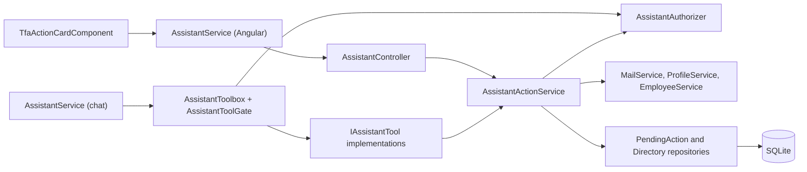
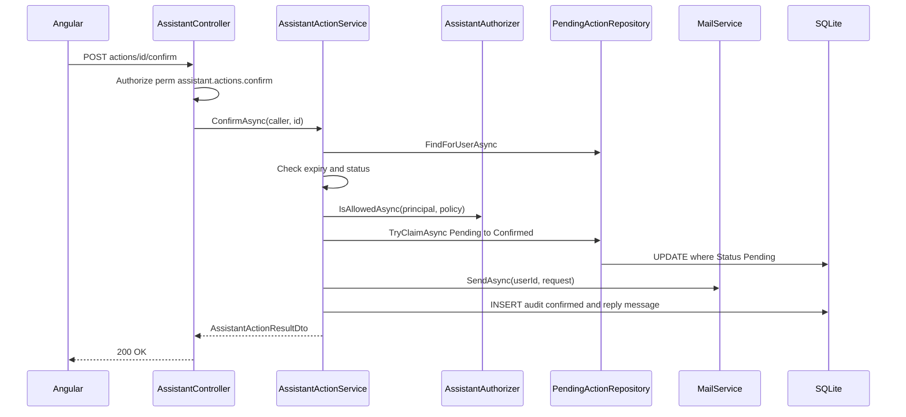

# Actions and Tools – Technical Documentation

> **Project:** TaskFlow – Intelligent Task Allocation & Tracking System
> **Parent Module:** TaskFlow Assistant (TFA)  ·  **Child Module:** 09.2 Actions and Tools
> **Version:** 1.0  ·  **Last Updated:** 31-Oct-2026
> **Backend:** ASP.NET Core Web API (.NET 10)  ·  **Frontend:** Angular  ·  **Database:** SQLite (EF Core)
> **Author:** Jojo George (jojogeorge3344@gmail.com)
> © 2026 Jojo George. All rights reserved.

---

## 1. Technical Overview
Actions and Tools covers the model-callable tools and the pending-action lifecycle. `Services/Assistant/Tools` holds 9 `IAssistantTool` implementations (6 read/guidance tools, 3 action-preparing tools). `AssistantToolbox` advertises only tools the caller may use and re-checks authorization on every call through `AssistantToolGate` → `IAssistantAuthorizer`, which evaluates the API's own `perm:{key}` authorization policies.

Action tools only create an `AssistantPendingAction` (10-minute lifetime) through `AssistantActionService`. Only the user's `POST actions/{id}/confirm` executes it, after re-checking the policy with the caller's current token and atomically claiming the row (`TryClaimAsync`), so it runs at most once. The Angular `TfaActionCardComponent` renders the card with Confirm / Edit / Cancel.

## 2. Architecture Flow


## 3. Backend File Structure

| Layer | Path | Files |
|-------|------|-------|
| Controller | `TaskFlow.Api/Controllers/Assistant/` | `AssistantController.cs` (action endpoints, `RunActionAsync`) |
| Service – Actions | `TaskFlow.Api/Services/Assistant/Actions/` | `IAssistantActionService.cs`, `IAssistantActionCards.cs`, `AssistantActionService.cs` |
| Service – Tools | `TaskFlow.Api/Services/Assistant/Tools/` | `IAssistantTool.cs`, `AssistantReadTools.cs` (`AssistantTaskReader`, `GetMyTasksTool`, `PrioritiseTasksTool`, `SearchHelpTool`, `FindUserTool`, `ExplainPasswordChangeTool`, `ContactAdminGuidanceTool`), `AssistantActionTools.cs` (`AssistantUserResolver`, `AssistantManagerResolver`, `DraftMailTool`, `ProposeProfileUpdateTool`, `ProposeRoleChangeTool`) |
| Service – Toolbox | `TaskFlow.Api/Services/Assistant/Toolbox/` | `IAssistantToolbox.cs`, `AssistantToolbox.cs` (also `AssistantToolGate`), `ToolOutcome.cs` |
| Service – Rules | `TaskFlow.Api/Services/Assistant/Rules/` | `AssistantActionRules.cs`, `TaskPrioritiser.cs` |
| Repository | `TaskFlow.Api/Repositories/Assistant/` | `PendingActions/IAssistantPendingActionRepository.cs`, `AssistantPendingActionRepository.cs`; `People/IAssistantDirectoryRepository.cs`, `AssistantDirectoryRepository.cs` |
| DTOs | `TaskFlow.Api/Dtos/Assistant/` | `AssistantActionDtos.cs` (`SendMailPayload`, `UpdateProfilePayload`, `ChangeRolePayload`, `MailRecipientRef`, `EditMailActionRequest`, `AssistantActionResultDto`, `ResolvedUser`); `AssistantDtos.cs` (`AssistantPendingActionDto`, `AssistantActionFieldDto`) |
| Validators | (reused) `Dtos/Communication/Mail/Validators/`, `Dtos/Profile/Validators/` | `SendMailRequestValidator` (in `MailRequestValidators.cs`), `UpdateOwnProfileRequestValidator.cs` – no TFA-specific validator class |
| Entities | `TaskFlow.Api/Models/Entities/` | `AssistantPendingAction.cs` |
| Enums | `TaskFlow.Api/Models/Enums/` | `AssistantActionKind.cs`, `AssistantActionStatus.cs` |
| Authorization | `TaskFlow.Api/Authorization/Assistant/` | `IAssistantAuthorizer.cs`, `AssistantAuthorizer.cs` |
| Exceptions | `TaskFlow.Api/Common/Exceptions/` | `AssistantExceptions.cs` (`AssistantActionConflictException`, `AssistantRequestException`) |

> `SearchHelpTool` delegates to the Help Knowledge base (09.3).

## 4. Frontend File Structure

| Type | Path | Purpose |
|------|------|---------|
| Child components | `src/app/modules/assistant/components/tfa-action-card.component.ts/.html` | Pending action card: Confirm / Edit / Cancel, mail edit form, status labels |
| Child components | `src/app/modules/assistant/components/tfa-message.component.ts/.html` | Hosts the action card inside a message |
| API service | `src/app/modules/assistant/services/assistant.service.ts` | Edit / confirm / cancel HTTP calls |
| Models | `src/app/modules/assistant/models/assistant.model.ts`, `services/assistant.model.ts` | Action card and result interfaces |
| Permission constants | `src/app/shared/auth/permissions.ts` | `AssistantActions: 'assistant.actions.confirm'` (not referenced by any component – see Gaps) |

---

## 5. API & Logic

### 5.1 API Endpoints

| # | Method | Endpoint | Description | Permission (Policy) | Request DTO | Response DTO |
|---|--------|----------|-------------|---------------------|-------------|--------------|
| 1 | PUT | `/api/v1/assistant/actions/{id:guid}` | Edit a pending mail's recipients, subject, body | `perm:assistant.actions.confirm` | `EditMailActionRequest` | `AssistantPendingActionDto` (404 if not the caller's) |
| 2 | POST | `/api/v1/assistant/actions/{id:guid}/confirm` | Execute the prepared action (only path that runs an action) | `perm:assistant.actions.confirm` (+ `perm:roles.manage` re-checked in service for `ChangeUserRole`) | – | `AssistantActionResultDto` (404 if not the caller's) |
| 3 | POST | `/api/v1/assistant/actions/{id:guid}/cancel` | Cancel a pending action | `perm:assistant.actions.confirm` | – | `AssistantPendingActionDto` (404 if not the caller's) |

All endpoints also carry the class-level `[Authorize]` (JWT).

**Model tools** (not HTTP endpoints; invoked by the model inside `SendAsync`, 09.1):

| Tool name | Class | Policy | Arguments (JSON Schema) | Effect |
|-----------|-------|--------|-------------------------|--------|
| `get_my_tasks` | `GetMyTasksTool` | none (signed-in) | `filter` (upcoming, due_today, overdue, all_open), `scope` (mine, accessible), `limit` (default 10, max 20) | Read open tasks via `ITaskService.ListAsync(filter, userId, role)`; links `/tasks/{id}` |
| `prioritise_tasks` | `PrioritiseTasksTool` | none | `limit` (default 5, max 10) | `TaskPrioritiser.Rank` on own open tasks; returns `RankedTasks` |
| `search_help` | `SearchHelpTool` | none | `topic` (required) | `IHelpKnowledgeBase.Search(topic, role)` (09.3) |
| `find_user` | `FindUserTool` | none | `name` (required) | `IMailService.GetContactsAsync` (max 10) |
| `explain_password_change` | `ExplainPasswordChangeTool` | none | – | Fixed `PasswordGuidance` reply + `/profile` link |
| `contact_admin_guidance` | `ContactAdminGuidanceTool` | none | – | Fixed `AdminGuidance` reply |
| `draft_mail` | `DraftMailTool` | none | `recipient` ("manager"), `to[]`, `taskId`, `subject`*, `body`* | Creates `SendMail` pending action |
| `propose_profile_update` | `ProposeProfileUpdateTool` | none | `fullName`, `email` | Creates `UpdateOwnProfile` pending action |
| `propose_role_change` | `ProposeRoleChangeTool` | `perm:roles.manage` | `user`*, `role`* | Creates `ChangeUserRole` pending action |

No tool accepts a user id, role or password; the caller is always `AssistantCaller` built from the JWT claims (`ClaimTypes.NameIdentifier`, `ClaimTypes.Role`).

### 5.2 Request / Response Samples
```json
// PUT /api/v1/assistant/actions/3f2b0c1e-9a7d-4c55-8f0e-1b2c3d4e5f60
{ "to": ["ravi@company.com"], "subject": "TSK-12 update", "body": "Hi Ravi, ..." }
```
```json
// 200 OK
{ "id": "3f2b0c1e-9a7d-4c55-8f0e-1b2c3d4e5f60", "kind": "SendMail", "status": "Pending",
  "expiresAt": "2026-10-31T10:10:00Z", "title": "Mail draft",
  "fields": [ { "label": "To", "value": "Ravi Kumar <ravi@company.com>" }, { "label": "Subject", "value": "TSK-12 update" } ],
  "body": "Hi Ravi, ...", "canEdit": true }
```
```json
// POST /api/v1/assistant/actions/3f2b0c1e-9a7d-4c55-8f0e-1b2c3d4e5f60/confirm – 200 OK
{ "id": "3f2b0c1e-9a7d-4c55-8f0e-1b2c3d4e5f60", "status": "Confirmed",
  "message": "Done. Your mail \"TSK-12 update\" was sent to Ravi Kumar.",
  "reply": { "id": 57, "role": "Assistant", "content": "Done. Your mail \"TSK-12 update\" was sent to Ravi Kumar.",
    "kind": "Text", "createdAt": "2026-10-31T10:02:00Z", "provider": null, "links": [], "rankedTasks": [], "action": null } }
```
```json
// 409 Conflict (problem details)
{ "status": 409, "title": "This action can no longer be done", "detail": "This request has expired. Please ask TFA again." }
```

### 5.3 Service Layer Logic
**Method:** `CreateAsync(caller, conversationId, kind, payload)` – `AssistantActionService`
1. New `AssistantPendingAction` (Guid id, `Status = Pending`, `ExpiresAt = now + AssistantActionRules.Lifetime` (10 min), `PayloadJson` = serialized `SendMailPayload` / `UpdateProfilePayload` / `ChangeRolePayload`).
2. `SaveChangesAsync`, audit `"prepared"` (09.4), return the card (`ToCard`).

**Method:** `ConfirmAsync(caller, id)`
1. `FindForUserAsync(id, userId)` → null → controller returns 404.
2. Pending but `ExpiresAt <= now` → `SetStatusAsync(Expired)`, audit `"expired"`, throw `AssistantActionConflictException` (409).
3. Not pending → 409 ("already been done" for Confirmed, otherwise "can no longer be confirmed ({status})").
4. `AssistantActionRules.Requirement(kind)` → `IAssistantAuthorizer.IsAllowedAsync(principal, policy)`; refused → status `Refused`, audit `"refused"`, store a `Refusal` message, return result with `Status = Refused` (HTTP 200).
5. `TryClaimAsync` (single `ExecuteUpdate` Pending → Confirmed); false → 409 "already been done".
6. `ExecuteAsync`:
   - `SendMail`: re-validate with `SendMailRequestValidator`, `IMailService.SendAsync(userId, request)`.
   - `UpdateOwnProfile`: re-validate with `UpdateOwnProfileRequestValidator`, `IProfileService.UpdateAsync(userId, request)`.
   - `ChangeUserRole`: `IEmployeeService.GetByIdAsync` then `IEmployeeService.UpdateAsync` passing all existing fields (code, name, username, email, project allocations, department ids) with the new `RoleId`.
7. Any exception (except cancellation) → status `Failed`, audit `"failed"`, message `"I could not do that: {reason}. Nothing was sent/changed."` (`reason` = exception message for `AppException`/`ValidationException`, except concurrency/unique errors, otherwise "something went wrong on the server" and logged).
8. Success → audit `"confirmed"` (failure to audit is logged, never turns success into failure); store the reply message; return `AssistantActionResultDto`.

**Method:** `EditMailAsync(caller, id, request)` – tracked lookup; `EnsurePending` (409 if not pending/expired); only `SendMail` (else 400 "Only a mail can be edited."); validate with `SendMailRequestValidator`; `ResolveRecipientsAsync` (normalised addresses must all be active users, else 400 naming them); replace `PayloadJson`.

**Method:** `CancelAsync(caller, id)` – if still pending and not expired: `Status = Cancelled`, `ResolvedAt`, audit `"cancelled"`; always returns the current card.

**Card building (`ToCard`)**: a pending action past `ExpiresAt` is shown as `Expired`; titles "Mail draft", "Update your profile", "Change role"; `CanEdit` true only for pending mail.

**Tool-level logic**
- `AssistantToolbox.DefinitionsForAsync`: advertises only tools whose policy passes for the caller.
- `AssistantToolbox.ExecuteAsync`: unknown tool → message to model; gate refused → audit `"refused"` (action tools) and fixed `Refusal` reply `AssistantTexts.PermissionDenied(description, who)`; arguments must be a JSON object.
- `AssistantUserResolver.FindAsync`: `@` → exact active email; else exact full name/username (single match wins); else partial `LIKE` (max 5); ambiguity returns candidates.
- `AssistantManagerResolver.ResolveAsync`: with `taskId`, `ITaskService.GetDetailsAsync(id, userId, role)` (null → "That task was not found, or you do not have access to it."); the task creator if different and active; otherwise active users with `RoleId == SystemRoles.ManagerId` managing one of the caller's departments (exactly one required).
- `ProposeProfileUpdateTool`: merges new values with current, validates, checks `EmailUsedByOtherAsync`.
- `ProposeRoleChangeTool`: `FindRoleByNameAsync` (exact name), `FindAsync` user, refuses self, no-op if same role.
- `AssistantTaskReader.OpenTasksAsync`: one `ITaskService.ListAsync` query per open status (ToDo, InProgress, InQA, Blocked), page size 100, at most 5 pages each.
- `TaskPrioritiser.Rank`: exclude Completed/Cancelled; order by stage (Overdue 0, DueToday 1, other 2), local due date, priority desc, deadline, task code.

### 5.4 Repository Layer

| Method | Description | Query Notes |
|--------|-------------|-------------|
| `IAssistantPendingActionRepository.GetForUserAsync(userId, ids)` | Cards for messages | `AsNoTracking`, `UserId` + `ids.Contains` |
| `FindForUserAsync(id, userId)` | Confirm lookup | `AsNoTracking`, owner filter |
| `FindForUserForUpdateAsync(id, userId)` | Edit / cancel lookup | Tracked, owner filter |
| `TryClaimAsync(id, now)` | Atomic Pending → Confirmed | `ExecuteUpdateAsync` with `Status == Pending` filter; returns rows > 0 |
| `SetStatusAsync(id, status, now)` | Set status + `ResolvedAt` | `ExecuteUpdateAsync` |
| `IAssistantDirectoryRepository.FindActiveAsync / FindActiveByEmailAsync / FindActiveByExactNameAsync / SearchActiveByNameAsync` | Resolve people | Active users only (`IsActive`); soft-deleted hidden by global query filter; `LIKE` with escaped `%`, `_`, `\` |
| `GetNameAndEmailAsync`, `EmailUsedByOtherAsync` | Profile proposal | Case-insensitive email compare |
| `FindRoleByNameAsync(name)` | Role lookup | `Roles` exact `Name ==` |
| `GetDepartmentIdsAsync`, `GetActiveManagersOfDepartmentsAsync` | "My manager" | `UserDepartments`; `RoleId == SystemRoles.ManagerId` and `ManagedDepartments` |
| `GetActiveRecipientsAsync(lowerEmails)` | Mail edit recipients | Active users by lower-case email |

### 5.5 Sequence Diagram


---

## 6. Database Design

| Table | Column | Type | Constraints | Description |
|-------|--------|------|-------------|-------------|
| `AssistantPendingActions` | `Id` | TEXT (Guid) | PK | Action id |
| `AssistantPendingActions` | `UserId` | INTEGER | Not Null, FK → `Users.Id`, indexed `IX_AssistantPendingActions_UserId` | Owner |
| `AssistantPendingActions` | `ConversationId` | INTEGER | Not Null (no FK) | Conversation it belongs to |
| `AssistantPendingActions` | `Kind` | TEXT(32) | Not Null, enum as string (`SendMail`, `UpdateOwnProfile`, `ChangeUserRole`) | Action type |
| `AssistantPendingActions` | `PayloadJson` | TEXT | Not Null | Exact payload shown and executed |
| `AssistantPendingActions` | `Status` | TEXT(16) | Not Null, enum as string (`Pending`, `Confirmed`, `Cancelled`, `Expired`, `Refused`, `Failed`) | State |
| `AssistantPendingActions` | `CreatedAt` | TEXT (DateTime) | Not Null | UTC |
| `AssistantPendingActions` | `ExpiresAt` | TEXT (DateTime) | Not Null | CreatedAt + 10 min |
| `AssistantPendingActions` | `ResolvedAt` | TEXT (DateTime) | Nullable | Set on confirm/cancel/expire/refuse/fail |

Read-only lookups (through `AssistantDirectoryRepository`): `Users`, `Roles`, `UserDepartments`, department managers. Confirm and refusal replies are written to `AssistantMessages` (09.1); outcomes to `AssistantAudits` (09.4).

**Relationships**
- `AssistantPendingActions.UserId → Users.Id` (FK, Cascade)
- `AssistantPendingActions.ConversationId` is a plain column without an FK constraint.

## 7. Security & Authorization
- **Authorization:** `perm:assistant.actions.confirm` on the three action endpoints. Tools are advertised and gated through `AssistantToolGate` → `IAssistantAuthorizer` (`IAuthorizationService.AuthorizeAsync`) using the same `perm:{key}` policies; `ConfirmAsync` re-checks `AssistantActionRules.Requirement(kind)` with the caller's current token.
- **Data scope:** Own – pending actions are always filtered by `UserId` (another user's id yields 404). Task data used by tools follows the Task Management scope (`ITaskService.ListAsync / GetDetailsAsync(…, userId, role)`). People lookups are limited to active users.
- **Model containment:** the model can only call advertised tools; action tools only create pending actions; refusals and confirmations use fixed text (`AssistantTexts`).
- **Frontend:** action card buttons are not gated by `assistant.actions.confirm` (see Gaps).

| Permission Key | Endpoint(s) | UI Element Controlled |
|----------------|-------------|-----------------------|
| `assistant.actions.confirm` | `PUT /api/v1/assistant/actions/{id}`, `POST /api/v1/assistant/actions/{id}/confirm`, `POST /api/v1/assistant/actions/{id}/cancel` | None in UI (Confirm / Edit / Cancel always shown) |
| `roles.manage` | Tool `propose_role_change`; re-checked in `ConfirmAsync` for `ChangeUserRole` | Tool advertised to the model only when held |
| `assistant.chat` | Tools run inside `POST /api/v1/assistant/conversation/messages` (09.1) | Action Card visible inside the panel |

## 8. Validations & Error Handling

| Rule | Layer | HTTP Code | Error Message |
|------|-------|-----------|---------------|
| Action not the caller's / unknown | Controller `RunActionAsync` | 404 | (empty) |
| Action expired | `AssistantActionService` (`AssistantActionConflictException`) | 409 | This request has expired. Please ask TFA again. |
| Action already done / lost claim | `AssistantActionService` | 409 | This action has already been done. |
| Action not pending (confirm) | `AssistantActionService` | 409 | This action can no longer be confirmed ({status}). Please ask TFA again. |
| Action not pending (edit) | `AssistantActionService.EnsurePending` | 409 | This action can no longer be changed. Please ask TFA again. |
| Edit a non-mail action | `AssistantActionService` | 400 | Only a mail can be edited. |
| Edit with invalid mail fields | `SendMailRequestValidator` → `AssistantRequestException` | 400 | Write a subject or a message before sending. / Add between 1 and 50 recipients. / '{value}' is not an email address. |
| Edit with non-user recipient | `ResolveRecipientsAsync` | 400 | These are not active TaskFlow users: {addresses}. |
| Permission lost at confirm | `AssistantActionService` | 200 (`Status = Refused`) | You do not have the required permission to perform this action. {Action} can only be performed by {who}. Please contact your system administrator for assistance. |
| Execution failure | `AssistantActionService` | 200 (`Status = Failed`) | I could not do that: {reason}. Nothing was sent. / Nothing was changed. |

409 responses use the problem title `This action can no longer be done`. Angular fallbacks via `apiErrorMessage`: *"Could not confirm that action."*, *"Could not cancel that action."*, *"Could not save your changes."*

## 9. Integrations / Side Effects
- **Notifications:** none raised directly by TFA. ⚠️ To be confirmed: whether `IMailService.SendAsync` raises a mail notification for recipients (owned by the Communication module).
- **Email:** confirmed `SendMail` actions call `IMailService.SendAsync(userId, SendMailRequest)` – a normal TaskFlow internal mail from the user's mailbox (no attachments, no Cc).
- **Profile / Employees:** `IProfileService.UpdateAsync` (own name/email); `IEmployeeService.UpdateAsync` (role change; the confirmation text states the target is signed out).
- **Activity Log:** every create / confirm / cancel / expire / refuse / fail writes an `AssistantAudits` row (09.4).
- **Other modules read:** `ITaskService.ListAsync / GetDetailsAsync` (Task Management), `IMailService.GetContactsAsync` (Mail), `IHelpKnowledgeBase` (09.3).

## 10. Configuration

| Key (`appsettings.json`) | Purpose | Default |
|--------------------------|---------|---------|
| – | _Not applicable – no configuration keys specific to this child._ | – |

Code constants (not configurable): `AssistantActionRules.Lifetime` 10 min; `get_my_tasks` limit default 10 / max 20; `prioritise_tasks` limit default 5 / max 10; `find_user` max 10; `AssistantTaskReader` page size 100, max 5 pages per status. `TaskPrioritiser` uses the application time zone (`Application:Timezone` fallback – see parent).

## 11. Testing

| Test Type | File / Location | Covers |
|-----------|-----------------|--------|
| Integration | `tests/TaskFlow.IntegrationTests/Assistant/AssistantEndpointsTests.cs` | Actions part (shared with 09.1): instructions hidden in a task never send mail or expose other users' data; a fooled model asking to promote an employee gets the fixed refusal and nothing changes; drafting then confirming sends the mail as the user and only their confirm works; edit and cancel work for the owner; an edit to an unknown recipient is 400; an Employee's confirm of a crafted role change is refused by the gate; an Administrator can change a role after confirming; `IAssistantAuthorizer` uses the API's policy names and gives the same answers as the registered policies, follows a policy change and never allows an unauthenticated principal |
| Unit | `tests/TaskFlow.UnitTests/Assistant/Actions/AssistantActionServiceTests.cs` (+ `AssistantActionHarness.cs`) | Nothing is sent until confirm; confirm sends as the user; another user cannot see, confirm or cancel; expired actions are refused and shown as expired; confirming twice runs once; the permission is re-checked at confirm; cancel blocks confirm; edits (subject, body, recipients) are what is sent, and invalid, unknown-recipient, confirmed or non-mail edits are refused; send failures and unexpected or database errors are reported as failed, never as success; profile changes update only name and email; an Administrator's role change updates only the role and ends the target's sessions; cards are built from the stored payload; audit outcomes and audit-row contents are asserted (09.4) |
| Unit | `tests/TaskFlow.UnitTests/Assistant/Actions/AssistantActionConcurrencyTests.cs` | Two simultaneous confirms of one mail action send it once (one mail, one inbox item) |
| Unit | `tests/TaskFlow.UnitTests/Assistant/Tools/AssistantReadToolsTests.cs` | `get_my_tasks` filters (upcoming, overdue, due today, accessible by role), limit, links, data-not-instructions marking and paging past completed tasks; `prioritise_tasks` ranks only the user's assigned tasks with a capped limit; `search_help` (09.3); `find_user` returns active users only; password and admin guidance are fixed text; no tool parameter takes a user id, role, password or key |
| Unit | `tests/TaskFlow.UnitTests/Assistant/Tools/AssistantActionToolsTests.cs` | `draft_mail` to "manager" goes to the task creator, else the department manager, and asks when there are several or none; inaccessible tasks are "not found"; recipients are resolved on the server and unknown, inactive or ambiguous ones are not mailed; `draft_mail`, `propose_profile_update` and `propose_role_change` only prepare a card; the profile tool changes only the caller's name and email and rejects invalid or duplicate values; `propose_role_change` is not offered to, and is refused for, non-administrators; role-change edge cases give no card |
| Unit | `tests/TaskFlow.UnitTests/Assistant/Toolbox/AssistantToolGateTests.cs` | Only tools the role may use are advertised; admin tools are refused for other roles with a fixed message (what, who, next step); the gate runs on every call, so model output cannot grant permission and unoffered tools cannot run; a policy change changes the result; unauthenticated callers are refused; unknown tools and bad JSON run nothing; a refused action tool is audited, a read tool is not (09.4) |
| Unit | `tests/TaskFlow.UnitTests/Assistant/Rules/TaskPrioritiserTests.cs` | Order is overdue, then due today, then nearest deadline, with priority and task code breaking ties; completed and cancelled tasks are excluded; blocked tasks stay and are flagged; the order is stable; days until due is negative when overdue; "due today" follows the application time zone; no open tasks gives an empty list |
| Frontend unit | `src/app/modules/assistant/components/tfa-panel.component.spec.ts` | Action cards block: a prepared mail shows Send, Edit and Cancel; confirm only calls the confirm endpoint after the click; edits are saved before confirming and a server error shows in the editor; cancel uses the cancel endpoint; an expired card has no buttons; role and profile changes are labelled by what they do |
| Frontend unit | `src/app/modules/assistant/services/assistant.service.spec.ts` | Actions block: confirm uses only the confirm endpoint, updates the card and adds the result message; a refusal leaves the card refused; an expired or done action refreshes from the server; cancel updates the card; edits are saved before confirming and server errors go to the editor |

## 12. Known Limitations / Gaps found
- Pending action expiry is evaluated lazily (on read/confirm); no background job marks old actions `Expired`.
- The action card always shows a mail icon and a static "Expires in 10 minutes" label rather than a countdown.

**Gaps found**
- **Role change bypasses Employee Management rules:** the REST `PUT /api/v1/users/{id}` (EmployeesController) requires `employees.edit`, plus `employees.role.assign` to change a role, plus `roles.administrator.assign` when moving anyone into or out of Administrator. TFA's `propose_role_change` / `ConfirmAsync` only checks `roles.manage` and calls `IEmployeeService.UpdateAsync` directly, so a custom role holding `roles.manage` but not `employees.role.assign` / `roles.administrator.assign` could change roles (including to Administrator) through TFA. This contradicts `AssistantAuthorizer`'s stated intent that "TFA and the API cannot disagree".
- **`assistant.actions.confirm` not checked in the UI**: Confirm / Edit / Cancel are shown to users without the key and return 403. Apart from the constant in `permissions.ts`, the frontend never references the key.
- **"My manager" only finds system Managers:** `GetActiveManagersOfDepartmentsAsync` filters `RoleId == SystemRoles.ManagerId`; department managers in custom roles are ignored. The `AssistantManagerResolver` doc comment says "the single active Manager in the sender's project" while the code uses departments (stale comment).

---
<sub>© 2026 Jojo George. All rights reserved. Unauthorized copying or distribution of this document is prohibited.</sub>
