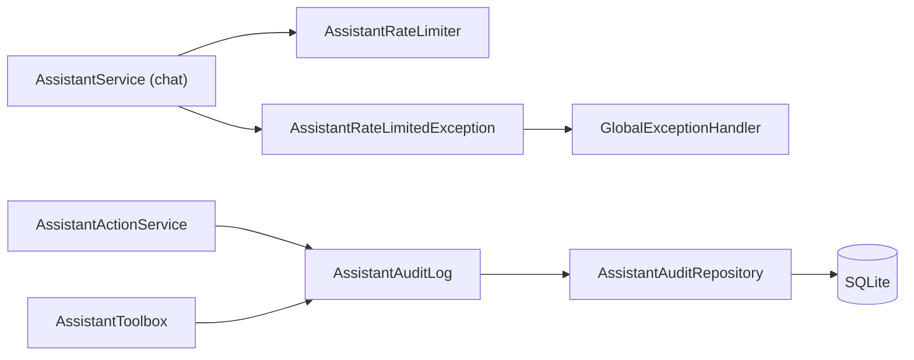
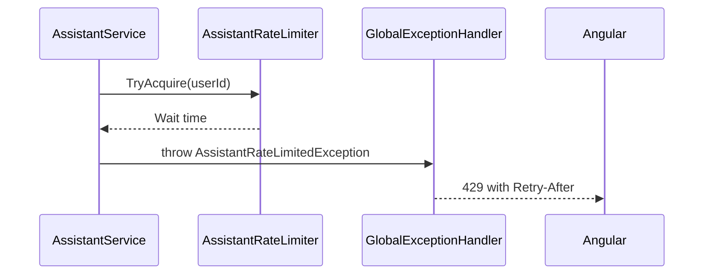

# Audit Log and Rate Limits – Technical Documentation

> **Project:** TaskFlow – Intelligent Task Allocation & Tracking System
> **Parent Module:** TaskFlow Assistant (TFA)  ·  **Child Module:** 09.4 Audit Log and Rate Limits
> **Version:** 1.0  ·  **Last Updated:** 31-Oct-2026
> **Backend:** ASP.NET Core Web API (.NET 10)  ·  **Frontend:** Angular  ·  **Database:** SQLite (EF Core)
> **Author:** Jojo George (jojogeorge3344@gmail.com)
> © 2026 Jojo George. All rights reserved.

---

## 1. Technical Overview
Two backend safeguards with no endpoint and no UI of their own:
- `AssistantAuditLog` (scoped) writes `AssistantAudits` rows (user, action kind, outcome, time; no bodies/keys). It is called by `AssistantActionService` (prepared, confirmed, cancelled, expired, refused, failed) and by `AssistantToolbox` (refused, when the gate blocks an action tool).
- `AssistantRateLimiter` (singleton) is an in-memory sliding 1-minute window of 20 requests per user, checked by `AssistantService.SendAsync` (09.1). Exceeding it throws `AssistantRateLimitedException`, which `GlobalExceptionHandler` turns into 429 with `Retry-After`.

## 2. Architecture Flow


## 3. Backend File Structure

| Layer | Path | Files |
|-------|------|-------|
| Service – Audit | `TaskFlow.Api/Services/Assistant/AuditLog/` | `IAssistantAuditLog.cs`, `AssistantAuditLog.cs` |
| Service – Rate limit | `TaskFlow.Api/Services/Assistant/RateLimits/` | `IAssistantRateLimiter.cs`, `AssistantRateLimiter.cs` |
| Repository | `TaskFlow.Api/Repositories/Assistant/Audits/` | `IAssistantAuditRepository.cs`, `AssistantAuditRepository.cs` |
| Entities | `TaskFlow.Api/Models/Entities/` | `AssistantAudit.cs` |
| Enums | `TaskFlow.Api/Models/Enums/` | `AssistantActionKind.cs` (audit `Kind`) |
| Exceptions | `TaskFlow.Api/Common/Exceptions/` | `AssistantExceptions.cs` (`AssistantRateLimitedException`) |
| Middleware | `TaskFlow.Api/Middleware/` | `GlobalExceptionHandler.cs` (429 + `Retry-After`) |
| DI | `TaskFlow.Api/Config/` | `ServiceRegistration.cs` (`AddSingleton` rate limiter, `AddScoped` audit log), `RepositoryRegistration.cs` |

## 4. Frontend File Structure

| Type | Path | Purpose |
|------|------|---------|
| API service | `src/app/modules/assistant/services/assistant.service.ts` | Shows the 429 problem `detail` ("You are sending messages too quickly…") via `apiErrorMessage` |

No audit-log screen exists.

---

## 5. API & Logic

### 5.1 API Endpoints

| # | Method | Endpoint | Description | Permission (Policy) | Request DTO | Response DTO |
|---|--------|----------|-------------|---------------------|-------------|--------------|
| – | – | (no endpoint) | Audit rows are written only; the rate limiter guards `POST /api/v1/assistant/conversation/messages` | – | – | – |

### 5.2 Request / Response Samples
```json
// 429 Too Many Requests (header Retry-After: 18)
{ "status": 429, "title": "Too many requests",
  "detail": "You are sending messages too quickly. Please wait about 18 seconds and try again." }
```
```json
// AssistantAudits row (illustrative)
{ "id": 7, "userId": 3, "kind": "SendMail", "outcome": "confirmed", "at": "2026-10-31T10:02:00Z" }
```

### 5.3 Service Layer Logic
**Method:** `AssistantAuditLog.RecordAsync(userId, kind, outcome)` – adds `AssistantAudit` (`At` = UTC now) and saves immediately. Outcomes written in code: `prepared`, `confirmed`, `cancelled`, `expired`, `refused`, `failed`.

**Method:** `AssistantRateLimiter.TryAcquire(userId)` – singleton; `ConcurrentDictionary<int, Queue<DateTimeOffset>>`; under a per-queue lock drop entries older than 1 minute; if count ≥ `RequestsPerMinute` (20) return `Window - (now - oldest)`; otherwise enqueue and return null.

Call order in `AssistantService.SendAsync`: the limiter runs after the length check, `SecretScreen` and provider selection, so only messages that pass those checks are counted.

### 5.4 Repository Layer

| Method | Description | Query Notes |
|--------|-------------|-------------|
| `IAssistantAuditRepository.Add` | Insert audit row | Base repository only; no read methods |

### 5.5 Sequence Diagram


---

## 6. Database Design

| Table | Column | Type | Constraints | Description |
|-------|--------|------|-------------|-------------|
| `AssistantAudits` | `Id` | INTEGER | PK, autoincrement | Audit id |
| `AssistantAudits` | `UserId` | INTEGER | Not Null (no FK), index `IX_AssistantAudits_UserId_At` (`UserId`, `At`) | Actor |
| `AssistantAudits` | `Kind` | TEXT(32) | Not Null, enum as string | Action type |
| `AssistantAudits` | `Outcome` | TEXT(32) | Not Null | prepared / confirmed / cancelled / expired / refused / failed |
| `AssistantAudits` | `At` | TEXT (DateTime) | Not Null | UTC |

**Relationships**
- `AssistantAudits.UserId` is a plain column without an FK constraint.

The rate limiter stores nothing in the database (process memory only).

## 7. Security & Authorization
- No permission key; both safeguards apply to every TFA user.
- Audit rows contain no message bodies, passwords or API keys.
- The rate limit is keyed by the user id from `AssistantCaller` (JWT claims).

| Permission Key | Endpoint(s) | UI Element Controlled |
|----------------|-------------|-----------------------|
| – | Limiter guards `POST /api/v1/assistant/conversation/messages` | None |

## 8. Validations & Error Handling

| Rule | Layer | HTTP Code | Error Message |
|------|-------|-----------|---------------|
| Over 20 messages / minute | `AssistantRateLimiter` (`AssistantRateLimitedException`) | 429 + `Retry-After` | You are sending messages too quickly. Please wait about {n} seconds and try again. |
| Audit write fails after a successful confirm | `AssistantActionService` | – (logged) | Success is kept; the failure is only logged |

## 9. Integrations / Side Effects
- **Activity Log:** TFA writes its own `AssistantAudits` rows (`prepared`, `confirmed`, `cancelled`, `expired`, `refused`, `failed`). Endpoint-level 403s are also recorded by the application's `DeniedActionAuditHandler` (see parent).
- **Notifications / Email:** none.

## 10. Configuration
_Not applicable – no configuration keys._ Code constants: `AssistantRateLimiter.RequestsPerMinute` 20, window 1 minute.

## 11. Testing

| Test Type | File / Location | Covers |
|-----------|-----------------|--------|
| Unit | `tests/TaskFlow.UnitTests/Assistant/Actions/AssistantActionServiceTests.cs` (+ `AssistantActionHarness.cs`) | Audit part: the stored outcomes are `prepared`, then `confirmed`, `expired`, `refused`, `cancelled` or `failed`; audit rows hold no mail body or task code and `AssistantAudit` has only `At`, `Id`, `Kind`, `Outcome`, `UserId`; a failed audit write neither turns a sent mail into a failure nor hides a failure from the user |
| Unit | `tests/TaskFlow.UnitTests/Assistant/Toolbox/AssistantToolGateTests.cs` | A refused action tool records one `refused` audit entry; a refused read tool records none |
| Unit | `tests/TaskFlow.UnitTests/Assistant/ModelGateway/ProviderFailureHandlingTests.cs` | `AssistantRateLimiter`: the 21st request in a minute gets a retry time of 1–60 seconds; the limit is per user and recovers after a minute |
| Unit | `tests/TaskFlow.UnitTests/Assistant/Chat/AssistantServiceTests.cs` | The 21st message in a minute throws `AssistantRateLimitedException` with a retry time before any provider is called |
| Unit | `tests/TaskFlow.UnitTests/Common/AppExceptionTests.cs` | `AssistantRateLimitedException` maps to 429 "Too many requests" and carries its retry time |
| Integration | `tests/TaskFlow.IntegrationTests/Common/GlobalExceptionHandlerTests.cs` | `AssistantRateLimitedException` becomes a 429 problem response with title "Too many requests" and a `Retry-After` header |
| Integration | `tests/TaskFlow.IntegrationTests/Assistant/AssistantEndpointsTests.cs` | Too many messages in a minute get 429 with `Retry-After` after exactly 20 provider calls; a fooled model's role-change attempt stores a `refused` audit row |

No test file is dedicated to `AssistantRateLimiter` or `AssistantAuditLog`, but both are asserted by the files above.

## 12. Known Limitations / Gaps found
- No screen or API to read the `AssistantAudits` log.
- The rate limiter is in memory per process: it resets on restart and is not shared between multiple API instances.

---
<sub>© 2026 Jojo George. All rights reserved. Unauthorized copying or distribution of this document is prohibited.</sub>
