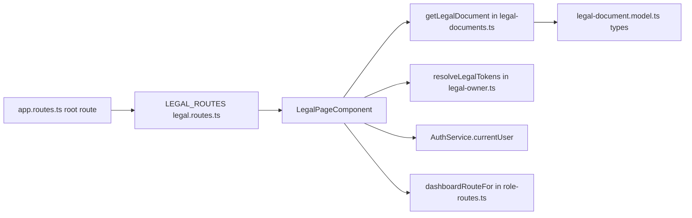
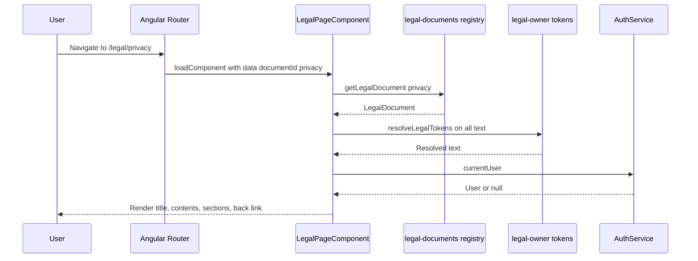

# Legal Documents – Technical Documentation

> **Project:** TaskFlow – Intelligent Task Allocation & Tracking System
> **Parent Module:** Legal  ·  **Child Module:** 10.1 Legal Documents
> **Version:** 1.0  ·  **Last Updated:** 31-Oct-2026
> **Backend:** ASP.NET Core Web API (.NET 10)  ·  **Frontend:** Angular  ·  **Database:** SQLite (EF Core)
> **Author:** Jojo George (jojogeorge3344@gmail.com)
> © 2026 Jojo George. All rights reserved.

---

## 1. Technical Overview
Legal Documents is frontend-only. Five lazily loaded public routes (`/legal/copyright|terms|privacy|disclaimer|licenses`) all load the standalone `LegalPageComponent` and pass `data.documentId`. The component looks the document up in the `LEGAL_DOCUMENTS` registry (`legal-documents.ts`), replaces the owner tokens with `resolveLegalTokens()` from `legal-owner.ts`, and chooses the back-link target from `AuthService.currentUser()` and `dashboardRouteFor()`. There is no HTTP call, controller, service, repository or table.

## 2. Architecture Flow


## 3. Backend File Structure

| Layer | Path | Files |
|-------|------|-------|
| Controller / Service / Repository / DTOs / Validators / Entities / Enums / Authorization | _Not applicable for this module._ | – |

No backend file serves the legal documents. Backend files whose behaviour the Privacy Policy text describes are listed in section 9.

## 4. Frontend File Structure

| Type | Path | Purpose |
|------|------|---------|
| Routes | `src/app/modules/legal/legal.routes.ts` | `LEGAL_ROUTES`: five routes, each `loadComponent: legalPage` with `data: { documentId }` |
| Root registration | `src/app/routes/app.routes.ts` | `{ path: '', loadChildren: … LEGAL_ROUTES }`, registered **outside** the shell route that has `canActivate: [authGuard, mfaSetupGuard]`, so the pages are public |
| Page component | `src/app/modules/legal/pages/legal-page.component.ts` / `.html` | `LegalPageComponent`: renders one document, the table of contents, the back link and the not-found fallback |
| Models | `src/app/modules/legal/models/legal-document.model.ts` | `LegalDocumentId`, `LegalBlock` (`paragraph` / `list` / `note` / `table`), `LegalSection`, `LegalDocument` |
| Data / utils | `src/app/modules/legal/utils/legal-documents.ts` | `LEGAL_DOCUMENTS` (660-line registry), `getLegalDocument(id)`, `LEGAL_DOCUMENT_IDS` |
| Data / utils (shared with 10.2) | `src/app/modules/legal/utils/legal-owner.ts` | `LEGAL_OWNER`, `LEGAL_APPLICATION`, `LEGAL_TOKENS`, `resolveLegalTokens(text)`, `legalOwnershipLine()` |
| Helpers used | `src/app/shared/auth/auth.service.ts`, `src/app/shared/auth/role-routes.ts` | `AuthService.currentUser()`, `dashboardRouteFor(role, permissions = [])` |
| Route / Guard | _None_ | No guard and no permission check. No entry in `layouts/nav-items.ts` |

---

## 5. API & Logic

### 5.1 API Endpoints
_Not applicable for this module._ (No backend endpoints. The content is bundled in the frontend.)

Client routes (Angular, from `legal.routes.ts`):

| # | Route | `data.documentId` | Document title | Footer label | Sections |
|---|-------|-------------------|----------------|--------------|---------:|
| 1 | `/legal/copyright` | `copyright` | Copyright Notice | Copyright | 8 |
| 2 | `/legal/terms` | `terms` | Terms of Use | Terms of Use | 14 |
| 3 | `/legal/privacy` | `privacy` | Privacy Policy | Privacy Policy | 11 |
| 4 | `/legal/disclaimer` | `disclaimer` | Disclaimer | Disclaimer | 7 |
| 5 | `/legal/licenses` | `licenses` | Third-Party Licence Notices | Licences | 3 |

All five documents have `updated: '21 October 2026'`.

### 5.2 Request / Response Samples
_Not applicable for this module._ The data shape is the TypeScript model below (extract from a registry entry):
```json
{
  "id": "copyright",
  "title": "Copyright Notice",
  "navLabel": "Copyright",
  "summary": "Who owns {{applicationName}}, what this notice protects and how you may use it.",
  "updated": "21 October 2026",
  "sections": [
    { "id": "ownership", "heading": "Ownership",
      "blocks": [ { "kind": "paragraph", "text": "The owner can be contacted at {{email}}." } ] }
  ]
}
```

### 5.3 Service Layer Logic
_Not applicable for this module._ (No backend service.) The frontend logic in `LegalPageComponent` is:
1. `routeData` is `toSignal(route.data.pipe(map(d => d['documentId'])))`.
2. `document` is `computed`. It calls `getLegalDocument(id)` (`LEGAL_DOCUMENTS.find(doc => doc.id === id)`) and returns `undefined` when there is no id or no match.
3. `resolvedDocument` is `computed`. It deep-clones the document (`JSON.parse(JSON.stringify(doc))`) and runs `resolveLegalTokens()` over `title`, `summary`, `navLabel`, every section `heading`, paragraph/note `text`, list `items`, and table `caption`, `head` and `rows`.
4. `resolveLegalTokens(text)` loops over the `TOKEN_VALUES` map and calls `replaceAll(token, value)`.
5. `ownershipLine` comes from `legalOwnershipLine()`, which returns `` `© ${year} ${name}. ${rights}.` ``, giving "© 2026 Jojo George. All Rights Reserved.".
6. `backLink` is `computed`. If `auth.currentUser()` exists it returns `{ path: dashboardRouteFor(user.role), label: 'Back to the application' }`, otherwise `{ path: '/login', label: 'Back to sign in' }`. `dashboardRouteFor` is called **without** the permissions argument, so the result is Administrator → `/admin`, Manager → `/manager`, any other role → `/me`.
7. The template renders `@if (resolvedDocument(); as doc)` → header, `nav.legal__toc` (anchor `href="#" + section.id`), `article` sections by block kind (`<p>`, `<aside class="legal__note">`, `<ul>`, `<table>` with `<caption>`/`<th>`). `@else` renders the "Legal document not found" fallback.
8. Track functions: `trackSection` → `section.id`, `trackBlock` → `block.kind`, `trackItem` → index.

### 5.4 Repository Layer
_Not applicable for this module._

| Method | Description | Query Notes |
|--------|-------------|-------------|
| `getLegalDocument(id)` (frontend util, not a repository) | Looks up a document by id in `LEGAL_DOCUMENTS` | In-memory `Array.find` |

### 5.5 Sequence Diagram


---

## 6. Database Design
_Not applicable for this module._ (No tables, entities or migrations. The five documents are static data in `legal-documents.ts`.)

**Relationships**
- _Not applicable for this module._

## 7. Security & Authorization
- **Authentication:** Not required. `LEGAL_ROUTES` is registered at root level, outside the shell route that has `authGuard` and `mfaSetupGuard`. `AuthService.currentUser()` is read only to choose the back-link target.
- **Authorization:** No permission key for the legal pages.
- **Output safety:** All document text is rendered with Angular interpolation (`{{ }}`), so it is HTML-escaped. `innerHTML` is not used.

| Permission Key | Endpoint(s) | UI Element Controlled |
|----------------|-------------|-----------------------|
| _(none)_ | – (client routes `/legal/copyright`, `/legal/terms`, `/legal/privacy`, `/legal/disclaimer`, `/legal/licenses`) | Legal document pages are always visible (Always On for every role, and also for visitors who are not signed in) |

## 8. Validations & Error Handling

| Rule | Layer | HTTP Code | Error Message |
|------|-------|-----------|---------------|
| Route has no `documentId` or the id is not in the registry | `LegalPageComponent` (`document()` returns `undefined`) | – (client) | "Legal document not found" / "The document you requested is not available." |
| Unknown `/legal/xyz` path | `app.routes.ts` wildcard `{ path: '**', redirectTo: 'login' }` | – (client) | Redirects to `/login` (no message) |

## 9. Integrations / Side Effects
- **Notifications / Email / Activity Log:** _Not applicable for this module._ Reading a document saves nothing.
- **Backend facts the Privacy Policy states, checked against the code:**
  - Default storage root is `C:\TaskFlow` on Windows, otherwise `CommonApplicationData/TaskFlow` (`Persistence/StorageRoot.cs`). Program.cs references `taskflow.db`, `dp-keys` and `mail-attachments`.
  - `IPasswordHasher<User>` is registered as `PasswordHasher<User>` (`Config/IntegrationRegistration.cs`).
  - Data Protection uses `ProtectKeysWithDpapi()` (`Config/IntegrationRegistration.cs`).
  - The cloud-model notice exists in the assistant panel: `assistant.needsCloudNotice()` in `modules/assistant/components/tfa-panel.component.html`.

## 10. Configuration

| Key (`appsettings.json`) | Purpose | Default |
|--------------------------|---------|---------|
| `Storage:Root` (referenced by the Privacy Policy text only) | Data folder. Empty means the platform default | `""` |
| `AiProviders:KeyRingPath` (referenced by the Privacy Policy text only) | Data Protection key ring folder | `"dp-keys"` |

Owner values come from the compile-time constants in `legal-owner.ts` (see the parent document, section 10).

## 11. Testing

| Test Type | File / Location | Covers |
|-----------|-----------------|--------|
| Frontend unit | `src/app/modules/legal/utils/legal-documents.spec.ts` | The registry holds all five documents, each with a title, summary, last-updated date and non-empty sections; required sections per document (Copyright, Terms naming India as governing law, Privacy with no sale/analytics/tracking, Disclaimer, Licences pointing to `THIRD-PARTY-NOTICES.md`); owner, year and email come from `LEGAL_OWNER` as tokens and resolve to the same values as the footer |
| Frontend unit | `src/app/routes/app.routes.spec.ts` | The five `/legal/*` routes are top-level, unguarded and carry their `documentId`; `/legal/terms` opens `LegalPageComponent` without signing in |
| Frontend unit | `src/app/modules/legal/pages/legal-page.component.spec.ts` | `LegalPageComponent` renders the document named by the route with one contents entry and one section per document section, replaces every owner token with the `LEGAL_OWNER` values, shows "Legal document not found" for an unknown or missing id, and links back to sign in (signed out) or to the role dashboard (signed in) |
| Backend | _None_ | Legal has no backend code, so there are no backend tests. |

## 12. Known Limitations / Gaps found
- The content is hard-coded in `legal-documents.ts`. Any wording change needs a frontend rebuild, and there is no admin editor or versioning. The "Last updated" date (`21 October 2026`) is typed by hand for each document.
- There is no acceptance tracking. The Terms say "By opening, installing or using the application you accept these terms", but no consent is recorded.
- The third-party licence table is maintained by hand and has to be kept in step with the real `package.json` and `.csproj` files.
- Possible enhancement: serve the documents from the backend (or a settings table) so they can be updated without a rebuild.

**Gaps found**
- **Back link for custom roles (confirmed in code):** `backLink` calls `dashboardRouteFor(user.role)` without permissions, so a custom role that holds `dashboard.view.organization` or `dashboard.view.team` is sent to `/me` instead of `/admin` or `/manager`.
- **Not-found fallback cannot be reached by URL:** only the five known ids have routes. Any other `/legal/...` path matches the `**` wildcard and redirects to `/login`, so the "Legal document not found" branch runs only if a route is added without a matching registry entry.
- **Duplicate track keys:** `trackBlock` returns `block.kind`. Sections with two blocks of the same kind (for example Copyright → Ownership has two paragraphs) produce duplicate `@for` track keys, and Angular warns about duplicate keys in dev mode.
- **Referenced file missing (confirmed):** the Licences page says the full texts are in `THIRD-PARTY-NOTICES.md` at the repository root, but the repository has no such file.
- **Licence table versions not verifiable:** the table lists Angular 19, TypeScript 5.7.x, RxJS 7.x, Zone.js 0.15.x and .NET / ASP.NET Core / EF Core 10. No `package.json` or `.csproj` was supplied to check them.
  > ⚠️ To be confirmed.
- **Content wording issues:**
  - The Terms "Disclaimer of warranties" paragraph repeats "fitness for a particular purpose" twice.
  - The Terms "Changes to these terms" section says the date is "at the foot of this document", but the page shows "Last updated" in the document header.
  - The Licences page says the TFA name and TF mark "are used under permission", which reads oddly given that the owner holds them.

---
<sub>© 2026 Jojo George. All rights reserved. Unauthorized copying or distribution of this document is prohibited.</sub>
